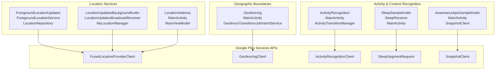
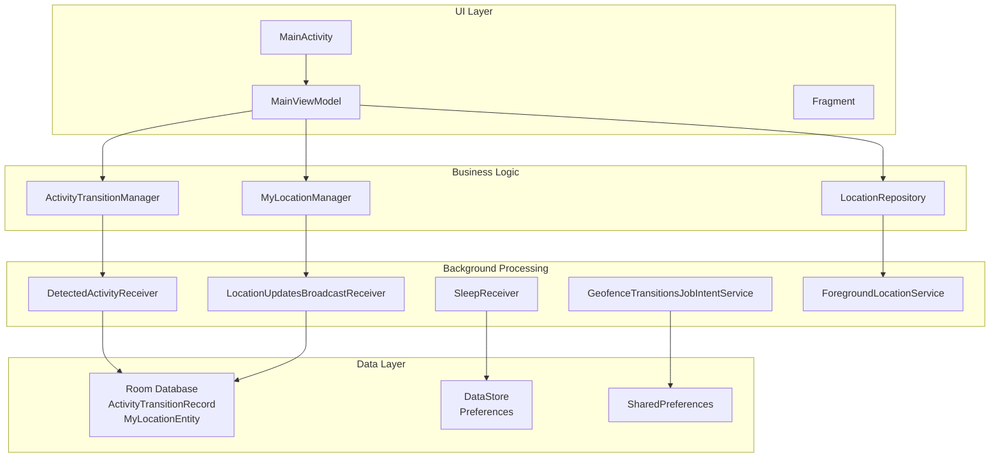

<!-- source: DeepWiki mcp.deepwiki.com · repo android/location-samples · page 2 Sample Applications · fetched 2026-10-23 -->

# Sample Applications

Relevant source files

The following files were used as context for generating this wiki page:

- [ActivityRecognition/README.md](ActivityRecognition/README.md)
- [Geofencing/README.md](Geofencing/README.md)
- [LocationUpdatesBackgroundKotlin/README.md](LocationUpdatesBackgroundKotlin/README.md)
- [README.md](README.md)

This document provides a comprehensive overview of the sample applications included in the Google Play Location & Context APIs repository. Each sample demonstrates specific aspects of location services, activity recognition, geofencing, and context awareness APIs available through Google Play Services.

**Note**: These samples have been deprecated and are no longer maintained. For current location samples, refer to the new platform-samples repository.

For detailed documentation of individual sample architectures and patterns, see [Architecture Patterns](#3). For development setup instructions, see [Development Setup](#4).

## Sample Application Overview

The repository contains seven distinct sample applications, each targeting different use cases and complexity levels for location and context APIs:

| Sample | Language | Primary API | Complexity | Key Features |
|--------|----------|-------------|------------|--------------|
| ActivityRecognition | Kotlin | ActivityRecognitionApi | Advanced | MVVM, Room DB, Background processing |
| SleepSampleKotlin | Kotlin | Sleep API | Advanced | Activity transitions, DataStore |
| ForegroundLocationUpdates | Kotlin | FusedLocationProviderClient | Intermediate | Bound service, Notifications |
| LocationUpdatesBackgroundKotlin | Kotlin | FusedLocationProviderClient | Intermediate | Background location, Permissions |
| LocationAddress | Kotlin | Geocoder API | Basic | Address geocoding, MVVM |
| Geofencing | Java | GeofencingClient | Intermediate | Geographic boundaries, JobIntentService |
| AwarenessApisSampleKotlin | Kotlin | Awareness APIs | Basic | Contextual snapshots |

Sources: [README.md:12-27](), [ActivityRecognition/README.md:7-27](), [LocationUpdatesBackgroundKotlin/README.md:7-35](), [Geofencing/README.md:7-29]()

## Sample Application Categories

Sources: [README.md:14-27](), [ActivityRecognition/README.md:10-27](), [LocationUpdatesBackgroundKotlin/README.md:13-16]()

## Core Components Architecture

Sources: [ActivityRecognition/README.md:22-27](), [LocationUpdatesBackgroundKotlin/README.md:16-17](), [Geofencing/README.md:10-29]()

## Individual Sample Applications

### Activity Recognition Sample
**Purpose**: Demonstrates `ActivityRecognitionApi` for detecting user activities (walking, driving, standing still) with confidence levels.

**Key Components**:
- `MainActivity` with MVVM pattern
- `DetectedActivityReceiver` for background processing
- `ActivityTransitionManager` for API integration
- Room database for persistence

**Location**: `/ActivityRecognition/`

Sources: [ActivityRecognition/README.md:10-27]()

### Sleep Sample Kotlin
**Purpose**: Uses Sleep API to recognize user sleep patterns and activity transitions.

**Key Components**:
- `SleepReceiver` for sleep event handling
- DataStore for preferences
- Sleep segment and event processing

**Location**: `/SleepSampleKotlin/`

Sources: [README.md:27]()

### Foreground Location Updates
**Purpose**: Implements foreground service pattern for continuous location tracking while app is visible to user.

**Key Components**:
- `ForegroundLocationService` bound service
- `LocationRepository` for data management
- Notification system for foreground service

**Location**: `/ForegroundLocationUpdates/`

Sources: [README.md:19]()

### Background Location Updates Kotlin
**Purpose**: Demonstrates proper background location tracking using `PendingIntent` and `BroadcastReceiver` pattern.

**Key Components**:
- `LocationUpdatesBroadcastReceiver` for location events
- `MyLocationManager` for API coordination
- Permission handling for background location access

**Location**: `/LocationUpdatesBackgroundKotlin/`

Sources: [LocationUpdatesBackgroundKotlin/README.md:13-27]()

### Location Address Sample
**Purpose**: Converts geographic coordinates to human-readable addresses using Android's `Geocoder` API.

**Key Components**:
- `MainActivity` with MVVM architecture
- `MainViewModel` for address resolution
- Geocoder API integration

**Location**: `/LocationAddress/`

Sources: [README.md:23]()

### Geofencing Sample
**Purpose**: Creates and monitors geographic boundaries, triggering notifications on entry/exit events.

**Key Components**:
- `GeofenceTransitionsJobIntentService` for background processing
- `GeofencingClient` API integration
- Notification system for geofence events

**Location**: `/Geofencing/`

Sources: [Geofencing/README.md:10-29]()

### Awareness APIs Sample Kotlin
**Purpose**: Utilizes Google Awareness APIs to gather contextual information about user environment and situation.

**Key Components**:
- `SnapshotClient` for contextual data
- Single-activity architecture
- Awareness API snapshot functionality

**Location**: `/AwarenessApisSampleKotlin/`

Sources: [README.md:17]()

## Prerequisites and Requirements

All samples require:
- Android API Level 9 or higher (specific samples may require higher levels)
- Android Build Tools version 21 or higher
- Google Support Repository
- Location services enabled on the device

**Important**: Background location samples require `ACCESS_BACKGROUND_LOCATION` permission on Android 10+ and have additional restrictions.

Sources: [README.md:30-36](), [ActivityRecognition/README.md:37-42](), [LocationUpdatesBackgroundKotlin/README.md:25-27]()

---

