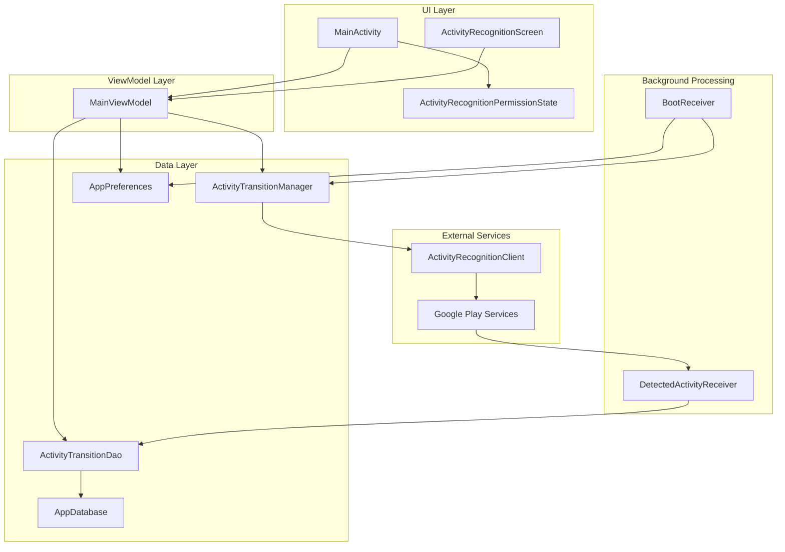
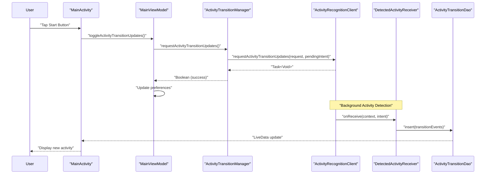
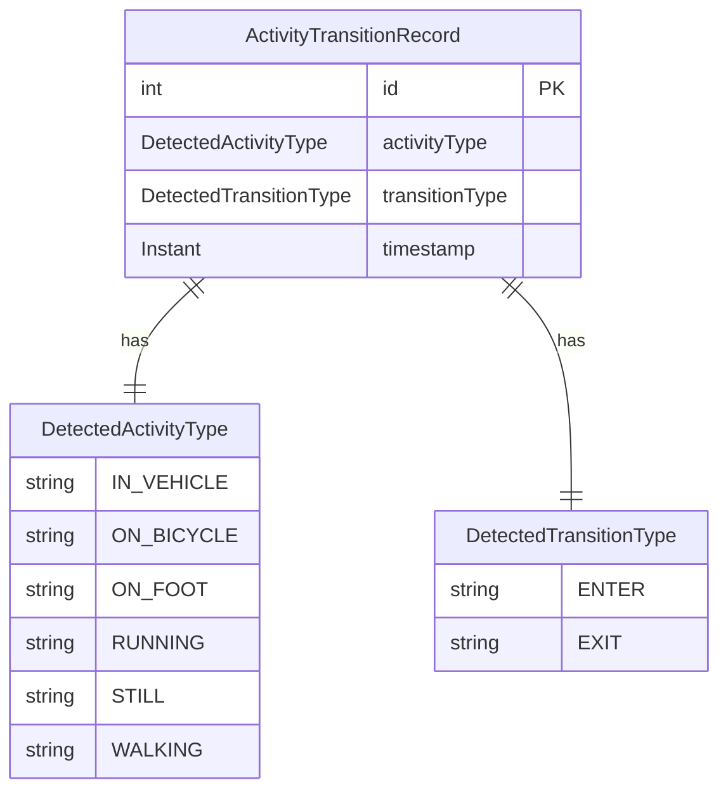
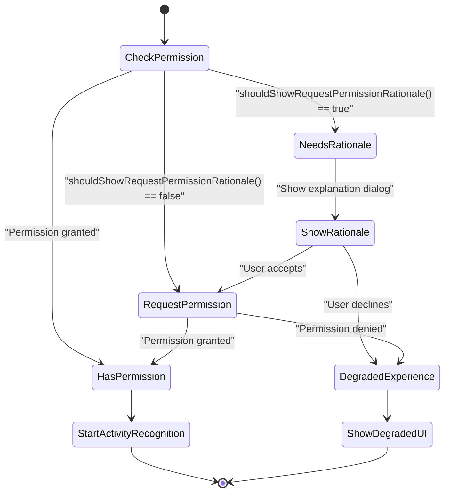
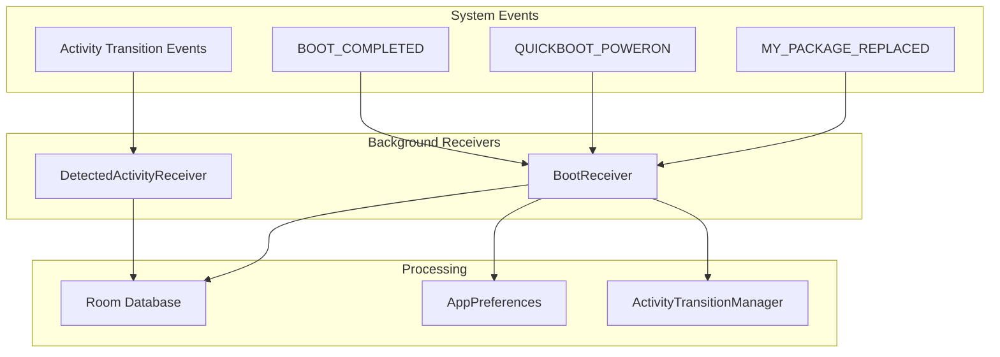

<!-- source: DeepWiki mcp.deepwiki.com · repo android/location-samples · page 2.1 Activity Recognition Sample · fetched 2026-10-23 -->

# Activity Recognition Sample

<details>
<summary>Relevant source files</summary>

The following files were used as context for generating this wiki page:

- [ActivityRecognition/app/build.gradle](ActivityRecognition/app/build.gradle)
- [ActivityRecognition/app/src/main/AndroidManifest.xml](ActivityRecognition/app/src/main/AndroidManifest.xml)
- [ActivityRecognition/app/src/main/java/com/google/android/gms/location/sample/activityrecognition/ActivityRecognitionApp.kt](ActivityRecognition/app/src/main/java/com/google/android/gms/location/sample/activityrecognition/ActivityRecognitionApp.kt)
- [ActivityRecognition/app/src/main/java/com/google/android/gms/location/sample/activityrecognition/BootReceiver.kt](ActivityRecognition/app/src/main/java/com/google/android/gms/location/sample/activityrecognition/BootReceiver.kt)
- [ActivityRecognition/app/src/main/java/com/google/android/gms/location/sample/activityrecognition/DetectedActivityReceiver.kt](ActivityRecognition/app/src/main/java/com/google/android/gms/location/sample/activityrecognition/DetectedActivityReceiver.kt)
- [ActivityRecognition/app/src/main/java/com/google/android/gms/location/sample/activityrecognition/MainActivity.kt](ActivityRecognition/app/src/main/java/com/google/android/gms/location/sample/activityrecognition/MainActivity.kt)
- [ActivityRecognition/app/src/main/java/com/google/android/gms/location/sample/activityrecognition/MainViewModel.kt](ActivityRecognition/app/src/main/java/com/google/android/gms/location/sample/activityrecognition/MainViewModel.kt)
- [ActivityRecognition/app/src/main/java/com/google/android/gms/location/sample/activityrecognition/PermissionUtils.kt](ActivityRecognition/app/src/main/java/com/google/android/gms/location/sample/activityrecognition/PermissionUtils.kt)
- [ActivityRecognition/app/src/main/java/com/google/android/gms/location/sample/activityrecognition/data/ActivityTransitionManager.kt](ActivityRecognition/app/src/main/java/com/google/android/gms/location/sample/activityrecognition/data/ActivityTransitionManager.kt)
- [ActivityRecognition/app/src/main/java/com/google/android/gms/location/sample/activityrecognition/data/db/ActivityTransitionDao.kt](ActivityRecognition/app/src/main/java/com/google/android/gms/location/sample/activityrecognition/data/db/ActivityTransitionDao.kt)
- [ActivityRecognition/app/src/main/java/com/google/android/gms/location/sample/activityrecognition/data/db/ActivityTransitionRecord.kt](ActivityRecognition/app/src/main/java/com/google/android/gms/location/sample/activityrecognition/data/db/ActivityTransitionRecord.kt)
- [ActivityRecognition/app/src/main/java/com/google/android/gms/location/sample/activityrecognition/data/db/AppDatabase.kt](ActivityRecognition/app/src/main/java/com/google/android/gms/location/sample/activityrecognition/data/db/AppDatabase.kt)
- [ActivityRecognition/app/src/main/java/com/google/android/gms/location/sample/activityrecognition/data/db/TimestampConverter.kt](ActivityRecognition/app/src/main/java/com/google/android/gms/location/sample/activityrecognition/data/db/TimestampConverter.kt)
- [ActivityRecognition/app/src/main/java/com/google/android/gms/location/sample/activityrecognition/ui/ActivityRecognitionPermissionState.kt](ActivityRecognition/app/src/main/java/com/google/android/gms/location/sample/activityrecognition/ui/ActivityRecognitionPermissionState.kt)
- [ActivityRecognition/app/src/main/java/com/google/android/gms/location/sample/activityrecognition/ui/ActivityRecognitionScreen.kt](ActivityRecognition/app/src/main/java/com/google/android/gms/location/sample/activityrecognition/ui/ActivityRecognitionScreen.kt)
- [ActivityRecognition/app/src/main/res/values/strings.xml](ActivityRecognition/app/src/main/res/values/strings.xml)
- [ActivityRecognition/build.gradle](ActivityRecognition/build.gradle)

</details>


## Purpose and Scope

This document covers the Activity Recognition sample application, which demonstrates how to implement Google Play Services Activity Recognition API to detect user activity transitions (such as walking, driving, cycling) using modern Android architecture patterns. The sample showcases MVVM architecture with Jetpack Compose UI, Hilt dependency injection, Room database persistence, and proper background processing patterns.

For information about other location-based samples, see [Location Services Samples](#2.3). For general architecture patterns used across samples, see [Architecture Patterns](#3).

## Architecture Overview

The Activity Recognition sample follows the MVVM (Model-View-ViewModel) architectural pattern with clean separation of concerns and dependency injection.

### MVVM Architecture Diagram



**Sources:** [ActivityRecognition/app/src/main/java/com/google/android/gms/location/sample/activityrecognition/MainActivity.kt:42-87](), [ActivityRecognition/app/src/main/java/com/google/android/gms/location/sample/activityrecognition/MainViewModel.kt:44-50](), [ActivityRecognition/app/src/main/java/com/google/android/gms/location/sample/activityrecognition/ActivityRecognitionApp.kt:35-76]()

### Key Components

| Component | Type | Responsibility |
|-----------|------|----------------|
| `MainActivity` | Activity | Entry point, handles Compose UI setup and permission state |
| `MainViewModel` | ViewModel | Manages UI state, coordinates business logic |
| `ActivityTransitionManager` | Repository | Handles Activity Recognition API calls |
| `DetectedActivityReceiver` | BroadcastReceiver | Processes activity transition events in background |
| `BootReceiver` | BroadcastReceiver | Restores activity recognition after device boot |
| `AppDatabase` | Room Database | Persists activity transition records |
| `AppPreferences` | DataStore | Stores user preferences and state |

**Sources:** [ActivityRecognition/app/src/main/java/com/google/android/gms/location/sample/activityrecognition/MainActivity.kt:44](), [ActivityRecognition/app/src/main/java/com/google/android/gms/location/sample/activityrecognition/MainViewModel.kt:44](), [ActivityRecognition/app/src/main/java/com/google/android/gms/location/sample/activityrecognition/data/ActivityTransitionManager.kt:34]()

## Activity Recognition Flow

The sample implements a complete activity recognition flow from user interaction to background processing and data persistence.

### Activity Recognition Data Flow



**Sources:** [ActivityRecognition/app/src/main/java/com/google/android/gms/location/sample/activityrecognition/MainViewModel.kt:76-82](), [ActivityRecognition/app/src/main/java/com/google/android/gms/location/sample/activityrecognition/data/ActivityTransitionManager.kt:54-80](), [ActivityRecognition/app/src/main/java/com/google/android/gms/location/sample/activityrecognition/DetectedActivityReceiver.kt:37-47]()

### Activity Transition Request Configuration

The sample requests activity transition updates for all supported activity types, focusing on `ACTIVITY_TRANSITION_ENTER` events to detect when users begin new activities.

```kotlin
// From ActivityTransitionManager.requestActivityTransitionUpdates()
val request = ActivityTransitionRequest(
    DetectedActivityType.values().map {
        ActivityTransition.Builder()
            .setActivityTransition(ActivityTransition.ACTIVITY_TRANSITION_ENTER)
            .setActivityType(it.type)
            .build()
    }
)
```

**Sources:** [ActivityRecognition/app/src/main/java/com/google/android/gms/location/sample/activityrecognition/data/ActivityTransitionManager.kt:64-71]()

## Data Persistence

The sample uses Room database to persist activity transition records and DataStore for user preferences.

### Database Schema



**Sources:** [ActivityRecognition/app/src/main/java/com/google/android/gms/location/sample/activityrecognition/data/db/ActivityTransitionRecord.kt:32-39](), [ActivityRecognition/app/src/main/java/com/google/android/gms/location/sample/activityrecognition/data/db/ActivityTransitionRecord.kt:45-58](), [ActivityRecognition/app/src/main/java/com/google/android/gms/location/sample/activityrecognition/data/db/ActivityTransitionRecord.kt:63-72]()

### Data Access Object

The `ActivityTransitionDao` provides methods for database operations with reactive data flow using Flow.

| Method | Purpose |
|--------|---------|
| `insert(records: List<ActivityTransitionRecord>)` | Insert new activity transition records |
| `deleteAll()` | Clear all records when stopping recognition |
| `getMostRecent(): Flow<List<ActivityTransitionRecord>>` | Get 20 most recent records with reactive updates |

**Sources:** [ActivityRecognition/app/src/main/java/com/google/android/gms/location/sample/activityrecognition/data/db/ActivityTransitionDao.kt:30-37]()

## Permission Management

The sample handles activity recognition permissions across different Android API levels with a proper permission flow.

### Permission Handling Flow



**Sources:** [ActivityRecognition/app/src/main/java/com/google/android/gms/location/sample/activityrecognition/ui/ActivityRecognitionPermissionState.kt:57-100](), [ActivityRecognition/app/src/main/java/com/google/android/gms/location/sample/activityrecognition/PermissionUtils.kt:32-39]()

### API Level Permission Handling

The sample correctly handles the permission change introduced in Android 10 (API 29):

| API Level | Permission Required |
|-----------|-------------------|
| ≤ 28 | `com.google.android.gms.permission.ACTIVITY_RECOGNITION` |
| ≥ 29 | `android.permission.ACTIVITY_RECOGNITION` |

**Sources:** [ActivityRecognition/app/src/main/java/com/google/android/gms/location/sample/activityrecognition/PermissionUtils.kt:35-39](), [ActivityRecognition/app/src/main/AndroidManifest.xml:23-29]()

## Background Processing

The sample implements robust background processing to handle activity recognition events and maintain functionality across app lifecycle changes.

### Background Processing Components



**Sources:** [ActivityRecognition/app/src/main/java/com/google/android/gms/location/sample/activityrecognition/DetectedActivityReceiver.kt:30-48](), [ActivityRecognition/app/src/main/java/com/google/android/gms/location/sample/activityrecognition/BootReceiver.kt:35-76](), [ActivityRecognition/app/src/main/AndroidManifest.xml:54-76]()

### Boot Recovery Process

The `BootReceiver` implements automatic restoration of activity recognition after device restarts:

1. **Check Preferences**: Verify if activity recognition was previously enabled
2. **Validate Conditions**: Ensure Play Services availability and permissions
3. **Restore Registration**: Re-register for activity transition updates
4. **Handle Failures**: Reset preferences if restoration fails

**Sources:** [ActivityRecognition/app/src/main/java/com/google/android/gms/location/sample/activityrecognition/BootReceiver.kt:46-66]()

## Dependency Injection

The sample uses Hilt for dependency injection with a singleton-scoped module providing key dependencies.

### Hilt Module Configuration

| Dependency | Scope | Purpose |
|------------|-------|---------|
| `GoogleApiAvailability` | Singleton | Check Google Play Services availability |
| `DataStore<Preferences>` | Singleton | Store user preferences |
| `ActivityRecognitionClient` | Singleton | Interface to Activity Recognition API |
| `AppDatabase` | Singleton | Room database instance |
| `ActivityTransitionDao` | Singleton | Database access object |

**Sources:** [ActivityRecognition/app/src/main/java/com/google/android/gms/location/sample/activityrecognition/ActivityRecognitionApp.kt:42-76]()

## Build Configuration

The sample requires specific dependencies and build configuration for modern Android development.

### Key Dependencies

| Dependency | Purpose |
|------------|---------|
| `play-services-location:18.0.0` | Google Play Services Location APIs |
| `hilt-android` | Dependency injection framework |
| `room-runtime` | Database persistence |
| `datastore-preferences` | Modern preferences storage |
| `compose-ui` | Jetpack Compose UI toolkit |
| `kotlinx-coroutines` | Asynchronous programming |

**Sources:** [ActivityRecognition/app/build.gradle:86-104]()

The sample targets API 31 with minimum API 21, uses Kotlin coroutines throughout, and enables Jetpack Compose for modern UI development.

**Sources:** [ActivityRecognition/app/build.gradle:24-61]()

---

