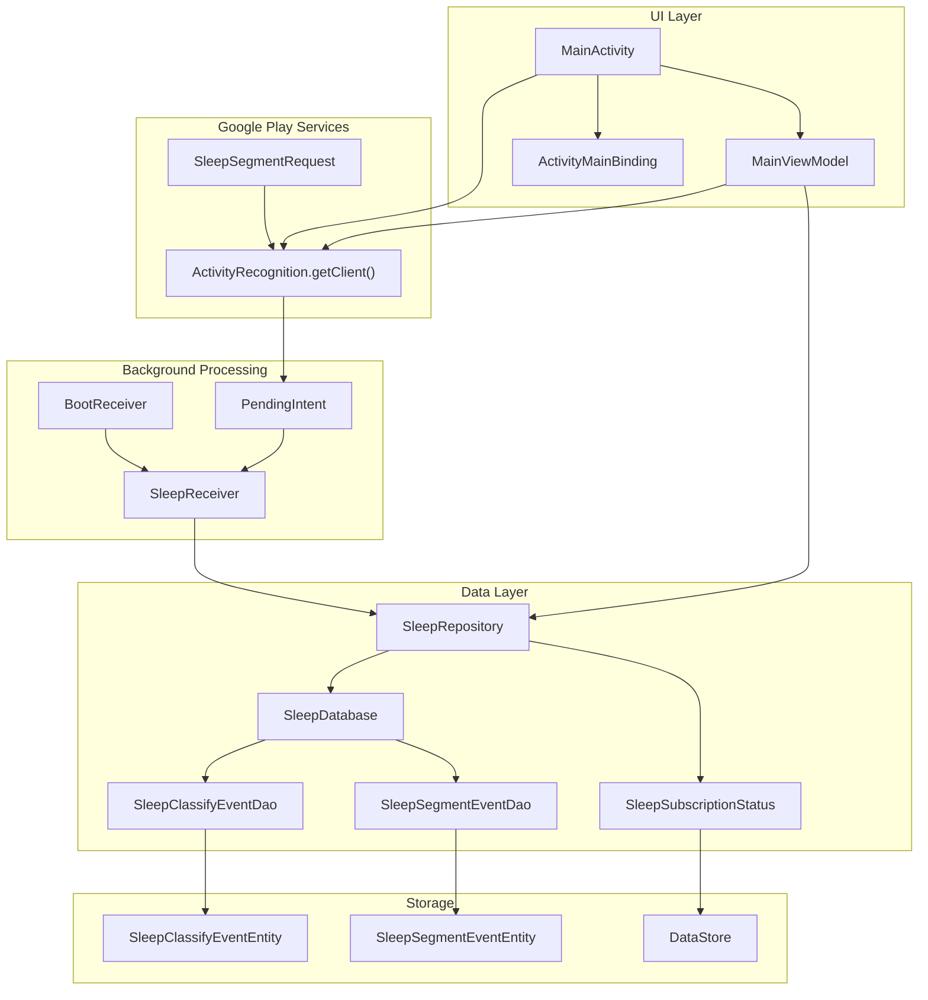
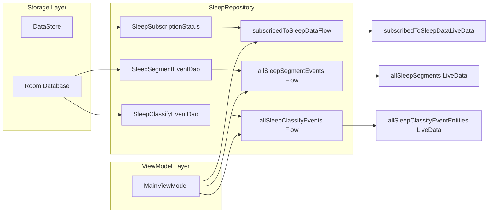
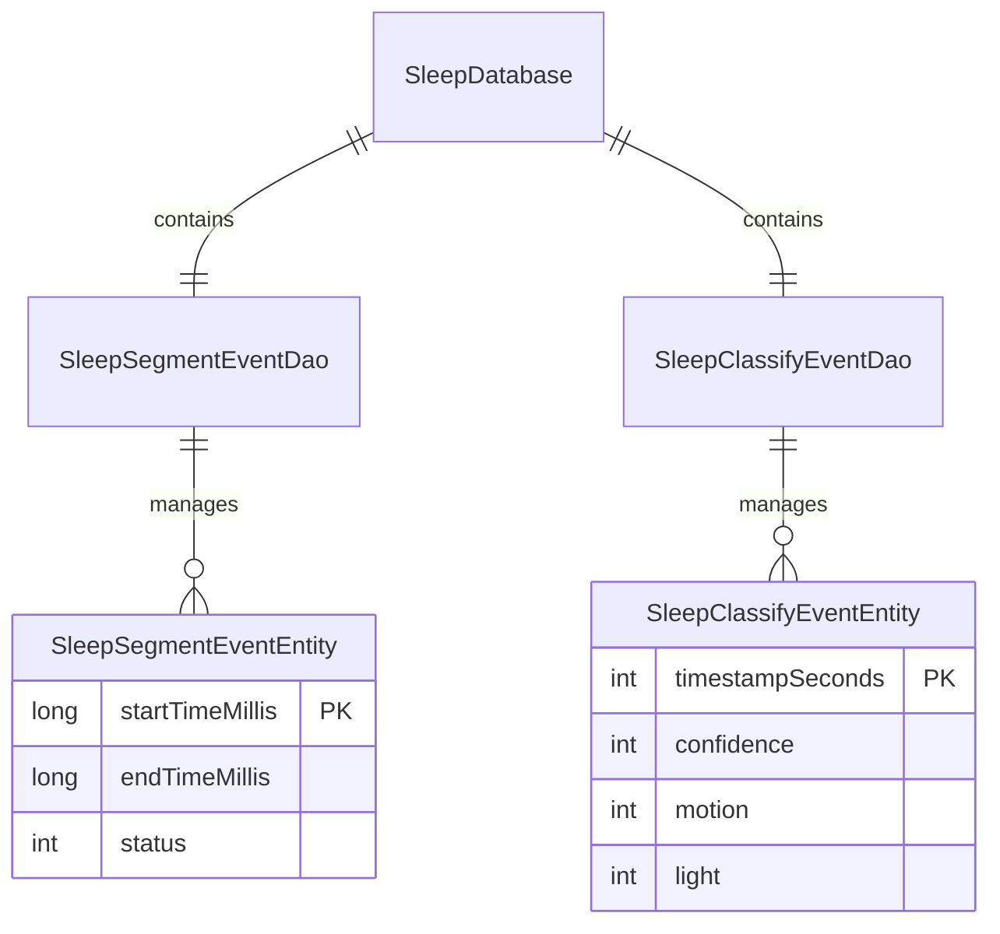
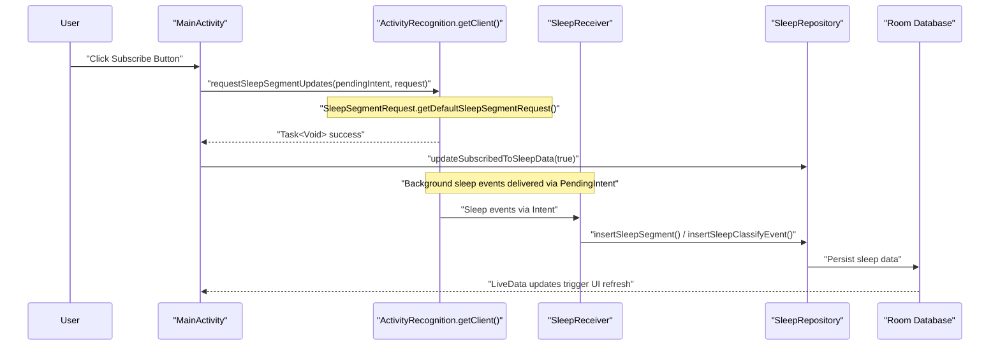

<!-- source: DeepWiki mcp.deepwiki.com · repo android/location-samples · page 2.2 Sleep Sample · fetched 2026-10-23 -->

# Sleep Sample

Relevant source files

The following files were used as context for generating this wiki page:

- [SleepSampleKotlin/.gitignore](SleepSampleKotlin/.gitignore)
- [SleepSampleKotlin/README.md](SleepSampleKotlin/README.md)
- [SleepSampleKotlin/app/.gitignore](SleepSampleKotlin/app/.gitignore)
- [SleepSampleKotlin/app/build.gradle](SleepSampleKotlin/app/build.gradle)
- [SleepSampleKotlin/app/proguard-rules.pro](SleepSampleKotlin/app/proguard-rules.pro)
- [SleepSampleKotlin/app/src/main/AndroidManifest.xml](SleepSampleKotlin/app/src/main/AndroidManifest.xml)
- [SleepSampleKotlin/app/src/main/java/com/android/example/sleepsamplekotlin/MainActivity.kt](SleepSampleKotlin/app/src/main/java/com/android/example/sleepsamplekotlin/MainActivity.kt)
- [SleepSampleKotlin/app/src/main/java/com/android/example/sleepsamplekotlin/MainApplication.kt](SleepSampleKotlin/app/src/main/java/com/android/example/sleepsamplekotlin/MainApplication.kt)
- [SleepSampleKotlin/app/src/main/java/com/android/example/sleepsamplekotlin/MainViewModel.kt](SleepSampleKotlin/app/src/main/java/com/android/example/sleepsamplekotlin/MainViewModel.kt)
- [SleepSampleKotlin/app/src/main/java/com/android/example/sleepsamplekotlin/data/SleepRepository.kt](SleepSampleKotlin/app/src/main/java/com/android/example/sleepsamplekotlin/data/SleepRepository.kt)
- [SleepSampleKotlin/app/src/main/java/com/android/example/sleepsamplekotlin/data/datastore/SleepSubscriptionStatus.kt](SleepSampleKotlin/app/src/main/java/com/android/example/sleepsamplekotlin/data/datastore/SleepSubscriptionStatus.kt)
- [SleepSampleKotlin/app/src/main/java/com/android/example/sleepsamplekotlin/data/db/SleepClassifyEventDao.kt](SleepSampleKotlin/app/src/main/java/com/android/example/sleepsamplekotlin/data/db/SleepClassifyEventDao.kt)
- [SleepSampleKotlin/app/src/main/java/com/android/example/sleepsamplekotlin/data/db/SleepClassifyEventEntity.kt](SleepSampleKotlin/app/src/main/java/com/android/example/sleepsamplekotlin/data/db/SleepClassifyEventEntity.kt)
- [SleepSampleKotlin/app/src/main/java/com/android/example/sleepsamplekotlin/data/db/SleepDatabase.kt](SleepSampleKotlin/app/src/main/java/com/android/example/sleepsamplekotlin/data/db/SleepDatabase.kt)
- [SleepSampleKotlin/app/src/main/java/com/android/example/sleepsamplekotlin/data/db/SleepSegmentEventDao.kt](SleepSampleKotlin/app/src/main/java/com/android/example/sleepsamplekotlin/data/db/SleepSegmentEventDao.kt)
- [SleepSampleKotlin/app/src/main/java/com/android/example/sleepsamplekotlin/data/db/SleepSegmentEventEntity.kt](SleepSampleKotlin/app/src/main/java/com/android/example/sleepsamplekotlin/data/db/SleepSegmentEventEntity.kt)
- [SleepSampleKotlin/app/src/main/res/drawable-v24/ic_launcher_foreground.xml](SleepSampleKotlin/app/src/main/res/drawable-v24/ic_launcher_foreground.xml)
- [SleepSampleKotlin/app/src/main/res/drawable/ic_launcher_background.xml](SleepSampleKotlin/app/src/main/res/drawable/ic_launcher_background.xml)
- [SleepSampleKotlin/app/src/main/res/layout/activity_main.xml](SleepSampleKotlin/app/src/main/res/layout/activity_main.xml)
- [SleepSampleKotlin/app/src/main/res/mipmap-anydpi-v26/ic_launcher.xml](SleepSampleKotlin/app/src/main/res/mipmap-anydpi-v26/ic_launcher.xml)
- [SleepSampleKotlin/app/src/main/res/values/strings.xml](SleepSampleKotlin/app/src/main/res/values/strings.xml)
- [SleepSampleKotlin/build.gradle](SleepSampleKotlin/build.gradle)

This document covers the Sleep Sample application, which demonstrates integration with Google Play Services Sleep API to detect and track user sleep patterns. The sample shows how to subscribe to sleep data updates, process sleep events in the background, and persist sleep information using Room database and DataStore preferences.

For information about other location-based samples, see [Location Services Samples](#2.3). For activity recognition patterns, see [Activity Recognition Sample](#2.1).

## System Overview

The Sleep Sample implements a complete sleep tracking solution using Google's Sleep API, which provides two types of sleep data:

- **Sleep Segment Events**: Represent discrete sleep periods with start/end times and status
- **Sleep Classify Events**: Provide regular classifications with confidence levels, motion data, and ambient light measurements

The application follows MVVM architecture with Repository pattern, using Room for local data persistence and DataStore for subscription status management.

**System Architecture Diagram**

Sources: [SleepSampleKotlin/app/src/main/java/com/android/example/sleepsamplekotlin/MainActivity.kt:43-233](), [SleepSampleKotlin/app/src/main/java/com/android/example/sleepsamplekotlin/MainViewModel.kt:28-45](), [SleepSampleKotlin/app/src/main/java/com/android/example/sleepsamplekotlin/data/SleepRepository.kt:25-72]()

## Architecture Components

### MainActivity and MVVM Pattern

The `MainActivity` serves as the primary UI controller, implementing a simple interface with a single button to toggle sleep data subscription. The activity follows MVVM pattern with `MainViewModel` managing business logic and data operations.

| Component | Responsibility | Key Methods |
|-----------|---------------|-------------|
| `MainActivity` | UI management, permission handling | `onClickRequestSleepData()`, `subscribeToSleepSegmentUpdates()` |
| `MainViewModel` | Data coordination, LiveData management | `updateSubscribedToSleepData()` |
| `SleepRepository` | Data access abstraction | `insertSleepSegment()`, `insertSleepClassifyEvent()` |

The activity observes LiveData from the ViewModel to reactively update the UI when sleep data changes:

[SleepSampleKotlin/app/src/main/java/com/android/example/sleepsamplekotlin/MainActivity.kt:77-112]()

Sources: [SleepSampleKotlin/app/src/main/java/com/android/example/sleepsamplekotlin/MainActivity.kt:43-233](), [SleepSampleKotlin/app/src/main/java/com/android/example/sleepsamplekotlin/MainViewModel.kt:28-45]()

### Repository Pattern Implementation

The `SleepRepository` implements the Repository pattern, abstracting data access across multiple storage mechanisms:

- **DataStore**: Manages subscription status via `SleepSubscriptionStatus`
- **Room Database**: Persists sleep events via DAOs
- **Flow/LiveData**: Provides reactive data streams

**Repository Data Flow**

Sources: [SleepSampleKotlin/app/src/main/java/com/android/example/sleepsamplekotlin/data/SleepRepository.kt:25-72](), [SleepSampleKotlin/app/src/main/java/com/android/example/sleepsamplekotlin/MainViewModel.kt:28-45]()

## Data Models and Database Schema

### Sleep Event Entities

The application defines two primary entities corresponding to Google's Sleep API event types:

**Database Schema**

### Entity Definitions

**SleepSegmentEventEntity**: Represents sleep periods with start/end timestamps and status indicators.

[SleepSampleKotlin/app/src/main/java/com/android/example/sleepsamplekotlin/data/db/SleepSegmentEventEntity.kt:27-47]()

**SleepClassifyEventEntity**: Stores classification data including confidence scores, motion levels, and ambient light measurements.

[SleepSampleKotlin/app/src/main/java/com/android/example/sleepsamplekotlin/data/db/SleepClassifyEventEntity.kt:30-54]()

Both entities include companion `from()` methods to convert from Google Play Services Sleep API objects to Room entities.

Sources: [SleepSampleKotlin/app/src/main/java/com/android/example/sleepsamplekotlin/data/db/SleepSegmentEventEntity.kt:1-48](), [SleepSampleKotlin/app/src/main/java/com/android/example/sleepsamplekotlin/data/db/SleepClassifyEventEntity.kt:1-55](), [SleepSampleKotlin/app/src/main/java/com/android/example/sleepsamplekotlin/data/db/SleepDatabase.kt:28-32]()

## Permission Requirements and API Constraints

### Required Permissions

The Sleep API requires specific permissions configured in the Android manifest:

| Permission | API Level | Purpose |
|------------|-----------|---------|
| `android.permission.ACTIVITY_RECOGNITION` | 29+ | Required for sleep detection |
| `android.permission.RECEIVE_BOOT_COMPLETED` | All | Restore subscriptions after reboot |

**Manifest Configuration**

[SleepSampleKotlin/app/src/main/AndroidManifest.xml:19-27]()

### API Level Requirements

The sample targets API 29+ (Android Q) exclusively, as recommended by Google for Sleep API usage. This constraint simplifies permission handling by avoiding the dual permission model needed for devices running API 28 and below.

[SleepSampleKotlin/app/build.gradle:28-29]()

### Runtime Permission Handling

The `MainActivity` implements runtime permission checking with fallback to device settings:

[SleepSampleKotlin/app/src/main/java/com/android/example/sleepsamplekotlin/MainActivity.kt:162-203]()

Sources: [SleepSampleKotlin/app/src/main/AndroidManifest.xml:17-67](), [SleepSampleKotlin/app/build.gradle:22-52](), [SleepSampleKotlin/app/src/main/java/com/android/example/sleepsamplekotlin/MainActivity.kt:162-203]()

## Background Processing Architecture

### Sleep Data Subscription Flow

The application uses PendingIntent-based subscription to receive sleep events in the background, ensuring data collection continues when the app is not in the foreground.

**Sleep Event Processing Flow**

### BroadcastReceiver Configuration

The manifest declares two receivers for background processing:

**SleepReceiver**: Handles incoming sleep events from Google Play Services
[SleepSampleKotlin/app/src/main/AndroidManifest.xml:46-49]()

**BootReceiver**: Restores sleep subscriptions after device restart, supporting multiple boot scenarios including HTC-specific quick boot events
[SleepSampleKotlin/app/src/main/AndroidManifest.xml:51-65]()

### PendingIntent Creation

The application creates a PendingIntent targeting `SleepReceiver` for background event delivery:

[SleepSampleKotlin/app/src/main/java/com/android/example/sleepsamplekotlin/MainActivity.kt:114-116]()

Sources: [SleepSampleKotlin/app/src/main/AndroidManifest.xml:46-65](), [SleepSampleKotlin/app/src/main/java/com/android/example/sleepsamplekotlin/MainActivity.kt:114-116](), [SleepSampleKotlin/app/src/main/java/com/android/example/sleepsamplekotlin/MainActivity.kt:132-147]()

## User Interface and Data Display

### Simple UI Design

The application implements a minimal interface with a single scrollable text area and toggle button:

[SleepSampleKotlin/app/src/main/res/layout/activity_main.xml:26-57]()

### Data Presentation Logic

The `MainActivity` aggregates data from multiple LiveData sources and formats output strings dynamically:

- **Sleep Segment Output**: Displays sleep period data from `SleepSegmentEventEntity` table
- **Sleep Classify Output**: Shows classification events from `SleepClassifyEventEntity` table  
- **Subscription Status**: Updates button text and header information based on current subscription state

The `updateOutput()` method combines these data sources into a single display string:

[SleepSampleKotlin/app/src/main/java/com/android/example/sleepsamplekotlin/MainActivity.kt:210-228]()

### String Resources and Localization

The application defines formatted string resources for consistent output presentation:

[SleepSampleKotlin/app/src/main/res/values/strings.xml:30-32]()

Sources: [SleepSampleKotlin/app/src/main/res/layout/activity_main.xml:17-60](), [SleepSampleKotlin/app/src/main/java/com/android/example/sleepsamplekotlin/MainActivity.kt:210-228](), [SleepSampleKotlin/app/src/main/res/values/strings.xml:17-33]()

---

