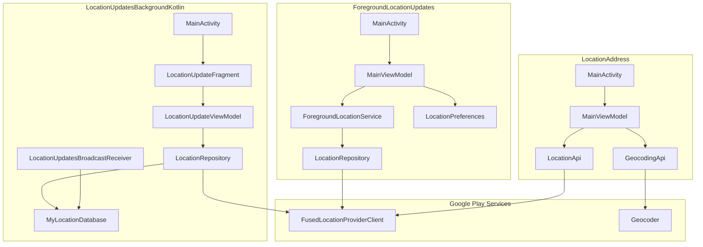
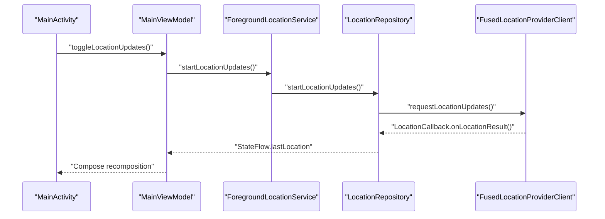
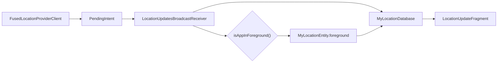

<!-- source: DeepWiki mcp.deepwiki.com · repo android/location-samples · page 2.3 Location Services Samples · fetched 2026-10-23 -->

# Location Services Samples

Relevant source files

The following files were used as context for generating this wiki page:

- [ForegroundLocationUpdates/app/build.gradle](ForegroundLocationUpdates/app/build.gradle)
- [ForegroundLocationUpdates/app/src/main/AndroidManifest.xml](ForegroundLocationUpdates/app/src/main/AndroidManifest.xml)
- [ForegroundLocationUpdates/app/src/main/java/com/google/android/gms/location/sample/foregroundlocation/ForegroundLocationApp.kt](ForegroundLocationUpdates/app/src/main/java/com/google/android/gms/location/sample/foregroundlocation/ForegroundLocationApp.kt)
- [ForegroundLocationUpdates/app/src/main/java/com/google/android/gms/location/sample/foregroundlocation/MainActivity.kt](ForegroundLocationUpdates/app/src/main/java/com/google/android/gms/location/sample/foregroundlocation/MainActivity.kt)
- [ForegroundLocationUpdates/app/src/main/java/com/google/android/gms/location/sample/foregroundlocation/MainViewModel.kt](ForegroundLocationUpdates/app/src/main/java/com/google/android/gms/location/sample/foregroundlocation/MainViewModel.kt)
- [ForegroundLocationUpdates/app/src/main/java/com/google/android/gms/location/sample/foregroundlocation/data/LocationPreferences.kt](ForegroundLocationUpdates/app/src/main/java/com/google/android/gms/location/sample/foregroundlocation/data/LocationPreferences.kt)
- [ForegroundLocationUpdates/app/src/main/java/com/google/android/gms/location/sample/foregroundlocation/data/LocationRepository.kt](ForegroundLocationUpdates/app/src/main/java/com/google/android/gms/location/sample/foregroundlocation/data/LocationRepository.kt)
- [ForegroundLocationUpdates/app/src/main/java/com/google/android/gms/location/sample/foregroundlocation/ui/LocationPermissionState.kt](ForegroundLocationUpdates/app/src/main/java/com/google/android/gms/location/sample/foregroundlocation/ui/LocationPermissionState.kt)
- [ForegroundLocationUpdates/app/src/main/java/com/google/android/gms/location/sample/foregroundlocation/ui/LocationUpdatesScreen.kt](ForegroundLocationUpdates/app/src/main/java/com/google/android/gms/location/sample/foregroundlocation/ui/LocationUpdatesScreen.kt)
- [ForegroundLocationUpdates/app/src/main/res/drawable/ic_location.xml](ForegroundLocationUpdates/app/src/main/res/drawable/ic_location.xml)
- [ForegroundLocationUpdates/app/src/main/res/values/strings.xml](ForegroundLocationUpdates/app/src/main/res/values/strings.xml)
- [LocationAddress/app/build.gradle](LocationAddress/app/build.gradle)
- [LocationAddress/app/src/main/AndroidManifest.xml](LocationAddress/app/src/main/AndroidManifest.xml)
- [LocationAddress/app/src/main/java/com/google/android/gms/location/sample/locationaddress/LocationAddressApp.kt](LocationAddress/app/src/main/java/com/google/android/gms/location/sample/locationaddress/LocationAddressApp.kt)
- [LocationAddress/app/src/main/java/com/google/android/gms/location/sample/locationaddress/MainActivity.kt](LocationAddress/app/src/main/java/com/google/android/gms/location/sample/locationaddress/MainActivity.kt)
- [LocationAddress/app/src/main/java/com/google/android/gms/location/sample/locationaddress/MainViewModel.kt](LocationAddress/app/src/main/java/com/google/android/gms/location/sample/locationaddress/MainViewModel.kt)
- [LocationAddress/app/src/main/java/com/google/android/gms/location/sample/locationaddress/data/GeocodingApi.kt](LocationAddress/app/src/main/java/com/google/android/gms/location/sample/locationaddress/data/GeocodingApi.kt)
- [LocationAddress/app/src/main/java/com/google/android/gms/location/sample/locationaddress/data/LocationApi.kt](LocationAddress/app/src/main/java/com/google/android/gms/location/sample/locationaddress/data/LocationApi.kt)
- [LocationAddress/app/src/main/java/com/google/android/gms/location/sample/locationaddress/data/PlayServicesAvailabilityChecker.kt](LocationAddress/app/src/main/java/com/google/android/gms/location/sample/locationaddress/data/PlayServicesAvailabilityChecker.kt)
- [LocationAddress/app/src/main/java/com/google/android/gms/location/sample/locationaddress/ui/DiscreteSlider.kt](LocationAddress/app/src/main/java/com/google/android/gms/location/sample/locationaddress/ui/DiscreteSlider.kt)
- [LocationAddress/app/src/main/java/com/google/android/gms/location/sample/locationaddress/ui/theme/Type.kt](LocationAddress/app/src/main/java/com/google/android/gms/location/sample/locationaddress/ui/theme/Type.kt)
- [LocationAddress/app/src/main/res/values/strings.xml](LocationAddress/app/src/main/res/values/strings.xml)
- [LocationAddress/build.gradle](LocationAddress/build.gradle)
- [LocationUpdatesBackgroundKotlin/app/src/main/java/com/google/android/gms/location/sample/locationupdatesbackgroundkotlin/LocationUpdatesBroadcastReceiver.kt](LocationUpdatesBackgroundKotlin/app/src/main/java/com/google/android/gms/location/sample/locationupdatesbackgroundkotlin/LocationUpdatesBroadcastReceiver.kt)
- [LocationUpdatesBackgroundKotlin/app/src/main/java/com/google/android/gms/location/sample/locationupdatesbackgroundkotlin/data/LocationRepository.kt](LocationUpdatesBackgroundKotlin/app/src/main/java/com/google/android/gms/location/sample/locationupdatesbackgroundkotlin/data/LocationRepository.kt)
- [LocationUpdatesBackgroundKotlin/app/src/main/java/com/google/android/gms/location/sample/locationupdatesbackgroundkotlin/ui/LocationUpdateFragment.kt](LocationUpdatesBackgroundKotlin/app/src/main/java/com/google/android/gms/location/sample/locationupdatesbackgroundkotlin/ui/LocationUpdateFragment.kt)
- [LocationUpdatesBackgroundKotlin/app/src/main/java/com/google/android/gms/location/sample/locationupdatesbackgroundkotlin/ui/MainActivity.kt](LocationUpdatesBackgroundKotlin/app/src/main/java/com/google/android/gms/location/sample/locationupdatesbackgroundkotlin/ui/MainActivity.kt)
- [LocationUpdatesBackgroundKotlin/app/src/main/java/com/google/android/gms/location/sample/locationupdatesbackgroundkotlin/ui/PermissionRequestFragment.kt](LocationUpdatesBackgroundKotlin/app/src/main/java/com/google/android/gms/location/sample/locationupdatesbackgroundkotlin/ui/PermissionRequestFragment.kt)
- [LocationUpdatesBackgroundKotlin/app/src/main/java/com/google/android/gms/location/sample/locationupdatesbackgroundkotlin/viewmodels/LocationUpdateViewModel.kt](LocationUpdatesBackgroundKotlin/app/src/main/java/com/google/android/gms/location/sample/locationupdatesbackgroundkotlin/viewmodels/LocationUpdateViewModel.kt)
- [LocationUpdatesBackgroundKotlin/app/src/main/res/layout/fragment_location_update.xml](LocationUpdatesBackgroundKotlin/app/src/main/res/layout/fragment_location_update.xml)
- [LocationUpdatesBackgroundKotlin/app/src/main/res/values/strings.xml](LocationUpdatesBackgroundKotlin/app/src/main/res/values/strings.xml)

This document provides an overview of the location-based sample applications in the repository, covering their different approaches to location tracking and when to use each architectural pattern. For information about specific implementation details of individual location samples, see [Foreground Location Updates](#2.3.1), [Background Location Updates](#2.3.2), and [Location Address (Geocoding)](#2.3.3).

The location services samples demonstrate three distinct approaches to working with Android's location APIs, each optimized for different use cases and Android system constraints.

## Sample Applications Overview

The repository contains three location services samples that showcase different architectural patterns and use cases:

| Sample | Primary Use Case | Architecture Pattern | Key Features |
|--------|------------------|---------------------|--------------|
| ForegroundLocationUpdates | Continuous location tracking while app is active | Bound Service + MVVM | Service lifecycle management, persistent notifications |
| LocationUpdatesBackgroundKotlin | Background location tracking | BroadcastReceiver + Fragment | Background processing, Room persistence |
| LocationAddress | Address lookup from coordinates | MVVM + Repository | Geocoding API integration, one-time requests |

**Sources:** [ForegroundLocationUpdates/app/src/main/java/com/google/android/gms/location/sample/foregroundlocation/MainActivity.kt:42-85](), [LocationUpdatesBackgroundKotlin/app/src/main/java/com/google/android/gms/location/sample/locationupdatesbackgroundkotlin/ui/MainActivity.kt:24-105](), [LocationAddress/app/src/main/java/com/google/android/gms/location/sample/locationaddress/MainActivity.kt:40-95]()

## Architectural Comparison

**Sources:** [ForegroundLocationUpdates/app/src/main/java/com/google/android/gms/location/sample/foregroundlocation/MainViewModel.kt:35-83](), [LocationUpdatesBackgroundKotlin/app/src/main/java/com/google/android/gms/location/sample/locationupdatesbackgroundkotlin/viewmodels/LocationUpdateViewModel.kt:28-42](), [LocationAddress/app/src/main/java/com/google/android/gms/location/sample/locationaddress/MainViewModel.kt:38-82]()

## Location Update Patterns

### Service-Based Pattern (Foreground Updates)

The `ForegroundLocationService` pattern is designed for continuous location tracking while the app is actively being used. The service runs in the foreground with a persistent notification to comply with Android's background execution limits.

**Key Components:**
- `ForegroundLocationService`: Bound service that manages location requests [ForegroundLocationUpdates/app/src/main/AndroidManifest.xml:51]()
- `LocationRepository`: Manages `FusedLocationProviderClient` and exposes `StateFlow` for location updates [ForegroundLocationUpdates/app/src/main/java/com/google/android/gms/location/sample/foregroundlocation/data/LocationRepository.kt:32-73]()
- `LocationPreferences`: Persists user's location tracking preferences using DataStore [ForegroundLocationUpdates/app/src/main/java/com/google/android/gms/location/sample/foregroundlocation/data/LocationPreferences.kt:31-47]()

**Sources:** [ForegroundLocationUpdates/app/src/main/java/com/google/android/gms/location/sample/foregroundlocation/data/LocationRepository.kt:44-66](), [ForegroundLocationUpdates/app/src/main/java/com/google/android/gms/location/sample/foregroundlocation/MainViewModel.kt:56-82]()

### BroadcastReceiver Pattern (Background Updates)

The `LocationUpdatesBroadcastReceiver` pattern handles location updates delivered via `PendingIntent` when the app is not in the foreground. This approach complies with Android 8.0+ background service limitations.

**Key Components:**
- `LocationUpdatesBroadcastReceiver`: Receives location updates via `PendingIntent` and persists to database [LocationUpdatesBackgroundKotlin/app/src/main/java/com/google/android/gms/location/sample/locationupdatesbackgroundkotlin/LocationUpdatesBroadcastReceiver.kt:45-100]()
- `MyLocationEntity`: Room entity representing location data with foreground/background flag [LocationUpdatesBackgroundKotlin/app/src/main/java/com/google/android/gms/location/sample/locationupdatesbackgroundkotlin/LocationUpdatesBroadcastReceiver.kt:60-67]()
- `LocationRepository`: Singleton managing both database operations and location API calls [LocationUpdatesBackgroundKotlin/app/src/main/java/com/google/android/gms/location/sample/locationupdatesbackgroundkotlin/data/LocationRepository.kt:32-111]()

**Sources:** [LocationUpdatesBackgroundKotlin/app/src/main/java/com/google/android/gms/location/sample/locationupdatesbackgroundkotlin/LocationUpdatesBroadcastReceiver.kt:47-74](), [LocationUpdatesBackgroundKotlin/app/src/main/java/com/google/android/gms/location/sample/locationupdatesbackgroundkotlin/data/LocationRepository.kt:84-96]()

### One-Shot Request Pattern (Address Lookup)

The geocoding sample demonstrates a different pattern focused on single location requests and address conversion rather than continuous updates.

**Key Components:**
- `LocationApi`: Wrapper around `FusedLocationProviderClient.getCurrentLocation()` [LocationAddress/app/src/main/java/com/google/android/gms/location/sample/locationaddress/data/LocationApi.kt:31-42]()
- `GeocodingApi`: Handles address lookup using Android's `Geocoder` class [LocationAddress/app/src/main/java/com/google/android/gms/location/sample/locationaddress/data/GeocodingApi.kt:35-55]()
- `FormattedAddress`: Data class for displaying geocoded results [LocationAddress/app/src/main/java/com/google/android/gms/location/sample/locationaddress/data/GeocodingApi.kt:27]()

**Sources:** [LocationAddress/app/src/main/java/com/google/android/gms/location/sample/locationaddress/MainViewModel.kt:69-81](), [LocationAddress/app/src/main/java/com/google/android/gms/location/sample/locationaddress/data/GeocodingApi.kt:30-56]()

## Permission Management Patterns

All location samples implement progressive permission requests, but with different complexity levels based on their background location requirements.

| Permission Type | ForegroundLocationUpdates | LocationUpdatesBackgroundKotlin | LocationAddress |
|----------------|---------------------------|--------------------------------|-----------------|
| `ACCESS_COARSE_LOCATION` | ✓ Required | ✓ Required | ✓ Required |
| `ACCESS_FINE_LOCATION` | ✓ Required | ✓ Required | ✓ Required |
| `ACCESS_BACKGROUND_LOCATION` | ✗ Not used | ✓ Optional enhancement | ✗ Not used |

The background location sample includes the most sophisticated permission handling with dedicated UI flows for rationale explanations and progressive permission requests through `PermissionRequestFragment`.

**Sources:** [ForegroundLocationUpdates/app/src/main/AndroidManifest.xml:27-28](), [LocationUpdatesBackgroundKotlin/app/src/main/java/com/google/android/gms/location/sample/locationupdatesbackgroundkotlin/ui/PermissionRequestFragment.kt:214-240](), [LocationAddress/app/src/main/AndroidManifest.xml:27-28]()

## Usage Recommendations

**Use ForegroundLocationUpdates when:**
- App needs continuous location updates while user is actively using it
- Location tracking should stop when user navigates away from app
- You want to show persistent notification during location tracking
- Implementing fitness tracking, navigation, or real-time location sharing

**Use LocationUpdatesBackgroundKotlin when:**
- App has legitimate need for background location (delivery, ride-sharing, etc.)
- Location data needs to be collected even when app is not visible
- You need to track whether location was captured in foreground vs background
- Implementing asset tracking or geofencing applications

**Use LocationAddress when:**
- App needs to convert coordinates to human-readable addresses
- One-time location requests rather than continuous updates
- Implementing place search, address validation, or location-based forms
- Building address autocomplete or location picker features

**Sources:** [ForegroundLocationUpdates/app/src/main/res/values/strings.xml:19-34](), [LocationUpdatesBackgroundKotlin/app/src/main/res/values/strings.xml:18-62](), [LocationAddress/app/src/main/res/values/strings.xml:19-29]()

---

