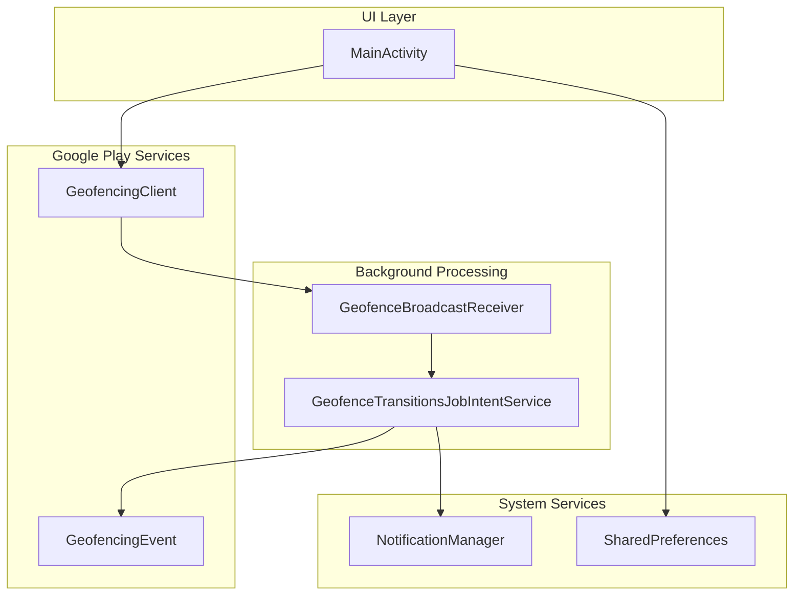
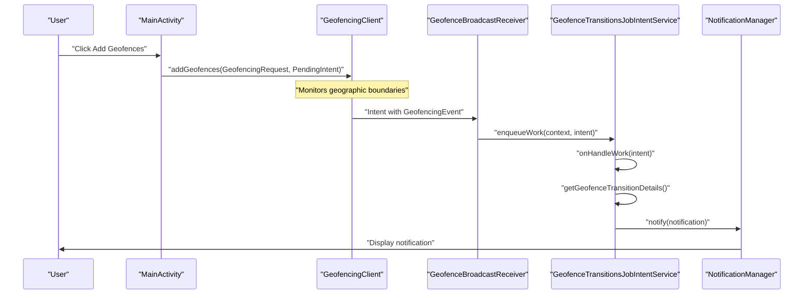

<!-- source: DeepWiki mcp.deepwiki.com · repo android/location-samples · page 2.4 Geofencing Sample · fetched 2026-10-23 -->

# Geofencing Sample

<details>
<summary>Relevant source files</summary>

The following files were used as context for generating this wiki page:

- [Geofencing/app/build.gradle](Geofencing/app/build.gradle)
- [Geofencing/app/src/main/AndroidManifest.xml](Geofencing/app/src/main/AndroidManifest.xml)
- [Geofencing/app/src/main/java/com/google/android/gms/location/sample/geofencing/GeofenceBroadcastReceiver.java](Geofencing/app/src/main/java/com/google/android/gms/location/sample/geofencing/GeofenceBroadcastReceiver.java)
- [Geofencing/app/src/main/java/com/google/android/gms/location/sample/geofencing/GeofenceTransitionsJobIntentService.java](Geofencing/app/src/main/java/com/google/android/gms/location/sample/geofencing/GeofenceTransitionsJobIntentService.java)
- [Geofencing/app/src/main/java/com/google/android/gms/location/sample/geofencing/MainActivity.java](Geofencing/app/src/main/java/com/google/android/gms/location/sample/geofencing/MainActivity.java)
- [Geofencing/app/src/main/res/layout/main_activity.xml](Geofencing/app/src/main/res/layout/main_activity.xml)
- [Geofencing/build.gradle](Geofencing/build.gradle)
- [Geofencing/gradle.properties](Geofencing/gradle.properties)
- [Geofencing/gradle/wrapper/gradle-wrapper.jar](Geofencing/gradle/wrapper/gradle-wrapper.jar)
- [Geofencing/gradle/wrapper/gradle-wrapper.properties](Geofencing/gradle/wrapper/gradle-wrapper.properties)
- [Geofencing/gradlew](Geofencing/gradlew)
- [Geofencing/gradlew.bat](Geofencing/gradlew.bat)

</details>


This document covers the Geofencing sample application, which demonstrates how to implement geographic boundary monitoring using the Google Play Services Location API. The sample shows how to create geofences, monitor entry/exit transitions, and handle background processing of geofence events through notifications.

For information about other location tracking patterns, see [Location Services Samples](#2.3). For background processing patterns used across samples, see [Background Processing Patterns](#3.2).

## Architecture Overview

The Geofencing sample implements a simple architecture that separates UI management, event reception, and background event processing into distinct components. The system uses the standard Android pattern of BroadcastReceiver + JobIntentService for reliable background processing.

**System Architecture**



Sources: [Geofencing/app/src/main/java/com/google/android/gms/location/sample/geofencing/MainActivity.java:57-112](), [Geofencing/app/src/main/java/com/google/android/gms/location/sample/geofencing/GeofenceBroadcastReceiver.java:29-43](), [Geofencing/app/src/main/java/com/google/android/gms/location/sample/geofencing/GeofenceTransitionsJobIntentService.java:46-59]()

## Core Components

### MainActivity

The `MainActivity` class serves as the primary interface for geofence management, implementing the `OnCompleteListener<Void>` interface to handle asynchronous geofence operations.

**Key Responsibilities:**
- Geofence registration and removal via `GeofencingClient`
- Permission management for location access
- UI state management through button enable/disable logic
- Persistent storage of geofence status in `SharedPreferences`

**Core Methods:**
- `addGeofences()` - Registers geofences with the location service
- `removeGeofences()` - Unregisters active geofences  
- `getGeofencingRequest()` - Builds the geofencing configuration
- `getGeofencePendingIntent()` - Creates PendingIntent for event delivery

Sources: [Geofencing/app/src/main/java/com/google/android/gms/location/sample/geofencing/MainActivity.java:57-112](), [Geofencing/app/src/main/java/com/google/android/gms/location/sample/geofencing/MainActivity.java:148-170](), [Geofencing/app/src/main/java/com/google/android/gms/location/sample/geofencing/MainActivity.java:228-238]()

### GeofenceBroadcastReceiver

A lightweight `BroadcastReceiver` that serves as the entry point for geofence transition events from the system. Its single responsibility is forwarding events to the background processing service.

```java
public void onReceive(Context context, Intent intent) {
    GeofenceTransitionsJobIntentService.enqueueWork(context, intent);
}
```

Sources: [Geofencing/app/src/main/java/com/google/android/gms/location/sample/geofencing/GeofenceBroadcastReceiver.java:38-42]()

### GeofenceTransitionsJobIntentService  

Extends `JobIntentService` to handle geofence events in the background, ensuring reliable processing even when the app is not active. The service processes `GeofencingEvent` objects and creates user notifications.

**Event Processing Flow:**
1. Extract `GeofencingEvent` from intent
2. Validate transition type (ENTER/EXIT)
3. Format transition details string
4. Create and display notification
5. Log event details

Sources: [Geofencing/app/src/main/java/com/google/android/gms/location/sample/geofencing/GeofenceTransitionsJobIntentService.java:67-97](), [Geofencing/app/src/main/java/com/google/android/gms/location/sample/geofencing/GeofenceTransitionsJobIntentService.java:126-182]()

## Geofence Event Processing

The sample implements a multi-stage event processing pipeline that handles geofence transitions from initial trigger through user notification.

**Event Processing Flow**



Sources: [Geofencing/app/src/main/java/com/google/android/gms/location/sample/geofencing/MainActivity.java:168-169](), [Geofencing/app/src/main/java/com/google/android/gms/location/sample/geofencing/GeofenceBroadcastReceiver.java:41](), [Geofencing/app/src/main/java/com/google/android/gms/location/sample/geofencing/GeofenceTransitionsJobIntentService.java:67-92]()

### Geofence Configuration

The sample creates circular geofences using the `Geofence.Builder` pattern with hardcoded Bay Area landmarks. Each geofence is configured with:

- **Request ID:** String identifier from `Constants.BAY_AREA_LANDMARKS`
- **Circular Region:** Latitude, longitude, and radius from `Constants.GEOFENCE_RADIUS_IN_METERS`
- **Expiration:** Duration from `Constants.GEOFENCE_EXPIRATION_IN_MILLISECONDS`
- **Transition Types:** `GEOFENCE_TRANSITION_ENTER | GEOFENCE_TRANSITION_EXIT`

The `GeofencingRequest` is built with `INITIAL_TRIGGER_ENTER` to immediately trigger if the device is already inside a geofence boundary.

Sources: [Geofencing/app/src/main/java/com/google/android/gms/location/sample/geofencing/MainActivity.java:244-270](), [Geofencing/app/src/main/java/com/google/android/gms/location/sample/geofencing/MainActivity.java:129-141]()

## Permission Management

The sample implements runtime permission handling for location access, following Android 6.0+ permission model requirements.

**Permission Requirements:**
- `ACCESS_FINE_LOCATION` - Required for geofence functionality
- `ACCESS_COARSE_LOCATION` - Baseline location permission
- `POST_NOTIFICATIONS` - For displaying geofence transition notifications  
- `WAKE_LOCK` - Allows background processing in JobIntentService

**Permission Flow:**
1. Check permissions with `ActivityCompat.checkSelfPermission()`
2. Request permissions if not granted
3. Handle permission rationale with Snackbar UI
4. Execute pending geofence operations after permission grant
5. Direct user to settings if permission permanently denied

Sources: [Geofencing/app/src/main/AndroidManifest.xml:19-22](), [Geofencing/app/src/main/java/com/google/android/gms/location/sample/geofencing/MainActivity.java:350-383](), [Geofencing/app/src/main/java/com/google/android/gms/location/sample/geofencing/MainActivity.java:389-431]()

## Component Registration

The Android manifest declares the necessary components for background geofence processing:

**Manifest Configuration:**

| Component | Type | Purpose |
|-----------|------|---------|
| `MainActivity` | Activity | Main UI and geofence management |
| `GeofenceBroadcastReceiver` | BroadcastReceiver | Receives geofence events from system |
| `GeofenceTransitionsJobIntentService` | JobIntentService | Background event processing |

The `GeofenceTransitionsJobIntentService` requires the `BIND_JOB_SERVICE` permission and both the receiver and service are marked as `exported="true"` to receive system intents.

Sources: [Geofencing/app/src/main/AndroidManifest.xml:33-51]()

## Build Configuration

The sample uses Google Play Services dependencies for location functionality:

```gradle
implementation 'com.google.android.gms:play-services-location:17.0.0'
implementation 'com.google.android.gms:play-services-maps:17.0.0'
```

**Target Configuration:**
- `minSdkVersion 16` - Android 4.1+ support
- `targetSdkVersion 33` - Android 13 target
- `compileSdkVersion 33` - Uses Android 13 APIs

Sources: [Geofencing/app/build.gradle:4-11](), [Geofencing/app/build.gradle:29-30]()

---

