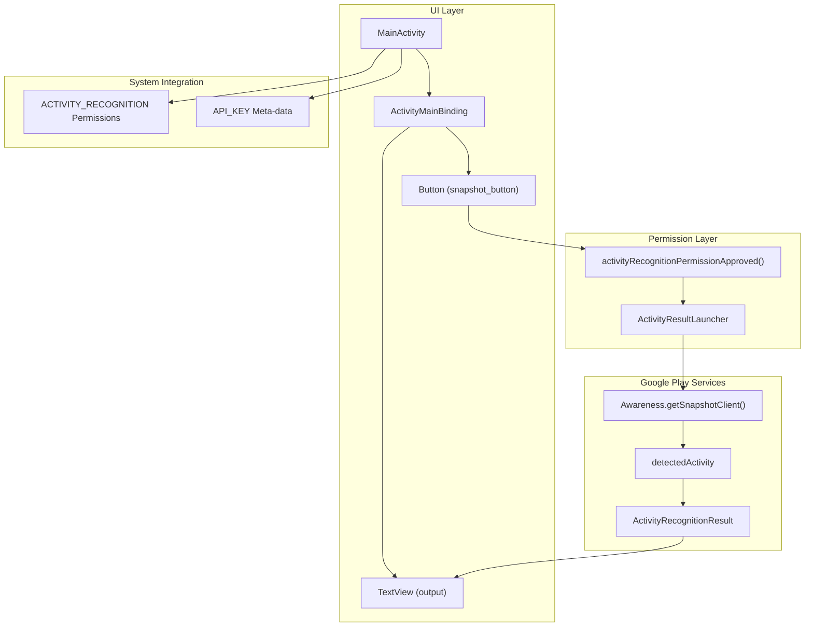
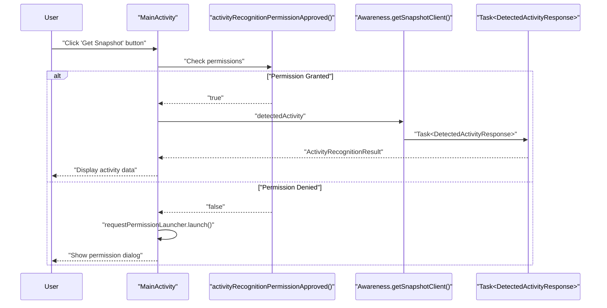
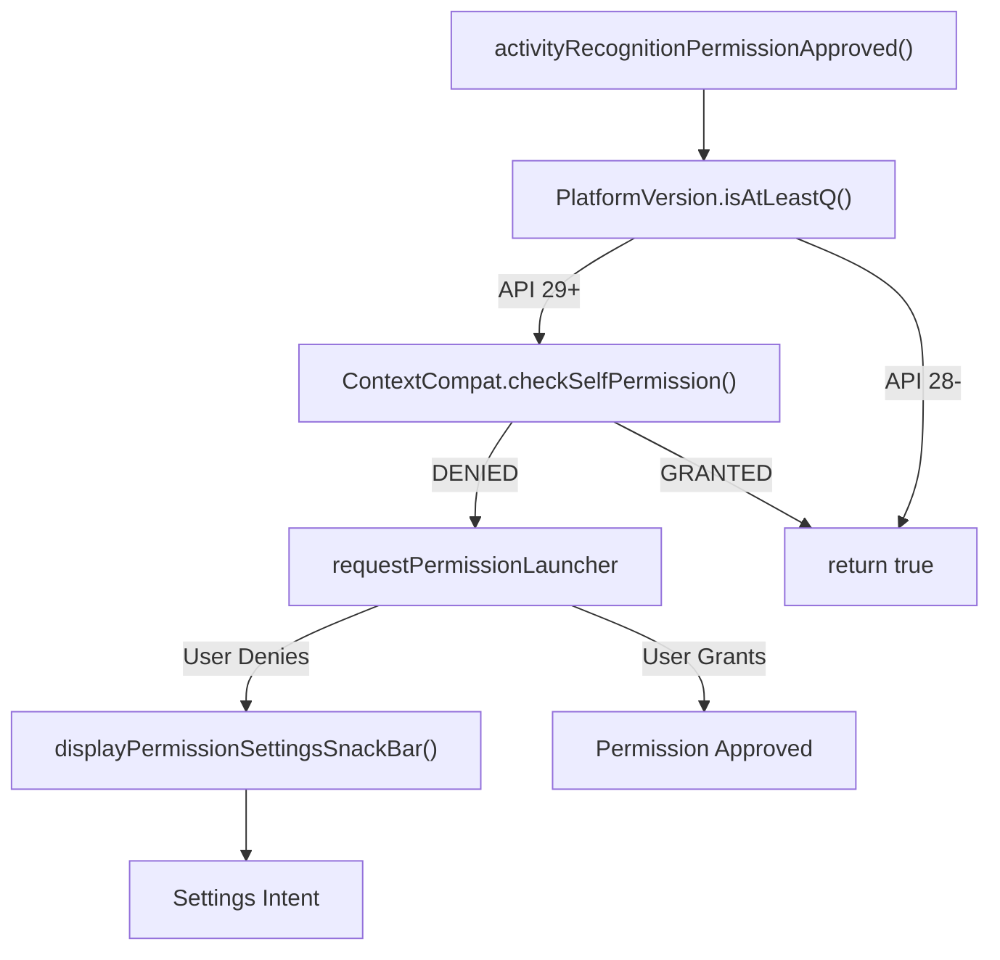
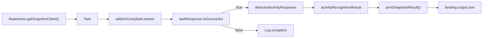

<!-- source: DeepWiki mcp.deepwiki.com · repo android/location-samples · page 2.5 Awareness APIs Sample · fetched 2026-10-23 -->

# Awareness APIs Sample

<details>
<summary>Relevant source files</summary>

The following files were used as context for generating this wiki page:

- [AwarenessApisSampleKotlin/.gitignore](AwarenessApisSampleKotlin/.gitignore)
- [AwarenessApisSampleKotlin/README.md](AwarenessApisSampleKotlin/README.md)
- [AwarenessApisSampleKotlin/app/.gitignore](AwarenessApisSampleKotlin/app/.gitignore)
- [AwarenessApisSampleKotlin/app/build.gradle](AwarenessApisSampleKotlin/app/build.gradle)
- [AwarenessApisSampleKotlin/app/proguard-rules.pro](AwarenessApisSampleKotlin/app/proguard-rules.pro)
- [AwarenessApisSampleKotlin/app/src/main/AndroidManifest.xml](AwarenessApisSampleKotlin/app/src/main/AndroidManifest.xml)
- [AwarenessApisSampleKotlin/app/src/main/java/com/android/example/awarenessapissamplekotlin/MainActivity.kt](AwarenessApisSampleKotlin/app/src/main/java/com/android/example/awarenessapissamplekotlin/MainActivity.kt)
- [AwarenessApisSampleKotlin/app/src/main/res/drawable-v24/ic_launcher_foreground.xml](AwarenessApisSampleKotlin/app/src/main/res/drawable-v24/ic_launcher_foreground.xml)
- [AwarenessApisSampleKotlin/app/src/main/res/drawable/ic_launcher_background.xml](AwarenessApisSampleKotlin/app/src/main/res/drawable/ic_launcher_background.xml)
- [AwarenessApisSampleKotlin/app/src/main/res/layout/activity_main.xml](AwarenessApisSampleKotlin/app/src/main/res/layout/activity_main.xml)
- [AwarenessApisSampleKotlin/app/src/main/res/mipmap-anydpi-v26/ic_launcher.xml](AwarenessApisSampleKotlin/app/src/main/res/mipmap-anydpi-v26/ic_launcher.xml)
- [AwarenessApisSampleKotlin/app/src/main/res/values/strings.xml](AwarenessApisSampleKotlin/app/src/main/res/values/strings.xml)
- [AwarenessApisSampleKotlin/app/src/main/res/values/themes.xml](AwarenessApisSampleKotlin/app/src/main/res/values/themes.xml)

</details>


This document covers the Awareness APIs Sample application, which demonstrates the integration of Google's Awareness APIs to retrieve contextual information about the user's current environment. The sample specifically showcases the Snapshot API functionality for obtaining real-time activity recognition data.

For location-based tracking patterns, see [Location Services Samples](#2.3). For activity monitoring with data persistence, see [Activity Recognition Sample](#2.1).

## Overview

The Awareness APIs Sample provides a minimal implementation of Google's Awareness API, focusing on the Snapshot functionality to retrieve the user's current detected activity. This sample serves as an entry point for developers wanting to integrate contextual awareness features without the complexity of background processing or data persistence.

**Application Architecture**



**Sources**: [AwarenessApisSampleKotlin/app/src/main/java/com/android/example/awarenessapissamplekotlin/MainActivity.kt:1-141](), [AwarenessApisSampleKotlin/app/src/main/res/layout/activity_main.xml:1-53]()

## Core Components

### MainActivity

The `MainActivity` class implements a straightforward pattern for requesting and displaying awareness snapshots:

| Component | Function | Implementation |
|-----------|----------|----------------|
| `onClickSnapshot()` | Initiates snapshot request | Permission check → API call |
| `requestSnapshot()` | Executes Awareness API call | `Awareness.getSnapshotClient().detectedActivity` |
| `activityRecognitionPermissionApproved()` | Handles API level differences | Checks Android Q+ permissions |
| `printSnapshotResult()` | Displays activity results | Formats `ActivityRecognitionResult` |

**API Integration Flow**



**Sources**: [AwarenessApisSampleKotlin/app/src/main/java/com/android/example/awarenessapissamplekotlin/MainActivity.kt:57-84](), [AwarenessApisSampleKotlin/app/src/main/java/com/android/example/awarenessapissamplekotlin/MainActivity.kt:86-96]()

## Permission Management

The sample implements dual permission handling to support different Android API levels:

### Permission Declarations

The manifest declares both legacy and modern activity recognition permissions:

```xml
<!-- Required for API 28 and below -->
<uses-permission android:name="com.google.android.gms.permission.ACTIVITY_RECOGNITION" />
<!-- Required for API 29+ -->
<uses-permission android:name="android.permission.ACTIVITY_RECOGNITION" />
```

### Runtime Permission Flow



**Sources**: [AwarenessApisSampleKotlin/app/src/main/AndroidManifest.xml:23-26](), [AwarenessApisSampleKotlin/app/src/main/java/com/android/example/awarenessapissamplekotlin/MainActivity.kt:86-96](), [AwarenessApisSampleKotlin/app/src/main/java/com/android/example/awarenessapissamplekotlin/MainActivity.kt:98-107]()

## API Configuration Requirements

### API Key Setup

The Awareness APIs require an API key configured in the manifest:

| Configuration | Value | Purpose |
|---------------|-------|---------|
| `meta-data` name | `com.google.android.awareness.API_KEY` | Identifies the API key |
| `meta-data` value | `YOUR_API_KEY_WITHOUT_VAR_ELEMENTS_TAGS` | Developer's API key |

### Dependencies

| Dependency | Version | Purpose |
|------------|---------|---------|
| `play-services-awareness` | 18.0.1 | Core Awareness API functionality |
| `activity-ktx` | 1.2.0-rc01 | Modern permission handling |
| `appcompat` | 1.3.0-beta01 | ActivityResultLauncher support |

**Sources**: [AwarenessApisSampleKotlin/app/src/main/AndroidManifest.xml:40-42](), [AwarenessApisSampleKotlin/app/build.gradle:67-67]()

## Data Processing

### Snapshot Response Handling

The sample processes `DetectedActivityResponse` objects through a simple display pattern:



The `printSnapshotResult()` function formats the raw `ActivityRecognitionResult` with a timestamp for display in the UI `TextView`.

**Sources**: [AwarenessApisSampleKotlin/app/src/main/java/com/android/example/awarenessapissamplekotlin/MainActivity.kt:72-83](), [AwarenessApisSampleKotlin/app/src/main/java/com/android/example/awarenessapissamplekotlin/MainActivity.kt:131-135]()

## Build Configuration

### Module Structure

| Configuration | Value | Purpose |
|---------------|-------|---------|
| `applicationId` | `com.android.example.awarenessapissamplekotlin` | Unique app identifier |
| `minSdkVersion` | 26 | Minimum Android API level |
| `targetSdkVersion` | 30 | Target Android API level |
| `viewBinding` | true | Enables view binding |

### Kotlin Configuration

The sample uses Kotlin with Java 8 compatibility and view binding enabled for type-safe view access.

**Sources**: [AwarenessApisSampleKotlin/app/build.gradle:21-51]()

## Usage Patterns

This sample demonstrates the simplest possible integration of Awareness APIs, suitable for:

- One-time contextual queries
- Testing API connectivity and permissions
- Learning basic Awareness API patterns
- Prototyping awareness-enabled features

For more complex scenarios involving continuous monitoring, background processing, or data persistence, refer to the [Activity Recognition Sample](#2.1) or [Sleep Sample](#2.2).

**Sources**: [AwarenessApisSampleKotlin/README.md:1-51]()

---

