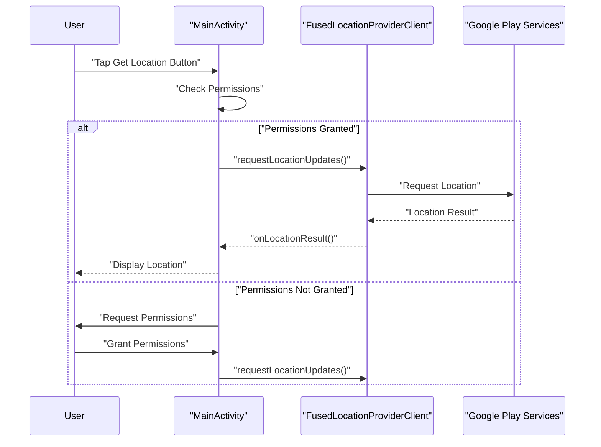
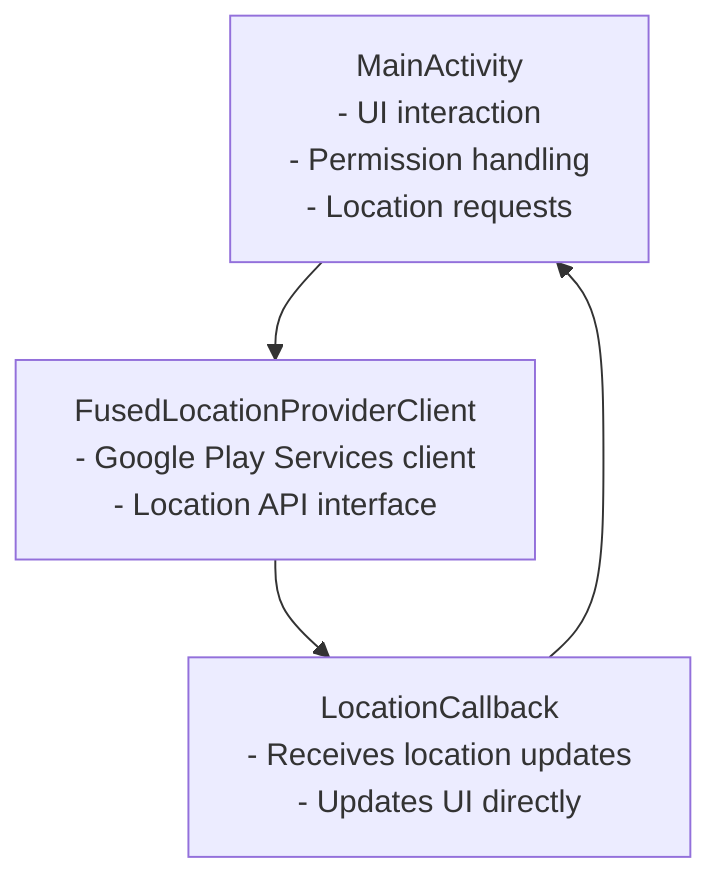

<!-- source: DeepWiki mcp.deepwiki.com · repo android/location-samples · page 2.6 Basic Location Sample · fetched 2026-10-23 -->

# Basic Location Sample

<details>
<summary>Relevant source files</summary>

The following files were used as context for generating this wiki page:

- [CONTRIBUTING.md](CONTRIBUTING.md)

</details>


## Purpose and Scope

The Basic Location Sample serves as the simplest entry point for developers new to the Google Play Location APIs. This sample demonstrates fundamental location retrieval functionality without the complexity of advanced architectural patterns, background processing, or data persistence. It provides a minimal working example that focuses purely on obtaining location data through a straightforward API call.

For more complex location tracking scenarios, see [Foreground Location Updates](#2.3.1) and [Background Location Updates](#2.3.2). For geocoding functionality, see [Location Address (Geocoding)](#2.3.3).

## Sample Overview

The Basic Location Sample implements the most straightforward approach to location services, designed to help developers understand the core concepts before progressing to more sophisticated implementations. Unlike the advanced samples in the repository that demonstrate MVVM architecture, dependency injection, and database persistence, this sample focuses on the essential steps required to obtain location data.

### Key Characteristics

| Feature | Implementation |
|---------|----------------|
| Architecture | Simple Activity-based |
| UI Pattern | Direct Activity interaction |
| Permissions | Runtime location permissions |
| Background Processing | None |
| Data Persistence | None |
| Dependency Injection | Not used |

## Location API Integration

The sample demonstrates the fundamental Google Play Location Services integration pattern, showing how to:

1. Request location permissions
2. Create a location request
3. Obtain location updates
4. Handle location results

### Basic Location Flow



Sources: Repository structure diagrams, Sample complexity matrix

## Repository Context

Within the broader repository ecosystem, the Basic Location Sample occupies a unique position as the foundation upon which other samples build. It demonstrates the core APIs without the architectural complexity that characterizes the advanced samples.

### Sample Progression Path

```mermaid
graph LR
    BasicLocation[Basic Location Sample<br/>"Simple API usage"] --> LocationAddress[Location Address Sample<br/>"+ MVVM + Geocoding"]
    BasicLocation --> ForegroundLocation[Foreground Location Sample<br/>"+ Service Architecture"]
    BasicLocation --> BackgroundLocation[Background Location Sample<br/>"+ Background Processing"]
    
    LocationAddress --> ActivityRecognition[Activity Recognition Sample<br/>"+ Database + Complex State"]
    ForegroundLocation --> ActivityRecognition
    BackgroundLocation --> ActivityRecognition
```

Sources: Repository structure overview, Sample complexity matrix

## Implementation Approach

The Basic Location Sample follows a direct implementation approach without abstraction layers or complex architectural patterns. This makes it ideal for understanding the underlying location APIs before adopting production-ready patterns.

### Core Components



Sources: Architectural patterns analysis, Repository structure overview

## Permission Management

The sample demonstrates the essential location permission workflow required for all location-based Android applications:

### Permission Flow

| Permission | Purpose | API Level |
|------------|---------|-----------|
| `ACCESS_FINE_LOCATION` | Precise location access | All |
| `ACCESS_COARSE_LOCATION` | Approximate location access | All |

The sample implements runtime permission requests as required by Android 6.0+ (API level 23), showing the basic pattern that all location samples in the repository follow.

Sources: Permission requirements diagram, Architectural patterns analysis

## When to Use This Pattern

The Basic Location Sample pattern is appropriate for:

- **Learning and prototyping**: Understanding location API fundamentals
- **Simple location queries**: One-time location requests without persistence
- **Proof of concept applications**: Minimal viable location functionality
- **Educational purposes**: Teaching location API basics

For production applications requiring robust location tracking, consider the advanced patterns demonstrated in other repository samples.

## Comparison with Advanced Samples

Unlike the sophisticated samples in the repository, the Basic Location Sample intentionally omits:

- **MVVM Architecture**: No separation of concerns through ViewModels
- **Database Persistence**: No Room database or data storage
- **Background Processing**: No BroadcastReceiver or Service components
- **Dependency Injection**: No Hilt or other DI frameworks
- **Complex State Management**: No StateFlow or LiveData patterns

This simplified approach makes the core location APIs clearly visible without architectural abstractions.

Sources: CONTRIBUTING.md:1-33, Architectural patterns analysis, Sample complexity matrix

---

