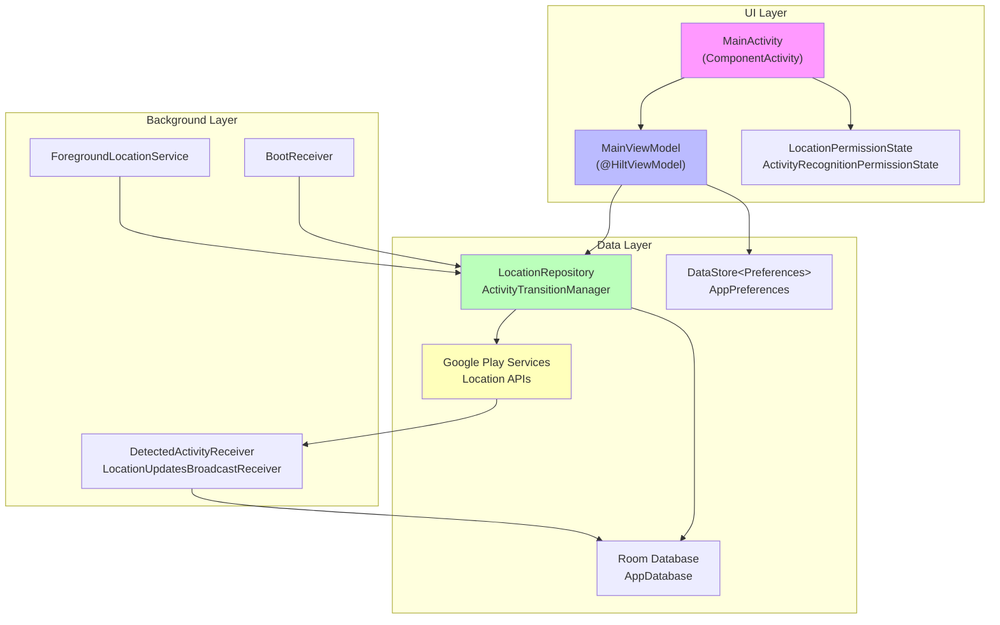
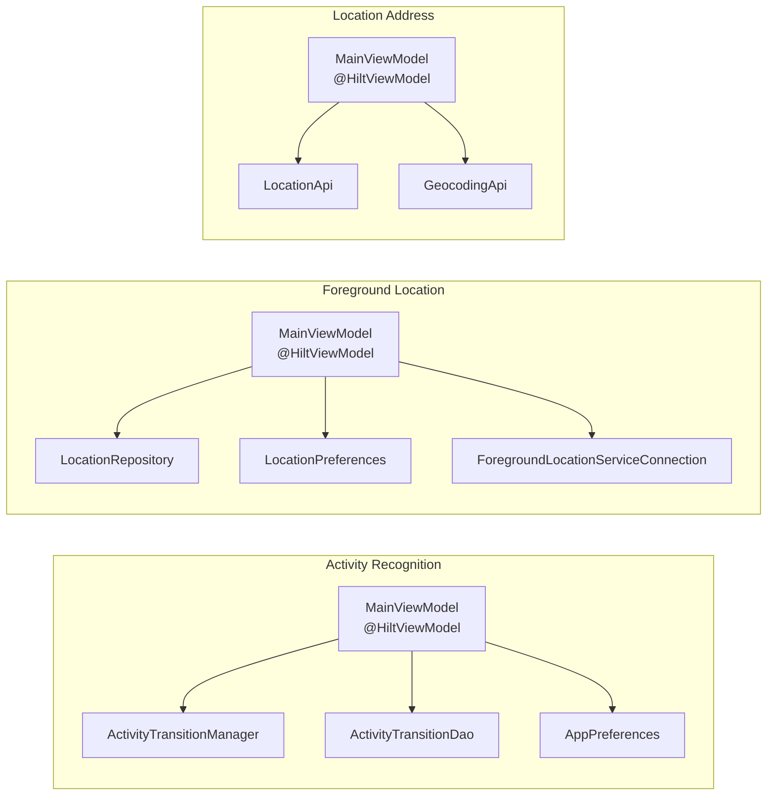
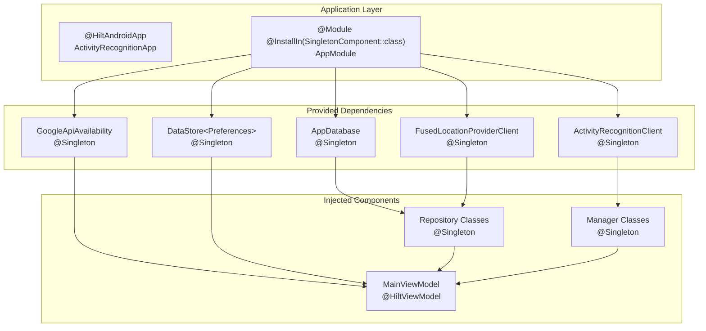
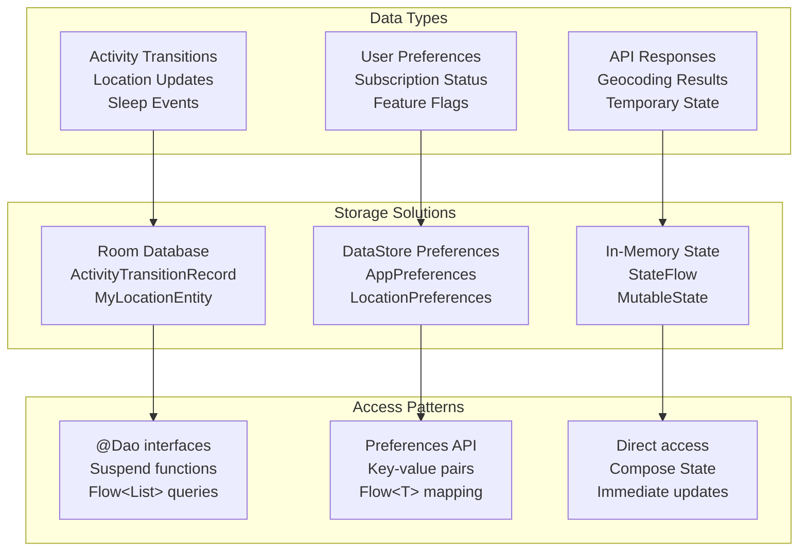
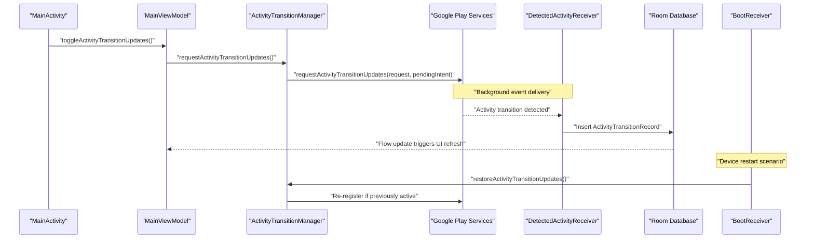
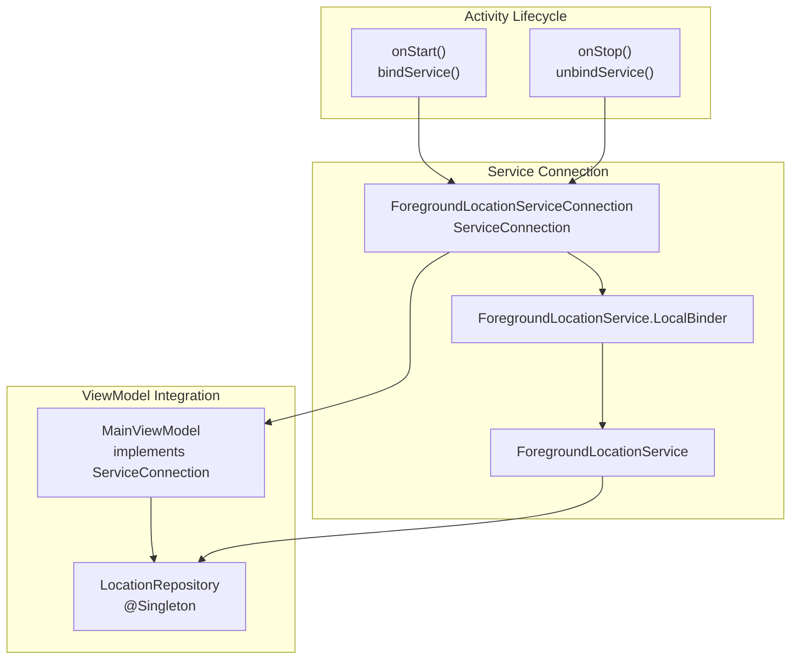
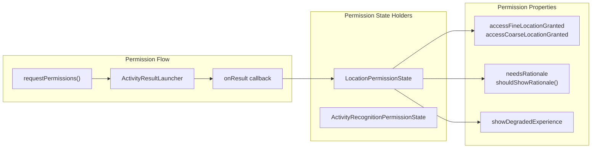

<!-- source: DeepWiki mcp.deepwiki.com · repo android/location-samples · page 3 Architecture Patterns · fetched 2026-10-23 -->

# Architecture Patterns

Relevant source files

The following files were used as context for generating this wiki page:

- [ActivityRecognition/app/build.gradle](ActivityRecognition/app/build.gradle)
- [ActivityRecognition/app/src/main/AndroidManifest.xml](ActivityRecognition/app/src/main/AndroidManifest.xml)
- [ActivityRecognition/app/src/main/java/com/google/android/gms/location/sample/activityrecognition/ActivityRecognitionApp.kt](ActivityRecognition/app/src/main/java/com/google/android/gms/location/sample/activityrecognition/ActivityRecognitionApp.kt)
- [ActivityRecognition/app/src/main/java/com/google/android/gms/location/sample/activityrecognition/MainActivity.kt](ActivityRecognition/app/src/main/java/com/google/android/gms/location/sample/activityrecognition/MainActivity.kt)
- [ActivityRecognition/app/src/main/java/com/google/android/gms/location/sample/activityrecognition/MainViewModel.kt](ActivityRecognition/app/src/main/java/com/google/android/gms/location/sample/activityrecognition/MainViewModel.kt)
- [ActivityRecognition/app/src/main/java/com/google/android/gms/location/sample/activityrecognition/ui/ActivityRecognitionScreen.kt](ActivityRecognition/app/src/main/java/com/google/android/gms/location/sample/activityrecognition/ui/ActivityRecognitionScreen.kt)
- [ActivityRecognition/app/src/main/res/values/strings.xml](ActivityRecognition/app/src/main/res/values/strings.xml)
- [ActivityRecognition/build.gradle](ActivityRecognition/build.gradle)
- [ForegroundLocationUpdates/app/build.gradle](ForegroundLocationUpdates/app/build.gradle)
- [ForegroundLocationUpdates/app/src/main/AndroidManifest.xml](ForegroundLocationUpdates/app/src/main/AndroidManifest.xml)
- [ForegroundLocationUpdates/app/src/main/java/com/google/android/gms/location/sample/foregroundlocation/ForegroundLocationApp.kt](ForegroundLocationUpdates/app/src/main/java/com/google/android/gms/location/sample/foregroundlocation/ForegroundLocationApp.kt)
- [ForegroundLocationUpdates/app/src/main/java/com/google/android/gms/location/sample/foregroundlocation/MainActivity.kt](ForegroundLocationUpdates/app/src/main/java/com/google/android/gms/location/sample/foregroundlocation/MainActivity.kt)
- [ForegroundLocationUpdates/app/src/main/java/com/google/android/gms/location/sample/foregroundlocation/MainViewModel.kt](ForegroundLocationUpdates/app/src/main/java/com/google/android/gms/location/sample/foregroundlocation/MainViewModel.kt)
- [ForegroundLocationUpdates/app/src/main/java/com/google/android/gms/location/sample/foregroundlocation/data/LocationPreferences.kt](ForegroundLocationUpdates/app/src/main/java/com/google/android/gms/location/sample/foregroundlocation/data/LocationPreferences.kt)
- [ForegroundLocationUpdates/app/src/main/java/com/google/android/gms/location/sample/foregroundlocation/data/LocationRepository.kt](ForegroundLocationUpdates/app/src/main/java/com/google/android/gms/location/sample/foregroundlocation/data/LocationRepository.kt)
- [ForegroundLocationUpdates/app/src/main/java/com/google/android/gms/location/sample/foregroundlocation/ui/LocationPermissionState.kt](ForegroundLocationUpdates/app/src/main/java/com/google/android/gms/location/sample/foregroundlocation/ui/LocationPermissionState.kt)
- [ForegroundLocationUpdates/app/src/main/java/com/google/android/gms/location/sample/foregroundlocation/ui/LocationUpdatesScreen.kt](ForegroundLocationUpdates/app/src/main/java/com/google/android/gms/location/sample/foregroundlocation/ui/LocationUpdatesScreen.kt)
- [ForegroundLocationUpdates/app/src/main/res/drawable/ic_location.xml](ForegroundLocationUpdates/app/src/main/res/drawable/ic_location.xml)
- [ForegroundLocationUpdates/app/src/main/res/values/strings.xml](ForegroundLocationUpdates/app/src/main/res/values/strings.xml)
- [LocationAddress/app/build.gradle](LocationAddress/app/build.gradle)
- [LocationAddress/app/src/main/AndroidManifest.xml](LocationAddress/app/src/main/AndroidManifest.xml)
- [LocationAddress/app/src/main/java/com/google/android/gms/location/sample/locationaddress/LocationAddressApp.kt](LocationAddress/app/src/main/java/com/google/android/gms/location/sample/locationaddress/LocationAddressApp.kt)
- [LocationAddress/app/src/main/java/com/google/android/gms/location/sample/locationaddress/MainActivity.kt](LocationAddress/app/src/main/java/com/google/android/gms/location/sample/locationaddress/MainActivity.kt)
- [LocationAddress/app/src/main/java/com/google/android/gms/location/sample/locationaddress/MainViewModel.kt](LocationAddress/app/src/main/java/com/google/android/gms/location/sample/locationaddress/MainViewModel.kt)
- [LocationAddress/app/src/main/java/com/google/android/gms/location/sample/locationaddress/data/GeocodingApi.kt](LocationAddress/app/src/main/java/com/google/android/gms/location/sample/locationaddress/data/GeocodingApi.kt)
- [LocationAddress/app/src/main/java/com/google/android/gms/location/sample/locationaddress/data/LocationApi.kt](LocationAddress/app/src/main/java/com/google/android/gms/location/sample/locationaddress/data/LocationApi.kt)
- [LocationAddress/app/src/main/java/com/google/android/gms/location/sample/locationaddress/data/PlayServicesAvailabilityChecker.kt](LocationAddress/app/src/main/java/com/google/android/gms/location/sample/locationaddress/data/PlayServicesAvailabilityChecker.kt)
- [LocationAddress/app/src/main/java/com/google/android/gms/location/sample/locationaddress/ui/DiscreteSlider.kt](LocationAddress/app/src/main/java/com/google/android/gms/location/sample/locationaddress/ui/DiscreteSlider.kt)
- [LocationAddress/app/src/main/java/com/google/android/gms/location/sample/locationaddress/ui/theme/Type.kt](LocationAddress/app/src/main/java/com/google/android/gms/location/sample/locationaddress/ui/theme/Type.kt)
- [LocationAddress/app/src/main/res/values/strings.xml](LocationAddress/app/src/main/res/values/strings.xml)
- [LocationAddress/build.gradle](LocationAddress/build.gradle)

This document describes the architectural patterns and design principles demonstrated across the Google Play Location & Context APIs sample applications. These patterns represent modern Android development best practices for location-aware applications, including MVVM architecture, dependency injection, reactive data flow, and background processing strategies.

For implementation details of specific sample applications, see [Sample Applications](#2). For permission handling specifics, see [Permission Management](#3.1). For background processing implementation details, see [Background Processing Patterns](#3.2).

## Pattern Overview

The repository demonstrates a layered architecture approach with consistent patterns across samples of varying complexity. Advanced samples like Activity Recognition and Foreground Location Updates showcase full production-ready architectures, while simpler samples demonstrate foundational patterns.

**Sources:** [ActivityRecognition/app/src/main/java/com/google/android/gms/location/sample/activityrecognition/MainActivity.kt:43-46](), [ForegroundLocationUpdates/app/src/main/java/com/google/android/gms/location/sample/foregroundlocation/MainViewModel.kt:35-41](), [LocationAddress/app/src/main/java/com/google/android/gms/location/sample/locationaddress/MainActivity.kt:43]()

## MVVM Architecture Implementation

The Model-View-ViewModel pattern is consistently implemented across the advanced samples using Jetpack Compose for UI, ViewModels for business logic, and repository classes for data access.

### ViewModel Layer

ViewModels serve as the bridge between UI and data layers, managing UI state and coordinating data operations. All advanced samples use Hilt for ViewModel injection:

**Key ViewModel characteristics:**
- Constructor injection with `@Inject` annotation
- `StateFlow` for reactive UI updates
- Coroutine scope management via `viewModelScope`
- State management for complex UI interactions

**Sources:** [ActivityRecognition/app/src/main/java/com/google/android/gms/location/sample/activityrecognition/MainViewModel.kt:44-50](), [ForegroundLocationUpdates/app/src/main/java/com/google/android/gms/location/sample/foregroundlocation/MainViewModel.kt:35-41](), [LocationAddress/app/src/main/java/com/google/android/gms/location/sample/locationaddress/MainViewModel.kt:38-43]()

### Reactive Data Flow

State management follows reactive principles using Kotlin Flows and Compose State:

| Pattern | Implementation | Usage |
|---------|---------------|--------|
| StateFlow | `stateIn(viewModelScope, SharingStarted.Eagerly, initialValue)` | Hot flows for UI state |
| Database Flows | `activityTransitionDao.getMostRecent().stateIn()` | Room query results |
| Preferences | `dataStore.data.map { it[key] }` | DataStore preferences |
| Mutable State | `mutableStateOf()` for Compose | Local UI state |

**Sources:** [ActivityRecognition/app/src/main/java/com/google/android/gms/location/sample/activityrecognition/MainViewModel.kt:67-71](), [ForegroundLocationUpdates/app/src/main/java/com/google/android/gms/location/sample/foregroundlocation/MainViewModel.kt:43-54]()

## Hilt Dependency Injection

Dependency injection is implemented using Dagger Hilt across all advanced samples, providing a consistent approach to dependency management and enabling proper separation of concerns.

### Application Module Structure

### Dependency Scoping Strategy

| Scope | Components | Lifecycle |
|-------|------------|-----------|
| `@Singleton` | Database, DataStore, API clients | Application lifetime |
| `@ViewModelScoped` | Repository instances (when needed) | ViewModel lifetime |
| Unscoped | Simple data classes, utilities | Per injection |

**Sources:** [ActivityRecognition/app/src/main/java/com/google/android/gms/location/sample/activityrecognition/ActivityRecognitionApp.kt:39-76](), [ForegroundLocationUpdates/app/src/main/java/com/google/android/gms/location/sample/foregroundlocation/ForegroundLocationApp.kt:36-57](), [LocationAddress/app/src/main/java/com/google/android/gms/location/sample/locationaddress/LocationAddressApp.kt:33-49]()

## Data Persistence Architecture

The samples demonstrate a multi-layered data persistence strategy using different storage mechanisms based on data characteristics and usage patterns.

### Storage Technology Matrix

### Database Schema Design

Room databases use entity classes with proper relationships and indexes:

- `ActivityTransitionRecord` with timestamp indexing for chronological queries
- Enum converters for type-safe activity and transition types
- Suspend functions for async database operations
- Flow-based queries for reactive UI updates

**Sources:** [ActivityRecognition/app/src/main/java/com/google/android/gms/location/sample/activityrecognition/ActivityRecognitionApp.kt:63-75](), [ForegroundLocationUpdates/app/src/main/java/com/google/android/gms/location/sample/foregroundlocation/data/LocationPreferences.kt:31-47]()

## Background Processing Patterns

Background processing follows Android's execution limitations while maintaining reliable operation across app lifecycle changes and system events.

### Event Flow Architecture

### BroadcastReceiver Implementation Patterns

| Pattern | Use Case | Implementation |
|---------|----------|----------------|
| Activity Detection | `DetectedActivityReceiver` | Handles activity transition events |
| Location Updates | `LocationUpdatesBroadcastReceiver` | Processes background location changes |
| Boot Recovery | `BootReceiver` | Restores subscriptions after restart |
| Geofence Events | `GeofenceBroadcastReceiver` | Geographic boundary notifications |

**Key implementation characteristics:**
- Exported receivers with intent filters in AndroidManifest
- Database operations in receiver `onReceive()` methods  
- Proper handling of `PendingIntent` delivery
- Error handling and logging for debugging

**Sources:** [ActivityRecognition/app/src/main/AndroidManifest.xml:54-76](), [ForegroundLocationUpdates/app/src/main/AndroidManifest.xml:51]()

## Service Architecture Patterns

Foreground services provide persistent location tracking with proper lifecycle management and user notification requirements.

### Service Binding Pattern

**Service characteristics:**
- Bound service pattern for UI communication
- Foreground service with persistent notification
- Repository pattern for data access
- DataStore integration for preference persistence

**Sources:** [ForegroundLocationUpdates/app/src/main/java/com/google/android/gms/location/sample/foregroundlocation/MainActivity.kt:75-84](), [ForegroundLocationUpdates/app/src/main/java/com/google/android/gms/location/sample/foregroundlocation/MainViewModel.kt:40-41]()

## Permission Management Architecture

Permission handling is abstracted into reusable state holders that integrate with Compose UI and handle the complexity of Android's permission system evolution.

### Permission State Management

**Permission handling features:**
- Compose State integration for reactive UI
- ActivityResultContracts for modern permission requests  
- Rationale dialog management
- Degraded experience fallback states
- API level compatibility (Android 10+ activity recognition changes)

**Sources:** [ForegroundLocationUpdates/app/src/main/java/com/google/android/gms/location/sample/foregroundlocation/ui/LocationPermissionState.kt:69-130](), [ActivityRecognition/app/src/main/AndroidManifest.xml:23-29]()

## Build Configuration Patterns

Build configurations demonstrate modern Android development practices with consistent dependency management and build optimization.

### Dependency Management Strategy

| Category | Libraries | Purpose |
|----------|-----------|---------|
| Hilt DI | `hilt-android`, `hilt-compiler` | Dependency injection |
| Compose | `compose-ui`, `compose-material` | Modern UI toolkit |
| Coroutines | `kotlinx-coroutines-*` | Async programming |
| Play Services | `play-services-location` | Location APIs |
| Data Storage | `room-*`, `datastore-preferences` | Local persistence |

**Build features:**
- Kotlin compilation with IR backend
- Compose build features enabled
- Hilt annotation processing with KAPT
- Consistent version management across modules

**Sources:** [ActivityRecognition/app/build.gradle:17-111](), [ForegroundLocationUpdates/app/build.gradle:17-103](), [LocationAddress/app/build.gradle:17-102]()

---

