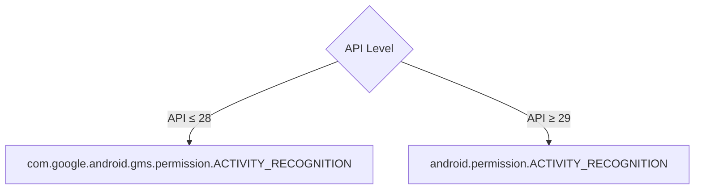
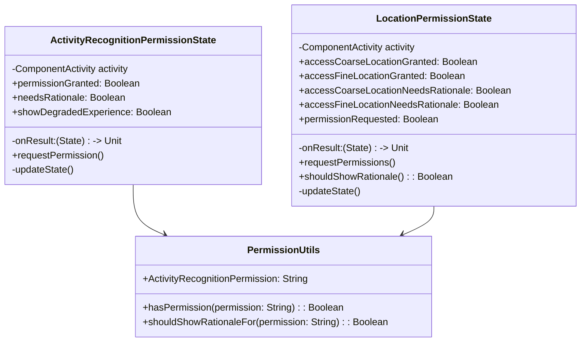
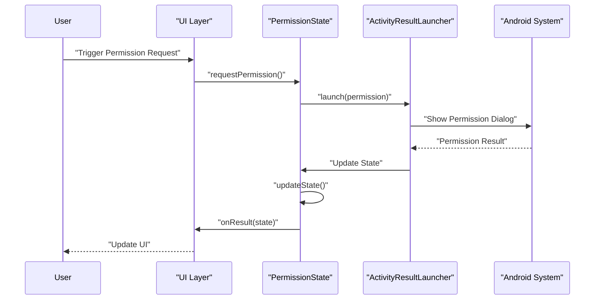
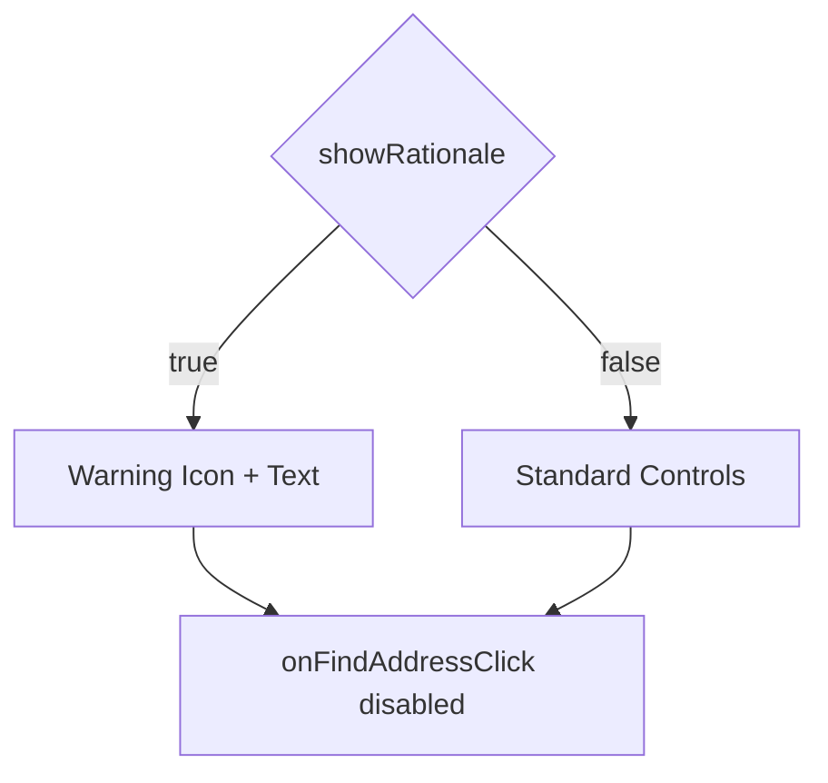
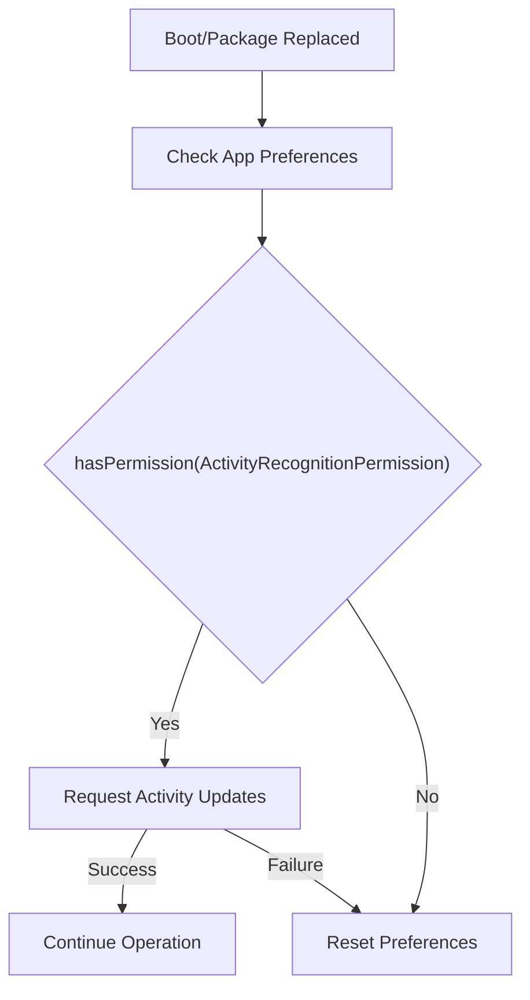

<!-- source: DeepWiki mcp.deepwiki.com · repo android/location-samples · page 3.1 Permission Management · fetched 2026-10-23 -->

# Permission Management

<details>
<summary>Relevant source files</summary>

The following files were used as context for generating this wiki page:

- [ActivityRecognition/app/src/main/java/com/google/android/gms/location/sample/activityrecognition/BootReceiver.kt](ActivityRecognition/app/src/main/java/com/google/android/gms/location/sample/activityrecognition/BootReceiver.kt)
- [ActivityRecognition/app/src/main/java/com/google/android/gms/location/sample/activityrecognition/PermissionUtils.kt](ActivityRecognition/app/src/main/java/com/google/android/gms/location/sample/activityrecognition/PermissionUtils.kt)
- [ActivityRecognition/app/src/main/java/com/google/android/gms/location/sample/activityrecognition/data/ActivityTransitionManager.kt](ActivityRecognition/app/src/main/java/com/google/android/gms/location/sample/activityrecognition/data/ActivityTransitionManager.kt)
- [ActivityRecognition/app/src/main/java/com/google/android/gms/location/sample/activityrecognition/ui/ActivityRecognitionPermissionState.kt](ActivityRecognition/app/src/main/java/com/google/android/gms/location/sample/activityrecognition/ui/ActivityRecognitionPermissionState.kt)
- [LocationAddress/app/src/main/java/com/google/android/gms/location/sample/locationaddress/ui/GeocoderScreen.kt](LocationAddress/app/src/main/java/com/google/android/gms/location/sample/locationaddress/ui/GeocoderScreen.kt)
- [LocationAddress/app/src/main/java/com/google/android/gms/location/sample/locationaddress/ui/InitializingScreen.kt](LocationAddress/app/src/main/java/com/google/android/gms/location/sample/locationaddress/ui/InitializingScreen.kt)
- [LocationAddress/app/src/main/java/com/google/android/gms/location/sample/locationaddress/ui/LocationPermissionState.kt](LocationAddress/app/src/main/java/com/google/android/gms/location/sample/locationaddress/ui/LocationPermissionState.kt)
- [LocationAddress/app/src/main/java/com/google/android/gms/location/sample/locationaddress/ui/ServiceUnavailableScreen.kt](LocationAddress/app/src/main/java/com/google/android/gms/location/sample/locationaddress/ui/ServiceUnavailableScreen.kt)
- [LocationUpdatesBackgroundKotlin/app/src/main/res/layout/fragment_permission_request.xml](LocationUpdatesBackgroundKotlin/app/src/main/res/layout/fragment_permission_request.xml)

</details>


This document covers the comprehensive permission management patterns used across the Google Play Location & Context APIs samples. It details how different permission types are handled, the evolution of permission requirements across Android API levels, and the architectural patterns for managing permission state and user interactions.

For information about background processing restrictions and service patterns, see [Background Processing Patterns](#3.2). For broader architectural patterns, see [MVVM and Dependency Injection](#3.4).

## Permission Types and API Evolution

The repository demonstrates handling of three primary permission categories that have evolved significantly across Android versions:

### Location Permissions

Location permissions follow a two-tier approach on Android 12+ where apps must request both coarse and fine location permissions simultaneously:

| Permission | API Level | Usage |
|------------|-----------|-------|
| `ACCESS_COARSE_LOCATION` | All | Required for all location operations |
| `ACCESS_FINE_LOCATION` | All | Required for precise location |
| `ACCESS_BACKGROUND_LOCATION` | 29+ | Required for location access when app is backgrounded |

### Activity Recognition Permissions

Activity recognition permissions changed significantly in Android 10 (API 29):



**Activity Recognition Permission Evolution**

Sources: [ActivityRecognition/app/src/main/java/com/google/android/gms/location/sample/activityrecognition/PermissionUtils.kt:35-39]()

### System Permissions

Additional system permissions are required for complete functionality:

- `RECEIVE_BOOT_COMPLETED` - Auto-restart after device reboot
- `POST_NOTIFICATIONS` - Required for foreground service notifications
- `WAKE_LOCK` - Background processing capabilities

## Permission State Management Architecture

The repository implements sophisticated state management patterns using Compose state holders that encapsulate permission logic:



**Permission State Management Classes**

The state management pattern provides reactive permission status through Compose state variables that automatically trigger UI recomposition when permissions change.

Sources: [ActivityRecognition/app/src/main/java/com/google/android/gms/location/sample/activityrecognition/ui/ActivityRecognitionPermissionState.kt:57-100](), [LocationAddress/app/src/main/java/com/google/android/gms/location/sample/locationaddress/ui/LocationPermissionState.kt:77-148]()

## Permission Request Flow

The permission request flow follows a consistent pattern across all samples:



**Permission Request Sequence**

### Key Implementation Details

The `ActivityResultLauncher` is registered during state initialization and handles the system permission dialog response:

- **Single Permission**: Used for activity recognition via `RequestPermission()` contract
- **Multiple Permissions**: Used for location permissions via `RequestMultiplePermissions()` contract

The state update logic checks current permission status and rationale requirements after each permission request.

Sources: [ActivityRecognition/app/src/main/java/com/google/android/gms/location/sample/activityrecognition/ui/ActivityRecognitionPermissionState.kt:75-82](), [LocationAddress/app/src/main/java/com/google/android/gms/location/sample/locationaddress/ui/LocationPermissionState.kt:105-112]()

## Permission Utility Functions

Core permission checking functionality is centralized in utility functions:

| Function | Purpose | Return Type |
|----------|---------|-------------|
| `Context.hasPermission()` | Check if permission is granted | `Boolean` |
| `Activity.shouldShowRationaleFor()` | Check if rationale should be shown | `Boolean` |
| `ActivityRecognitionPermission` | Get correct permission string for API level | `String` |

### API Level Handling

The `ActivityRecognitionPermission` property dynamically selects the appropriate permission string based on the device's API level:

```kotlin
val ActivityRecognitionPermission = if (Build.VERSION.SDK_INT >= Build.VERSION_CODES.Q) {
    android.Manifest.permission.ACTIVITY_RECOGNITION
} else {
    "com.google.android.gms.permission.ACTIVITY_RECOGNITION"
}
```

This ensures compatibility across different Android versions while using the correct permission for each API level.

Sources: [ActivityRecognition/app/src/main/java/com/google/android/gms/location/sample/activityrecognition/PermissionUtils.kt:26-39]()

## UI Integration Patterns

### Permission Rationale Display

The UI layer integrates permission state through reactive composition patterns. The `GeocoderScreen` demonstrates conditional rationale display:



**Rationale Display Logic**

The rationale UI appears when the system indicates that an explanation should be shown to the user, typically after a permission has been denied once.

### Fragment-Based Permission Requests

The `LocationUpdatesBackgroundKotlin` sample uses a dedicated fragment for permission requests with a comprehensive UI layout that includes:

- Permission icon
- Title text explaining the requirement
- Detailed explanation text
- Action button to trigger permission request

Sources: [LocationAddress/app/src/main/java/com/google/android/gms/location/sample/locationaddress/ui/GeocoderScreen.kt:145-166](), [LocationUpdatesBackgroundKotlin/app/src/main/res/layout/fragment_permission_request.xml:29-90]()

## System Integration and Persistence

### Boot Receiver Permission Restoration

The `BootReceiver` class demonstrates advanced permission handling for system-level integration:



**Boot Receiver Permission Flow**

The boot receiver ensures that previously active subscriptions are restored after system events, but only if the required permissions are still available. If permissions have been revoked, it resets the app preferences to prevent inconsistent state.

### Permission Validation Chain

The boot receiver implements a comprehensive validation chain:

1. **Google Play Services availability**
2. **Permission status check**
3. **API request attempt**
4. **Preference state management**

This ensures robust recovery from system interruptions while maintaining data consistency.

Sources: [ActivityRecognition/app/src/main/java/com/google/android/gms/location/sample/activityrecognition/BootReceiver.kt:49-65]()

## Location Permission Complexity

### Android 12+ Requirements

Starting with Android 12, location permission requests must include both coarse and fine location permissions. The system presents users with three options:

1. **Precise location** - Grants both permissions
2. **Approximate location** - Grants only coarse location
3. **Deny** - Grants no location permissions

### Rationale Logic

The `LocationPermissionState.shouldShowRationale()` method implements complex logic to determine when to show permission rationale:

- Show rationale if system indicates rationale needed for either permission
- Show rationale if permission was requested but precise location not granted
- Account for user's choice of approximate vs. precise location

This addresses the nuanced permission model introduced in Android 12 where users can grant partial location access.

Sources: [LocationAddress/app/src/main/java/com/google/android/gms/location/sample/locationaddress/ui/LocationPermissionState.kt:40-41](), [LocationAddress/app/src/main/java/com/google/android/gms/location/sample/locationaddress/ui/LocationPermissionState.kt:135-147]()

---

