<!-- source: DeepWiki mcp.deepwiki.com · repo android/location-samples · page 3.2 Background Processing Patterns · fetched 2026-10-23 -->

# Background Processing Patterns

Relevant source files

The following files were used as context for generating this wiki page:

- [ActivityRecognition/app/src/main/java/com/google/android/gms/location/sample/activityrecognition/DetectedActivityReceiver.kt](ActivityRecognition/app/src/main/java/com/google/android/gms/location/sample/activityrecognition/DetectedActivityReceiver.kt)
- [ActivityRecognition/app/src/main/java/com/google/android/gms/location/sample/activityrecognition/data/db/ActivityTransitionDao.kt](ActivityRecognition/app/src/main/java/com/google/android/gms/location/sample/activityrecognition/data/db/ActivityTransitionDao.kt)
- [ActivityRecognition/app/src/main/java/com/google/android/gms/location/sample/activityrecognition/data/db/ActivityTransitionRecord.kt](ActivityRecognition/app/src/main/java/com/google/android/gms/location/sample/activityrecognition/data/db/ActivityTransitionRecord.kt)
- [ActivityRecognition/app/src/main/java/com/google/android/gms/location/sample/activityrecognition/data/db/AppDatabase.kt](ActivityRecognition/app/src/main/java/com/google/android/gms/location/sample/activityrecognition/data/db/AppDatabase.kt)
- [ActivityRecognition/app/src/main/java/com/google/android/gms/location/sample/activityrecognition/data/db/TimestampConverter.kt](ActivityRecognition/app/src/main/java/com/google/android/gms/location/sample/activityrecognition/data/db/TimestampConverter.kt)
- [ForegroundLocationUpdates/app/src/main/java/com/google/android/gms/location/sample/foregroundlocation/ForegroundLocationService.kt](ForegroundLocationUpdates/app/src/main/java/com/google/android/gms/location/sample/foregroundlocation/ForegroundLocationService.kt)
- [ForegroundLocationUpdates/app/src/main/res/drawable/ic_stop.xml](ForegroundLocationUpdates/app/src/main/res/drawable/ic_stop.xml)
- [LocationUpdatesBackgroundKotlin/app/src/main/java/com/google/android/gms/location/sample/locationupdatesbackgroundkotlin/LocationUpdatesBroadcastReceiver.kt](LocationUpdatesBackgroundKotlin/app/src/main/java/com/google/android/gms/location/sample/locationupdatesbackgroundkotlin/LocationUpdatesBroadcastReceiver.kt)
- [LocationUpdatesBackgroundKotlin/app/src/main/java/com/google/android/gms/location/sample/locationupdatesbackgroundkotlin/data/LocationRepository.kt](LocationUpdatesBackgroundKotlin/app/src/main/java/com/google/android/gms/location/sample/locationupdatesbackgroundkotlin/data/LocationRepository.kt)
- [LocationUpdatesBackgroundKotlin/app/src/main/java/com/google/android/gms/location/sample/locationupdatesbackgroundkotlin/ui/LocationUpdateFragment.kt](LocationUpdatesBackgroundKotlin/app/src/main/java/com/google/android/gms/location/sample/locationupdatesbackgroundkotlin/ui/LocationUpdateFragment.kt)
- [LocationUpdatesBackgroundKotlin/app/src/main/java/com/google/android/gms/location/sample/locationupdatesbackgroundkotlin/ui/MainActivity.kt](LocationUpdatesBackgroundKotlin/app/src/main/java/com/google/android/gms/location/sample/locationupdatesbackgroundkotlin/ui/MainActivity.kt)
- [LocationUpdatesBackgroundKotlin/app/src/main/java/com/google/android/gms/location/sample/locationupdatesbackgroundkotlin/ui/PermissionRequestFragment.kt](LocationUpdatesBackgroundKotlin/app/src/main/java/com/google/android/gms/location/sample/locationupdatesbackgroundkotlin/ui/PermissionRequestFragment.kt)
- [LocationUpdatesBackgroundKotlin/app/src/main/java/com/google/android/gms/location/sample/locationupdatesbackgroundkotlin/viewmodels/LocationUpdateViewModel.kt](LocationUpdatesBackgroundKotlin/app/src/main/java/com/google/android/gms/location/sample/locationupdatesbackgroundkotlin/viewmodels/LocationUpdateViewModel.kt)
- [LocationUpdatesBackgroundKotlin/app/src/main/res/layout/fragment_location_update.xml](LocationUpdatesBackgroundKotlin/app/src/main/res/layout/fragment_location_update.xml)
- [LocationUpdatesBackgroundKotlin/app/src/main/res/values/strings.xml](LocationUpdatesBackgroundKotlin/app/src/main/res/values/strings.xml)

This document covers the various background processing patterns implemented across the Google Play Location & Context APIs samples. These patterns demonstrate how to handle location updates, activity recognition events, and other context-aware data when the application is not in the foreground, while adhering to Android's background execution limitations.

For information about specific sample implementations, see [Sample Applications](#2). For details on permission handling related to background processing, see [Permission Management](#3.1).

## Overview

The repository demonstrates three primary background processing patterns to handle location and context data:

- **BroadcastReceiver Pattern**: Handles discrete events delivered via `PendingIntent`
- **Foreground Service Pattern**: Maintains persistent background processing with user notification
- **Data Persistence Integration**: Coordinates background events with local storage

These patterns address Android's background execution limitations introduced in API 26+ while maintaining reliable location and context tracking.

## BroadcastReceiver Pattern

The `BroadcastReceiver` pattern is the primary mechanism for handling background location and activity recognition events. This pattern uses `PendingIntent` to deliver events to registered receivers even when the app is not in the foreground.

### Core Architecture

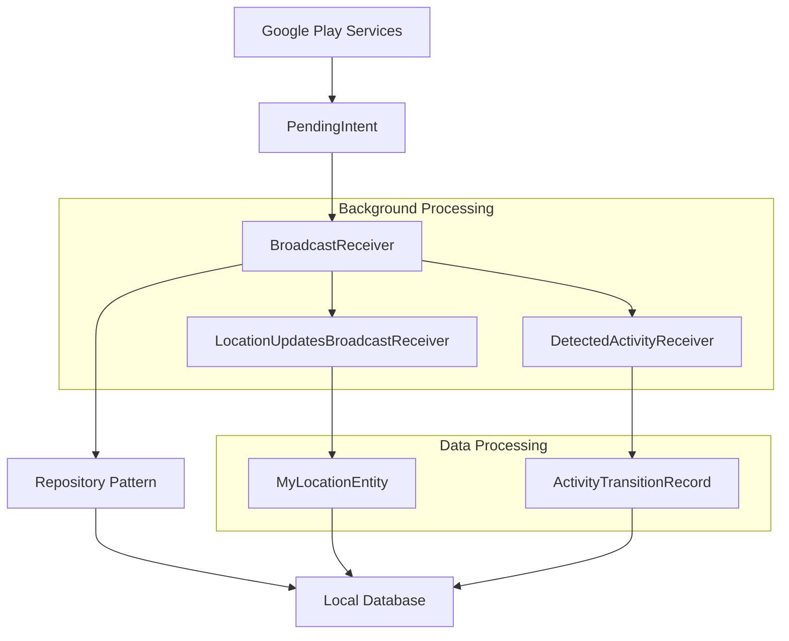

**Sources**: [LocationUpdatesBackgroundKotlin/app/src/main/java/com/google/android/gms/location/sample/locationupdatesbackgroundkotlin/LocationUpdatesBroadcastReceiver.kt:32-74](), [ActivityRecognition/app/src/main/java/com/google/android/gms/location/sample/activityrecognition/DetectedActivityReceiver.kt:30-47]()

### Location Updates Implementation

The `LocationUpdatesBroadcastReceiver` demonstrates the canonical pattern for handling background location updates:

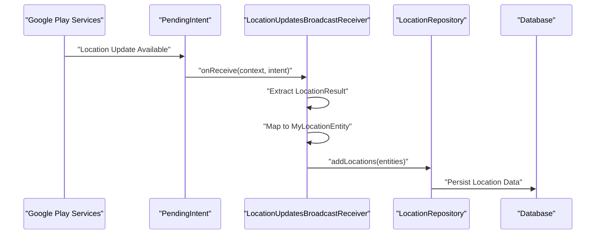

**Sources**: [LocationUpdatesBackgroundKotlin/app/src/main/java/com/google/android/gms/location/sample/locationupdatesbackgroundkotlin/LocationUpdatesBroadcastReceiver.kt:47-74]()

The receiver extracts location data from the intent and processes it immediately:

| Component | Responsibility |
|-----------|---------------|
| `LocationAvailability.extractLocationAvailability()` | Checks if location services are available |
| `LocationResult.extractResult()` | Extracts location updates from intent |
| `MyLocationEntity` mapping | Converts raw location to database entity |
| `LocationRepository.addLocations()` | Persists data asynchronously |

### Activity Recognition Implementation

The `DetectedActivityReceiver` follows a similar pattern but uses coroutines for asynchronous processing:

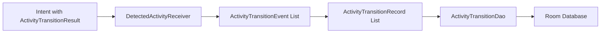

**Sources**: [ActivityRecognition/app/src/main/java/com/google/android/gms/location/sample/activityrecognition/DetectedActivityReceiver.kt:37-46]()

## Foreground Service Pattern

The foreground service pattern provides persistent background processing with user notification, enabling continuous location tracking while maintaining system compliance.

### Service Lifecycle Management

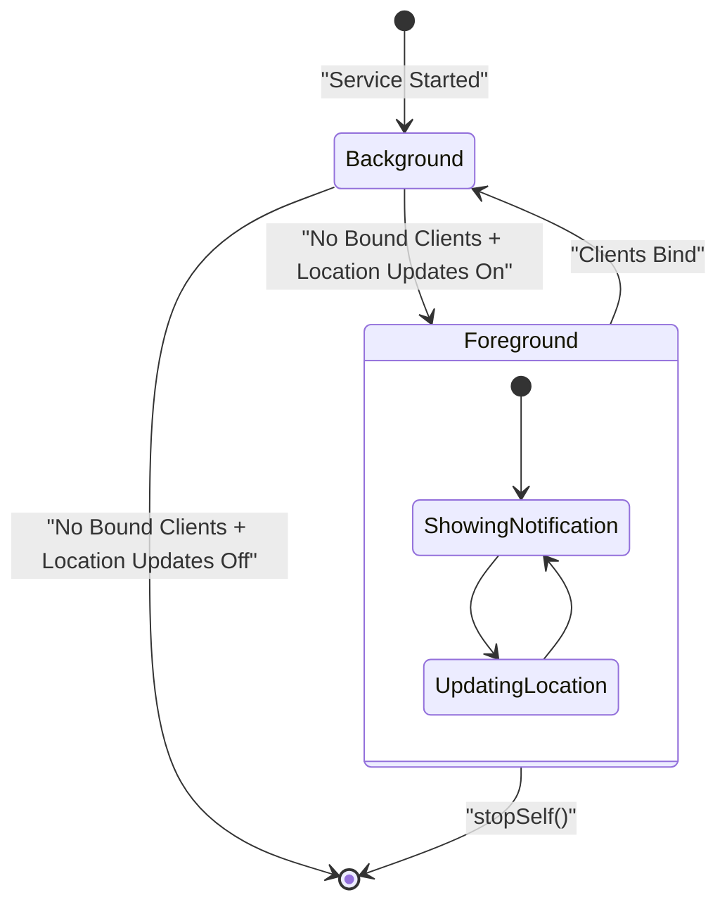

**Sources**: [ForegroundLocationUpdates/app/src/main/java/com/google/android/gms/location/sample/foregroundlocation/ForegroundLocationService.kt:146-157]()

### Service Connection Pattern

The `ForegroundLocationService` demonstrates sophisticated lifecycle management:

| State | Condition | Action |
|-------|-----------|--------|
| **Bound with Clients** | `isBound() == true` | Exit foreground, remain in background |
| **Unbound + Updates Active** | `locationRepository.isReceivingLocationUpdates.value == true` | Enter foreground, show notification |
| **Unbound + Updates Inactive** | No active updates | Stop service |

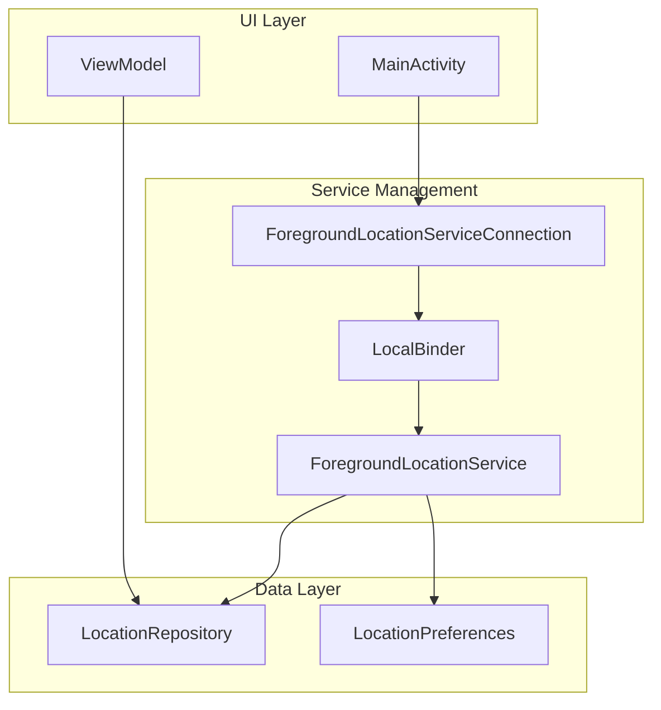

**Sources**: [ForegroundLocationUpdates/app/src/main/java/com/google/android/gms/location/sample/foregroundlocation/ForegroundLocationService.kt:256-269]()

### Notification Management

The service creates persistent notifications to maintain foreground status:

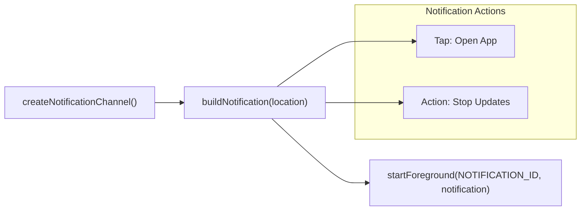

**Sources**: [ForegroundLocationUpdates/app/src/main/java/com/google/android/gms/location/sample/foregroundlocation/ForegroundLocationService.kt:184-228]()

## Data Persistence Integration

Background processing patterns integrate closely with data persistence to ensure reliable storage of location and context events.

### Repository Pattern Integration

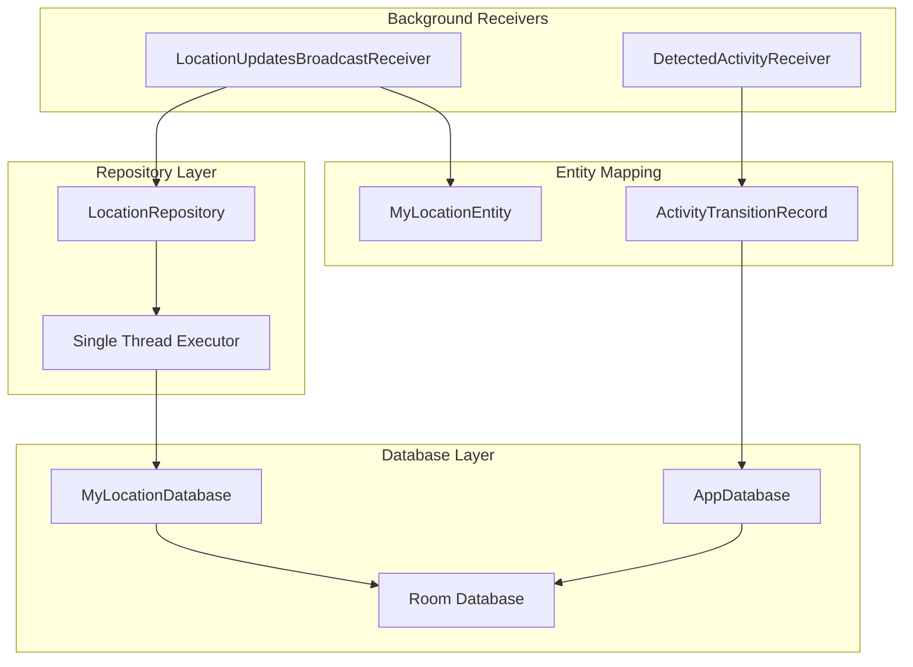

**Sources**: [LocationUpdatesBackgroundKotlin/app/src/main/java/com/google/android/gms/location/sample/locationupdatesbackgroundkotlin/data/LocationRepository.kt:32-78](), [ActivityRecognition/app/src/main/java/com/google/android/gms/location/sample/activityrecognition/data/db/ActivityTransitionDao.kt:28-37]()

### Entity Transformation Patterns

The background receivers transform raw API data into database entities:

| Pattern | Source | Target | Transformation |
|---------|--------|--------|----------------|
| **Location Mapping** | `Location` | `MyLocationEntity` | Coordinate extraction + timestamp |
| **Activity Mapping** | `ActivityTransitionEvent` | `ActivityTransitionRecord` | Type enumeration + time conversion |
| **Foreground Detection** | `ActivityManager` | `Boolean` | Process importance check |

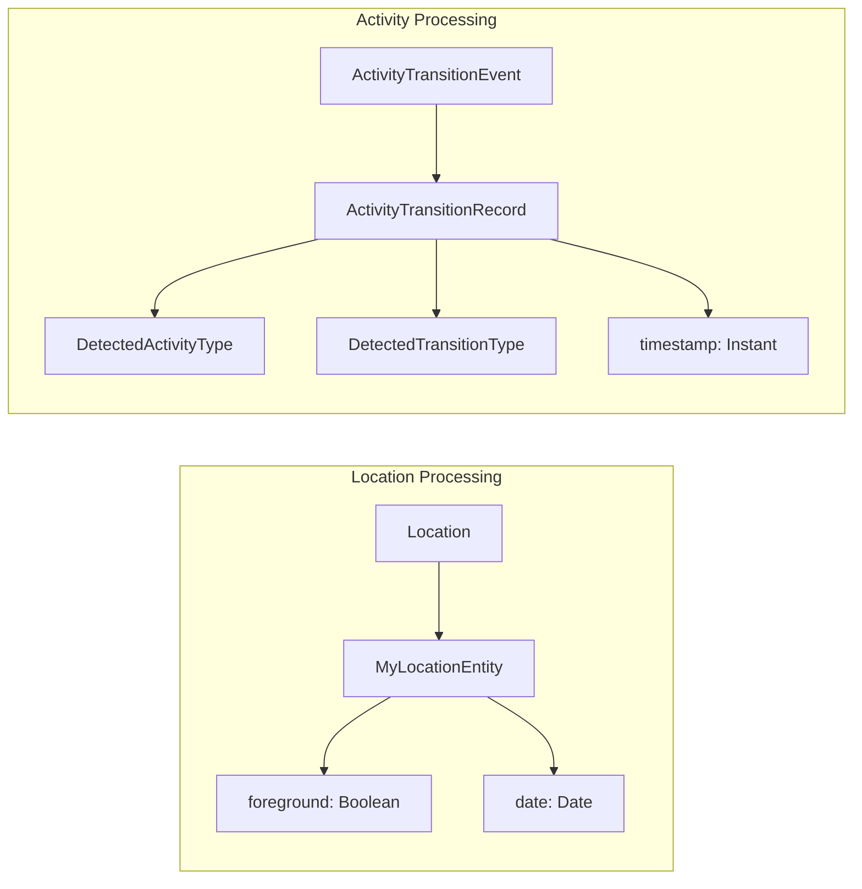

**Sources**: [LocationUpdatesBackgroundKotlin/app/src/main/java/com/google/android/gms/location/sample/locationupdatesbackgroundkotlin/LocationUpdatesBroadcastReceiver.kt:59-67](), [ActivityRecognition/app/src/main/java/com/google/android/gms/location/sample/activityrecognition/data/db/ActivityTransitionRecord.kt:77-81]()

## PendingIntent Configuration

Background processing relies on `PendingIntent` to deliver events from Google Play Services to application receivers.

### Intent Action Patterns

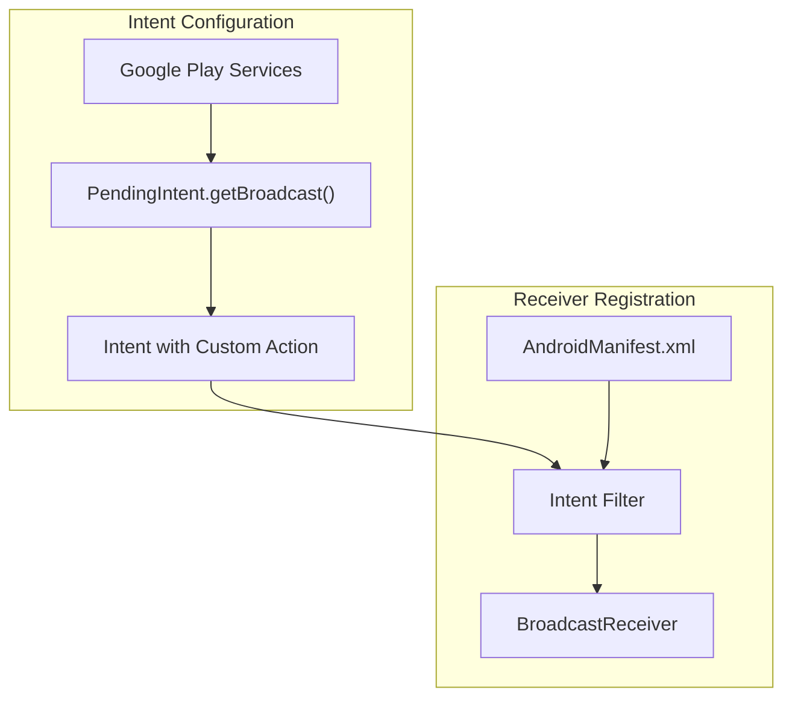

**Sources**: [LocationUpdatesBackgroundKotlin/app/src/main/java/com/google/android/gms/location/sample/locationupdatesbackgroundkotlin/LocationUpdatesBroadcastReceiver.kt:96-99]()

The location updates receiver uses a custom action constant:
- `ACTION_PROCESS_UPDATES`: `"com.google.android.gms.location.sample.locationupdatesbackgroundkotlin.action.PROCESS_UPDATES"`

### Background Execution Compliance

The patterns ensure compliance with Android's background execution limitations:

| API Level | Constraint | Pattern Response |
|-----------|------------|------------------|
| **API 26+** | Background service limits | Use `PendingIntent.getBroadcast()` instead of `PendingIntent.getService()` |
| **API 29+** | Background location access | Request `ACCESS_BACKGROUND_LOCATION` permission |
| **API 31+** | Notification permissions | Handle `POST_NOTIFICATIONS` permission |

**Sources**: [LocationUpdatesBackgroundKotlin/app/src/main/java/com/google/android/gms/location/sample/locationupdatesbackgroundkotlin/LocationUpdatesBroadcastReceiver.kt:35-43]()

## Error Handling and Resilience

Background processing patterns include robust error handling to manage system constraints and API limitations.

### Availability Checking

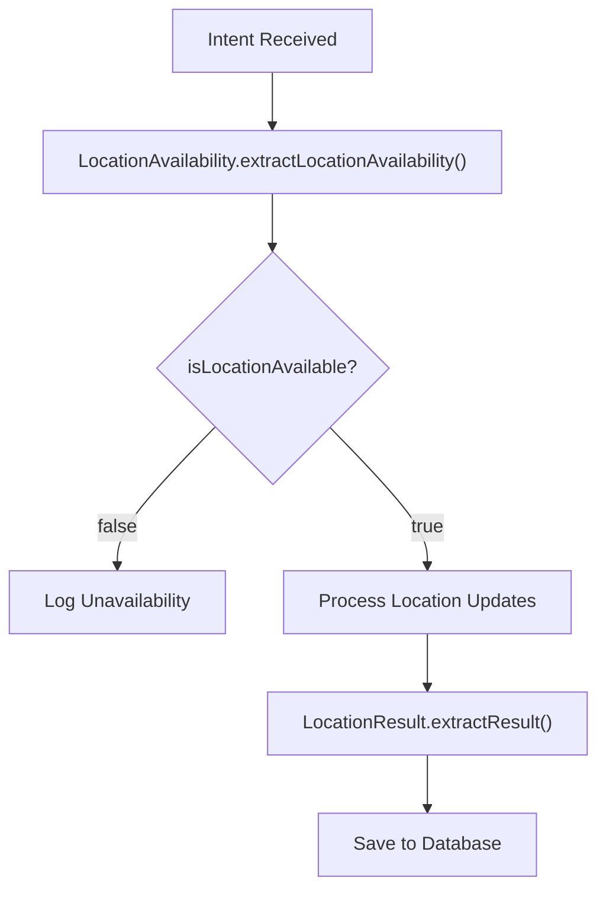

**Sources**: [LocationUpdatesBackgroundKotlin/app/src/main/java/com/google/android/gms/location/sample/locationupdatesbackgroundkotlin/LocationUpdatesBroadcastReceiver.kt:52-57]()

### Foreground State Detection

The location receiver includes foreground state detection for debugging and data analysis:

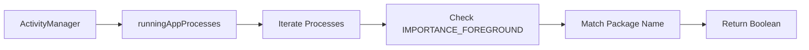

**Sources**: [LocationUpdatesBackgroundKotlin/app/src/main/java/com/google/android/gms/location/sample/locationupdatesbackgroundkotlin/LocationUpdatesBroadcastReceiver.kt:81-93]()

These background processing patterns provide reliable, system-compliant approaches to handling location and context data across different Android API levels and execution contexts.

---

