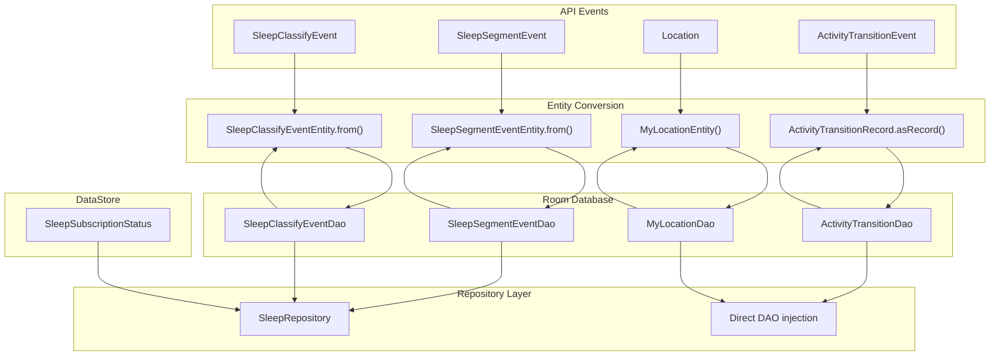
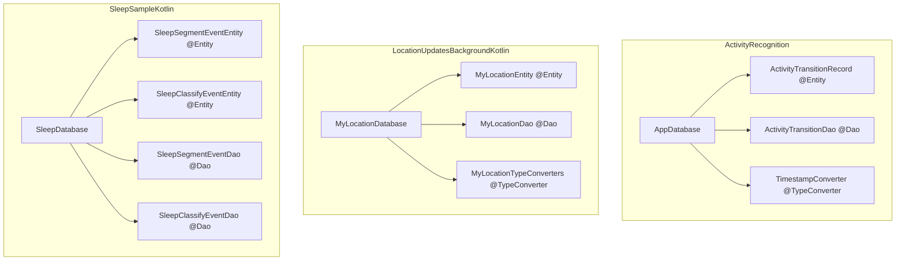
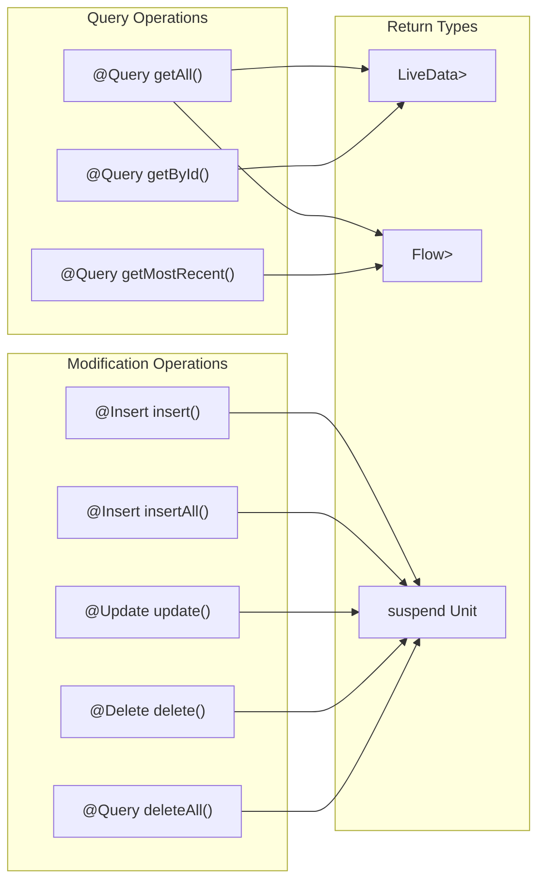
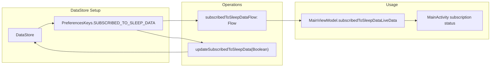
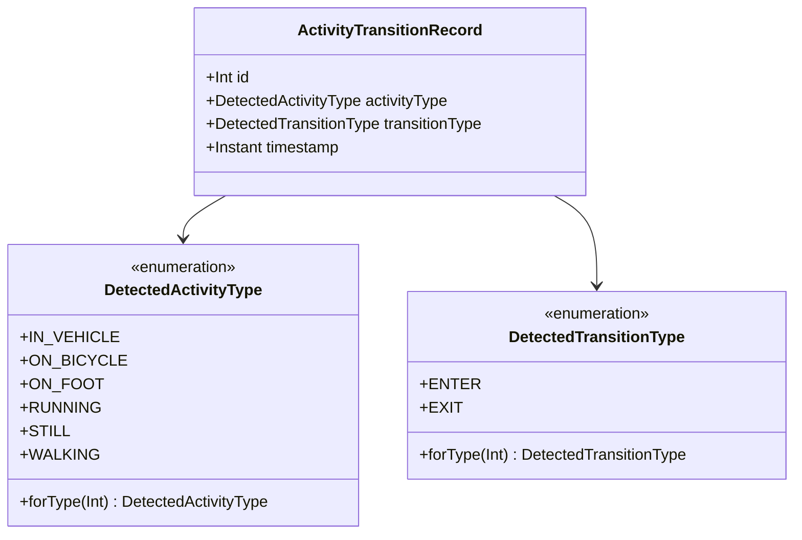
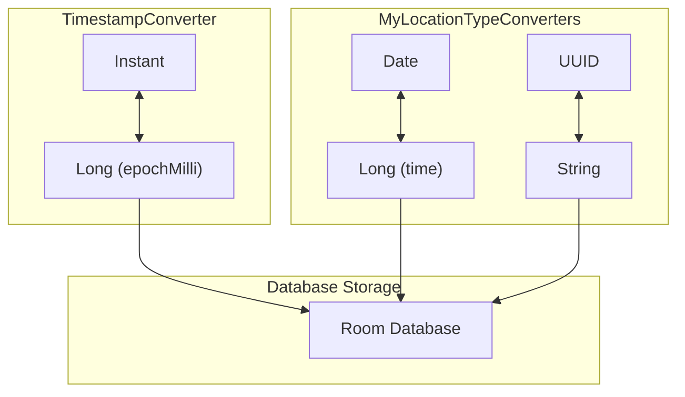
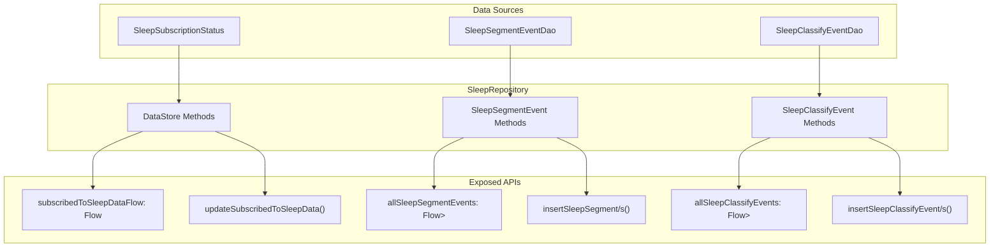

<!-- source: DeepWiki mcp.deepwiki.com · repo android/location-samples · page 3.3 Data Persistence · fetched 2026-10-23 -->

# Data Persistence

Relevant source files

The following files were used as context for generating this wiki page:

- [ActivityRecognition/app/src/main/java/com/google/android/gms/location/sample/activityrecognition/DetectedActivityReceiver.kt](ActivityRecognition/app/src/main/java/com/google/android/gms/location/sample/activityrecognition/DetectedActivityReceiver.kt)
- [ActivityRecognition/app/src/main/java/com/google/android/gms/location/sample/activityrecognition/data/db/ActivityTransitionDao.kt](ActivityRecognition/app/src/main/java/com/google/android/gms/location/sample/activityrecognition/data/db/ActivityTransitionDao.kt)
- [ActivityRecognition/app/src/main/java/com/google/android/gms/location/sample/activityrecognition/data/db/ActivityTransitionRecord.kt](ActivityRecognition/app/src/main/java/com/google/android/gms/location/sample/activityrecognition/data/db/ActivityTransitionRecord.kt)
- [ActivityRecognition/app/src/main/java/com/google/android/gms/location/sample/activityrecognition/data/db/AppDatabase.kt](ActivityRecognition/app/src/main/java/com/google/android/gms/location/sample/activityrecognition/data/db/AppDatabase.kt)
- [ActivityRecognition/app/src/main/java/com/google/android/gms/location/sample/activityrecognition/data/db/TimestampConverter.kt](ActivityRecognition/app/src/main/java/com/google/android/gms/location/sample/activityrecognition/data/db/TimestampConverter.kt)
- [LocationUpdatesBackgroundKotlin/app/src/main/java/com/google/android/gms/location/sample/locationupdatesbackgroundkotlin/Utils.kt](LocationUpdatesBackgroundKotlin/app/src/main/java/com/google/android/gms/location/sample/locationupdatesbackgroundkotlin/Utils.kt)
- [LocationUpdatesBackgroundKotlin/app/src/main/java/com/google/android/gms/location/sample/locationupdatesbackgroundkotlin/data/MyLocationManager.kt](LocationUpdatesBackgroundKotlin/app/src/main/java/com/google/android/gms/location/sample/locationupdatesbackgroundkotlin/data/MyLocationManager.kt)
- [LocationUpdatesBackgroundKotlin/app/src/main/java/com/google/android/gms/location/sample/locationupdatesbackgroundkotlin/data/db/MyLocationDao.kt](LocationUpdatesBackgroundKotlin/app/src/main/java/com/google/android/gms/location/sample/locationupdatesbackgroundkotlin/data/db/MyLocationDao.kt)
- [LocationUpdatesBackgroundKotlin/app/src/main/java/com/google/android/gms/location/sample/locationupdatesbackgroundkotlin/data/db/MyLocationDatabase.kt](LocationUpdatesBackgroundKotlin/app/src/main/java/com/google/android/gms/location/sample/locationupdatesbackgroundkotlin/data/db/MyLocationDatabase.kt)
- [LocationUpdatesBackgroundKotlin/app/src/main/java/com/google/android/gms/location/sample/locationupdatesbackgroundkotlin/data/db/MyLocationEntity.kt](LocationUpdatesBackgroundKotlin/app/src/main/java/com/google/android/gms/location/sample/locationupdatesbackgroundkotlin/data/db/MyLocationEntity.kt)
- [LocationUpdatesBackgroundKotlin/app/src/main/java/com/google/android/gms/location/sample/locationupdatesbackgroundkotlin/data/db/MyLocationTypeConverters.kt](LocationUpdatesBackgroundKotlin/app/src/main/java/com/google/android/gms/location/sample/locationupdatesbackgroundkotlin/data/db/MyLocationTypeConverters.kt)
- [SleepSampleKotlin/app/src/main/java/com/android/example/sleepsamplekotlin/MainActivity.kt](SleepSampleKotlin/app/src/main/java/com/android/example/sleepsamplekotlin/MainActivity.kt)
- [SleepSampleKotlin/app/src/main/java/com/android/example/sleepsamplekotlin/MainApplication.kt](SleepSampleKotlin/app/src/main/java/com/android/example/sleepsamplekotlin/MainApplication.kt)
- [SleepSampleKotlin/app/src/main/java/com/android/example/sleepsamplekotlin/MainViewModel.kt](SleepSampleKotlin/app/src/main/java/com/android/example/sleepsamplekotlin/MainViewModel.kt)
- [SleepSampleKotlin/app/src/main/java/com/android/example/sleepsamplekotlin/data/SleepRepository.kt](SleepSampleKotlin/app/src/main/java/com/android/example/sleepsamplekotlin/data/SleepRepository.kt)
- [SleepSampleKotlin/app/src/main/java/com/android/example/sleepsamplekotlin/data/datastore/SleepSubscriptionStatus.kt](SleepSampleKotlin/app/src/main/java/com/android/example/sleepsamplekotlin/data/datastore/SleepSubscriptionStatus.kt)
- [SleepSampleKotlin/app/src/main/java/com/android/example/sleepsamplekotlin/data/db/SleepClassifyEventDao.kt](SleepSampleKotlin/app/src/main/java/com/android/example/sleepsamplekotlin/data/db/SleepClassifyEventDao.kt)
- [SleepSampleKotlin/app/src/main/java/com/android/example/sleepsamplekotlin/data/db/SleepClassifyEventEntity.kt](SleepSampleKotlin/app/src/main/java/com/android/example/sleepsamplekotlin/data/db/SleepClassifyEventEntity.kt)
- [SleepSampleKotlin/app/src/main/java/com/android/example/sleepsamplekotlin/data/db/SleepDatabase.kt](SleepSampleKotlin/app/src/main/java/com/android/example/sleepsamplekotlin/data/db/SleepDatabase.kt)
- [SleepSampleKotlin/app/src/main/java/com/android/example/sleepsamplekotlin/data/db/SleepSegmentEventDao.kt](SleepSampleKotlin/app/src/main/java/com/android/example/sleepsamplekotlin/data/db/SleepSegmentEventDao.kt)
- [SleepSampleKotlin/app/src/main/java/com/android/example/sleepsamplekotlin/data/db/SleepSegmentEventEntity.kt](SleepSampleKotlin/app/src/main/java/com/android/example/sleepsamplekotlin/data/db/SleepSegmentEventEntity.kt)

This document covers the data persistence patterns and implementations used across the Google Play Location & Context APIs sample repository. The samples demonstrate three primary persistence approaches: Room database for structured data storage, DataStore for preferences and settings, and various entity modeling patterns for different data types.

For information about background processing patterns that often trigger data persistence, see [Background Processing Patterns](#3.2). For UI patterns that consume persisted data, see [MVVM and Dependency Injection](#3.4).

## Persistence Architecture Overview

The repository implements a layered persistence architecture where API events are captured, transformed into database entities, and stored for later retrieval by UI components.

**Data Persistence Architecture**

Sources: [ActivityRecognition/app/src/main/java/com/google/android/gms/location/sample/activityrecognition/data/db/ActivityTransitionRecord.kt:77-81](), [LocationUpdatesBackgroundKotlin/app/src/main/java/com/google/android/gms/location/sample/locationupdatesbackgroundkotlin/data/db/MyLocationEntity.kt:28-35](), [SleepSampleKotlin/app/src/main/java/com/android/example/sleepsamplekotlin/data/db/SleepSegmentEventEntity.kt:38-46]()

## Room Database Implementation

### Database Configuration

Each sample implements a Room database with specific entity configurations and singleton initialization patterns.

**Room Database Structure**

Sources: [ActivityRecognition/app/src/main/java/com/google/android/gms/location/sample/activityrecognition/data/db/AppDatabase.kt:25-33](), [LocationUpdatesBackgroundKotlin/app/src/main/java/com/google/android/gms/location/sample/locationupdatesbackgroundkotlin/data/db/MyLocationDatabase.kt:29-32](), [SleepSampleKotlin/app/src/main/java/com/android/example/sleepsamplekotlin/data/db/SleepDatabase.kt:28-36]()

### Database Singleton Implementation

All samples use a consistent singleton pattern for database instantiation with thread-safe lazy initialization:

| Sample | Database Class | Singleton Pattern |
|--------|----------------|-------------------|
| ActivityRecognition | `AppDatabase` | Hilt dependency injection |
| LocationUpdatesBackgroundKotlin | `MyLocationDatabase` | Volatile instance with synchronized initialization |
| SleepSampleKotlin | `SleepDatabase` | Volatile instance with synchronized initialization |

The `MyLocationDatabase` demonstrates the manual singleton pattern:

[LocationUpdatesBackgroundKotlin/app/src/main/java/com/google/android/gms/location/sample/locationupdatesbackgroundkotlin/data/db/MyLocationDatabase.kt:34-52]()

Sources: [LocationUpdatesBackgroundKotlin/app/src/main/java/com/google/android/gms/location/sample/locationupdatesbackgroundkotlin/data/db/MyLocationDatabase.kt:34-52](), [SleepSampleKotlin/app/src/main/java/com/google/android/gms/location/sample/sleepsamplekotlin/data/db/SleepDatabase.kt:38-60]()

### DAO Operations

All DAOs implement standard CRUD operations with reactive data streams using `LiveData` or `Flow`:

**Common DAO Operations**

Sources: [ActivityRecognition/app/src/main/java/com/google/android/gms/location/sample/activityrecognition/data/db/ActivityTransitionDao.kt:27-38](), [LocationUpdatesBackgroundKotlin/app/src/main/java/com/google/android/gms/location/sample/locationupdatesbackgroundkotlin/data/db/MyLocationDao.kt:28-45](), [SleepSampleKotlin/app/src/main/java/com/android/example/sleepsamplekotlin/data/db/SleepSegmentEventDao.kt:28-44]()

## DataStore Preferences

The Sleep sample demonstrates DataStore usage for persisting application preferences and subscription status.

### SleepSubscriptionStatus Implementation

The `SleepSubscriptionStatus` class encapsulates DataStore operations for managing sleep data subscription state:

[SleepSampleKotlin/app/src/main/java/com/android/example/sleepsamplekotlin/data/datastore/SleepSubscriptionStatus.kt:32-49]()

**DataStore Flow**

Sources: [SleepSampleKotlin/app/src/main/java/com/android/example/sleepsamplekotlin/data/datastore/SleepSubscriptionStatus.kt:32-49](), [SleepSampleKotlin/app/src/main/java/com/android/example/sleepsamplekotlin/MainApplication.kt:35-42]()

## Entity Modeling Patterns

### Activity Recognition Entities

The `ActivityTransitionRecord` entity demonstrates conversion from Play Services types to database entities with enum mappings:

[ActivityRecognition/app/src/main/java/com/google/android/gms/location/sample/activityrecognition/data/db/ActivityTransitionRecord.kt:32-39]()

**Activity Recognition Entity Structure**

Sources: [ActivityRecognition/app/src/main/java/com/google/android/gms/location/sample/activityrecognition/data/db/ActivityTransitionRecord.kt:32-72]()

### Location Entities

The `MyLocationEntity` demonstrates location data persistence with UUID primary keys and custom toString formatting:

[LocationUpdatesBackgroundKotlin/app/src/main/java/com/google/android/gms/location/sample/locationupdatesbackgroundkotlin/data/db/MyLocationEntity.kt:28-47]()

### Sleep Entities

The Sleep sample implements two distinct entity types with companion object factory methods:

| Entity | Purpose | Primary Key | Factory Method |
|--------|---------|-------------|----------------|
| `SleepSegmentEventEntity` | Sleep periods | `startTimeMillis` | `from(SleepSegmentEvent)` |
| `SleepClassifyEventEntity` | Sleep classifications | `timestampSeconds` | `from(SleepClassifyEvent)` |

Sources: [SleepSampleKotlin/app/src/main/java/com/android/example/sleepsamplekotlin/data/db/SleepSegmentEventEntity.kt:26-47](), [SleepSampleKotlin/app/src/main/java/com/android/example/sleepsamplekotlin/data/db/SleepClassifyEventEntity.kt:29-54]()

## Type Converters

Room requires type converters for non-primitive data types. The samples demonstrate different converter strategies:

### Timestamp Conversion

The Activity Recognition sample uses `TimestampConverter` for `Instant` objects:

[ActivityRecognition/app/src/main/java/com/google/android/gms/location/sample/activityrecognition/data/db/TimestampConverter.kt:25-35]()

### Multiple Type Conversion

The Location sample implements `MyLocationTypeConverters` for multiple types:

[LocationUpdatesBackgroundKotlin/app/src/main/java/com/google/android/gms/location/sample/locationupdatesbackgroundkotlin/data/db/MyLocationTypeConverters.kt:25-48]()

**Type Converter Patterns**

Sources: [ActivityRecognition/app/src/main/java/com/google/android/gms/location/sample/activityrecognition/data/db/TimestampConverter.kt:25-35](), [LocationUpdatesBackgroundKotlin/app/src/main/java/com/google/android/gms/location/sample/locationupdatesbackgroundkotlin/data/db/MyLocationTypeConverters.kt:25-48]()

## Repository Pattern Integration

### Sleep Repository

The `SleepRepository` demonstrates comprehensive repository pattern implementation combining Room and DataStore:

[SleepSampleKotlin/app/src/main/java/com/android/example/sleepsamplekotlin/data/SleepRepository.kt:25-72]()

**Repository Architecture**

Sources: [SleepSampleKotlin/app/src/main/java/com/android/example/sleepsamplekotlin/data/SleepRepository.kt:25-72]()

### Direct DAO Injection

The Activity Recognition sample uses direct DAO injection through Hilt without an additional repository layer:

[ActivityRecognition/app/src/main/java/com/google/android/gms/location/sample/activityrecognition/DetectedActivityReceiver.kt:33-47]()

This approach demonstrates immediate persistence in broadcast receivers for low-latency event processing.

Sources: [ActivityRecognition/app/src/main/java/com/google/android/gms/location/sample/activityrecognition/DetectedActivityReceiver.kt:33-47]()

---

