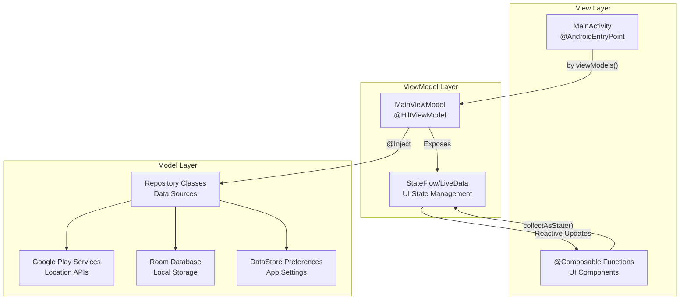
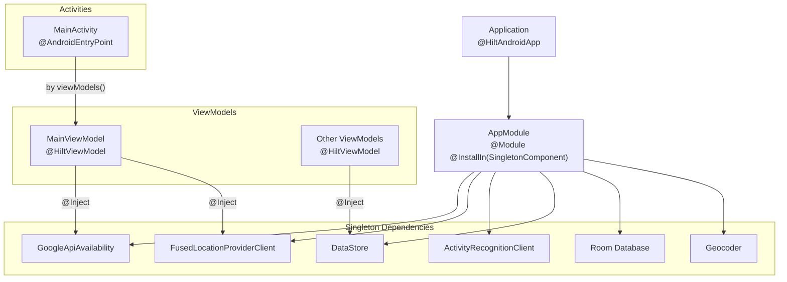
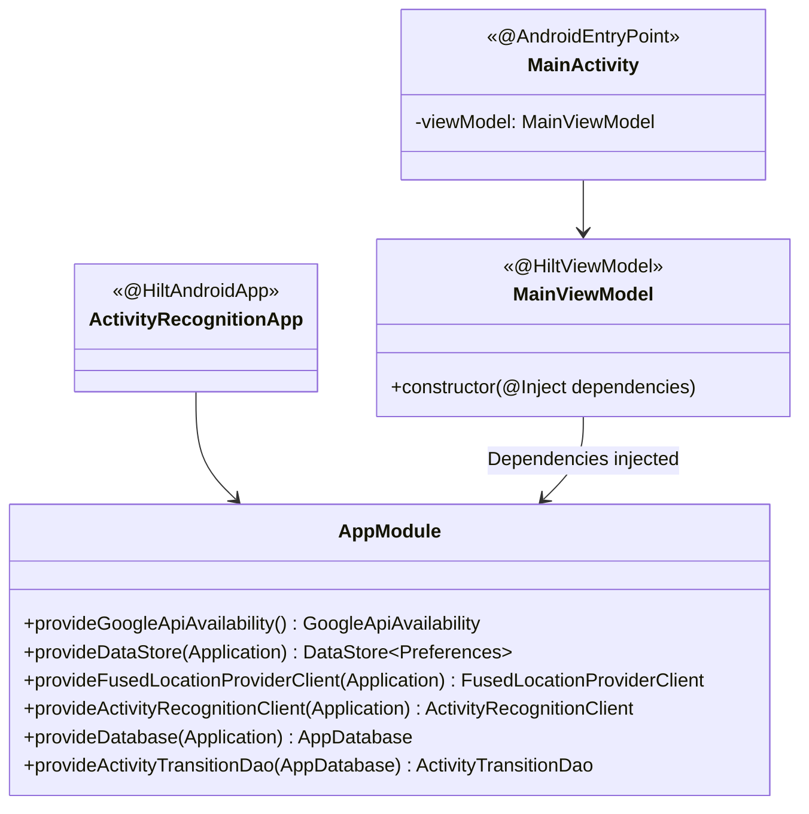
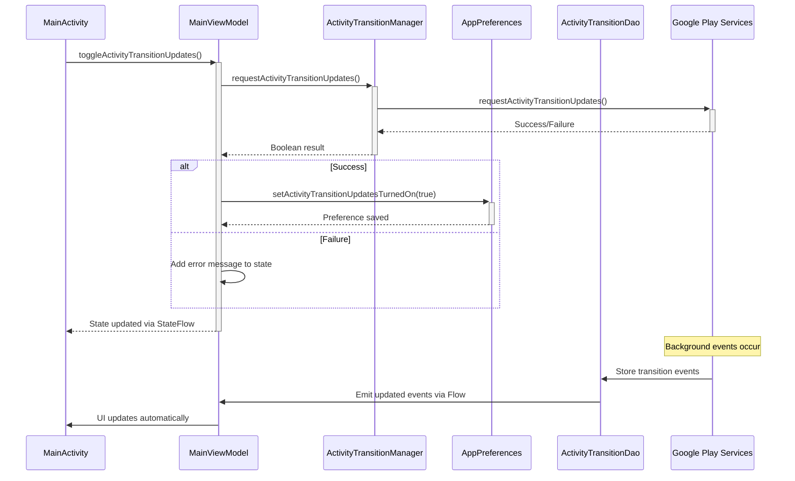

<!-- source: DeepWiki mcp.deepwiki.com · repo android/location-samples · page 3.4 MVVM and Dependency Injection · fetched 2026-10-23 -->

# MVVM and Dependency Injection

<details>
<summary>Relevant source files</summary>

The following files were used as context for generating this wiki page:

- [ActivityRecognition/app/build.gradle](ActivityRecognition/app/build.gradle)
- [ActivityRecognition/app/src/main/AndroidManifest.xml](ActivityRecognition/app/src/main/AndroidManifest.xml)
- [ActivityRecognition/app/src/main/java/com/google/android/gms/location/sample/activityrecognition/ActivityRecognitionApp.kt](ActivityRecognition/app/src/main/java/com/google/android/gms/location/sample/activityrecognition/ActivityRecognitionApp.kt)
- [ActivityRecognition/app/src/main/java/com/google/android/gms/location/sample/activityrecognition/MainActivity.kt](ActivityRecognition/app/src/main/java/com/google/android/gms/location/sample/activityrecognition/MainActivity.kt)
- [ActivityRecognition/app/src/main/java/com/google/android/gms/location/sample/activityrecognition/MainViewModel.kt](ActivityRecognition/app/src/main/java/com/google/android/gms/location/sample/activityrecognition/MainViewModel.kt)
- [ActivityRecognition/app/src/main/java/com/google/android/gms/location/sample/activityrecognition/ui/ActivityRecognitionScreen.kt](ActivityRecognition/app/src/main/java/com/google/android/gms/location/sample/activityrecognition/ui/ActivityRecognitionScreen.kt)
- [ActivityRecognition/app/src/main/res/values/strings.xml](ActivityRecognition/app/src/main/res/values/strings.xml)
- [ActivityRecognition/build.gradle](ActivityRecognition/build.gradle)
- [ForegroundLocationUpdates/app/build.gradle](ForegroundLocationUpdates/app/build.gradle)
- [ForegroundLocationUpdates/app/src/main/AndroidManifest.xml](ForegroundLocationUpdates/app/src/main/AndroidManifest.xml)
- [ForegroundLocationUpdates/app/src/main/java/com/google/android/gms/location/sample/foregroundlocation/ForegroundLocationApp.kt](ForegroundLocationUpdates/app/src/main/java/com/google/android/gms/location/sample/foregroundlocation/ForegroundLocationApp.kt)
- [ForegroundLocationUpdates/app/src/main/java/com/google/android/gms/location/sample/foregroundlocation/MainActivity.kt](ForegroundLocationUpdates/app/src/main/java/com/google/android/gms/location/sample/foregroundlocation/MainActivity.kt)
- [ForegroundLocationUpdates/app/src/main/java/com/google/android/gms/location/sample/foregroundlocation/MainViewModel.kt](ForegroundLocationUpdates/app/src/main/java/com/google/android/gms/location/sample/foregroundlocation/MainViewModel.kt)
- [ForegroundLocationUpdates/app/src/main/java/com/google/android/gms/location/sample/foregroundlocation/data/LocationPreferences.kt](ForegroundLocationUpdates/app/src/main/java/com/google/android/gms/location/sample/foregroundlocation/data/LocationPreferences.kt)
- [ForegroundLocationUpdates/app/src/main/java/com/google/android/gms/location/sample/foregroundlocation/data/LocationRepository.kt](ForegroundLocationUpdates/app/src/main/java/com/google/android/gms/location/sample/foregroundlocation/data/LocationRepository.kt)
- [ForegroundLocationUpdates/app/src/main/java/com/google/android/gms/location/sample/foregroundlocation/ui/LocationPermissionState.kt](ForegroundLocationUpdates/app/src/main/java/com/google/android/gms/location/sample/foregroundlocation/ui/LocationPermissionState.kt)
- [ForegroundLocationUpdates/app/src/main/java/com/google/android/gms/location/sample/foregroundlocation/ui/LocationUpdatesScreen.kt](ForegroundLocationUpdates/app/src/main/java/com/google/android/gms/location/sample/foregroundlocation/ui/LocationUpdatesScreen.kt)
- [ForegroundLocationUpdates/app/src/main/res/drawable/ic_location.xml](ForegroundLocationUpdates/app/src/main/res/drawable/ic_location.xml)
- [ForegroundLocationUpdates/app/src/main/res/values/strings.xml](ForegroundLocationUpdates/app/src/main/res/values/strings.xml)
- [LocationAddress/app/build.gradle](LocationAddress/app/build.gradle)
- [LocationAddress/app/src/main/AndroidManifest.xml](LocationAddress/app/src/main/AndroidManifest.xml)
- [LocationAddress/app/src/main/java/com/google/android/gms/location/sample/locationaddress/LocationAddressApp.kt](LocationAddress/app/src/main/java/com/google/android/gms/location/sample/locationaddress/LocationAddressApp.kt)
- [LocationAddress/app/src/main/java/com/google/android/gms/location/sample/locationaddress/MainActivity.kt](LocationAddress/app/src/main/java/com/google/android/gms/location/sample/locationaddress/MainActivity.kt)
- [LocationAddress/app/src/main/java/com/google/android/gms/location/sample/locationaddress/MainViewModel.kt](LocationAddress/app/src/main/java/com/google/android/gms/location/sample/locationaddress/MainViewModel.kt)
- [LocationAddress/app/src/main/java/com/google/android/gms/location/sample/locationaddress/data/GeocodingApi.kt](LocationAddress/app/src/main/java/com/google/android/gms/location/sample/locationaddress/data/GeocodingApi.kt)
- [LocationAddress/app/src/main/java/com/google/android/gms/location/sample/locationaddress/data/LocationApi.kt](LocationAddress/app/src/main/java/com/google/android/gms/location/sample/locationaddress/data/LocationApi.kt)
- [LocationAddress/app/src/main/java/com/google/android/gms/location/sample/locationaddress/data/PlayServicesAvailabilityChecker.kt](LocationAddress/app/src/main/java/com/google/android/gms/location/sample/locationaddress/data/PlayServicesAvailabilityChecker.kt)
- [LocationAddress/app/src/main/java/com/google/android/gms/location/sample/locationaddress/ui/DiscreteSlider.kt](LocationAddress/app/src/main/java/com/google/android/gms/location/sample/locationaddress/ui/DiscreteSlider.kt)
- [LocationAddress/app/src/main/java/com/google/android/gms/location/sample/locationaddress/ui/theme/Type.kt](LocationAddress/app/src/main/java/com/google/android/gms/location/sample/locationaddress/ui/theme/Type.kt)
- [LocationAddress/app/src/main/res/values/strings.xml](LocationAddress/app/src/main/res/values/strings.xml)
- [LocationAddress/build.gradle](LocationAddress/build.gradle)

</details>


This document covers the Model-View-ViewModel (MVVM) architectural pattern and Hilt dependency injection implementation used across the advanced samples in the Google Play Location & Context APIs repository. These patterns provide separation of concerns, testability, and maintainable code structure for location-based Android applications.

For information about data persistence patterns used with MVVM, see [Data Persistence](#3.3). For background processing patterns that complement these architectural choices, see [Background Processing Patterns](#3.2).

## MVVM Architecture Pattern

The MVVM pattern separates UI logic from business logic through three distinct layers: the View (UI components), ViewModel (UI state and business logic), and Model (data layer). The advanced samples demonstrate this pattern using Android Architecture Components with reactive data flow.

### MVVM Architecture Flow



**Sources:** [ActivityRecognition/app/src/main/java/com/google/android/gms/location/sample/activityrecognition/MainActivity.kt:42-46](), [ActivityRecognition/app/src/main/java/com/google/android/gms/location/sample/activityrecognition/MainViewModel.kt:44-50]()

### ViewModel Implementation Pattern

The ViewModels follow a consistent pattern across samples, using `@HiltViewModel` for dependency injection and `StateFlow` for reactive state management:

| Sample | ViewModel Class | Key Dependencies | State Management |
|--------|----------------|------------------|------------------|
| Activity Recognition | `MainViewModel` | `ActivityTransitionManager`, `AppPreferences`, `ActivityTransitionDao` | `StateFlow` for play services state, transition updates |
| Foreground Location | `MainViewModel` | `LocationRepository`, `LocationPreferences`, `ServiceConnection` | `StateFlow` for location updates, service state |
| Location Address | `MainViewModel` | `LocationApi`, `GeocodingApi`, `PlayServicesAvailabilityChecker` | `StateFlow` for UI state, `mutableStateOf` for addresses |

The ViewModels handle:
- UI state management through reactive streams
- Business logic coordination between data sources
- Configuration change survival
- Lifecycle-aware operations using `viewModelScope`

**Sources:** [ActivityRecognition/app/src/main/java/com/google/android/gms/location/sample/activityrecognition/MainViewModel.kt:44-112](), [ForegroundLocationUpdates/app/src/main/java/com/google/android/gms/location/sample/foregroundlocation/MainViewModel.kt:35-83](), [LocationAddress/app/src/main/java/com/google/android/gms/location/sample/locationaddress/MainViewModel.kt:38-86]()

## Dependency Injection with Hilt

Hilt provides compile-time dependency injection across the samples, managing object creation and lifecycle automatically. The implementation follows Android's recommended DI patterns for location-based applications.

### Hilt Component Hierarchy



**Sources:** [ActivityRecognition/app/src/main/java/com/google/android/gms/location/sample/activityrecognition/ActivityRecognitionApp.kt:40-76](), [ForegroundLocationUpdates/app/src/main/java/com/google/android/gms/location/sample/foregroundlocation/ForegroundLocationApp.kt:36-57]()

### Hilt Module Configuration

The `AppModule` classes provide singleton dependencies using `@Provides` methods:



**Sources:** [ActivityRecognition/app/src/main/java/com/google/android/gms/location/sample/activityrecognition/ActivityRecognitionApp.kt:42-76](), [LocationAddress/app/src/main/java/com/google/android/gms/location/sample/locationaddress/LocationAddressApp.kt:35-49]()

## Activity Recognition Sample Implementation

The Activity Recognition sample demonstrates the complete MVVM + Hilt architecture with complex state management and background processing:

### Component Interaction Flow



**Sources:** [ActivityRecognition/app/src/main/java/com/google/android/gms/location/sample/activityrecognition/MainViewModel.kt:76-104](), [ActivityRecognition/app/src/main/java/com/google/android/gms/location/sample/activityrecognition/MainActivity.kt:51-55]()

### State Management Architecture

The Activity Recognition sample uses multiple `StateFlow` instances for different aspects of UI state:

| StateFlow Property | Purpose | Source |
|-------------------|---------|--------|
| `playServicesAvailableState` | Google Play Services availability | `PlayServicesAvailabilityChecker` |
| `isActivityTransitionUpdatesTurnedOn` | Toggle button state | `AppPreferences.isActivityTransitionUpdatesTurnedOn` |
| `transitionEvents` | Recent activity transitions | `ActivityTransitionDao.getMostRecent()` |
| `errorMessages` | Error display management | `mutableStateOf` for UI feedback |

**Sources:** [ActivityRecognition/app/src/main/java/com/google/android/gms/location/sample/activityrecognition/MainViewModel.kt:57-74]()

## Build Configuration and Dependencies

All advanced samples require consistent Hilt setup in their build files:

### Required Dependencies

```
plugins {
    id 'dagger.hilt.android.plugin'
    id 'kotlin-kapt'
}

dependencies {
    // Hilt
    kapt "androidx.hilt:hilt-compiler:$hilt_compiler_version"
    kapt "com.google.dagger:hilt-android-compiler:$hilt_version"
    implementation "com.google.dagger:hilt-android:$hilt_version"
    
    // Compose + Hilt
    implementation 'androidx.hilt:hilt-navigation-compose:1.0.0-alpha03'
}
```

### Version Management

The project-level build files define consistent versions across samples:

| Dependency | Version Variable | Purpose |
|------------|-----------------|---------|
| Hilt | `hilt_version = '2.38.1'` | Core DI framework |
| Hilt Compiler | `hilt_compiler_version = '1.0.0'` | Annotation processing |
| Compose | `compose_version = '1.0.0'` | UI framework integration |
| Room | `room_version = "2.4.1"` | Database integration |

**Sources:** [ActivityRecognition/app/build.gradle:82-93](), [LocationAddress/app/build.gradle:82-93](), [ForegroundLocationUpdates/app/build.gradle:87-90]()

## Best Practices and Patterns

### ViewModel Lifecycle Management

ViewModels use `viewModelScope` for coroutine management, ensuring operations are cancelled when the ViewModel is cleared:

- **State Management**: Use `StateFlow` with `stateIn()` for hot flows that survive configuration changes
- **Error Handling**: Implement error state management with user feedback mechanisms
- **Resource Cleanup**: Leverage ViewModel's `onCleared()` for cleanup operations

### Dependency Scoping

The samples demonstrate proper dependency scoping:

- **Singleton**: Google Play Services clients, databases, preferences
- **ViewModel**: Business logic coordinators, UI state holders  
- **Activity**: UI components, permission handlers, service connections

### Testing Considerations

The MVVM + Hilt architecture enables comprehensive testing:

- **Unit Tests**: ViewModels can be tested independently with mocked dependencies
- **Integration Tests**: Hilt provides test modules for dependency replacement
- **UI Tests**: View layer can be tested with fake ViewModels

**Sources:** [ActivityRecognition/app/src/main/java/com/google/android/gms/location/sample/activityrecognition/MainViewModel.kt:23-36](), [ForegroundLocationUpdates/app/src/main/java/com/google/android/gms/location/sample/foregroundlocation/MainViewModel.kt:28-33]()

---

