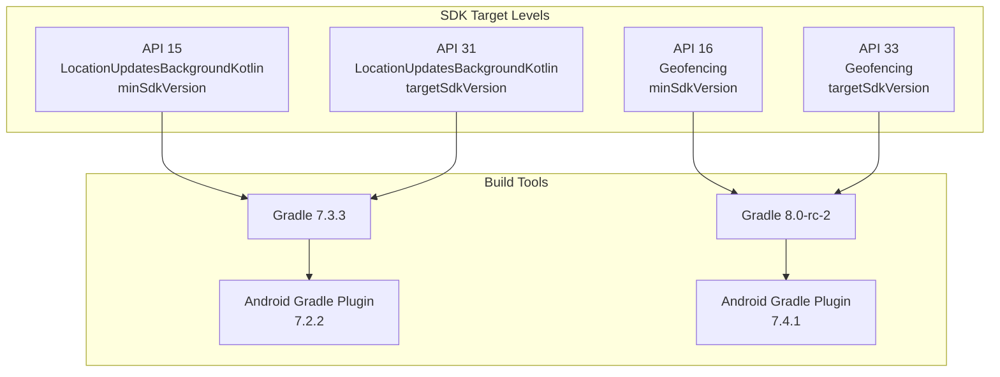
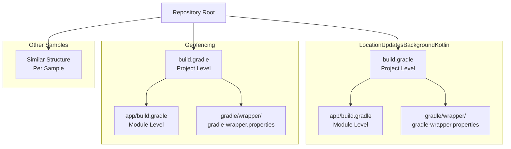
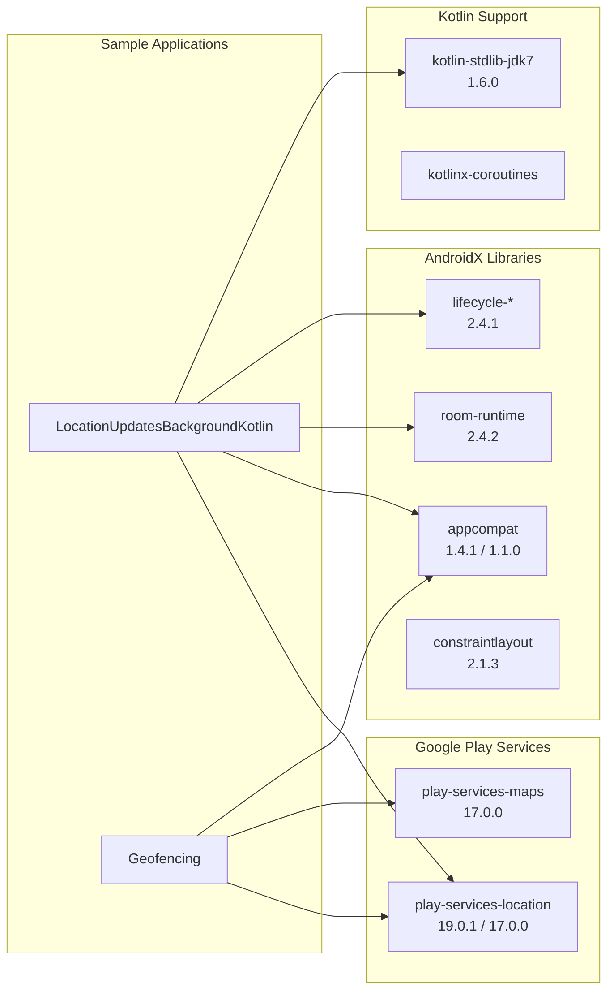
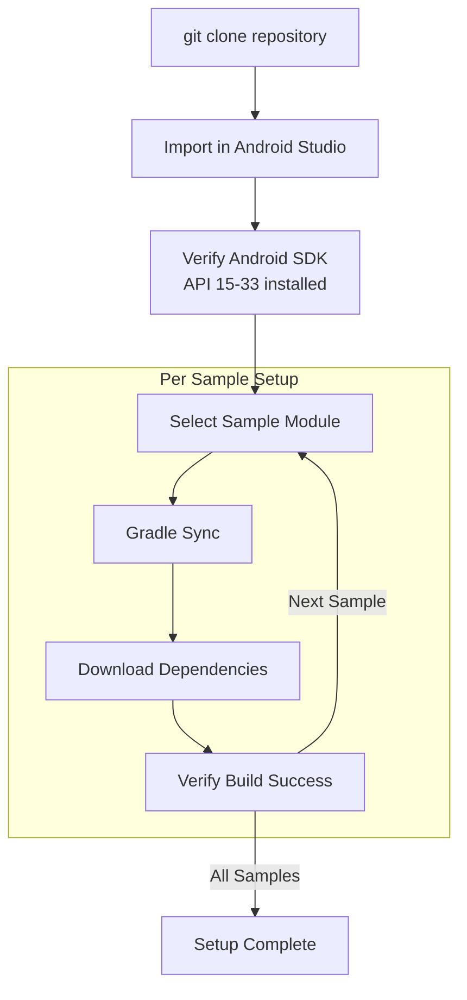
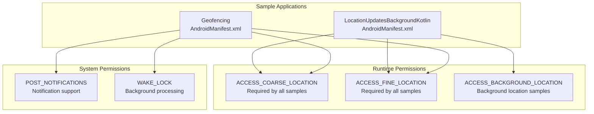

<!-- source: DeepWiki mcp.deepwiki.com · repo android/location-samples · page 4 Development Setup · fetched 2026-10-23 -->

# Development Setup

<details>
<summary>Relevant source files</summary>

The following files were used as context for generating this wiki page:

- [CONTRIBUTING.md](CONTRIBUTING.md)
- [Geofencing/app/build.gradle](Geofencing/app/build.gradle)
- [Geofencing/app/src/main/AndroidManifest.xml](Geofencing/app/src/main/AndroidManifest.xml)
- [Geofencing/build.gradle](Geofencing/build.gradle)
- [Geofencing/gradle.properties](Geofencing/gradle.properties)
- [Geofencing/gradle/wrapper/gradle-wrapper.jar](Geofencing/gradle/wrapper/gradle-wrapper.jar)
- [Geofencing/gradle/wrapper/gradle-wrapper.properties](Geofencing/gradle/wrapper/gradle-wrapper.properties)
- [Geofencing/gradlew](Geofencing/gradlew)
- [Geofencing/gradlew.bat](Geofencing/gradlew.bat)
- [LocationUpdatesBackgroundKotlin/app/build.gradle](LocationUpdatesBackgroundKotlin/app/build.gradle)
- [LocationUpdatesBackgroundKotlin/app/src/main/AndroidManifest.xml](LocationUpdatesBackgroundKotlin/app/src/main/AndroidManifest.xml)
- [LocationUpdatesBackgroundKotlin/app/src/main/res/drawable/ic_location_on_24px.xml](LocationUpdatesBackgroundKotlin/app/src/main/res/drawable/ic_location_on_24px.xml)
- [LocationUpdatesBackgroundKotlin/app/src/main/res/drawable/ic_my_location_24px.xml](LocationUpdatesBackgroundKotlin/app/src/main/res/drawable/ic_my_location_24px.xml)
- [LocationUpdatesBackgroundKotlin/app/src/main/res/layout/activity_main.xml](LocationUpdatesBackgroundKotlin/app/src/main/res/layout/activity_main.xml)
- [LocationUpdatesBackgroundKotlin/app/src/main/res/values/dimens.xml](LocationUpdatesBackgroundKotlin/app/src/main/res/values/dimens.xml)
- [LocationUpdatesBackgroundKotlin/build.gradle](LocationUpdatesBackgroundKotlin/build.gradle)
- [LocationUpdatesBackgroundKotlin/gradle.properties](LocationUpdatesBackgroundKotlin/gradle.properties)
- [LocationUpdatesBackgroundKotlin/gradle/wrapper/gradle-wrapper.properties](LocationUpdatesBackgroundKotlin/gradle/wrapper/gradle-wrapper.properties)

</details>


This document provides a comprehensive guide for setting up the development environment for the Google Play Location & Context APIs samples repository. It covers build system configuration, dependency management, SDK requirements, and environment setup procedures required to build and run the sample applications.

For information about specific architectural patterns used across samples, see [Architecture Patterns](#3). For details about individual sample applications, see [Sample Applications](#2).

## Prerequisites and System Requirements

The repository requires specific versions of development tools and SDKs to ensure compatibility across all sample applications.

### Required Development Tools

| Tool | Version | Purpose |
|------|---------|---------|
| Android Studio | Arctic Fox or later | Primary IDE |
| JDK | 8 or later | Java compilation |
| Android SDK | API 15-33 | Target platform support |
| Gradle | 7.3.3 - 8.0 | Build automation |

### Android SDK Configuration

Different samples target varying API levels based on their feature requirements:



**SDK Configuration by Sample**
- **LocationUpdatesBackgroundKotlin**: `minSdkVersion 15`, `targetSdkVersion 31`
- **Geofencing**: `minSdkVersion 16`, `targetSdkVersion 33`

Sources: [LocationUpdatesBackgroundKotlin/app/build.gradle:28-29](), [Geofencing/app/build.gradle:8-9]()

## Project Structure and Build Configuration

The repository follows a multi-module structure where each sample application maintains its own build configuration and dependencies.

### Build System Architecture



Each sample maintains independent:
- **Project-level build.gradle**: Defines `buildscript` dependencies and repository configurations
- **Module-level build.gradle**: Specifies application dependencies, SDK versions, and build variants
- **Gradle wrapper**: Ensures consistent Gradle version across development environments

Sources: [LocationUpdatesBackgroundKotlin/build.gradle:17-43](), [LocationUpdatesBackgroundKotlin/app/build.gradle:17-77](), [Geofencing/build.gradle:1-22]()

### Kotlin and Android Configuration

The samples use Kotlin as the primary development language with specific plugin configurations:

**LocationUpdatesBackgroundKotlin Configuration:**
- `kotlin-android` plugin for Android Kotlin support
- `kotlin-kapt` plugin for annotation processing
- Kotlin version: `1.6.0`
- JVM target: `1.8`

**Key Build Features:**
- `dataBinding { enabled true }` - Enables Android Data Binding
- `multiDexEnabled true` - Supports applications exceeding 64K method limit

Sources: [LocationUpdatesBackgroundKotlin/build.gradle:20](), [LocationUpdatesBackgroundKotlin/app/build.gradle:19-21,43-49]()

## Dependency Management

The samples demonstrate comprehensive dependency management covering Google Play Services, AndroidX libraries, and modern Android development tools.

### Core Dependencies Matrix



### Google Play Services Integration

All location-based samples require Google Play Services Location API:

**Version Variations by Sample:**
- LocationUpdatesBackground: `19.0.1`
- Geofencing: `17.0.0`

**Additional Services:**
- `play-services-maps` for map visualization in Geofencing sample

Sources: [LocationUpdatesBackgroundKotlin/app/build.gradle:71](), [Geofencing/app/build.gradle:29-30]()

### Database and Persistence

Advanced samples integrate Room database for local data persistence:

**Room Configuration:**
- `room-runtime:2.4.2` - Runtime library
- `room-compiler:2.4.2` - Annotation processor (kapt)

**Lifecycle Components:**
- `lifecycle-runtime-ktx:2.4.1`
- `lifecycle-viewmodel-ktx:2.4.1` 
- `lifecycle-extensions:2.2.0`

Sources: [LocationUpdatesBackgroundKotlin/app/build.gradle:63-68]()

## Environment Setup Workflow

### Initial Repository Setup



### Gradle Wrapper Configuration

Each sample includes Gradle wrapper for build consistency:

**Gradle Versions:**
- LocationUpdatesBackgroundKotlin: `gradle-7.3.3-bin.zip`
- Geofencing: `gradle-8.0-rc-2-bin.zip`

**Wrapper Properties:**
```
distributionBase=GRADLE_USER_HOME
distributionPath=wrapper/dists
zipStoreBase=GRADLE_USER_HOME
zipStorePath=wrapper/dists
```

Use `./gradlew` (Unix) or `gradlew.bat` (Windows) for consistent builds across environments.

Sources: [LocationUpdatesBackgroundKotlin/gradle/wrapper/gradle-wrapper.properties:1-7](), [Geofencing/gradle/wrapper/gradle-wrapper.properties:1-6]()

## Permission and Manifest Configuration

Samples require specific Android permissions and manifest configurations for location and context APIs.

### Location Permission Requirements



### Application Component Registration

**Broadcast Receivers:**
- `LocationUpdatesBroadcastReceiver` for background location updates
- `GeofenceBroadcastReceiver` for geofence transition events

**Services:**
- `GeofenceTransitionsJobIntentService` for background geofence processing

Sources: [LocationUpdatesBackgroundKotlin/app/src/main/AndroidManifest.xml:21-23,44-50](), [Geofencing/app/src/main/AndroidManifest.xml:19-22,43-51]()

## Build Variants and Configuration

### Debug and Release Configurations

**ProGuard Configuration:**
- Release builds: `minifyEnabled false` (disabled for sample clarity)
- ProGuard rules: `proguard-rules.pro` files maintain sample readability

**Data Binding:**
- Enabled in LocationUpdatesBackgroundKotlin for modern UI patterns
- Compiler: `com.android.databinding:compiler:3.1.4`

Sources: [LocationUpdatesBackgroundKotlin/app/build.gradle:36-45,69]()

## Testing and Development Tools

### Testing Dependencies

**Unit Testing:**
- `junit:junit:4.13.2` / `4.12`

**Instrumentation Testing:**
- `androidx.test.ext:junit:1.1.3`
- `androidx.test.espresso:espresso-core:3.4.0` / `3.1.1`

### Material Design Integration

- `com.google.android.material:material:1.5.0` / `1.0.0`

Sources: [LocationUpdatesBackgroundKotlin/app/build.gradle:73-76](), [Geofencing/app/build.gradle:22-28]()

---

