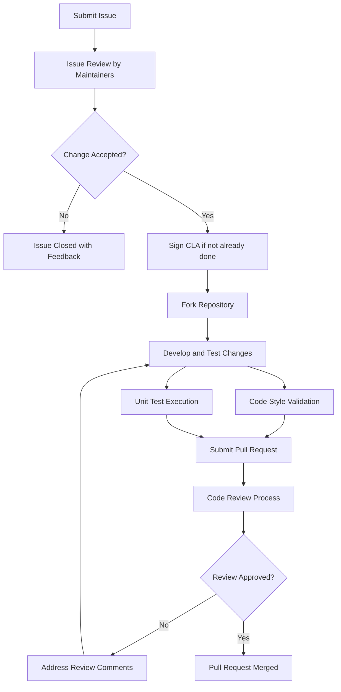
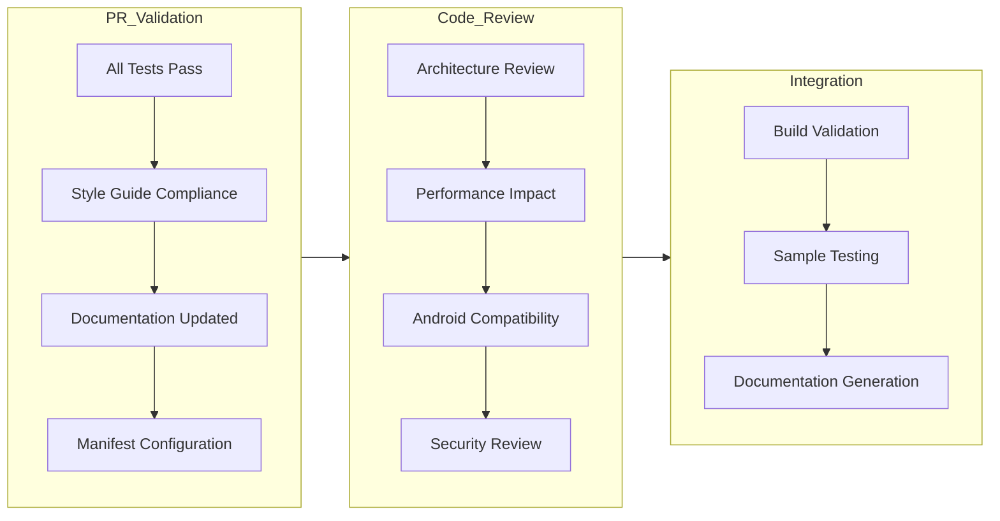

<!-- source: DeepWiki mcp.deepwiki.com · repo android/location-samples · page 5 Contributing Guidelines · fetched 2026-10-23 -->

# Contributing Guidelines

<details>
<summary>Relevant source files</summary>

The following files were used as context for generating this wiki page:

- [CONTRIBUTING.md](CONTRIBUTING.md)

</details>


This document outlines the process and requirements for contributing to the Google Play Location & Context APIs samples repository. It covers legal requirements, technical standards, testing expectations, and the submission workflow for patches, bug fixes, and new sample applications.

For information about the repository structure and existing samples, see [Sample Applications](#2). For details about architectural patterns used across samples, see [Architecture Patterns](#3).

## Legal Requirements

### Contributor License Agreement

Before any code contributions can be accepted, contributors must complete a Contributor License Agreement (CLA). This is a legal requirement for all Google open source projects.

**Individual Contributors**: If you are contributing as an individual and own the intellectual property of your contributions, sign the [individual CLA](https://cla.developers.google.com/clas).

**Corporate Contributors**: If you are contributing on behalf of a company, your organization must sign the [corporate CLA](https://developers.google.com/open-source/cla/corporate).

The CLA process is handled through Google's online system and must be completed before any pull requests can be merged.

Sources: [CONTRIBUTING.md:3-18]()

## Contribution Workflow

The standard contribution process follows these steps:



**Contribution Process Flow**

### Step-by-Step Process

1. **Issue Submission**: Submit an issue describing your proposed change to the repository
2. **Maintainer Response**: Repository maintainers will respond to evaluate the proposed change
3. **Change Acceptance**: If the change is accepted, proceed with development
4. **CLA Completion**: Complete the appropriate CLA if not already done
5. **Development**: Fork the repository and implement your changes
6. **Testing**: Ensure all tests pass and add appropriate unit tests
7. **Style Compliance**: Verify code adheres to the established style guidelines
8. **Pull Request**: Submit a pull request with your implementation

Sources: [CONTRIBUTING.md:20-33]()

## Code Standards and Architecture

### Style Guidelines

All contributions must adhere to the existing code style within the repository. The project follows the [Google Cloud Platform Samples Style Guide](https://github.com/GoogleCloudPlatform/Template/wiki/style.html) as the baseline for coding standards.

### Architecture Patterns

New sample applications should follow the established architectural patterns demonstrated in existing samples:

```mermaid
graph TB
    subgraph "Simple Samples Pattern"
        SA["Single Activity"] --> SP["Simple Permissions"]
        SP --> SAPI["Direct API Calls"]
    end
    
    subgraph "Intermediate Samples Pattern"  
        MVVM["MVVM Architecture"] --> VM["ViewModel Classes"]
        VM --> LV["LiveData/StateFlow"]
        LV --> PM["Permission Management"]
        PM --> API["Google Play Services APIs"]
    end
    
    subgraph "Advanced Samples Pattern"
        HILT["Hilt Dependency Injection"] --> ROOM["Room Database"]
        ROOM --> BR["BroadcastReceiver Pattern"]
        BR --> FS["Foreground Service Pattern"]
        FS --> BOOT["BootReceiver Recovery"]
    end
    
    subgraph "Code Quality Requirements"
        UT["Unit Tests"] --> INT["Integration Tests"]
        INT --> DOC["Documentation Comments"]
        DOC --> ERR["Error Handling"]
    end
```



**Architecture Pattern Compliance for New Samples**

### Required Components for Sample Applications

**Basic Requirements**:
- `MainActivity` with appropriate lifecycle management
- Proper permission handling for location/activity recognition APIs
- Error handling and user feedback mechanisms
- Clear separation of concerns

**Intermediate Requirements**:
- MVVM pattern with `ViewModel` and `LiveData`/`StateFlow`
- Repository pattern for data access
- Proper background processing patterns
- `AndroidManifest.xml` configuration following best practices

**Advanced Requirements**:
- Hilt dependency injection setup
- Room database for data persistence
- `BroadcastReceiver` classes for background event handling
- `BootReceiver` implementation for subscription recovery
- Foreground service patterns where appropriate

Sources: [CONTRIBUTING.md:26-30]()

## Testing Requirements

### Unit Test Coverage

All contributions must include appropriate unit tests that validate the functionality being added or modified. The testing requirements vary based on the complexity of the sample:

**Minimum Testing Requirements**:
- Core functionality unit tests
- Permission handling validation
- API integration tests
- Error condition handling

**Advanced Sample Testing Requirements**:
- `ViewModel` unit tests with mock repositories
- Database entity and DAO testing
- Service lifecycle testing
- Background processing validation

### Test Execution

Contributors must ensure that all existing tests continue to pass with their changes. Run the test suite using:

```
./gradlew test
```

New tests should follow the existing test structure and naming conventions found in the repository.

Sources: [CONTRIBUTING.md:31]()

## Repository Integration Process

### Pull Request Requirements



**Pull Request Validation and Integration Process**

### Submission Checklist

Before submitting a pull request, verify:

- [ ] Issue created and approved by maintainers
- [ ] CLA signed and processed
- [ ] Code follows repository style guidelines
- [ ] All existing tests pass
- [ ] New functionality includes unit tests
- [ ] Documentation updated as needed
- [ ] `AndroidManifest.xml` properly configured
- [ ] Permissions properly declared and handled
- [ ] Background processing follows Android best practices

### Review Process

Pull requests undergo review for:
- **Architectural Consistency**: Adherence to established patterns
- **Code Quality**: Readability, maintainability, and performance
- **Android Compatibility**: Support for target API levels
- **Security**: Proper permission handling and data protection
- **Documentation**: Clear comments and updated README files

Sources: [CONTRIBUTING.md:32]()

## Sample-Specific Contribution Guidelines

### New Sample Applications

When contributing new sample applications to demonstrate additional location or context APIs, ensure:

**Project Structure**:
- Follow the established directory naming conventions
- Include complete `build.gradle` configuration
- Provide comprehensive `README.md` documentation
- Include appropriate resource files and assets

**API Integration**:
- Use the latest Google Play Services versions
- Implement proper API key management
- Handle API deprecations and migrations
- Follow Google's API usage best practices

**User Experience**:
- Provide clear user interface for demonstration
- Include appropriate progress indicators
- Handle error states gracefully
- Implement proper permission request flows

### Existing Sample Updates

When updating existing samples:
- Maintain backward compatibility where possible
- Update documentation to reflect changes
- Ensure changes align with current Android best practices
- Test across supported Android versions

Sources: [CONTRIBUTING.md:1-33]()