# Page: Overview

# Overview

<details>
<summary>Relevant source files</summary>

The following files were used as context for generating this wiki page:

- [ActivityRecognition/README.md](ActivityRecognition/README.md)
- [Geofencing/README.md](Geofencing/README.md)
- [LocationUpdatesBackgroundKotlin/README.md](LocationUpdatesBackgroundKotlin/README.md)
- [README.md](README.md)

</details>


This document provides an overview of the Google Play Location & Context APIs sample repository, which contains demonstration applications for Android location and context awareness features. The repository showcases various architectural patterns and implementation approaches for integrating Google Play Services location APIs into Android applications.

**Important**: This repository has been deprecated and is no longer maintained. For current location samples, refer to the [new platform-samples repository](https://github.com/android/platform-samples/tree/main/samples/location).

For detailed documentation of individual sample applications, see [Sample Applications](#2). For cross-cutting architectural patterns and best practices, see [Architecture Patterns](#3).

## Repository Purpose

The repository serves as an educational resource demonstrating how to integrate Google Play Services location and context APIs into Android applications. It provides samples ranging from basic API usage to production-ready architectural patterns, including:

- Location tracking in foreground and background scenarios
- Activity recognition and sleep detection
- Geofencing and location-based notifications  
- Address geocoding and reverse geocoding
- Context awareness through Google's Awareness APIs

Each sample demonstrates different aspects of Android's location ecosystem while addressing modern Android constraints around background processing, permissions, and battery optimization.

**Sources**: [README.md:1-59]()

## Sample Applications Overview

The repository contains seven distinct sample applications, each targeting specific location or context APIs:

| Sample | Language | Primary API | Complexity Level |
|--------|----------|-------------|------------------|
| ActivityRecognition | Kotlin | ActivityRecognitionApi | Advanced |
| SleepSampleKotlin | Kotlin | Sleep API | Advanced |
| ForegroundLocationUpdates | Kotlin | FusedLocationProviderClient | Intermediate |
| LocationUpdatesBackgroundKotlin | Kotlin | FusedLocationProviderClient | Intermediate |
| LocationAddress | Kotlin | Geocoder API | Intermediate |
| Geofencing | Java | GeofencingClient | Intermediate |
| AwarenessApisSampleKotlin | Kotlin | Awareness Snapshot API | Basic |

**Sample Complexity Classification:**
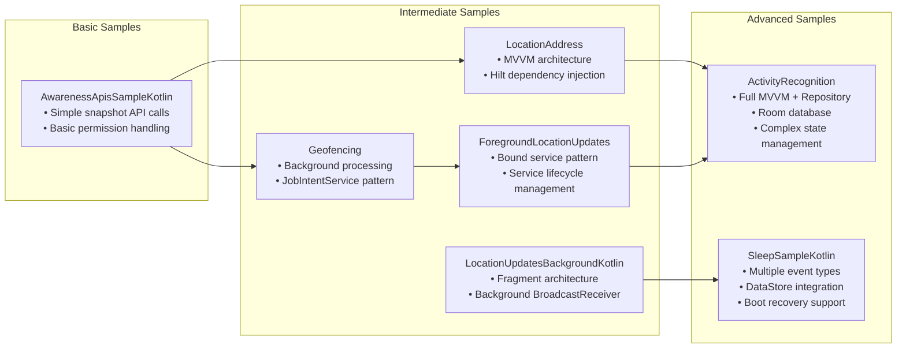

**Sources**: [README.md:12-28](), [ActivityRecognition/README.md:1-80](), [LocationUpdatesBackgroundKotlin/README.md:1-59](), [Geofencing/README.md:1-76]()

## Core API Integration Patterns

The samples demonstrate integration with multiple Google Play Services APIs through consistent patterns:

**API Client Integration Architecture:**
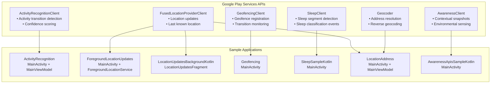

**Sources**: [README.md:14-28](), [ActivityRecognition/README.md:10-17](), [LocationUpdatesBackgroundKotlin/README.md:13-17]()

## Technical Requirements and Prerequisites

All samples share common technical requirements reflecting modern Android development practices:

**System Requirements:**
- Android API Level 9+ (minimum)
- Android Build Tools 21+ 
- Google Support Repository
- Location services enabled on device

**Key Dependencies:**
- Google Play Services Location APIs
- AndroidX libraries for modern UI components
- Hilt for dependency injection (advanced samples)
- Room database for local persistence (advanced samples)
- DataStore for preferences (newer samples)

**Runtime Requirements:**
- Device location must be enabled
- Appropriate runtime permissions granted
- Google Play Services installed and updated

**Sources**: [README.md:30-36](), [ActivityRecognition/README.md:37-43](), [LocationUpdatesBackgroundKotlin/README.md:37-42](), [Geofencing/README.md:33-39]()

## Permission Model Evolution

The samples demonstrate Android's evolving permission model for location and activity recognition:

**Permission Requirements by API Level:**
```mermaid
graph TB
    subgraph "Location Permissions"
        COARSE["ACCESS_COARSE_LOCATION<br/>All location samples"]
        FINE["ACCESS_FINE_LOCATION<br/>All location samples"] 
        BACKGROUND["ACCESS_BACKGROUND_LOCATION<br/>API 29+ background samples"]
    end
    
    subgraph "Activity Recognition Permissions"
        ACT_OLD["com.google.android.gms.permission.ACTIVITY_RECOGNITION<br/>API ≤ 28"]
        ACT_NEW["android.permission.ACTIVITY_RECOGNITION<br/>API ≥ 29"]
    end
    
    subgraph "System Permissions"
        BOOT["RECEIVE_BOOT_COMPLETED<br/>Auto-restart after reboot"]
        NOTIF["POST_NOTIFICATIONS<br/>API 33+ notification display"]
        WAKE["WAKE_LOCK<br/>Background processing"]
    end
    
    subgraph "Sample Usage"
        AR_PERMS["ActivityRecognition<br/>• ACTIVITY_RECOGNITION<br/>• RECEIVE_BOOT_COMPLETED"]
        BG_PERMS["LocationUpdatesBackgroundKotlin<br/>• ACCESS_BACKGROUND_LOCATION<br/>• RECEIVE_BOOT_COMPLETED"] 
        FG_PERMS["ForegroundLocationUpdates<br/>• POST_NOTIFICATIONS<br/>• WAKE_LOCK"]
    end
    
    ACT_NEW --> AR_PERMS
    BACKGROUND --> BG_PERMS
    BOOT --> AR_PERMS
    BOOT --> BG_PERMS
    NOTIF --> FG_PERMS
    WAKE --> FG_PERMS
```

**Sources**: [LocationUpdatesBackgroundKotlin/README.md:19-27]()

## Build System and Project Structure

The repository uses Gradle build system with individual module structure for each sample:

**Project Structure:**
- Each sample is a standalone Android application
- Individual `build.gradle` files with specific dependencies
- Shared Gradle wrapper for consistent build environment
- Apache License 2.0 for all samples

**Build Commands:**
- `gradlew build` - Build all samples
- Import individual projects in Android Studio
- Target SDK versions vary by sample complexity and API requirements

**Sources**: [README.md:37-42](), [ActivityRecognition/README.md:44-49](), [LocationUpdatesBackgroundKotlin/README.md:43-47](), [Geofencing/README.md:40-45]()

---

# Page: Sample Applications

# Sample Applications

<details>
<summary>Relevant source files</summary>

The following files were used as context for generating this wiki page:

- [ActivityRecognition/README.md](ActivityRecognition/README.md)
- [Geofencing/README.md](Geofencing/README.md)
- [LocationUpdatesBackgroundKotlin/README.md](LocationUpdatesBackgroundKotlin/README.md)
- [README.md](README.md)

</details>


This document provides a comprehensive overview of the sample applications included in the Google Play Location & Context APIs repository. Each sample demonstrates specific aspects of location services, activity recognition, geofencing, and context awareness APIs available through Google Play Services.

**Note**: These samples have been deprecated and are no longer maintained. For current location samples, refer to the new platform-samples repository.

For detailed documentation of individual sample architectures and patterns, see [Architecture Patterns](#3). For development setup instructions, see [Development Setup](#4).

## Sample Application Overview

The repository contains seven distinct sample applications, each targeting different use cases and complexity levels for location and context APIs:

| Sample | Language | Primary API | Complexity | Key Features |
|--------|----------|-------------|------------|--------------|
| ActivityRecognition | Kotlin | ActivityRecognitionApi | Advanced | MVVM, Room DB, Background processing |
| SleepSampleKotlin | Kotlin | Sleep API | Advanced | Activity transitions, DataStore |
| ForegroundLocationUpdates | Kotlin | FusedLocationProviderClient | Intermediate | Bound service, Notifications |
| LocationUpdatesBackgroundKotlin | Kotlin | FusedLocationProviderClient | Intermediate | Background location, Permissions |
| LocationAddress | Kotlin | Geocoder API | Basic | Address geocoding, MVVM |
| Geofencing | Java | GeofencingClient | Intermediate | Geographic boundaries, JobIntentService |
| AwarenessApisSampleKotlin | Kotlin | Awareness APIs | Basic | Contextual snapshots |

Sources: [README.md:12-27](), [ActivityRecognition/README.md:7-27](), [LocationUpdatesBackgroundKotlin/README.md:7-35](), [Geofencing/README.md:7-29]()

## Sample Application Categories

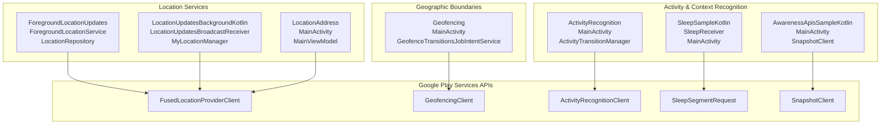

Sources: [README.md:14-27](), [ActivityRecognition/README.md:10-27](), [LocationUpdatesBackgroundKotlin/README.md:13-16]()

## Core Components Architecture

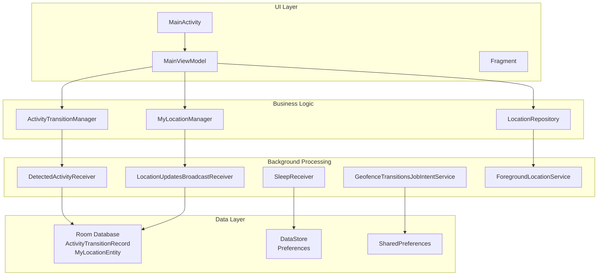

Sources: [ActivityRecognition/README.md:22-27](), [LocationUpdatesBackgroundKotlin/README.md:16-17](), [Geofencing/README.md:10-29]()

## Individual Sample Applications

### Activity Recognition Sample
**Purpose**: Demonstrates `ActivityRecognitionApi` for detecting user activities (walking, driving, standing still) with confidence levels.

**Key Components**:
- `MainActivity` with MVVM pattern
- `DetectedActivityReceiver` for background processing
- `ActivityTransitionManager` for API integration
- Room database for persistence

**Location**: `/ActivityRecognition/`

Sources: [ActivityRecognition/README.md:10-27]()

### Sleep Sample Kotlin
**Purpose**: Uses Sleep API to recognize user sleep patterns and activity transitions.

**Key Components**:
- `SleepReceiver` for sleep event handling
- DataStore for preferences
- Sleep segment and event processing

**Location**: `/SleepSampleKotlin/`

Sources: [README.md:27]()

### Foreground Location Updates
**Purpose**: Implements foreground service pattern for continuous location tracking while app is visible to user.

**Key Components**:
- `ForegroundLocationService` bound service
- `LocationRepository` for data management
- Notification system for foreground service

**Location**: `/ForegroundLocationUpdates/`

Sources: [README.md:19]()

### Background Location Updates Kotlin
**Purpose**: Demonstrates proper background location tracking using `PendingIntent` and `BroadcastReceiver` pattern.

**Key Components**:
- `LocationUpdatesBroadcastReceiver` for location events
- `MyLocationManager` for API coordination
- Permission handling for background location access

**Location**: `/LocationUpdatesBackgroundKotlin/`

Sources: [LocationUpdatesBackgroundKotlin/README.md:13-27]()

### Location Address Sample
**Purpose**: Converts geographic coordinates to human-readable addresses using Android's `Geocoder` API.

**Key Components**:
- `MainActivity` with MVVM architecture
- `MainViewModel` for address resolution
- Geocoder API integration

**Location**: `/LocationAddress/`

Sources: [README.md:23]()

### Geofencing Sample
**Purpose**: Creates and monitors geographic boundaries, triggering notifications on entry/exit events.

**Key Components**:
- `GeofenceTransitionsJobIntentService` for background processing
- `GeofencingClient` API integration
- Notification system for geofence events

**Location**: `/Geofencing/`

Sources: [Geofencing/README.md:10-29]()

### Awareness APIs Sample Kotlin
**Purpose**: Utilizes Google Awareness APIs to gather contextual information about user environment and situation.

**Key Components**:
- `SnapshotClient` for contextual data
- Single-activity architecture
- Awareness API snapshot functionality

**Location**: `/AwarenessApisSampleKotlin/`

Sources: [README.md:17]()

## Prerequisites and Requirements

All samples require:
- Android API Level 9 or higher (specific samples may require higher levels)
- Android Build Tools version 21 or higher
- Google Support Repository
- Location services enabled on the device

**Important**: Background location samples require `ACCESS_BACKGROUND_LOCATION` permission on Android 10+ and have additional restrictions.

Sources: [README.md:30-36](), [ActivityRecognition/README.md:37-42](), [LocationUpdatesBackgroundKotlin/README.md:25-27]()

---

# Page: Activity Recognition Sample

# Activity Recognition Sample

<details>
<summary>Relevant source files</summary>

The following files were used as context for generating this wiki page:

- [ActivityRecognition/app/build.gradle](ActivityRecognition/app/build.gradle)
- [ActivityRecognition/app/src/main/AndroidManifest.xml](ActivityRecognition/app/src/main/AndroidManifest.xml)
- [ActivityRecognition/app/src/main/java/com/google/android/gms/location/sample/activityrecognition/ActivityRecognitionApp.kt](ActivityRecognition/app/src/main/java/com/google/android/gms/location/sample/activityrecognition/ActivityRecognitionApp.kt)
- [ActivityRecognition/app/src/main/java/com/google/android/gms/location/sample/activityrecognition/BootReceiver.kt](ActivityRecognition/app/src/main/java/com/google/android/gms/location/sample/activityrecognition/BootReceiver.kt)
- [ActivityRecognition/app/src/main/java/com/google/android/gms/location/sample/activityrecognition/DetectedActivityReceiver.kt](ActivityRecognition/app/src/main/java/com/google/android/gms/location/sample/activityrecognition/DetectedActivityReceiver.kt)
- [ActivityRecognition/app/src/main/java/com/google/android/gms/location/sample/activityrecognition/MainActivity.kt](ActivityRecognition/app/src/main/java/com/google/android/gms/location/sample/activityrecognition/MainActivity.kt)
- [ActivityRecognition/app/src/main/java/com/google/android/gms/location/sample/activityrecognition/MainViewModel.kt](ActivityRecognition/app/src/main/java/com/google/android/gms/location/sample/activityrecognition/MainViewModel.kt)
- [ActivityRecognition/app/src/main/java/com/google/android/gms/location/sample/activityrecognition/PermissionUtils.kt](ActivityRecognition/app/src/main/java/com/google/android/gms/location/sample/activityrecognition/PermissionUtils.kt)
- [ActivityRecognition/app/src/main/java/com/google/android/gms/location/sample/activityrecognition/data/ActivityTransitionManager.kt](ActivityRecognition/app/src/main/java/com/google/android/gms/location/sample/activityrecognition/data/ActivityTransitionManager.kt)
- [ActivityRecognition/app/src/main/java/com/google/android/gms/location/sample/activityrecognition/data/db/ActivityTransitionDao.kt](ActivityRecognition/app/src/main/java/com/google/android/gms/location/sample/activityrecognition/data/db/ActivityTransitionDao.kt)
- [ActivityRecognition/app/src/main/java/com/google/android/gms/location/sample/activityrecognition/data/db/ActivityTransitionRecord.kt](ActivityRecognition/app/src/main/java/com/google/android/gms/location/sample/activityrecognition/data/db/ActivityTransitionRecord.kt)
- [ActivityRecognition/app/src/main/java/com/google/android/gms/location/sample/activityrecognition/data/db/AppDatabase.kt](ActivityRecognition/app/src/main/java/com/google/android/gms/location/sample/activityrecognition/data/db/AppDatabase.kt)
- [ActivityRecognition/app/src/main/java/com/google/android/gms/location/sample/activityrecognition/data/db/TimestampConverter.kt](ActivityRecognition/app/src/main/java/com/google/android/gms/location/sample/activityrecognition/data/db/TimestampConverter.kt)
- [ActivityRecognition/app/src/main/java/com/google/android/gms/location/sample/activityrecognition/ui/ActivityRecognitionPermissionState.kt](ActivityRecognition/app/src/main/java/com/google/android/gms/location/sample/activityrecognition/ui/ActivityRecognitionPermissionState.kt)
- [ActivityRecognition/app/src/main/java/com/google/android/gms/location/sample/activityrecognition/ui/ActivityRecognitionScreen.kt](ActivityRecognition/app/src/main/java/com/google/android/gms/location/sample/activityrecognition/ui/ActivityRecognitionScreen.kt)
- [ActivityRecognition/app/src/main/res/values/strings.xml](ActivityRecognition/app/src/main/res/values/strings.xml)
- [ActivityRecognition/build.gradle](ActivityRecognition/build.gradle)

</details>


## Purpose and Scope

This document covers the Activity Recognition sample application, which demonstrates how to implement Google Play Services Activity Recognition API to detect user activity transitions (such as walking, driving, cycling) using modern Android architecture patterns. The sample showcases MVVM architecture with Jetpack Compose UI, Hilt dependency injection, Room database persistence, and proper background processing patterns.

For information about other location-based samples, see [Location Services Samples](#2.3). For general architecture patterns used across samples, see [Architecture Patterns](#3).

## Architecture Overview

The Activity Recognition sample follows the MVVM (Model-View-ViewModel) architectural pattern with clean separation of concerns and dependency injection.

### MVVM Architecture Diagram

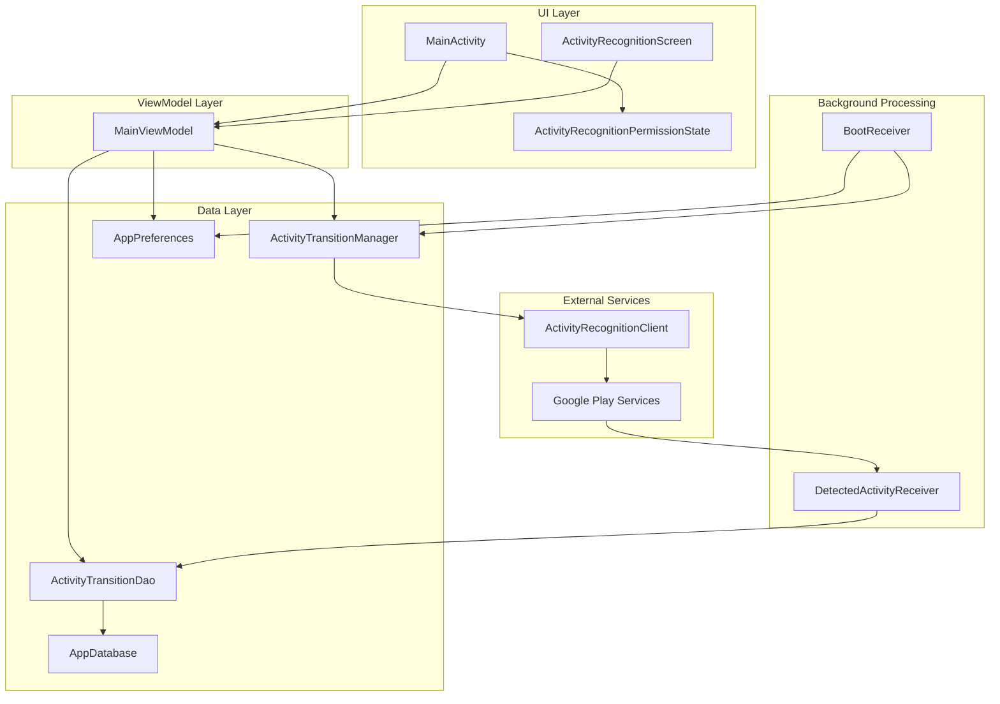

**Sources:** [ActivityRecognition/app/src/main/java/com/google/android/gms/location/sample/activityrecognition/MainActivity.kt:42-87](), [ActivityRecognition/app/src/main/java/com/google/android/gms/location/sample/activityrecognition/MainViewModel.kt:44-50](), [ActivityRecognition/app/src/main/java/com/google/android/gms/location/sample/activityrecognition/ActivityRecognitionApp.kt:35-76]()

### Key Components

| Component | Type | Responsibility |
|-----------|------|----------------|
| `MainActivity` | Activity | Entry point, handles Compose UI setup and permission state |
| `MainViewModel` | ViewModel | Manages UI state, coordinates business logic |
| `ActivityTransitionManager` | Repository | Handles Activity Recognition API calls |
| `DetectedActivityReceiver` | BroadcastReceiver | Processes activity transition events in background |
| `BootReceiver` | BroadcastReceiver | Restores activity recognition after device boot |
| `AppDatabase` | Room Database | Persists activity transition records |
| `AppPreferences` | DataStore | Stores user preferences and state |

**Sources:** [ActivityRecognition/app/src/main/java/com/google/android/gms/location/sample/activityrecognition/MainActivity.kt:44](), [ActivityRecognition/app/src/main/java/com/google/android/gms/location/sample/activityrecognition/MainViewModel.kt:44](), [ActivityRecognition/app/src/main/java/com/google/android/gms/location/sample/activityrecognition/data/ActivityTransitionManager.kt:34]()

## Activity Recognition Flow

The sample implements a complete activity recognition flow from user interaction to background processing and data persistence.

### Activity Recognition Data Flow

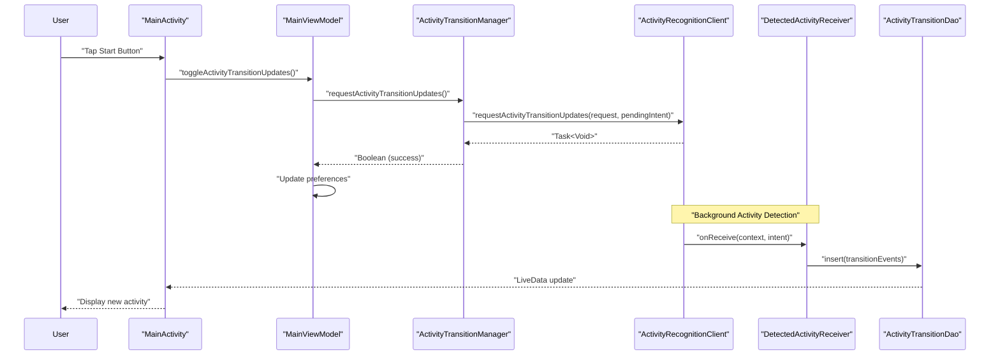

**Sources:** [ActivityRecognition/app/src/main/java/com/google/android/gms/location/sample/activityrecognition/MainViewModel.kt:76-82](), [ActivityRecognition/app/src/main/java/com/google/android/gms/location/sample/activityrecognition/data/ActivityTransitionManager.kt:54-80](), [ActivityRecognition/app/src/main/java/com/google/android/gms/location/sample/activityrecognition/DetectedActivityReceiver.kt:37-47]()

### Activity Transition Request Configuration

The sample requests activity transition updates for all supported activity types, focusing on `ACTIVITY_TRANSITION_ENTER` events to detect when users begin new activities.

```kotlin
// From ActivityTransitionManager.requestActivityTransitionUpdates()
val request = ActivityTransitionRequest(
    DetectedActivityType.values().map {
        ActivityTransition.Builder()
            .setActivityTransition(ActivityTransition.ACTIVITY_TRANSITION_ENTER)
            .setActivityType(it.type)
            .build()
    }
)
```

**Sources:** [ActivityRecognition/app/src/main/java/com/google/android/gms/location/sample/activityrecognition/data/ActivityTransitionManager.kt:64-71]()

## Data Persistence

The sample uses Room database to persist activity transition records and DataStore for user preferences.

### Database Schema

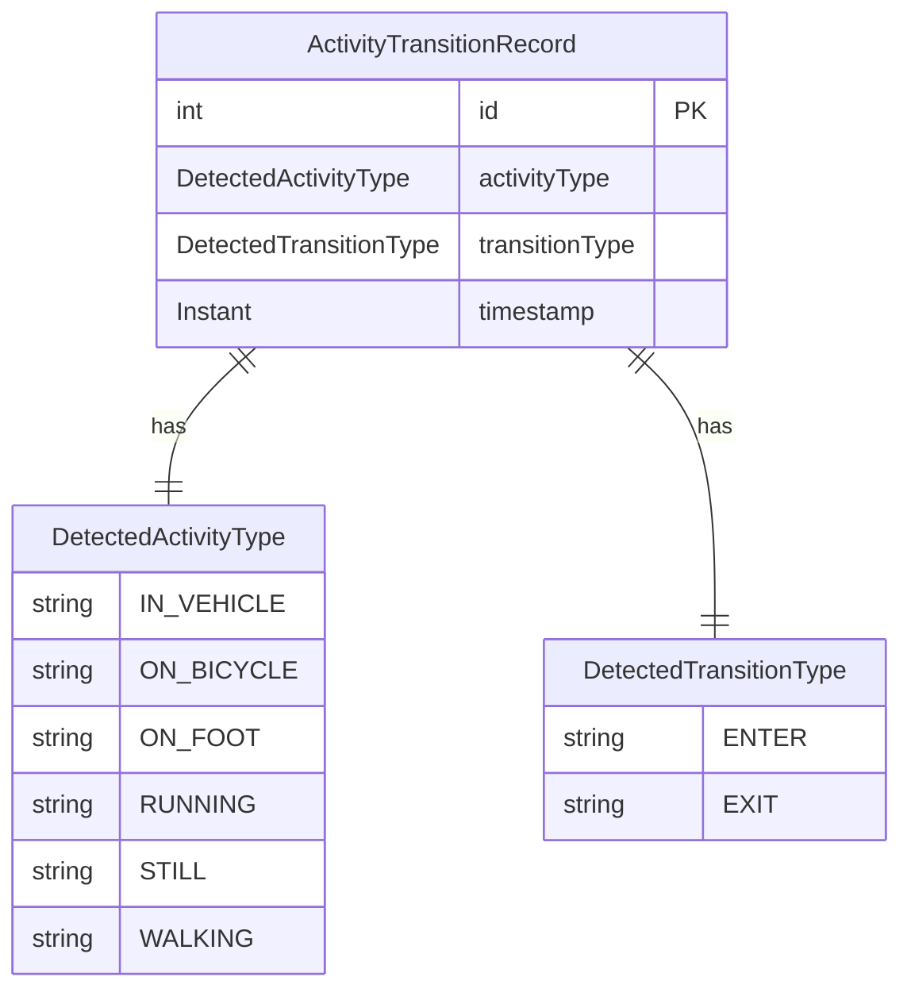

**Sources:** [ActivityRecognition/app/src/main/java/com/google/android/gms/location/sample/activityrecognition/data/db/ActivityTransitionRecord.kt:32-39](), [ActivityRecognition/app/src/main/java/com/google/android/gms/location/sample/activityrecognition/data/db/ActivityTransitionRecord.kt:45-58](), [ActivityRecognition/app/src/main/java/com/google/android/gms/location/sample/activityrecognition/data/db/ActivityTransitionRecord.kt:63-72]()

### Data Access Object

The `ActivityTransitionDao` provides methods for database operations with reactive data flow using Flow.

| Method | Purpose |
|--------|---------|
| `insert(records: List<ActivityTransitionRecord>)` | Insert new activity transition records |
| `deleteAll()` | Clear all records when stopping recognition |
| `getMostRecent(): Flow<List<ActivityTransitionRecord>>` | Get 20 most recent records with reactive updates |

**Sources:** [ActivityRecognition/app/src/main/java/com/google/android/gms/location/sample/activityrecognition/data/db/ActivityTransitionDao.kt:30-37]()

## Permission Management

The sample handles activity recognition permissions across different Android API levels with a proper permission flow.

### Permission Handling Flow

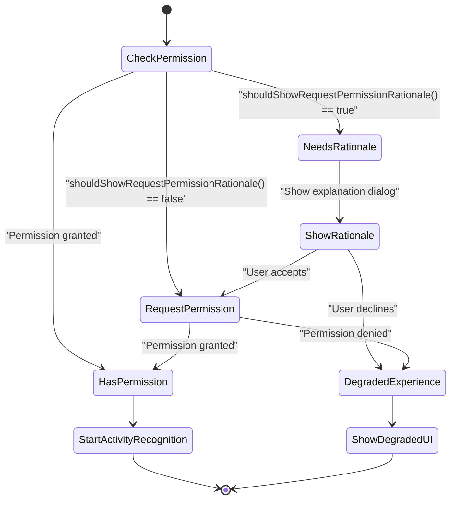

**Sources:** [ActivityRecognition/app/src/main/java/com/google/android/gms/location/sample/activityrecognition/ui/ActivityRecognitionPermissionState.kt:57-100](), [ActivityRecognition/app/src/main/java/com/google/android/gms/location/sample/activityrecognition/PermissionUtils.kt:32-39]()

### API Level Permission Handling

The sample correctly handles the permission change introduced in Android 10 (API 29):

| API Level | Permission Required |
|-----------|-------------------|
| ≤ 28 | `com.google.android.gms.permission.ACTIVITY_RECOGNITION` |
| ≥ 29 | `android.permission.ACTIVITY_RECOGNITION` |

**Sources:** [ActivityRecognition/app/src/main/java/com/google/android/gms/location/sample/activityrecognition/PermissionUtils.kt:35-39](), [ActivityRecognition/app/src/main/AndroidManifest.xml:23-29]()

## Background Processing

The sample implements robust background processing to handle activity recognition events and maintain functionality across app lifecycle changes.

### Background Processing Components

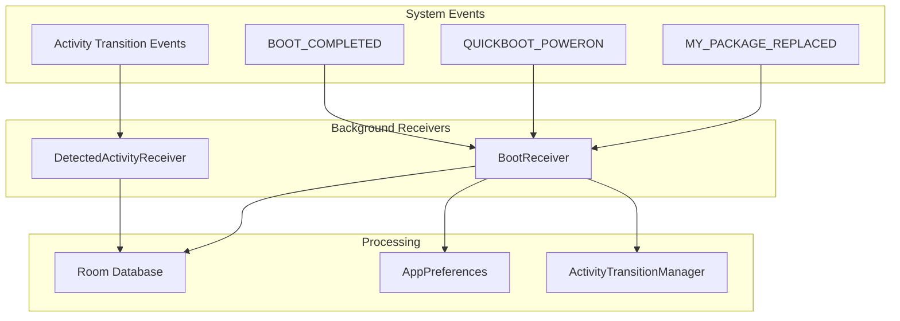

**Sources:** [ActivityRecognition/app/src/main/java/com/google/android/gms/location/sample/activityrecognition/DetectedActivityReceiver.kt:30-48](), [ActivityRecognition/app/src/main/java/com/google/android/gms/location/sample/activityrecognition/BootReceiver.kt:35-76](), [ActivityRecognition/app/src/main/AndroidManifest.xml:54-76]()

### Boot Recovery Process

The `BootReceiver` implements automatic restoration of activity recognition after device restarts:

1. **Check Preferences**: Verify if activity recognition was previously enabled
2. **Validate Conditions**: Ensure Play Services availability and permissions
3. **Restore Registration**: Re-register for activity transition updates
4. **Handle Failures**: Reset preferences if restoration fails

**Sources:** [ActivityRecognition/app/src/main/java/com/google/android/gms/location/sample/activityrecognition/BootReceiver.kt:46-66]()

## Dependency Injection

The sample uses Hilt for dependency injection with a singleton-scoped module providing key dependencies.

### Hilt Module Configuration

| Dependency | Scope | Purpose |
|------------|-------|---------|
| `GoogleApiAvailability` | Singleton | Check Google Play Services availability |
| `DataStore<Preferences>` | Singleton | Store user preferences |
| `ActivityRecognitionClient` | Singleton | Interface to Activity Recognition API |
| `AppDatabase` | Singleton | Room database instance |
| `ActivityTransitionDao` | Singleton | Database access object |

**Sources:** [ActivityRecognition/app/src/main/java/com/google/android/gms/location/sample/activityrecognition/ActivityRecognitionApp.kt:42-76]()

## Build Configuration

The sample requires specific dependencies and build configuration for modern Android development.

### Key Dependencies

| Dependency | Purpose |
|------------|---------|
| `play-services-location:18.0.0` | Google Play Services Location APIs |
| `hilt-android` | Dependency injection framework |
| `room-runtime` | Database persistence |
| `datastore-preferences` | Modern preferences storage |
| `compose-ui` | Jetpack Compose UI toolkit |
| `kotlinx-coroutines` | Asynchronous programming |

**Sources:** [ActivityRecognition/app/build.gradle:86-104]()

The sample targets API 31 with minimum API 21, uses Kotlin coroutines throughout, and enables Jetpack Compose for modern UI development.

**Sources:** [ActivityRecognition/app/build.gradle:24-61]()

---

# Page: Sleep Sample

# Sleep Sample

<details>
<summary>Relevant source files</summary>

The following files were used as context for generating this wiki page:

- [SleepSampleKotlin/.gitignore](SleepSampleKotlin/.gitignore)
- [SleepSampleKotlin/README.md](SleepSampleKotlin/README.md)
- [SleepSampleKotlin/app/.gitignore](SleepSampleKotlin/app/.gitignore)
- [SleepSampleKotlin/app/build.gradle](SleepSampleKotlin/app/build.gradle)
- [SleepSampleKotlin/app/proguard-rules.pro](SleepSampleKotlin/app/proguard-rules.pro)
- [SleepSampleKotlin/app/src/main/AndroidManifest.xml](SleepSampleKotlin/app/src/main/AndroidManifest.xml)
- [SleepSampleKotlin/app/src/main/java/com/android/example/sleepsamplekotlin/MainActivity.kt](SleepSampleKotlin/app/src/main/java/com/android/example/sleepsamplekotlin/MainActivity.kt)
- [SleepSampleKotlin/app/src/main/java/com/android/example/sleepsamplekotlin/MainApplication.kt](SleepSampleKotlin/app/src/main/java/com/android/example/sleepsamplekotlin/MainApplication.kt)
- [SleepSampleKotlin/app/src/main/java/com/android/example/sleepsamplekotlin/MainViewModel.kt](SleepSampleKotlin/app/src/main/java/com/android/example/sleepsamplekotlin/MainViewModel.kt)
- [SleepSampleKotlin/app/src/main/java/com/android/example/sleepsamplekotlin/data/SleepRepository.kt](SleepSampleKotlin/app/src/main/java/com/android/example/sleepsamplekotlin/data/SleepRepository.kt)
- [SleepSampleKotlin/app/src/main/java/com/android/example/sleepsamplekotlin/data/datastore/SleepSubscriptionStatus.kt](SleepSampleKotlin/app/src/main/java/com/android/example/sleepsamplekotlin/data/datastore/SleepSubscriptionStatus.kt)
- [SleepSampleKotlin/app/src/main/java/com/android/example/sleepsamplekotlin/data/db/SleepClassifyEventDao.kt](SleepSampleKotlin/app/src/main/java/com/android/example/sleepsamplekotlin/data/db/SleepClassifyEventDao.kt)
- [SleepSampleKotlin/app/src/main/java/com/android/example/sleepsamplekotlin/data/db/SleepClassifyEventEntity.kt](SleepSampleKotlin/app/src/main/java/com/android/example/sleepsamplekotlin/data/db/SleepClassifyEventEntity.kt)
- [SleepSampleKotlin/app/src/main/java/com/android/example/sleepsamplekotlin/data/db/SleepDatabase.kt](SleepSampleKotlin/app/src/main/java/com/android/example/sleepsamplekotlin/data/db/SleepDatabase.kt)
- [SleepSampleKotlin/app/src/main/java/com/android/example/sleepsamplekotlin/data/db/SleepSegmentEventDao.kt](SleepSampleKotlin/app/src/main/java/com/android/example/sleepsamplekotlin/data/db/SleepSegmentEventDao.kt)
- [SleepSampleKotlin/app/src/main/java/com/android/example/sleepsamplekotlin/data/db/SleepSegmentEventEntity.kt](SleepSampleKotlin/app/src/main/java/com/android/example/sleepsamplekotlin/data/db/SleepSegmentEventEntity.kt)
- [SleepSampleKotlin/app/src/main/res/drawable-v24/ic_launcher_foreground.xml](SleepSampleKotlin/app/src/main/res/drawable-v24/ic_launcher_foreground.xml)
- [SleepSampleKotlin/app/src/main/res/drawable/ic_launcher_background.xml](SleepSampleKotlin/app/src/main/res/drawable/ic_launcher_background.xml)
- [SleepSampleKotlin/app/src/main/res/layout/activity_main.xml](SleepSampleKotlin/app/src/main/res/layout/activity_main.xml)
- [SleepSampleKotlin/app/src/main/res/mipmap-anydpi-v26/ic_launcher.xml](SleepSampleKotlin/app/src/main/res/mipmap-anydpi-v26/ic_launcher.xml)
- [SleepSampleKotlin/app/src/main/res/values/strings.xml](SleepSampleKotlin/app/src/main/res/values/strings.xml)
- [SleepSampleKotlin/build.gradle](SleepSampleKotlin/build.gradle)

</details>


This document covers the Sleep Sample application, which demonstrates integration with Google Play Services Sleep API to detect and track user sleep patterns. The sample shows how to subscribe to sleep data updates, process sleep events in the background, and persist sleep information using Room database and DataStore preferences.

For information about other location-based samples, see [Location Services Samples](#2.3). For activity recognition patterns, see [Activity Recognition Sample](#2.1).

## System Overview

The Sleep Sample implements a complete sleep tracking solution using Google's Sleep API, which provides two types of sleep data:

- **Sleep Segment Events**: Represent discrete sleep periods with start/end times and status
- **Sleep Classify Events**: Provide regular classifications with confidence levels, motion data, and ambient light measurements

The application follows MVVM architecture with Repository pattern, using Room for local data persistence and DataStore for subscription status management.

**System Architecture Diagram**

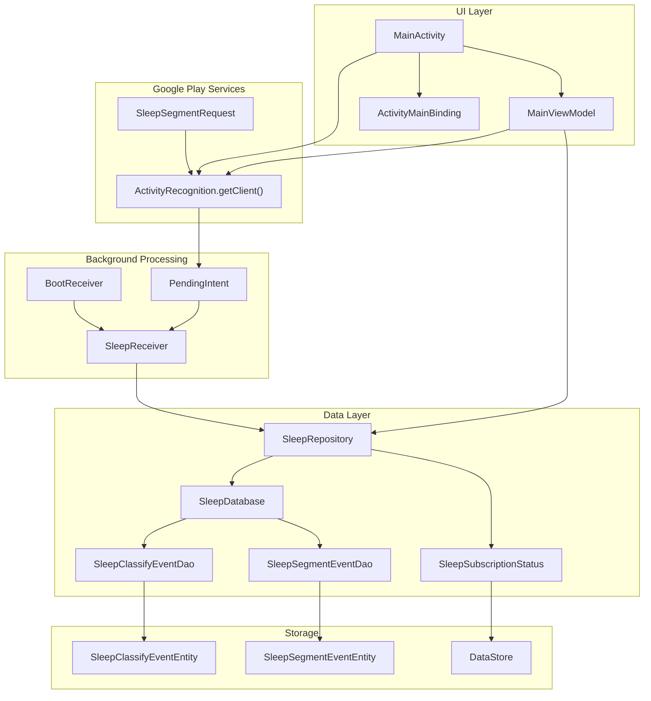

Sources: [SleepSampleKotlin/app/src/main/java/com/android/example/sleepsamplekotlin/MainActivity.kt:43-233](), [SleepSampleKotlin/app/src/main/java/com/android/example/sleepsamplekotlin/MainViewModel.kt:28-45](), [SleepSampleKotlin/app/src/main/java/com/android/example/sleepsamplekotlin/data/SleepRepository.kt:25-72]()

## Architecture Components

### MainActivity and MVVM Pattern

The `MainActivity` serves as the primary UI controller, implementing a simple interface with a single button to toggle sleep data subscription. The activity follows MVVM pattern with `MainViewModel` managing business logic and data operations.

| Component | Responsibility | Key Methods |
|-----------|---------------|-------------|
| `MainActivity` | UI management, permission handling | `onClickRequestSleepData()`, `subscribeToSleepSegmentUpdates()` |
| `MainViewModel` | Data coordination, LiveData management | `updateSubscribedToSleepData()` |
| `SleepRepository` | Data access abstraction | `insertSleepSegment()`, `insertSleepClassifyEvent()` |

The activity observes LiveData from the ViewModel to reactively update the UI when sleep data changes:

[SleepSampleKotlin/app/src/main/java/com/android/example/sleepsamplekotlin/MainActivity.kt:77-112]()

Sources: [SleepSampleKotlin/app/src/main/java/com/android/example/sleepsamplekotlin/MainActivity.kt:43-233](), [SleepSampleKotlin/app/src/main/java/com/android/example/sleepsamplekotlin/MainViewModel.kt:28-45]()

### Repository Pattern Implementation

The `SleepRepository` implements the Repository pattern, abstracting data access across multiple storage mechanisms:

- **DataStore**: Manages subscription status via `SleepSubscriptionStatus`
- **Room Database**: Persists sleep events via DAOs
- **Flow/LiveData**: Provides reactive data streams

**Repository Data Flow**

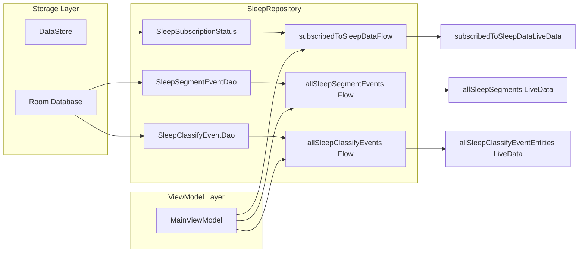

Sources: [SleepSampleKotlin/app/src/main/java/com/android/example/sleepsamplekotlin/data/SleepRepository.kt:25-72](), [SleepSampleKotlin/app/src/main/java/com/android/example/sleepsamplekotlin/MainViewModel.kt:28-45]()

## Data Models and Database Schema

### Sleep Event Entities

The application defines two primary entities corresponding to Google's Sleep API event types:

**Database Schema**

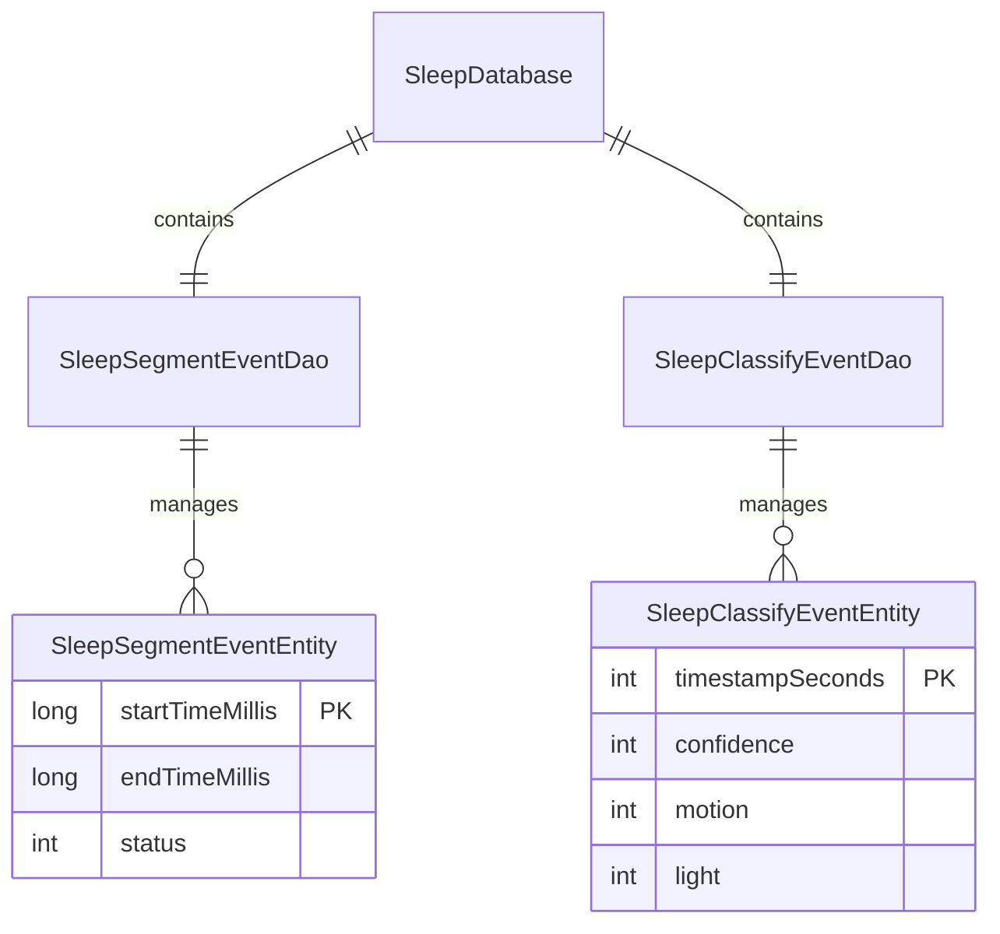

### Entity Definitions

**SleepSegmentEventEntity**: Represents sleep periods with start/end timestamps and status indicators.

[SleepSampleKotlin/app/src/main/java/com/android/example/sleepsamplekotlin/data/db/SleepSegmentEventEntity.kt:27-47]()

**SleepClassifyEventEntity**: Stores classification data including confidence scores, motion levels, and ambient light measurements.

[SleepSampleKotlin/app/src/main/java/com/android/example/sleepsamplekotlin/data/db/SleepClassifyEventEntity.kt:30-54]()

Both entities include companion `from()` methods to convert from Google Play Services Sleep API objects to Room entities.

Sources: [SleepSampleKotlin/app/src/main/java/com/android/example/sleepsamplekotlin/data/db/SleepSegmentEventEntity.kt:1-48](), [SleepSampleKotlin/app/src/main/java/com/android/example/sleepsamplekotlin/data/db/SleepClassifyEventEntity.kt:1-55](), [SleepSampleKotlin/app/src/main/java/com/android/example/sleepsamplekotlin/data/db/SleepDatabase.kt:28-32]()

## Permission Requirements and API Constraints

### Required Permissions

The Sleep API requires specific permissions configured in the Android manifest:

| Permission | API Level | Purpose |
|------------|-----------|---------|
| `android.permission.ACTIVITY_RECOGNITION` | 29+ | Required for sleep detection |
| `android.permission.RECEIVE_BOOT_COMPLETED` | All | Restore subscriptions after reboot |

**Manifest Configuration**

[SleepSampleKotlin/app/src/main/AndroidManifest.xml:19-27]()

### API Level Requirements

The sample targets API 29+ (Android Q) exclusively, as recommended by Google for Sleep API usage. This constraint simplifies permission handling by avoiding the dual permission model needed for devices running API 28 and below.

[SleepSampleKotlin/app/build.gradle:28-29]()

### Runtime Permission Handling

The `MainActivity` implements runtime permission checking with fallback to device settings:

[SleepSampleKotlin/app/src/main/java/com/android/example/sleepsamplekotlin/MainActivity.kt:162-203]()

Sources: [SleepSampleKotlin/app/src/main/AndroidManifest.xml:17-67](), [SleepSampleKotlin/app/build.gradle:22-52](), [SleepSampleKotlin/app/src/main/java/com/android/example/sleepsamplekotlin/MainActivity.kt:162-203]()

## Background Processing Architecture

### Sleep Data Subscription Flow

The application uses PendingIntent-based subscription to receive sleep events in the background, ensuring data collection continues when the app is not in the foreground.

**Sleep Event Processing Flow**

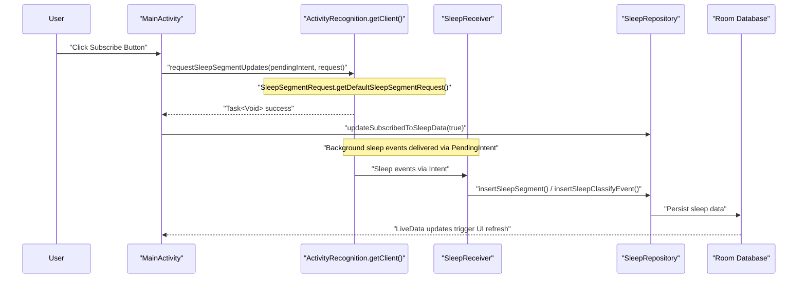

### BroadcastReceiver Configuration

The manifest declares two receivers for background processing:

**SleepReceiver**: Handles incoming sleep events from Google Play Services
[SleepSampleKotlin/app/src/main/AndroidManifest.xml:46-49]()

**BootReceiver**: Restores sleep subscriptions after device restart, supporting multiple boot scenarios including HTC-specific quick boot events
[SleepSampleKotlin/app/src/main/AndroidManifest.xml:51-65]()

### PendingIntent Creation

The application creates a PendingIntent targeting `SleepReceiver` for background event delivery:

[SleepSampleKotlin/app/src/main/java/com/android/example/sleepsamplekotlin/MainActivity.kt:114-116]()

Sources: [SleepSampleKotlin/app/src/main/AndroidManifest.xml:46-65](), [SleepSampleKotlin/app/src/main/java/com/android/example/sleepsamplekotlin/MainActivity.kt:114-116](), [SleepSampleKotlin/app/src/main/java/com/android/example/sleepsamplekotlin/MainActivity.kt:132-147]()

## User Interface and Data Display

### Simple UI Design

The application implements a minimal interface with a single scrollable text area and toggle button:

[SleepSampleKotlin/app/src/main/res/layout/activity_main.xml:26-57]()

### Data Presentation Logic

The `MainActivity` aggregates data from multiple LiveData sources and formats output strings dynamically:

- **Sleep Segment Output**: Displays sleep period data from `SleepSegmentEventEntity` table
- **Sleep Classify Output**: Shows classification events from `SleepClassifyEventEntity` table  
- **Subscription Status**: Updates button text and header information based on current subscription state

The `updateOutput()` method combines these data sources into a single display string:

[SleepSampleKotlin/app/src/main/java/com/android/example/sleepsamplekotlin/MainActivity.kt:210-228]()

### String Resources and Localization

The application defines formatted string resources for consistent output presentation:

[SleepSampleKotlin/app/src/main/res/values/strings.xml:30-32]()

Sources: [SleepSampleKotlin/app/src/main/res/layout/activity_main.xml:17-60](), [SleepSampleKotlin/app/src/main/java/com/android/example/sleepsamplekotlin/MainActivity.kt:210-228](), [SleepSampleKotlin/app/src/main/res/values/strings.xml:17-33]()

---

# Page: Location Services Samples

# Location Services Samples

<details>
<summary>Relevant source files</summary>

The following files were used as context for generating this wiki page:

- [ForegroundLocationUpdates/app/build.gradle](ForegroundLocationUpdates/app/build.gradle)
- [ForegroundLocationUpdates/app/src/main/AndroidManifest.xml](ForegroundLocationUpdates/app/src/main/AndroidManifest.xml)
- [ForegroundLocationUpdates/app/src/main/java/com/google/android/gms/location/sample/foregroundlocation/ForegroundLocationApp.kt](ForegroundLocationUpdates/app/src/main/java/com/google/android/gms/location/sample/foregroundlocation/ForegroundLocationApp.kt)
- [ForegroundLocationUpdates/app/src/main/java/com/google/android/gms/location/sample/foregroundlocation/MainActivity.kt](ForegroundLocationUpdates/app/src/main/java/com/google/android/gms/location/sample/foregroundlocation/MainActivity.kt)
- [ForegroundLocationUpdates/app/src/main/java/com/google/android/gms/location/sample/foregroundlocation/MainViewModel.kt](ForegroundLocationUpdates/app/src/main/java/com/google/android/gms/location/sample/foregroundlocation/MainViewModel.kt)
- [ForegroundLocationUpdates/app/src/main/java/com/google/android/gms/location/sample/foregroundlocation/data/LocationPreferences.kt](ForegroundLocationUpdates/app/src/main/java/com/google/android/gms/location/sample/foregroundlocation/data/LocationPreferences.kt)
- [ForegroundLocationUpdates/app/src/main/java/com/google/android/gms/location/sample/foregroundlocation/data/LocationRepository.kt](ForegroundLocationUpdates/app/src/main/java/com/google/android/gms/location/sample/foregroundlocation/data/LocationRepository.kt)
- [ForegroundLocationUpdates/app/src/main/java/com/google/android/gms/location/sample/foregroundlocation/ui/LocationPermissionState.kt](ForegroundLocationUpdates/app/src/main/java/com/google/android/gms/location/sample/foregroundlocation/ui/LocationPermissionState.kt)
- [ForegroundLocationUpdates/app/src/main/java/com/google/android/gms/location/sample/foregroundlocation/ui/LocationUpdatesScreen.kt](ForegroundLocationUpdates/app/src/main/java/com/google/android/gms/location/sample/foregroundlocation/ui/LocationUpdatesScreen.kt)
- [ForegroundLocationUpdates/app/src/main/res/drawable/ic_location.xml](ForegroundLocationUpdates/app/src/main/res/drawable/ic_location.xml)
- [ForegroundLocationUpdates/app/src/main/res/values/strings.xml](ForegroundLocationUpdates/app/src/main/res/values/strings.xml)
- [LocationAddress/app/build.gradle](LocationAddress/app/build.gradle)
- [LocationAddress/app/src/main/AndroidManifest.xml](LocationAddress/app/src/main/AndroidManifest.xml)
- [LocationAddress/app/src/main/java/com/google/android/gms/location/sample/locationaddress/LocationAddressApp.kt](LocationAddress/app/src/main/java/com/google/android/gms/location/sample/locationaddress/LocationAddressApp.kt)
- [LocationAddress/app/src/main/java/com/google/android/gms/location/sample/locationaddress/MainActivity.kt](LocationAddress/app/src/main/java/com/google/android/gms/location/sample/locationaddress/MainActivity.kt)
- [LocationAddress/app/src/main/java/com/google/android/gms/location/sample/locationaddress/MainViewModel.kt](LocationAddress/app/src/main/java/com/google/android/gms/location/sample/locationaddress/MainViewModel.kt)
- [LocationAddress/app/src/main/java/com/google/android/gms/location/sample/locationaddress/data/GeocodingApi.kt](LocationAddress/app/src/main/java/com/google/android/gms/location/sample/locationaddress/data/GeocodingApi.kt)
- [LocationAddress/app/src/main/java/com/google/android/gms/location/sample/locationaddress/data/LocationApi.kt](LocationAddress/app/src/main/java/com/google/android/gms/location/sample/locationaddress/data/LocationApi.kt)
- [LocationAddress/app/src/main/java/com/google/android/gms/location/sample/locationaddress/data/PlayServicesAvailabilityChecker.kt](LocationAddress/app/src/main/java/com/google/android/gms/location/sample/locationaddress/data/PlayServicesAvailabilityChecker.kt)
- [LocationAddress/app/src/main/java/com/google/android/gms/location/sample/locationaddress/ui/DiscreteSlider.kt](LocationAddress/app/src/main/java/com/google/android/gms/location/sample/locationaddress/ui/DiscreteSlider.kt)
- [LocationAddress/app/src/main/java/com/google/android/gms/location/sample/locationaddress/ui/theme/Type.kt](LocationAddress/app/src/main/java/com/google/android/gms/location/sample/locationaddress/ui/theme/Type.kt)
- [LocationAddress/app/src/main/res/values/strings.xml](LocationAddress/app/src/main/res/values/strings.xml)
- [LocationAddress/build.gradle](LocationAddress/build.gradle)
- [LocationUpdatesBackgroundKotlin/app/src/main/java/com/google/android/gms/location/sample/locationupdatesbackgroundkotlin/LocationUpdatesBroadcastReceiver.kt](LocationUpdatesBackgroundKotlin/app/src/main/java/com/google/android/gms/location/sample/locationupdatesbackgroundkotlin/LocationUpdatesBroadcastReceiver.kt)
- [LocationUpdatesBackgroundKotlin/app/src/main/java/com/google/android/gms/location/sample/locationupdatesbackgroundkotlin/data/LocationRepository.kt](LocationUpdatesBackgroundKotlin/app/src/main/java/com/google/android/gms/location/sample/locationupdatesbackgroundkotlin/data/LocationRepository.kt)
- [LocationUpdatesBackgroundKotlin/app/src/main/java/com/google/android/gms/location/sample/locationupdatesbackgroundkotlin/ui/LocationUpdateFragment.kt](LocationUpdatesBackgroundKotlin/app/src/main/java/com/google/android/gms/location/sample/locationupdatesbackgroundkotlin/ui/LocationUpdateFragment.kt)
- [LocationUpdatesBackgroundKotlin/app/src/main/java/com/google/android/gms/location/sample/locationupdatesbackgroundkotlin/ui/MainActivity.kt](LocationUpdatesBackgroundKotlin/app/src/main/java/com/google/android/gms/location/sample/locationupdatesbackgroundkotlin/ui/MainActivity.kt)
- [LocationUpdatesBackgroundKotlin/app/src/main/java/com/google/android/gms/location/sample/locationupdatesbackgroundkotlin/ui/PermissionRequestFragment.kt](LocationUpdatesBackgroundKotlin/app/src/main/java/com/google/android/gms/location/sample/locationupdatesbackgroundkotlin/ui/PermissionRequestFragment.kt)
- [LocationUpdatesBackgroundKotlin/app/src/main/java/com/google/android/gms/location/sample/locationupdatesbackgroundkotlin/viewmodels/LocationUpdateViewModel.kt](LocationUpdatesBackgroundKotlin/app/src/main/java/com/google/android/gms/location/sample/locationupdatesbackgroundkotlin/viewmodels/LocationUpdateViewModel.kt)
- [LocationUpdatesBackgroundKotlin/app/src/main/res/layout/fragment_location_update.xml](LocationUpdatesBackgroundKotlin/app/src/main/res/layout/fragment_location_update.xml)
- [LocationUpdatesBackgroundKotlin/app/src/main/res/values/strings.xml](LocationUpdatesBackgroundKotlin/app/src/main/res/values/strings.xml)

</details>


This document provides an overview of the location-based sample applications in the repository, covering their different approaches to location tracking and when to use each architectural pattern. For information about specific implementation details of individual location samples, see [Foreground Location Updates](#2.3.1), [Background Location Updates](#2.3.2), and [Location Address (Geocoding)](#2.3.3).

The location services samples demonstrate three distinct approaches to working with Android's location APIs, each optimized for different use cases and Android system constraints.

## Sample Applications Overview

The repository contains three location services samples that showcase different architectural patterns and use cases:

| Sample | Primary Use Case | Architecture Pattern | Key Features |
|--------|------------------|---------------------|--------------|
| ForegroundLocationUpdates | Continuous location tracking while app is active | Bound Service + MVVM | Service lifecycle management, persistent notifications |
| LocationUpdatesBackgroundKotlin | Background location tracking | BroadcastReceiver + Fragment | Background processing, Room persistence |
| LocationAddress | Address lookup from coordinates | MVVM + Repository | Geocoding API integration, one-time requests |

**Sources:** [ForegroundLocationUpdates/app/src/main/java/com/google/android/gms/location/sample/foregroundlocation/MainActivity.kt:42-85](), [LocationUpdatesBackgroundKotlin/app/src/main/java/com/google/android/gms/location/sample/locationupdatesbackgroundkotlin/ui/MainActivity.kt:24-105](), [LocationAddress/app/src/main/java/com/google/android/gms/location/sample/locationaddress/MainActivity.kt:40-95]()

## Architectural Comparison

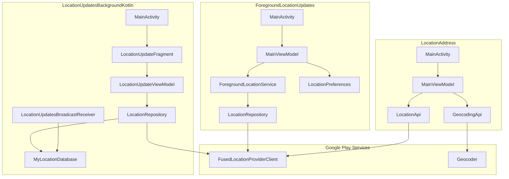

**Sources:** [ForegroundLocationUpdates/app/src/main/java/com/google/android/gms/location/sample/foregroundlocation/MainViewModel.kt:35-83](), [LocationUpdatesBackgroundKotlin/app/src/main/java/com/google/android/gms/location/sample/locationupdatesbackgroundkotlin/viewmodels/LocationUpdateViewModel.kt:28-42](), [LocationAddress/app/src/main/java/com/google/android/gms/location/sample/locationaddress/MainViewModel.kt:38-82]()

## Location Update Patterns

### Service-Based Pattern (Foreground Updates)

The `ForegroundLocationService` pattern is designed for continuous location tracking while the app is actively being used. The service runs in the foreground with a persistent notification to comply with Android's background execution limits.

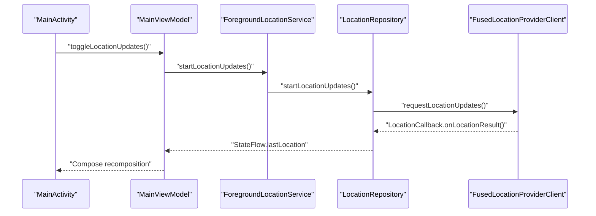

**Key Components:**
- `ForegroundLocationService`: Bound service that manages location requests [ForegroundLocationUpdates/app/src/main/AndroidManifest.xml:51]()
- `LocationRepository`: Manages `FusedLocationProviderClient` and exposes `StateFlow` for location updates [ForegroundLocationUpdates/app/src/main/java/com/google/android/gms/location/sample/foregroundlocation/data/LocationRepository.kt:32-73]()
- `LocationPreferences`: Persists user's location tracking preferences using DataStore [ForegroundLocationUpdates/app/src/main/java/com/google/android/gms/location/sample/foregroundlocation/data/LocationPreferences.kt:31-47]()

**Sources:** [ForegroundLocationUpdates/app/src/main/java/com/google/android/gms/location/sample/foregroundlocation/data/LocationRepository.kt:44-66](), [ForegroundLocationUpdates/app/src/main/java/com/google/android/gms/location/sample/foregroundlocation/MainViewModel.kt:56-82]()

### BroadcastReceiver Pattern (Background Updates)

The `LocationUpdatesBroadcastReceiver` pattern handles location updates delivered via `PendingIntent` when the app is not in the foreground. This approach complies with Android 8.0+ background service limitations.

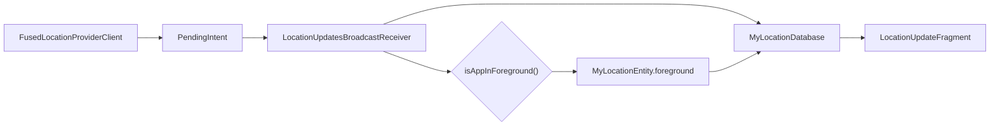

**Key Components:**
- `LocationUpdatesBroadcastReceiver`: Receives location updates via `PendingIntent` and persists to database [LocationUpdatesBackgroundKotlin/app/src/main/java/com/google/android/gms/location/sample/locationupdatesbackgroundkotlin/LocationUpdatesBroadcastReceiver.kt:45-100]()
- `MyLocationEntity`: Room entity representing location data with foreground/background flag [LocationUpdatesBackgroundKotlin/app/src/main/java/com/google/android/gms/location/sample/locationupdatesbackgroundkotlin/LocationUpdatesBroadcastReceiver.kt:60-67]()
- `LocationRepository`: Singleton managing both database operations and location API calls [LocationUpdatesBackgroundKotlin/app/src/main/java/com/google/android/gms/location/sample/locationupdatesbackgroundkotlin/data/LocationRepository.kt:32-111]()

**Sources:** [LocationUpdatesBackgroundKotlin/app/src/main/java/com/google/android/gms/location/sample/locationupdatesbackgroundkotlin/LocationUpdatesBroadcastReceiver.kt:47-74](), [LocationUpdatesBackgroundKotlin/app/src/main/java/com/google/android/gms/location/sample/locationupdatesbackgroundkotlin/data/LocationRepository.kt:84-96]()

### One-Shot Request Pattern (Address Lookup)

The geocoding sample demonstrates a different pattern focused on single location requests and address conversion rather than continuous updates.

**Key Components:**
- `LocationApi`: Wrapper around `FusedLocationProviderClient.getCurrentLocation()` [LocationAddress/app/src/main/java/com/google/android/gms/location/sample/locationaddress/data/LocationApi.kt:31-42]()
- `GeocodingApi`: Handles address lookup using Android's `Geocoder` class [LocationAddress/app/src/main/java/com/google/android/gms/location/sample/locationaddress/data/GeocodingApi.kt:35-55]()
- `FormattedAddress`: Data class for displaying geocoded results [LocationAddress/app/src/main/java/com/google/android/gms/location/sample/locationaddress/data/GeocodingApi.kt:27]()

**Sources:** [LocationAddress/app/src/main/java/com/google/android/gms/location/sample/locationaddress/MainViewModel.kt:69-81](), [LocationAddress/app/src/main/java/com/google/android/gms/location/sample/locationaddress/data/GeocodingApi.kt:30-56]()

## Permission Management Patterns

All location samples implement progressive permission requests, but with different complexity levels based on their background location requirements.

| Permission Type | ForegroundLocationUpdates | LocationUpdatesBackgroundKotlin | LocationAddress |
|----------------|---------------------------|--------------------------------|-----------------|
| `ACCESS_COARSE_LOCATION` | ✓ Required | ✓ Required | ✓ Required |
| `ACCESS_FINE_LOCATION` | ✓ Required | ✓ Required | ✓ Required |
| `ACCESS_BACKGROUND_LOCATION` | ✗ Not used | ✓ Optional enhancement | ✗ Not used |

The background location sample includes the most sophisticated permission handling with dedicated UI flows for rationale explanations and progressive permission requests through `PermissionRequestFragment`.

**Sources:** [ForegroundLocationUpdates/app/src/main/AndroidManifest.xml:27-28](), [LocationUpdatesBackgroundKotlin/app/src/main/java/com/google/android/gms/location/sample/locationupdatesbackgroundkotlin/ui/PermissionRequestFragment.kt:214-240](), [LocationAddress/app/src/main/AndroidManifest.xml:27-28]()

## Usage Recommendations

**Use ForegroundLocationUpdates when:**
- App needs continuous location updates while user is actively using it
- Location tracking should stop when user navigates away from app
- You want to show persistent notification during location tracking
- Implementing fitness tracking, navigation, or real-time location sharing

**Use LocationUpdatesBackgroundKotlin when:**
- App has legitimate need for background location (delivery, ride-sharing, etc.)
- Location data needs to be collected even when app is not visible
- You need to track whether location was captured in foreground vs background
- Implementing asset tracking or geofencing applications

**Use LocationAddress when:**
- App needs to convert coordinates to human-readable addresses
- One-time location requests rather than continuous updates
- Implementing place search, address validation, or location-based forms
- Building address autocomplete or location picker features

**Sources:** [ForegroundLocationUpdates/app/src/main/res/values/strings.xml:19-34](), [LocationUpdatesBackgroundKotlin/app/src/main/res/values/strings.xml:18-62](), [LocationAddress/app/src/main/res/values/strings.xml:19-29]()

---

# Page: Foreground Location Updates

# Foreground Location Updates

<details>
<summary>Relevant source files</summary>

The following files were used as context for generating this wiki page:

- [ForegroundLocationUpdates/app/build.gradle](ForegroundLocationUpdates/app/build.gradle)
- [ForegroundLocationUpdates/app/src/main/AndroidManifest.xml](ForegroundLocationUpdates/app/src/main/AndroidManifest.xml)
- [ForegroundLocationUpdates/app/src/main/java/com/google/android/gms/location/sample/foregroundlocation/ForegroundLocationApp.kt](ForegroundLocationUpdates/app/src/main/java/com/google/android/gms/location/sample/foregroundlocation/ForegroundLocationApp.kt)
- [ForegroundLocationUpdates/app/src/main/java/com/google/android/gms/location/sample/foregroundlocation/ForegroundLocationService.kt](ForegroundLocationUpdates/app/src/main/java/com/google/android/gms/location/sample/foregroundlocation/ForegroundLocationService.kt)
- [ForegroundLocationUpdates/app/src/main/java/com/google/android/gms/location/sample/foregroundlocation/MainActivity.kt](ForegroundLocationUpdates/app/src/main/java/com/google/android/gms/location/sample/foregroundlocation/MainActivity.kt)
- [ForegroundLocationUpdates/app/src/main/java/com/google/android/gms/location/sample/foregroundlocation/MainViewModel.kt](ForegroundLocationUpdates/app/src/main/java/com/google/android/gms/location/sample/foregroundlocation/MainViewModel.kt)
- [ForegroundLocationUpdates/app/src/main/java/com/google/android/gms/location/sample/foregroundlocation/data/LocationPreferences.kt](ForegroundLocationUpdates/app/src/main/java/com/google/android/gms/location/sample/foregroundlocation/data/LocationPreferences.kt)
- [ForegroundLocationUpdates/app/src/main/java/com/google/android/gms/location/sample/foregroundlocation/data/LocationRepository.kt](ForegroundLocationUpdates/app/src/main/java/com/google/android/gms/location/sample/foregroundlocation/data/LocationRepository.kt)
- [ForegroundLocationUpdates/app/src/main/java/com/google/android/gms/location/sample/foregroundlocation/ui/LocationPermissionState.kt](ForegroundLocationUpdates/app/src/main/java/com/google/android/gms/location/sample/foregroundlocation/ui/LocationPermissionState.kt)
- [ForegroundLocationUpdates/app/src/main/java/com/google/android/gms/location/sample/foregroundlocation/ui/LocationUpdatesScreen.kt](ForegroundLocationUpdates/app/src/main/java/com/google/android/gms/location/sample/foregroundlocation/ui/LocationUpdatesScreen.kt)
- [ForegroundLocationUpdates/app/src/main/res/drawable/ic_location.xml](ForegroundLocationUpdates/app/src/main/res/drawable/ic_location.xml)
- [ForegroundLocationUpdates/app/src/main/res/drawable/ic_stop.xml](ForegroundLocationUpdates/app/src/main/res/drawable/ic_stop.xml)
- [ForegroundLocationUpdates/app/src/main/res/values/strings.xml](ForegroundLocationUpdates/app/src/main/res/values/strings.xml)

</details>


## Purpose and Scope

This document covers the Foreground Location Updates sample, which demonstrates how to implement continuous location tracking using a foreground service with bound service architecture. The sample shows best practices for managing location updates that persist when the app is backgrounded, including proper service lifecycle management, notification handling, and permission management.

For background location tracking using broadcast receivers, see [Background Location Updates](#2.3.2). For basic location retrieval without persistent tracking, see [Basic Location Sample](#2.6).

## Architecture Overview

The Foreground Location Updates sample implements a sophisticated architecture using MVVM pattern with Hilt dependency injection, bound service pattern, and repository pattern for data management.

### Component Architecture

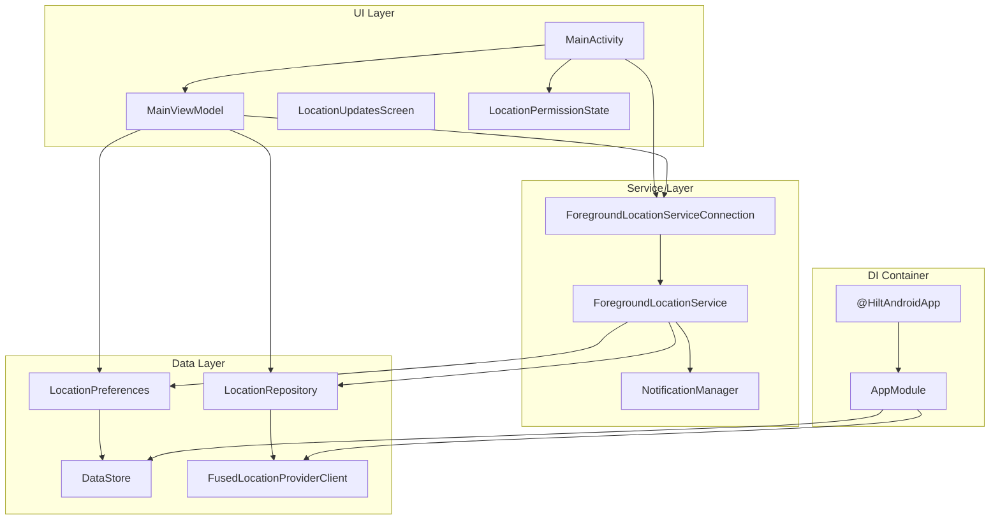

**Sources:** [ForegroundLocationUpdates/app/src/main/java/com/google/android/gms/location/sample/foregroundlocation/MainActivity.kt:1-110](), [ForegroundLocationUpdates/app/src/main/java/com/google/android/gms/location/sample/foregroundlocation/MainViewModel.kt:1-88](), [ForegroundLocationUpdates/app/src/main/java/com/google/android/gms/location/sample/foregroundlocation/ForegroundLocationService.kt:1-270]()

### Technology Stack

| Component | Technology | Purpose |
|-----------|------------|---------|
| UI Framework | Jetpack Compose | Modern declarative UI |
| Architecture Pattern | MVVM | Separation of concerns |
| Dependency Injection | Hilt | Component lifecycle management |
| Location Provider | FusedLocationProviderClient | Google Play Services location API |
| Data Persistence | DataStore Preferences | User preferences storage |
| Background Processing | Foreground Service | Persistent location tracking |
| State Management | StateFlow | Reactive data streams |

**Sources:** [ForegroundLocationUpdates/app/build.gradle:17-103](), [ForegroundLocationUpdates/app/src/main/java/com/google/android/gms/location/sample/foregroundlocation/ForegroundLocationApp.kt:1-58]()

## Service Lifecycle Management

The `ForegroundLocationService` implements sophisticated lifecycle management that adapts to UI binding state and location update requirements.

### Service State Machine

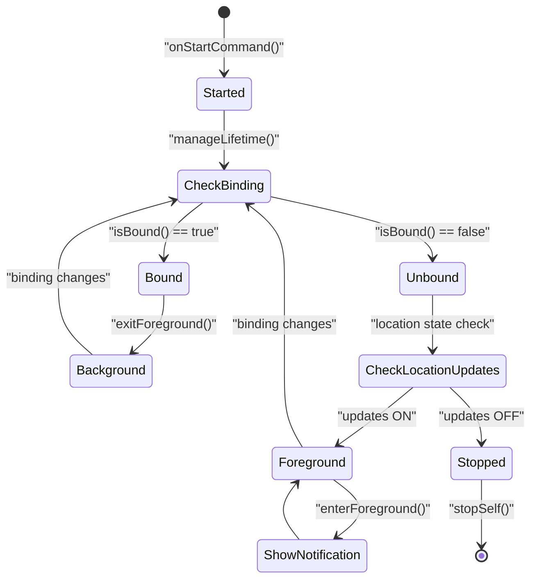

**Sources:** [ForegroundLocationUpdates/app/src/main/java/com/google/android/gms/location/sample/foregroundlocation/ForegroundLocationService.kt:146-157]()

### Binding Management

The service uses a custom `LocalBinder` and `ForegroundLocationServiceConnection` to manage client connections:

- **Bind Count Tracking**: [ForegroundLocationUpdates/app/src/main/java/com/google/android/gms/location/sample/foregroundlocation/ForegroundLocationService.kt:68-73]()
- **Bind Handling**: [ForegroundLocationUpdates/app/src/main/java/com/google/android/gms/location/sample/foregroundlocation/ForegroundLocationService.kt:127-131]()
- **Unbind Delay**: [ForegroundLocationUpdates/app/src/main/java/com/google/android/gms/location/sample/foregroundlocation/ForegroundLocationService.kt:133-144]()

The service implements a 2-second delay after unbinding to handle configuration changes where the UI temporarily unbinds and rebinds.

**Sources:** [ForegroundLocationUpdates/app/src/main/java/com/google/android/gms/location/sample/foregroundlocation/ForegroundLocationService.kt:117-144](), [ForegroundLocationUpdates/app/src/main/java/com/google/android/gms/location/sample/foregroundlocation/ForegroundLocationService.kt:256-269]()

### Notification Management

The service creates persistent notifications when running in foreground mode:

- **Channel Creation**: [ForegroundLocationUpdates/app/src/main/java/com/google/android/gms/location/sample/foregroundlocation/ForegroundLocationService.kt:184-194]()
- **Notification Building**: [ForegroundLocationUpdates/app/src/main/java/com/google/android/gms/location/sample/foregroundlocation/ForegroundLocationService.kt:196-228]()
- **Stop Action**: [ForegroundLocationUpdates/app/src/main/java/com/google/android/gms/location/sample/foregroundlocation/ForegroundLocationService.kt:79-84]()

**Sources:** [ForegroundLocationUpdates/app/src/main/java/com/google/android/gms/location/sample/foregroundlocation/ForegroundLocationService.kt:175-228]()

## Location Data Flow

The location data flows through a repository pattern with reactive state management using StateFlow.

### Location Update Pipeline

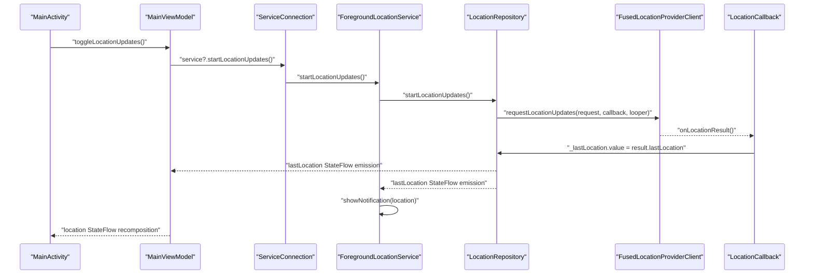

**Sources:** [ForegroundLocationUpdates/app/src/main/java/com/google/android/gms/location/sample/foregroundlocation/MainViewModel.kt:56-82](), [ForegroundLocationUpdates/app/src/main/java/com/google/android/gms/location/sample/foregroundlocation/data/LocationRepository.kt:44-73]()

### LocationRepository Implementation

The `LocationRepository` manages location updates using `FusedLocationProviderClient`:

- **Location Request Configuration**: [ForegroundLocationUpdates/app/src/main/java/com/google/android/gms/location/sample/foregroundlocation/data/LocationRepository.kt:45-48]()
- **StateFlow Management**: [ForegroundLocationUpdates/app/src/main/java/com/google/android/gms/location/sample/foregroundlocation/data/LocationRepository.kt:37-41]()
- **Callback Implementation**: [ForegroundLocationUpdates/app/src/main/java/com/google/android/gms/location/sample/foregroundlocation/data/LocationRepository.kt:68-72]()

The repository uses high accuracy priority with 10-second intervals and runs callbacks on the main looper for simplicity.

**Sources:** [ForegroundLocationUpdates/app/src/main/java/com/google/android/gms/location/sample/foregroundlocation/data/LocationRepository.kt:1-74]()

## Permission Management

The sample implements comprehensive location permission handling with support for Android 12+ approximate location permissions.

### Permission Requirements

The app requires both coarse and fine location permissions as mandated by Android 12+:

```xml
<uses-permission android:name="android.permission.ACCESS_COARSE_LOCATION" />
<uses-permission android:name="android.permission.ACCESS_FINE_LOCATION" />
<uses-permission android:name="android.permission.FOREGROUND_SERVICE" />
```

**Sources:** [ForegroundLocationUpdates/app/src/main/AndroidManifest.xml:27-29]()

### LocationPermissionState

The `LocationPermissionState` class manages permission requests and UI state:

- **Permission Arrays**: [ForegroundLocationUpdates/app/src/main/java/com/google/android/gms/location/sample/foregroundlocation/ui/LocationPermissionState.kt:32-33]()
- **State Properties**: [ForegroundLocationUpdates/app/src/main/java/com/google/android/gms/location/sample/foregroundlocation/ui/LocationPermissionState.kt:74-94]()
- **Request Launcher**: [ForegroundLocationUpdates/app/src/main/java/com/google/android/gms/location/sample/foregroundlocation/ui/LocationPermissionState.kt:96-103]()

The class provides reactive state properties that trigger recomposition when permission states change.

**Sources:** [ForegroundLocationUpdates/app/src/main/java/com/google/android/gms/location/sample/foregroundlocation/ui/LocationPermissionState.kt:1-131]()

## UI Layer

The UI layer uses Jetpack Compose with MVVM architecture and reactive state management.

### Activity and ViewModel Integration

```mermaid
graph LR
    subgraph "MainActivity"
        OC["onCreate()"]
        OS["onStart()"]
        OST["onStop()"]
    end
    
    subgraph "MainViewModel"
        PSA["playServicesAvailableState"]
        ILU["isReceivingLocationUpdates"] 
        LL["lastLocation"]
        TLU["toggleLocationUpdates()"]
    end
    
    subgraph "UI Composables"
        MS["MainScreen"]
        LUS["LocationUpdatesScreen"]
        PRD["PermissionRationaleDialog"]
    end
    
    OC --> LPS["LocationPermissionState"]
    OC --> MS
    OS --> SC["bindService()"]
    OST --> USC["unbindService()"]
    
    MS --> PSA
    MS --> ILU
    MS --> LL
    LUS --> TLU
    LUS --> PRD
```

**Sources:** [ForegroundLocationUpdates/app/src/main/java/com/google/android/gms/location/sample/foregroundlocation/MainActivity.kt:46-84](), [ForegroundLocationUpdates/app/src/main/java/com/google/android/gms/location/sample/foregroundlocation/MainViewModel.kt:35-87]()

### Screen State Management

The UI handles multiple states based on Google Play Services availability and location permissions:

| State | Composable | Condition |
|-------|------------|-----------|
| Initializing | `InitializingScreen` | `PlayServicesAvailableState.Initializing` |
| Service Unavailable | `ServiceUnavailableScreen` | `PlayServicesAvailableState.PlayServicesUnavailable` |
| Location Updates | `LocationUpdatesScreen` | `PlayServicesAvailableState.PlayServicesAvailable` |

**Sources:** [ForegroundLocationUpdates/app/src/main/java/com/google/android/gms/location/sample/foregroundlocation/MainActivity.kt:96-108]()

### LocationUpdatesScreen

The main screen displays location data and provides start/stop controls:

- **Location Display**: [ForegroundLocationUpdates/app/src/main/java/com/google/android/gms/location/sample/foregroundlocation/ui/LocationUpdatesScreen.kt:69-81]()
- **Permission Rationale Dialog**: [ForegroundLocationUpdates/app/src/main/java/com/google/android/gms/location/sample/foregroundlocation/ui/LocationUpdatesScreen.kt:103-126]()
- **Button State Logic**: [ForegroundLocationUpdates/app/src/main/java/com/google/android/gms/location/sample/foregroundlocation/ui/LocationUpdatesScreen.kt:61-67]()

**Sources:** [ForegroundLocationUpdates/app/src/main/java/com/google/android/gms/location/sample/foregroundlocation/ui/LocationUpdatesScreen.kt:1-141]()

## Data Persistence

The sample uses DataStore Preferences for persisting user location preferences across app restarts.

### LocationPreferences Implementation

The `LocationPreferences` class manages the location toggle state:

- **DataStore Integration**: [ForegroundLocationUpdates/app/src/main/java/com/google/android/gms/location/sample/foregroundlocation/data/LocationPreferences.kt:31-33]()
- **State Flow**: [ForegroundLocationUpdates/app/src/main/java/com/google/android/gms/location/sample/foregroundlocation/data/LocationPreferences.kt:34-36]()
- **Update Method**: [ForegroundLocationUpdates/app/src/main/java/com/google/android/gms/location/sample/foregroundlocation/data/LocationPreferences.kt:38-42]()

The service checks this preference on startup to restore location updates after app restart or system reboot.

**Sources:** [ForegroundLocationUpdates/app/src/main/java/com/google/android/gms/location/sample/foregroundlocation/data/LocationPreferences.kt:1-48](), [ForegroundLocationUpdates/app/src/main/java/com/google/android/gms/location/sample/foregroundlocation/ForegroundLocationService.kt:89-102]()

### Dependency Injection Configuration

The `AppModule` provides singleton instances for key dependencies:

- **FusedLocationProviderClient**: [ForegroundLocationUpdates/app/src/main/java/com/google/android/gms/location/sample/foregroundlocation/ForegroundLocationApp.kt:45-48]()
- **DataStore**: [ForegroundLocationUpdates/app/src/main/java/com/google/android/gms/location/sample/foregroundlocation/ForegroundLocationApp.kt:51-56]()
- **GoogleApiAvailability**: [ForegroundLocationUpdates/app/src/main/java/com/google/android/gms/location/sample/foregroundlocation/ForegroundLocationApp.kt:40-42]()

**Sources:** [ForegroundLocationUpdates/app/src/main/java/com/google/android/gms/location/sample/foregroundlocation/ForegroundLocationApp.kt:36-57]()

---

# Page: Background Location Updates

# Background Location Updates

<details>
<summary>Relevant source files</summary>

The following files were used as context for generating this wiki page:

- [LocationUpdatesBackgroundKotlin/app/build.gradle](LocationUpdatesBackgroundKotlin/app/build.gradle)
- [LocationUpdatesBackgroundKotlin/app/src/main/AndroidManifest.xml](LocationUpdatesBackgroundKotlin/app/src/main/AndroidManifest.xml)
- [LocationUpdatesBackgroundKotlin/app/src/main/java/com/google/android/gms/location/sample/locationupdatesbackgroundkotlin/LocationUpdatesBroadcastReceiver.kt](LocationUpdatesBackgroundKotlin/app/src/main/java/com/google/android/gms/location/sample/locationupdatesbackgroundkotlin/LocationUpdatesBroadcastReceiver.kt)
- [LocationUpdatesBackgroundKotlin/app/src/main/java/com/google/android/gms/location/sample/locationupdatesbackgroundkotlin/Utils.kt](LocationUpdatesBackgroundKotlin/app/src/main/java/com/google/android/gms/location/sample/locationupdatesbackgroundkotlin/Utils.kt)
- [LocationUpdatesBackgroundKotlin/app/src/main/java/com/google/android/gms/location/sample/locationupdatesbackgroundkotlin/data/LocationRepository.kt](LocationUpdatesBackgroundKotlin/app/src/main/java/com/google/android/gms/location/sample/locationupdatesbackgroundkotlin/data/LocationRepository.kt)
- [LocationUpdatesBackgroundKotlin/app/src/main/java/com/google/android/gms/location/sample/locationupdatesbackgroundkotlin/data/MyLocationManager.kt](LocationUpdatesBackgroundKotlin/app/src/main/java/com/google/android/gms/location/sample/locationupdatesbackgroundkotlin/data/MyLocationManager.kt)
- [LocationUpdatesBackgroundKotlin/app/src/main/java/com/google/android/gms/location/sample/locationupdatesbackgroundkotlin/data/db/MyLocationDao.kt](LocationUpdatesBackgroundKotlin/app/src/main/java/com/google/android/gms/location/sample/locationupdatesbackgroundkotlin/data/db/MyLocationDao.kt)
- [LocationUpdatesBackgroundKotlin/app/src/main/java/com/google/android/gms/location/sample/locationupdatesbackgroundkotlin/data/db/MyLocationDatabase.kt](LocationUpdatesBackgroundKotlin/app/src/main/java/com/google/android/gms/location/sample/locationupdatesbackgroundkotlin/data/db/MyLocationDatabase.kt)
- [LocationUpdatesBackgroundKotlin/app/src/main/java/com/google/android/gms/location/sample/locationupdatesbackgroundkotlin/data/db/MyLocationEntity.kt](LocationUpdatesBackgroundKotlin/app/src/main/java/com/google/android/gms/location/sample/locationupdatesbackgroundkotlin/data/db/MyLocationEntity.kt)
- [LocationUpdatesBackgroundKotlin/app/src/main/java/com/google/android/gms/location/sample/locationupdatesbackgroundkotlin/data/db/MyLocationTypeConverters.kt](LocationUpdatesBackgroundKotlin/app/src/main/java/com/google/android/gms/location/sample/locationupdatesbackgroundkotlin/data/db/MyLocationTypeConverters.kt)
- [LocationUpdatesBackgroundKotlin/app/src/main/java/com/google/android/gms/location/sample/locationupdatesbackgroundkotlin/ui/LocationUpdateFragment.kt](LocationUpdatesBackgroundKotlin/app/src/main/java/com/google/android/gms/location/sample/locationupdatesbackgroundkotlin/ui/LocationUpdateFragment.kt)
- [LocationUpdatesBackgroundKotlin/app/src/main/java/com/google/android/gms/location/sample/locationupdatesbackgroundkotlin/ui/MainActivity.kt](LocationUpdatesBackgroundKotlin/app/src/main/java/com/google/android/gms/location/sample/locationupdatesbackgroundkotlin/ui/MainActivity.kt)
- [LocationUpdatesBackgroundKotlin/app/src/main/java/com/google/android/gms/location/sample/locationupdatesbackgroundkotlin/ui/PermissionRequestFragment.kt](LocationUpdatesBackgroundKotlin/app/src/main/java/com/google/android/gms/location/sample/locationupdatesbackgroundkotlin/ui/PermissionRequestFragment.kt)
- [LocationUpdatesBackgroundKotlin/app/src/main/java/com/google/android/gms/location/sample/locationupdatesbackgroundkotlin/viewmodels/LocationUpdateViewModel.kt](LocationUpdatesBackgroundKotlin/app/src/main/java/com/google/android/gms/location/sample/locationupdatesbackgroundkotlin/viewmodels/LocationUpdateViewModel.kt)
- [LocationUpdatesBackgroundKotlin/app/src/main/res/drawable/ic_location_on_24px.xml](LocationUpdatesBackgroundKotlin/app/src/main/res/drawable/ic_location_on_24px.xml)
- [LocationUpdatesBackgroundKotlin/app/src/main/res/drawable/ic_my_location_24px.xml](LocationUpdatesBackgroundKotlin/app/src/main/res/drawable/ic_my_location_24px.xml)
- [LocationUpdatesBackgroundKotlin/app/src/main/res/layout/activity_main.xml](LocationUpdatesBackgroundKotlin/app/src/main/res/layout/activity_main.xml)
- [LocationUpdatesBackgroundKotlin/app/src/main/res/layout/fragment_location_update.xml](LocationUpdatesBackgroundKotlin/app/src/main/res/layout/fragment_location_update.xml)
- [LocationUpdatesBackgroundKotlin/app/src/main/res/layout/fragment_permission_request.xml](LocationUpdatesBackgroundKotlin/app/src/main/res/layout/fragment_permission_request.xml)
- [LocationUpdatesBackgroundKotlin/app/src/main/res/values/dimens.xml](LocationUpdatesBackgroundKotlin/app/src/main/res/values/dimens.xml)
- [LocationUpdatesBackgroundKotlin/app/src/main/res/values/strings.xml](LocationUpdatesBackgroundKotlin/app/src/main/res/values/strings.xml)
- [LocationUpdatesBackgroundKotlin/build.gradle](LocationUpdatesBackgroundKotlin/build.gradle)
- [LocationUpdatesBackgroundKotlin/gradle.properties](LocationUpdatesBackgroundKotlin/gradle.properties)
- [LocationUpdatesBackgroundKotlin/gradle/wrapper/gradle-wrapper.properties](LocationUpdatesBackgroundKotlin/gradle/wrapper/gradle-wrapper.properties)

</details>


## Purpose and Scope

This page documents the Background Location Updates sample application, which demonstrates how to receive location updates when an Android app is running in the background. The sample uses a BroadcastReceiver pattern to comply with Android's background execution limitations and implements proper permission handling for background location access.

For foreground location updates using a bound service pattern, see [Foreground Location Updates](#2.3.1). For basic location access without background functionality, see [Location Address (Geocoding)](#2.3.3).

Sources: [LocationUpdatesBackgroundKotlin/app/src/main/java/com/google/android/gms/location/sample/locationupdatesbackgroundkotlin/ui/MainActivity.kt:24-46](), [LocationUpdatesBackgroundKotlin/app/src/main/AndroidManifest.xml:21-23]()

## System Architecture Overview

The Background Location Updates sample implements a fragment-based MVVM architecture with background processing capabilities. The system is designed to handle Android's background execution restrictions by using a BroadcastReceiver pattern instead of traditional background services.

### High-Level Component Architecture

```mermaid
graph TB
    subgraph "UI Layer"
        MA["MainActivity"]
        LUF["LocationUpdateFragment"]
        PRF["PermissionRequestFragment"]
    end
    
    subgraph "ViewModel Layer"
        LUVM["LocationUpdateViewModel"]
    end
    
    subgraph "Repository Layer"
        LR["LocationRepository"]
        MLM["MyLocationManager"]
    end
    
    subgraph "Background Processing"
        LUBR["LocationUpdatesBroadcastReceiver"]
    end
    
    subgraph "Data Persistence"
        MLD["MyLocationDatabase"]
        MLAO["MyLocationDao"]
        MLE["MyLocationEntity"]
    end
    
    subgraph "Google Play Services"
        FLC["FusedLocationProviderClient"]
    end
    
    MA --> LUF
    MA --> PRF
    LUF --> LUVM
    LUVM --> LR
    LR --> MLM
    LR --> MLD
    MLM --> FLC
    FLC --> LUBR
    LUBR --> LR
    MLD --> MLAO
    MLAO --> MLE
```

Sources: [LocationUpdatesBackgroundKotlin/app/src/main/java/com/google/android/gms/location/sample/locationupdatesbackgroundkotlin/ui/MainActivity.kt:47-48](), [LocationUpdatesBackgroundKotlin/app/src/main/java/com/google/android/gms/location/sample/locationupdatesbackgroundkotlin/viewmodels/LocationUpdateViewModel.kt:28-42](), [LocationUpdatesBackgroundKotlin/app/src/main/java/com/google/android/gms/location/sample/locationupdatesbackgroundkotlin/data/LocationRepository.kt:32-36]()

## Core Components

### LocationUpdatesBroadcastReceiver

The `LocationUpdatesBroadcastReceiver` is the central component that handles location updates delivered via PendingIntent. This approach is required for apps targeting API level 26+ due to background service limitations.

```mermaid
graph LR
    GPS["Google Play Services"] --> PI["PendingIntent"]
    PI --> LUBR["LocationUpdatesBroadcastReceiver"]
    LUBR --> LR["LocationRepository"]
    LR --> DB["Room Database"]
    
    subgraph "Background Processing"
        LUBR
    end
```

Key responsibilities:
- Extracts `LocationResult` and `LocationAvailability` from incoming intents
- Converts location data to `MyLocationEntity` objects
- Tracks whether app is in foreground or background state
- Persists location data via `LocationRepository`

Sources: [LocationUpdatesBackgroundKotlin/app/src/main/java/com/google/android/gms/location/sample/locationupdatesbackgroundkotlin/LocationUpdatesBroadcastReceiver.kt:32-44](), [LocationUpdatesBackgroundKotlin/app/src/main/java/com/google/android/gms/location/sample/locationupdatesbackgroundkotlin/LocationUpdatesBroadcastReceiver.kt:47-74]()

### MyLocationManager

The `MyLocationManager` handles all interactions with the Fused Location Provider API and manages the location update subscription state.

| Configuration | Value | Purpose |
|---------------|-------|---------|
| Update Interval | 60 seconds | Primary location update frequency |
| Fastest Interval | 30 seconds | Maximum update rate limit |
| Max Wait Time | 2 minutes | Batched update delivery timeout |
| Priority | `PRIORITY_HIGH_ACCURACY` | GPS-level accuracy |

Sources: [LocationUpdatesBackgroundKotlin/app/src/main/java/com/google/android/gms/location/sample/locationupdatesbackgroundkotlin/data/MyLocationManager.kt:53-73](), [LocationUpdatesBackgroundKotlin/app/src/main/java/com/google/android/gms/location/sample/locationupdatesbackgroundkotlin/data/MyLocationManager.kt:81-85]()

### Fragment Architecture

The UI is implemented using a fragment-based architecture where `MainActivity` acts as a container that swaps between different fragments based on permission state and user actions.

```mermaid
graph TD
    MA["MainActivity"] --> LUF["LocationUpdateFragment"]
    MA --> PRF["PermissionRequestFragment"]
    
    subgraph "Fragment Callbacks"
        LUF --> |"requestFineLocationPermission()"| MA
        LUF --> |"requestBackgroundLocationPermission()"| MA
        PRF --> |"displayLocationUI()"| MA
    end
    
    subgraph "Permission Flow"
        PRF --> |"FINE_LOCATION"| PRF_FINE["Fine Location Request"]
        PRF --> |"BACKGROUND_LOCATION"| PRF_BG["Background Location Request"]
    end
```

Sources: [LocationUpdatesBackgroundKotlin/app/src/main/java/com/google/android/gms/location/sample/locationupdatesbackgroundkotlin/ui/MainActivity.kt:47-48](), [LocationUpdatesBackgroundKotlin/app/src/main/java/com/google/android/gms/location/sample/locationupdatesbackgroundkotlin/ui/LocationUpdateFragment.kt:180-183](), [LocationUpdatesBackgroundKotlin/app/src/main/java/com/google/android/gms/location/sample/locationupdatesbackgroundkotlin/ui/PermissionRequestFragment.kt:253-255]()

## Permission Management

The sample implements a two-stage permission request process, following Android best practices for background location access.

### Permission Requirements

| Permission | Manifest Declaration | Runtime Request | Purpose |
|------------|---------------------|-----------------|---------|
| `ACCESS_COARSE_LOCATION` | ✓ | ✓ | Basic location access |
| `ACCESS_FINE_LOCATION` | ✓ | ✓ | GPS-level accuracy |
| `ACCESS_BACKGROUND_LOCATION` | ✓ | ✓ | Background location updates |

### Permission Flow Architecture

```mermaid
sequenceDiagram
    participant User
    participant LUF as "LocationUpdateFragment"
    participant MA as "MainActivity"
    participant PRF as "PermissionRequestFragment"
    participant System as "Android System"
    
    User->>LUF: "Start Location Updates"
    LUF->>LUF: "Check ACCESS_FINE_LOCATION"
    
    alt "Fine Location Not Granted"
        LUF->>MA: "requestFineLocationPermission()"
        MA->>PRF: "Show FINE_LOCATION Fragment"
        PRF->>System: "Request Fine Location"
        System->>PRF: "Permission Result"
        PRF->>MA: "displayLocationUI()"
    end
    
    User->>LUF: "Enable Background Location"
    LUF->>MA: "requestBackgroundLocationPermission()"
    MA->>PRF: "Show BACKGROUND_LOCATION Fragment"
    PRF->>System: "Request Background Location"
    System->>PRF: "Permission Result"
```

Sources: [LocationUpdatesBackgroundKotlin/app/src/main/java/com/google/android/gms/location/sample/locationupdatesbackgroundkotlin/ui/LocationUpdateFragment.kt:58-60](), [LocationUpdatesBackgroundKotlin/app/src/main/java/com/google/android/gms/location/sample/locationupdatesbackgroundkotlin/ui/PermissionRequestFragment.kt:214-240](), [LocationUpdatesBackgroundKotlin/app/src/main/AndroidManifest.xml:21-23]()

## Data Flow and Processing

### Location Update Processing Flow

```mermaid
flowchart TD
    FLC["FusedLocationProviderClient"] --> PI["PendingIntent"]
    PI --> LUBR["LocationUpdatesBroadcastReceiver.onReceive()"]
    
    LUBR --> LA["LocationAvailability.extractLocationAvailability()"]
    LUBR --> LR["LocationResult.extractResult()"]
    
    LR --> MAP["Map to MyLocationEntity"]
    MAP --> REPO["LocationRepository.addLocations()"]
    REPO --> DAO["MyLocationDao.addLocations()"]
    DAO --> DB["Room Database"]
    
    DB --> LD["LiveData<List<MyLocationEntity>>"]
    LD --> VM["LocationUpdateViewModel"]
    VM --> UI["LocationUpdateFragment"]
```

The system processes location updates through the following steps:

1. **Intent Processing**: `LocationUpdatesBroadcastReceiver` receives location updates via `ACTION_PROCESS_UPDATES` intent
2. **Data Extraction**: Extracts `LocationResult` and checks `LocationAvailability`
3. **Entity Mapping**: Converts locations to `MyLocationEntity` with foreground/background state tracking
4. **Persistence**: Stores entities in Room database via `LocationRepository`
5. **UI Updates**: LiveData observers automatically update the UI

Sources: [LocationUpdatesBackgroundKotlin/app/src/main/java/com/google/android/gms/location/sample/locationupdatesbackgroundkotlin/LocationUpdatesBroadcastReceiver.kt:47-74](), [LocationUpdatesBackgroundKotlin/app/src/main/java/com/google/android/gms/location/sample/locationupdatesbackgroundkotlin/data/LocationRepository.kt:74-78]()

### Foreground State Detection

The system tracks whether location updates are received while the app is in the foreground or background using the `isAppInForeground()` method:

```mermaid
graph LR
    AM["ActivityManager"] --> RAP["runningAppProcesses"]
    RAP --> CHECK["Check IMPORTANCE_FOREGROUND"]
    CHECK --> STATE["Set MyLocationEntity.foreground"]
```

**Note**: The implementation at [LocationUpdatesBackgroundKotlin/app/src/main/java/com/google/android/gms/location/sample/locationupdatesbackgroundkotlin/LocationUpdatesBroadcastReceiver.kt:76-93]() is marked as debug-only and recommends using `Application.ActivityLifecycleCallbacks` for production apps.

Sources: [LocationUpdatesBackgroundKotlin/app/src/main/java/com/google/android/gms/location/sample/locationupdatesbackgroundkotlin/LocationUpdatesBroadcastReceiver.kt:81-93](), [LocationUpdatesBackgroundKotlin/app/src/main/java/com/google/android/gms/location/sample/locationupdatesbackgroundkotlin/LocationUpdatesBroadcastReceiver.kt:60-67]()

## Background Processing Architecture

### BroadcastReceiver Registration

The sample registers `LocationUpdatesBroadcastReceiver` in the manifest with an explicit intent filter to handle location updates:

```xml
<receiver
    android:name=".LocationUpdatesBroadcastReceiver"
    android:exported="true">
    <intent-filter>
        <action android:name="...ACTION_PROCESS_UPDATES" />
    </intent-filter>
</receiver>
```

### Android Background Execution Compliance

The architecture addresses Android's background execution limitations:

| Android Version | Restriction | Sample Solution |
|----------------|-------------|-----------------|
| API 26+ (Oreo) | Background service limits | Use BroadcastReceiver with PendingIntent |
| API 29+ (Q) | Background location permission | Separate permission request flow |
| All versions | App lifecycle management | Automatic subscription cleanup |

The sample automatically stops location updates when the app goes to background without background location permission, implemented in `LocationUpdateFragment.onPause()`:

Sources: [LocationUpdatesBackgroundKotlin/app/src/main/AndroidManifest.xml:44-50](), [LocationUpdatesBackgroundKotlin/app/src/main/java/com/google/android/gms/location/sample/locationupdatesbackgroundkotlin/LocationUpdatesBroadcastReceiver.kt:35-44](), [LocationUpdatesBackgroundKotlin/app/src/main/java/com/google/android/gms/location/sample/locationupdatesbackgroundkotlin/ui/LocationUpdateFragment.kt:121-131]()

## Database Persistence

### Room Database Schema

The sample uses Room database for local storage with the following entity structure:

```mermaid
erDiagram
    MyLocationEntity {
        UUID id PK
        Double latitude
        Double longitude
        Boolean foreground
        Date date
    }
    
    MyLocationDao ||--o{ MyLocationEntity : manages
    MyLocationDatabase ||--|| MyLocationDao : contains
```

### Data Access Layer

| Component | Responsibility |
|-----------|---------------|
| `MyLocationEntity` | Location data model with Room annotations |
| `MyLocationDao` | Database operations interface |
| `MyLocationDatabase` | Room database configuration |
| `MyLocationTypeConverters` | Type conversion for UUID and Date |

The database provides LiveData-based reactive queries that automatically update the UI when new location data is inserted:

```kotlin
@Query("SELECT * FROM my_location_table ORDER BY date DESC")
fun getLocations(): LiveData<List<MyLocationEntity>>
```

Sources: [LocationUpdatesBackgroundKotlin/app/src/main/java/com/google/android/gms/location/sample/locationupdatesbackgroundkotlin/data/db/MyLocationEntity.kt:28-35](), [LocationUpdatesBackgroundKotlin/app/src/main/java/com/google/android/gms/location/sample/locationupdatesbackgroundkotlin/data/db/MyLocationDao.kt:31-32](), [LocationUpdatesBackgroundKotlin/app/src/main/java/com/google/android/gms/location/sample/locationupdatesbackgroundkotlin/data/db/MyLocationDatabase.kt:29-32]()

### Repository Pattern Implementation

The `LocationRepository` provides a clean abstraction between the UI layer and both the location API and database operations:

```mermaid
graph TB
    LUVM["LocationUpdateViewModel"] --> LR["LocationRepository"]
    LR --> MLM["MyLocationManager"]
    LR --> MLD["MyLocationDatabase"]
    
    subgraph "Location API Operations"
        MLM --> |"startLocationUpdates()"| FLC["FusedLocationProviderClient"]
        MLM --> |"stopLocationUpdates()"| FLC
    end
    
    subgraph "Database Operations"
        MLD --> |"addLocations()"| MLAO["MyLocationDao"]
        MLD --> |"getLocations()"| LD["LiveData<List<MyLocationEntity>>"]
    end
```

Sources: [LocationUpdatesBackgroundKotlin/app/src/main/java/com/google/android/gms/location/sample/locationupdatesbackgroundkotlin/data/LocationRepository.kt:81-96](), [LocationUpdatesBackgroundKotlin/app/src/main/java/com/google/android/gms/location/sample/locationupdatesbackgroundkotlin/data/LocationRepository.kt:41-78]()

---

# Page: Location Address (Geocoding)

# Location Address (Geocoding)

<details>
<summary>Relevant source files</summary>

The following files were used as context for generating this wiki page:

- [LocationAddress/.gitignore](LocationAddress/.gitignore)
- [LocationAddress/README.md](LocationAddress/README.md)
- [LocationAddress/app/.gitignore](LocationAddress/app/.gitignore)
- [LocationAddress/app/build.gradle](LocationAddress/app/build.gradle)
- [LocationAddress/app/src/main/AndroidManifest.xml](LocationAddress/app/src/main/AndroidManifest.xml)
- [LocationAddress/app/src/main/java/com/google/android/gms/location/sample/locationaddress/LocationAddressApp.kt](LocationAddress/app/src/main/java/com/google/android/gms/location/sample/locationaddress/LocationAddressApp.kt)
- [LocationAddress/app/src/main/java/com/google/android/gms/location/sample/locationaddress/MainActivity.kt](LocationAddress/app/src/main/java/com/google/android/gms/location/sample/locationaddress/MainActivity.kt)
- [LocationAddress/app/src/main/java/com/google/android/gms/location/sample/locationaddress/MainViewModel.kt](LocationAddress/app/src/main/java/com/google/android/gms/location/sample/locationaddress/MainViewModel.kt)
- [LocationAddress/app/src/main/java/com/google/android/gms/location/sample/locationaddress/data/GeocodingApi.kt](LocationAddress/app/src/main/java/com/google/android/gms/location/sample/locationaddress/data/GeocodingApi.kt)
- [LocationAddress/app/src/main/java/com/google/android/gms/location/sample/locationaddress/data/LocationApi.kt](LocationAddress/app/src/main/java/com/google/android/gms/location/sample/locationaddress/data/LocationApi.kt)
- [LocationAddress/app/src/main/java/com/google/android/gms/location/sample/locationaddress/data/PlayServicesAvailabilityChecker.kt](LocationAddress/app/src/main/java/com/google/android/gms/location/sample/locationaddress/data/PlayServicesAvailabilityChecker.kt)
- [LocationAddress/app/src/main/java/com/google/android/gms/location/sample/locationaddress/ui/DiscreteSlider.kt](LocationAddress/app/src/main/java/com/google/android/gms/location/sample/locationaddress/ui/DiscreteSlider.kt)
- [LocationAddress/app/src/main/java/com/google/android/gms/location/sample/locationaddress/ui/GeocoderScreen.kt](LocationAddress/app/src/main/java/com/google/android/gms/location/sample/locationaddress/ui/GeocoderScreen.kt)
- [LocationAddress/app/src/main/java/com/google/android/gms/location/sample/locationaddress/ui/InitializingScreen.kt](LocationAddress/app/src/main/java/com/google/android/gms/location/sample/locationaddress/ui/InitializingScreen.kt)
- [LocationAddress/app/src/main/java/com/google/android/gms/location/sample/locationaddress/ui/LocationPermissionState.kt](LocationAddress/app/src/main/java/com/google/android/gms/location/sample/locationaddress/ui/LocationPermissionState.kt)
- [LocationAddress/app/src/main/java/com/google/android/gms/location/sample/locationaddress/ui/ServiceUnavailableScreen.kt](LocationAddress/app/src/main/java/com/google/android/gms/location/sample/locationaddress/ui/ServiceUnavailableScreen.kt)
- [LocationAddress/app/src/main/java/com/google/android/gms/location/sample/locationaddress/ui/theme/Type.kt](LocationAddress/app/src/main/java/com/google/android/gms/location/sample/locationaddress/ui/theme/Type.kt)
- [LocationAddress/app/src/main/res/values/strings.xml](LocationAddress/app/src/main/res/values/strings.xml)
- [LocationAddress/build.gradle](LocationAddress/build.gradle)
- [LocationAddress/gradle/wrapper/gradle-wrapper.properties](LocationAddress/gradle/wrapper/gradle-wrapper.properties)
- [LocationAddress/screenshots/results_ui.png](LocationAddress/screenshots/results_ui.png)

</details>


This document covers the Location Address sample application, which demonstrates how to use Android's geocoding capabilities to convert geographic coordinates into human-readable addresses. The sample showcases the integration of Google Play Services location APIs with Android's `Geocoder` class to perform reverse geocoding operations.

For information about other location tracking patterns, see [Foreground Location Updates](#2.3.1) and [Background Location Updates](#2.3.2).

## Purpose and Architecture

The Location Address sample demonstrates a complete implementation of reverse geocoding using modern Android architecture patterns. The application follows MVVM architecture with Jetpack Compose UI, Hilt dependency injection, and reactive data flow using Kotlin coroutines.

```mermaid
graph TB
    subgraph "UI Layer"
        MA["MainActivity"]
        GS["GeocoderScreen"]
        LPS["LocationPermissionState"]
    end
    
    subgraph "ViewModel Layer"
        MVM["MainViewModel"]
    end
    
    subgraph "Data Layer"
        LA["LocationApi"]
        GA["GeocodingApi"]
        PSAC["PlayServicesAvailabilityChecker"]
    end
    
    subgraph "External APIs"
        FLPC["FusedLocationProviderClient"]
        GC["Android Geocoder"]
        GAAV["GoogleApiAvailability"]
    end
    
    MA --> MVM
    MA --> GS
    MA --> LPS
    MVM --> LA
    MVM --> GA
    MVM --> PSAC
    LA --> FLPC
    GA --> GC
    PSAC --> GAAV
    
    GS --> MVM
    LPS --> MVM
```

**Sources:** [LocationAddress/app/src/main/java/com/google/android/gms/location/sample/locationaddress/MainActivity.kt:1-95](), [LocationAddress/app/src/main/java/com/google/android/gms/location/sample/locationaddress/MainViewModel.kt:1-87]()

## Core Components

### MainActivity

The `MainActivity` serves as the application entry point and handles the composition of UI components with permission management. It implements the Android Activity pattern with Jetpack Compose integration.

Key responsibilities:
- Initializes `LocationPermissionState` for permission handling
- Composes the main UI with `MainScreen`
- Triggers address lookup when permissions are granted

```mermaid
graph LR
    subgraph "MainActivity Components"
        OC["onCreate()"]
        MS["MainScreen()"]
        LPS["LocationPermissionState"]
    end
    
    subgraph "UI States"
        INIT["Initializing"]
        PSU["PlayServicesUnavailable"] 
        PSA["PlayServicesAvailable"]
    end
    
    OC --> LPS
    OC --> MS
    MS --> INIT
    MS --> PSU
    MS --> PSA
    
    LPS --> |"onResult"| MS
```

**Sources:** [LocationAddress/app/src/main/java/com/google/android/gms/location/sample/locationaddress/MainActivity.kt:40-94]()

### MainViewModel

The `MainViewModel` orchestrates the geocoding process and manages application state using the MVVM pattern with Hilt dependency injection.

State management:
- `uiState`: Flow-based UI state (Initializing, PlayServicesAvailable, PlayServicesUnavailable)
- `addressList`: List of `FormattedAddress` objects from geocoding results
- `showProgress`: Boolean indicating ongoing geocoding operation
- `maxResults`: Configurable maximum number of results (1-7)

**Sources:** [LocationAddress/app/src/main/java/com/google/android/gms/location/sample/locationaddress/MainViewModel.kt:38-87]()

### Data Layer APIs

#### LocationApi

Wraps the `FusedLocationProviderClient` to provide a coroutine-based interface for location retrieval.

Key method: `getCurrentLocation()` - Returns current location with high accuracy priority or null on permission errors.

**Sources:** [LocationAddress/app/src/main/java/com/google/android/gms/location/sample/locationaddress/data/LocationApi.kt:27-43]()

#### GeocodingApi

Encapsulates Android's `Geocoder` class with proper thread management and error handling.

Key method: `getFromLocation(location, maxResults)` - Performs reverse geocoding on IO dispatcher to avoid main thread blocking.

**Sources:** [LocationAddress/app/src/main/java/com/google/android/gms/location/sample/locationaddress/data/GeocodingApi.kt:29-56]()

## Data Flow and Processing

The application follows a reactive data flow pattern from user interaction to address display:

```mermaid
sequenceDiagram
    participant U as "User"
    participant MA as "MainActivity"
    participant LPS as "LocationPermissionState" 
    participant MVM as "MainViewModel"
    participant LA as "LocationApi"
    participant GA as "GeocodingApi"
    participant FLPC as "FusedLocationProviderClient"
    participant GC as "Android Geocoder"
    
    U->>MA: "Click Find Address"
    MA->>LPS: "requestPermissions()"
    LPS->>LPS: "Launch permission dialog"
    LPS->>MA: "onResult callback"
    MA->>MVM: "getCurrentAddress()"
    
    MVM->>MVM: "showProgress = true"
    MVM->>LA: "getCurrentLocation()"
    LA->>FLPC: "getCurrentLocation()"
    FLPC-->>LA: "Location"
    LA-->>MVM: "Location"
    
    MVM->>GA: "getFromLocation(location, maxResults)"
    GA->>GC: "getFromLocation() on IO dispatcher"
    GC-->>GA: "List<Address>"
    GA-->>MVM: "List<FormattedAddress>"
    
    MVM->>MVM: "addressList = addresses"
    MVM->>MVM: "showProgress = false"
    MVM-->>U: "Display formatted addresses"
```

**Sources:** [LocationAddress/app/src/main/java/com/google/android/gms/location/sample/locationaddress/MainActivity.kt:48-52](), [LocationAddress/app/src/main/java/com/google/android/gms/location/sample/locationaddress/MainViewModel.kt:69-81]()

## Permission Management

The sample implements comprehensive location permission handling compatible with Android 12+ requirements using the `LocationPermissionState` class.

### Permission Requirements

| Permission | API Level | Usage |
|------------|-----------|-------|
| `ACCESS_COARSE_LOCATION` | All | Required for approximate location |
| `ACCESS_FINE_LOCATION` | All | Required for precise location |

Both permissions must be requested together on Android 12+ to comply with the approximate location feature.

### LocationPermissionState

Key properties and methods:
- `accessFineLocationGranted`: Boolean state for precise location permission
- `accessCoarseLocationGranted`: Boolean state for approximate location permission  
- `shouldShowRationale()`: Determines when to show permission rationale
- `requestPermissions()`: Launches system permission dialog

**Sources:** [LocationAddress/app/src/main/AndroidManifest.xml:22-28](), [LocationAddress/app/src/main/java/com/google/android/gms/location/sample/locationaddress/ui/LocationPermissionState.kt:40-148]()

## UI Implementation

The sample uses Jetpack Compose with responsive design patterns that adapt to device orientation.

### Screen Components

```mermaid
graph TB
    subgraph "GeocoderScreen Layout"
        CTRL["GeocoderControls"]
        RES["GeocoderResults"]
    end
    
    subgraph "GeocoderControls"
        BTN["Find Address Button"]
        SLDR["DiscreteSlider (maxResults)"]  
        RAT["Permission Rationale"]
    end
    
    subgraph "GeocoderResults"
        PROG["Progress Indicator"]
        LIST["LazyColumn (addresses)"]
    end
    
    CTRL --> BTN
    CTRL --> SLDR
    CTRL --> RAT
    RES --> PROG
    RES --> LIST
```

### Responsive Layout

The UI adapts between portrait and landscape orientations:
- **Portrait**: Vertical layout with controls (40%) and results (60%)
- **Landscape**: Horizontal layout with equal split (50%/50%)

**Sources:** [LocationAddress/app/src/main/java/com/google/android/gms/location/sample/locationaddress/ui/GeocoderScreen.kt:65-107]()

## Dependency Injection Configuration

The application uses Hilt for dependency injection with a singleton component providing core dependencies:

```mermaid
graph LR
    subgraph "Hilt Module"
        AM["AppModule"]
    end
    
    subgraph "Provided Dependencies"
        GAAV["GoogleApiAvailability"]
        FLPC["FusedLocationProviderClient"]
        GC["Geocoder"]
    end
    
    AM --> GAAV
    AM --> FLPC  
    AM --> GC
```

**Sources:** [LocationAddress/app/src/main/java/com/google/android/gms/location/sample/locationaddress/LocationAddressApp.kt:33-49]()

## Build Configuration

The sample requires the following key dependencies:

| Dependency | Purpose |
|------------|---------|
| `play-services-location:18.0.0` | Google Play Services location APIs |
| `hilt-android` | Dependency injection framework |
| `kotlinx-coroutines-play-services` | Coroutine integration for Play Services |
| Jetpack Compose libraries | Modern UI toolkit |

**Sources:** [LocationAddress/app/build.gradle:79-81](), [LocationAddress/app/build.gradle:82-85](), [LocationAddress/app/build.gradle:87-94]()

---

# Page: Geofencing Sample

# Geofencing Sample

<details>
<summary>Relevant source files</summary>

The following files were used as context for generating this wiki page:

- [Geofencing/app/build.gradle](Geofencing/app/build.gradle)
- [Geofencing/app/src/main/AndroidManifest.xml](Geofencing/app/src/main/AndroidManifest.xml)
- [Geofencing/app/src/main/java/com/google/android/gms/location/sample/geofencing/GeofenceBroadcastReceiver.java](Geofencing/app/src/main/java/com/google/android/gms/location/sample/geofencing/GeofenceBroadcastReceiver.java)
- [Geofencing/app/src/main/java/com/google/android/gms/location/sample/geofencing/GeofenceTransitionsJobIntentService.java](Geofencing/app/src/main/java/com/google/android/gms/location/sample/geofencing/GeofenceTransitionsJobIntentService.java)
- [Geofencing/app/src/main/java/com/google/android/gms/location/sample/geofencing/MainActivity.java](Geofencing/app/src/main/java/com/google/android/gms/location/sample/geofencing/MainActivity.java)
- [Geofencing/app/src/main/res/layout/main_activity.xml](Geofencing/app/src/main/res/layout/main_activity.xml)
- [Geofencing/build.gradle](Geofencing/build.gradle)
- [Geofencing/gradle.properties](Geofencing/gradle.properties)
- [Geofencing/gradle/wrapper/gradle-wrapper.jar](Geofencing/gradle/wrapper/gradle-wrapper.jar)
- [Geofencing/gradle/wrapper/gradle-wrapper.properties](Geofencing/gradle/wrapper/gradle-wrapper.properties)
- [Geofencing/gradlew](Geofencing/gradlew)
- [Geofencing/gradlew.bat](Geofencing/gradlew.bat)

</details>


This document covers the Geofencing sample application, which demonstrates how to implement geographic boundary monitoring using the Google Play Services Location API. The sample shows how to create geofences, monitor entry/exit transitions, and handle background processing of geofence events through notifications.

For information about other location tracking patterns, see [Location Services Samples](#2.3). For background processing patterns used across samples, see [Background Processing Patterns](#3.2).

## Architecture Overview

The Geofencing sample implements a simple architecture that separates UI management, event reception, and background event processing into distinct components. The system uses the standard Android pattern of BroadcastReceiver + JobIntentService for reliable background processing.

**System Architecture**

```mermaid
graph TB
    subgraph "UI Layer"
        MA["MainActivity"]
    end
    
    subgraph "Google Play Services"
        GC["GeofencingClient"]
        GE["GeofencingEvent"]
    end
    
    subgraph "Background Processing"
        GBR["GeofenceBroadcastReceiver"]
        GTJIS["GeofenceTransitionsJobIntentService"]
    end
    
    subgraph "System Services"
        NM["NotificationManager"]
        SP["SharedPreferences"]
    end
    
    MA --> GC
    GC --> GBR
    GBR --> GTJIS
    GTJIS --> NM
    MA --> SP
    GTJIS --> GE
```

Sources: [Geofencing/app/src/main/java/com/google/android/gms/location/sample/geofencing/MainActivity.java:57-112](), [Geofencing/app/src/main/java/com/google/android/gms/location/sample/geofencing/GeofenceBroadcastReceiver.java:29-43](), [Geofencing/app/src/main/java/com/google/android/gms/location/sample/geofencing/GeofenceTransitionsJobIntentService.java:46-59]()

## Core Components

### MainActivity

The `MainActivity` class serves as the primary interface for geofence management, implementing the `OnCompleteListener<Void>` interface to handle asynchronous geofence operations.

**Key Responsibilities:**
- Geofence registration and removal via `GeofencingClient`
- Permission management for location access
- UI state management through button enable/disable logic
- Persistent storage of geofence status in `SharedPreferences`

**Core Methods:**
- `addGeofences()` - Registers geofences with the location service
- `removeGeofences()` - Unregisters active geofences  
- `getGeofencingRequest()` - Builds the geofencing configuration
- `getGeofencePendingIntent()` - Creates PendingIntent for event delivery

Sources: [Geofencing/app/src/main/java/com/google/android/gms/location/sample/geofencing/MainActivity.java:57-112](), [Geofencing/app/src/main/java/com/google/android/gms/location/sample/geofencing/MainActivity.java:148-170](), [Geofencing/app/src/main/java/com/google/android/gms/location/sample/geofencing/MainActivity.java:228-238]()

### GeofenceBroadcastReceiver

A lightweight `BroadcastReceiver` that serves as the entry point for geofence transition events from the system. Its single responsibility is forwarding events to the background processing service.

```java
public void onReceive(Context context, Intent intent) {
    GeofenceTransitionsJobIntentService.enqueueWork(context, intent);
}
```

Sources: [Geofencing/app/src/main/java/com/google/android/gms/location/sample/geofencing/GeofenceBroadcastReceiver.java:38-42]()

### GeofenceTransitionsJobIntentService  

Extends `JobIntentService` to handle geofence events in the background, ensuring reliable processing even when the app is not active. The service processes `GeofencingEvent` objects and creates user notifications.

**Event Processing Flow:**
1. Extract `GeofencingEvent` from intent
2. Validate transition type (ENTER/EXIT)
3. Format transition details string
4. Create and display notification
5. Log event details

Sources: [Geofencing/app/src/main/java/com/google/android/gms/location/sample/geofencing/GeofenceTransitionsJobIntentService.java:67-97](), [Geofencing/app/src/main/java/com/google/android/gms/location/sample/geofencing/GeofenceTransitionsJobIntentService.java:126-182]()

## Geofence Event Processing

The sample implements a multi-stage event processing pipeline that handles geofence transitions from initial trigger through user notification.

**Event Processing Flow**

```mermaid
sequenceDiagram
    participant U as "User"
    participant MA as "MainActivity"
    participant GC as "GeofencingClient"
    participant GBR as "GeofenceBroadcastReceiver"
    participant GTJIS as "GeofenceTransitionsJobIntentService"
    participant NM as "NotificationManager"
    
    U->>MA: "Click Add Geofences"
    MA->>GC: "addGeofences(GeofencingRequest, PendingIntent)"
    Note over GC: "Monitors geographic boundaries"
    GC->>GBR: "Intent with GeofencingEvent"
    GBR->>GTJIS: "enqueueWork(context, intent)"
    GTJIS->>GTJIS: "onHandleWork(intent)"
    GTJIS->>GTJIS: "getGeofenceTransitionDetails()"
    GTJIS->>NM: "notify(notification)"
    NM->>U: "Display notification"
```

Sources: [Geofencing/app/src/main/java/com/google/android/gms/location/sample/geofencing/MainActivity.java:168-169](), [Geofencing/app/src/main/java/com/google/android/gms/location/sample/geofencing/GeofenceBroadcastReceiver.java:41](), [Geofencing/app/src/main/java/com/google/android/gms/location/sample/geofencing/GeofenceTransitionsJobIntentService.java:67-92]()

### Geofence Configuration

The sample creates circular geofences using the `Geofence.Builder` pattern with hardcoded Bay Area landmarks. Each geofence is configured with:

- **Request ID:** String identifier from `Constants.BAY_AREA_LANDMARKS`
- **Circular Region:** Latitude, longitude, and radius from `Constants.GEOFENCE_RADIUS_IN_METERS`
- **Expiration:** Duration from `Constants.GEOFENCE_EXPIRATION_IN_MILLISECONDS`
- **Transition Types:** `GEOFENCE_TRANSITION_ENTER | GEOFENCE_TRANSITION_EXIT`

The `GeofencingRequest` is built with `INITIAL_TRIGGER_ENTER` to immediately trigger if the device is already inside a geofence boundary.

Sources: [Geofencing/app/src/main/java/com/google/android/gms/location/sample/geofencing/MainActivity.java:244-270](), [Geofencing/app/src/main/java/com/google/android/gms/location/sample/geofencing/MainActivity.java:129-141]()

## Permission Management

The sample implements runtime permission handling for location access, following Android 6.0+ permission model requirements.

**Permission Requirements:**
- `ACCESS_FINE_LOCATION` - Required for geofence functionality
- `ACCESS_COARSE_LOCATION` - Baseline location permission
- `POST_NOTIFICATIONS` - For displaying geofence transition notifications  
- `WAKE_LOCK` - Allows background processing in JobIntentService

**Permission Flow:**
1. Check permissions with `ActivityCompat.checkSelfPermission()`
2. Request permissions if not granted
3. Handle permission rationale with Snackbar UI
4. Execute pending geofence operations after permission grant
5. Direct user to settings if permission permanently denied

Sources: [Geofencing/app/src/main/AndroidManifest.xml:19-22](), [Geofencing/app/src/main/java/com/google/android/gms/location/sample/geofencing/MainActivity.java:350-383](), [Geofencing/app/src/main/java/com/google/android/gms/location/sample/geofencing/MainActivity.java:389-431]()

## Component Registration

The Android manifest declares the necessary components for background geofence processing:

**Manifest Configuration:**

| Component | Type | Purpose |
|-----------|------|---------|
| `MainActivity` | Activity | Main UI and geofence management |
| `GeofenceBroadcastReceiver` | BroadcastReceiver | Receives geofence events from system |
| `GeofenceTransitionsJobIntentService` | JobIntentService | Background event processing |

The `GeofenceTransitionsJobIntentService` requires the `BIND_JOB_SERVICE` permission and both the receiver and service are marked as `exported="true"` to receive system intents.

Sources: [Geofencing/app/src/main/AndroidManifest.xml:33-51]()

## Build Configuration

The sample uses Google Play Services dependencies for location functionality:

```gradle
implementation 'com.google.android.gms:play-services-location:17.0.0'
implementation 'com.google.android.gms:play-services-maps:17.0.0'
```

**Target Configuration:**
- `minSdkVersion 16` - Android 4.1+ support
- `targetSdkVersion 33` - Android 13 target
- `compileSdkVersion 33` - Uses Android 13 APIs

Sources: [Geofencing/app/build.gradle:4-11](), [Geofencing/app/build.gradle:29-30]()

---

# Page: Awareness APIs Sample

# Awareness APIs Sample

<details>
<summary>Relevant source files</summary>

The following files were used as context for generating this wiki page:

- [AwarenessApisSampleKotlin/.gitignore](AwarenessApisSampleKotlin/.gitignore)
- [AwarenessApisSampleKotlin/README.md](AwarenessApisSampleKotlin/README.md)
- [AwarenessApisSampleKotlin/app/.gitignore](AwarenessApisSampleKotlin/app/.gitignore)
- [AwarenessApisSampleKotlin/app/build.gradle](AwarenessApisSampleKotlin/app/build.gradle)
- [AwarenessApisSampleKotlin/app/proguard-rules.pro](AwarenessApisSampleKotlin/app/proguard-rules.pro)
- [AwarenessApisSampleKotlin/app/src/main/AndroidManifest.xml](AwarenessApisSampleKotlin/app/src/main/AndroidManifest.xml)
- [AwarenessApisSampleKotlin/app/src/main/java/com/android/example/awarenessapissamplekotlin/MainActivity.kt](AwarenessApisSampleKotlin/app/src/main/java/com/android/example/awarenessapissamplekotlin/MainActivity.kt)
- [AwarenessApisSampleKotlin/app/src/main/res/drawable-v24/ic_launcher_foreground.xml](AwarenessApisSampleKotlin/app/src/main/res/drawable-v24/ic_launcher_foreground.xml)
- [AwarenessApisSampleKotlin/app/src/main/res/drawable/ic_launcher_background.xml](AwarenessApisSampleKotlin/app/src/main/res/drawable/ic_launcher_background.xml)
- [AwarenessApisSampleKotlin/app/src/main/res/layout/activity_main.xml](AwarenessApisSampleKotlin/app/src/main/res/layout/activity_main.xml)
- [AwarenessApisSampleKotlin/app/src/main/res/mipmap-anydpi-v26/ic_launcher.xml](AwarenessApisSampleKotlin/app/src/main/res/mipmap-anydpi-v26/ic_launcher.xml)
- [AwarenessApisSampleKotlin/app/src/main/res/values/strings.xml](AwarenessApisSampleKotlin/app/src/main/res/values/strings.xml)
- [AwarenessApisSampleKotlin/app/src/main/res/values/themes.xml](AwarenessApisSampleKotlin/app/src/main/res/values/themes.xml)

</details>


This document covers the Awareness APIs Sample application, which demonstrates the integration of Google's Awareness APIs to retrieve contextual information about the user's current environment. The sample specifically showcases the Snapshot API functionality for obtaining real-time activity recognition data.

For location-based tracking patterns, see [Location Services Samples](#2.3). For activity monitoring with data persistence, see [Activity Recognition Sample](#2.1).

## Overview

The Awareness APIs Sample provides a minimal implementation of Google's Awareness API, focusing on the Snapshot functionality to retrieve the user's current detected activity. This sample serves as an entry point for developers wanting to integrate contextual awareness features without the complexity of background processing or data persistence.

**Application Architecture**

```mermaid
graph TB
    subgraph "UI Layer"
        MA["MainActivity"]
        AB["ActivityMainBinding"]
        TV["TextView (output)"]
        BTN["Button (snapshot_button)"]
    end
    
    subgraph "Permission Layer"
        PL["ActivityResultLauncher"]
        PC["activityRecognitionPermissionApproved()"]
    end
    
    subgraph "Google Play Services"
        ASC["Awareness.getSnapshotClient()"]
        DA["detectedActivity"]
        ARR["ActivityRecognitionResult"]
    end
    
    subgraph "System Integration"
        PERM["ACTIVITY_RECOGNITION Permissions"]
        APIKEY["API_KEY Meta-data"]
    end
    
    MA --> AB
    AB --> TV
    AB --> BTN
    BTN --> PC
    PC --> PL
    PL --> ASC
    ASC --> DA
    DA --> ARR
    ARR --> TV
    
    MA --> PERM
    MA --> APIKEY
```

**Sources**: [AwarenessApisSampleKotlin/app/src/main/java/com/android/example/awarenessapissamplekotlin/MainActivity.kt:1-141](), [AwarenessApisSampleKotlin/app/src/main/res/layout/activity_main.xml:1-53]()

## Core Components

### MainActivity

The `MainActivity` class implements a straightforward pattern for requesting and displaying awareness snapshots:

| Component | Function | Implementation |
|-----------|----------|----------------|
| `onClickSnapshot()` | Initiates snapshot request | Permission check → API call |
| `requestSnapshot()` | Executes Awareness API call | `Awareness.getSnapshotClient().detectedActivity` |
| `activityRecognitionPermissionApproved()` | Handles API level differences | Checks Android Q+ permissions |
| `printSnapshotResult()` | Displays activity results | Formats `ActivityRecognitionResult` |

**API Integration Flow**

```mermaid
sequenceDiagram
    participant User
    participant MainActivity as "MainActivity"
    participant PermissionChecker as "activityRecognitionPermissionApproved()"
    participant SnapshotClient as "Awareness.getSnapshotClient()"
    participant ResultHandler as "Task<DetectedActivityResponse>"
    
    User->>MainActivity: "Click 'Get Snapshot' button"
    MainActivity->>PermissionChecker: "Check permissions"
    
    alt "Permission Granted"
        PermissionChecker-->>MainActivity: "true"
        MainActivity->>SnapshotClient: "detectedActivity"
        SnapshotClient->>ResultHandler: "Task<DetectedActivityResponse>"
        ResultHandler-->>MainActivity: "ActivityRecognitionResult"
        MainActivity-->>User: "Display activity data"
    else "Permission Denied"
        PermissionChecker-->>MainActivity: "false"
        MainActivity->>MainActivity: "requestPermissionLauncher.launch()"
        MainActivity-->>User: "Show permission dialog"
    end
```

**Sources**: [AwarenessApisSampleKotlin/app/src/main/java/com/android/example/awarenessapissamplekotlin/MainActivity.kt:57-84](), [AwarenessApisSampleKotlin/app/src/main/java/com/android/example/awarenessapissamplekotlin/MainActivity.kt:86-96]()

## Permission Management

The sample implements dual permission handling to support different Android API levels:

### Permission Declarations

The manifest declares both legacy and modern activity recognition permissions:

```xml
<!-- Required for API 28 and below -->
<uses-permission android:name="com.google.android.gms.permission.ACTIVITY_RECOGNITION" />
<!-- Required for API 29+ -->
<uses-permission android:name="android.permission.ACTIVITY_RECOGNITION" />
```

### Runtime Permission Flow

```mermaid
graph TD
    PC["activityRecognitionPermissionApproved()"]
    PVC["PlatformVersion.isAtLeastQ()"]
    CC["ContextCompat.checkSelfPermission()"]
    RPL["requestPermissionLauncher"]
    SB["displayPermissionSettingsSnackBar()"]
    
    PC --> PVC
    PVC -->|"API 29+"| CC
    PVC -->|"API 28-"| GRANTED["return true"]
    CC -->|"GRANTED"| GRANTED
    CC -->|"DENIED"| RPL
    RPL -->|"User Denies"| SB
    RPL -->|"User Grants"| APPROVED["Permission Approved"]
    
    SB --> SETTINGS["Settings Intent"]
```

**Sources**: [AwarenessApisSampleKotlin/app/src/main/AndroidManifest.xml:23-26](), [AwarenessApisSampleKotlin/app/src/main/java/com/android/example/awarenessapissamplekotlin/MainActivity.kt:86-96](), [AwarenessApisSampleKotlin/app/src/main/java/com/android/example/awarenessapissamplekotlin/MainActivity.kt:98-107]()

## API Configuration Requirements

### API Key Setup

The Awareness APIs require an API key configured in the manifest:

| Configuration | Value | Purpose |
|---------------|-------|---------|
| `meta-data` name | `com.google.android.awareness.API_KEY` | Identifies the API key |
| `meta-data` value | `YOUR_API_KEY_WITHOUT_VAR_ELEMENTS_TAGS` | Developer's API key |

### Dependencies

| Dependency | Version | Purpose |
|------------|---------|---------|
| `play-services-awareness` | 18.0.1 | Core Awareness API functionality |
| `activity-ktx` | 1.2.0-rc01 | Modern permission handling |
| `appcompat` | 1.3.0-beta01 | ActivityResultLauncher support |

**Sources**: [AwarenessApisSampleKotlin/app/src/main/AndroidManifest.xml:40-42](), [AwarenessApisSampleKotlin/app/build.gradle:67-67]()

## Data Processing

### Snapshot Response Handling

The sample processes `DetectedActivityResponse` objects through a simple display pattern:

```mermaid
graph LR
    ASC["Awareness.getSnapshotClient()"] --> TASK["Task<DetectedActivityResponse>"]
    TASK --> OCL["addOnCompleteListener"]
    OCL --> SUCCESS["taskResponse.isSuccessful"]
    SUCCESS -->|"true"| DAR["detectedActivityResponse"]
    SUCCESS -->|"false"| ERROR["Log exception"]
    DAR --> ARR["activityRecognitionResult"]
    ARR --> PSR["printSnapshotResult()"]
    PSR --> OUTPUT["binding.output.text"]
```

The `printSnapshotResult()` function formats the raw `ActivityRecognitionResult` with a timestamp for display in the UI `TextView`.

**Sources**: [AwarenessApisSampleKotlin/app/src/main/java/com/android/example/awarenessapissamplekotlin/MainActivity.kt:72-83](), [AwarenessApisSampleKotlin/app/src/main/java/com/android/example/awarenessapissamplekotlin/MainActivity.kt:131-135]()

## Build Configuration

### Module Structure

| Configuration | Value | Purpose |
|---------------|-------|---------|
| `applicationId` | `com.android.example.awarenessapissamplekotlin` | Unique app identifier |
| `minSdkVersion` | 26 | Minimum Android API level |
| `targetSdkVersion` | 30 | Target Android API level |
| `viewBinding` | true | Enables view binding |

### Kotlin Configuration

The sample uses Kotlin with Java 8 compatibility and view binding enabled for type-safe view access.

**Sources**: [AwarenessApisSampleKotlin/app/build.gradle:21-51]()

## Usage Patterns

This sample demonstrates the simplest possible integration of Awareness APIs, suitable for:

- One-time contextual queries
- Testing API connectivity and permissions
- Learning basic Awareness API patterns
- Prototyping awareness-enabled features

For more complex scenarios involving continuous monitoring, background processing, or data persistence, refer to the [Activity Recognition Sample](#2.1) or [Sleep Sample](#2.2).

**Sources**: [AwarenessApisSampleKotlin/README.md:1-51]()

---

# Page: Basic Location Sample

# Basic Location Sample

<details>
<summary>Relevant source files</summary>

The following files were used as context for generating this wiki page:

- [CONTRIBUTING.md](CONTRIBUTING.md)

</details>


## Purpose and Scope

The Basic Location Sample serves as the simplest entry point for developers new to the Google Play Location APIs. This sample demonstrates fundamental location retrieval functionality without the complexity of advanced architectural patterns, background processing, or data persistence. It provides a minimal working example that focuses purely on obtaining location data through a straightforward API call.

For more complex location tracking scenarios, see [Foreground Location Updates](#2.3.1) and [Background Location Updates](#2.3.2). For geocoding functionality, see [Location Address (Geocoding)](#2.3.3).

## Sample Overview

The Basic Location Sample implements the most straightforward approach to location services, designed to help developers understand the core concepts before progressing to more sophisticated implementations. Unlike the advanced samples in the repository that demonstrate MVVM architecture, dependency injection, and database persistence, this sample focuses on the essential steps required to obtain location data.

### Key Characteristics

| Feature | Implementation |
|---------|----------------|
| Architecture | Simple Activity-based |
| UI Pattern | Direct Activity interaction |
| Permissions | Runtime location permissions |
| Background Processing | None |
| Data Persistence | None |
| Dependency Injection | Not used |

## Location API Integration

The sample demonstrates the fundamental Google Play Location Services integration pattern, showing how to:

1. Request location permissions
2. Create a location request
3. Obtain location updates
4. Handle location results

### Basic Location Flow

```mermaid
sequenceDiagram
    participant User
    participant MainActivity as "MainActivity"
    participant LocationClient as "FusedLocationProviderClient"
    participant GPS as "Google Play Services"
    
    User->>MainActivity: "Tap Get Location Button"
    MainActivity->>MainActivity: "Check Permissions"
    alt "Permissions Granted"
        MainActivity->>LocationClient: "requestLocationUpdates()"
        LocationClient->>GPS: "Request Location"
        GPS-->>LocationClient: "Location Result"
        LocationClient-->>MainActivity: "onLocationResult()"
        MainActivity-->>User: "Display Location"
    else "Permissions Not Granted"
        MainActivity->>User: "Request Permissions"
        User->>MainActivity: "Grant Permissions"
        MainActivity->>LocationClient: "requestLocationUpdates()"
    end
```

Sources: Repository structure diagrams, Sample complexity matrix

## Repository Context

Within the broader repository ecosystem, the Basic Location Sample occupies a unique position as the foundation upon which other samples build. It demonstrates the core APIs without the architectural complexity that characterizes the advanced samples.

### Sample Progression Path

```mermaid
graph LR
    BasicLocation[Basic Location Sample<br/>"Simple API usage"] --> LocationAddress[Location Address Sample<br/>"+ MVVM + Geocoding"]
    BasicLocation --> ForegroundLocation[Foreground Location Sample<br/>"+ Service Architecture"]
    BasicLocation --> BackgroundLocation[Background Location Sample<br/>"+ Background Processing"]
    
    LocationAddress --> ActivityRecognition[Activity Recognition Sample<br/>"+ Database + Complex State"]
    ForegroundLocation --> ActivityRecognition
    BackgroundLocation --> ActivityRecognition
```

Sources: Repository structure overview, Sample complexity matrix

## Implementation Approach

The Basic Location Sample follows a direct implementation approach without abstraction layers or complex architectural patterns. This makes it ideal for understanding the underlying location APIs before adopting production-ready patterns.

### Core Components

```mermaid
graph TB
    MainActivity["MainActivity<br/>- UI interaction<br/>- Permission handling<br/>- Location requests"]
    LocationClient["FusedLocationProviderClient<br/>- Google Play Services client<br/>- Location API interface"]
    LocationCallback["LocationCallback<br/>- Receives location updates<br/>- Updates UI directly"]
    
    MainActivity --> LocationClient
    LocationClient --> LocationCallback
    LocationCallback --> MainActivity
```

Sources: Architectural patterns analysis, Repository structure overview

## Permission Management

The sample demonstrates the essential location permission workflow required for all location-based Android applications:

### Permission Flow

| Permission | Purpose | API Level |
|------------|---------|-----------|
| `ACCESS_FINE_LOCATION` | Precise location access | All |
| `ACCESS_COARSE_LOCATION` | Approximate location access | All |

The sample implements runtime permission requests as required by Android 6.0+ (API level 23), showing the basic pattern that all location samples in the repository follow.

Sources: Permission requirements diagram, Architectural patterns analysis

## When to Use This Pattern

The Basic Location Sample pattern is appropriate for:

- **Learning and prototyping**: Understanding location API fundamentals
- **Simple location queries**: One-time location requests without persistence
- **Proof of concept applications**: Minimal viable location functionality
- **Educational purposes**: Teaching location API basics

For production applications requiring robust location tracking, consider the advanced patterns demonstrated in other repository samples.

## Comparison with Advanced Samples

Unlike the sophisticated samples in the repository, the Basic Location Sample intentionally omits:

- **MVVM Architecture**: No separation of concerns through ViewModels
- **Database Persistence**: No Room database or data storage
- **Background Processing**: No BroadcastReceiver or Service components
- **Dependency Injection**: No Hilt or other DI frameworks
- **Complex State Management**: No StateFlow or LiveData patterns

This simplified approach makes the core location APIs clearly visible without architectural abstractions.

Sources: CONTRIBUTING.md:1-33, Architectural patterns analysis, Sample complexity matrix

---

# Page: Architecture Patterns

# Architecture Patterns

<details>
<summary>Relevant source files</summary>

The following files were used as context for generating this wiki page:

- [ActivityRecognition/app/build.gradle](ActivityRecognition/app/build.gradle)
- [ActivityRecognition/app/src/main/AndroidManifest.xml](ActivityRecognition/app/src/main/AndroidManifest.xml)
- [ActivityRecognition/app/src/main/java/com/google/android/gms/location/sample/activityrecognition/ActivityRecognitionApp.kt](ActivityRecognition/app/src/main/java/com/google/android/gms/location/sample/activityrecognition/ActivityRecognitionApp.kt)
- [ActivityRecognition/app/src/main/java/com/google/android/gms/location/sample/activityrecognition/MainActivity.kt](ActivityRecognition/app/src/main/java/com/google/android/gms/location/sample/activityrecognition/MainActivity.kt)
- [ActivityRecognition/app/src/main/java/com/google/android/gms/location/sample/activityrecognition/MainViewModel.kt](ActivityRecognition/app/src/main/java/com/google/android/gms/location/sample/activityrecognition/MainViewModel.kt)
- [ActivityRecognition/app/src/main/java/com/google/android/gms/location/sample/activityrecognition/ui/ActivityRecognitionScreen.kt](ActivityRecognition/app/src/main/java/com/google/android/gms/location/sample/activityrecognition/ui/ActivityRecognitionScreen.kt)
- [ActivityRecognition/app/src/main/res/values/strings.xml](ActivityRecognition/app/src/main/res/values/strings.xml)
- [ActivityRecognition/build.gradle](ActivityRecognition/build.gradle)
- [ForegroundLocationUpdates/app/build.gradle](ForegroundLocationUpdates/app/build.gradle)
- [ForegroundLocationUpdates/app/src/main/AndroidManifest.xml](ForegroundLocationUpdates/app/src/main/AndroidManifest.xml)
- [ForegroundLocationUpdates/app/src/main/java/com/google/android/gms/location/sample/foregroundlocation/ForegroundLocationApp.kt](ForegroundLocationUpdates/app/src/main/java/com/google/android/gms/location/sample/foregroundlocation/ForegroundLocationApp.kt)
- [ForegroundLocationUpdates/app/src/main/java/com/google/android/gms/location/sample/foregroundlocation/MainActivity.kt](ForegroundLocationUpdates/app/src/main/java/com/google/android/gms/location/sample/foregroundlocation/MainActivity.kt)
- [ForegroundLocationUpdates/app/src/main/java/com/google/android/gms/location/sample/foregroundlocation/MainViewModel.kt](ForegroundLocationUpdates/app/src/main/java/com/google/android/gms/location/sample/foregroundlocation/MainViewModel.kt)
- [ForegroundLocationUpdates/app/src/main/java/com/google/android/gms/location/sample/foregroundlocation/data/LocationPreferences.kt](ForegroundLocationUpdates/app/src/main/java/com/google/android/gms/location/sample/foregroundlocation/data/LocationPreferences.kt)
- [ForegroundLocationUpdates/app/src/main/java/com/google/android/gms/location/sample/foregroundlocation/data/LocationRepository.kt](ForegroundLocationUpdates/app/src/main/java/com/google/android/gms/location/sample/foregroundlocation/data/LocationRepository.kt)
- [ForegroundLocationUpdates/app/src/main/java/com/google/android/gms/location/sample/foregroundlocation/ui/LocationPermissionState.kt](ForegroundLocationUpdates/app/src/main/java/com/google/android/gms/location/sample/foregroundlocation/ui/LocationPermissionState.kt)
- [ForegroundLocationUpdates/app/src/main/java/com/google/android/gms/location/sample/foregroundlocation/ui/LocationUpdatesScreen.kt](ForegroundLocationUpdates/app/src/main/java/com/google/android/gms/location/sample/foregroundlocation/ui/LocationUpdatesScreen.kt)
- [ForegroundLocationUpdates/app/src/main/res/drawable/ic_location.xml](ForegroundLocationUpdates/app/src/main/res/drawable/ic_location.xml)
- [ForegroundLocationUpdates/app/src/main/res/values/strings.xml](ForegroundLocationUpdates/app/src/main/res/values/strings.xml)
- [LocationAddress/app/build.gradle](LocationAddress/app/build.gradle)
- [LocationAddress/app/src/main/AndroidManifest.xml](LocationAddress/app/src/main/AndroidManifest.xml)
- [LocationAddress/app/src/main/java/com/google/android/gms/location/sample/locationaddress/LocationAddressApp.kt](LocationAddress/app/src/main/java/com/google/android/gms/location/sample/locationaddress/LocationAddressApp.kt)
- [LocationAddress/app/src/main/java/com/google/android/gms/location/sample/locationaddress/MainActivity.kt](LocationAddress/app/src/main/java/com/google/android/gms/location/sample/locationaddress/MainActivity.kt)
- [LocationAddress/app/src/main/java/com/google/android/gms/location/sample/locationaddress/MainViewModel.kt](LocationAddress/app/src/main/java/com/google/android/gms/location/sample/locationaddress/MainViewModel.kt)
- [LocationAddress/app/src/main/java/com/google/android/gms/location/sample/locationaddress/data/GeocodingApi.kt](LocationAddress/app/src/main/java/com/google/android/gms/location/sample/locationaddress/data/GeocodingApi.kt)
- [LocationAddress/app/src/main/java/com/google/android/gms/location/sample/locationaddress/data/LocationApi.kt](LocationAddress/app/src/main/java/com/google/android/gms/location/sample/locationaddress/data/LocationApi.kt)
- [LocationAddress/app/src/main/java/com/google/android/gms/location/sample/locationaddress/data/PlayServicesAvailabilityChecker.kt](LocationAddress/app/src/main/java/com/google/android/gms/location/sample/locationaddress/data/PlayServicesAvailabilityChecker.kt)
- [LocationAddress/app/src/main/java/com/google/android/gms/location/sample/locationaddress/ui/DiscreteSlider.kt](LocationAddress/app/src/main/java/com/google/android/gms/location/sample/locationaddress/ui/DiscreteSlider.kt)
- [LocationAddress/app/src/main/java/com/google/android/gms/location/sample/locationaddress/ui/theme/Type.kt](LocationAddress/app/src/main/java/com/google/android/gms/location/sample/locationaddress/ui/theme/Type.kt)
- [LocationAddress/app/src/main/res/values/strings.xml](LocationAddress/app/src/main/res/values/strings.xml)
- [LocationAddress/build.gradle](LocationAddress/build.gradle)

</details>


This document describes the architectural patterns and design principles demonstrated across the Google Play Location & Context APIs sample applications. These patterns represent modern Android development best practices for location-aware applications, including MVVM architecture, dependency injection, reactive data flow, and background processing strategies.

For implementation details of specific sample applications, see [Sample Applications](#2). For permission handling specifics, see [Permission Management](#3.1). For background processing implementation details, see [Background Processing Patterns](#3.2).

## Pattern Overview

The repository demonstrates a layered architecture approach with consistent patterns across samples of varying complexity. Advanced samples like Activity Recognition and Foreground Location Updates showcase full production-ready architectures, while simpler samples demonstrate foundational patterns.

```mermaid
graph TB
    subgraph "UI Layer"
        MainActivity["MainActivity<br/>(ComponentActivity)"]
        MainViewModel["MainViewModel<br/>(@HiltViewModel)"]
        PermissionState["LocationPermissionState<br/>ActivityRecognitionPermissionState"]
    end
    
    subgraph "Data Layer"
        Repository["LocationRepository<br/>ActivityTransitionManager"]
        DataStore["DataStore&lt;Preferences&gt;<br/>AppPreferences"]
        RoomDB["Room Database<br/>AppDatabase"]
        PlayServices["Google Play Services<br/>Location APIs"]
    end
    
    subgraph "Background Layer"
        BroadcastReceiver["DetectedActivityReceiver<br/>LocationUpdatesBroadcastReceiver"]
        ForegroundService["ForegroundLocationService"]
        BootReceiver["BootReceiver"]
    end
    
    MainActivity --> MainViewModel
    MainActivity --> PermissionState
    MainViewModel --> Repository
    MainViewModel --> DataStore
    Repository --> PlayServices
    Repository --> RoomDB
    
    PlayServices --> BroadcastReceiver
    BroadcastReceiver --> RoomDB
    BootReceiver --> Repository
    ForegroundService --> Repository
    
    style MainActivity fill:#f9f
    style MainViewModel fill:#bbf
    style Repository fill:#bfb
    style PlayServices fill:#ffb
```

**Sources:** [ActivityRecognition/app/src/main/java/com/google/android/gms/location/sample/activityrecognition/MainActivity.kt:43-46](), [ForegroundLocationUpdates/app/src/main/java/com/google/android/gms/location/sample/foregroundlocation/MainViewModel.kt:35-41](), [LocationAddress/app/src/main/java/com/google/android/gms/location/sample/locationaddress/MainActivity.kt:43]()

## MVVM Architecture Implementation

The Model-View-ViewModel pattern is consistently implemented across the advanced samples using Jetpack Compose for UI, ViewModels for business logic, and repository classes for data access.

### ViewModel Layer

ViewModels serve as the bridge between UI and data layers, managing UI state and coordinating data operations. All advanced samples use Hilt for ViewModel injection:

```mermaid
graph LR
    subgraph "Activity Recognition"
        ARViewModel["MainViewModel<br/>@HiltViewModel"]
        ARManager["ActivityTransitionManager"]
        ARDao["ActivityTransitionDao"]
        ARPrefs["AppPreferences"]
    end
    
    subgraph "Foreground Location"
        FLViewModel["MainViewModel<br/>@HiltViewModel"]
        FLRepository["LocationRepository"]
        FLPrefs["LocationPreferences"]
        FLConnection["ForegroundLocationServiceConnection"]
    end
    
    subgraph "Location Address"
        LAViewModel["MainViewModel<br/>@HiltViewModel"]
        LALocationApi["LocationApi"]
        LAGeocodingApi["GeocodingApi"]
    end
    
    ARViewModel --> ARManager
    ARViewModel --> ARDao
    ARViewModel --> ARPrefs
    
    FLViewModel --> FLRepository
    FLViewModel --> FLPrefs
    FLViewModel --> FLConnection
    
    LAViewModel --> LALocationApi
    LAViewModel --> LAGeocodingApi
```

**Key ViewModel characteristics:**
- Constructor injection with `@Inject` annotation
- `StateFlow` for reactive UI updates
- Coroutine scope management via `viewModelScope`
- State management for complex UI interactions

**Sources:** [ActivityRecognition/app/src/main/java/com/google/android/gms/location/sample/activityrecognition/MainViewModel.kt:44-50](), [ForegroundLocationUpdates/app/src/main/java/com/google/android/gms/location/sample/foregroundlocation/MainViewModel.kt:35-41](), [LocationAddress/app/src/main/java/com/google/android/gms/location/sample/locationaddress/MainViewModel.kt:38-43]()

### Reactive Data Flow

State management follows reactive principles using Kotlin Flows and Compose State:

| Pattern | Implementation | Usage |
|---------|---------------|--------|
| StateFlow | `stateIn(viewModelScope, SharingStarted.Eagerly, initialValue)` | Hot flows for UI state |
| Database Flows | `activityTransitionDao.getMostRecent().stateIn()` | Room query results |
| Preferences | `dataStore.data.map { it[key] }` | DataStore preferences |
| Mutable State | `mutableStateOf()` for Compose | Local UI state |

**Sources:** [ActivityRecognition/app/src/main/java/com/google/android/gms/location/sample/activityrecognition/MainViewModel.kt:67-71](), [ForegroundLocationUpdates/app/src/main/java/com/google/android/gms/location/sample/foregroundlocation/MainViewModel.kt:43-54]()

## Hilt Dependency Injection

Dependency injection is implemented using Dagger Hilt across all advanced samples, providing a consistent approach to dependency management and enabling proper separation of concerns.

### Application Module Structure

```mermaid
graph TB
    subgraph "Application Layer"
        HiltApp["@HiltAndroidApp<br/>ActivityRecognitionApp"]
        AppModule["@Module @InstallIn(SingletonComponent::class)<br/>AppModule"]
    end
    
    subgraph "Provided Dependencies"
        GoogleApi["GoogleApiAvailability<br/>@Singleton"]
        DataStore["DataStore&lt;Preferences&gt;<br/>@Singleton"]
        Database["AppDatabase<br/>@Singleton"]
        LocationClient["FusedLocationProviderClient<br/>@Singleton"]
        ActivityClient["ActivityRecognitionClient<br/>@Singleton"]
    end
    
    subgraph "Injected Components"
        ViewModel["MainViewModel<br/>@HiltViewModel"]
        Repository["Repository Classes<br/>@Singleton"]
        Manager["Manager Classes<br/>@Singleton"]
    end
    
    AppModule --> GoogleApi
    AppModule --> DataStore
    AppModule --> Database
    AppModule --> LocationClient
    AppModule --> ActivityClient
    
    GoogleApi --> ViewModel
    DataStore --> ViewModel
    Database --> Repository
    LocationClient --> Repository
    ActivityClient --> Manager
    
    Repository --> ViewModel
    Manager --> ViewModel
```

### Dependency Scoping Strategy

| Scope | Components | Lifecycle |
|-------|------------|-----------|
| `@Singleton` | Database, DataStore, API clients | Application lifetime |
| `@ViewModelScoped` | Repository instances (when needed) | ViewModel lifetime |
| Unscoped | Simple data classes, utilities | Per injection |

**Sources:** [ActivityRecognition/app/src/main/java/com/google/android/gms/location/sample/activityrecognition/ActivityRecognitionApp.kt:39-76](), [ForegroundLocationUpdates/app/src/main/java/com/google/android/gms/location/sample/foregroundlocation/ForegroundLocationApp.kt:36-57](), [LocationAddress/app/src/main/java/com/google/android/gms/location/sample/locationaddress/LocationAddressApp.kt:33-49]()

## Data Persistence Architecture

The samples demonstrate a multi-layered data persistence strategy using different storage mechanisms based on data characteristics and usage patterns.

### Storage Technology Matrix

```mermaid
graph TB
    subgraph "Data Types"
        Transient["Activity Transitions<br/>Location Updates<br/>Sleep Events"]
        Settings["User Preferences<br/>Subscription Status<br/>Feature Flags"]
        Cache["API Responses<br/>Geocoding Results<br/>Temporary State"]
    end
    
    subgraph "Storage Solutions"
        Room["Room Database<br/>ActivityTransitionRecord<br/>MyLocationEntity"]
        DataStore["DataStore Preferences<br/>AppPreferences<br/>LocationPreferences"]
        Memory["In-Memory State<br/>StateFlow<br/>MutableState"]
    end
    
    Transient --> Room
    Settings --> DataStore
    Cache --> Memory
    
    subgraph "Access Patterns"
        DAO["@Dao interfaces<br/>Suspend functions<br/>Flow&lt;List&gt; queries"]
        Preferences["Preferences API<br/>Key-value pairs<br/>Flow&lt;T&gt; mapping"]
        State["Direct access<br/>Compose State<br/>Immediate updates"]
    end
    
    Room --> DAO
    DataStore --> Preferences
    Memory --> State
```

### Database Schema Design

Room databases use entity classes with proper relationships and indexes:

- `ActivityTransitionRecord` with timestamp indexing for chronological queries
- Enum converters for type-safe activity and transition types
- Suspend functions for async database operations
- Flow-based queries for reactive UI updates

**Sources:** [ActivityRecognition/app/src/main/java/com/google/android/gms/location/sample/activityrecognition/ActivityRecognitionApp.kt:63-75](), [ForegroundLocationUpdates/app/src/main/java/com/google/android/gms/location/sample/foregroundlocation/data/LocationPreferences.kt:31-47]()

## Background Processing Patterns

Background processing follows Android's execution limitations while maintaining reliable operation across app lifecycle changes and system events.

### Event Flow Architecture

```mermaid
sequenceDiagram
    participant UI as "MainActivity"
    participant VM as "MainViewModel"
    participant Manager as "ActivityTransitionManager"
    participant GPS as "Google Play Services"
    participant BR as "DetectedActivityReceiver"
    participant DB as "Room Database"
    participant Boot as "BootReceiver"
    
    UI->>VM: "toggleActivityTransitionUpdates()"
    VM->>Manager: "requestActivityTransitionUpdates()"
    Manager->>GPS: "requestActivityTransitionUpdates(request, pendingIntent)"
    
    Note over GPS,BR: "Background event delivery"
    GPS-->>BR: "Activity transition detected"
    BR->>DB: "Insert ActivityTransitionRecord"
    DB-->>VM: "Flow update triggers UI refresh"
    
    Note over Boot: "Device restart scenario"
    Boot->>Manager: "restoreActivityTransitionUpdates()"
    Manager->>GPS: "Re-register if previously active"
```

### BroadcastReceiver Implementation Patterns

| Pattern | Use Case | Implementation |
|---------|----------|----------------|
| Activity Detection | `DetectedActivityReceiver` | Handles activity transition events |
| Location Updates | `LocationUpdatesBroadcastReceiver` | Processes background location changes |
| Boot Recovery | `BootReceiver` | Restores subscriptions after restart |
| Geofence Events | `GeofenceBroadcastReceiver` | Geographic boundary notifications |

**Key implementation characteristics:**
- Exported receivers with intent filters in AndroidManifest
- Database operations in receiver `onReceive()` methods  
- Proper handling of `PendingIntent` delivery
- Error handling and logging for debugging

**Sources:** [ActivityRecognition/app/src/main/AndroidManifest.xml:54-76](), [ForegroundLocationUpdates/app/src/main/AndroidManifest.xml:51]()

## Service Architecture Patterns

Foreground services provide persistent location tracking with proper lifecycle management and user notification requirements.

### Service Binding Pattern

```mermaid
graph TB
    subgraph "Activity Lifecycle"
        OnStart["onStart()<br/>bindService()"]
        OnStop["onStop()<br/>unbindService()"]
    end
    
    subgraph "Service Connection"
        Connection["ForegroundLocationServiceConnection<br/>ServiceConnection"]
        Binder["ForegroundLocationService.LocalBinder"]
        Service["ForegroundLocationService"]
    end
    
    subgraph "ViewModel Integration"
        ViewModel["MainViewModel<br/>implements ServiceConnection"]
        Repository["LocationRepository<br/>@Singleton"]
    end
    
    OnStart --> Connection
    Connection --> Binder
    Binder --> Service
    Connection --> ViewModel
    ViewModel --> Repository
    Service --> Repository
    OnStop --> Connection
```

**Service characteristics:**
- Bound service pattern for UI communication
- Foreground service with persistent notification
- Repository pattern for data access
- DataStore integration for preference persistence

**Sources:** [ForegroundLocationUpdates/app/src/main/java/com/google/android/gms/location/sample/foregroundlocation/MainActivity.kt:75-84](), [ForegroundLocationUpdates/app/src/main/java/com/google/android/gms/location/sample/foregroundlocation/MainViewModel.kt:40-41]()

## Permission Management Architecture

Permission handling is abstracted into reusable state holders that integrate with Compose UI and handle the complexity of Android's permission system evolution.

### Permission State Management

```mermaid
graph LR
    subgraph "Permission State Holders"
        LocationState["LocationPermissionState"]
        ActivityState["ActivityRecognitionPermissionState"]
    end
    
    subgraph "Permission Properties"
        Granted["accessFineLocationGranted<br/>accessCoarseLocationGranted"]
        Rationale["needsRationale<br/>shouldShowRationale()"]
        Degraded["showDegradedExperience"]
    end
    
    subgraph "Permission Flow"
        Request["requestPermissions()"]
        Launcher["ActivityResultLauncher"]
        Callback["onResult callback"]
    end
    
    LocationState --> Granted
    LocationState --> Rationale
    LocationState --> Degraded
    
    Request --> Launcher
    Launcher --> Callback
    Callback --> LocationState
```

**Permission handling features:**
- Compose State integration for reactive UI
- ActivityResultContracts for modern permission requests  
- Rationale dialog management
- Degraded experience fallback states
- API level compatibility (Android 10+ activity recognition changes)

**Sources:** [ForegroundLocationUpdates/app/src/main/java/com/google/android/gms/location/sample/foregroundlocation/ui/LocationPermissionState.kt:69-130](), [ActivityRecognition/app/src/main/AndroidManifest.xml:23-29]()

## Build Configuration Patterns

Build configurations demonstrate modern Android development practices with consistent dependency management and build optimization.

### Dependency Management Strategy

| Category | Libraries | Purpose |
|----------|-----------|---------|
| Hilt DI | `hilt-android`, `hilt-compiler` | Dependency injection |
| Compose | `compose-ui`, `compose-material` | Modern UI toolkit |
| Coroutines | `kotlinx-coroutines-*` | Async programming |
| Play Services | `play-services-location` | Location APIs |
| Data Storage | `room-*`, `datastore-preferences` | Local persistence |

**Build features:**
- Kotlin compilation with IR backend
- Compose build features enabled
- Hilt annotation processing with KAPT
- Consistent version management across modules

**Sources:** [ActivityRecognition/app/build.gradle:17-111](), [ForegroundLocationUpdates/app/build.gradle:17-103](), [LocationAddress/app/build.gradle:17-102]()

---

# Page: Permission Management

# Permission Management

<details>
<summary>Relevant source files</summary>

The following files were used as context for generating this wiki page:

- [ActivityRecognition/app/src/main/java/com/google/android/gms/location/sample/activityrecognition/BootReceiver.kt](ActivityRecognition/app/src/main/java/com/google/android/gms/location/sample/activityrecognition/BootReceiver.kt)
- [ActivityRecognition/app/src/main/java/com/google/android/gms/location/sample/activityrecognition/PermissionUtils.kt](ActivityRecognition/app/src/main/java/com/google/android/gms/location/sample/activityrecognition/PermissionUtils.kt)
- [ActivityRecognition/app/src/main/java/com/google/android/gms/location/sample/activityrecognition/data/ActivityTransitionManager.kt](ActivityRecognition/app/src/main/java/com/google/android/gms/location/sample/activityrecognition/data/ActivityTransitionManager.kt)
- [ActivityRecognition/app/src/main/java/com/google/android/gms/location/sample/activityrecognition/ui/ActivityRecognitionPermissionState.kt](ActivityRecognition/app/src/main/java/com/google/android/gms/location/sample/activityrecognition/ui/ActivityRecognitionPermissionState.kt)
- [LocationAddress/app/src/main/java/com/google/android/gms/location/sample/locationaddress/ui/GeocoderScreen.kt](LocationAddress/app/src/main/java/com/google/android/gms/location/sample/locationaddress/ui/GeocoderScreen.kt)
- [LocationAddress/app/src/main/java/com/google/android/gms/location/sample/locationaddress/ui/InitializingScreen.kt](LocationAddress/app/src/main/java/com/google/android/gms/location/sample/locationaddress/ui/InitializingScreen.kt)
- [LocationAddress/app/src/main/java/com/google/android/gms/location/sample/locationaddress/ui/LocationPermissionState.kt](LocationAddress/app/src/main/java/com/google/android/gms/location/sample/locationaddress/ui/LocationPermissionState.kt)
- [LocationAddress/app/src/main/java/com/google/android/gms/location/sample/locationaddress/ui/ServiceUnavailableScreen.kt](LocationAddress/app/src/main/java/com/google/android/gms/location/sample/locationaddress/ui/ServiceUnavailableScreen.kt)
- [LocationUpdatesBackgroundKotlin/app/src/main/res/layout/fragment_permission_request.xml](LocationUpdatesBackgroundKotlin/app/src/main/res/layout/fragment_permission_request.xml)

</details>


This document covers the comprehensive permission management patterns used across the Google Play Location & Context APIs samples. It details how different permission types are handled, the evolution of permission requirements across Android API levels, and the architectural patterns for managing permission state and user interactions.

For information about background processing restrictions and service patterns, see [Background Processing Patterns](#3.2). For broader architectural patterns, see [MVVM and Dependency Injection](#3.4).

## Permission Types and API Evolution

The repository demonstrates handling of three primary permission categories that have evolved significantly across Android versions:

### Location Permissions

Location permissions follow a two-tier approach on Android 12+ where apps must request both coarse and fine location permissions simultaneously:

| Permission | API Level | Usage |
|------------|-----------|-------|
| `ACCESS_COARSE_LOCATION` | All | Required for all location operations |
| `ACCESS_FINE_LOCATION` | All | Required for precise location |
| `ACCESS_BACKGROUND_LOCATION` | 29+ | Required for location access when app is backgrounded |

### Activity Recognition Permissions

Activity recognition permissions changed significantly in Android 10 (API 29):

```mermaid
flowchart TD
    API_CHECK{"API Level"}
    OLD_PERM["com.google.android.gms.permission.ACTIVITY_RECOGNITION"]
    NEW_PERM["android.permission.ACTIVITY_RECOGNITION"]
    
    API_CHECK -->|"API ≤ 28"| OLD_PERM
    API_CHECK -->|"API ≥ 29"| NEW_PERM
```

**Activity Recognition Permission Evolution**

Sources: [ActivityRecognition/app/src/main/java/com/google/android/gms/location/sample/activityrecognition/PermissionUtils.kt:35-39]()

### System Permissions

Additional system permissions are required for complete functionality:

- `RECEIVE_BOOT_COMPLETED` - Auto-restart after device reboot
- `POST_NOTIFICATIONS` - Required for foreground service notifications
- `WAKE_LOCK` - Background processing capabilities

## Permission State Management Architecture

The repository implements sophisticated state management patterns using Compose state holders that encapsulate permission logic:

```mermaid
classDiagram
    class ActivityRecognitionPermissionState {
        -ComponentActivity activity
        -onResult: (State) -> Unit
        +permissionGranted: Boolean
        +needsRationale: Boolean
        +showDegradedExperience: Boolean
        +requestPermission()
        -updateState()
    }
    
    class LocationPermissionState {
        -ComponentActivity activity
        -onResult: (State) -> Unit
        +accessCoarseLocationGranted: Boolean
        +accessFineLocationGranted: Boolean
        +accessCoarseLocationNeedsRationale: Boolean
        +accessFineLocationNeedsRationale: Boolean
        +permissionRequested: Boolean
        +requestPermissions()
        +shouldShowRationale(): Boolean
        -updateState()
    }
    
    class PermissionUtils {
        +hasPermission(permission: String): Boolean
        +shouldShowRationaleFor(permission: String): Boolean
        +ActivityRecognitionPermission: String
    }
    
    ActivityRecognitionPermissionState --> PermissionUtils
    LocationPermissionState --> PermissionUtils
```

**Permission State Management Classes**

The state management pattern provides reactive permission status through Compose state variables that automatically trigger UI recomposition when permissions change.

Sources: [ActivityRecognition/app/src/main/java/com/google/android/gms/location/sample/activityrecognition/ui/ActivityRecognitionPermissionState.kt:57-100](), [LocationAddress/app/src/main/java/com/google/android/gms/location/sample/locationaddress/ui/LocationPermissionState.kt:77-148]()

## Permission Request Flow

The permission request flow follows a consistent pattern across all samples:

```mermaid
sequenceDiagram
    participant User
    participant UI as "UI Layer"
    participant State as "PermissionState"
    participant Launcher as "ActivityResultLauncher"
    participant System as "Android System"
    
    User->>UI: "Trigger Permission Request"
    UI->>State: "requestPermission()"
    State->>Launcher: "launch(permission)"
    Launcher->>System: "Show Permission Dialog"
    System-->>Launcher: "Permission Result"
    Launcher->>State: "Update State"
    State->>State: "updateState()"
    State->>UI: "onResult(state)"
    UI-->>User: "Update UI"
```

**Permission Request Sequence**

### Key Implementation Details

The `ActivityResultLauncher` is registered during state initialization and handles the system permission dialog response:

- **Single Permission**: Used for activity recognition via `RequestPermission()` contract
- **Multiple Permissions**: Used for location permissions via `RequestMultiplePermissions()` contract

The state update logic checks current permission status and rationale requirements after each permission request.

Sources: [ActivityRecognition/app/src/main/java/com/google/android/gms/location/sample/activityrecognition/ui/ActivityRecognitionPermissionState.kt:75-82](), [LocationAddress/app/src/main/java/com/google/android/gms/location/sample/locationaddress/ui/LocationPermissionState.kt:105-112]()

## Permission Utility Functions

Core permission checking functionality is centralized in utility functions:

| Function | Purpose | Return Type |
|----------|---------|-------------|
| `Context.hasPermission()` | Check if permission is granted | `Boolean` |
| `Activity.shouldShowRationaleFor()` | Check if rationale should be shown | `Boolean` |
| `ActivityRecognitionPermission` | Get correct permission string for API level | `String` |

### API Level Handling

The `ActivityRecognitionPermission` property dynamically selects the appropriate permission string based on the device's API level:

```kotlin
val ActivityRecognitionPermission = if (Build.VERSION.SDK_INT >= Build.VERSION_CODES.Q) {
    android.Manifest.permission.ACTIVITY_RECOGNITION
} else {
    "com.google.android.gms.permission.ACTIVITY_RECOGNITION"
}
```

This ensures compatibility across different Android versions while using the correct permission for each API level.

Sources: [ActivityRecognition/app/src/main/java/com/google/android/gms/location/sample/activityrecognition/PermissionUtils.kt:26-39]()

## UI Integration Patterns

### Permission Rationale Display

The UI layer integrates permission state through reactive composition patterns. The `GeocoderScreen` demonstrates conditional rationale display:

```mermaid
graph TD
    showRationale{"showRationale"}
    RationaleUI["Warning Icon + Text"]
    NormalUI["Standard Controls"]
    
    showRationale -->|"true"| RationaleUI
    showRationale -->|"false"| NormalUI
    
    RationaleUI --> UpdateUI["onFindAddressClick disabled"]
    NormalUI --> UpdateUI
```

**Rationale Display Logic**

The rationale UI appears when the system indicates that an explanation should be shown to the user, typically after a permission has been denied once.

### Fragment-Based Permission Requests

The `LocationUpdatesBackgroundKotlin` sample uses a dedicated fragment for permission requests with a comprehensive UI layout that includes:

- Permission icon
- Title text explaining the requirement
- Detailed explanation text
- Action button to trigger permission request

Sources: [LocationAddress/app/src/main/java/com/google/android/gms/location/sample/locationaddress/ui/GeocoderScreen.kt:145-166](), [LocationUpdatesBackgroundKotlin/app/src/main/res/layout/fragment_permission_request.xml:29-90]()

## System Integration and Persistence

### Boot Receiver Permission Restoration

The `BootReceiver` class demonstrates advanced permission handling for system-level integration:

```mermaid
flowchart TD
    BootEvent["Boot/Package Replaced"]
    CheckPrefs["Check App Preferences"]
    HasPermission{"hasPermission(ActivityRecognitionPermission)"}
    RequestUpdates["Request Activity Updates"]
    ResetPrefs["Reset Preferences"]
    Success["Continue Operation"]
    
    BootEvent --> CheckPrefs
    CheckPrefs --> HasPermission
    HasPermission -->|"Yes"| RequestUpdates
    HasPermission -->|"No"| ResetPrefs
    RequestUpdates -->|"Success"| Success
    RequestUpdates -->|"Failure"| ResetPrefs
```

**Boot Receiver Permission Flow**

The boot receiver ensures that previously active subscriptions are restored after system events, but only if the required permissions are still available. If permissions have been revoked, it resets the app preferences to prevent inconsistent state.

### Permission Validation Chain

The boot receiver implements a comprehensive validation chain:

1. **Google Play Services availability**
2. **Permission status check**
3. **API request attempt**
4. **Preference state management**

This ensures robust recovery from system interruptions while maintaining data consistency.

Sources: [ActivityRecognition/app/src/main/java/com/google/android/gms/location/sample/activityrecognition/BootReceiver.kt:49-65]()

## Location Permission Complexity

### Android 12+ Requirements

Starting with Android 12, location permission requests must include both coarse and fine location permissions. The system presents users with three options:

1. **Precise location** - Grants both permissions
2. **Approximate location** - Grants only coarse location
3. **Deny** - Grants no location permissions

### Rationale Logic

The `LocationPermissionState.shouldShowRationale()` method implements complex logic to determine when to show permission rationale:

- Show rationale if system indicates rationale needed for either permission
- Show rationale if permission was requested but precise location not granted
- Account for user's choice of approximate vs. precise location

This addresses the nuanced permission model introduced in Android 12 where users can grant partial location access.

Sources: [LocationAddress/app/src/main/java/com/google/android/gms/location/sample/locationaddress/ui/LocationPermissionState.kt:40-41](), [LocationAddress/app/src/main/java/com/google/android/gms/location/sample/locationaddress/ui/LocationPermissionState.kt:135-147]()

---

# Page: Background Processing Patterns

# Background Processing Patterns

<details>
<summary>Relevant source files</summary>

The following files were used as context for generating this wiki page:

- [ActivityRecognition/app/src/main/java/com/google/android/gms/location/sample/activityrecognition/DetectedActivityReceiver.kt](ActivityRecognition/app/src/main/java/com/google/android/gms/location/sample/activityrecognition/DetectedActivityReceiver.kt)
- [ActivityRecognition/app/src/main/java/com/google/android/gms/location/sample/activityrecognition/data/db/ActivityTransitionDao.kt](ActivityRecognition/app/src/main/java/com/google/android/gms/location/sample/activityrecognition/data/db/ActivityTransitionDao.kt)
- [ActivityRecognition/app/src/main/java/com/google/android/gms/location/sample/activityrecognition/data/db/ActivityTransitionRecord.kt](ActivityRecognition/app/src/main/java/com/google/android/gms/location/sample/activityrecognition/data/db/ActivityTransitionRecord.kt)
- [ActivityRecognition/app/src/main/java/com/google/android/gms/location/sample/activityrecognition/data/db/AppDatabase.kt](ActivityRecognition/app/src/main/java/com/google/android/gms/location/sample/activityrecognition/data/db/AppDatabase.kt)
- [ActivityRecognition/app/src/main/java/com/google/android/gms/location/sample/activityrecognition/data/db/TimestampConverter.kt](ActivityRecognition/app/src/main/java/com/google/android/gms/location/sample/activityrecognition/data/db/TimestampConverter.kt)
- [ForegroundLocationUpdates/app/src/main/java/com/google/android/gms/location/sample/foregroundlocation/ForegroundLocationService.kt](ForegroundLocationUpdates/app/src/main/java/com/google/android/gms/location/sample/foregroundlocation/ForegroundLocationService.kt)
- [ForegroundLocationUpdates/app/src/main/res/drawable/ic_stop.xml](ForegroundLocationUpdates/app/src/main/res/drawable/ic_stop.xml)
- [LocationUpdatesBackgroundKotlin/app/src/main/java/com/google/android/gms/location/sample/locationupdatesbackgroundkotlin/LocationUpdatesBroadcastReceiver.kt](LocationUpdatesBackgroundKotlin/app/src/main/java/com/google/android/gms/location/sample/locationupdatesbackgroundkotlin/LocationUpdatesBroadcastReceiver.kt)
- [LocationUpdatesBackgroundKotlin/app/src/main/java/com/google/android/gms/location/sample/locationupdatesbackgroundkotlin/data/LocationRepository.kt](LocationUpdatesBackgroundKotlin/app/src/main/java/com/google/android/gms/location/sample/locationupdatesbackgroundkotlin/data/LocationRepository.kt)
- [LocationUpdatesBackgroundKotlin/app/src/main/java/com/google/android/gms/location/sample/locationupdatesbackgroundkotlin/ui/LocationUpdateFragment.kt](LocationUpdatesBackgroundKotlin/app/src/main/java/com/google/android/gms/location/sample/locationupdatesbackgroundkotlin/ui/LocationUpdateFragment.kt)
- [LocationUpdatesBackgroundKotlin/app/src/main/java/com/google/android/gms/location/sample/locationupdatesbackgroundkotlin/ui/MainActivity.kt](LocationUpdatesBackgroundKotlin/app/src/main/java/com/google/android/gms/location/sample/locationupdatesbackgroundkotlin/ui/MainActivity.kt)
- [LocationUpdatesBackgroundKotlin/app/src/main/java/com/google/android/gms/location/sample/locationupdatesbackgroundkotlin/ui/PermissionRequestFragment.kt](LocationUpdatesBackgroundKotlin/app/src/main/java/com/google/android/gms/location/sample/locationupdatesbackgroundkotlin/ui/PermissionRequestFragment.kt)
- [LocationUpdatesBackgroundKotlin/app/src/main/java/com/google/android/gms/location/sample/locationupdatesbackgroundkotlin/viewmodels/LocationUpdateViewModel.kt](LocationUpdatesBackgroundKotlin/app/src/main/java/com/google/android/gms/location/sample/locationupdatesbackgroundkotlin/viewmodels/LocationUpdateViewModel.kt)
- [LocationUpdatesBackgroundKotlin/app/src/main/res/layout/fragment_location_update.xml](LocationUpdatesBackgroundKotlin/app/src/main/res/layout/fragment_location_update.xml)
- [LocationUpdatesBackgroundKotlin/app/src/main/res/values/strings.xml](LocationUpdatesBackgroundKotlin/app/src/main/res/values/strings.xml)

</details>


This document covers the various background processing patterns implemented across the Google Play Location & Context APIs samples. These patterns demonstrate how to handle location updates, activity recognition events, and other context-aware data when the application is not in the foreground, while adhering to Android's background execution limitations.

For information about specific sample implementations, see [Sample Applications](#2). For details on permission handling related to background processing, see [Permission Management](#3.1).

## Overview

The repository demonstrates three primary background processing patterns to handle location and context data:

- **BroadcastReceiver Pattern**: Handles discrete events delivered via `PendingIntent`
- **Foreground Service Pattern**: Maintains persistent background processing with user notification
- **Data Persistence Integration**: Coordinates background events with local storage

These patterns address Android's background execution limitations introduced in API 26+ while maintaining reliable location and context tracking.

## BroadcastReceiver Pattern

The `BroadcastReceiver` pattern is the primary mechanism for handling background location and activity recognition events. This pattern uses `PendingIntent` to deliver events to registered receivers even when the app is not in the foreground.

### Core Architecture

```mermaid
graph TB
    GMS["Google Play Services"] --> PI["PendingIntent"]
    PI --> BR["BroadcastReceiver"]
    BR --> RP["Repository Pattern"]
    RP --> DB["Local Database"]
    
    subgraph "Background Processing"
        BR --> LU["LocationUpdatesBroadcastReceiver"]
        BR --> AR["DetectedActivityReceiver"]
    end
    
    subgraph "Data Processing"
        LU --> LE["MyLocationEntity"]
        AR --> TR["ActivityTransitionRecord"]
    end
    
    LE --> DB
    TR --> DB
```

**Sources**: [LocationUpdatesBackgroundKotlin/app/src/main/java/com/google/android/gms/location/sample/locationupdatesbackgroundkotlin/LocationUpdatesBroadcastReceiver.kt:32-74](), [ActivityRecognition/app/src/main/java/com/google/android/gms/location/sample/activityrecognition/DetectedActivityReceiver.kt:30-47]()

### Location Updates Implementation

The `LocationUpdatesBroadcastReceiver` demonstrates the canonical pattern for handling background location updates:

```mermaid
sequenceDiagram
    participant GPS as "Google Play Services"
    participant PI as "PendingIntent"
    participant BR as "LocationUpdatesBroadcastReceiver"
    participant LR as "LocationRepository"
    participant DB as "Database"
    
    GPS->>PI: "Location Update Available"
    PI->>BR: "onReceive(context, intent)"
    BR->>BR: "Extract LocationResult"
    BR->>BR: "Map to MyLocationEntity"
    BR->>LR: "addLocations(entities)"
    LR->>DB: "Persist Location Data"
```

**Sources**: [LocationUpdatesBackgroundKotlin/app/src/main/java/com/google/android/gms/location/sample/locationupdatesbackgroundkotlin/LocationUpdatesBroadcastReceiver.kt:47-74]()

The receiver extracts location data from the intent and processes it immediately:

| Component | Responsibility |
|-----------|---------------|
| `LocationAvailability.extractLocationAvailability()` | Checks if location services are available |
| `LocationResult.extractResult()` | Extracts location updates from intent |
| `MyLocationEntity` mapping | Converts raw location to database entity |
| `LocationRepository.addLocations()` | Persists data asynchronously |

### Activity Recognition Implementation

The `DetectedActivityReceiver` follows a similar pattern but uses coroutines for asynchronous processing:

```mermaid
graph LR
    ITR["Intent with ActivityTransitionResult"] --> DAR["DetectedActivityReceiver"]
    DAR --> ATE["ActivityTransitionEvent List"]
    ATE --> ATR["ActivityTransitionRecord List"]
    ATR --> DAO["ActivityTransitionDao"]
    DAO --> DB["Room Database"]
```

**Sources**: [ActivityRecognition/app/src/main/java/com/google/android/gms/location/sample/activityrecognition/DetectedActivityReceiver.kt:37-46]()

## Foreground Service Pattern

The foreground service pattern provides persistent background processing with user notification, enabling continuous location tracking while maintaining system compliance.

### Service Lifecycle Management

```mermaid
stateDiagram-v2
    [*] --> Background: "Service Started"
    Background --> Foreground: "No Bound Clients + Location Updates On"
    Foreground --> Background: "Clients Bind"
    Background --> [*]: "No Bound Clients + Location Updates Off"
    Foreground --> [*]: "stopSelf()"
    
    state Foreground {
        [*] --> ShowingNotification
        ShowingNotification --> UpdatingLocation
        UpdatingLocation --> ShowingNotification
    }
```

**Sources**: [ForegroundLocationUpdates/app/src/main/java/com/google/android/gms/location/sample/foregroundlocation/ForegroundLocationService.kt:146-157]()

### Service Connection Pattern

The `ForegroundLocationService` demonstrates sophisticated lifecycle management:

| State | Condition | Action |
|-------|-----------|--------|
| **Bound with Clients** | `isBound() == true` | Exit foreground, remain in background |
| **Unbound + Updates Active** | `locationRepository.isReceivingLocationUpdates.value == true` | Enter foreground, show notification |
| **Unbound + Updates Inactive** | No active updates | Stop service |

```mermaid
graph TB
    subgraph "Service Management"
        SC["ForegroundLocationServiceConnection"]
        LB["LocalBinder"]
        FLS["ForegroundLocationService"]
    end
    
    subgraph "UI Layer"
        MA["MainActivity"]
        VM["ViewModel"]
    end
    
    subgraph "Data Layer"
        LR["LocationRepository"]
        LP["LocationPreferences"]
    end
    
    MA --> SC
    SC --> LB
    LB --> FLS
    FLS --> LR
    FLS --> LP
    VM --> LR
```

**Sources**: [ForegroundLocationUpdates/app/src/main/java/com/google/android/gms/location/sample/foregroundlocation/ForegroundLocationService.kt:256-269]()

### Notification Management

The service creates persistent notifications to maintain foreground status:

```mermaid
graph LR
    NC["createNotificationChannel()"] --> BN["buildNotification(location)"]
    BN --> SF["startForeground(NOTIFICATION_ID, notification)"]
    
    subgraph "Notification Actions"
        PI1["Tap: Open App"]
        PI2["Action: Stop Updates"]
    end
    
    BN --> PI1
    BN --> PI2
```

**Sources**: [ForegroundLocationUpdates/app/src/main/java/com/google/android/gms/location/sample/foregroundlocation/ForegroundLocationService.kt:184-228]()

## Data Persistence Integration

Background processing patterns integrate closely with data persistence to ensure reliable storage of location and context events.

### Repository Pattern Integration

```mermaid
graph TB
    subgraph "Background Receivers"
        LBR["LocationUpdatesBroadcastReceiver"]
        DAR["DetectedActivityReceiver"]
    end
    
    subgraph "Repository Layer"
        LR["LocationRepository"]
        SINGLE["Single Thread Executor"]
    end
    
    subgraph "Database Layer"
        MLD["MyLocationDatabase"]
        ADB["AppDatabase"]
        ROOM["Room Database"]
    end
    
    subgraph "Entity Mapping"
        MLE["MyLocationEntity"]
        ATR["ActivityTransitionRecord"]
    end
    
    LBR --> LR
    LBR --> MLE
    DAR --> ATR
    LR --> SINGLE
    SINGLE --> MLD
    ATR --> ADB
    MLD --> ROOM
    ADB --> ROOM
```

**Sources**: [LocationUpdatesBackgroundKotlin/app/src/main/java/com/google/android/gms/location/sample/locationupdatesbackgroundkotlin/data/LocationRepository.kt:32-78](), [ActivityRecognition/app/src/main/java/com/google/android/gms/location/sample/activityrecognition/data/db/ActivityTransitionDao.kt:28-37]()

### Entity Transformation Patterns

The background receivers transform raw API data into database entities:

| Pattern | Source | Target | Transformation |
|---------|--------|--------|----------------|
| **Location Mapping** | `Location` | `MyLocationEntity` | Coordinate extraction + timestamp |
| **Activity Mapping** | `ActivityTransitionEvent` | `ActivityTransitionRecord` | Type enumeration + time conversion |
| **Foreground Detection** | `ActivityManager` | `Boolean` | Process importance check |

```mermaid
graph LR
    subgraph "Location Processing"
        LOC["Location"] --> MLE["MyLocationEntity"]
        MLE --> FG["foreground: Boolean"]
        MLE --> TS["date: Date"]
    end
    
    subgraph "Activity Processing"
        ATE["ActivityTransitionEvent"] --> ATR["ActivityTransitionRecord"]
        ATR --> DAT["DetectedActivityType"]
        ATR --> DTT["DetectedTransitionType"]
        ATR --> INST["timestamp: Instant"]
    end
```

**Sources**: [LocationUpdatesBackgroundKotlin/app/src/main/java/com/google/android/gms/location/sample/locationupdatesbackgroundkotlin/LocationUpdatesBroadcastReceiver.kt:59-67](), [ActivityRecognition/app/src/main/java/com/google/android/gms/location/sample/activityrecognition/data/db/ActivityTransitionRecord.kt:77-81]()

## PendingIntent Configuration

Background processing relies on `PendingIntent` to deliver events from Google Play Services to application receivers.

### Intent Action Patterns

```mermaid
graph TB
    subgraph "Intent Configuration"
        GMS["Google Play Services"]
        PI["PendingIntent.getBroadcast()"]
        INTENT["Intent with Custom Action"]
    end
    
    subgraph "Receiver Registration"
        MANIFEST["AndroidManifest.xml"]
        FILTER["Intent Filter"]
        RECEIVER["BroadcastReceiver"]
    end
    
    GMS --> PI
    PI --> INTENT
    INTENT --> FILTER
    FILTER --> RECEIVER
    MANIFEST --> FILTER
```

**Sources**: [LocationUpdatesBackgroundKotlin/app/src/main/java/com/google/android/gms/location/sample/locationupdatesbackgroundkotlin/LocationUpdatesBroadcastReceiver.kt:96-99]()

The location updates receiver uses a custom action constant:
- `ACTION_PROCESS_UPDATES`: `"com.google.android.gms.location.sample.locationupdatesbackgroundkotlin.action.PROCESS_UPDATES"`

### Background Execution Compliance

The patterns ensure compliance with Android's background execution limitations:

| API Level | Constraint | Pattern Response |
|-----------|------------|------------------|
| **API 26+** | Background service limits | Use `PendingIntent.getBroadcast()` instead of `PendingIntent.getService()` |
| **API 29+** | Background location access | Request `ACCESS_BACKGROUND_LOCATION` permission |
| **API 31+** | Notification permissions | Handle `POST_NOTIFICATIONS` permission |

**Sources**: [LocationUpdatesBackgroundKotlin/app/src/main/java/com/google/android/gms/location/sample/locationupdatesbackgroundkotlin/LocationUpdatesBroadcastReceiver.kt:35-43]()

## Error Handling and Resilience

Background processing patterns include robust error handling to manage system constraints and API limitations.

### Availability Checking

```mermaid
graph TD
    INT["Intent Received"] --> LAE["LocationAvailability.extractLocationAvailability()"]
    LAE --> CHECK{"isLocationAvailable?"}
    CHECK -->|false| LOG["Log Unavailability"]
    CHECK -->|true| PROC["Process Location Updates"]
    PROC --> LRE["LocationResult.extractResult()"]
    LRE --> SAVE["Save to Database"]
```

**Sources**: [LocationUpdatesBackgroundKotlin/app/src/main/java/com/google/android/gms/location/sample/locationupdatesbackgroundkotlin/LocationUpdatesBroadcastReceiver.kt:52-57]()

### Foreground State Detection

The location receiver includes foreground state detection for debugging and data analysis:

```mermaid
graph LR
    AM["ActivityManager"] --> RAP["runningAppProcesses"]
    RAP --> LOOP["Iterate Processes"]
    LOOP --> CHECK["Check IMPORTANCE_FOREGROUND"]
    CHECK --> MATCH["Match Package Name"]
    MATCH --> RESULT["Return Boolean"]
```

**Sources**: [LocationUpdatesBackgroundKotlin/app/src/main/java/com/google/android/gms/location/sample/locationupdatesbackgroundkotlin/LocationUpdatesBroadcastReceiver.kt:81-93]()

These background processing patterns provide reliable, system-compliant approaches to handling location and context data across different Android API levels and execution contexts.

---

# Page: Data Persistence

# Data Persistence

<details>
<summary>Relevant source files</summary>

The following files were used as context for generating this wiki page:

- [ActivityRecognition/app/src/main/java/com/google/android/gms/location/sample/activityrecognition/DetectedActivityReceiver.kt](ActivityRecognition/app/src/main/java/com/google/android/gms/location/sample/activityrecognition/DetectedActivityReceiver.kt)
- [ActivityRecognition/app/src/main/java/com/google/android/gms/location/sample/activityrecognition/data/db/ActivityTransitionDao.kt](ActivityRecognition/app/src/main/java/com/google/android/gms/location/sample/activityrecognition/data/db/ActivityTransitionDao.kt)
- [ActivityRecognition/app/src/main/java/com/google/android/gms/location/sample/activityrecognition/data/db/ActivityTransitionRecord.kt](ActivityRecognition/app/src/main/java/com/google/android/gms/location/sample/activityrecognition/data/db/ActivityTransitionRecord.kt)
- [ActivityRecognition/app/src/main/java/com/google/android/gms/location/sample/activityrecognition/data/db/AppDatabase.kt](ActivityRecognition/app/src/main/java/com/google/android/gms/location/sample/activityrecognition/data/db/AppDatabase.kt)
- [ActivityRecognition/app/src/main/java/com/google/android/gms/location/sample/activityrecognition/data/db/TimestampConverter.kt](ActivityRecognition/app/src/main/java/com/google/android/gms/location/sample/activityrecognition/data/db/TimestampConverter.kt)
- [LocationUpdatesBackgroundKotlin/app/src/main/java/com/google/android/gms/location/sample/locationupdatesbackgroundkotlin/Utils.kt](LocationUpdatesBackgroundKotlin/app/src/main/java/com/google/android/gms/location/sample/locationupdatesbackgroundkotlin/Utils.kt)
- [LocationUpdatesBackgroundKotlin/app/src/main/java/com/google/android/gms/location/sample/locationupdatesbackgroundkotlin/data/MyLocationManager.kt](LocationUpdatesBackgroundKotlin/app/src/main/java/com/google/android/gms/location/sample/locationupdatesbackgroundkotlin/data/MyLocationManager.kt)
- [LocationUpdatesBackgroundKotlin/app/src/main/java/com/google/android/gms/location/sample/locationupdatesbackgroundkotlin/data/db/MyLocationDao.kt](LocationUpdatesBackgroundKotlin/app/src/main/java/com/google/android/gms/location/sample/locationupdatesbackgroundkotlin/data/db/MyLocationDao.kt)
- [LocationUpdatesBackgroundKotlin/app/src/main/java/com/google/android/gms/location/sample/locationupdatesbackgroundkotlin/data/db/MyLocationDatabase.kt](LocationUpdatesBackgroundKotlin/app/src/main/java/com/google/android/gms/location/sample/locationupdatesbackgroundkotlin/data/db/MyLocationDatabase.kt)
- [LocationUpdatesBackgroundKotlin/app/src/main/java/com/google/android/gms/location/sample/locationupdatesbackgroundkotlin/data/db/MyLocationEntity.kt](LocationUpdatesBackgroundKotlin/app/src/main/java/com/google/android/gms/location/sample/locationupdatesbackgroundkotlin/data/db/MyLocationEntity.kt)
- [LocationUpdatesBackgroundKotlin/app/src/main/java/com/google/android/gms/location/sample/locationupdatesbackgroundkotlin/data/db/MyLocationTypeConverters.kt](LocationUpdatesBackgroundKotlin/app/src/main/java/com/google/android/gms/location/sample/locationupdatesbackgroundkotlin/data/db/MyLocationTypeConverters.kt)
- [SleepSampleKotlin/app/src/main/java/com/android/example/sleepsamplekotlin/MainActivity.kt](SleepSampleKotlin/app/src/main/java/com/android/example/sleepsamplekotlin/MainActivity.kt)
- [SleepSampleKotlin/app/src/main/java/com/android/example/sleepsamplekotlin/MainApplication.kt](SleepSampleKotlin/app/src/main/java/com/android/example/sleepsamplekotlin/MainApplication.kt)
- [SleepSampleKotlin/app/src/main/java/com/android/example/sleepsamplekotlin/MainViewModel.kt](SleepSampleKotlin/app/src/main/java/com/android/example/sleepsamplekotlin/MainViewModel.kt)
- [SleepSampleKotlin/app/src/main/java/com/android/example/sleepsamplekotlin/data/SleepRepository.kt](SleepSampleKotlin/app/src/main/java/com/android/example/sleepsamplekotlin/data/SleepRepository.kt)
- [SleepSampleKotlin/app/src/main/java/com/android/example/sleepsamplekotlin/data/datastore/SleepSubscriptionStatus.kt](SleepSampleKotlin/app/src/main/java/com/android/example/sleepsamplekotlin/data/datastore/SleepSubscriptionStatus.kt)
- [SleepSampleKotlin/app/src/main/java/com/android/example/sleepsamplekotlin/data/db/SleepClassifyEventDao.kt](SleepSampleKotlin/app/src/main/java/com/android/example/sleepsamplekotlin/data/db/SleepClassifyEventDao.kt)
- [SleepSampleKotlin/app/src/main/java/com/android/example/sleepsamplekotlin/data/db/SleepClassifyEventEntity.kt](SleepSampleKotlin/app/src/main/java/com/android/example/sleepsamplekotlin/data/db/SleepClassifyEventEntity.kt)
- [SleepSampleKotlin/app/src/main/java/com/android/example/sleepsamplekotlin/data/db/SleepDatabase.kt](SleepSampleKotlin/app/src/main/java/com/android/example/sleepsamplekotlin/data/db/SleepDatabase.kt)
- [SleepSampleKotlin/app/src/main/java/com/android/example/sleepsamplekotlin/data/db/SleepSegmentEventDao.kt](SleepSampleKotlin/app/src/main/java/com/android/example/sleepsamplekotlin/data/db/SleepSegmentEventDao.kt)
- [SleepSampleKotlin/app/src/main/java/com/android/example/sleepsamplekotlin/data/db/SleepSegmentEventEntity.kt](SleepSampleKotlin/app/src/main/java/com/android/example/sleepsamplekotlin/data/db/SleepSegmentEventEntity.kt)

</details>


This document covers the data persistence patterns and implementations used across the Google Play Location & Context APIs sample repository. The samples demonstrate three primary persistence approaches: Room database for structured data storage, DataStore for preferences and settings, and various entity modeling patterns for different data types.

For information about background processing patterns that often trigger data persistence, see [Background Processing Patterns](#3.2). For UI patterns that consume persisted data, see [MVVM and Dependency Injection](#3.4).

## Persistence Architecture Overview

The repository implements a layered persistence architecture where API events are captured, transformed into database entities, and stored for later retrieval by UI components.

**Data Persistence Architecture**
```mermaid
graph TB
    subgraph "API Events"
        ATE["ActivityTransitionEvent"]
        LE["Location"]
        SSE["SleepSegmentEvent"]
        SCE["SleepClassifyEvent"]
    end
    
    subgraph "Entity Conversion"
        ATR["ActivityTransitionRecord.asRecord()"]
        MLE["MyLocationEntity()"]
        SSEE["SleepSegmentEventEntity.from()"]
        SCEE["SleepClassifyEventEntity.from()"]
    end
    
    subgraph "Room Database"
        ATD["ActivityTransitionDao"]
        MLD["MyLocationDao"] 
        SSED["SleepSegmentEventDao"]
        SCED["SleepClassifyEventDao"]
    end
    
    subgraph "DataStore"
        SSS["SleepSubscriptionStatus"]
    end
    
    subgraph "Repository Layer"
        SR["SleepRepository"]
        Direct["Direct DAO injection"]
    end
    
    ATE --> ATR --> ATD
    LE --> MLE --> MLD
    SSE --> SSEE --> SSED
    SCE --> SCEE --> SCED
    
    ATD --> Direct
    MLD --> Direct
    SSED --> SR
    SCED --> SR
    SSS --> SR
    
    ATD --> ATR
    MLD --> MLE
    SSED --> SSEE
    SCED --> SCEE
```

Sources: [ActivityRecognition/app/src/main/java/com/google/android/gms/location/sample/activityrecognition/data/db/ActivityTransitionRecord.kt:77-81](), [LocationUpdatesBackgroundKotlin/app/src/main/java/com/google/android/gms/location/sample/locationupdatesbackgroundkotlin/data/db/MyLocationEntity.kt:28-35](), [SleepSampleKotlin/app/src/main/java/com/android/example/sleepsamplekotlin/data/db/SleepSegmentEventEntity.kt:38-46]()

## Room Database Implementation

### Database Configuration

Each sample implements a Room database with specific entity configurations and singleton initialization patterns.

**Room Database Structure**
```mermaid
graph TB
    subgraph "ActivityRecognition"
        ADB["AppDatabase"]
        ATR_E["ActivityTransitionRecord @Entity"]
        ATD_I["ActivityTransitionDao @Dao"]
        TC["TimestampConverter @TypeConverter"]
    end
    
    subgraph "LocationUpdatesBackgroundKotlin"
        MLDB["MyLocationDatabase"]
        MLE_E["MyLocationEntity @Entity"]
        MLD_I["MyLocationDao @Dao"]
        MLTC["MyLocationTypeConverters @TypeConverter"]
    end
    
    subgraph "SleepSampleKotlin"
        SDB["SleepDatabase"]
        SSEE_E["SleepSegmentEventEntity @Entity"]
        SCEE_E["SleepClassifyEventEntity @Entity"]
        SSED_I["SleepSegmentEventDao @Dao"]
        SCED_I["SleepClassifyEventDao @Dao"]
    end
    
    ADB --> ATR_E
    ADB --> ATD_I
    ADB --> TC
    
    MLDB --> MLE_E
    MLDB --> MLD_I
    MLDB --> MLTC
    
    SDB --> SSEE_E
    SDB --> SCEE_E
    SDB --> SSED_I
    SDB --> SCED_I
```

Sources: [ActivityRecognition/app/src/main/java/com/google/android/gms/location/sample/activityrecognition/data/db/AppDatabase.kt:25-33](), [LocationUpdatesBackgroundKotlin/app/src/main/java/com/google/android/gms/location/sample/locationupdatesbackgroundkotlin/data/db/MyLocationDatabase.kt:29-32](), [SleepSampleKotlin/app/src/main/java/com/android/example/sleepsamplekotlin/data/db/SleepDatabase.kt:28-36]()

### Database Singleton Implementation

All samples use a consistent singleton pattern for database instantiation with thread-safe lazy initialization:

| Sample | Database Class | Singleton Pattern |
|--------|----------------|-------------------|
| ActivityRecognition | `AppDatabase` | Hilt dependency injection |
| LocationUpdatesBackgroundKotlin | `MyLocationDatabase` | Volatile instance with synchronized initialization |
| SleepSampleKotlin | `SleepDatabase` | Volatile instance with synchronized initialization |

The `MyLocationDatabase` demonstrates the manual singleton pattern:

[LocationUpdatesBackgroundKotlin/app/src/main/java/com/google/android/gms/location/sample/locationupdatesbackgroundkotlin/data/db/MyLocationDatabase.kt:34-52]()

Sources: [LocationUpdatesBackgroundKotlin/app/src/main/java/com/google/android/gms/location/sample/locationupdatesbackgroundkotlin/data/db/MyLocationDatabase.kt:34-52](), [SleepSampleKotlin/app/src/main/java/com/google/android/gms/location/sample/sleepsamplekotlin/data/db/SleepDatabase.kt:38-60]()

### DAO Operations

All DAOs implement standard CRUD operations with reactive data streams using `LiveData` or `Flow`:

**Common DAO Operations**
```mermaid
graph LR
    subgraph "Query Operations"
        GA["@Query getAll()"]
        GO["@Query getById()"] 
        GR["@Query getMostRecent()"]
    end
    
    subgraph "Modification Operations"
        I["@Insert insert()"]
        IA["@Insert insertAll()"]
        U["@Update update()"]
        D["@Delete delete()"]
        DA["@Query deleteAll()"]
    end
    
    subgraph "Return Types"
        LD["LiveData<List<Entity>>"]
        F["Flow<List<Entity>>"]
        S["suspend Unit"]
    end
    
    GA --> LD
    GA --> F
    GO --> LD
    GR --> F
    
    I --> S
    IA --> S
    U --> S
    D --> S
    DA --> S
```

Sources: [ActivityRecognition/app/src/main/java/com/google/android/gms/location/sample/activityrecognition/data/db/ActivityTransitionDao.kt:27-38](), [LocationUpdatesBackgroundKotlin/app/src/main/java/com/google/android/gms/location/sample/locationupdatesbackgroundkotlin/data/db/MyLocationDao.kt:28-45](), [SleepSampleKotlin/app/src/main/java/com/android/example/sleepsamplekotlin/data/db/SleepSegmentEventDao.kt:28-44]()

## DataStore Preferences

The Sleep sample demonstrates DataStore usage for persisting application preferences and subscription status.

### SleepSubscriptionStatus Implementation

The `SleepSubscriptionStatus` class encapsulates DataStore operations for managing sleep data subscription state:

[SleepSampleKotlin/app/src/main/java/com/android/example/sleepsamplekotlin/data/datastore/SleepSubscriptionStatus.kt:32-49]()

**DataStore Flow**
```mermaid
graph LR
    subgraph "DataStore Setup"
        DS["DataStore<Preferences>"]
        PK["PreferencesKeys.SUBSCRIBED_TO_SLEEP_DATA"]
    end
    
    subgraph "Operations"
        R["subscribedToSleepDataFlow: Flow<Boolean>"]
        W["updateSubscribedToSleepData(Boolean)"]
    end
    
    subgraph "Usage"
        VM["MainViewModel.subscribedToSleepDataLiveData"]
        UI["MainActivity subscription status"]
    end
    
    DS --> PK
    PK --> R
    PK --> W
    R --> VM
    VM --> UI
    W --> DS
```

Sources: [SleepSampleKotlin/app/src/main/java/com/android/example/sleepsamplekotlin/data/datastore/SleepSubscriptionStatus.kt:32-49](), [SleepSampleKotlin/app/src/main/java/com/android/example/sleepsamplekotlin/MainApplication.kt:35-42]()

## Entity Modeling Patterns

### Activity Recognition Entities

The `ActivityTransitionRecord` entity demonstrates conversion from Play Services types to database entities with enum mappings:

[ActivityRecognition/app/src/main/java/com/google/android/gms/location/sample/activityrecognition/data/db/ActivityTransitionRecord.kt:32-39]()

**Activity Recognition Entity Structure**
```mermaid
classDiagram
    class ActivityTransitionRecord {
        +Int id
        +DetectedActivityType activityType
        +DetectedTransitionType transitionType  
        +Instant timestamp
    }
    
    class DetectedActivityType {
        <<enumeration>>
        +IN_VEHICLE
        +ON_BICYCLE
        +ON_FOOT
        +RUNNING
        +STILL
        +WALKING
        +forType(Int) DetectedActivityType
    }
    
    class DetectedTransitionType {
        <<enumeration>>
        +ENTER
        +EXIT
        +forType(Int) DetectedTransitionType
    }
    
    ActivityTransitionRecord --> DetectedActivityType
    ActivityTransitionRecord --> DetectedTransitionType
```

Sources: [ActivityRecognition/app/src/main/java/com/google/android/gms/location/sample/activityrecognition/data/db/ActivityTransitionRecord.kt:32-72]()

### Location Entities

The `MyLocationEntity` demonstrates location data persistence with UUID primary keys and custom toString formatting:

[LocationUpdatesBackgroundKotlin/app/src/main/java/com/google/android/gms/location/sample/locationupdatesbackgroundkotlin/data/db/MyLocationEntity.kt:28-47]()

### Sleep Entities

The Sleep sample implements two distinct entity types with companion object factory methods:

| Entity | Purpose | Primary Key | Factory Method |
|--------|---------|-------------|----------------|
| `SleepSegmentEventEntity` | Sleep periods | `startTimeMillis` | `from(SleepSegmentEvent)` |
| `SleepClassifyEventEntity` | Sleep classifications | `timestampSeconds` | `from(SleepClassifyEvent)` |

Sources: [SleepSampleKotlin/app/src/main/java/com/android/example/sleepsamplekotlin/data/db/SleepSegmentEventEntity.kt:26-47](), [SleepSampleKotlin/app/src/main/java/com/android/example/sleepsamplekotlin/data/db/SleepClassifyEventEntity.kt:29-54]()

## Type Converters

Room requires type converters for non-primitive data types. The samples demonstrate different converter strategies:

### Timestamp Conversion

The Activity Recognition sample uses `TimestampConverter` for `Instant` objects:

[ActivityRecognition/app/src/main/java/com/google/android/gms/location/sample/activityrecognition/data/db/TimestampConverter.kt:25-35]()

### Multiple Type Conversion

The Location sample implements `MyLocationTypeConverters` for multiple types:

[LocationUpdatesBackgroundKotlin/app/src/main/java/com/google/android/gms/location/sample/locationupdatesbackgroundkotlin/data/db/MyLocationTypeConverters.kt:25-48]()

**Type Converter Patterns**
```mermaid
graph TB
    subgraph "TimestampConverter"
        I1["Instant"] 
        L1["Long (epochMilli)"]
        I1 <--> L1
    end
    
    subgraph "MyLocationTypeConverters"
        D["Date"]
        L2["Long (time)"]
        U["UUID"]
        S["String"]
        D <--> L2
        U <--> S
    end
    
    subgraph "Database Storage"
        DB["Room Database"]
        L1 --> DB
        L2 --> DB
        S --> DB
    end
```

Sources: [ActivityRecognition/app/src/main/java/com/google/android/gms/location/sample/activityrecognition/data/db/TimestampConverter.kt:25-35](), [LocationUpdatesBackgroundKotlin/app/src/main/java/com/google/android/gms/location/sample/locationupdatesbackgroundkotlin/data/db/MyLocationTypeConverters.kt:25-48]()

## Repository Pattern Integration

### Sleep Repository

The `SleepRepository` demonstrates comprehensive repository pattern implementation combining Room and DataStore:

[SleepSampleKotlin/app/src/main/java/com/android/example/sleepsamplekotlin/data/SleepRepository.kt:25-72]()

**Repository Architecture**
```mermaid
graph TB
    subgraph "SleepRepository"
        DSM["DataStore Methods"]
        SSEM["SleepSegmentEvent Methods"]
        SCEM["SleepClassifyEvent Methods"]
    end
    
    subgraph "Data Sources"
        SS["SleepSubscriptionStatus"]
        SSED["SleepSegmentEventDao"]
        SCED["SleepClassifyEventDao"]
    end
    
    subgraph "Exposed APIs"
        SSF["subscribedToSleepDataFlow: Flow<Boolean>"]
        ASSEF["allSleepSegmentEvents: Flow<List<Entity>>"]
        ASCEF["allSleepClassifyEvents: Flow<List<Entity>>"]
        USM["updateSubscribedToSleepData()"]
        ISM["insertSleepSegment/s()"]
        ICM["insertSleepClassifyEvent/s()"]
    end
    
    SS --> DSM
    SSED --> SSEM  
    SCED --> SCEM
    
    DSM --> SSF
    DSM --> USM
    SSEM --> ASSEF
    SSEM --> ISM
    SCEM --> ASCEF
    SCEM --> ICM
```

Sources: [SleepSampleKotlin/app/src/main/java/com/android/example/sleepsamplekotlin/data/SleepRepository.kt:25-72]()

### Direct DAO Injection

The Activity Recognition sample uses direct DAO injection through Hilt without an additional repository layer:

[ActivityRecognition/app/src/main/java/com/google/android/gms/location/sample/activityrecognition/DetectedActivityReceiver.kt:33-47]()

This approach demonstrates immediate persistence in broadcast receivers for low-latency event processing.

Sources: [ActivityRecognition/app/src/main/java/com/google/android/gms/location/sample/activityrecognition/DetectedActivityReceiver.kt:33-47]()

---

# Page: MVVM and Dependency Injection

# MVVM and Dependency Injection

<details>
<summary>Relevant source files</summary>

The following files were used as context for generating this wiki page:

- [ActivityRecognition/app/build.gradle](ActivityRecognition/app/build.gradle)
- [ActivityRecognition/app/src/main/AndroidManifest.xml](ActivityRecognition/app/src/main/AndroidManifest.xml)
- [ActivityRecognition/app/src/main/java/com/google/android/gms/location/sample/activityrecognition/ActivityRecognitionApp.kt](ActivityRecognition/app/src/main/java/com/google/android/gms/location/sample/activityrecognition/ActivityRecognitionApp.kt)
- [ActivityRecognition/app/src/main/java/com/google/android/gms/location/sample/activityrecognition/MainActivity.kt](ActivityRecognition/app/src/main/java/com/google/android/gms/location/sample/activityrecognition/MainActivity.kt)
- [ActivityRecognition/app/src/main/java/com/google/android/gms/location/sample/activityrecognition/MainViewModel.kt](ActivityRecognition/app/src/main/java/com/google/android/gms/location/sample/activityrecognition/MainViewModel.kt)
- [ActivityRecognition/app/src/main/java/com/google/android/gms/location/sample/activityrecognition/ui/ActivityRecognitionScreen.kt](ActivityRecognition/app/src/main/java/com/google/android/gms/location/sample/activityrecognition/ui/ActivityRecognitionScreen.kt)
- [ActivityRecognition/app/src/main/res/values/strings.xml](ActivityRecognition/app/src/main/res/values/strings.xml)
- [ActivityRecognition/build.gradle](ActivityRecognition/build.gradle)
- [ForegroundLocationUpdates/app/build.gradle](ForegroundLocationUpdates/app/build.gradle)
- [ForegroundLocationUpdates/app/src/main/AndroidManifest.xml](ForegroundLocationUpdates/app/src/main/AndroidManifest.xml)
- [ForegroundLocationUpdates/app/src/main/java/com/google/android/gms/location/sample/foregroundlocation/ForegroundLocationApp.kt](ForegroundLocationUpdates/app/src/main/java/com/google/android/gms/location/sample/foregroundlocation/ForegroundLocationApp.kt)
- [ForegroundLocationUpdates/app/src/main/java/com/google/android/gms/location/sample/foregroundlocation/MainActivity.kt](ForegroundLocationUpdates/app/src/main/java/com/google/android/gms/location/sample/foregroundlocation/MainActivity.kt)
- [ForegroundLocationUpdates/app/src/main/java/com/google/android/gms/location/sample/foregroundlocation/MainViewModel.kt](ForegroundLocationUpdates/app/src/main/java/com/google/android/gms/location/sample/foregroundlocation/MainViewModel.kt)
- [ForegroundLocationUpdates/app/src/main/java/com/google/android/gms/location/sample/foregroundlocation/data/LocationPreferences.kt](ForegroundLocationUpdates/app/src/main/java/com/google/android/gms/location/sample/foregroundlocation/data/LocationPreferences.kt)
- [ForegroundLocationUpdates/app/src/main/java/com/google/android/gms/location/sample/foregroundlocation/data/LocationRepository.kt](ForegroundLocationUpdates/app/src/main/java/com/google/android/gms/location/sample/foregroundlocation/data/LocationRepository.kt)
- [ForegroundLocationUpdates/app/src/main/java/com/google/android/gms/location/sample/foregroundlocation/ui/LocationPermissionState.kt](ForegroundLocationUpdates/app/src/main/java/com/google/android/gms/location/sample/foregroundlocation/ui/LocationPermissionState.kt)
- [ForegroundLocationUpdates/app/src/main/java/com/google/android/gms/location/sample/foregroundlocation/ui/LocationUpdatesScreen.kt](ForegroundLocationUpdates/app/src/main/java/com/google/android/gms/location/sample/foregroundlocation/ui/LocationUpdatesScreen.kt)
- [ForegroundLocationUpdates/app/src/main/res/drawable/ic_location.xml](ForegroundLocationUpdates/app/src/main/res/drawable/ic_location.xml)
- [ForegroundLocationUpdates/app/src/main/res/values/strings.xml](ForegroundLocationUpdates/app/src/main/res/values/strings.xml)
- [LocationAddress/app/build.gradle](LocationAddress/app/build.gradle)
- [LocationAddress/app/src/main/AndroidManifest.xml](LocationAddress/app/src/main/AndroidManifest.xml)
- [LocationAddress/app/src/main/java/com/google/android/gms/location/sample/locationaddress/LocationAddressApp.kt](LocationAddress/app/src/main/java/com/google/android/gms/location/sample/locationaddress/LocationAddressApp.kt)
- [LocationAddress/app/src/main/java/com/google/android/gms/location/sample/locationaddress/MainActivity.kt](LocationAddress/app/src/main/java/com/google/android/gms/location/sample/locationaddress/MainActivity.kt)
- [LocationAddress/app/src/main/java/com/google/android/gms/location/sample/locationaddress/MainViewModel.kt](LocationAddress/app/src/main/java/com/google/android/gms/location/sample/locationaddress/MainViewModel.kt)
- [LocationAddress/app/src/main/java/com/google/android/gms/location/sample/locationaddress/data/GeocodingApi.kt](LocationAddress/app/src/main/java/com/google/android/gms/location/sample/locationaddress/data/GeocodingApi.kt)
- [LocationAddress/app/src/main/java/com/google/android/gms/location/sample/locationaddress/data/LocationApi.kt](LocationAddress/app/src/main/java/com/google/android/gms/location/sample/locationaddress/data/LocationApi.kt)
- [LocationAddress/app/src/main/java/com/google/android/gms/location/sample/locationaddress/data/PlayServicesAvailabilityChecker.kt](LocationAddress/app/src/main/java/com/google/android/gms/location/sample/locationaddress/data/PlayServicesAvailabilityChecker.kt)
- [LocationAddress/app/src/main/java/com/google/android/gms/location/sample/locationaddress/ui/DiscreteSlider.kt](LocationAddress/app/src/main/java/com/google/android/gms/location/sample/locationaddress/ui/DiscreteSlider.kt)
- [LocationAddress/app/src/main/java/com/google/android/gms/location/sample/locationaddress/ui/theme/Type.kt](LocationAddress/app/src/main/java/com/google/android/gms/location/sample/locationaddress/ui/theme/Type.kt)
- [LocationAddress/app/src/main/res/values/strings.xml](LocationAddress/app/src/main/res/values/strings.xml)
- [LocationAddress/build.gradle](LocationAddress/build.gradle)

</details>


This document covers the Model-View-ViewModel (MVVM) architectural pattern and Hilt dependency injection implementation used across the advanced samples in the Google Play Location & Context APIs repository. These patterns provide separation of concerns, testability, and maintainable code structure for location-based Android applications.

For information about data persistence patterns used with MVVM, see [Data Persistence](#3.3). For background processing patterns that complement these architectural choices, see [Background Processing Patterns](#3.2).

## MVVM Architecture Pattern

The MVVM pattern separates UI logic from business logic through three distinct layers: the View (UI components), ViewModel (UI state and business logic), and Model (data layer). The advanced samples demonstrate this pattern using Android Architecture Components with reactive data flow.

### MVVM Architecture Flow

```mermaid
graph TD
    subgraph "View Layer"
        Activity["MainActivity<br/>@AndroidEntryPoint"]
        Composable["@Composable Functions<br/>UI Components"]
    end
    
    subgraph "ViewModel Layer"
        ViewModel["MainViewModel<br/>@HiltViewModel"]
        StateFlow["StateFlow/LiveData<br/>UI State Management"]
    end
    
    subgraph "Model Layer"
        Repository["Repository Classes<br/>Data Sources"]
        API["Google Play Services<br/>Location APIs"]
        Database["Room Database<br/>Local Storage"]
        Preferences["DataStore Preferences<br/>App Settings"]
    end
    
    Activity --> |"by viewModels()"|ViewModel
    Composable --> |"collectAsState()"|StateFlow
    ViewModel --> |"@Inject"|Repository
    Repository --> API
    Repository --> Database
    Repository --> Preferences
    
    StateFlow --> |"Reactive Updates"|Composable
    ViewModel --> |"Exposes"|StateFlow
```

**Sources:** [ActivityRecognition/app/src/main/java/com/google/android/gms/location/sample/activityrecognition/MainActivity.kt:42-46](), [ActivityRecognition/app/src/main/java/com/google/android/gms/location/sample/activityrecognition/MainViewModel.kt:44-50]()

### ViewModel Implementation Pattern

The ViewModels follow a consistent pattern across samples, using `@HiltViewModel` for dependency injection and `StateFlow` for reactive state management:

| Sample | ViewModel Class | Key Dependencies | State Management |
|--------|----------------|------------------|------------------|
| Activity Recognition | `MainViewModel` | `ActivityTransitionManager`, `AppPreferences`, `ActivityTransitionDao` | `StateFlow` for play services state, transition updates |
| Foreground Location | `MainViewModel` | `LocationRepository`, `LocationPreferences`, `ServiceConnection` | `StateFlow` for location updates, service state |
| Location Address | `MainViewModel` | `LocationApi`, `GeocodingApi`, `PlayServicesAvailabilityChecker` | `StateFlow` for UI state, `mutableStateOf` for addresses |

The ViewModels handle:
- UI state management through reactive streams
- Business logic coordination between data sources
- Configuration change survival
- Lifecycle-aware operations using `viewModelScope`

**Sources:** [ActivityRecognition/app/src/main/java/com/google/android/gms/location/sample/activityrecognition/MainViewModel.kt:44-112](), [ForegroundLocationUpdates/app/src/main/java/com/google/android/gms/location/sample/foregroundlocation/MainViewModel.kt:35-83](), [LocationAddress/app/src/main/java/com/google/android/gms/location/sample/locationaddress/MainViewModel.kt:38-86]()

## Dependency Injection with Hilt

Hilt provides compile-time dependency injection across the samples, managing object creation and lifecycle automatically. The implementation follows Android's recommended DI patterns for location-based applications.

### Hilt Component Hierarchy

```mermaid
graph TD
    Application["Application<br/>@HiltAndroidApp"]
    AppModule["AppModule<br/>@Module @InstallIn(SingletonComponent)"]
    
    subgraph "Singleton Dependencies"
        GoogleAPI["GoogleApiAvailability"]
        LocationClient["FusedLocationProviderClient"]
        ActivityClient["ActivityRecognitionClient"]
        DataStore["DataStore<Preferences>"]
        Database["Room Database"]
        Geocoder["Geocoder"]
    end
    
    subgraph "ViewModels"
        HiltVM1["MainViewModel<br/>@HiltViewModel"]
        HiltVM2["Other ViewModels<br/>@HiltViewModel"]
    end
    
    subgraph "Activities"
        EntryPoint["MainActivity<br/>@AndroidEntryPoint"]
    end
    
    Application --> AppModule
    AppModule --> GoogleAPI
    AppModule --> LocationClient
    AppModule --> ActivityClient
    AppModule --> DataStore
    AppModule --> Database
    AppModule --> Geocoder
    
    HiltVM1 --> |"@Inject"|GoogleAPI
    HiltVM1 --> |"@Inject"|LocationClient
    HiltVM2 --> |"@Inject"|DataStore
    
    EntryPoint --> |"by viewModels()"|HiltVM1
```

**Sources:** [ActivityRecognition/app/src/main/java/com/google/android/gms/location/sample/activityrecognition/ActivityRecognitionApp.kt:40-76](), [ForegroundLocationUpdates/app/src/main/java/com/google/android/gms/location/sample/foregroundlocation/ForegroundLocationApp.kt:36-57]()

### Hilt Module Configuration

The `AppModule` classes provide singleton dependencies using `@Provides` methods:

```mermaid
classDiagram
    class AppModule {
        +provideGoogleApiAvailability() GoogleApiAvailability
        +provideDataStore(Application) DataStore~Preferences~
        +provideFusedLocationProviderClient(Application) FusedLocationProviderClient
        +provideActivityRecognitionClient(Application) ActivityRecognitionClient
        +provideDatabase(Application) AppDatabase
        +provideActivityTransitionDao(AppDatabase) ActivityTransitionDao
    }
    
    class ActivityRecognitionApp {
        <<@HiltAndroidApp>>
    }
    
    class MainActivity {
        <<@AndroidEntryPoint>>
        -viewModel: MainViewModel
    }
    
    class MainViewModel {
        <<@HiltViewModel>>
        +constructor(@Inject dependencies)
    }
    
    ActivityRecognitionApp --> AppModule
    MainActivity --> MainViewModel
    MainViewModel --> AppModule : Dependencies injected
```

**Sources:** [ActivityRecognition/app/src/main/java/com/google/android/gms/location/sample/activityrecognition/ActivityRecognitionApp.kt:42-76](), [LocationAddress/app/src/main/java/com/google/android/gms/location/sample/locationaddress/LocationAddressApp.kt:35-49]()

## Activity Recognition Sample Implementation

The Activity Recognition sample demonstrates the complete MVVM + Hilt architecture with complex state management and background processing:

### Component Interaction Flow

```mermaid
sequenceDiagram
    participant UI as MainActivity
    participant VM as MainViewModel
    participant Manager as ActivityTransitionManager
    participant Prefs as AppPreferences
    participant DAO as ActivityTransitionDao
    participant GPS as Google Play Services
    
    UI->>+VM: toggleActivityTransitionUpdates()
    VM->>+Manager: requestActivityTransitionUpdates()
    Manager->>+GPS: requestActivityTransitionUpdates()
    GPS-->>-Manager: Success/Failure
    Manager-->>-VM: Boolean result
    
    alt Success
        VM->>+Prefs: setActivityTransitionUpdatesTurnedOn(true)
        Prefs-->>-VM: Preference saved
    else Failure
        VM->>VM: Add error message to state
    end
    
    VM-->>-UI: State updated via StateFlow
    
    Note over GPS: Background events occur
    GPS->>DAO: Store transition events
    DAO->>VM: Emit updated events via Flow
    VM->>UI: UI updates automatically
```

**Sources:** [ActivityRecognition/app/src/main/java/com/google/android/gms/location/sample/activityrecognition/MainViewModel.kt:76-104](), [ActivityRecognition/app/src/main/java/com/google/android/gms/location/sample/activityrecognition/MainActivity.kt:51-55]()

### State Management Architecture

The Activity Recognition sample uses multiple `StateFlow` instances for different aspects of UI state:

| StateFlow Property | Purpose | Source |
|-------------------|---------|--------|
| `playServicesAvailableState` | Google Play Services availability | `PlayServicesAvailabilityChecker` |
| `isActivityTransitionUpdatesTurnedOn` | Toggle button state | `AppPreferences.isActivityTransitionUpdatesTurnedOn` |
| `transitionEvents` | Recent activity transitions | `ActivityTransitionDao.getMostRecent()` |
| `errorMessages` | Error display management | `mutableStateOf` for UI feedback |

**Sources:** [ActivityRecognition/app/src/main/java/com/google/android/gms/location/sample/activityrecognition/MainViewModel.kt:57-74]()

## Build Configuration and Dependencies

All advanced samples require consistent Hilt setup in their build files:

### Required Dependencies

```
plugins {
    id 'dagger.hilt.android.plugin'
    id 'kotlin-kapt'
}

dependencies {
    // Hilt
    kapt "androidx.hilt:hilt-compiler:$hilt_compiler_version"
    kapt "com.google.dagger:hilt-android-compiler:$hilt_version"
    implementation "com.google.dagger:hilt-android:$hilt_version"
    
    // Compose + Hilt
    implementation 'androidx.hilt:hilt-navigation-compose:1.0.0-alpha03'
}
```

### Version Management

The project-level build files define consistent versions across samples:

| Dependency | Version Variable | Purpose |
|------------|-----------------|---------|
| Hilt | `hilt_version = '2.38.1'` | Core DI framework |
| Hilt Compiler | `hilt_compiler_version = '1.0.0'` | Annotation processing |
| Compose | `compose_version = '1.0.0'` | UI framework integration |
| Room | `room_version = "2.4.1"` | Database integration |

**Sources:** [ActivityRecognition/app/build.gradle:82-93](), [LocationAddress/app/build.gradle:82-93](), [ForegroundLocationUpdates/app/build.gradle:87-90]()

## Best Practices and Patterns

### ViewModel Lifecycle Management

ViewModels use `viewModelScope` for coroutine management, ensuring operations are cancelled when the ViewModel is cleared:

- **State Management**: Use `StateFlow` with `stateIn()` for hot flows that survive configuration changes
- **Error Handling**: Implement error state management with user feedback mechanisms
- **Resource Cleanup**: Leverage ViewModel's `onCleared()` for cleanup operations

### Dependency Scoping

The samples demonstrate proper dependency scoping:

- **Singleton**: Google Play Services clients, databases, preferences
- **ViewModel**: Business logic coordinators, UI state holders  
- **Activity**: UI components, permission handlers, service connections

### Testing Considerations

The MVVM + Hilt architecture enables comprehensive testing:

- **Unit Tests**: ViewModels can be tested independently with mocked dependencies
- **Integration Tests**: Hilt provides test modules for dependency replacement
- **UI Tests**: View layer can be tested with fake ViewModels

**Sources:** [ActivityRecognition/app/src/main/java/com/google/android/gms/location/sample/activityrecognition/MainViewModel.kt:23-36](), [ForegroundLocationUpdates/app/src/main/java/com/google/android/gms/location/sample/foregroundlocation/MainViewModel.kt:28-33]()

---

# Page: Development Setup

# Development Setup

<details>
<summary>Relevant source files</summary>

The following files were used as context for generating this wiki page:

- [CONTRIBUTING.md](CONTRIBUTING.md)
- [Geofencing/app/build.gradle](Geofencing/app/build.gradle)
- [Geofencing/app/src/main/AndroidManifest.xml](Geofencing/app/src/main/AndroidManifest.xml)
- [Geofencing/build.gradle](Geofencing/build.gradle)
- [Geofencing/gradle.properties](Geofencing/gradle.properties)
- [Geofencing/gradle/wrapper/gradle-wrapper.jar](Geofencing/gradle/wrapper/gradle-wrapper.jar)
- [Geofencing/gradle/wrapper/gradle-wrapper.properties](Geofencing/gradle/wrapper/gradle-wrapper.properties)
- [Geofencing/gradlew](Geofencing/gradlew)
- [Geofencing/gradlew.bat](Geofencing/gradlew.bat)
- [LocationUpdatesBackgroundKotlin/app/build.gradle](LocationUpdatesBackgroundKotlin/app/build.gradle)
- [LocationUpdatesBackgroundKotlin/app/src/main/AndroidManifest.xml](LocationUpdatesBackgroundKotlin/app/src/main/AndroidManifest.xml)
- [LocationUpdatesBackgroundKotlin/app/src/main/res/drawable/ic_location_on_24px.xml](LocationUpdatesBackgroundKotlin/app/src/main/res/drawable/ic_location_on_24px.xml)
- [LocationUpdatesBackgroundKotlin/app/src/main/res/drawable/ic_my_location_24px.xml](LocationUpdatesBackgroundKotlin/app/src/main/res/drawable/ic_my_location_24px.xml)
- [LocationUpdatesBackgroundKotlin/app/src/main/res/layout/activity_main.xml](LocationUpdatesBackgroundKotlin/app/src/main/res/layout/activity_main.xml)
- [LocationUpdatesBackgroundKotlin/app/src/main/res/values/dimens.xml](LocationUpdatesBackgroundKotlin/app/src/main/res/values/dimens.xml)
- [LocationUpdatesBackgroundKotlin/build.gradle](LocationUpdatesBackgroundKotlin/build.gradle)
- [LocationUpdatesBackgroundKotlin/gradle.properties](LocationUpdatesBackgroundKotlin/gradle.properties)
- [LocationUpdatesBackgroundKotlin/gradle/wrapper/gradle-wrapper.properties](LocationUpdatesBackgroundKotlin/gradle/wrapper/gradle-wrapper.properties)

</details>


This document provides a comprehensive guide for setting up the development environment for the Google Play Location & Context APIs samples repository. It covers build system configuration, dependency management, SDK requirements, and environment setup procedures required to build and run the sample applications.

For information about specific architectural patterns used across samples, see [Architecture Patterns](#3). For details about individual sample applications, see [Sample Applications](#2).

## Prerequisites and System Requirements

The repository requires specific versions of development tools and SDKs to ensure compatibility across all sample applications.

### Required Development Tools

| Tool | Version | Purpose |
|------|---------|---------|
| Android Studio | Arctic Fox or later | Primary IDE |
| JDK | 8 or later | Java compilation |
| Android SDK | API 15-33 | Target platform support |
| Gradle | 7.3.3 - 8.0 | Build automation |

### Android SDK Configuration

Different samples target varying API levels based on their feature requirements:

```mermaid
graph TB
    subgraph "SDK Target Levels"
        API15["API 15<br/>LocationUpdatesBackgroundKotlin<br/>minSdkVersion"]
        API16["API 16<br/>Geofencing<br/>minSdkVersion"]
        API31["API 31<br/>LocationUpdatesBackgroundKotlin<br/>targetSdkVersion"]
        API33["API 33<br/>Geofencing<br/>targetSdkVersion"]
    end
    
    subgraph "Build Tools"
        AGP722["Android Gradle Plugin<br/>7.2.2"]
        AGP741["Android Gradle Plugin<br/>7.4.1"]
        GRADLE733["Gradle 7.3.3"]
        GRADLE80["Gradle 8.0-rc-2"]
    end
    
    API15 --> GRADLE733
    API31 --> GRADLE733
    API16 --> GRADLE80
    API33 --> GRADLE80
    
    GRADLE733 --> AGP722
    GRADLE80 --> AGP741
```

**SDK Configuration by Sample**
- **LocationUpdatesBackgroundKotlin**: `minSdkVersion 15`, `targetSdkVersion 31`
- **Geofencing**: `minSdkVersion 16`, `targetSdkVersion 33`

Sources: [LocationUpdatesBackgroundKotlin/app/build.gradle:28-29](), [Geofencing/app/build.gradle:8-9]()

## Project Structure and Build Configuration

The repository follows a multi-module structure where each sample application maintains its own build configuration and dependencies.

### Build System Architecture

```mermaid
graph TD
    ROOT["Repository Root"]
    
    subgraph "LocationUpdatesBackgroundKotlin"
        LUBK_ROOT["build.gradle<br/>Project Level"]
        LUBK_APP["app/build.gradle<br/>Module Level"]
        LUBK_WRAPPER["gradle/wrapper/<br/>gradle-wrapper.properties"]
    end
    
    subgraph "Geofencing"
        GF_ROOT["build.gradle<br/>Project Level"]
        GF_APP["app/build.gradle<br/>Module Level"]
        GF_WRAPPER["gradle/wrapper/<br/>gradle-wrapper.properties"]
    end
    
    subgraph "Other Samples"
        OTHER["Similar Structure<br/>Per Sample"]
    end
    
    ROOT --> LUBK_ROOT
    ROOT --> GF_ROOT
    ROOT --> OTHER
    
    LUBK_ROOT --> LUBK_APP
    LUBK_ROOT --> LUBK_WRAPPER
    
    GF_ROOT --> GF_APP
    GF_ROOT --> GF_WRAPPER
```

Each sample maintains independent:
- **Project-level build.gradle**: Defines `buildscript` dependencies and repository configurations
- **Module-level build.gradle**: Specifies application dependencies, SDK versions, and build variants
- **Gradle wrapper**: Ensures consistent Gradle version across development environments

Sources: [LocationUpdatesBackgroundKotlin/build.gradle:17-43](), [LocationUpdatesBackgroundKotlin/app/build.gradle:17-77](), [Geofencing/build.gradle:1-22]()

### Kotlin and Android Configuration

The samples use Kotlin as the primary development language with specific plugin configurations:

**LocationUpdatesBackgroundKotlin Configuration:**
- `kotlin-android` plugin for Android Kotlin support
- `kotlin-kapt` plugin for annotation processing
- Kotlin version: `1.6.0`
- JVM target: `1.8`

**Key Build Features:**
- `dataBinding { enabled true }` - Enables Android Data Binding
- `multiDexEnabled true` - Supports applications exceeding 64K method limit

Sources: [LocationUpdatesBackgroundKotlin/build.gradle:20](), [LocationUpdatesBackgroundKotlin/app/build.gradle:19-21,43-49]()

## Dependency Management

The samples demonstrate comprehensive dependency management covering Google Play Services, AndroidX libraries, and modern Android development tools.

### Core Dependencies Matrix

```mermaid
graph LR
    subgraph "Google Play Services"
        GPS_LOC["play-services-location<br/>19.0.1 / 17.0.0"]
        GPS_MAPS["play-services-maps<br/>17.0.0"]
    end
    
    subgraph "AndroidX Libraries"
        APPCOMPAT["appcompat<br/>1.4.1 / 1.1.0"]
        ROOM["room-runtime<br/>2.4.2"]
        LIFECYCLE["lifecycle-*<br/>2.4.1"]
        CONSTRAINT["constraintlayout<br/>2.1.3"]
    end
    
    subgraph "Kotlin Support"
        KOTLIN_STD["kotlin-stdlib-jdk7<br/>1.6.0"]
        COROUTINES["kotlinx-coroutines"]
    end
    
    subgraph "Sample Applications"
        LUBK["LocationUpdatesBackgroundKotlin"]
        GF["Geofencing"]
    end
    
    LUBK --> GPS_LOC
    LUBK --> APPCOMPAT
    LUBK --> ROOM
    LUBK --> LIFECYCLE
    LUBK --> KOTLIN_STD
    
    GF --> GPS_LOC
    GF --> GPS_MAPS
    GF --> APPCOMPAT
```

### Google Play Services Integration

All location-based samples require Google Play Services Location API:

**Version Variations by Sample:**
- LocationUpdatesBackground: `19.0.1`
- Geofencing: `17.0.0`

**Additional Services:**
- `play-services-maps` for map visualization in Geofencing sample

Sources: [LocationUpdatesBackgroundKotlin/app/build.gradle:71](), [Geofencing/app/build.gradle:29-30]()

### Database and Persistence

Advanced samples integrate Room database for local data persistence:

**Room Configuration:**
- `room-runtime:2.4.2` - Runtime library
- `room-compiler:2.4.2` - Annotation processor (kapt)

**Lifecycle Components:**
- `lifecycle-runtime-ktx:2.4.1`
- `lifecycle-viewmodel-ktx:2.4.1` 
- `lifecycle-extensions:2.2.0`

Sources: [LocationUpdatesBackgroundKotlin/app/build.gradle:63-68]()

## Environment Setup Workflow

### Initial Repository Setup

```mermaid
flowchart TD
    CLONE["git clone repository"]
    STUDIO["Import in Android Studio"]
    SDK_CHECK["Verify Android SDK<br/>API 15-33 installed"]
    
    subgraph "Per Sample Setup"
        SELECT["Select Sample Module"]
        GRADLE_SYNC["Gradle Sync"]
        DEPS_DOWNLOAD["Download Dependencies"]
        BUILD_CHECK["Verify Build Success"]
    end
    
    CLONE --> STUDIO
    STUDIO --> SDK_CHECK
    SDK_CHECK --> SELECT
    SELECT --> GRADLE_SYNC
    GRADLE_SYNC --> DEPS_DOWNLOAD
    DEPS_DOWNLOAD --> BUILD_CHECK
    
    BUILD_CHECK --> |"Next Sample"| SELECT
    BUILD_CHECK --> |"All Samples"| COMPLETE["Setup Complete"]
```

### Gradle Wrapper Configuration

Each sample includes Gradle wrapper for build consistency:

**Gradle Versions:**
- LocationUpdatesBackgroundKotlin: `gradle-7.3.3-bin.zip`
- Geofencing: `gradle-8.0-rc-2-bin.zip`

**Wrapper Properties:**
```
distributionBase=GRADLE_USER_HOME
distributionPath=wrapper/dists
zipStoreBase=GRADLE_USER_HOME
zipStorePath=wrapper/dists
```

Use `./gradlew` (Unix) or `gradlew.bat` (Windows) for consistent builds across environments.

Sources: [LocationUpdatesBackgroundKotlin/gradle/wrapper/gradle-wrapper.properties:1-7](), [Geofencing/gradle/wrapper/gradle-wrapper.properties:1-6]()

## Permission and Manifest Configuration

Samples require specific Android permissions and manifest configurations for location and context APIs.

### Location Permission Requirements

```mermaid
graph TB
    subgraph "Runtime Permissions"
        COARSE["ACCESS_COARSE_LOCATION<br/>Required by all samples"]
        FINE["ACCESS_FINE_LOCATION<br/>Required by all samples"]
        BACKGROUND["ACCESS_BACKGROUND_LOCATION<br/>Background location samples"]
    end
    
    subgraph "System Permissions"
        NOTIF["POST_NOTIFICATIONS<br/>Notification support"]
        WAKE["WAKE_LOCK<br/>Background processing"]
    end
    
    subgraph "Sample Applications"
        LUBK_MANIFEST["LocationUpdatesBackgroundKotlin<br/>AndroidManifest.xml"]
        GF_MANIFEST["Geofencing<br/>AndroidManifest.xml"]
    end
    
    LUBK_MANIFEST --> COARSE
    LUBK_MANIFEST --> FINE
    LUBK_MANIFEST --> BACKGROUND
    
    GF_MANIFEST --> COARSE
    GF_MANIFEST --> FINE
    GF_MANIFEST --> NOTIF
    GF_MANIFEST --> WAKE
```

### Application Component Registration

**Broadcast Receivers:**
- `LocationUpdatesBroadcastReceiver` for background location updates
- `GeofenceBroadcastReceiver` for geofence transition events

**Services:**
- `GeofenceTransitionsJobIntentService` for background geofence processing

Sources: [LocationUpdatesBackgroundKotlin/app/src/main/AndroidManifest.xml:21-23,44-50](), [Geofencing/app/src/main/AndroidManifest.xml:19-22,43-51]()

## Build Variants and Configuration

### Debug and Release Configurations

**ProGuard Configuration:**
- Release builds: `minifyEnabled false` (disabled for sample clarity)
- ProGuard rules: `proguard-rules.pro` files maintain sample readability

**Data Binding:**
- Enabled in LocationUpdatesBackgroundKotlin for modern UI patterns
- Compiler: `com.android.databinding:compiler:3.1.4`

Sources: [LocationUpdatesBackgroundKotlin/app/build.gradle:36-45,69]()

## Testing and Development Tools

### Testing Dependencies

**Unit Testing:**
- `junit:junit:4.13.2` / `4.12`

**Instrumentation Testing:**
- `androidx.test.ext:junit:1.1.3`
- `androidx.test.espresso:espresso-core:3.4.0` / `3.1.1`

### Material Design Integration

- `com.google.android.material:material:1.5.0` / `1.0.0`

Sources: [LocationUpdatesBackgroundKotlin/app/build.gradle:73-76](), [Geofencing/app/build.gradle:22-28]()

---

# Page: Contributing Guidelines

# Contributing Guidelines

<details>
<summary>Relevant source files</summary>

The following files were used as context for generating this wiki page:

- [CONTRIBUTING.md](CONTRIBUTING.md)

</details>


This document outlines the process and requirements for contributing to the Google Play Location & Context APIs samples repository. It covers legal requirements, technical standards, testing expectations, and the submission workflow for patches, bug fixes, and new sample applications.

For information about the repository structure and existing samples, see [Sample Applications](#2). For details about architectural patterns used across samples, see [Architecture Patterns](#3).

## Legal Requirements

### Contributor License Agreement

Before any code contributions can be accepted, contributors must complete a Contributor License Agreement (CLA). This is a legal requirement for all Google open source projects.

**Individual Contributors**: If you are contributing as an individual and own the intellectual property of your contributions, sign the [individual CLA](https://cla.developers.google.com/clas).

**Corporate Contributors**: If you are contributing on behalf of a company, your organization must sign the [corporate CLA](https://developers.google.com/open-source/cla/corporate).

The CLA process is handled through Google's online system and must be completed before any pull requests can be merged.

Sources: [CONTRIBUTING.md:3-18]()

## Contribution Workflow

The standard contribution process follows these steps:

```mermaid
flowchart TD
    A["Submit Issue"] --> B["Issue Review by Maintainers"]
    B --> C{"Change Accepted?"}
    C -->|No| D["Issue Closed with Feedback"]
    C -->|Yes| E["Sign CLA if not already done"]
    E --> F["Fork Repository"]
    F --> G["Develop and Test Changes"]
    G --> H["Code Style Validation"]
    G --> I["Unit Test Execution"]
    H --> J["Submit Pull Request"]
    I --> J
    J --> K["Code Review Process"]
    K --> L{"Review Approved?"}
    L -->|No| M["Address Review Comments"]
    M --> G
    L -->|Yes| N["Pull Request Merged"]
```

**Contribution Process Flow**

### Step-by-Step Process

1. **Issue Submission**: Submit an issue describing your proposed change to the repository
2. **Maintainer Response**: Repository maintainers will respond to evaluate the proposed change
3. **Change Acceptance**: If the change is accepted, proceed with development
4. **CLA Completion**: Complete the appropriate CLA if not already done
5. **Development**: Fork the repository and implement your changes
6. **Testing**: Ensure all tests pass and add appropriate unit tests
7. **Style Compliance**: Verify code adheres to the established style guidelines
8. **Pull Request**: Submit a pull request with your implementation

Sources: [CONTRIBUTING.md:20-33]()

## Code Standards and Architecture

### Style Guidelines

All contributions must adhere to the existing code style within the repository. The project follows the [Google Cloud Platform Samples Style Guide](https://github.com/GoogleCloudPlatform/Template/wiki/style.html) as the baseline for coding standards.

### Architecture Patterns

New sample applications should follow the established architectural patterns demonstrated in existing samples:

```mermaid
graph TB
    subgraph "Simple Samples Pattern"
        SA["Single Activity"] --> SP["Simple Permissions"]
        SP --> SAPI["Direct API Calls"]
    end
    
    subgraph "Intermediate Samples Pattern"  
        MVVM["MVVM Architecture"] --> VM["ViewModel Classes"]
        VM --> LV["LiveData/StateFlow"]
        LV --> PM["Permission Management"]
        PM --> API["Google Play Services APIs"]
    end
    
    subgraph "Advanced Samples Pattern"
        HILT["Hilt Dependency Injection"] --> ROOM["Room Database"]
        ROOM --> BR["BroadcastReceiver Pattern"]
        BR --> FS["Foreground Service Pattern"]
        FS --> BOOT["BootReceiver Recovery"]
    end
    
    subgraph "Code Quality Requirements"
        UT["Unit Tests"] --> INT["Integration Tests"]
        INT --> DOC["Documentation Comments"]
        DOC --> ERR["Error Handling"]
    end
```

**Architecture Pattern Compliance for New Samples**

### Required Components for Sample Applications

**Basic Requirements**:
- `MainActivity` with appropriate lifecycle management
- Proper permission handling for location/activity recognition APIs
- Error handling and user feedback mechanisms
- Clear separation of concerns

**Intermediate Requirements**:
- MVVM pattern with `ViewModel` and `LiveData`/`StateFlow`
- Repository pattern for data access
- Proper background processing patterns
- `AndroidManifest.xml` configuration following best practices

**Advanced Requirements**:
- Hilt dependency injection setup
- Room database for data persistence
- `BroadcastReceiver` classes for background event handling
- `BootReceiver` implementation for subscription recovery
- Foreground service patterns where appropriate

Sources: [CONTRIBUTING.md:26-30]()

## Testing Requirements

### Unit Test Coverage

All contributions must include appropriate unit tests that validate the functionality being added or modified. The testing requirements vary based on the complexity of the sample:

**Minimum Testing Requirements**:
- Core functionality unit tests
- Permission handling validation
- API integration tests
- Error condition handling

**Advanced Sample Testing Requirements**:
- `ViewModel` unit tests with mock repositories
- Database entity and DAO testing
- Service lifecycle testing
- Background processing validation

### Test Execution

Contributors must ensure that all existing tests continue to pass with their changes. Run the test suite using:

```
./gradlew test
```

New tests should follow the existing test structure and naming conventions found in the repository.

Sources: [CONTRIBUTING.md:31]()

## Repository Integration Process

### Pull Request Requirements

```mermaid
flowchart LR
    subgraph "PR_Validation"
        TESTS["All Tests Pass"] --> STYLE["Style Guide Compliance"]
        STYLE --> DOCS["Documentation Updated"]
        DOCS --> MANIFEST["Manifest Configuration"]
    end
    
    subgraph "Code_Review"
        ARCH["Architecture Review"] --> PERF["Performance Impact"]
        PERF --> COMPAT["Android Compatibility"]
        COMPAT --> SEC["Security Review"]
    end
    
    subgraph "Integration"
        BUILD["Build Validation"] --> SAMPLE["Sample Testing"]
        SAMPLE --> DOC_GEN["Documentation Generation"]
    end
    
    PR_Validation --> Code_Review
    Code_Review --> Integration
```

**Pull Request Validation and Integration Process**

### Submission Checklist

Before submitting a pull request, verify:

- [ ] Issue created and approved by maintainers
- [ ] CLA signed and processed
- [ ] Code follows repository style guidelines
- [ ] All existing tests pass
- [ ] New functionality includes unit tests
- [ ] Documentation updated as needed
- [ ] `AndroidManifest.xml` properly configured
- [ ] Permissions properly declared and handled
- [ ] Background processing follows Android best practices

### Review Process

Pull requests undergo review for:
- **Architectural Consistency**: Adherence to established patterns
- **Code Quality**: Readability, maintainability, and performance
- **Android Compatibility**: Support for target API levels
- **Security**: Proper permission handling and data protection
- **Documentation**: Clear comments and updated README files

Sources: [CONTRIBUTING.md:32]()

## Sample-Specific Contribution Guidelines

### New Sample Applications

When contributing new sample applications to demonstrate additional location or context APIs, ensure:

**Project Structure**:
- Follow the established directory naming conventions
- Include complete `build.gradle` configuration
- Provide comprehensive `README.md` documentation
- Include appropriate resource files and assets

**API Integration**:
- Use the latest Google Play Services versions
- Implement proper API key management
- Handle API deprecations and migrations
- Follow Google's API usage best practices

**User Experience**:
- Provide clear user interface for demonstration
- Include appropriate progress indicators
- Handle error states gracefully
- Implement proper permission request flows

### Existing Sample Updates

When updating existing samples:
- Maintain backward compatibility where possible
- Update documentation to reflect changes
- Ensure changes align with current Android best practices
- Test across supported Android versions

Sources: [CONTRIBUTING.md:1-33]()