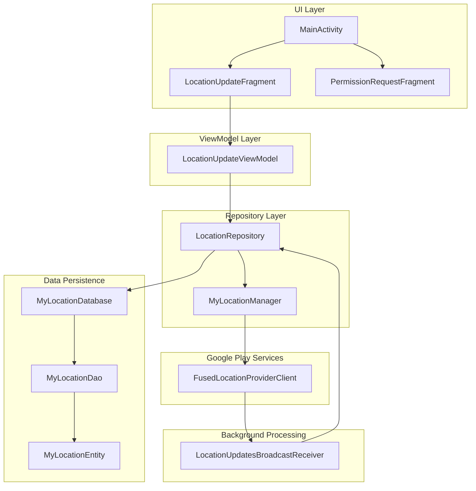
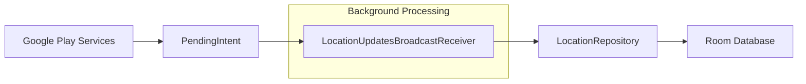
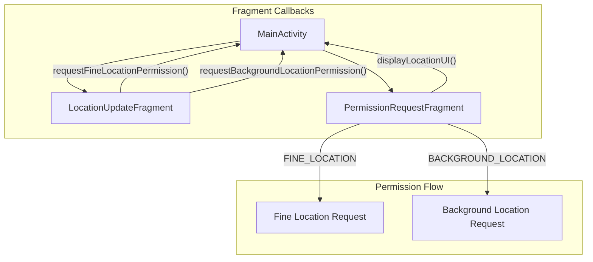
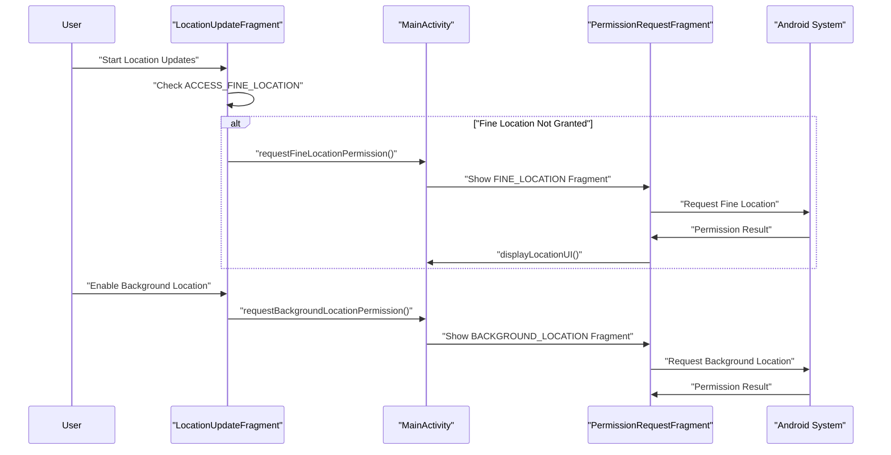
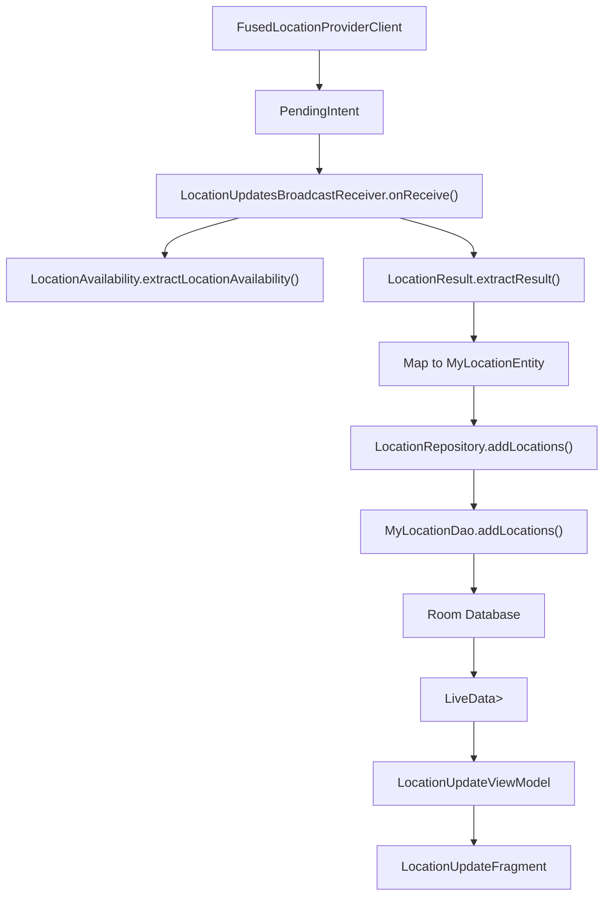
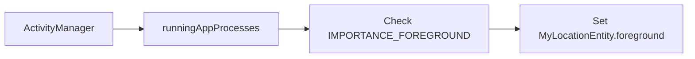
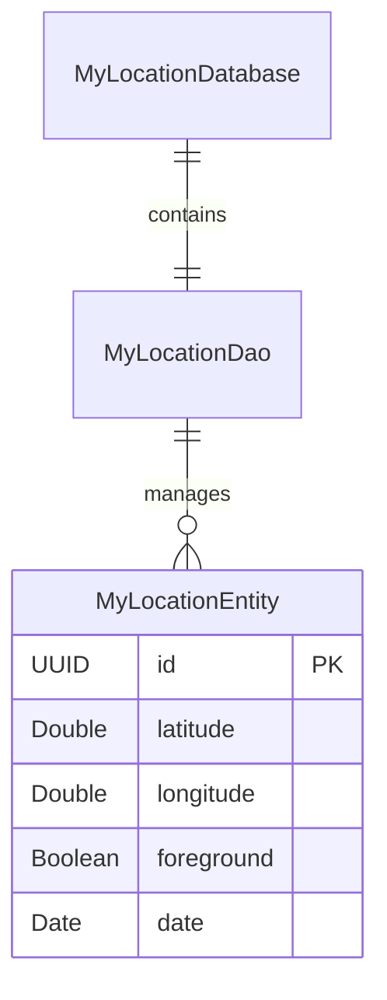
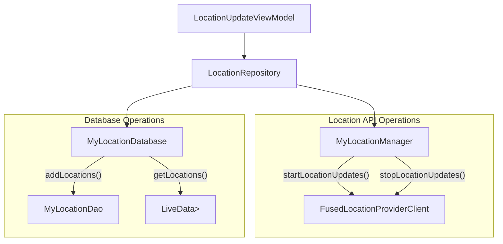

<!-- source: DeepWiki mcp.deepwiki.com · repo android/location-samples · extra page Background Location Updates · fetched 2026-10-23 -->

# Background Location Updates

<details>
<summary>Relevant source files</summary>

The following files were used as context for generating this wiki page:

- [LocationUpdatesBackgroundKotlin/app/build.gradle](LocationUpdatesBackgroundKotlin/app/build.gradle)
- [LocationUpdatesBackgroundKotlin/app/src/main/AndroidManifest.xml](LocationUpdatesBackgroundKotlin/app/src/main/AndroidManifest.xml)
- [LocationUpdatesBackgroundKotlin/app/src/main/java/com/google/android/gms/location/sample/locationupdatesbackgroundkotlin/LocationUpdatesBroadcastReceiver.kt](LocationUpdatesBackgroundKotlin/app/src/main/java/com/google/android/gms/location/sample/locationupdatesbackgroundkotlin/LocationUpdatesBroadcastReceiver.kt)
- [LocationUpdatesBackgroundKotlin/app/src/main/java/com/google/android/gms/location/sample/locationupdatesbackgroundkotlin/Utils.kt](LocationUpdatesBackgroundKotlin/app/src/main/java/com/google/android/gms/location/sample/locationupdatesbackgroundkotlin/Utils.kt)
- [LocationUpdatesBackgroundKotlin/app/src/main/java/com/google/android/gms/location/sample/locationupdatesbackgroundkotlin/data/LocationRepository.kt](LocationUpdatesBackgroundKotlin/app/src/main/java/com/google/android/gms/location/sample/locationupdatesbackgroundkotlin/data/LocationRepository.kt)
- [LocationUpdatesBackgroundKotlin/app/src/main/java/com/google/android/gms/location/sample/locationupdatesbackgroundkotlin/data/MyLocationManager.kt](LocationUpdatesBackgroundKotlin/app/src/main/java/com/google/android/gms/location/sample/locationupdatesbackgroundkotlin/data/MyLocationManager.kt)
- [LocationUpdatesBackgroundKotlin/app/src/main/java/com/google/android/gms/location/sample/locationupdatesbackgroundkotlin/data/db/MyLocationDao.kt](LocationUpdatesBackgroundKotlin/app/src/main/java/com/google/android/gms/location/sample/locationupdatesbackgroundkotlin/data/db/MyLocationDao.kt)
- [LocationUpdatesBackgroundKotlin/app/src/main/java/com/google/android/gms/location/sample/locationupdatesbackgroundkotlin/data/db/MyLocationDatabase.kt](LocationUpdatesBackgroundKotlin/app/src/main/java/com/google/android/gms/location/sample/locationupdatesbackgroundkotlin/data/db/MyLocationDatabase.kt)
- [LocationUpdatesBackgroundKotlin/app/src/main/java/com/google/android/gms/location/sample/locationupdatesbackgroundkotlin/data/db/MyLocationEntity.kt](LocationUpdatesBackgroundKotlin/app/src/main/java/com/google/android/gms/location/sample/locationupdatesbackgroundkotlin/data/db/MyLocationEntity.kt)
- [LocationUpdatesBackgroundKotlin/app/src/main/java/com/google/android/gms/location/sample/locationupdatesbackgroundkotlin/data/db/MyLocationTypeConverters.kt](LocationUpdatesBackgroundKotlin/app/src/main/java/com/google/android/gms/location/sample/locationupdatesbackgroundkotlin/data/db/MyLocationTypeConverters.kt)
- [LocationUpdatesBackgroundKotlin/app/src/main/java/com/google/android/gms/location/sample/locationupdatesbackgroundkotlin/ui/LocationUpdateFragment.kt](LocationUpdatesBackgroundKotlin/app/src/main/java/com/google/android/gms/location/sample/locationupdatesbackgroundkotlin/ui/LocationUpdateFragment.kt)
- [LocationUpdatesBackgroundKotlin/app/src/main/java/com/google/android/gms/location/sample/locationupdatesbackgroundkotlin/ui/MainActivity.kt](LocationUpdatesBackgroundKotlin/app/src/main/java/com/google/android/gms/location/sample/locationupdatesbackgroundkotlin/ui/MainActivity.kt)
- [LocationUpdatesBackgroundKotlin/app/src/main/java/com/google/android/gms/location/sample/locationupdatesbackgroundkotlin/ui/PermissionRequestFragment.kt](LocationUpdatesBackgroundKotlin/app/src/main/java/com/google/android/gms/location/sample/locationupdatesbackgroundkotlin/ui/PermissionRequestFragment.kt)
- [LocationUpdatesBackgroundKotlin/app/src/main/java/com/google/android/gms/location/sample/locationupdatesbackgroundkotlin/viewmodels/LocationUpdateViewModel.kt](LocationUpdatesBackgroundKotlin/app/src/main/java/com/google/android/gms/location/sample/locationupdatesbackgroundkotlin/viewmodels/LocationUpdateViewModel.kt)
- [LocationUpdatesBackgroundKotlin/app/src/main/res/drawable/ic_location_on_24px.xml](LocationUpdatesBackgroundKotlin/app/src/main/res/drawable/ic_location_on_24px.xml)
- [LocationUpdatesBackgroundKotlin/app/src/main/res/drawable/ic_my_location_24px.xml](LocationUpdatesBackgroundKotlin/app/src/main/res/drawable/ic_my_location_24px.xml)
- [LocationUpdatesBackgroundKotlin/app/src/main/res/layout/activity_main.xml](LocationUpdatesBackgroundKotlin/app/src/main/res/layout/activity_main.xml)
- [LocationUpdatesBackgroundKotlin/app/src/main/res/layout/fragment_location_update.xml](LocationUpdatesBackgroundKotlin/app/src/main/res/layout/fragment_location_update.xml)
- [LocationUpdatesBackgroundKotlin/app/src/main/res/layout/fragment_permission_request.xml](LocationUpdatesBackgroundKotlin/app/src/main/res/layout/fragment_permission_request.xml)
- [LocationUpdatesBackgroundKotlin/app/src/main/res/values/dimens.xml](LocationUpdatesBackgroundKotlin/app/src/main/res/values/dimens.xml)
- [LocationUpdatesBackgroundKotlin/app/src/main/res/values/strings.xml](LocationUpdatesBackgroundKotlin/app/src/main/res/values/strings.xml)
- [LocationUpdatesBackgroundKotlin/build.gradle](LocationUpdatesBackgroundKotlin/build.gradle)
- [LocationUpdatesBackgroundKotlin/gradle.properties](LocationUpdatesBackgroundKotlin/gradle.properties)
- [LocationUpdatesBackgroundKotlin/gradle/wrapper/gradle-wrapper.properties](LocationUpdatesBackgroundKotlin/gradle/wrapper/gradle-wrapper.properties)

</details>


## Purpose and Scope

This page documents the Background Location Updates sample application, which demonstrates how to receive location updates when an Android app is running in the background. The sample uses a BroadcastReceiver pattern to comply with Android's background execution limitations and implements proper permission handling for background location access.

For foreground location updates using a bound service pattern, see [Foreground Location Updates](#2.3.1). For basic location access without background functionality, see [Location Address (Geocoding)](#2.3.3).

Sources: [LocationUpdatesBackgroundKotlin/app/src/main/java/com/google/android/gms/location/sample/locationupdatesbackgroundkotlin/ui/MainActivity.kt:24-46](), [LocationUpdatesBackgroundKotlin/app/src/main/AndroidManifest.xml:21-23]()

## System Architecture Overview

The Background Location Updates sample implements a fragment-based MVVM architecture with background processing capabilities. The system is designed to handle Android's background execution restrictions by using a BroadcastReceiver pattern instead of traditional background services.

### High-Level Component Architecture



Sources: [LocationUpdatesBackgroundKotlin/app/src/main/java/com/google/android/gms/location/sample/locationupdatesbackgroundkotlin/ui/MainActivity.kt:47-48](), [LocationUpdatesBackgroundKotlin/app/src/main/java/com/google/android/gms/location/sample/locationupdatesbackgroundkotlin/viewmodels/LocationUpdateViewModel.kt:28-42](), [LocationUpdatesBackgroundKotlin/app/src/main/java/com/google/android/gms/location/sample/locationupdatesbackgroundkotlin/data/LocationRepository.kt:32-36]()

## Core Components

### LocationUpdatesBroadcastReceiver

The `LocationUpdatesBroadcastReceiver` is the central component that handles location updates delivered via PendingIntent. This approach is required for apps targeting API level 26+ due to background service limitations.



Key responsibilities:
- Extracts `LocationResult` and `LocationAvailability` from incoming intents
- Converts location data to `MyLocationEntity` objects
- Tracks whether app is in foreground or background state
- Persists location data via `LocationRepository`

Sources: [LocationUpdatesBackgroundKotlin/app/src/main/java/com/google/android/gms/location/sample/locationupdatesbackgroundkotlin/LocationUpdatesBroadcastReceiver.kt:32-44](), [LocationUpdatesBackgroundKotlin/app/src/main/java/com/google/android/gms/location/sample/locationupdatesbackgroundkotlin/LocationUpdatesBroadcastReceiver.kt:47-74]()

### MyLocationManager

The `MyLocationManager` handles all interactions with the Fused Location Provider API and manages the location update subscription state.

| Configuration | Value | Purpose |
|---------------|-------|---------|
| Update Interval | 60 seconds | Primary location update frequency |
| Fastest Interval | 30 seconds | Maximum update rate limit |
| Max Wait Time | 2 minutes | Batched update delivery timeout |
| Priority | `PRIORITY_HIGH_ACCURACY` | GPS-level accuracy |

Sources: [LocationUpdatesBackgroundKotlin/app/src/main/java/com/google/android/gms/location/sample/locationupdatesbackgroundkotlin/data/MyLocationManager.kt:53-73](), [LocationUpdatesBackgroundKotlin/app/src/main/java/com/google/android/gms/location/sample/locationupdatesbackgroundkotlin/data/MyLocationManager.kt:81-85]()

### Fragment Architecture

The UI is implemented using a fragment-based architecture where `MainActivity` acts as a container that swaps between different fragments based on permission state and user actions.



Sources: [LocationUpdatesBackgroundKotlin/app/src/main/java/com/google/android/gms/location/sample/locationupdatesbackgroundkotlin/ui/MainActivity.kt:47-48](), [LocationUpdatesBackgroundKotlin/app/src/main/java/com/google/android/gms/location/sample/locationupdatesbackgroundkotlin/ui/LocationUpdateFragment.kt:180-183](), [LocationUpdatesBackgroundKotlin/app/src/main/java/com/google/android/gms/location/sample/locationupdatesbackgroundkotlin/ui/PermissionRequestFragment.kt:253-255]()

## Permission Management

The sample implements a two-stage permission request process, following Android best practices for background location access.

### Permission Requirements

| Permission | Manifest Declaration | Runtime Request | Purpose |
|------------|---------------------|-----------------|---------|
| `ACCESS_COARSE_LOCATION` | ✓ | ✓ | Basic location access |
| `ACCESS_FINE_LOCATION` | ✓ | ✓ | GPS-level accuracy |
| `ACCESS_BACKGROUND_LOCATION` | ✓ | ✓ | Background location updates |

### Permission Flow Architecture



Sources: [LocationUpdatesBackgroundKotlin/app/src/main/java/com/google/android/gms/location/sample/locationupdatesbackgroundkotlin/ui/LocationUpdateFragment.kt:58-60](), [LocationUpdatesBackgroundKotlin/app/src/main/java/com/google/android/gms/location/sample/locationupdatesbackgroundkotlin/ui/PermissionRequestFragment.kt:214-240](), [LocationUpdatesBackgroundKotlin/app/src/main/AndroidManifest.xml:21-23]()

## Data Flow and Processing

### Location Update Processing Flow



The system processes location updates through the following steps:

1. **Intent Processing**: `LocationUpdatesBroadcastReceiver` receives location updates via `ACTION_PROCESS_UPDATES` intent
2. **Data Extraction**: Extracts `LocationResult` and checks `LocationAvailability`
3. **Entity Mapping**: Converts locations to `MyLocationEntity` with foreground/background state tracking
4. **Persistence**: Stores entities in Room database via `LocationRepository`
5. **UI Updates**: LiveData observers automatically update the UI

Sources: [LocationUpdatesBackgroundKotlin/app/src/main/java/com/google/android/gms/location/sample/locationupdatesbackgroundkotlin/LocationUpdatesBroadcastReceiver.kt:47-74](), [LocationUpdatesBackgroundKotlin/app/src/main/java/com/google/android/gms/location/sample/locationupdatesbackgroundkotlin/data/LocationRepository.kt:74-78]()

### Foreground State Detection

The system tracks whether location updates are received while the app is in the foreground or background using the `isAppInForeground()` method:



**Note**: The implementation at [LocationUpdatesBackgroundKotlin/app/src/main/java/com/google/android/gms/location/sample/locationupdatesbackgroundkotlin/LocationUpdatesBroadcastReceiver.kt:76-93]() is marked as debug-only and recommends using `Application.ActivityLifecycleCallbacks` for production apps.

Sources: [LocationUpdatesBackgroundKotlin/app/src/main/java/com/google/android/gms/location/sample/locationupdatesbackgroundkotlin/LocationUpdatesBroadcastReceiver.kt:81-93](), [LocationUpdatesBackgroundKotlin/app/src/main/java/com/google/android/gms/location/sample/locationupdatesbackgroundkotlin/LocationUpdatesBroadcastReceiver.kt:60-67]()

## Background Processing Architecture

### BroadcastReceiver Registration

The sample registers `LocationUpdatesBroadcastReceiver` in the manifest with an explicit intent filter to handle location updates:

```xml
<receiver
    android:name=".LocationUpdatesBroadcastReceiver"
    android:exported="true">
    <intent-filter>
        <action android:name="...ACTION_PROCESS_UPDATES" />
    </intent-filter>
</receiver>
```

### Android Background Execution Compliance

The architecture addresses Android's background execution limitations:

| Android Version | Restriction | Sample Solution |
|----------------|-------------|-----------------|
| API 26+ (Oreo) | Background service limits | Use BroadcastReceiver with PendingIntent |
| API 29+ (Q) | Background location permission | Separate permission request flow |
| All versions | App lifecycle management | Automatic subscription cleanup |

The sample automatically stops location updates when the app goes to background without background location permission, implemented in `LocationUpdateFragment.onPause()`:

Sources: [LocationUpdatesBackgroundKotlin/app/src/main/AndroidManifest.xml:44-50](), [LocationUpdatesBackgroundKotlin/app/src/main/java/com/google/android/gms/location/sample/locationupdatesbackgroundkotlin/LocationUpdatesBroadcastReceiver.kt:35-44](), [LocationUpdatesBackgroundKotlin/app/src/main/java/com/google/android/gms/location/sample/locationupdatesbackgroundkotlin/ui/LocationUpdateFragment.kt:121-131]()

## Database Persistence

### Room Database Schema

The sample uses Room database for local storage with the following entity structure:



### Data Access Layer

| Component | Responsibility |
|-----------|---------------|
| `MyLocationEntity` | Location data model with Room annotations |
| `MyLocationDao` | Database operations interface |
| `MyLocationDatabase` | Room database configuration |
| `MyLocationTypeConverters` | Type conversion for UUID and Date |

The database provides LiveData-based reactive queries that automatically update the UI when new location data is inserted:

```kotlin
@Query("SELECT * FROM my_location_table ORDER BY date DESC")
fun getLocations(): LiveData<List<MyLocationEntity>>
```

Sources: [LocationUpdatesBackgroundKotlin/app/src/main/java/com/google/android/gms/location/sample/locationupdatesbackgroundkotlin/data/db/MyLocationEntity.kt:28-35](), [LocationUpdatesBackgroundKotlin/app/src/main/java/com/google/android/gms/location/sample/locationupdatesbackgroundkotlin/data/db/MyLocationDao.kt:31-32](), [LocationUpdatesBackgroundKotlin/app/src/main/java/com/google/android/gms/location/sample/locationupdatesbackgroundkotlin/data/db/MyLocationDatabase.kt:29-32]()

### Repository Pattern Implementation

The `LocationRepository` provides a clean abstraction between the UI layer and both the location API and database operations:



Sources: [LocationUpdatesBackgroundKotlin/app/src/main/java/com/google/android/gms/location/sample/locationupdatesbackgroundkotlin/data/LocationRepository.kt:81-96](), [LocationUpdatesBackgroundKotlin/app/src/main/java/com/google/android/gms/location/sample/locationupdatesbackgroundkotlin/data/LocationRepository.kt:41-78]()

---

