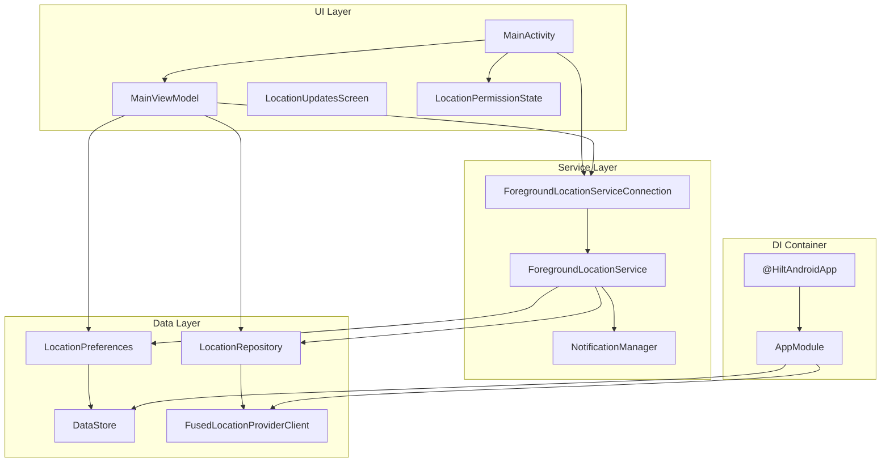
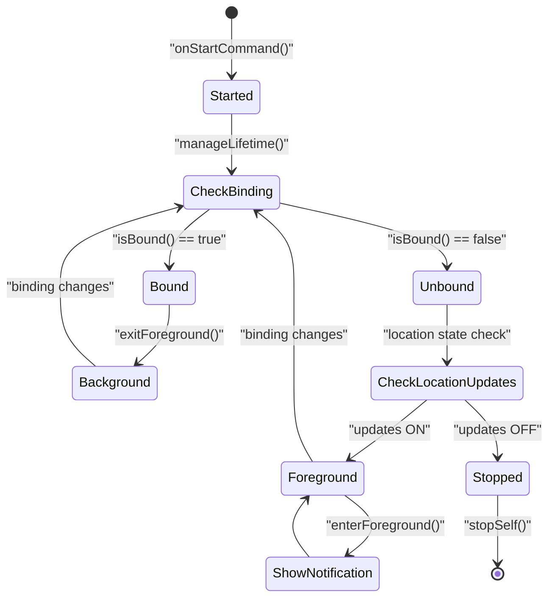
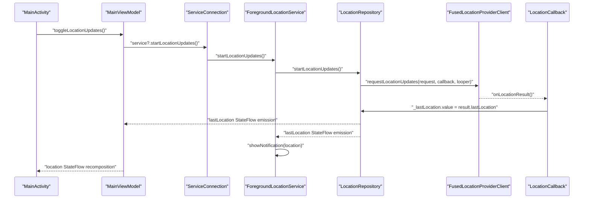
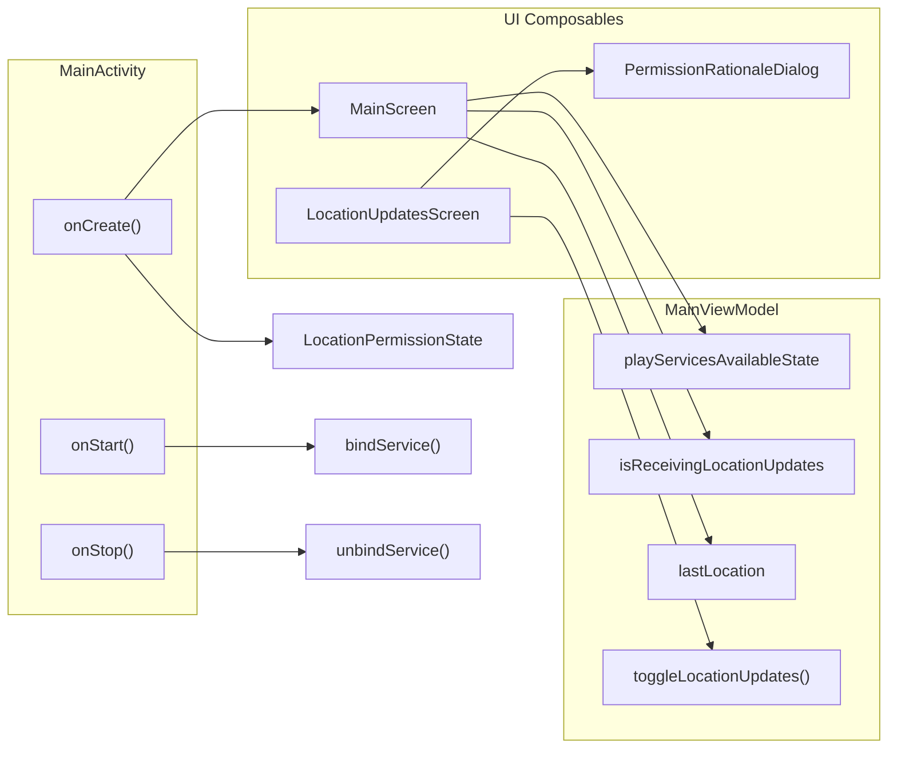

<!-- source: DeepWiki mcp.deepwiki.com · repo android/location-samples · extra page Foreground Location Updates · fetched 2026-10-23 -->

# Foreground Location Updates

<details>
<summary>Relevant source files</summary>

The following files were used as context for generating this wiki page:

- [ForegroundLocationUpdates/app/build.gradle](ForegroundLocationUpdates/app/build.gradle)
- [ForegroundLocationUpdates/app/src/main/AndroidManifest.xml](ForegroundLocationUpdates/app/src/main/AndroidManifest.xml)
- [ForegroundLocationUpdates/app/src/main/java/com/google/android/gms/location/sample/foregroundlocation/ForegroundLocationApp.kt](ForegroundLocationUpdates/app/src/main/java/com/google/android/gms/location/sample/foregroundlocation/ForegroundLocationApp.kt)
- [ForegroundLocationUpdates/app/src/main/java/com/google/android/gms/location/sample/foregroundlocation/ForegroundLocationService.kt](ForegroundLocationUpdates/app/src/main/java/com/google/android/gms/location/sample/foregroundlocation/ForegroundLocationService.kt)
- [ForegroundLocationUpdates/app/src/main/java/com/google/android/gms/location/sample/foregroundlocation/MainActivity.kt](ForegroundLocationUpdates/app/src/main/java/com/google/android/gms/location/sample/foregroundlocation/MainActivity.kt)
- [ForegroundLocationUpdates/app/src/main/java/com/google/android/gms/location/sample/foregroundlocation/MainViewModel.kt](ForegroundLocationUpdates/app/src/main/java/com/google/android/gms/location/sample/foregroundlocation/MainViewModel.kt)
- [ForegroundLocationUpdates/app/src/main/java/com/google/android/gms/location/sample/foregroundlocation/data/LocationPreferences.kt](ForegroundLocationUpdates/app/src/main/java/com/google/android/gms/location/sample/foregroundlocation/data/LocationPreferences.kt)
- [ForegroundLocationUpdates/app/src/main/java/com/google/android/gms/location/sample/foregroundlocation/data/LocationRepository.kt](ForegroundLocationUpdates/app/src/main/java/com/google/android/gms/location/sample/foregroundlocation/data/LocationRepository.kt)
- [ForegroundLocationUpdates/app/src/main/java/com/google/android/gms/location/sample/foregroundlocation/ui/LocationPermissionState.kt](ForegroundLocationUpdates/app/src/main/java/com/google/android/gms/location/sample/foregroundlocation/ui/LocationPermissionState.kt)
- [ForegroundLocationUpdates/app/src/main/java/com/google/android/gms/location/sample/foregroundlocation/ui/LocationUpdatesScreen.kt](ForegroundLocationUpdates/app/src/main/java/com/google/android/gms/location/sample/foregroundlocation/ui/LocationUpdatesScreen.kt)
- [ForegroundLocationUpdates/app/src/main/res/drawable/ic_location.xml](ForegroundLocationUpdates/app/src/main/res/drawable/ic_location.xml)
- [ForegroundLocationUpdates/app/src/main/res/drawable/ic_stop.xml](ForegroundLocationUpdates/app/src/main/res/drawable/ic_stop.xml)
- [ForegroundLocationUpdates/app/src/main/res/values/strings.xml](ForegroundLocationUpdates/app/src/main/res/values/strings.xml)

</details>


## Purpose and Scope

This document covers the Foreground Location Updates sample, which demonstrates how to implement continuous location tracking using a foreground service with bound service architecture. The sample shows best practices for managing location updates that persist when the app is backgrounded, including proper service lifecycle management, notification handling, and permission management.

For background location tracking using broadcast receivers, see [Background Location Updates](#2.3.2). For basic location retrieval without persistent tracking, see [Basic Location Sample](#2.6).

## Architecture Overview

The Foreground Location Updates sample implements a sophisticated architecture using MVVM pattern with Hilt dependency injection, bound service pattern, and repository pattern for data management.

### Component Architecture



**Sources:** [ForegroundLocationUpdates/app/src/main/java/com/google/android/gms/location/sample/foregroundlocation/MainActivity.kt:1-110](), [ForegroundLocationUpdates/app/src/main/java/com/google/android/gms/location/sample/foregroundlocation/MainViewModel.kt:1-88](), [ForegroundLocationUpdates/app/src/main/java/com/google/android/gms/location/sample/foregroundlocation/ForegroundLocationService.kt:1-270]()

### Technology Stack

| Component | Technology | Purpose |
|-----------|------------|---------|
| UI Framework | Jetpack Compose | Modern declarative UI |
| Architecture Pattern | MVVM | Separation of concerns |
| Dependency Injection | Hilt | Component lifecycle management |
| Location Provider | FusedLocationProviderClient | Google Play Services location API |
| Data Persistence | DataStore Preferences | User preferences storage |
| Background Processing | Foreground Service | Persistent location tracking |
| State Management | StateFlow | Reactive data streams |

**Sources:** [ForegroundLocationUpdates/app/build.gradle:17-103](), [ForegroundLocationUpdates/app/src/main/java/com/google/android/gms/location/sample/foregroundlocation/ForegroundLocationApp.kt:1-58]()

## Service Lifecycle Management

The `ForegroundLocationService` implements sophisticated lifecycle management that adapts to UI binding state and location update requirements.

### Service State Machine



**Sources:** [ForegroundLocationUpdates/app/src/main/java/com/google/android/gms/location/sample/foregroundlocation/ForegroundLocationService.kt:146-157]()

### Binding Management

The service uses a custom `LocalBinder` and `ForegroundLocationServiceConnection` to manage client connections:

- **Bind Count Tracking**: [ForegroundLocationUpdates/app/src/main/java/com/google/android/gms/location/sample/foregroundlocation/ForegroundLocationService.kt:68-73]()
- **Bind Handling**: [ForegroundLocationUpdates/app/src/main/java/com/google/android/gms/location/sample/foregroundlocation/ForegroundLocationService.kt:127-131]()
- **Unbind Delay**: [ForegroundLocationUpdates/app/src/main/java/com/google/android/gms/location/sample/foregroundlocation/ForegroundLocationService.kt:133-144]()

The service implements a 2-second delay after unbinding to handle configuration changes where the UI temporarily unbinds and rebinds.

**Sources:** [ForegroundLocationUpdates/app/src/main/java/com/google/android/gms/location/sample/foregroundlocation/ForegroundLocationService.kt:117-144](), [ForegroundLocationUpdates/app/src/main/java/com/google/android/gms/location/sample/foregroundlocation/ForegroundLocationService.kt:256-269]()

### Notification Management

The service creates persistent notifications when running in foreground mode:

- **Channel Creation**: [ForegroundLocationUpdates/app/src/main/java/com/google/android/gms/location/sample/foregroundlocation/ForegroundLocationService.kt:184-194]()
- **Notification Building**: [ForegroundLocationUpdates/app/src/main/java/com/google/android/gms/location/sample/foregroundlocation/ForegroundLocationService.kt:196-228]()
- **Stop Action**: [ForegroundLocationUpdates/app/src/main/java/com/google/android/gms/location/sample/foregroundlocation/ForegroundLocationService.kt:79-84]()

**Sources:** [ForegroundLocationUpdates/app/src/main/java/com/google/android/gms/location/sample/foregroundlocation/ForegroundLocationService.kt:175-228]()

## Location Data Flow

The location data flows through a repository pattern with reactive state management using StateFlow.

### Location Update Pipeline



**Sources:** [ForegroundLocationUpdates/app/src/main/java/com/google/android/gms/location/sample/foregroundlocation/MainViewModel.kt:56-82](), [ForegroundLocationUpdates/app/src/main/java/com/google/android/gms/location/sample/foregroundlocation/data/LocationRepository.kt:44-73]()

### LocationRepository Implementation

The `LocationRepository` manages location updates using `FusedLocationProviderClient`:

- **Location Request Configuration**: [ForegroundLocationUpdates/app/src/main/java/com/google/android/gms/location/sample/foregroundlocation/data/LocationRepository.kt:45-48]()
- **StateFlow Management**: [ForegroundLocationUpdates/app/src/main/java/com/google/android/gms/location/sample/foregroundlocation/data/LocationRepository.kt:37-41]()
- **Callback Implementation**: [ForegroundLocationUpdates/app/src/main/java/com/google/android/gms/location/sample/foregroundlocation/data/LocationRepository.kt:68-72]()

The repository uses high accuracy priority with 10-second intervals and runs callbacks on the main looper for simplicity.

**Sources:** [ForegroundLocationUpdates/app/src/main/java/com/google/android/gms/location/sample/foregroundlocation/data/LocationRepository.kt:1-74]()

## Permission Management

The sample implements comprehensive location permission handling with support for Android 12+ approximate location permissions.

### Permission Requirements

The app requires both coarse and fine location permissions as mandated by Android 12+:

```xml
<uses-permission android:name="android.permission.ACCESS_COARSE_LOCATION" />
<uses-permission android:name="android.permission.ACCESS_FINE_LOCATION" />
<uses-permission android:name="android.permission.FOREGROUND_SERVICE" />
```

**Sources:** [ForegroundLocationUpdates/app/src/main/AndroidManifest.xml:27-29]()

### LocationPermissionState

The `LocationPermissionState` class manages permission requests and UI state:

- **Permission Arrays**: [ForegroundLocationUpdates/app/src/main/java/com/google/android/gms/location/sample/foregroundlocation/ui/LocationPermissionState.kt:32-33]()
- **State Properties**: [ForegroundLocationUpdates/app/src/main/java/com/google/android/gms/location/sample/foregroundlocation/ui/LocationPermissionState.kt:74-94]()
- **Request Launcher**: [ForegroundLocationUpdates/app/src/main/java/com/google/android/gms/location/sample/foregroundlocation/ui/LocationPermissionState.kt:96-103]()

The class provides reactive state properties that trigger recomposition when permission states change.

**Sources:** [ForegroundLocationUpdates/app/src/main/java/com/google/android/gms/location/sample/foregroundlocation/ui/LocationPermissionState.kt:1-131]()

## UI Layer

The UI layer uses Jetpack Compose with MVVM architecture and reactive state management.

### Activity and ViewModel Integration



**Sources:** [ForegroundLocationUpdates/app/src/main/java/com/google/android/gms/location/sample/foregroundlocation/MainActivity.kt:46-84](), [ForegroundLocationUpdates/app/src/main/java/com/google/android/gms/location/sample/foregroundlocation/MainViewModel.kt:35-87]()

### Screen State Management

The UI handles multiple states based on Google Play Services availability and location permissions:

| State | Composable | Condition |
|-------|------------|-----------|
| Initializing | `InitializingScreen` | `PlayServicesAvailableState.Initializing` |
| Service Unavailable | `ServiceUnavailableScreen` | `PlayServicesAvailableState.PlayServicesUnavailable` |
| Location Updates | `LocationUpdatesScreen` | `PlayServicesAvailableState.PlayServicesAvailable` |

**Sources:** [ForegroundLocationUpdates/app/src/main/java/com/google/android/gms/location/sample/foregroundlocation/MainActivity.kt:96-108]()

### LocationUpdatesScreen

The main screen displays location data and provides start/stop controls:

- **Location Display**: [ForegroundLocationUpdates/app/src/main/java/com/google/android/gms/location/sample/foregroundlocation/ui/LocationUpdatesScreen.kt:69-81]()
- **Permission Rationale Dialog**: [ForegroundLocationUpdates/app/src/main/java/com/google/android/gms/location/sample/foregroundlocation/ui/LocationUpdatesScreen.kt:103-126]()
- **Button State Logic**: [ForegroundLocationUpdates/app/src/main/java/com/google/android/gms/location/sample/foregroundlocation/ui/LocationUpdatesScreen.kt:61-67]()

**Sources:** [ForegroundLocationUpdates/app/src/main/java/com/google/android/gms/location/sample/foregroundlocation/ui/LocationUpdatesScreen.kt:1-141]()

## Data Persistence

The sample uses DataStore Preferences for persisting user location preferences across app restarts.

### LocationPreferences Implementation

The `LocationPreferences` class manages the location toggle state:

- **DataStore Integration**: [ForegroundLocationUpdates/app/src/main/java/com/google/android/gms/location/sample/foregroundlocation/data/LocationPreferences.kt:31-33]()
- **State Flow**: [ForegroundLocationUpdates/app/src/main/java/com/google/android/gms/location/sample/foregroundlocation/data/LocationPreferences.kt:34-36]()
- **Update Method**: [ForegroundLocationUpdates/app/src/main/java/com/google/android/gms/location/sample/foregroundlocation/data/LocationPreferences.kt:38-42]()

The service checks this preference on startup to restore location updates after app restart or system reboot.

**Sources:** [ForegroundLocationUpdates/app/src/main/java/com/google/android/gms/location/sample/foregroundlocation/data/LocationPreferences.kt:1-48](), [ForegroundLocationUpdates/app/src/main/java/com/google/android/gms/location/sample/foregroundlocation/ForegroundLocationService.kt:89-102]()

### Dependency Injection Configuration

The `AppModule` provides singleton instances for key dependencies:

- **FusedLocationProviderClient**: [ForegroundLocationUpdates/app/src/main/java/com/google/android/gms/location/sample/foregroundlocation/ForegroundLocationApp.kt:45-48]()
- **DataStore**: [ForegroundLocationUpdates/app/src/main/java/com/google/android/gms/location/sample/foregroundlocation/ForegroundLocationApp.kt:51-56]()
- **GoogleApiAvailability**: [ForegroundLocationUpdates/app/src/main/java/com/google/android/gms/location/sample/foregroundlocation/ForegroundLocationApp.kt:40-42]()

**Sources:** [ForegroundLocationUpdates/app/src/main/java/com/google/android/gms/location/sample/foregroundlocation/ForegroundLocationApp.kt:36-57]()

---

