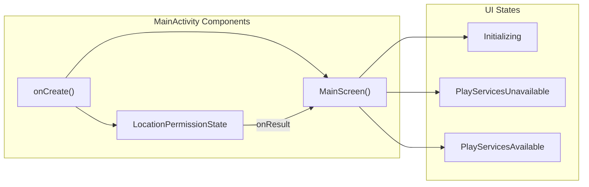
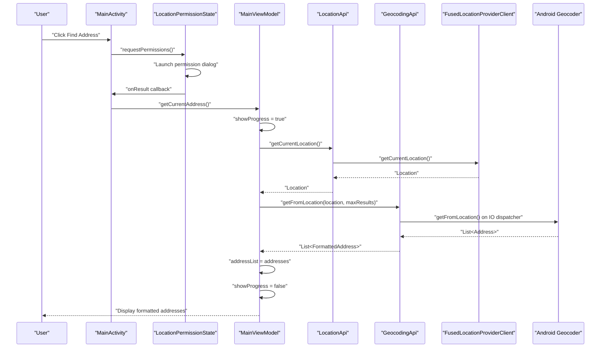
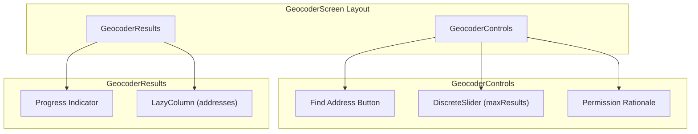
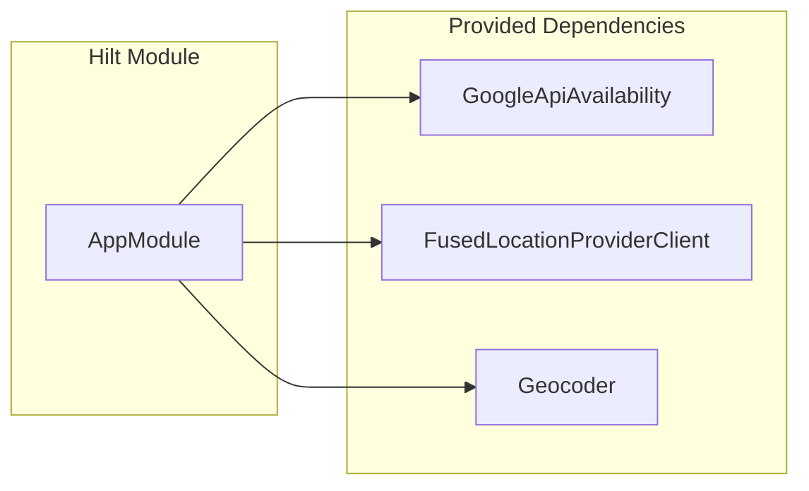

<!-- source: DeepWiki mcp.deepwiki.com · repo android/location-samples · extra page Location Address (Geocoding) · fetched 2026-10-23 -->

# Location Address (Geocoding)

Relevant source files

The following files were used as context for generating this wiki page:

- [LocationAddress/.gitignore](LocationAddress/.gitignore)
- [LocationAddress/README.md](LocationAddress/README.md)
- [LocationAddress/app/.gitignore](LocationAddress/app/.gitignore)
- [LocationAddress/app/build.gradle](LocationAddress/app/build.gradle)
- [LocationAddress/app/src/main/AndroidManifest.xml](LocationAddress/app/src/main/AndroidManifest.xml)
- [LocationAddress/app/src/main/java/com/google/android/gms/location/sample/locationaddress/LocationAddressApp.kt](LocationAddress/app/src/main/java/com/google/android/gms/location/sample/locationaddress/LocationAddressApp.kt)
- [LocationAddress/app/src/main/java/com/google/android/gms/location/sample/locationaddress/MainActivity.kt](LocationAddress/app/src/main/java/com/google/android/gms/location/sample/locationaddress/MainActivity.kt)
- [LocationAddress/app/src/main/java/com/google/android/gms/location/sample/locationaddress/MainViewModel.kt](LocationAddress/app/src/main/java/com/google/android/gms/location/sample/locationaddress/MainViewModel.kt)
- [LocationAddress/app/src/main/java/com/google/android/gms/location/sample/locationaddress/data/GeocodingApi.kt](LocationAddress/app/src/main/java/com/google/android/gms/location/sample/locationaddress/data/GeocodingApi.kt)
- [LocationAddress/app/src/main/java/com/google/android/gms/location/sample/locationaddress/data/LocationApi.kt](LocationAddress/app/src/main/java/com/google/android/gms/location/sample/locationaddress/data/LocationApi.kt)
- [LocationAddress/app/src/main/java/com/google/android/gms/location/sample/locationaddress/data/PlayServicesAvailabilityChecker.kt](LocationAddress/app/src/main/java/com/google/android/gms/location/sample/locationaddress/data/PlayServicesAvailabilityChecker.kt)
- [LocationAddress/app/src/main/java/com/google/android/gms/location/sample/locationaddress/ui/DiscreteSlider.kt](LocationAddress/app/src/main/java/com/google/android/gms/location/sample/locationaddress/ui/DiscreteSlider.kt)
- [LocationAddress/app/src/main/java/com/google/android/gms/location/sample/locationaddress/ui/GeocoderScreen.kt](LocationAddress/app/src/main/java/com/google/android/gms/location/sample/locationaddress/ui/GeocoderScreen.kt)
- [LocationAddress/app/src/main/java/com/google/android/gms/location/sample/locationaddress/ui/InitializingScreen.kt](LocationAddress/app/src/main/java/com/google/android/gms/location/sample/locationaddress/ui/InitializingScreen.kt)
- [LocationAddress/app/src/main/java/com/google/android/gms/location/sample/locationaddress/ui/LocationPermissionState.kt](LocationAddress/app/src/main/java/com/google/android/gms/location/sample/locationaddress/ui/LocationPermissionState.kt)
- [LocationAddress/app/src/main/java/com/google/android/gms/location/sample/locationaddress/ui/ServiceUnavailableScreen.kt](LocationAddress/app/src/main/java/com/google/android/gms/location/sample/locationaddress/ui/ServiceUnavailableScreen.kt)
- [LocationAddress/app/src/main/java/com/google/android/gms/location/sample/locationaddress/ui/theme/Type.kt](LocationAddress/app/src/main/java/com/google/android/gms/location/sample/locationaddress/ui/theme/Type.kt)
- [LocationAddress/app/src/main/res/values/strings.xml](LocationAddress/app/src/main/res/values/strings.xml)
- [LocationAddress/build.gradle](LocationAddress/build.gradle)
- [LocationAddress/gradle/wrapper/gradle-wrapper.properties](LocationAddress/gradle/wrapper/gradle-wrapper.properties)
- [LocationAddress/screenshots/results_ui.png](LocationAddress/screenshots/results_ui.png)

This document covers the Location Address sample application, which demonstrates how to use Android's geocoding capabilities to convert geographic coordinates into human-readable addresses. The sample showcases the integration of Google Play Services location APIs with Android's `Geocoder` class to perform reverse geocoding operations.

For information about other location tracking patterns, see [Foreground Location Updates](#2.3.1) and [Background Location Updates](#2.3.2).

## Purpose and Architecture

The Location Address sample demonstrates a complete implementation of reverse geocoding using modern Android architecture patterns. The application follows MVVM architecture with Jetpack Compose UI, Hilt dependency injection, and reactive data flow using Kotlin coroutines.

```mermaid
graph TB
    subgraph "UI Layer"
        MA["MainActivity"]
        GS["GeocoderScreen"]
        LPS["LocationPermissionState"]
    end
    
    subgraph "ViewModel Layer"
        MVM["MainViewModel"]
    end
    
    subgraph "Data Layer"
        LA["LocationApi"]
        GA["GeocodingApi"]
        PSAC["PlayServicesAvailabilityChecker"]
    end
    
    subgraph "External APIs"
        FLPC["FusedLocationProviderClient"]
        GC["Android Geocoder"]
        GAAV["GoogleApiAvailability"]
    end
    
    MA --> MVM
    MA --> GS
    MA --> LPS
    MVM --> LA
    MVM --> GA
    MVM --> PSAC
    LA --> FLPC
    GA --> GC
    PSAC --> GAAV
    
    GS --> MVM
    LPS --> MVM
```

**Sources:** [LocationAddress/app/src/main/java/com/google/android/gms/location/sample/locationaddress/MainActivity.kt:1-95](), [LocationAddress/app/src/main/java/com/google/android/gms/location/sample/locationaddress/MainViewModel.kt:1-87]()

## Core Components

### MainActivity

The `MainActivity` serves as the application entry point and handles the composition of UI components with permission management. It implements the Android Activity pattern with Jetpack Compose integration.

Key responsibilities:
- Initializes `LocationPermissionState` for permission handling
- Composes the main UI with `MainScreen`
- Triggers address lookup when permissions are granted

**Sources:** [LocationAddress/app/src/main/java/com/google/android/gms/location/sample/locationaddress/MainActivity.kt:40-94]()

### MainViewModel

The `MainViewModel` orchestrates the geocoding process and manages application state using the MVVM pattern with Hilt dependency injection.

State management:
- `uiState`: Flow-based UI state (Initializing, PlayServicesAvailable, PlayServicesUnavailable)
- `addressList`: List of `FormattedAddress` objects from geocoding results
- `showProgress`: Boolean indicating ongoing geocoding operation
- `maxResults`: Configurable maximum number of results (1-7)

**Sources:** [LocationAddress/app/src/main/java/com/google/android/gms/location/sample/locationaddress/MainViewModel.kt:38-87]()

### Data Layer APIs

#### LocationApi

Wraps the `FusedLocationProviderClient` to provide a coroutine-based interface for location retrieval.

Key method: `getCurrentLocation()` - Returns current location with high accuracy priority or null on permission errors.

**Sources:** [LocationAddress/app/src/main/java/com/google/android/gms/location/sample/locationaddress/data/LocationApi.kt:27-43]()

#### GeocodingApi

Encapsulates Android's `Geocoder` class with proper thread management and error handling.

Key method: `getFromLocation(location, maxResults)` - Performs reverse geocoding on IO dispatcher to avoid main thread blocking.

**Sources:** [LocationAddress/app/src/main/java/com/google/android/gms/location/sample/locationaddress/data/GeocodingApi.kt:29-56]()

## Data Flow and Processing

The application follows a reactive data flow pattern from user interaction to address display:

**Sources:** [LocationAddress/app/src/main/java/com/google/android/gms/location/sample/locationaddress/MainActivity.kt:48-52](), [LocationAddress/app/src/main/java/com/google/android/gms/location/sample/locationaddress/MainViewModel.kt:69-81]()

## Permission Management

The sample implements comprehensive location permission handling compatible with Android 12+ requirements using the `LocationPermissionState` class.

### Permission Requirements

| Permission | API Level | Usage |
|------------|-----------|-------|
| `ACCESS_COARSE_LOCATION` | All | Required for approximate location |
| `ACCESS_FINE_LOCATION` | All | Required for precise location |

Both permissions must be requested together on Android 12+ to comply with the approximate location feature.

### LocationPermissionState

Key properties and methods:
- `accessFineLocationGranted`: Boolean state for precise location permission
- `accessCoarseLocationGranted`: Boolean state for approximate location permission  
- `shouldShowRationale()`: Determines when to show permission rationale
- `requestPermissions()`: Launches system permission dialog

**Sources:** [LocationAddress/app/src/main/AndroidManifest.xml:22-28](), [LocationAddress/app/src/main/java/com/google/android/gms/location/sample/locationaddress/ui/LocationPermissionState.kt:40-148]()

## UI Implementation

The sample uses Jetpack Compose with responsive design patterns that adapt to device orientation.

### Screen Components

### Responsive Layout

The UI adapts between portrait and landscape orientations:
- **Portrait**: Vertical layout with controls (40%) and results (60%)
- **Landscape**: Horizontal layout with equal split (50%/50%)

**Sources:** [LocationAddress/app/src/main/java/com/google/android/gms/location/sample/locationaddress/ui/GeocoderScreen.kt:65-107]()

## Dependency Injection Configuration

The application uses Hilt for dependency injection with a singleton component providing core dependencies:

**Sources:** [LocationAddress/app/src/main/java/com/google/android/gms/location/sample/locationaddress/LocationAddressApp.kt:33-49]()

## Build Configuration

The sample requires the following key dependencies:

| Dependency | Purpose |
|------------|---------|
| `play-services-location:18.0.0` | Google Play Services location APIs |
| `hilt-android` | Dependency injection framework |
| `kotlinx-coroutines-play-services` | Coroutine integration for Play Services |
| Jetpack Compose libraries | Modern UI toolkit |

**Sources:** [LocationAddress/app/build.gradle:79-81](), [LocationAddress/app/build.gradle:82-85](), [LocationAddress/app/build.gradle:87-94]()

---

