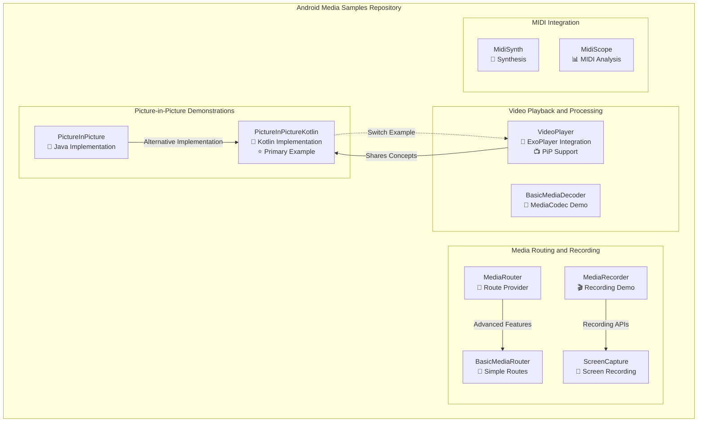
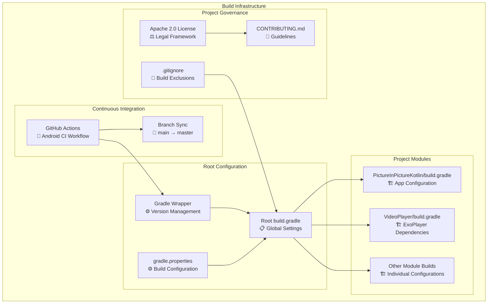

<!-- source: DeepWiki mcp.deepwiki.com · repo android/media-samples · page 1 Overview · fetched 2026-10-23 -->

# Overview

<details>
<summary>Relevant source files</summary>

The following files were used as context for generating this wiki page:

- [.gitignore](.gitignore)
- [CONTRIBUTING.md](CONTRIBUTING.md)
- [LICENSE](LICENSE)
- [PictureInPictureKotlin/README.md](PictureInPictureKotlin/README.md)
- [PictureInPictureKotlin/app/src/main/AndroidManifest.xml](PictureInPictureKotlin/app/src/main/AndroidManifest.xml)
- [PictureInPictureKotlin/app/src/main/res/values/dimens.xml](PictureInPictureKotlin/app/src/main/res/values/dimens.xml)
- [PictureInPictureKotlin/app/src/main/res/values/strings.xml](PictureInPictureKotlin/app/src/main/res/values/strings.xml)
- [README.md](README.md)

</details>


## Purpose and Scope

The Android Media Samples repository is a collection of independent Android Studio projects that demonstrate various media-related functionalities on the Android platform. Each sample application focuses on specific Android media APIs and serves as a practical reference implementation for developers working with audio, video, recording, playback, and media routing capabilities.

This document provides a high-level overview of the repository structure, its main sample applications, and the build infrastructure. For detailed documentation of specific samples, refer to the following sections: Picture-in-Picture samples ([2](#2)), VideoPlayer implementation ([3](#3)), and other media demonstrations ([4](#4)). Build system and CI/CD information is covered in ([5](#5)).

## Repository Structure

The repository is organized as a multi-project Gradle build containing several independent Android Studio projects. Each project demonstrates different aspects of Android media development while maintaining its own build configuration and dependencies.

### Primary Sample Applications



**Repository Structure Diagram**
Sources: [README.md:1-6](), [PictureInPictureKotlin/README.md:1-8]()

The repository contains the following major components:

| Sample Application | Primary APIs Demonstrated | Key Features |
|-------------------|---------------------------|--------------|
| `PictureInPictureKotlin` | Picture-in-Picture, MediaSession | Stopwatch and video playback examples |
| `PictureInPicture` | Picture-in-Picture (Java) | Java implementation alternative |
| `VideoPlayer` | ExoPlayer, MediaSession, AudioFocus | Advanced video playback with PiP |
| `BasicMediaDecoder` | MediaCodec, MediaExtractor | Low-level media decoding |
| `MediaRouter` | MediaRouter API | Custom route providers |
| `MediaRecorder` | MediaRecorder API | Audio/video recording |
| `ScreenCapture` | MediaProjection | Screen recording |
| `MidiSynth` | MIDI API | MIDI synthesis |
| `MidiScope` | MIDI API | MIDI device analysis |

### Build System Architecture



**Build System and Infrastructure Diagram**
Sources: [.gitignore:1-37](), [LICENSE:1-193](), [CONTRIBUTING.md:1-29]()

## Key Sample Applications

### Picture-in-Picture Demonstrations

The repository features two Picture-in-Picture implementations:

- **PictureInPictureKotlin**: The primary example demonstrating modern Android PiP functionality with both stopwatch and video playback scenarios
- **PictureInPicture**: Java-based alternative implementation showing the same concepts

Both samples demonstrate the `android:supportsPictureInPicture` manifest attribute and the use of `PictureInPictureParams` for configuring PiP behavior.

Sources: [PictureInPictureKotlin/app/src/main/AndroidManifest.xml:28-42](), [PictureInPictureKotlin/README.md:12-32]()

### Media Playback and Processing

The VideoPlayer sample showcases advanced media playback using ExoPlayer with comprehensive MediaSession integration and audio focus management. The BasicMediaDecoder demonstrates lower-level media processing using MediaCodec and MediaExtractor APIs.

### Recording and Routing

Several samples demonstrate media recording capabilities including traditional MediaRecorder usage and screen capture functionality. The MediaRouter samples show both basic and advanced implementations of custom media route providers.

## Application Configuration

Each sample application maintains its own Android manifest configuration with specific media-related permissions and activity declarations. The PictureInPictureKotlin manifest demonstrates typical PiP configuration:

```xml
<activity
    android:name=".MainActivity"
    android:configChanges="screenSize|smallestScreenSize|screenLayout|orientation"
    android:supportsPictureInPicture="true">
```

Sources: [PictureInPictureKotlin/app/src/main/AndroidManifest.xml:28-37]()

## String Resources and Localization

The samples include comprehensive string resources supporting multiple use cases. The PictureInPictureKotlin sample defines resources for both stopwatch and video playback scenarios:

| Resource Category | Key Strings | Purpose |
|------------------|-------------|---------|
| Stopwatch UI | `start`, `pause`, `clear` | Stopwatch controls |
| PiP Actions | `enter_picture_in_picture` | Mode switching |
| Video Controls | `play`, `fast_forward`, `fast_rewind` | Media playback |
| Navigation | `switch_media_session`, `switch_custom` | Example switching |

Sources: [PictureInPictureKotlin/app/src/main/res/values/strings.xml:20-47]()

## Legal Framework and Contribution Guidelines

The repository operates under the Apache 2.0 License and follows Google's Open Source Community Guidelines. Contributions require a Contributor License Agreement and must go through code review via GitHub pull requests.

Sources: [LICENSE:1-193](), [CONTRIBUTING.md:6-24]()

## Navigation Guide

This repository documentation is organized into the following main sections:

- **Picture-in-Picture Samples ([2](#2))**: Comprehensive coverage of PiP implementations
- **VideoPlayer Sample ([3](#3))**: ExoPlayer integration and advanced media features  
- **Other Media Samples ([4](#4))**: Recording, routing, decoding, and MIDI applications
- **Build System and CI/CD ([5](#5))**: Infrastructure and automation details
- **Repository Governance ([6](#6))**: Legal framework and contribution processes

Each section provides detailed technical documentation with code references, implementation details, and architectural explanations specific to that component.

---

