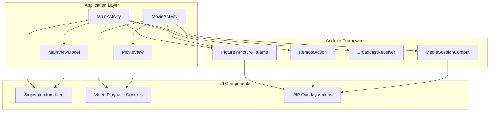
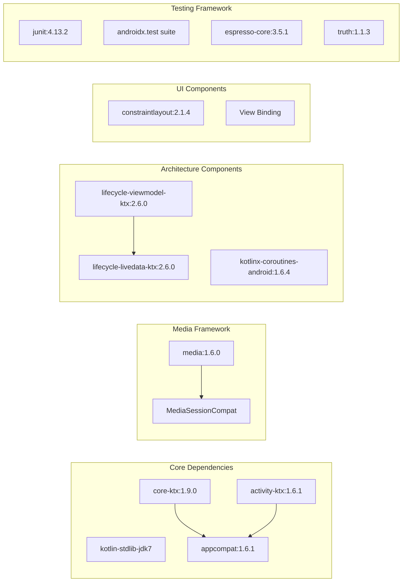

<!-- source: DeepWiki mcp.deepwiki.com · repo android/media-samples · page 2.1 PictureInPictureKotlin · fetched 2026-10-23 -->

# PictureInPictureKotlin

Relevant source files

The following files were used as context for generating this wiki page:

- [PictureInPictureKotlin/README.md](PictureInPictureKotlin/README.md)
- [PictureInPictureKotlin/app/build.gradle](PictureInPictureKotlin/app/build.gradle)
- [PictureInPictureKotlin/app/src/main/AndroidManifest.xml](PictureInPictureKotlin/app/src/main/AndroidManifest.xml)
- [PictureInPictureKotlin/app/src/main/res/values/dimens.xml](PictureInPictureKotlin/app/src/main/res/values/dimens.xml)
- [PictureInPictureKotlin/app/src/main/res/values/strings.xml](PictureInPictureKotlin/app/src/main/res/values/strings.xml)
- [PictureInPictureKotlin/build.gradle](PictureInPictureKotlin/build.gradle)
- [PictureInPictureKotlin/gradle/wrapper/gradle-wrapper.properties](PictureInPictureKotlin/gradle/wrapper/gradle-wrapper.properties)

This document covers the PictureInPictureKotlin sample application, which demonstrates comprehensive Picture-in-Picture (PiP) mode functionality for Android handheld devices. The sample includes two distinct demonstration scenarios: a stopwatch example with custom RemoteActions and a video playback example with MediaSession integration. For the Java-based PiP implementation, see [PictureInPicture (Java)](#2.2).

Sources: [PictureInPictureKotlin/README.md:1-65](), [PictureInPictureKotlin/app/src/main/AndroidManifest.xml:17-46]()

## System Architecture

The PictureInPictureKotlin sample implements a dual-activity architecture demonstrating different approaches to Picture-in-Picture mode integration.

Sources: [PictureInPictureKotlin/app/src/main/AndroidManifest.xml:28-42](), [PictureInPictureKotlin/app/src/main/res/values/strings.xml:20-47]()

## Core Activities

### MainActivity - Stopwatch Implementation

The `MainActivity` serves as the primary entry point and demonstrates PiP mode with a stopwatch timer that continues running seamlessly during mode transitions. The activity implements custom `RemoteAction` controls that remain accessible in the PiP overlay.

Key configuration attributes from the manifest:
- `android:supportsPictureInPicture="true"` enables PiP support
- `android:configChanges="screenSize|smallestScreenSize|screenLayout|orientation"` handles configuration changes without recreation

The stopwatch functionality provides three main actions available in PiP mode:
- Start/Pause timer control
- Clear timer reset
- Picture-in-Picture mode entry

Sources: [PictureInPictureKotlin/app/src/main/AndroidManifest.xml:28-37](), [PictureInPictureKotlin/app/src/main/res/values/strings.xml:20-31]()

### MovieActivity - Video Playback Implementation

The `MovieActivity` demonstrates video playback with MediaSession integration, showcasing how media controls can be seamlessly transitioned between full-screen and PiP modes. This activity integrates with the Android media framework to provide standard media session controls.

The video playback implementation features:
- Continuous playback during PiP transitions
- MediaSession integration for system-level media controls
- Custom video controls (play, fast forward, fast rewind)
- Integration with `MovieView` custom component

Sources: [PictureInPictureKotlin/app/src/main/AndroidManifest.xml:39-42](), [PictureInPictureKotlin/app/src/main/res/values/strings.xml:34-47]()

## Build Configuration

The project uses a modern Android build configuration with Kotlin support and comprehensive dependency management.

### Project-Level Configuration

The root `build.gradle` establishes the build environment:
- Kotlin version 1.8.0
- Android Gradle Plugin 7.4.2
- Google and Maven Central repositories

### Application Module Configuration

The app-level build configuration specifies:

| Configuration | Value |
|---------------|-------|
| Compile SDK | 33 |
| Target SDK | 33 |
| Minimum SDK | 31 |
| Application ID | `com.example.android.pictureinpicture` |
| Version Code | 1 |
| Version Name | "1.0" |

Build features enabled:
- `viewBinding true` for type-safe view references
- Java 8 language features support
- Kotlin JVM target 1.8

Sources: [PictureInPictureKotlin/build.gradle:17-38](), [PictureInPictureKotlin/app/build.gradle:20-46]()

## Dependencies and Integration

The application integrates with multiple AndroidX libraries and modern Android development tools.

### Key Dependencies

**Media Integration:**
- `androidx.media:media:1.6.0` - Provides MediaSessionCompat for video playback controls

**Architecture Components:**
- `lifecycle-viewmodel-ktx:2.6.0` - ViewModel pattern implementation
- `lifecycle-livedata-ktx:2.6.0` - Reactive data observation
- `kotlinx-coroutines-android:1.6.4` - Asynchronous programming support

**Testing Infrastructure:**
- Comprehensive testing setup with JUnit, AndroidX Test, Espresso, and Truth assertion library
- `androidx.test.runner.AndroidJUnitRunner` for instrumented tests

Sources: [PictureInPictureKotlin/app/build.gradle:48-71]()

## Gradle Wrapper Configuration

The project uses Gradle 7.5 distributed through the Gradle Wrapper system, ensuring consistent build environments across development machines and CI systems.

Wrapper configuration:
- Distribution URL: `https://services.gradle.org/distributions/gradle-7.5-bin.zip`
- Binary distribution for faster downloads and execution

Sources: [PictureInPictureKotlin/gradle/wrapper/gradle-wrapper.properties:1-5]()

---

