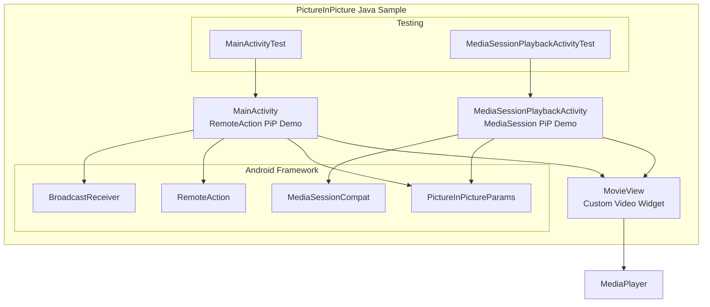
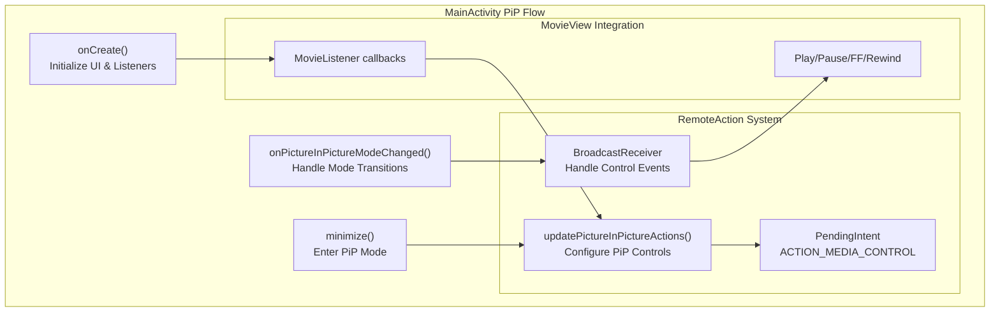
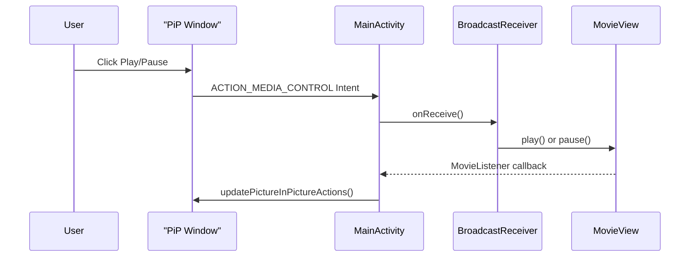
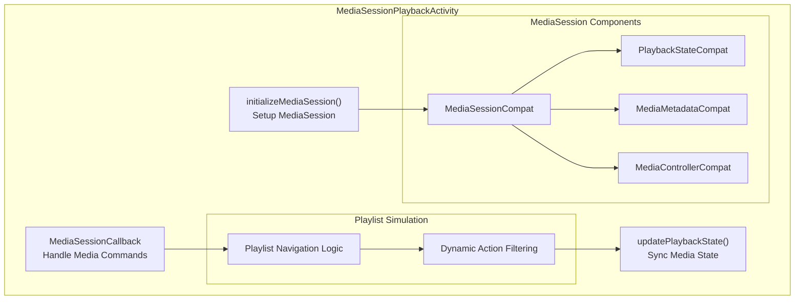
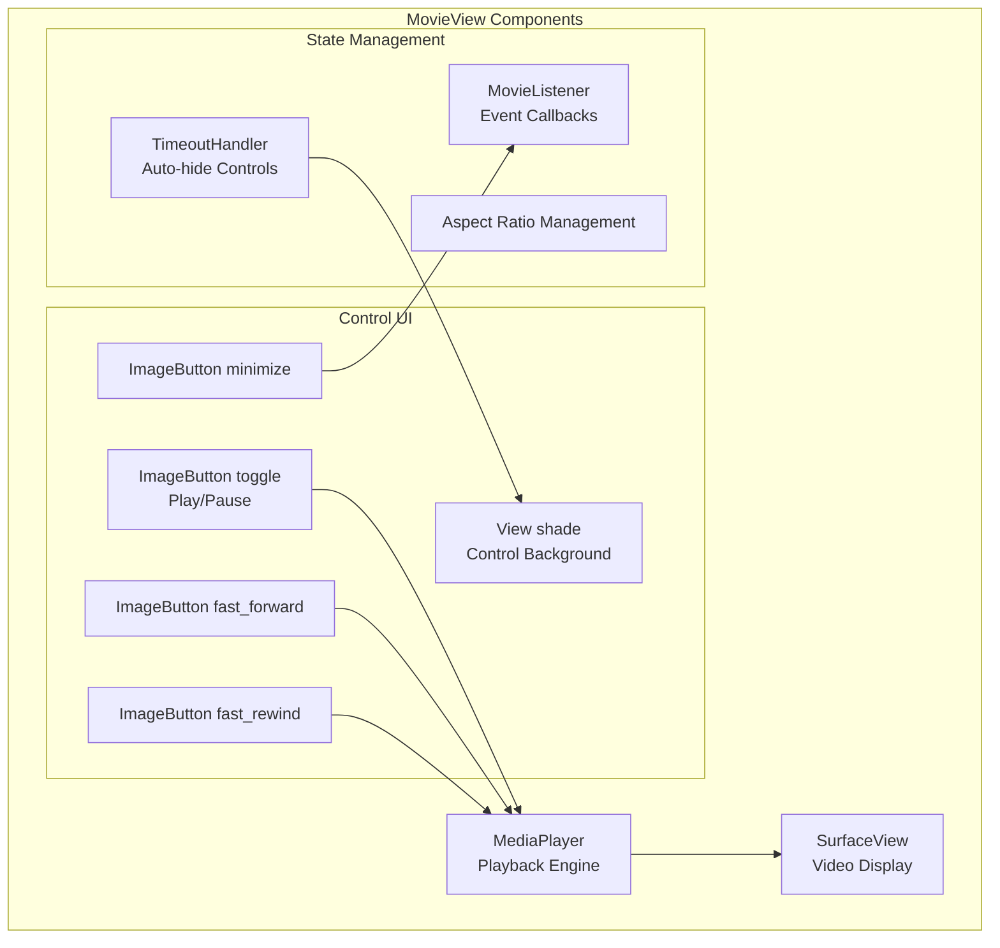
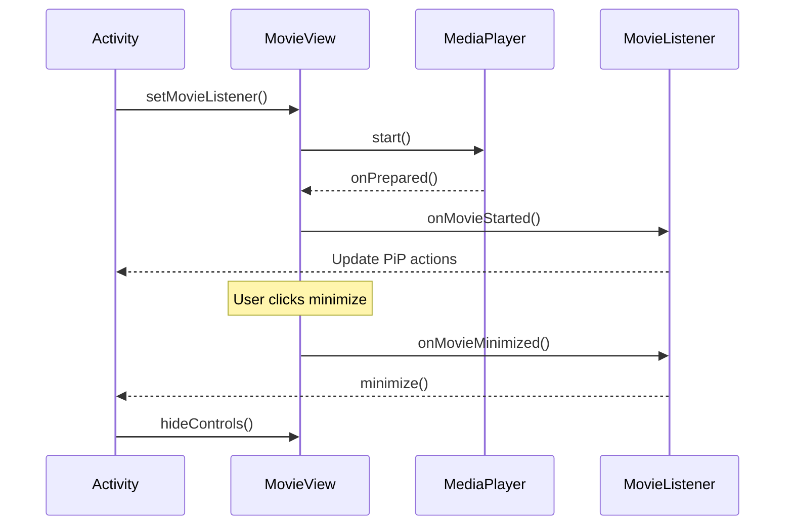
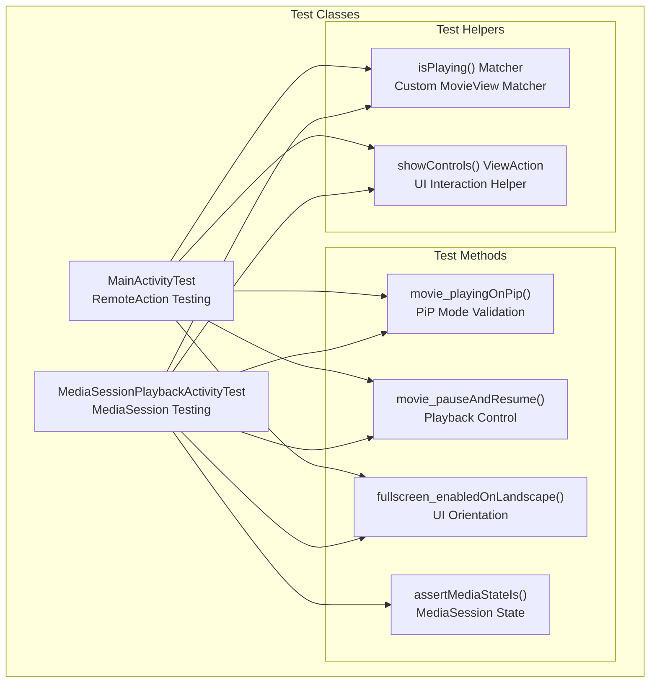

<!-- source: DeepWiki mcp.deepwiki.com · repo android/media-samples · page 2.2 PictureInPicture (Java) · fetched 2026-10-23 -->

# PictureInPicture (Java)

Relevant source files

The following files were used as context for generating this wiki page:

- [PictureInPicture/app/build.gradle](PictureInPicture/app/build.gradle)
- [PictureInPicture/app/src/androidTest/java/com/example/android/pictureinpicture/MainActivityTest.java](PictureInPicture/app/src/androidTest/java/com/example/android/pictureinpicture/MainActivityTest.java)
- [PictureInPicture/app/src/androidTest/java/com/example/android/pictureinpicture/MediaSessionPlaybackActivityTest.java](PictureInPicture/app/src/androidTest/java/com/example/android/pictureinpicture/MediaSessionPlaybackActivityTest.java)
- [PictureInPicture/app/src/main/java/com/example/android/pictureinpicture/MainActivity.java](PictureInPicture/app/src/main/java/com/example/android/pictureinpicture/MainActivity.java)
- [PictureInPicture/app/src/main/java/com/example/android/pictureinpicture/MediaSessionPlaybackActivity.java](PictureInPicture/app/src/main/java/com/example/android/pictureinpicture/MediaSessionPlaybackActivity.java)
- [PictureInPicture/app/src/main/java/com/example/android/pictureinpicture/widget/MovieView.java](PictureInPicture/app/src/main/java/com/example/android/pictureinpicture/widget/MovieView.java)
- [PictureInPicture/build.gradle](PictureInPicture/build.gradle)
- [PictureInPicture/gradle/wrapper/gradle-wrapper.properties](PictureInPicture/gradle/wrapper/gradle-wrapper.properties)

This document covers the Java-based Picture-in-Picture sample application, which demonstrates two different approaches for implementing Picture-in-Picture functionality on Android. This sample provides both `RemoteAction`-based controls and `MediaSession`-based integration patterns for PiP mode.

For the Kotlin-based implementation with more comprehensive features, see [PictureInPictureKotlin](#2.1).

## Architecture Overview

The Java PiP sample implements a dual-approach architecture with two separate activities demonstrating different PiP integration patterns, sharing a common custom video widget.

**Sources:** [PictureInPicture/app/src/main/java/com/example/android/pictureinpicture/MainActivity.java:1-330](), [PictureInPicture/app/src/main/java/com/example/android/pictureinpicture/MediaSessionPlaybackActivity.java:1-344](), [PictureInPicture/app/src/main/java/com/example/android/pictureinpicture/widget/MovieView.java:1-545]()

## MainActivity - RemoteAction Implementation

The `MainActivity` class demonstrates Picture-in-Picture using `RemoteAction` components, providing custom controls that appear as action buttons in the PiP window.

### PiP Control Flow

**Sources:** [PictureInPicture/app/src/main/java/com/example/android/pictureinpicture/MainActivity.java:153-190](), [PictureInPicture/app/src/main/java/com/example/android/pictureinpicture/MainActivity.java:246-283](), [PictureInPicture/app/src/main/java/com/example/android/pictureinpicture/MainActivity.java:288-298]()

### Key Implementation Details

| Component | Purpose | Code Location |
|-----------|---------|---------------|
| `ACTION_MEDIA_CONTROL` | Intent action for PiP control events | [MainActivity.java:54]() |
| `mPictureInPictureParamsBuilder` | Builder for PiP configuration | [MainActivity.java:89-90]() |
| `updatePictureInPictureActions()` | Updates RemoteAction buttons | [MainActivity.java:153-190]() |
| `minimize()` | Enters PiP mode with aspect ratio calculation | [MainActivity.java:288-298]() |

The activity registers a `BroadcastReceiver` when entering PiP mode to handle control events:

**Sources:** [PictureInPicture/app/src/main/java/com/example/android/pictureinpicture/MainActivity.java:251-273]()

## MediaSessionPlaybackActivity - MediaSession Integration

The `MediaSessionPlaybackActivity` demonstrates a different approach using `MediaSessionCompat` for PiP integration, providing system-level media controls.

### MediaSession Architecture

**Sources:** [PictureInPicture/app/src/main/java/com/example/android/pictureinpicture/MediaSessionPlaybackActivity.java:136-158](), [PictureInPicture/app/src/main/java/com/example/android/pictureinpicture/MediaSessionPlaybackActivity.java:267-334]()

### MediaSession Callback Implementation

The `MediaSessionCallback` inner class simulates a playlist with dynamic action availability:

| Callback Method | Function | Implementation |
|----------------|----------|----------------|
| `onPlay()` | Resume playback | [MediaSessionPlaybackActivity.java:280-283]() |
| `onPause()` | Pause playback | [MediaSessionPlaybackActivity.java:286-289]() |
| `onSkipToNext()` | Navigate playlist forward | [MediaSessionPlaybackActivity.java:292-311]() |
| `onSkipToPrevious()` | Navigate playlist backward | [MediaSessionPlaybackActivity.java:314-333]() |

**Sources:** [PictureInPicture/app/src/main/java/com/example/android/pictureinpicture/MediaSessionPlaybackActivity.java:267-334]()

## MovieView Custom Widget

The `MovieView` class provides a reusable video playback component with built-in controls, used by both activity implementations.

### MovieView Component Structure

**Sources:** [PictureInPicture/app/src/main/java/com/example/android/pictureinpicture/widget/MovieView.java:92-104](), [PictureInPicture/app/src/main/java/com/example/android/pictureinpicture/widget/MovieView.java:125-131]()

### MovieView Lifecycle Integration

The widget integrates with both PiP activities through the `MovieListener` interface:

**Sources:** [PictureInPicture/app/src/main/java/com/example/android/pictureinpicture/widget/MovieView.java:56-75](), [PictureInPicture/app/src/main/java/com/example/android/pictureinpicture/widget/MovieView.java:119-142]()

## Testing Infrastructure

Both activities include comprehensive test coverage using Espresso for UI testing and media state validation.

### Test Architecture

**Sources:** [PictureInPicture/app/src/androidTest/java/com/example/android/pictureinpicture/MainActivityTest.java:61-79](), [PictureInPicture/app/src/androidTest/java/com/example/android/pictureinpicture/MediaSessionPlaybackActivityTest.java:66-86](), [PictureInPicture/app/src/androidTest/java/com/example/android/pictureinpicture/MainActivityTest.java:129-141]()

### Key Test Validations

| Test Category | MainActivity | MediaSessionPlaybackActivity |
|---------------|--------------|------------------------------|
| PiP Mode Entry | `isInPictureInPictureMode()` validation | Same + MediaSession state check |
| Playback Control | Direct `MovieView` state checking | MediaSession `PlaybackState` validation |
| Orientation Handling | Window insets verification | Same implementation |
| Control Interaction | Espresso UI interactions | Same + media session callbacks |

**Sources:** [PictureInPicture/app/src/androidTest/java/com/example/android/pictureinpicture/MainActivityTest.java:82-93](), [PictureInPicture/app/src/androidTest/java/com/example/android/pictureinpicture/MediaSessionPlaybackActivityTest.java:140-149]()

## Build Configuration

The Java PiP sample uses a standard Android Gradle configuration with media-specific dependencies.

### Dependencies and SDK Requirements

| Component | Version | Purpose |
|-----------|---------|---------|
| `compileSdkVersion` | 30 | Target Android API level |
| `minSdkVersion` | 26 | PiP requires Android 8.0+ |
| `androidx.core:core` | 1.5.0-beta03 | Core AndroidX functionality |
| `androidx.media:media` | 1.2.1 | MediaSession support |
| Gradle Plugin | 4.2.2 | Android build tools |

**Sources:** [PictureInPicture/app/build.gradle:20-28](), [PictureInPicture/app/build.gradle:41-45](), [PictureInPicture/build.gradle:23]()

The project structure follows the standard multi-module Gradle pattern with root-level configuration and app-specific build settings.

**Sources:** [PictureInPicture/build.gradle:17-36](), [PictureInPicture/gradle/wrapper/gradle-wrapper.properties:1-6]()

---

