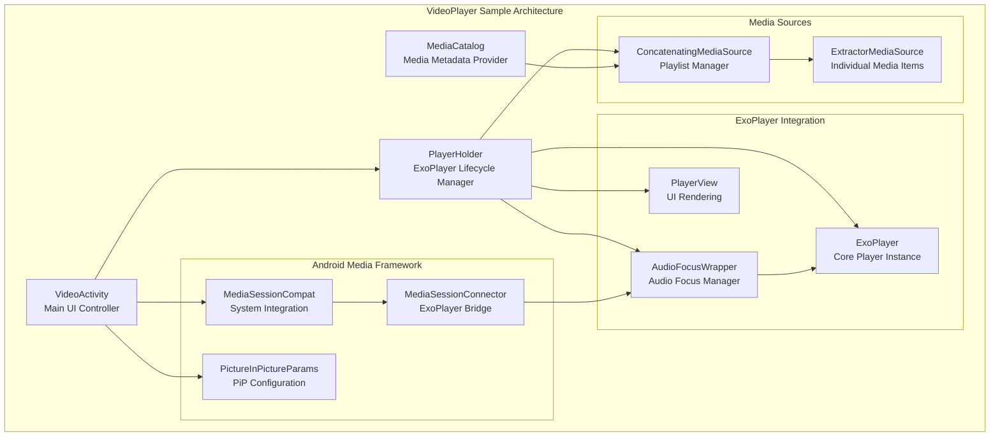
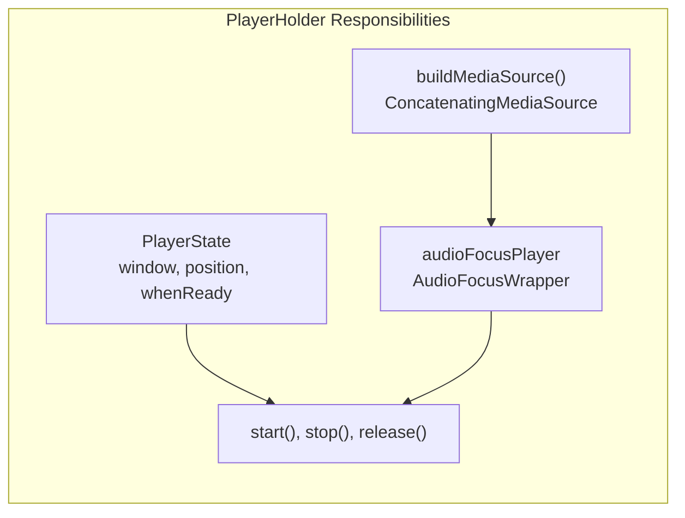
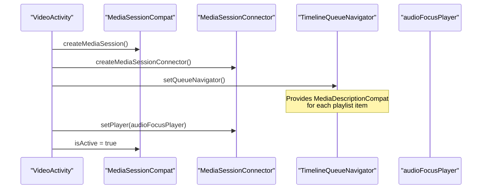
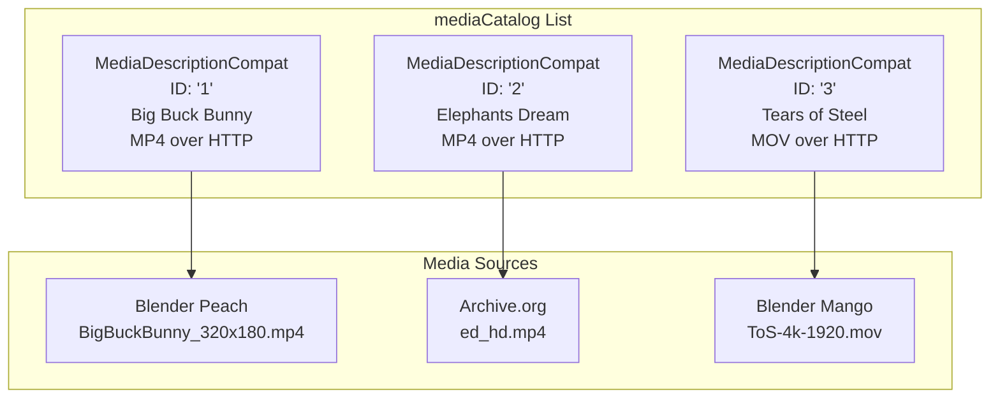

<!-- source: DeepWiki mcp.deepwiki.com · repo android/media-samples · page 3 VideoPlayer Sample · fetched 2026-10-23 -->

# VideoPlayer Sample

<details>
<summary>Relevant source files</summary>

The following files were used as context for generating this wiki page:

- [VideoPlayer/videoplayerapp/build.gradle](VideoPlayer/videoplayerapp/build.gradle)
- [VideoPlayer/videoplayerapp/src/main/java/com/example/android/videoplayersample/MediaCatalog.kt](VideoPlayer/videoplayerapp/src/main/java/com/example/android/videoplayersample/MediaCatalog.kt)
- [VideoPlayer/videoplayerapp/src/main/java/com/example/android/videoplayersample/Player.kt](VideoPlayer/videoplayerapp/src/main/java/com/example/android/videoplayersample/Player.kt)
- [VideoPlayer/videoplayerapp/src/main/java/com/example/android/videoplayersample/VideoActivity.kt](VideoPlayer/videoplayerapp/src/main/java/com/example/android/videoplayersample/VideoActivity.kt)

</details>


This document covers the VideoPlayer sample application, which demonstrates ExoPlayer integration with MediaSession support, audio focus management, and Picture-in-Picture functionality. The sample showcases best practices for building a video player that properly integrates with the Android media system.

For Picture-in-Picture implementation details specific to the PictureInPictureKotlin sample, see [PictureInPictureKotlin](#2.1). For audio focus management implementation details, see [Audio Focus Management](#3.1).

## Architecture Overview

The VideoPlayer sample follows a layered architecture with clear separation between UI management, player lifecycle, and media session integration. The core components work together to provide a complete video playback experience.

### System Architecture



Sources: [VideoPlayer/videoplayerapp/src/main/java/com/example/android/videoplayersample/VideoActivity.kt:1-143](), [VideoPlayer/videoplayerapp/src/main/java/com/example/android/videoplayersample/Player.kt:1-163]()

## Core Components

### VideoActivity

The `VideoActivity` class serves as the main controller, orchestrating player lifecycle, MediaSession management, and Picture-in-Picture functionality. It implements proper Android lifecycle management to ensure resources are handled correctly.

| Lifecycle Method | Player Action | MediaSession Action |
|------------------|---------------|-------------------|
| `onCreate()` | Create player instance | Create MediaSession |
| `onStart()` | Start playback | Activate MediaSession |
| `onStop()` | Stop and save state | Deactivate MediaSession |
| `onDestroy()` | Release resources | Release MediaSession |

Key responsibilities include:
- **Player Management**: Creates and manages `PlayerHolder` instance [VideoPlayer/videoplayerapp/src/main/java/com/example/android/videoplayersample/VideoActivity.kt:109-123]()
- **MediaSession Integration**: Handles MediaSession lifecycle and connector setup [VideoPlayer/videoplayerapp/src/main/java/com/example/android/videoplayersample/VideoActivity.kt:76-106]()
- **Picture-in-Picture**: Implements PiP mode transitions [VideoPlayer/videoplayerapp/src/main/java/com/example/android/videoplayersample/VideoActivity.kt:126-141]()

### PlayerHolder

The `PlayerHolder` class encapsulates ExoPlayer instance management and provides a clean interface for the activity. It handles player state persistence and audio focus integration.



The `PlayerState` data class maintains playback state across lifecycle transitions:
```kotlin
data class PlayerState(var window: Int = 0,
                       var position: Long = 0, 
                       var whenReady: Boolean = true)
```

Sources: [VideoPlayer/videoplayerapp/src/main/java/com/example/android/videoplayersample/Player.kt:41-43](), [VideoPlayer/videoplayerapp/src/main/java/com/example/android/videoplayersample/Player.kt:45-64]()

## MediaSession Integration

The sample demonstrates proper MediaSession integration using ExoPlayer's MediaSession extension. The `MediaSessionConnector` bridges ExoPlayer with the Android media framework.

### MediaSession Setup Flow



The `TimelineQueueNavigator` provides media descriptions for playlist navigation, enabling skip previous/next actions in Picture-in-Picture mode [VideoPlayer/videoplayerapp/src/main/java/com/example/android/videoplayersample/VideoActivity.kt:83-87]().

Sources: [VideoPlayer/videoplayerapp/src/main/java/com/example/android/videoplayersample/VideoActivity.kt:76-88](), [VideoPlayer/videoplayerapp/src/main/java/com/example/android/videoplayersample/VideoActivity.kt:92-106]()

## Picture-in-Picture Functionality  

The sample implements Picture-in-Picture mode with proper aspect ratio handling and UI state management. PiP mode is triggered automatically when the user leaves the app during video playback.

### PiP Implementation Details

| Method | Purpose | Key Implementation |
|--------|---------|-------------------|
| `onUserLeaveHint()` | Trigger PiP entry | Sets 16:9 aspect ratio with `Rational(16, 9)` |
| `onPictureInPictureModeChanged()` | Handle PiP state changes | Hides/shows player controls via `useController` |

The PiP configuration uses a standard 16:9 aspect ratio suitable for most video content [VideoPlayer/videoplayerapp/src/main/java/com/example/android/videoplayersample/VideoActivity.kt:129-134]().

Sources: [VideoPlayer/videoplayerapp/src/main/java/com/example/android/videoplayersample/VideoActivity.kt:126-141]()

## Media Catalog System

The `MediaCatalog` provides a predefined set of sample videos for demonstration purposes. Each media item is defined using `MediaDescriptionCompat` with complete metadata.

### Catalog Structure



Each catalog entry includes:
- **Media ID**: Unique identifier for playlist navigation
- **Title/Subtitle**: Display metadata for UI and MediaSession
- **Description**: Technical details about the media format
- **Media URI**: HTTP URL to the video file with proper licensing

Sources: [VideoPlayer/videoplayerapp/src/main/java/com/example/android/videoplayersample/MediaCatalog.kt:25-53]()

## Dependencies and Build Configuration

The sample uses specific ExoPlayer version 2.7.0 with MediaSession extension support. The build configuration demonstrates proper dependency management for ExoPlayer-based applications.

### Key Dependencies

| Dependency | Version | Purpose |
|------------|---------|---------|
| `exoplayer-core` | 2.7.0 | Core player functionality |
| `exoplayer-ui` | 2.7.0 | PlayerView UI components |
| `extension-mediasession` | 2.7.0 | MediaSession integration |

The sample targets API level 29 with minimum SDK 21, providing broad device compatibility while using modern Android features [VideoPlayer/videoplayerapp/build.gradle:21-29]().

Sources: [VideoPlayer/videoplayerapp/build.gradle:32-47](), [VideoPlayer/videoplayerapp/build.gradle:21-29]()

---

