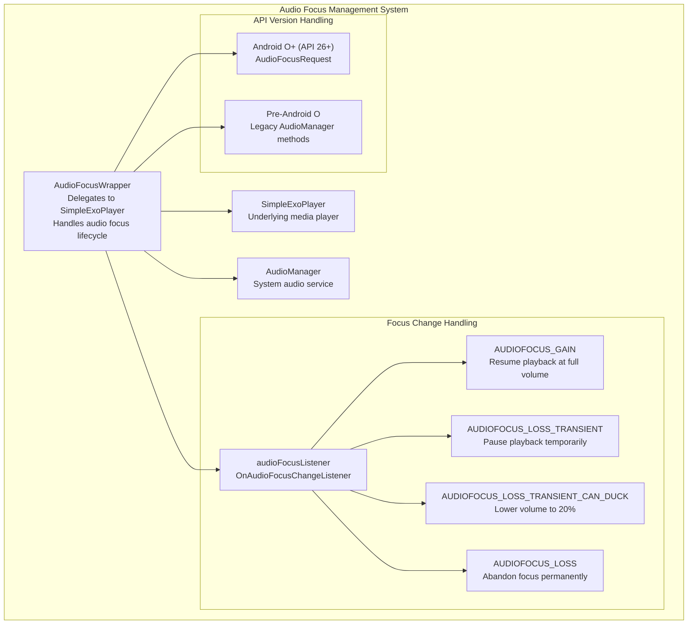
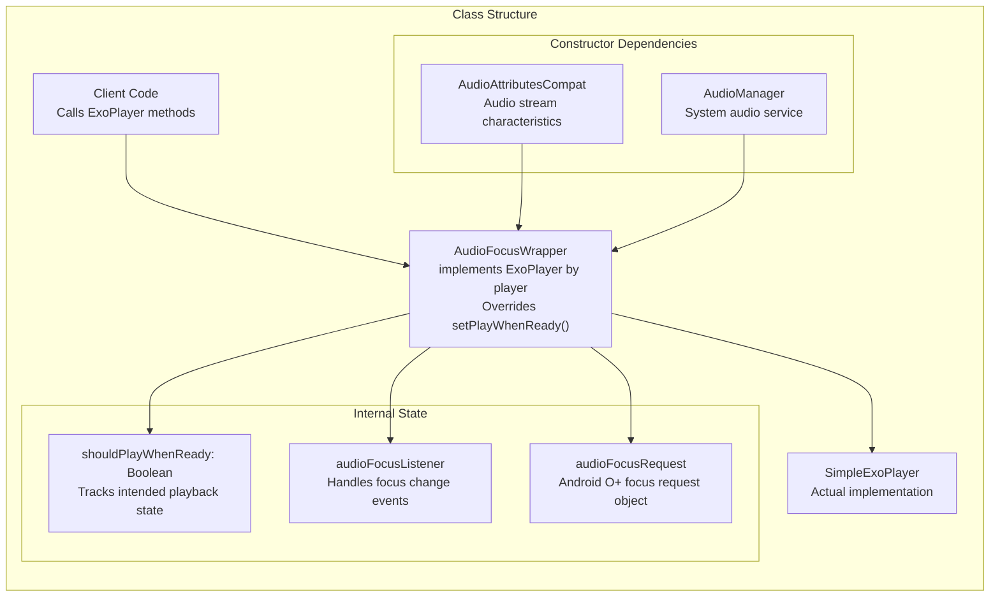
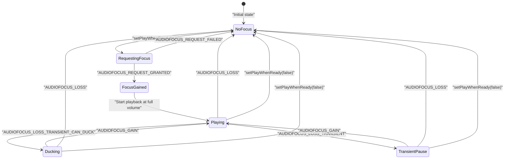
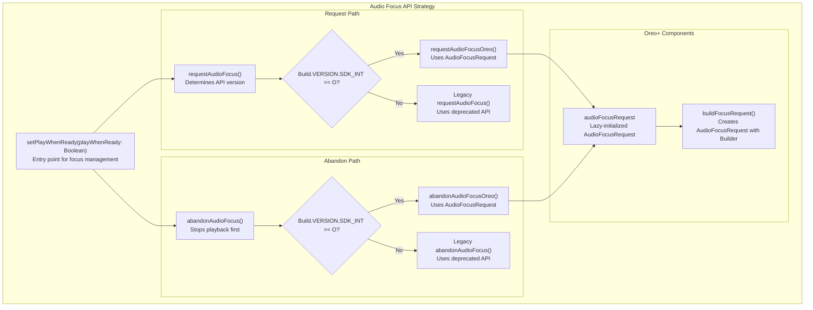

<!-- source: DeepWiki mcp.deepwiki.com · repo android/media-samples · page 3.1 Audio Focus Management · fetched 2026-10-23 -->

# Audio Focus Management

Relevant source files

The following files were used as context for generating this wiki page:

- [VideoPlayer/videoplayerapp/src/main/java/com/example/android/videoplayersample/AudioFocusWrapper.kt](VideoPlayer/videoplayerapp/src/main/java/com/example/android/videoplayersample/AudioFocusWrapper.kt)

## Purpose and Scope

This document covers the audio focus management system implemented in the VideoPlayer sample application. The system provides automatic audio focus handling for media playback applications, ensuring proper integration with the Android audio system and other audio-enabled applications.

The audio focus management is specifically implemented through the `AudioFocusWrapper` class, which wraps ExoPlayer instances to provide seamless audio focus request and abandonment functionality. For information about the broader VideoPlayer sample architecture, see [VideoPlayer Sample](#3).

## System Overview

The audio focus management system is centered around the `AudioFocusWrapper` class, which acts as a proxy for `SimpleExoPlayer` while automatically handling audio focus lifecycle management. The wrapper implements the delegation pattern to transparently add audio focus capabilities to any ExoPlayer instance.

**Sources:** [VideoPlayer/videoplayerapp/src/main/java/com/example/android/videoplayersample/AudioFocusWrapper.kt:31-38]()

## AudioFocusWrapper Class Architecture

The `AudioFocusWrapper` class implements the delegation pattern by implementing `ExoPlayer` interface and delegating all calls to the underlying `SimpleExoPlayer` instance, except for `setPlayWhenReady()` which is overridden to handle audio focus management.

**Sources:** [VideoPlayer/videoplayerapp/src/main/java/com/example/android/videoplayersample/AudioFocusWrapper.kt:36-39](), [VideoPlayer/videoplayerapp/src/main/java/com/example/android/videoplayersample/AudioFocusWrapper.kt:65-66]()

## Audio Focus Change Handling

The system responds to different types of audio focus changes by implementing specific behaviors for each focus change type. The focus change listener handles four main scenarios:

| Focus Change Type | Behavior | Volume Level | Playback State |
|------------------|----------|--------------|----------------|
| `AUDIOFOCUS_GAIN` | Resume playback | Full volume (1.0f) | Play if should play |
| `AUDIOFOCUS_LOSS_TRANSIENT_CAN_DUCK` | Continue playing | Duck volume (0.2f) | Continue playing |
| `AUDIOFOCUS_LOSS_TRANSIENT` | Pause temporarily | N/A | Pause |
| `AUDIOFOCUS_LOSS` | Stop permanently | N/A | Stop and abandon focus |

**Sources:** [VideoPlayer/videoplayerapp/src/main/java/com/example/android/videoplayersample/AudioFocusWrapper.kt:41-63](), [VideoPlayer/videoplayerapp/src/main/java/com/example/android/videoplayersample/AudioFocusWrapper.kt:115-116]()

## API Version Compatibility

The `AudioFocusWrapper` handles differences between Android API versions by using conditional logic to choose the appropriate audio focus API:

### Android O+ (API 26+) Implementation

For Android Oreo and later, the system uses the modern `AudioFocusRequest` API:

- Uses `AudioFocusRequest.Builder()` to construct focus requests
- Calls `audioManager.requestAudioFocus(audioFocusRequest)`
- Calls `audioManager.abandonAudioFocusRequest(audioFocusRequest)`

### Pre-Android O Implementation

For older Android versions, the system uses the legacy AudioManager methods:

- Calls deprecated `audioManager.requestAudioFocus()` with individual parameters
- Calls deprecated `audioManager.abandonAudioFocus(audioFocusListener)`
- Uses `audioAttributes.legacyStreamType` for stream type mapping

**Sources:** [VideoPlayer/videoplayerapp/src/main/java/com/example/android/videoplayersample/AudioFocusWrapper.kt:72-89](), [VideoPlayer/videoplayerapp/src/main/java/com/example/android/videoplayersample/AudioFocusWrapper.kt:91-99](), [VideoPlayer/videoplayerapp/src/main/java/com/example/android/videoplayersample/AudioFocusWrapper.kt:101-112]()

## Integration with ExoPlayer

The `AudioFocusWrapper` integrates with ExoPlayer through the delegation pattern and selective method overriding:

### Delegation Pattern Implementation

The class uses Kotlin's `by` delegation to automatically forward all `ExoPlayer` interface calls to the underlying `SimpleExoPlayer` instance, except for explicitly overridden methods.

### Playback Control Override

The key integration point is the `setPlayWhenReady()` method override, which intercepts playback start/stop requests to manage audio focus:

- When `playWhenReady = true`: Requests audio focus before allowing playback
- When `playWhenReady = false`: Abandons audio focus and stops playback

### State Management

The wrapper maintains a `shouldPlayWhenReady` boolean flag to track the intended playback state, separate from the actual `player.playWhenReady` state. This allows the system to remember the user's intent when audio focus is temporarily lost.

**Sources:** [VideoPlayer/videoplayerapp/src/main/java/com/example/android/videoplayersample/AudioFocusWrapper.kt:68-70](), [VideoPlayer/videoplayerapp/src/main/java/com/example/android/videoplayersample/AudioFocusWrapper.kt:39]()

## Volume Management and Ducking

The audio focus system implements volume ducking as a cooperative audio behavior, allowing multiple audio sources to play simultaneously when appropriate:

### Volume Constants

- `MEDIA_VOLUME_DEFAULT = 1.0f`: Full volume for normal playback
- `MEDIA_VOLUME_DUCK = 0.2f`: Reduced volume for ducking scenarios

### Ducking Behavior

When receiving `AUDIOFOCUS_LOSS_TRANSIENT_CAN_DUCK`, the system:
1. Continues playback without pausing
2. Reduces volume to 20% of normal level
3. Restores full volume when focus is regained

This allows the media to continue playing at reduced volume while other audio (like navigation prompts or notifications) plays at full volume.

**Sources:** [VideoPlayer/videoplayerapp/src/main/java/com/example/android/videoplayersample/AudioFocusWrapper.kt:50-54](), [VideoPlayer/videoplayerapp/src/main/java/com/example/android/videoplayersample/AudioFocusWrapper.kt:115-116]()

---

