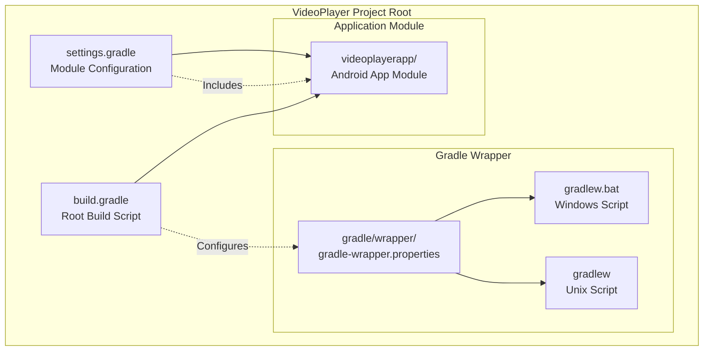
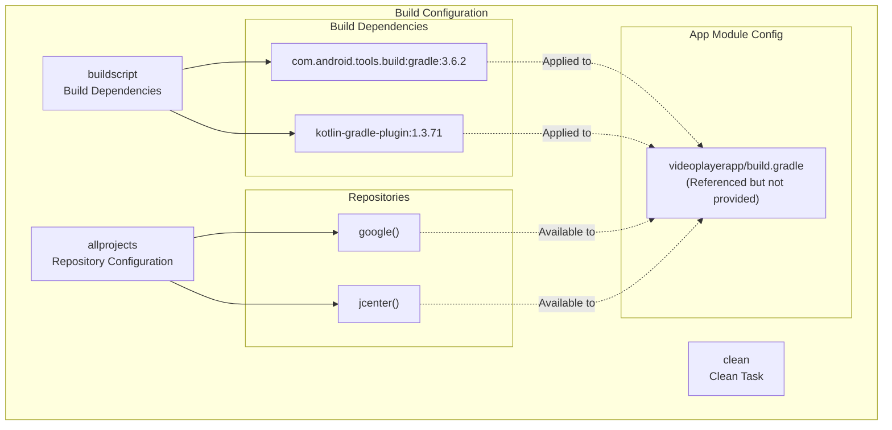
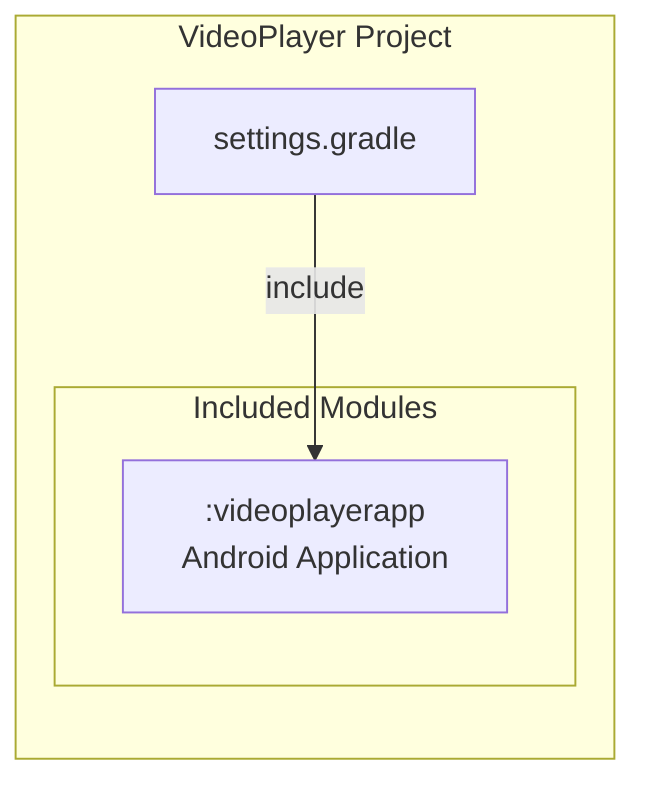

<!-- source: DeepWiki mcp.deepwiki.com · repo android/media-samples · page 3.2 Build System · fetched 2026-10-23 -->

# Build System

<details>
<summary>Relevant source files</summary>

The following files were used as context for generating this wiki page:

- [VideoPlayer/build.gradle](VideoPlayer/build.gradle)
- [VideoPlayer/gradle/wrapper/gradle-wrapper.properties](VideoPlayer/gradle/wrapper/gradle-wrapper.properties)
- [VideoPlayer/gradlew](VideoPlayer/gradlew)
- [VideoPlayer/gradlew.bat](VideoPlayer/gradlew.bat)
- [VideoPlayer/screenshots/template-icon.png](VideoPlayer/screenshots/template-icon.png)
- [VideoPlayer/settings.gradle](VideoPlayer/settings.gradle)

</details>


This document covers the Gradle build system configuration for the VideoPlayer sample project. It focuses specifically on the build setup, module structure, and dependency management for this individual sample application. For repository-wide build infrastructure and CI/CD workflows, see [Build System and CI/CD](#5) and [Gradle Wrapper System](#5.2).

## Project Structure

The VideoPlayer sample is configured as a single-module Android project with a straightforward Gradle build setup. The project follows standard Android Studio project conventions with Gradle wrapper support for consistent build environments.



Sources: [VideoPlayer/build.gradle:1-44](), [VideoPlayer/settings.gradle:1-18](), [VideoPlayer/gradle/wrapper/gradle-wrapper.properties:1-7]()

## Build Configuration Hierarchy

The build system uses a two-tier configuration approach with a root build script providing common settings and the application module containing app-specific configuration.



Sources: [VideoPlayer/build.gradle:19-32](), [VideoPlayer/build.gradle:34-39]()

## Gradle Wrapper Configuration

The project uses Gradle Wrapper version 5.6.4 to ensure consistent build environments across different development machines and CI systems.

| Configuration | Value |
|---------------|-------|
| Gradle Version | 5.6.4-all |
| Distribution URL | `https://services.gradle.org/distributions/gradle-5.6.4-all.zip` |
| Distribution Base | `GRADLE_USER_HOME` |
| Distribution Path | `wrapper/dists` |
| Zip Store Base | `GRADLE_USER_HOME` |
| Zip Store Path | `wrapper/dists` |

The wrapper scripts (`gradlew` and `gradlew.bat`) provide platform-specific entry points for executing Gradle commands without requiring a local Gradle installation.

Sources: [VideoPlayer/gradle/wrapper/gradle-wrapper.properties:1-7](), [VideoPlayer/gradlew:1-161](), [VideoPlayer/gradlew.bat:1-91]()

## Module Structure

The project contains a single Android application module defined in the settings configuration.



The `include ':videoplayerapp'` declaration in `settings.gradle` registers the single application module with the Gradle build system.

Sources: [VideoPlayer/settings.gradle:17]()

## Build Dependencies and Repositories

The root build script establishes the foundation for Android and Kotlin development through specific plugin versions and repository configurations.

### Build Script Dependencies

The `buildscript` block defines the tools needed to build the project:

- **Android Gradle Plugin**: Version 3.6.2 (`com.android.tools.build:gradle:3.6.2`)
- **Kotlin Gradle Plugin**: Version 1.3.71 (`org.jetbrains.kotlin:kotlin-gradle-plugin:$kotlin_version`)

### Repository Configuration

Both build script and project dependencies are resolved through:

- **Google Maven Repository**: `google()` - Primary source for Android libraries
- **JCenter Repository**: `jcenter()` - Secondary repository for general JVM libraries

Sources: [VideoPlayer/build.gradle:20](), [VideoPlayer/build.gradle:25-27](), [VideoPlayer/build.gradle:21-24](), [VideoPlayer/build.gradle:35-38]()

## Build Tasks

The root build script defines a `clean` task that removes the project's build directory, providing a way to reset the build state.

```kotlin
task clean(type: Delete) {
    delete rootProject.buildDir
}
```

This task ensures that all generated build artifacts are removed when a clean build is required.

Sources: [VideoPlayer/build.gradle:41-43]()

---

