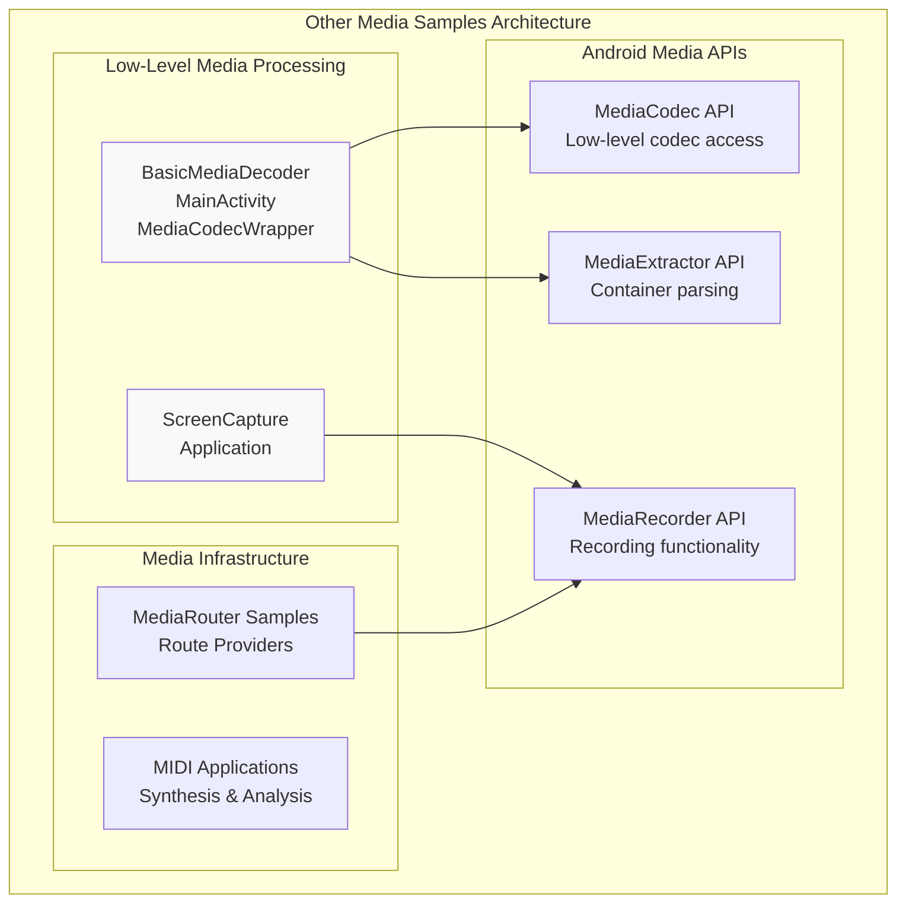
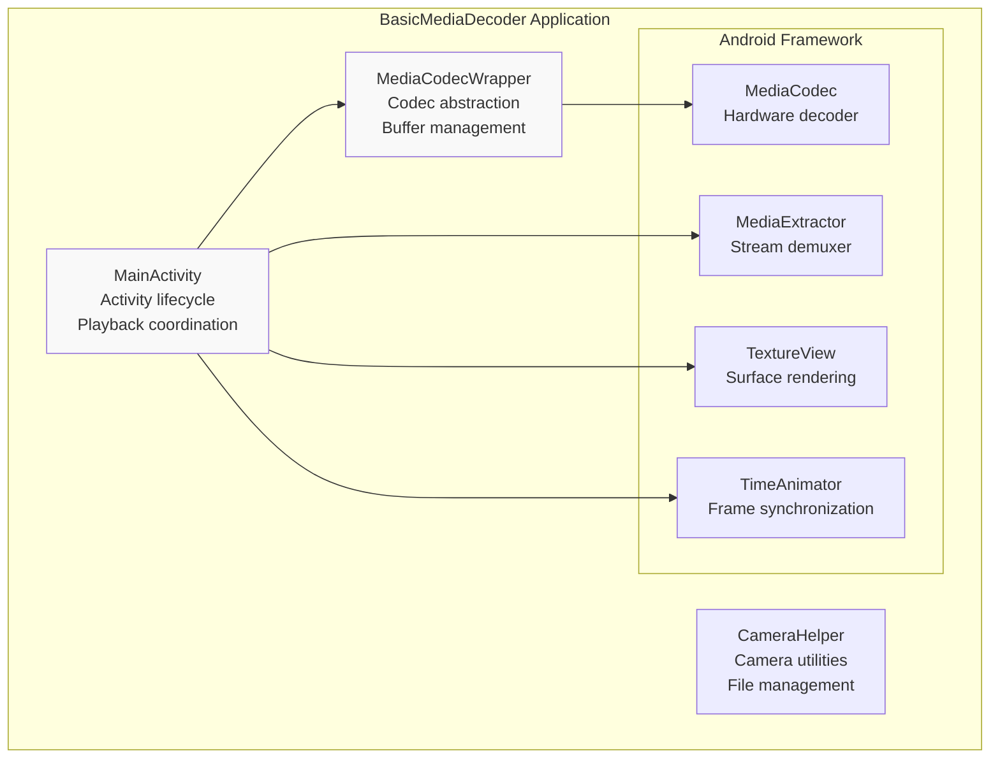
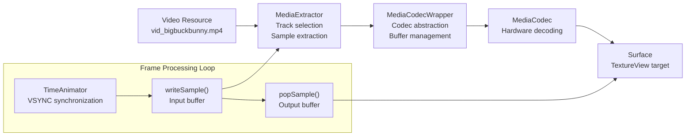
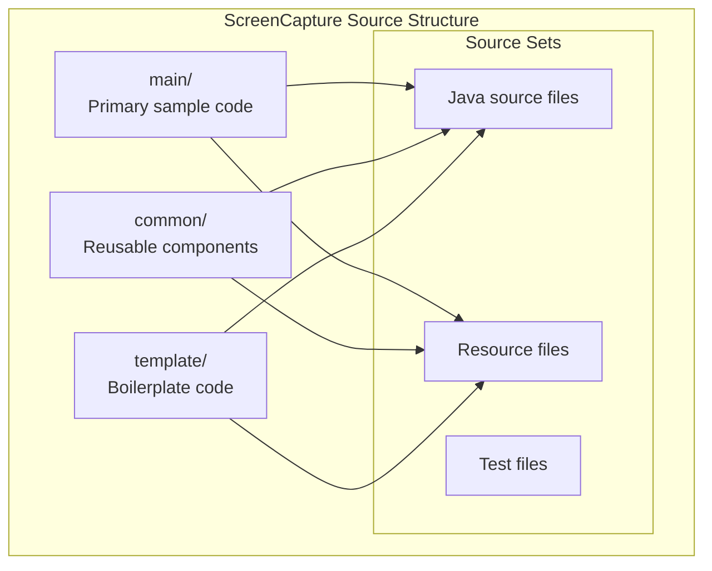

<!-- source: DeepWiki mcp.deepwiki.com · repo android/media-samples · page 4 Other Media Samples · fetched 2026-10-23 -->

# Other Media Samples

Relevant source files

The following files were used as context for generating this wiki page:

- [BasicMediaDecoder/.google/packaging.yaml](BasicMediaDecoder/.google/packaging.yaml)
- [BasicMediaDecoder/Application/src/main/AndroidManifest.xml](BasicMediaDecoder/Application/src/main/AndroidManifest.xml)
- [BasicMediaDecoder/Application/src/main/java/com/example/android/basicmediadecoder/MainActivity.java](BasicMediaDecoder/Application/src/main/java/com/example/android/basicmediadecoder/MainActivity.java)
- [BasicMediaDecoder/Application/src/main/java/com/example/android/common/media/CameraHelper.java](BasicMediaDecoder/Application/src/main/java/com/example/android/common/media/CameraHelper.java)
- [ScreenCapture/Application/build.gradle](ScreenCapture/Application/build.gradle)
- [ScreenCapture/gradle/wrapper/gradle-wrapper.properties](ScreenCapture/gradle/wrapper/gradle-wrapper.properties)

This document covers the remaining media sample applications in the Android Media Samples repository that demonstrate specific media functionality beyond the main Picture-in-Picture and VideoPlayer samples. These samples focus on low-level media processing, recording capabilities, and specialized media APIs.

For comprehensive Picture-in-Picture demonstrations, see [Picture-in-Picture Samples](#2). For video playback with ExoPlayer integration, see [VideoPlayer Sample](#3).

## Overview

The "Other Media Samples" category encompasses several independent Android applications that demonstrate specialized media functionality:

- **BasicMediaDecoder**: Low-level media decoding using `MediaCodec` and `MediaExtractor`
- **ScreenCapture**: Screen recording and capture functionality
- **MediaRouter**: Custom route providers and secondary display management
- **MIDI Applications**: MIDI synthesis and analysis tools

**Sources:** [BasicMediaDecoder/Application/src/main/AndroidManifest.xml:1-39](), [ScreenCapture/Application/build.gradle:1-69]()

## BasicMediaDecoder

The `BasicMediaDecoder` sample demonstrates low-level video decoding using Android's `MediaCodec` and `MediaExtractor` APIs. This sample provides a foundation for understanding how to decode video streams and render them to a `TextureView`.

### Core Components

The BasicMediaDecoder application consists of several key components:

**Sources:** [BasicMediaDecoder/Application/src/main/java/com/example/android/basicmediadecoder/MainActivity.java:1-190](), [BasicMediaDecoder/Application/src/main/java/com/example/android/common/media/CameraHelper.java:1-192]()

### MainActivity Implementation

The `MainActivity` class in [BasicMediaDecoder/Application/src/main/java/com/example/android/basicmediadecoder/MainActivity.java:42-189]() serves as the primary coordination point for the decoding demo:

| Component | Type | Purpose |
|-----------|------|---------|
| `mPlaybackView` | `TextureView` | Renders decoded video frames |
| `mTimeAnimator` | `TimeAnimator` | Synchronizes playback with display refresh |
| `mCodecWrapper` | `MediaCodecWrapper` | Abstracts codec operations |
| `mExtractor` | `MediaExtractor` | Parses media container |

The playback process follows this sequence:

1. **Media Source Setup**: [BasicMediaDecoder/Application/src/main/java/com/example/android/basicmediadecoder/MainActivity.java:99-103]() creates a URI pointing to the bundled video resource
2. **Extractor Configuration**: [BasicMediaDecoder/Application/src/main/java/com/example/android/basicmediadecoder/MainActivity.java:107-131]() initializes the `MediaExtractor` and selects the first video track
3. **Codec Initialization**: [BasicMediaDecoder/Application/src/main/java/com/example/android/basicmediadecoder/MainActivity.java:124-130]() creates a `MediaCodecWrapper` for the video format
4. **Playback Loop**: [BasicMediaDecoder/Application/src/main/java/com/example/android/basicmediadecoder/MainActivity.java:139-180]() uses `TimeAnimator` to process frames in sync with display refresh

### Media Processing Pipeline

The decoding pipeline demonstrates the coordination between multiple Android media APIs:

**Sources:** [BasicMediaDecoder/Application/src/main/java/com/example/android/basicmediadecoder/MainActivity.java:145-177]()

### CameraHelper Utilities

The `CameraHelper` class provides camera-related utilities, though not directly used in the main decoding demo. Key functionality includes:

- **Optimal Size Selection**: [BasicMediaDecoder/Application/src/main/java/com/example/android/common/media/CameraHelper.java:50-97]() calculates optimal video sizes based on aspect ratio
- **Camera Instance Management**: [BasicMediaDecoder/Application/src/main/java/com/example/android/common/media/CameraHelper.java:102-146]() provides methods for accessing front/back cameras
- **File Management**: [BasicMediaDecoder/Application/src/main/java/com/example/android/common/media/CameraHelper.java:155-189]() creates timestamped media files

**Sources:** [BasicMediaDecoder/Application/src/main/java/com/example/android/common/media/CameraHelper.java:1-192]()

## ScreenCapture Application

The `ScreenCapture` sample demonstrates screen recording functionality using Android's screen capture APIs. The application configuration reveals its focus on media capture operations.

### Build Configuration

The build configuration in [ScreenCapture/Application/build.gradle:1-69]() shows:

| Setting | Value | Purpose |
|---------|-------|---------|
| `compileSdkVersion` | 28 | Target Android API level |
| `minSdkVersion` | 21 | Minimum Android 5.0 (Lollipop) |
| `targetSdkVersion` | 28 | Target Android 9.0 (Pie) |
| Gradle Version | 5.4.1 | Build system version |

The application uses Android Support Library components:
- `support-v4` and `support-v13` for compatibility
- `cardview-v7` and `appcompat-v7` for UI components

**Sources:** [ScreenCapture/Application/build.gradle:43-54](), [ScreenCapture/gradle/wrapper/gradle-wrapper.properties:1-6]()

### Multi-Directory Source Structure

The ScreenCapture project uses a multi-directory source structure defined in [ScreenCapture/Application/build.gradle:38-41]():

**Sources:** [ScreenCapture/Application/build.gradle:38-67]()

## Additional Media Samples

Based on the repository structure, additional media samples that fall into this category include:

### MediaRouter Samples
- **BasicMediaRouter**: Demonstrates basic route discovery and selection
- **MediaRouter**: Advanced route provider implementation with custom media routing

### MIDI Applications
- **MidiSynth**: MIDI synthesis and playback functionality
- **MidiScope**: MIDI message analysis and visualization

### Recording Applications
- **MediaRecorder**: Audio and video recording using `MediaRecorder` API

These samples follow similar architectural patterns to the documented samples, providing focused demonstrations of specific Android media APIs and their integration patterns.

**Sources:** [BasicMediaDecoder/.google/packaging.yaml:1-20]()

---

