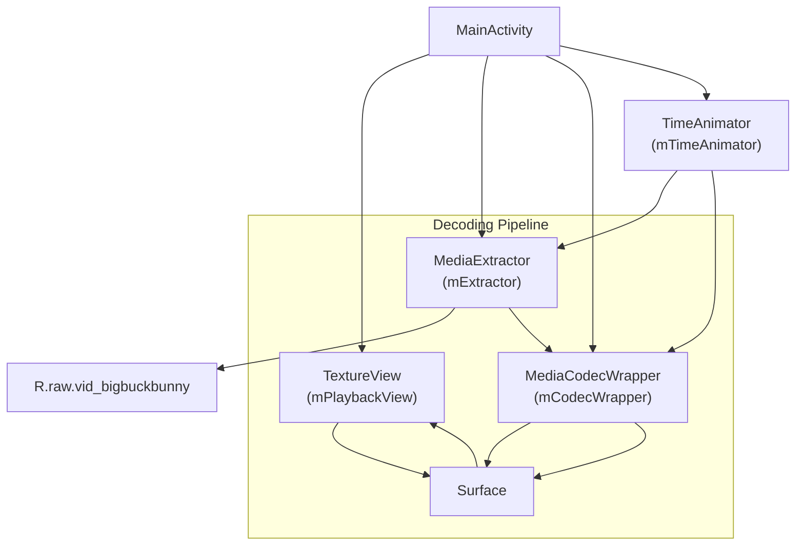
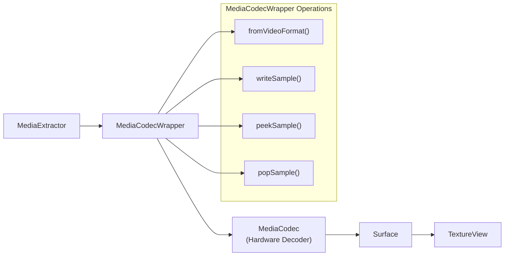
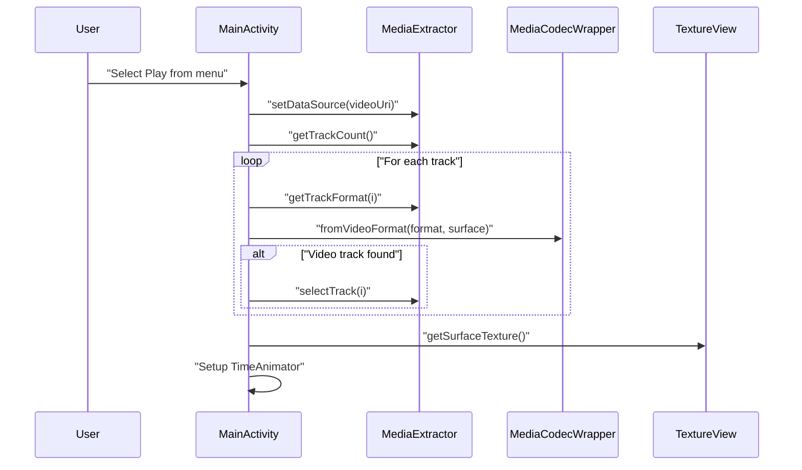
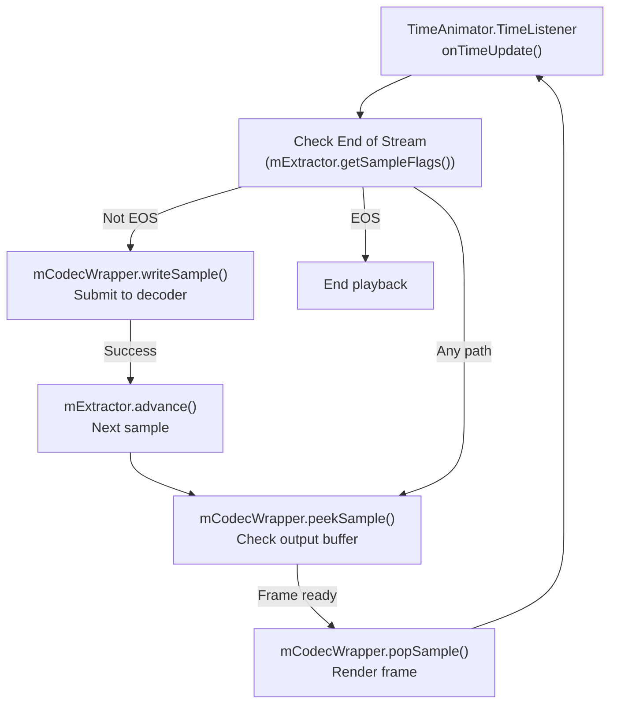

<!-- source: DeepWiki mcp.deepwiki.com · repo android/media-samples · page 4.1 BasicMediaDecoder · fetched 2026-10-23 -->

# BasicMediaDecoder

<details>
<summary>Relevant source files</summary>

The following files were used as context for generating this wiki page:

- [BasicMediaDecoder/.google/packaging.yaml](BasicMediaDecoder/.google/packaging.yaml)
- [BasicMediaDecoder/Application/src/main/AndroidManifest.xml](BasicMediaDecoder/Application/src/main/AndroidManifest.xml)
- [BasicMediaDecoder/Application/src/main/java/com/example/android/basicmediadecoder/MainActivity.java](BasicMediaDecoder/Application/src/main/java/com/example/android/basicmediadecoder/MainActivity.java)
- [BasicMediaDecoder/Application/src/main/java/com/example/android/common/media/CameraHelper.java](BasicMediaDecoder/Application/src/main/java/com/example/android/common/media/CameraHelper.java)

</details>


## Purpose and Scope

The BasicMediaDecoder sample demonstrates low-level video decoding using Android's `MediaCodec` and `MediaExtractor` APIs. This sample shows how to decode video frames directly and render them to a `TextureView` using manual buffer management and synchronization with the display refresh rate via `TimeAnimator`.

This sample focuses on the fundamental building blocks of media playback at the codec level. For higher-level media playback examples using `ExoPlayer`, see [VideoPlayer Sample](#3). For Picture-in-Picture functionality with media playback, see [PictureInPictureKotlin](#2.1).

## System Architecture Overview

The BasicMediaDecoder implements a minimal video player that demonstrates the core Android media decoding pipeline. The system extracts video data from a bundled video file, decodes it using hardware-accelerated codecs, and renders frames synchronized with the display refresh rate.



**Key Components:**
- `MainActivity`: Orchestrates the decoding pipeline and handles UI interactions
- `MediaExtractor`: Extracts compressed video samples from the media file
- `MediaCodecWrapper`: Wraps `MediaCodec` operations for easier buffer management
- `TextureView`: Renders decoded video frames
- `TimeAnimator`: Synchronizes decoding with display refresh rate

Sources: [BasicMediaDecoder/Application/src/main/java/com/example/android/basicmediadecoder/MainActivity.java:42-51]()

## Core Components

### MainActivity

The `MainActivity` class serves as the primary coordinator for the video decoding demonstration. It manages the lifecycle of all media components and handles user interactions.

| Component | Type | Purpose |
|-----------|------|---------|
| `mPlaybackView` | `TextureView` | Renders decoded video frames |
| `mTimeAnimator` | `TimeAnimator` | Synchronizes rendering with display refresh |
| `mCodecWrapper` | `MediaCodecWrapper` | Manages MediaCodec operations |
| `mExtractor` | `MediaExtractor` | Extracts video samples from media file |
| `mAttribView` | `TextView` | Displays playback information |

The activity is configured for landscape orientation and provides a simple menu-driven interface to start video playback.

Sources: [BasicMediaDecoder/Application/src/main/java/com/example/android/basicmediadecoder/MainActivity.java:42-52](), [BasicMediaDecoder/Application/src/main/AndroidManifest.xml:28-29]()

### MediaCodecWrapper Integration

The sample relies on `MediaCodecWrapper` from the common utilities package to simplify `MediaCodec` operations. This wrapper handles the complex buffer management required for hardware-accelerated video decoding.



The wrapper provides these key methods:
- `fromVideoFormat()`: Creates a codec instance for a specific video format
- `writeSample()`: Submits compressed samples to the decoder
- `peekSample()`: Examines decoded output without consuming it
- `popSample()`: Renders decoded frames to the surface

Sources: [BasicMediaDecoder/Application/src/main/java/com/example/android/basicmediadecoder/MainActivity.java:124-125](), [BasicMediaDecoder/Application/src/main/java/com/example/android/basicmediadecoder/MainActivity.java:152-153]()

## Playback Flow

The video playback process follows a precise sequence that demonstrates the complete media decoding pipeline from file extraction to frame rendering.

### Initialization Phase



The initialization process extracts metadata from the bundled video file (`R.raw.vid_bigbuckbunny`) and configures the decoder for the first available video track.

Sources: [BasicMediaDecoder/Application/src/main/java/com/example/android/basicmediadecoder/MainActivity.java:99-131]()

### Decoding Loop

The core decoding operation runs continuously via `TimeAnimator`, which synchronizes with the display's VSYNC signal to maintain smooth playback.



The decoding loop implements a producer-consumer pattern where:
1. **Producer**: `MediaExtractor` reads compressed samples and feeds them to `MediaCodec`
2. **Consumer**: Decoded frames are rendered when their presentation time matches the current playback time
3. **Synchronization**: `TimeAnimator` ensures rendering aligns with display refresh cycles

Sources: [BasicMediaDecoder/Application/src/main/java/com/example/android/basicmediadecoder/MainActivity.java:139-180]()

### Frame Timing and Synchronization

The sample demonstrates precise frame timing using presentation timestamps:

```java
// Frame is ready when its timestamp matches current playback time
if (out_bufferInfo.presentationTimeUs / 1000 < totalTime) {
    mCodecWrapper.popSample(true);
}
```

This approach ensures smooth playback by only rendering frames at their designated presentation time, preventing frame drops or stuttering.

Sources: [BasicMediaDecoder/Application/src/main/java/com/example/android/basicmediadecoder/MainActivity.java:173-176]()

## Lifecycle Management

The sample properly manages media resources across the Android activity lifecycle to prevent memory leaks and ensure clean shutdown.

| Lifecycle Event | Media Operations |
|-----------------|------------------|
| `onCreate()` | Initialize UI components, set up `TextureView` |
| `onOptionsItemSelected()` | Start playback when user selects play |
| `onPause()` | Stop `TimeAnimator`, release `MediaCodecWrapper` and `MediaExtractor` |

The cleanup process ensures that hardware decoder resources are properly released when the activity is no longer visible.

Sources: [BasicMediaDecoder/Application/src/main/java/com/example/android/basicmediadecoder/MainActivity.java:74-84]()

## Build Configuration

The BasicMediaDecoder is configured as an advanced-level sample targeting Android's media APIs with specific focus on `MediaCodec` and `MediaExtractor` functionality.

### Application Configuration

| Setting | Value | Purpose |
|---------|-------|---------|
| Package | `com.example.android.basicmediadecoder` | Unique application identifier |
| Orientation | `landscape` | Optimized for video playback |
| Target APIs | `MediaCodec`, `MediaExtractor`, `TimeAnimator` | Core media decoding components |
| Sample Level | `ADVANCED` | Requires understanding of low-level media APIs |

The application includes a bundled video file (`R.raw.vid_bigbuckbunny`) for demonstration purposes, eliminating the need for external media files or network access.

Sources: [BasicMediaDecoder/Application/src/main/AndroidManifest.xml:18-21](), [BasicMediaDecoder/Application/src/main/AndroidManifest.xml:29](), [BasicMediaDecoder/.google/packaging.yaml:13](), [BasicMediaDecoder/Application/src/main/java/com/example/android/basicmediadecoder/MainActivity.java:100-102]()

---

