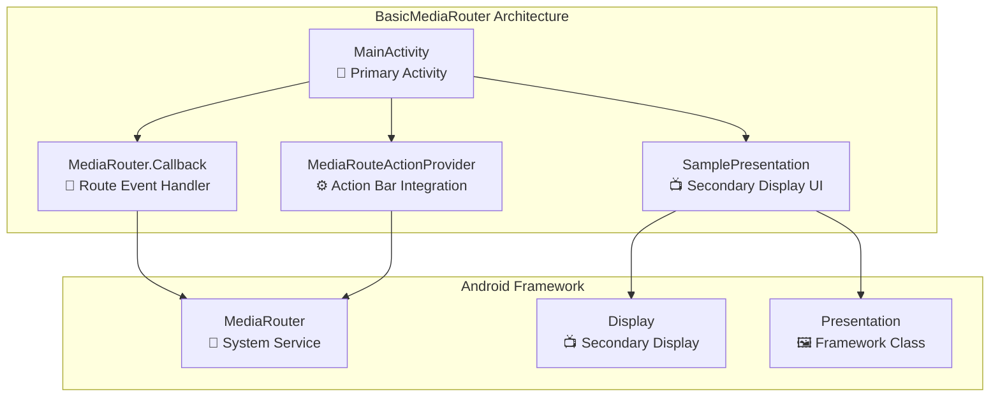
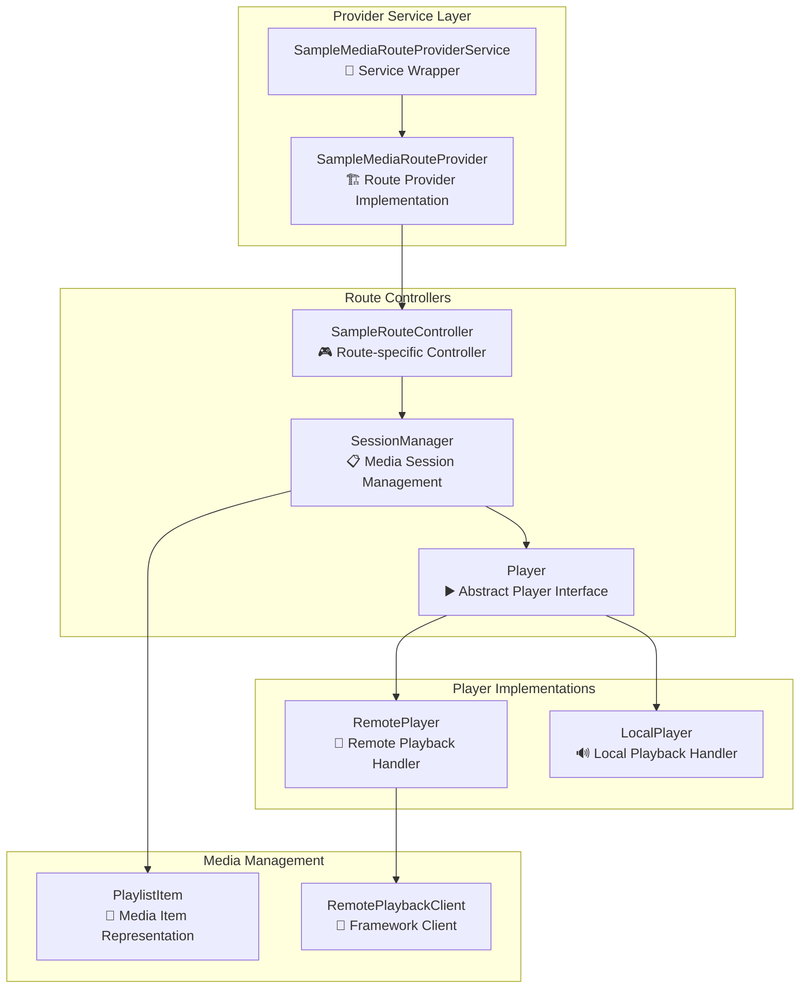
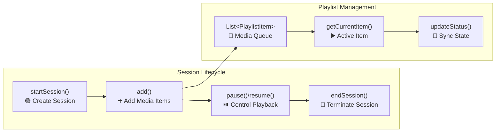
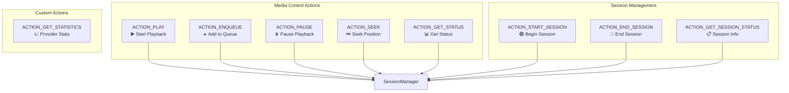

<!-- source: DeepWiki mcp.deepwiki.com · repo android/media-samples · page 4.2 MediaRouter Samples · fetched 2026-10-23 -->

# MediaRouter Samples

Relevant source files

The following files were used as context for generating this wiki page:

- [BasicMediaRouter/Application/build.gradle](BasicMediaRouter/Application/build.gradle)
- [BasicMediaRouter/Application/src/main/AndroidManifest.xml](BasicMediaRouter/Application/src/main/AndroidManifest.xml)
- [BasicMediaRouter/Application/src/main/java/com/example/android/basicmediarouter/MainActivity.java](BasicMediaRouter/Application/src/main/java/com/example/android/basicmediarouter/MainActivity.java)
- [MediaRouter/Application/src/main/java/com/example/android/mediarouter/player/PlaylistItem.java](MediaRouter/Application/src/main/java/com/example/android/mediarouter/player/PlaylistItem.java)
- [MediaRouter/Application/src/main/java/com/example/android/mediarouter/player/RemotePlayer.java](MediaRouter/Application/src/main/java/com/example/android/mediarouter/player/RemotePlayer.java)
- [MediaRouter/Application/src/main/java/com/example/android/mediarouter/player/SessionManager.java](MediaRouter/Application/src/main/java/com/example/android/mediarouter/player/SessionManager.java)
- [MediaRouter/Application/src/main/java/com/example/android/mediarouter/provider/SampleMediaRouteProvider.java](MediaRouter/Application/src/main/java/com/example/android/mediarouter/provider/SampleMediaRouteProvider.java)
- [MediaRouter/Application/src/main/java/com/example/android/mediarouter/provider/SampleMediaRouteProviderService.java](MediaRouter/Application/src/main/java/com/example/android/mediarouter/provider/SampleMediaRouteProviderService.java)

## Purpose and Scope

This document covers the MediaRouter demonstration samples in the Android Media Samples repository, which showcase the Android MediaRouter API for discovering and controlling remote playback devices. The samples demonstrate two different approaches: basic secondary display management and advanced custom route provider implementation with remote playback capabilities.

For information about other media samples including video playback and recording, see [Other Media Samples](#4).

## BasicMediaRouter Sample

The BasicMediaRouter sample demonstrates fundamental MediaRouter usage for secondary display management through the `Presentation` API. This sample shows how to detect external displays and present content on them using MediaRouter's live video routing capabilities.

### Core Components

The main implementation resides in `MainActivity` which extends `AppCompatActivity` and implements MediaRouter callbacks for route discovery and management.

**Sources:** [BasicMediaRouter/Application/src/main/java/com/example/android/basicmediarouter/MainActivity.java:1-306]()

### Route Discovery and Callbacks

The `MainActivity` implements route discovery through `MediaRouter.Callback` with three key callback methods:

- `onRouteSelected()` - Called when a new route becomes active [BasicMediaRouter/Application/src/main/java/com/example/android/basicmediarouter/MainActivity.java:117-119]()
- `onRouteUnselected()` - Called when a route is deactivated [BasicMediaRouter/Application/src/main/java/com/example/android/basicmediarouter/MainActivity.java:124-127]()
- `onRoutePresentationDisplayChanged()` - Called when display properties change [BasicMediaRouter/Application/src/main/java/com/example/android/basicmediarouter/MainActivity.java:134-137]()

The sample registers for `CATEGORY_LIVE_VIDEO` routes during `onResume()` and unregisters during `onPause()` to manage lifecycle properly [BasicMediaRouter/Application/src/main/java/com/example/android/basicmediarouter/MainActivity.java:206-211](), [BasicMediaRouter/Application/src/main/java/com/example/android/basicmediarouter/MainActivity.java:227-229]().

**Sources:** [BasicMediaRouter/Application/src/main/java/com/example/android/basicmediarouter/MainActivity.java:107-139]()

### Presentation Management

The `updatePresentation()` method manages the lifecycle of secondary display presentations:

1. Gets the selected route's presentation display [BasicMediaRouter/Application/src/main/java/com/example/android/basicmediarouter/MainActivity.java:153-156]()
2. Dismisses existing presentations if display changes [BasicMediaRouter/Application/src/main/java/com/example/android/basicmediarouter/MainActivity.java:164-169]()
3. Creates new `SamplePresentation` instances for valid displays [BasicMediaRouter/Application/src/main/java/com/example/android/basicmediarouter/MainActivity.java:177-195]()

**Sources:** [BasicMediaRouter/Application/src/main/java/com/example/android/basicmediarouter/MainActivity.java:149-198]()

## Advanced MediaRouter Sample

The advanced MediaRouter sample demonstrates a complete custom route provider implementation with remote playback capabilities, session management, and media control. This sample shows how to create custom routes that can handle media playback requests from other applications.

### Custom Route Provider Architecture

**Sources:** [MediaRouter/Application/src/main/java/com/example/android/mediarouter/provider/SampleMediaRouteProviderService.java:28-33](), [MediaRouter/Application/src/main/java/com/example/android/mediarouter/provider/SampleMediaRouteProvider.java:49-224]()

### Route Provider Implementation

The `SampleMediaRouteProvider` creates four distinct route types with different capabilities:

| Route Type | Volume Control | Queuing Support | Session Management |
|------------|----------------|------------------|-------------------|
| Fixed Volume | Fixed | Basic | No |
| Variable Basic | Variable | Basic | No |
| Variable Queuing | Variable | Yes | No |
| Variable Session | Variable | Yes | Yes |

Each route is configured with specific `IntentFilter` collections that define supported media control actions [MediaRouter/Application/src/main/java/com/example/android/mediarouter/provider/SampleMediaRouteProvider.java:86-142]().

**Sources:** [MediaRouter/Application/src/main/java/com/example/android/mediarouter/provider/SampleMediaRouteProvider.java:166-224]()

### Media Session Management

The `SessionManager` class handles media session lifecycle and playlist management:

**Sources:** [MediaRouter/Application/src/main/java/com/example/android/mediarouter/player/SessionManager.java:38-419]()

### Remote Playback Implementation

The `RemotePlayer` class implements the abstract `Player` interface for remote playback scenarios using `RemotePlaybackClient`. Key methods include:

- `connect()` - Establishes connection to remote route [MediaRouter/Application/src/main/java/com/example/android/mediarouter/player/RemotePlayer.java:103-113]()
- `play()` - Initiates media playback [MediaRouter/Application/src/main/java/com/example/android/mediarouter/player/RemotePlayer.java:126-152]()
- `enqueue()` - Adds items to remote playlist [MediaRouter/Application/src/main/java/com/example/android/mediarouter/player/RemotePlayer.java:279-294]()
- `getStatus()` - Retrieves current playback status [MediaRouter/Application/src/main/java/com/example/android/mediarouter/player/RemotePlayer.java:160-197]()

The implementation handles both queuing-supported and basic remote players, managing temporary queues when sessions are not immediately available [MediaRouter/Application/src/main/java/com/example/android/mediarouter/player/RemotePlayer.java:282-293]().

**Sources:** [MediaRouter/Application/src/main/java/com/example/android/mediarouter/player/RemotePlayer.java:44-480]()

### Control Request Handling

The route provider handles various media control intents through the `onControlRequest()` method:

**Sources:** [MediaRouter/Application/src/main/java/com/example/android/mediarouter/provider/SampleMediaRouteProvider.java:284-326]()

## Build Configuration

Both MediaRouter samples use standard Android Gradle build configuration targeting API level 29:

### BasicMediaRouter Dependencies
- `androidx.appcompat:appcompat:1.1.0` - AppCompat support library
- `androidx.mediarouter:mediarouter:1.1.0` - MediaRouter support library

### Compatibility Requirements
- Minimum SDK: API 17 (Android 4.2)
- Target SDK: API 29 (Android 10)
- Java compatibility: VERSION_1_7

**Sources:** [BasicMediaRouter/Application/build.gradle:17-36](), [BasicMediaRouter/Application/src/main/AndroidManifest.xml:17-40]()

---

