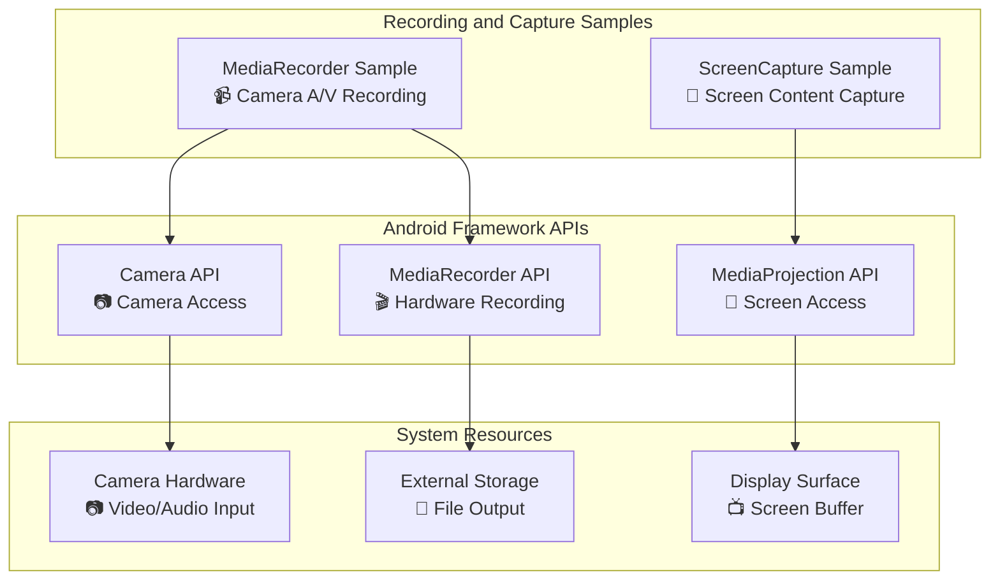
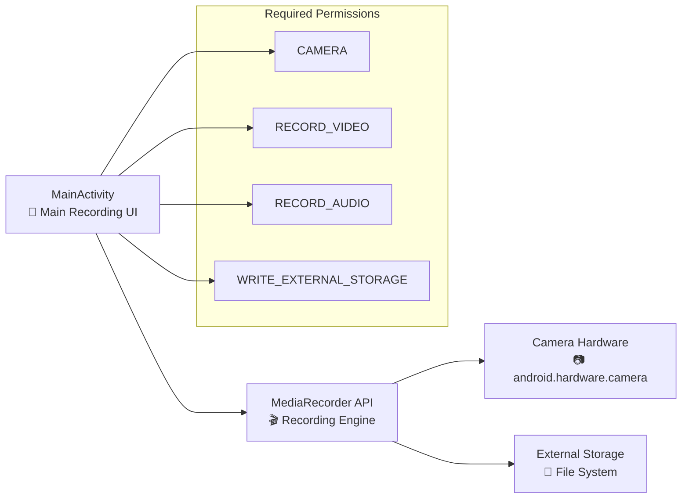
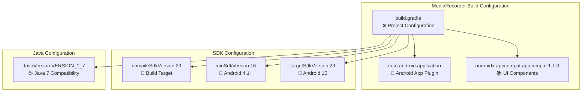
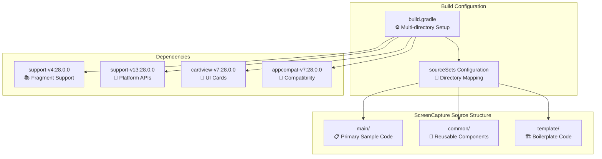
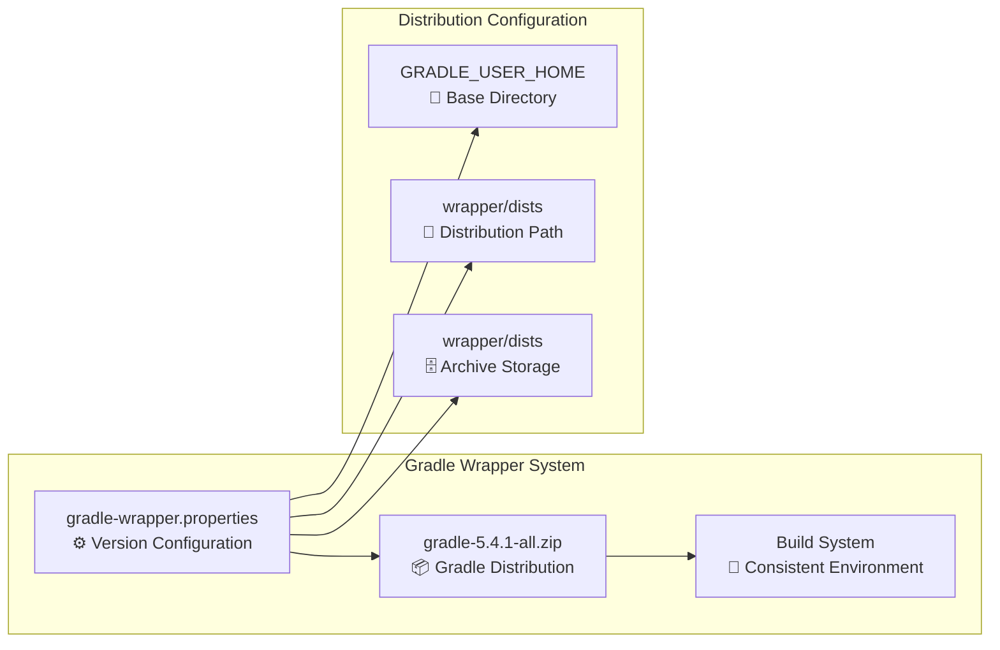
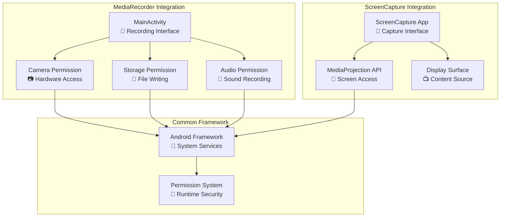

<!-- source: DeepWiki mcp.deepwiki.com · repo android/media-samples · page 4.3 Recording and Capture · fetched 2026-10-23 -->

# Recording and Capture

Relevant source files

The following files were used as context for generating this wiki page:

- [MediaRecorder/Application/build.gradle](MediaRecorder/Application/build.gradle)
- [MediaRecorder/Application/src/main/AndroidManifest.xml](MediaRecorder/Application/src/main/AndroidManifest.xml)
- [ScreenCapture/Application/build.gradle](ScreenCapture/Application/build.gradle)
- [ScreenCapture/gradle/wrapper/gradle-wrapper.properties](ScreenCapture/gradle/wrapper/gradle-wrapper.properties)

This document covers the recording and capture samples in the Android Media Samples repository, specifically the `MediaRecorder` and `ScreenCapture` applications. These samples demonstrate different approaches to capturing media content: recording audio/video from camera hardware and capturing screen content for recording or streaming purposes.

For media playback and decoding samples, see [BasicMediaDecoder](#4.1). For routing media to external displays, see [MediaRouter Samples](#4.2).

## Overview

The recording and capture functionality is implemented through two independent sample applications:

**Sources:** [MediaRecorder/Application/src/main/AndroidManifest.xml:1-55](), [ScreenCapture/Application/build.gradle:1-68]()

## MediaRecorder Sample

The `MediaRecorder` sample demonstrates recording audio and video from the device camera using the Android `MediaRecorder` API. This sample is located in the `com.example.android.mediarecorder` package and provides a complete implementation of camera-based recording.

### Application Configuration

The `MediaRecorder` sample requires extensive system permissions to access camera hardware and storage:

| Permission | Purpose |
|------------|---------|
| `WRITE_EXTERNAL_STORAGE` | Save recorded files to device storage |
| `RECORD_VIDEO` | Access video recording functionality |
| `RECORD_AUDIO` | Capture audio during video recording |
| `CAMERA` | Control camera hardware |

The application is configured with landscape orientation to optimize camera preview display for standard video aspect ratios [MediaRecorder/Application/src/main/AndroidManifest.xml:44-47]().

**Sources:** [MediaRecorder/Application/src/main/AndroidManifest.xml:26-32](), [MediaRecorder/Application/src/main/AndroidManifest.xml:41-47]()

### Build Configuration

The `MediaRecorder` sample uses a modern Android build configuration:

The build targets API level 29 with minimum support for API level 16, providing broad device compatibility [MediaRecorder/Application/build.gradle:22-24]().

**Sources:** [MediaRecorder/Application/build.gradle:19-35]()

## ScreenCapture Sample

The `ScreenCapture` sample demonstrates capturing screen content, likely using the `MediaProjection` API for screen recording functionality. This sample uses a more complex build structure with multiple source directories.

### Build Architecture

The `ScreenCapture` sample employs a sophisticated build structure separating different types of code:

The build configuration defines three distinct source directories [ScreenCapture/Application/build.gradle:38-41]():
- `main`: Contains the primary sample implementation
- `common`: Houses reusable components shared across samples
- `template`: Includes boilerplate code generated by the sample template system

**Sources:** [ScreenCapture/Application/build.gradle:35-66]()

### SDK and Compatibility Configuration

The `ScreenCapture` sample targets API level 28 with specific compatibility requirements:

| Configuration | Value | Purpose |
|---------------|-------|---------|
| `compileSdkVersion` | 28 | Android 9.0 (API level 28) build target |
| `minSdkVersion` | 21 | Android 5.0+ requirement for screen capture |
| `targetSdkVersion` | 28 | Optimized for Android 9.0 features |
| Java compatibility | VERSION_1_7 | Java 7 language features |

The minimum SDK version of 21 aligns with the `MediaProjection` API availability, which was introduced in Android 5.0 [ScreenCapture/Application/build.gradle:47]().

**Sources:** [ScreenCapture/Application/build.gradle:43-54]()

## Gradle Wrapper Configuration

Both samples use Gradle wrapper for consistent build environments:

The `ScreenCapture` sample uses Gradle 5.4.1 [ScreenCapture/gradle/wrapper/gradle-wrapper.properties:5](), ensuring reproducible builds across different development environments.

**Sources:** [ScreenCapture/gradle/wrapper/gradle-wrapper.properties:1-6]()

## System Integration Patterns

The recording and capture samples demonstrate different approaches to accessing Android system resources:

Both samples require careful permission handling and system resource management to provide robust recording capabilities while maintaining user privacy and security.

**Sources:** [MediaRecorder/Application/src/main/AndroidManifest.xml:26-32](), [ScreenCapture/Application/build.gradle:43-49]()

---

