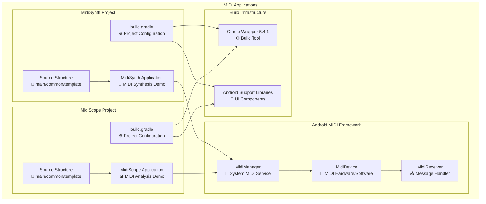
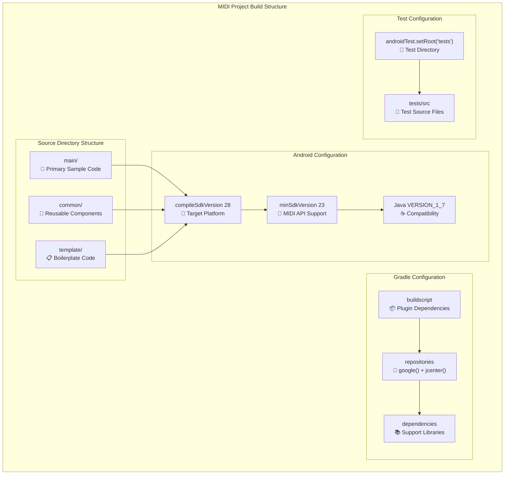

<!-- source: DeepWiki mcp.deepwiki.com · repo android/media-samples · page 4.4 MIDI Applications · fetched 2026-10-23 -->

# MIDI Applications

<details>
<summary>Relevant source files</summary>

The following files were used as context for generating this wiki page:

- [BasicMediaDecoder/Application/build.gradle](BasicMediaDecoder/Application/build.gradle)
- [BasicMediaDecoder/gradle/wrapper/gradle-wrapper.properties](BasicMediaDecoder/gradle/wrapper/gradle-wrapper.properties)
- [MidiScope/Application/build.gradle](MidiScope/Application/build.gradle)
- [MidiScope/gradle/wrapper/gradle-wrapper.properties](MidiScope/gradle/wrapper/gradle-wrapper.properties)
- [MidiSynth/Application/build.gradle](MidiSynth/Application/build.gradle)
- [MidiSynth/gradle/wrapper/gradle-wrapper.properties](MidiSynth/gradle/wrapper/gradle-wrapper.properties)

</details>


This document covers the MIDI-related sample applications in the Android Media Samples repository, specifically the `MidiSynth` and `MidiScope` projects. These applications demonstrate Android's MIDI API capabilities for music synthesis and MIDI data analysis respectively.

For information about other media samples including video playback and Picture-in-Picture functionality, see [Picture-in-Picture Samples](#2) and [VideoPlayer Sample](#3). For recording and capture functionality, see [Recording and Capture](#4.3).

## Overview

The MIDI Applications subsystem consists of two independent Android Studio projects that showcase different aspects of Android's MIDI framework:

- **MidiSynth**: Demonstrates MIDI synthesis capabilities
- **MidiScope**: Provides MIDI data analysis and visualization

Both applications follow the standard Android sample template structure and target modern Android versions with MIDI API support.

## MIDI Applications Architecture



**Sources**: [MidiSynth/Application/build.gradle:1-69](), [MidiScope/Application/build.gradle:1-69](), [MidiSynth/gradle/wrapper/gradle-wrapper.properties:1-7](), [MidiScope/gradle/wrapper/gradle-wrapper.properties:1-7]()

## MidiSynth Application

The `MidiSynth` project demonstrates MIDI synthesis functionality on Android. It provides an example of how to create and play MIDI audio using Android's built-in MIDI capabilities.

### Build Configuration

The MidiSynth application uses the following build configuration:

| Configuration | Value |
|---------------|-------|
| Compile SDK Version | 28 |
| Minimum SDK Version | 23 |
| Target SDK Version | 28 |
| Gradle Plugin Version | 3.5.0 |
| Java Compatibility | VERSION_1_7 |

The project requires Android API level 23 (Android 6.0) or higher, which ensures access to the complete Android MIDI API introduced in that version.

### Dependencies

The application uses standard Android support libraries:

- `support-v4`: Core support utilities
- `support-v13`: Fragment support for older platforms  
- `cardview-v7`: Material Design card components
- `appcompat-v7`: Backward-compatible app bar and theming

**Sources**: [MidiSynth/Application/build.gradle:20-33](), [MidiSynth/Application/build.gradle:44-49]()

## MidiScope Application

The `MidiScope` project provides MIDI data analysis and visualization capabilities. It demonstrates how to monitor and display MIDI message data in real-time.

### Build Configuration

MidiScope shares the same build configuration as MidiSynth:

| Configuration | Value |
|---------------|-------|
| Compile SDK Version | 28 |
| Minimum SDK Version | 23 |
| Target SDK Version | 28 |
| Gradle Plugin Version | 3.5.0 |
| Java Compatibility | VERSION_1_7 |

The identical minimum SDK requirement ensures both applications can access the same MIDI API features.

### Dependencies

MidiScope uses the same Android support library dependencies as MidiSynth, providing consistent UI components and backward compatibility.

**Sources**: [MidiScope/Application/build.gradle:20-33](), [MidiScope/Application/build.gradle:44-49]()

## Build System Architecture

Both MIDI applications follow a consistent build system pattern that separates concerns into multiple source directories.



**Sources**: [MidiSynth/Application/build.gradle:35-68](), [MidiScope/Application/build.gradle:35-68]()

## Project Structure Patterns

Both MIDI applications implement a standardized directory structure that promotes code reusability and separation of concerns:

### Directory Organization

The build configuration defines three primary source directories:

1. **`main`**: Contains the core sample application code where the primary MIDI functionality is implemented
2. **`common`**: Houses reusable components that can be shared between multiple samples
3. **`template`**: Includes boilerplate code generated by the Android sample template system

### Gradle Wrapper Configuration

Both projects use Gradle Wrapper 5.4.1 for consistent build environments:

```
distributionUrl=https://services.gradle.org/distributions/gradle-5.4.1-all.zip
```

This ensures reproducible builds across different development environments and CI systems.

### Source Set Configuration

The build system dynamically configures source sets to include all three directory types:

```gradle
sourceSets {
    main {
        dirs.each { dir ->
            java.srcDirs "src/${dir}/java"
            res.srcDirs "src/${dir}/res"
        }
    }
}
```

This pattern allows for modular organization while maintaining a single buildable application.

**Sources**: [MidiSynth/Application/build.gradle:56-66](), [MidiScope/Application/build.gradle:56-66](), [MidiSynth/gradle/wrapper/gradle-wrapper.properties:6](), [MidiScope/gradle/wrapper/gradle-wrapper.properties:6]()

## Integration with Android Media Framework

Both MIDI applications integrate with Android's media framework through the MIDI API, which was introduced in Android 6.0 (API level 23). The minimum SDK version requirement ensures access to:

- `MidiManager` for device discovery and connection management
- `MidiDevice` for hardware and software MIDI device interaction  
- `MidiReceiver` and `MidiSender` for message handling
- `MidiDeviceService` for creating virtual MIDI devices

The applications demonstrate different aspects of MIDI functionality within the broader Android media ecosystem, complementing other samples in the repository that focus on audio playback, recording, and media routing.

**Sources**: [MidiSynth/Application/build.gradle:47](), [MidiScope/Application/build.gradle:47]()

---

