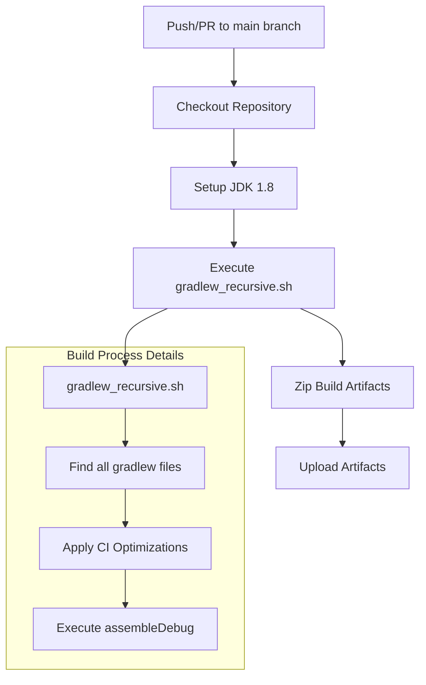
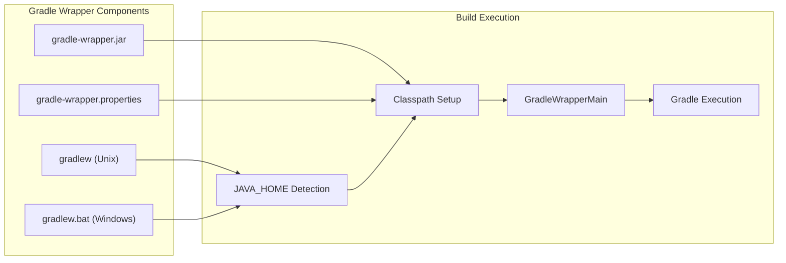
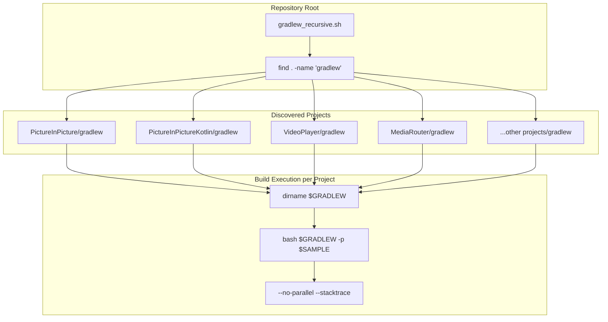
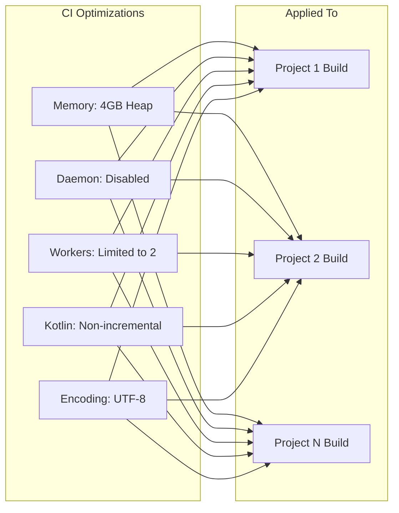
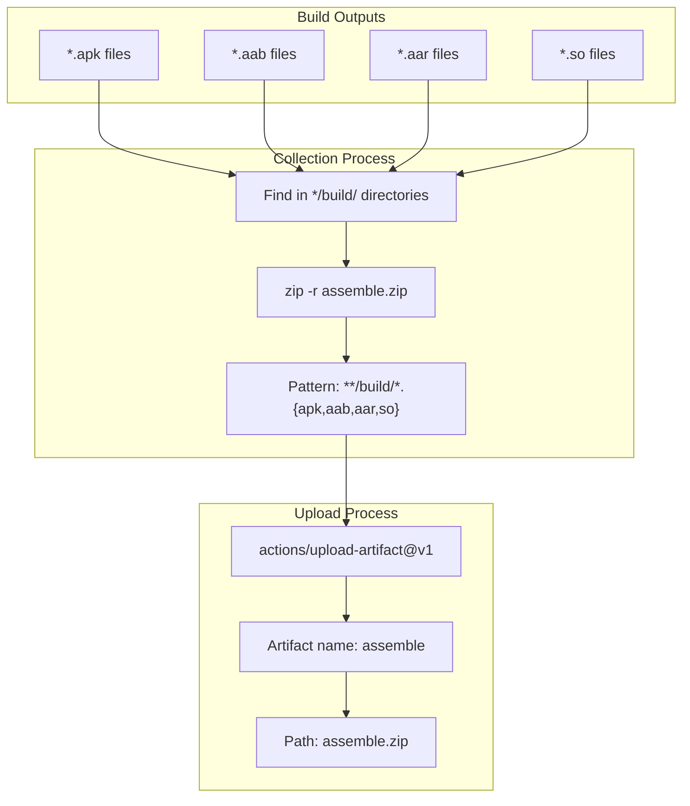

<!-- source: DeepWiki mcp.deepwiki.com · repo android/media-samples · page 5 Build System and CI/CD · fetched 2026-10-23 -->

# Build System and CI/CD

Relevant source files

The following files were used as context for generating this wiki page:

- [.github/scripts/gradlew_recursive.sh](.github/scripts/gradlew_recursive.sh)
- [.github/workflows/android.yml](.github/workflows/android.yml)
- [PictureInPicture/gradle/wrapper/gradle-wrapper.jar](PictureInPicture/gradle/wrapper/gradle-wrapper.jar)
- [PictureInPicture/gradlew](PictureInPicture/gradlew)
- [PictureInPicture/gradlew.bat](PictureInPicture/gradlew.bat)

This document covers the build infrastructure, continuous integration pipeline, and automated build processes for the Android Media Samples repository. It details how the multi-project Gradle setup works, the GitHub Actions CI/CD pipeline, and the build optimization strategies used across all sample applications.

For information about individual project build configurations, see [PictureInPictureKotlin Build Configuration](#2.1.4) and [VideoPlayer Build System](#3.2).

## CI/CD Pipeline Architecture

The repository uses GitHub Actions for continuous integration, with a custom recursive build strategy to handle multiple independent Android projects within a single repository.

The main CI workflow is defined in [.github/workflows/android.yml:15-44]() and consists of the following key components:

| Component | Configuration | Purpose |
|-----------|--------------|---------|
| **Trigger** | Push/PR on `main` branch | Automatic build validation |
| **Runner** | `ubuntu-18.04` | Consistent Linux environment |
| **Java Version** | JDK 1.8 | Android development compatibility |
| **Build Command** | `gradlew_recursive.sh assembleDebug` | Multi-project build execution |
| **Artifacts** | APK, AAB, AAR, SO files | Deployable build outputs |

Sources: [.github/workflows/android.yml:17-43]()

## Gradle Wrapper System

Each sample project uses the standard Gradle Wrapper pattern to ensure consistent build environments across different development machines and CI systems.

The wrapper system provides platform-specific entry points:

- **Unix Systems**: [PictureInPicture/gradlew:1-234]() - POSIX-compliant shell script
- **Windows Systems**: [PictureInPicture/gradlew.bat:1-90]() - Windows batch script  
- **Core Runtime**: [PictureInPicture/gradle/wrapper/gradle-wrapper.jar]() - Java execution environment

Key features of the wrapper implementation:

| Feature | Implementation | Location |
|---------|---------------|-----------|
| **Java Detection** | Automatic `JAVA_HOME` discovery | [PictureInPicture/gradlew:121-140]() |
| **Memory Configuration** | Default JVM options `-Xmx64m -Xms64m` | [PictureInPicture/gradlew:89]() |
| **Cross-Platform** | Shell and batch script variants | [PictureInPicture/gradlew](), [PictureInPicture/gradlew.bat]() |
| **Classpath Setup** | Gradle wrapper JAR inclusion | [PictureInPicture/gradlew:117]() |

Sources: [PictureInPicture/gradlew:65-234](), [PictureInPicture/gradlew.bat:17-90]()

## Multi-Project Build Strategy

The repository implements a recursive build strategy to handle multiple independent Android projects, each with their own Gradle configuration.

The recursive build process in [.github/scripts/gradlew_recursive.sh:30-36]() implements the following logic:

1. **Project Discovery**: Scans for all `gradlew` files in the repository
2. **Directory Resolution**: Extracts project directory from wrapper location
3. **Isolated Execution**: Runs each project build independently
4. **CI Optimization**: Applies consistent CI-specific flags

Sources: [.github/scripts/gradlew_recursive.sh:30-36]()

## Build Optimization

The CI environment applies specific Gradle optimizations to maximize build performance and reliability on GitHub Actions infrastructure.

### Memory and Performance Settings

The build script configures optimal JVM settings for the CI environment:

| Setting | Value | Purpose |
|---------|-------|---------|
| **Heap Size** | `-Xms4g -Xmx4g` | Consistent 4GB memory allocation |
| **OOM Handling** | `-XX:+HeapDumpOnOutOfMemoryError` | Debug memory issues |
| **Daemon** | `false` | Disable for CI stability |
| **Workers** | `max=2` | Match GitHub Actions CPU allocation |
| **Kotlin Incremental** | `false` | Ensure clean builds |
| **Kotlin Strategy** | `in-process` | Reduce process overhead |

These optimizations are applied through environment variables in [.github/scripts/gradlew_recursive.sh:19-28]():

- **Predictable Memory Usage**: Fixed heap size prevents OOM errors
- **CI Stability**: Daemon disabled to avoid state issues between builds
- **Resource Efficiency**: Worker limitation matches available CPU cores
- **Clean Builds**: Disabled incremental compilation ensures reproducibility

Sources: [.github/scripts/gradlew_recursive.sh:19-28]()

## Artifact Management

The CI pipeline automatically collects and uploads build artifacts from all projects.

The artifact collection process defined in [.github/workflows/android.yml:37-43]() includes:

- **APK Files**: Compiled Android application packages
- **AAB Files**: Android App Bundles for Play Store distribution  
- **AAR Files**: Android Archive libraries
- **SO Files**: Native shared libraries

The zip command pattern `**/build/*.{apk,aab,aar,so}` recursively collects all build outputs from any project's `build/` directory, ensuring comprehensive artifact capture across the multi-project repository structure.

Sources: [.github/workflows/android.yml:37-43]()

---

