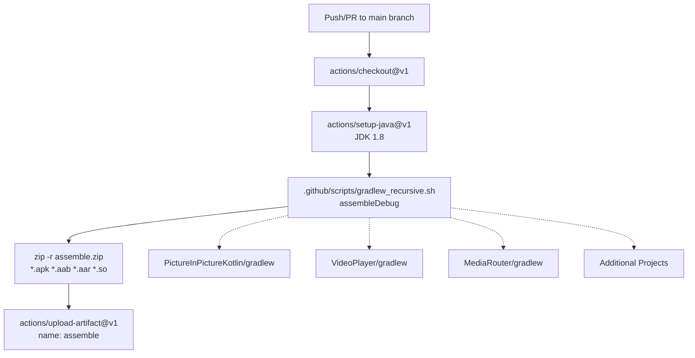
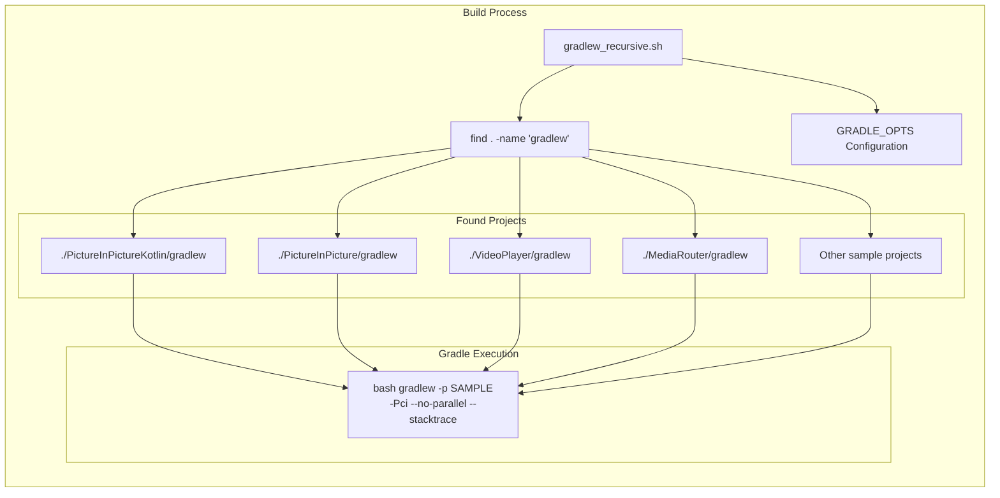
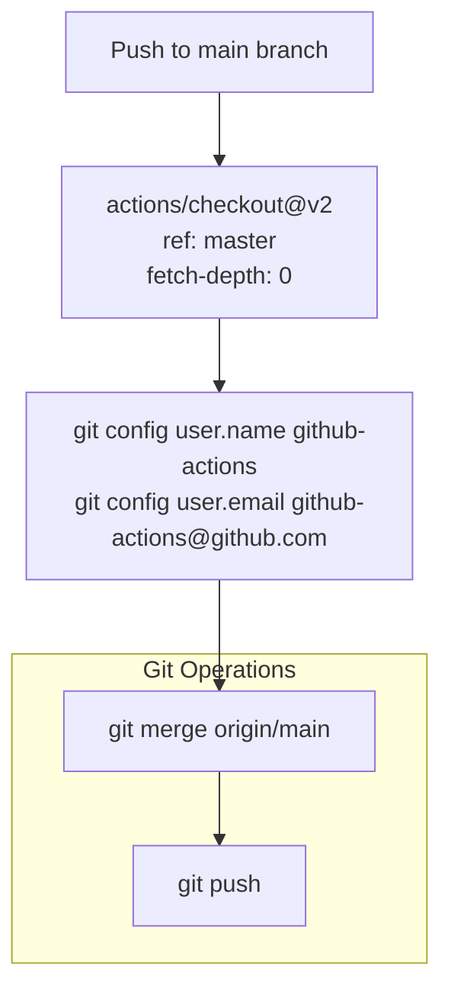

<!-- source: DeepWiki mcp.deepwiki.com · repo android/media-samples · page 5.1 GitHub Actions Workflows · fetched 2026-10-23 -->

# GitHub Actions Workflows

<details>
<summary>Relevant source files</summary>

The following files were used as context for generating this wiki page:

- [.github/scripts/gradlew_recursive.sh](.github/scripts/gradlew_recursive.sh)
- [.github/workflows/android.yml](.github/workflows/android.yml)
- [.github/workflows/copy-branch.yml](.github/workflows/copy-branch.yml)

</details>


This document covers the continuous integration and deployment automation implemented through GitHub Actions workflows in the Android Media Samples repository. The workflows handle automated building of all sample projects, artifact management, and branch synchronization.

For information about the Gradle build system that these workflows utilize, see [Gradle Wrapper System](#5.2).

## Overview

The repository implements two primary GitHub Actions workflows that automate key development processes:

| Workflow | Purpose | Trigger |
|----------|---------|---------|
| **Android CI** | Build all sample projects and collect artifacts | Push/PR to `main` branch |
| **Branch Sync** | Maintain backward compatibility by syncing `main` to `master` | Push to `main` branch |

The workflows are designed to handle the multi-project structure of the repository, where each sample application is an independent Android Studio project with its own `gradlew` wrapper.

Sources: [.github/workflows/android.yml:15-44](), [.github/workflows/copy-branch.yml:1-32]()

## Android CI Workflow Architecture

The Android CI workflow implements a comprehensive build and testing pipeline for all sample projects in the repository.



**Workflow Configuration:**
- **Runner**: `ubuntu-18.04`
- **Java Version**: JDK 1.8
- **Build Target**: `assembleDebug` for all projects
- **Artifact Types**: APK, AAB, AAR, and SO files

Sources: [.github/workflows/android.yml:25-43]()

## Multi-Project Build System

The `gradlew_recursive.sh` script implements the core logic for building multiple independent Android projects within a single repository.



**Gradle Optimization Settings:**
- **Heap Size**: 4GB initial and maximum (`-Xms4g -Xmx4g`)
- **Daemon**: Disabled (`-Dorg.gradle.daemon=false`)
- **Workers**: Limited to 2 (`-Dorg.gradle.workers.max=2`)
- **Kotlin Incremental**: Disabled (`-Dkotlin.incremental=false`)
- **Compilation Strategy**: In-process (`-Dkotlin.compiler.execution.strategy=in-process`)

Sources: [.github/scripts/gradlew_recursive.sh:19-36]()

## Branch Synchronization Workflow

The copy-branch workflow maintains backward compatibility by automatically synchronizing the `main` branch to the legacy `master` branch.



**Workflow Characteristics:**
- **Trigger**: Push events to `main` branch only
- **Runner**: `ubuntu-latest`
- **Git Strategy**: Full history fetch with merge operation
- **Authentication**: GitHub Actions token with repository write permissions

Sources: [.github/workflows/copy-branch.yml:7-31]()

## Build Artifact Management

The Android CI workflow generates and manages build artifacts from all sample projects systematically.

| Artifact Type | File Pattern | Purpose |
|---------------|--------------|---------|
| **APK** | `**/build/*.apk` | Debug builds of sample applications |
| **AAB** | `**/build/*.aab` | Android App Bundles for distribution |
| **AAR** | `**/build/*.aar` | Android library archives |
| **SO** | `**/build/*.so` | Native library files |

**Artifact Collection Process:**
1. **Discovery**: Recursive search across all `build/` directories
2. **Compression**: ZIP archive creation with selective inclusion
3. **Upload**: GitHub Actions artifact storage with `assemble` identifier
4. **Retention**: Follows repository artifact retention policies

Sources: [.github/workflows/android.yml:37-43]()

## CI Configuration Optimizations

The workflow implements several optimizations specifically for the GitHub Actions environment and multi-project repository structure.

**Java Environment:**
- Uses `actions/setup-java@v1` with JDK 1.8 for Android compatibility
- Maintains consistent Java version across all sample builds

**Gradle Performance Tuning:**
```bash
GRADLE_OPTS="-Xms4g -Xmx4g -XX:+HeapDumpOnOutOfMemoryError"
GRADLE_OPTS="$GRADLE_OPTS -Dorg.gradle.daemon=false"
GRADLE_OPTS="$GRADLE_OPTS -Dorg.gradle.workers.max=2"
```

**CI-Specific Flags:**
- `--no-parallel`: Prevents resource contention between projects
- `--stacktrace`: Provides detailed error information for debugging
- `-Pci`: Enables CI-specific project configurations

**Build Strategy:**
- Sequential project builds to manage resource usage
- Fail-fast behavior with detailed error reporting
- Comprehensive artifact collection across all projects

Sources: [.github/scripts/gradlew_recursive.sh:19-35](), [.github/workflows/android.yml:31-36]()

---

