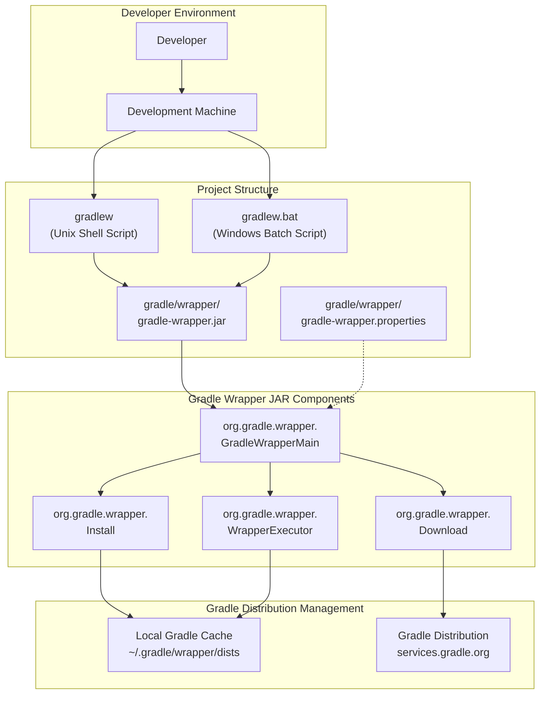
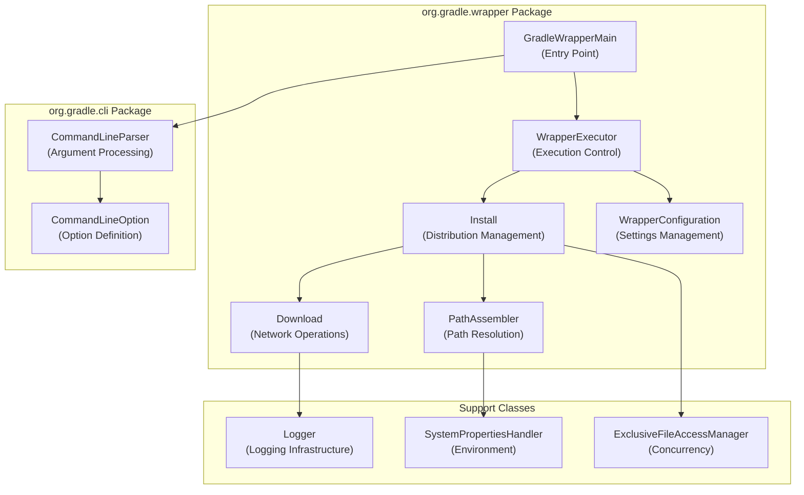
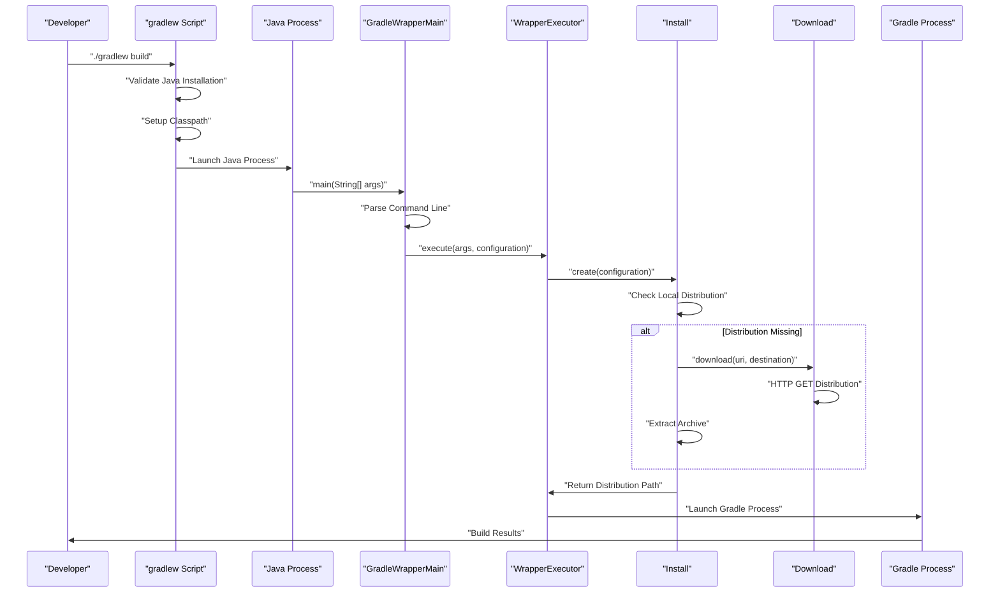

<!-- source: DeepWiki mcp.deepwiki.com · repo android/media-samples · page 5.2 Gradle Wrapper System · fetched 2026-10-23 -->

# Gradle Wrapper System

Relevant source files

The following files were used as context for generating this wiki page:

- [PictureInPicture/gradle/wrapper/gradle-wrapper.jar](PictureInPicture/gradle/wrapper/gradle-wrapper.jar)
- [PictureInPicture/gradlew](PictureInPicture/gradlew)
- [PictureInPicture/gradlew.bat](PictureInPicture/gradlew.bat)
- [PictureInPictureKotlin/gradle/wrapper/gradle-wrapper.jar](PictureInPictureKotlin/gradle/wrapper/gradle-wrapper.jar)
- [PictureInPictureKotlin/gradlew](PictureInPictureKotlin/gradlew)
- [PictureInPictureKotlin/gradlew.bat](PictureInPictureKotlin/gradlew.bat)

## Purpose and Scope

The Gradle Wrapper System provides a standardized mechanism for ensuring consistent build environments across all sample projects in the Android Media Samples repository. This system eliminates the need for developers to manually install specific Gradle versions by automatically downloading and managing the required Gradle distribution for each project.

For information about the overall build system configuration, see [Build System and CI/CD](#5). For details about GitHub Actions integration with the wrapper system, see [GitHub Actions Workflows](#5.1).

## System Overview

The Gradle Wrapper System consists of platform-specific executable scripts that bootstrap a Java application responsible for downloading, installing, and executing the appropriate Gradle version. This ensures that all developers and CI environments use identical build tooling regardless of their local Gradle installations.

Sources: [PictureInPictureKotlin/gradlew:1-235](), [PictureInPictureKotlin/gradlew.bat:1-90](), [PictureInPictureKotlin/gradle/wrapper/gradle-wrapper.jar]()

## Core Components

### Platform-Specific Scripts

The wrapper system provides two platform-specific entry points that handle environment setup and Java Virtual Machine invocation:

| Component | Platform | Primary Function |
|-----------|----------|------------------|
| `gradlew` | Unix/Linux/macOS | POSIX shell script with comprehensive path and environment handling |
| `gradlew.bat` | Windows | Batch script with Windows-specific path resolution |

Both scripts implement identical functionality through platform-appropriate mechanisms:

- **Java Discovery**: Locate Java executable via `JAVA_HOME` or system `PATH`
- **Classpath Setup**: Configure classpath to include `gradle-wrapper.jar`
- **JVM Configuration**: Apply default JVM options (`-Xmx64m -Xms64m`)
- **Main Class Invocation**: Execute `org.gradle.wrapper.GradleWrapperMain`

Sources: [PictureInPictureKotlin/gradlew:88-89](), [PictureInPictureKotlin/gradlew:117](), [PictureInPictureKotlin/gradlew:203-206](), [PictureInPictureKotlin/gradlew.bat:36](), [PictureInPictureKotlin/gradlew.bat:70](), [PictureInPictureKotlin/gradlew.bat:74]()

### Wrapper JAR Architecture

The `gradle-wrapper.jar` contains a self-contained Java application with distinct responsibilities for Gradle distribution management:

Sources: [PictureInPictureKotlin/gradle/wrapper/gradle-wrapper.jar]()

### Key Class Responsibilities

| Class | Primary Responsibility |
|-------|----------------------|
| `GradleWrapperMain` | Application entry point and command-line argument processing |
| `WrapperExecutor` | Orchestrates wrapper execution flow and delegates to appropriate handlers |
| `Install` | Manages Gradle distribution installation and verification |
| `Download` | Handles HTTP downloads with progress tracking and proxy support |
| `PathAssembler` | Constructs file system paths for Gradle distributions and user directories |
| `WrapperConfiguration` | Parses and manages wrapper configuration properties |

## Execution Flow

The wrapper system follows a predictable execution sequence from script invocation to Gradle process launch:

Sources: [PictureInPictureKotlin/gradlew:202-206](), [PictureInPictureKotlin/gradlew:227-234]()

## Cross-Project Consistency

The wrapper system maintains identical implementations across all sample projects, ensuring consistent build behavior regardless of project-specific requirements:

### Script Standardization

Both Picture-in-Picture projects use identical wrapper scripts:

| Project | Unix Script | Windows Script | Wrapper JAR |
|---------|-------------|----------------|-------------|
| PictureInPictureKotlin | `gradlew` | `gradlew.bat` | `gradle/wrapper/gradle-wrapper.jar` |
| PictureInPicture | `gradlew` | `gradlew.bat` | `gradle/wrapper/gradle-wrapper.jar` |

The scripts are functionally identical, implementing the same:
- **Environment Detection**: OS-specific path handling and shell compatibility
- **Java Discovery Logic**: Consistent `JAVA_HOME` resolution and fallback mechanisms  
- **JVM Options**: Standardized memory settings (`-Xmx64m -Xms64m`)
- **Error Handling**: Uniform error messages and exit codes

Sources: [PictureInPictureKotlin/gradlew:88-89](), [PictureInPicture/gradlew:88-89](), [PictureInPictureKotlin/gradlew.bat:36](), [PictureInPicture/gradlew.bat:36]()

### Platform Compatibility Matrix

| Operating System | Script Used | Java Discovery | Path Handling |
|------------------|-------------|----------------|---------------|
| Linux/macOS | `gradlew` | `$JAVA_HOME/bin/java` or `which java` | POSIX path resolution |
| Windows | `gradlew.bat` | `%JAVA_HOME%\bin\java.exe` or `java.exe` | Windows path resolution |
| Cygwin/MSYS | `gradlew` | Unix-style with Cygwin path conversion | Mixed path handling |

Sources: [PictureInPictureKotlin/gradlew:121-140](), [PictureInPictureKotlin/gradlew:166-194](), [PictureInPictureKotlin/gradlew.bat:39-65]()

## Configuration and Distribution Management

### Wrapper Properties Integration

The wrapper system integrates with `gradle-wrapper.properties` files to determine distribution URLs, checksums, and local storage paths. The `WrapperConfiguration` class parses these properties and provides them to the `Install` and `Download` components.

### Local Caching Strategy

Downloaded Gradle distributions are cached in the user's home directory under `~/.gradle/wrapper/dists` (Unix) or `%USERPROFILE%\.gradle\wrapper\dists` (Windows). The `PathAssembler` class constructs these paths consistently across platforms, while `ExclusiveFileAccessManager` prevents concurrent download conflicts.

### Network and Proxy Handling

The `Download` class includes comprehensive proxy support through `ProxyAuthenticator` and progress tracking via `DownloadProgressListener`. This ensures the wrapper functions correctly in corporate environments with network restrictions.

Sources: [PictureInPictureKotlin/gradle/wrapper/gradle-wrapper.jar]()

---

