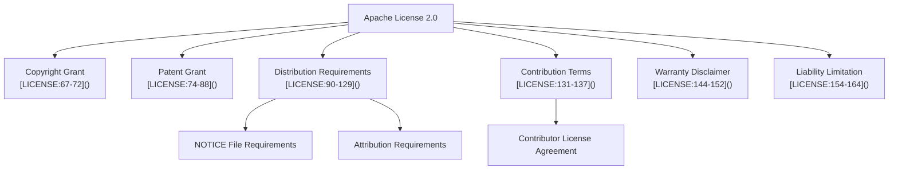
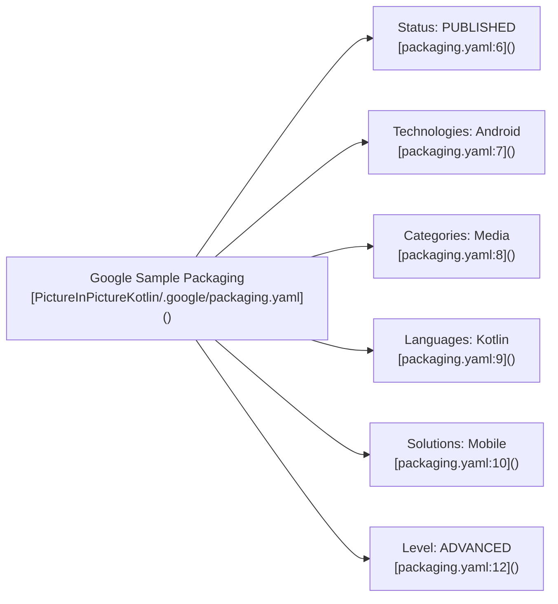
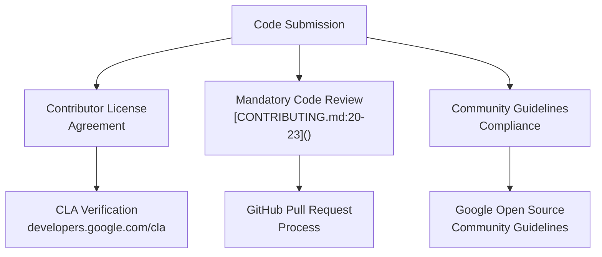
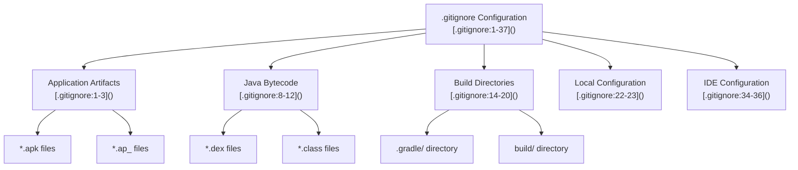

<!-- source: DeepWiki mcp.deepwiki.com · repo android/media-samples · page 6 Repository Governance · fetched 2026-10-23 -->

# Repository Governance

Relevant source files

The following files were used as context for generating this wiki page:

- [.gitignore](.gitignore)
- [CONTRIBUTING.md](CONTRIBUTING.md)
- [LICENSE](LICENSE)
- [PictureInPictureKotlin/.google/packaging.yaml](PictureInPictureKotlin/.google/packaging.yaml)
- [README.md](README.md)

This document covers the legal framework, contribution processes, and project governance policies for the Android Media Samples repository. It documents the licensing terms, community guidelines, and submission requirements that govern how the repository operates and accepts contributions.

For information about the build system and CI/CD infrastructure, see [Build System and CI/CD](#5).

## Legal Framework

The Android Media Samples repository operates under the Apache License Version 2.0, providing a comprehensive legal framework for usage, modification, and distribution of the sample code.

### License Terms

The repository is governed by the Apache License 2.0, which provides the following key permissions and requirements:

| Permission | Description | Requirements |
|------------|-------------|--------------|
| Commercial Use | Code may be used for commercial purposes | Must include license and copyright notice |
| Modification | Code may be modified and derivative works created | Must state changes made to files |
| Distribution | Code may be distributed in source or binary form | Must include copy of license |
| Patent Grant | Contributors grant patent licenses for their contributions | Patent license terminates if litigation is filed |
| Private Use | Code may be used privately without disclosure | No additional requirements |

The license includes important disclaimers of warranty and limitations of liability, establishing that the code is provided "AS IS" without warranties of any kind.

**Contribution License Terms**

The license specifically addresses contributions in [LICENSE:131-137](), establishing that any contribution submitted for inclusion becomes subject to the same license terms unless explicitly stated otherwise.

Sources: [LICENSE:1-193]()

### Google Sample Packaging

The repository includes Google-specific sample packaging metadata that defines publication status and categorization:

The packaging configuration establishes the samples as published, advanced-level Android media examples targeting mobile solutions.

Sources: [PictureInPictureKotlin/.google/packaging.yaml:1-20]()

## Contribution Process

The repository implements a structured contribution process with specific requirements for legal compliance and code quality.

### Contributor License Agreement

All contributions must be accompanied by a Contributor License Agreement (CLA), as specified in [CONTRIBUTING.md:6-16](). The CLA process includes:

- Contributors retain copyright to their contributions
- Google receives permission to use and redistribute contributions
- CLA submission is typically required only once across projects
- Existing CLAs for other projects may apply

### Code Review Requirements

The repository enforces mandatory code review for all submissions:

All submissions, including those by project members, require review through GitHub pull requests as documented in [CONTRIBUTING.md:18-23]().

Sources: [CONTRIBUTING.md:1-29]()

### Community Standards

The project adheres to Google's Open Source Community Guidelines, establishing behavioral expectations and standards for contributors and maintainers. This ensures a welcoming and productive environment for collaboration.

## Version Control Policies

The repository implements comprehensive version control policies through `.gitignore` configuration, defining what artifacts should be excluded from source control.

### Build Artifact Exclusion

The `.gitignore` file establishes policies for excluding various types of generated content:

| Artifact Type | Pattern | Purpose |
|---------------|---------|---------|
| Application Files | `*.apk`, `*.ap_` | Exclude compiled Android packages |
| Java Bytecode | `*.dex`, `*.class` | Exclude compiled code |
| Build Directories | `build/`, `bin/`, `gen/` | Exclude generated build artifacts |
| Gradle Files | `.gradle/` | Exclude Gradle cache and temporary files |
| IDE Configuration | `*.iml`, `.idea` | Exclude IDE-specific configuration |
| Local Configuration | `local.properties` | Exclude machine-specific settings |

The configuration ensures that only source code and essential project files are tracked in version control, while build artifacts and local configuration remain excluded.

Sources: [.gitignore:1-37]()

## Project Structure and Organization

The repository follows a structured organization pattern with each sample as an independent Android Studio project, enabling focused development and clear separation of concerns.

### Repository Purpose

As defined in [README.md:4-5](), the repository serves as "a set of individual Android Studio projects to help you get started writing/understanding Android Media (audio, video, etc.)."

This organizational approach provides:
- Independent project builds and dependencies
- Clear sample isolation and focus
- Simplified navigation and learning paths
- Reduced complexity for individual examples

Sources: [README.md:1-6]()

## Governance Enforcement

The repository governance is enforced through a combination of automated and manual processes that ensure compliance with legal, technical, and community standards.

### Automated Enforcement

Version control policies are automatically enforced through:
- `.gitignore` rules preventing inappropriate file commits
- Build system validation of project structure
- CI/CD pipeline checks for build integrity

### Manual Review Process

Human oversight ensures:
- CLA compliance verification
- Code review quality and standards
- Community guideline adherence
- Technical accuracy and sample quality

This multi-layered approach ensures that the repository maintains high standards while remaining accessible to contributors and users across the Android development community.

Sources: [LICENSE:1-193](), [CONTRIBUTING.md:1-29](), [.gitignore:1-37](), [README.md:1-6](), [PictureInPictureKotlin/.google/packaging.yaml:1-20]()

---

