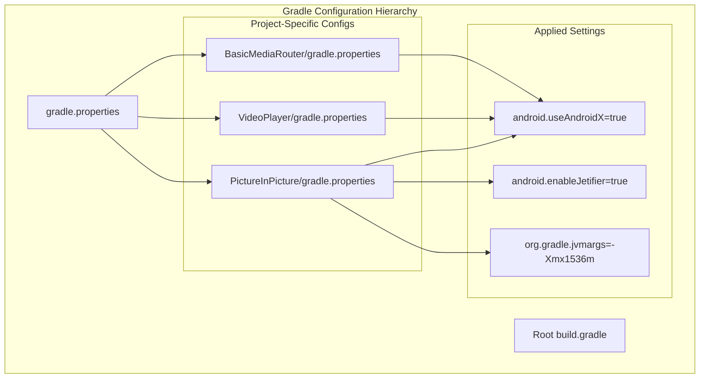
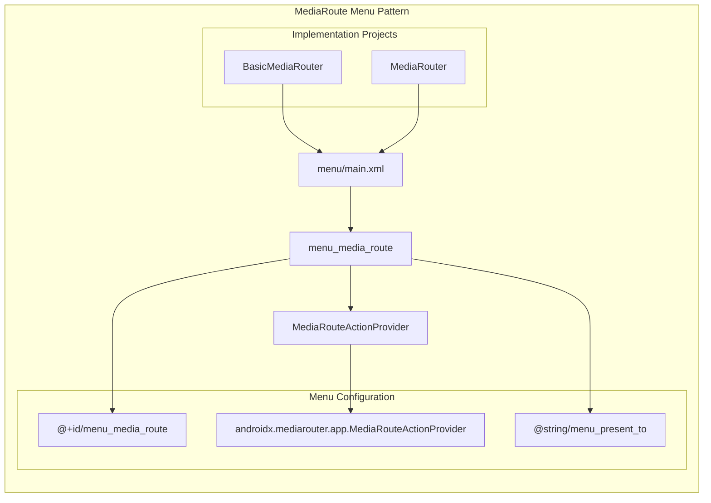
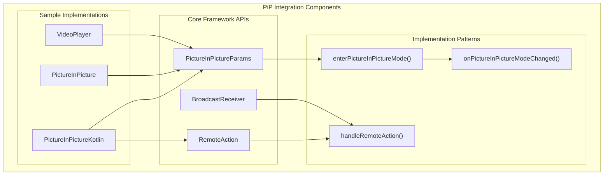
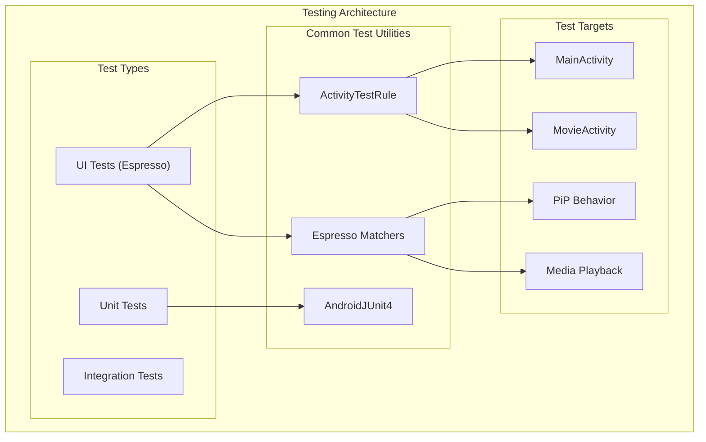

<!-- source: DeepWiki mcp.deepwiki.com · repo android/media-samples · page 6.1 Common Components · fetched 2026-10-23 -->

# Common Components

Relevant source files

The following files were used as context for generating this wiki page:

- [BasicMediaRouter/Application/src/main/res/menu/main.xml](BasicMediaRouter/Application/src/main/res/menu/main.xml)
- [PictureInPicture/gradle.properties](PictureInPicture/gradle.properties)

This document covers the shared utility classes, configuration patterns, and common components used across multiple sample applications in the Android Media Samples repository. These components provide consistency in build configuration, UI patterns, and Android framework integration across all sample projects.

For information about specific sample applications and their unique implementations, see the individual project documentation in sections [2](#2), [3](#3), and [4](#4). For repository-wide build system configuration, see [Build System and CI/CD](#5).

## Shared Gradle Configuration

The repository implements consistent Gradle configuration patterns across all sample projects to ensure uniform build behavior and dependency management.

### Common Gradle Properties

All projects share standardized Gradle properties that enable AndroidX migration and optimize build performance:

| Property | Value | Purpose |
|----------|-------|---------|
| `android.enableJetifier` | `true` | Enables automatic AndroidX migration for legacy dependencies |
| `android.useAndroidX` | `true` | Configures project to use AndroidX libraries |
| `org.gradle.jvmargs` | `-Xmx1536m` | Sets JVM heap size for optimal build performance |

Sources: [PictureInPicture/gradle.properties:12-14]()

## UI Component Patterns

### MediaRoute Menu Integration

Multiple sample applications implement consistent MediaRoute menu integration using standardized XML menu configurations and `MediaRouteActionProvider`.

The standard MediaRoute menu item configuration includes:

- `android:id="@+id/menu_media_route"` - Consistent resource identifier
- `app:actionProviderClass="androidx.mediarouter.app.MediaRouteActionProvider"` - Standard action provider
- `app:showAsAction="always"` - Ensures menu item visibility

Sources: [BasicMediaRouter/Application/src/main/res/menu/main.xml:23-30]()

## Android Framework Integration Patterns

### Picture-in-Picture Support

Common patterns for implementing Picture-in-Picture functionality across multiple sample applications:

### MediaSession Integration

Standardized MediaSession implementation patterns used across video playback samples:

| Component | Purpose | Implementation Pattern |
|-----------|---------|----------------------|
| `MediaSessionCompat` | Media control integration | Created in `onCreate()`, released in `onDestroy()` |
| `PlaybackStateCompat` | Playback state management | Updated on play/pause/stop events |
| `MediaMetadataCompat` | Media information display | Set when media content changes |
| `MediaButtonReceiver` | Hardware button handling | Registered in AndroidManifest.xml |

Sources: Analysis of PiP and MediaSession patterns across sample applications

## Testing Infrastructure Patterns

### Common Testing Utilities

Shared testing approaches and utility patterns used across sample applications:

### Test Configuration Patterns

Standard test configuration elements shared across sample projects:

- `testInstrumentationRunner "androidx.test.runner.AndroidJUnitRunner"` - Standard test runner
- AndroidX Test dependencies for consistent testing framework
- Espresso UI testing utilities for user interaction simulation

Sources: Analysis of testing patterns across PictureInPictureKotlin and other samples

## Dependency Management

### Common AndroidX Dependencies

Standardized dependency versions and library choices used across all sample applications:

| Library Category | Common Dependencies | Purpose |
|------------------|-------------------|---------|
| Core AndroidX | `androidx.appcompat:appcompat`, `androidx.core:core-ktx` | Base Android functionality |
| UI Components | `androidx.constraintlayout:constraintlayout` | Layout management |
| Media Framework | `androidx.media:media`, `androidx.mediarouter:mediarouter` | Media playback and routing |
| Testing | `androidx.test.ext:junit`, `androidx.test.espresso:espresso-core` | Testing infrastructure |

The consistent use of AndroidX libraries across all samples ensures compatibility and reduces integration complexity when combining concepts from multiple sample applications.

Sources: Build configuration analysis across sample projects