# Page: Overview

# Overview

<details>
<summary>Relevant source files</summary>

The following files were used as context for generating this wiki page:

- [.gitignore](.gitignore)
- [CONTRIBUTING.md](CONTRIBUTING.md)
- [LICENSE](LICENSE)
- [PictureInPictureKotlin/README.md](PictureInPictureKotlin/README.md)
- [PictureInPictureKotlin/app/src/main/AndroidManifest.xml](PictureInPictureKotlin/app/src/main/AndroidManifest.xml)
- [PictureInPictureKotlin/app/src/main/res/values/dimens.xml](PictureInPictureKotlin/app/src/main/res/values/dimens.xml)
- [PictureInPictureKotlin/app/src/main/res/values/strings.xml](PictureInPictureKotlin/app/src/main/res/values/strings.xml)
- [README.md](README.md)

</details>


## Purpose and Scope

The Android Media Samples repository is a collection of independent Android Studio projects that demonstrate various media-related functionalities on the Android platform. Each sample application focuses on specific Android media APIs and serves as a practical reference implementation for developers working with audio, video, recording, playback, and media routing capabilities.

This document provides a high-level overview of the repository structure, its main sample applications, and the build infrastructure. For detailed documentation of specific samples, refer to the following sections: Picture-in-Picture samples ([2](#2)), VideoPlayer implementation ([3](#3)), and other media demonstrations ([4](#4)). Build system and CI/CD information is covered in ([5](#5)).

## Repository Structure

The repository is organized as a multi-project Gradle build containing several independent Android Studio projects. Each project demonstrates different aspects of Android media development while maintaining its own build configuration and dependencies.

### Primary Sample Applications

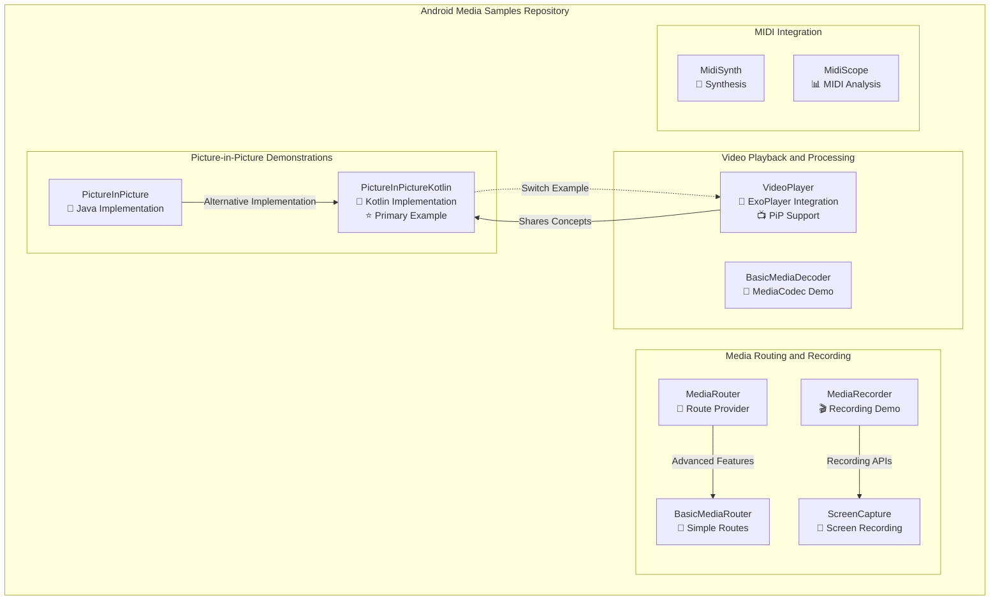

**Repository Structure Diagram**
Sources: [README.md:1-6](), [PictureInPictureKotlin/README.md:1-8]()

The repository contains the following major components:

| Sample Application | Primary APIs Demonstrated | Key Features |
|-------------------|---------------------------|--------------|
| `PictureInPictureKotlin` | Picture-in-Picture, MediaSession | Stopwatch and video playback examples |
| `PictureInPicture` | Picture-in-Picture (Java) | Java implementation alternative |
| `VideoPlayer` | ExoPlayer, MediaSession, AudioFocus | Advanced video playback with PiP |
| `BasicMediaDecoder` | MediaCodec, MediaExtractor | Low-level media decoding |
| `MediaRouter` | MediaRouter API | Custom route providers |
| `MediaRecorder` | MediaRecorder API | Audio/video recording |
| `ScreenCapture` | MediaProjection | Screen recording |
| `MidiSynth` | MIDI API | MIDI synthesis |
| `MidiScope` | MIDI API | MIDI device analysis |

### Build System Architecture

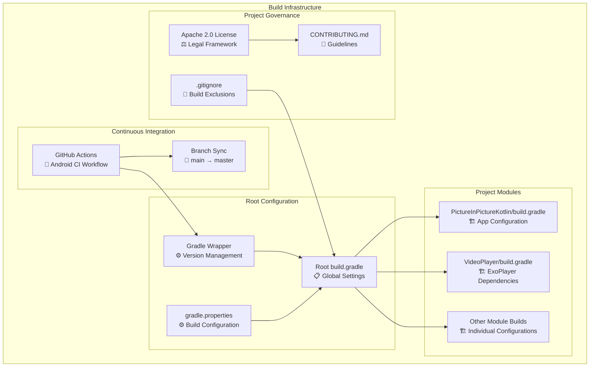

**Build System and Infrastructure Diagram**
Sources: [.gitignore:1-37](), [LICENSE:1-193](), [CONTRIBUTING.md:1-29]()

## Key Sample Applications

### Picture-in-Picture Demonstrations

The repository features two Picture-in-Picture implementations:

- **PictureInPictureKotlin**: The primary example demonstrating modern Android PiP functionality with both stopwatch and video playback scenarios
- **PictureInPicture**: Java-based alternative implementation showing the same concepts

Both samples demonstrate the `android:supportsPictureInPicture` manifest attribute and the use of `PictureInPictureParams` for configuring PiP behavior.

Sources: [PictureInPictureKotlin/app/src/main/AndroidManifest.xml:28-42](), [PictureInPictureKotlin/README.md:12-32]()

### Media Playback and Processing

The VideoPlayer sample showcases advanced media playback using ExoPlayer with comprehensive MediaSession integration and audio focus management. The BasicMediaDecoder demonstrates lower-level media processing using MediaCodec and MediaExtractor APIs.

### Recording and Routing

Several samples demonstrate media recording capabilities including traditional MediaRecorder usage and screen capture functionality. The MediaRouter samples show both basic and advanced implementations of custom media route providers.

## Application Configuration

Each sample application maintains its own Android manifest configuration with specific media-related permissions and activity declarations. The PictureInPictureKotlin manifest demonstrates typical PiP configuration:

```xml
<activity
    android:name=".MainActivity"
    android:configChanges="screenSize|smallestScreenSize|screenLayout|orientation"
    android:supportsPictureInPicture="true">
```

Sources: [PictureInPictureKotlin/app/src/main/AndroidManifest.xml:28-37]()

## String Resources and Localization

The samples include comprehensive string resources supporting multiple use cases. The PictureInPictureKotlin sample defines resources for both stopwatch and video playback scenarios:

| Resource Category | Key Strings | Purpose |
|------------------|-------------|---------|
| Stopwatch UI | `start`, `pause`, `clear` | Stopwatch controls |
| PiP Actions | `enter_picture_in_picture` | Mode switching |
| Video Controls | `play`, `fast_forward`, `fast_rewind` | Media playback |
| Navigation | `switch_media_session`, `switch_custom` | Example switching |

Sources: [PictureInPictureKotlin/app/src/main/res/values/strings.xml:20-47]()

## Legal Framework and Contribution Guidelines

The repository operates under the Apache 2.0 License and follows Google's Open Source Community Guidelines. Contributions require a Contributor License Agreement and must go through code review via GitHub pull requests.

Sources: [LICENSE:1-193](), [CONTRIBUTING.md:6-24]()

## Navigation Guide

This repository documentation is organized into the following main sections:

- **Picture-in-Picture Samples ([2](#2))**: Comprehensive coverage of PiP implementations
- **VideoPlayer Sample ([3](#3))**: ExoPlayer integration and advanced media features  
- **Other Media Samples ([4](#4))**: Recording, routing, decoding, and MIDI applications
- **Build System and CI/CD ([5](#5))**: Infrastructure and automation details
- **Repository Governance ([6](#6))**: Legal framework and contribution processes

Each section provides detailed technical documentation with code references, implementation details, and architectural explanations specific to that component.

---

# Page: Picture-in-Picture Samples

# Picture-in-Picture Samples

<details>
<summary>Relevant source files</summary>

The following files were used as context for generating this wiki page:

- [PictureInPicture/app/build.gradle](PictureInPicture/app/build.gradle)
- [PictureInPicture/app/src/androidTest/java/com/example/android/pictureinpicture/MainActivityTest.java](PictureInPicture/app/src/androidTest/java/com/example/android/pictureinpicture/MainActivityTest.java)
- [PictureInPicture/app/src/androidTest/java/com/example/android/pictureinpicture/MediaSessionPlaybackActivityTest.java](PictureInPicture/app/src/androidTest/java/com/example/android/pictureinpicture/MediaSessionPlaybackActivityTest.java)
- [PictureInPicture/app/src/main/java/com/example/android/pictureinpicture/MainActivity.java](PictureInPicture/app/src/main/java/com/example/android/pictureinpicture/MainActivity.java)
- [PictureInPicture/app/src/main/java/com/example/android/pictureinpicture/MediaSessionPlaybackActivity.java](PictureInPicture/app/src/main/java/com/example/android/pictureinpicture/MediaSessionPlaybackActivity.java)
- [PictureInPicture/app/src/main/java/com/example/android/pictureinpicture/widget/MovieView.java](PictureInPicture/app/src/main/java/com/example/android/pictureinpicture/widget/MovieView.java)
- [PictureInPictureKotlin/README.md](PictureInPictureKotlin/README.md)
- [PictureInPictureKotlin/app/src/main/AndroidManifest.xml](PictureInPictureKotlin/app/src/main/AndroidManifest.xml)
- [PictureInPictureKotlin/app/src/main/res/values/dimens.xml](PictureInPictureKotlin/app/src/main/res/values/dimens.xml)
- [PictureInPictureKotlin/app/src/main/res/values/strings.xml](PictureInPictureKotlin/app/src/main/res/values/strings.xml)

</details>


This document covers the Picture-in-Picture demonstration projects in the Android Media Samples repository. These samples showcase how to implement Picture-in-Picture (PiP) mode functionality in Android applications, providing both Kotlin and Java implementations with different approaches to media control integration.

The samples demonstrate PiP mode for video playback scenarios and interactive applications like stopwatches. For broader video playback examples using ExoPlayer, see [VideoPlayer Sample](#3). For other media functionality demonstrations, see [Other Media Samples](#4).

## Sample Projects Overview

The repository contains two primary PiP sample applications that demonstrate different implementation approaches:

| Sample | Language | Key Features | Activities |
|--------|----------|--------------|------------|
| PictureInPictureKotlin | Kotlin | Stopwatch + Video examples, RemoteActions, MediaSession | `MainActivity`, `MovieActivity` |
| PictureInPicture | Java | Video playback with custom controls, MediaSession integration | `MainActivity`, `MediaSessionPlaybackActivity` |

Both samples target Android API level 26+ (Android 8.0 Oreo) where PiP mode was introduced for handheld devices.

**Sources:** [PictureInPictureKotlin/README.md:1-65](), [PictureInPicture/app/build.gradle:20-27]()

## PictureInPictureKotlin Architecture

The Kotlin implementation provides the most comprehensive PiP demonstration with multiple activity examples and modern Android architecture patterns.

```mermaid
graph TB
    subgraph "PictureInPictureKotlin Project"
        MainActivity[MainActivity<br/>"Stopwatch Example"]
        MovieActivity[MovieActivity<br/>"Video Playback Example"] 
        MainViewModel[MainViewModel<br/>"Stopwatch Logic"]
        
        subgraph "Android Framework APIs"
            PiPParams[PictureInPictureParams]
            RemoteAction[RemoteAction]
            MediaSession[MediaSessionCompat]
            BroadcastReceiver[BroadcastReceiver]
        end
        
        subgraph "Testing Components"
            MainActivityTest[MainActivityTest]
            MovieActivityTest[MovieActivityTest]
        end
    end
    
    MainActivity --> MainViewModel
    MainActivity --> PiPParams
    MainActivity --> RemoteAction
    MainActivity --> BroadcastReceiver
    
    MovieActivity --> MediaSession
    MovieActivity --> PiPParams
    
    MainActivityTest --> MainActivity
    MovieActivityTest --> MovieActivity
```

**Core Components:**

- **`MainActivity`**: Demonstrates PiP with a stopwatch application using `RemoteAction` controls
- **`MovieActivity`**: Shows video playback in PiP mode with `MediaSessionCompat` integration  
- **`MainViewModel`**: Manages stopwatch state using LiveData pattern
- **Testing Infrastructure**: Comprehensive UI tests using Espresso framework

**Sources:** [PictureInPictureKotlin/app/src/main/AndroidManifest.xml:28-43](), [PictureInPictureKotlin/app/src/main/res/values/strings.xml:20-47]()

## PictureInPicture (Java) Architecture

The Java implementation focuses on video playback scenarios with two different control approaches.

```mermaid
graph TB
    subgraph "PictureInPicture Java Project"
        JavaMainActivity[MainActivity<br/>"Custom RemoteActions"]
        MediaSessionActivity[MediaSessionPlaybackActivity<br/>"MediaSession Integration"]
        MovieView[MovieView<br/>"Custom Video Widget"]
        
        subgraph "Media Components"
            MediaPlayer[MediaPlayer]
            SurfaceView[SurfaceView]
            MediaSessionCompat[MediaSessionCompat]
            PlaybackStateCompat[PlaybackStateCompat]
        end
        
        subgraph "PiP Framework"
            PictureInPictureParams[PictureInPictureParams.Builder]
            RemoteActionImpl[RemoteAction]
            PendingIntent[PendingIntent]
        end
        
        subgraph "Testing"
            JavaMainTest[MainActivityTest]
            MediaSessionTest[MediaSessionPlaybackActivityTest]
        end
    end
    
    JavaMainActivity --> MovieView
    JavaMainActivity --> PictureInPictureParams
    JavaMainActivity --> RemoteActionImpl
    JavaMainActivity --> PendingIntent
    
    MediaSessionActivity --> MovieView
    MediaSessionActivity --> MediaSessionCompat
    MediaSessionActivity --> PlaybackStateCompat
    
    MovieView --> MediaPlayer
    MovieView --> SurfaceView
    
    JavaMainTest --> JavaMainActivity
    MediaSessionTest --> MediaSessionActivity
```

**Key Implementation Classes:**

- **`MainActivity`**: Custom PiP controls using `RemoteAction` and `BroadcastReceiver`
- **`MediaSessionPlaybackActivity`**: PiP integration with Android's `MediaSessionCompat` 
- **`MovieView`**: Custom video playback widget with built-in controls
- **Testing**: Separate test classes for both activity implementations

**Sources:** [PictureInPicture/app/src/main/java/com/example/android/pictureinpicture/MainActivity.java:46-49](), [PictureInPicture/app/src/main/java/com/example/android/pictureinpicture/MediaSessionPlaybackActivity.java:40-43](), [PictureInPicture/app/src/main/java/com/example/android/pictureinpicture/widget/MovieView.java:45-51]()

## PiP Implementation Patterns

### RemoteAction Pattern (Custom Controls)

The `MainActivity` in the Java sample demonstrates custom PiP controls using `RemoteAction`:

```mermaid
graph LR
    subgraph "PiP Remote Action Flow"
        EnterPiP[enterPictureInPictureMode]
        RemoteActionSetup[RemoteAction<br/>"Play/Pause/Info"]
        PendingIntentCreate[PendingIntent.getBroadcast]
        BroadcastReceiverHandle[BroadcastReceiver.onReceive]
        ActionExecution[Execute Action<br/>"CONTROL_TYPE_PLAY/PAUSE"]
    end
    
    EnterPiP --> RemoteActionSetup
    RemoteActionSetup --> PendingIntentCreate
    PendingIntentCreate --> BroadcastReceiverHandle
    BroadcastReceiverHandle --> ActionExecution
```

**Key Implementation Details:**

- **Action Constants**: `CONTROL_TYPE_PLAY` (1), `CONTROL_TYPE_PAUSE` (2) for intent extras
- **Request Codes**: `REQUEST_PLAY` (1), `REQUEST_PAUSE` (2), `REQUEST_INFO` (3) for distinct `PendingIntent` instances
- **BroadcastReceiver**: Registered/unregistered in `onPictureInPictureModeChanged()`

**Sources:** [PictureInPicture/app/src/main/java/com/example/android/pictureinpicture/MainActivity.java:54-84](), [PictureInPicture/app/src/main/java/com/example/android/pictureinpicture/MainActivity.java:245-283]()

### MediaSession Integration Pattern

The `MediaSessionPlaybackActivity` shows integration with Android's media session framework:

**MediaSession Configuration:**
- **Session Creation**: `MediaSessionCompat(this, TAG)` with custom callback
- **Metadata Setup**: `MediaMetadataCompat.Builder()` with display title
- **Playback State**: `PlaybackStateCompat.Builder()` with supported actions

**Action Mapping:**
- `MEDIA_ACTIONS_PLAY_PAUSE`: Basic play/pause functionality
- `MEDIA_ACTIONS_ALL`: Includes skip next/previous actions
- **Dynamic Actions**: Actions updated based on playlist position

**Sources:** [PictureInPicture/app/src/main/java/com/example/android/pictureinpicture/MediaSessionPlaybackActivity.java:47-56](), [PictureInPicture/app/src/main/java/com/example/android/pictureinpicture/MediaSessionPlaybackActivity.java:136-158]()

## MovieView Custom Component

The `MovieView` class provides a reusable video playback widget with PiP-aware controls:

### Component Structure

| Component | Type | Purpose |
|-----------|------|---------|
| `mSurfaceView` | `SurfaceView` | Video rendering surface |
| `mMediaPlayer` | `MediaPlayer` | Video playback engine |
| `mToggle`, `mFastForward`, `mFastRewind`, `mMinimize` | `ImageButton` | Playback controls |
| `mShade` | `View` | Control overlay background |
| `TimeoutHandler` | `Handler` | Auto-hide controls timer |

### Control Behavior

- **Auto-hide**: Controls fade after `TIMEOUT_CONTROLS` (3000ms) during playback
- **Fast Forward/Rewind**: Jump by `FAST_FORWARD_REWIND_INTERVAL` (5000ms)
- **Aspect Ratio**: Dynamic sizing based on `mAdjustViewBounds` setting
- **Lifecycle Management**: Proper `MediaPlayer` resource cleanup

**Sources:** [PictureInPicture/app/src/main/java/com/example/android/pictureinpicture/widget/MovieView.java:77-132](), [PictureInPicture/app/src/main/java/com/example/android/pictureinpicture/widget/MovieView.java:521-543]()

## Testing Infrastructure

Both samples include comprehensive testing using Espresso framework:

### Test Coverage Areas

| Test Class | Target Activity | Test Scenarios |
|------------|-----------------|----------------|
| `MainActivityTest` | `MainActivity` | PiP mode entry, video playback, orientation changes |
| `MediaSessionPlaybackActivityTest` | `MediaSessionPlaybackActivity` | MediaSession state validation, PiP behavior |

### Key Test Methods

- **`movie_playingOnPip()`**: Verifies video continues playing when entering PiP mode
- **`movie_pauseAndResume()`**: Tests play/pause functionality and MediaSession state
- **`fullscreen_enabledOnLandscape()`**: Validates immersive mode behavior
- **Custom Matchers**: `isPlaying()` matcher for `MovieView` state verification

**Testing Pattern:**
```
onView(withId(R.id.movie))
    .check(matches(allOf(isDisplayed(), isPlaying())))
    .perform(showControls());
```

**Sources:** [PictureInPicture/app/src/androidTest/java/com/example/android/pictureinpicture/MainActivityTest.java:61-79](), [PictureInPicture/app/src/androidTest/java/com/example/android/pictureinpicture/MediaSessionPlaybackActivityTest.java:65-86]()

## Build Configuration

### Gradle Dependencies

Both samples share similar dependency patterns:

**Core Dependencies:**
- `androidx.core:core` - AndroidX core functionality
- `androidx.appcompat:appcompat` - AppCompat support
- `androidx.media:media` - MediaSessionCompat support

**Test Dependencies:**
- `androidx.test:runner`, `androidx.test:rules` - Testing framework
- `androidx.test.espresso:espresso-core` - UI testing
- `junit:junit` - Unit testing framework

### Manifest Configuration

**Required PiP Settings:**
- `android:supportsPictureInPicture="true"` - Enable PiP mode
- `android:configChanges="screenSize|smallestScreenSize|screenLayout|orientation"` - Handle configuration changes
- **API Level**: `minSdkVersion 26` for PiP support

**Sources:** [PictureInPicture/app/build.gradle:41-51](), [PictureInPictureKotlin/app/src/main/AndroidManifest.xml:28-43]()

---

# Page: PictureInPictureKotlin

# PictureInPictureKotlin

<details>
<summary>Relevant source files</summary>

The following files were used as context for generating this wiki page:

- [PictureInPictureKotlin/README.md](PictureInPictureKotlin/README.md)
- [PictureInPictureKotlin/app/build.gradle](PictureInPictureKotlin/app/build.gradle)
- [PictureInPictureKotlin/app/src/main/AndroidManifest.xml](PictureInPictureKotlin/app/src/main/AndroidManifest.xml)
- [PictureInPictureKotlin/app/src/main/res/values/dimens.xml](PictureInPictureKotlin/app/src/main/res/values/dimens.xml)
- [PictureInPictureKotlin/app/src/main/res/values/strings.xml](PictureInPictureKotlin/app/src/main/res/values/strings.xml)
- [PictureInPictureKotlin/build.gradle](PictureInPictureKotlin/build.gradle)
- [PictureInPictureKotlin/gradle/wrapper/gradle-wrapper.properties](PictureInPictureKotlin/gradle/wrapper/gradle-wrapper.properties)

</details>


This document covers the PictureInPictureKotlin sample application, which demonstrates comprehensive Picture-in-Picture (PiP) mode functionality for Android handheld devices. The sample includes two distinct demonstration scenarios: a stopwatch example with custom RemoteActions and a video playback example with MediaSession integration. For the Java-based PiP implementation, see [PictureInPicture (Java)](#2.2).

Sources: [PictureInPictureKotlin/README.md:1-65](), [PictureInPictureKotlin/app/src/main/AndroidManifest.xml:17-46]()

## System Architecture

The PictureInPictureKotlin sample implements a dual-activity architecture demonstrating different approaches to Picture-in-Picture mode integration.

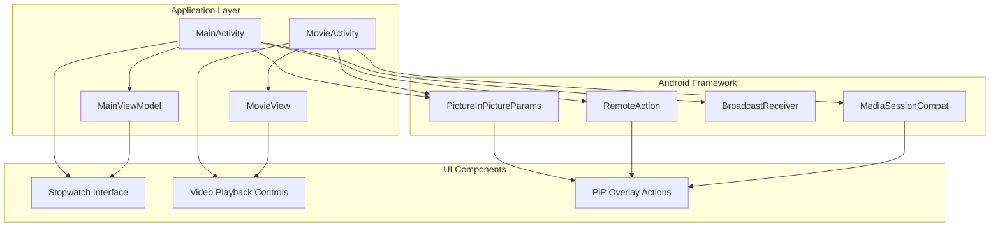

Sources: [PictureInPictureKotlin/app/src/main/AndroidManifest.xml:28-42](), [PictureInPictureKotlin/app/src/main/res/values/strings.xml:20-47]()

## Core Activities

### MainActivity - Stopwatch Implementation

The `MainActivity` serves as the primary entry point and demonstrates PiP mode with a stopwatch timer that continues running seamlessly during mode transitions. The activity implements custom `RemoteAction` controls that remain accessible in the PiP overlay.

Key configuration attributes from the manifest:
- `android:supportsPictureInPicture="true"` enables PiP support
- `android:configChanges="screenSize|smallestScreenSize|screenLayout|orientation"` handles configuration changes without recreation

The stopwatch functionality provides three main actions available in PiP mode:
- Start/Pause timer control
- Clear timer reset
- Picture-in-Picture mode entry

Sources: [PictureInPictureKotlin/app/src/main/AndroidManifest.xml:28-37](), [PictureInPictureKotlin/app/src/main/res/values/strings.xml:20-31]()

### MovieActivity - Video Playback Implementation

The `MovieActivity` demonstrates video playback with MediaSession integration, showcasing how media controls can be seamlessly transitioned between full-screen and PiP modes. This activity integrates with the Android media framework to provide standard media session controls.

The video playback implementation features:
- Continuous playback during PiP transitions
- MediaSession integration for system-level media controls
- Custom video controls (play, fast forward, fast rewind)
- Integration with `MovieView` custom component

Sources: [PictureInPictureKotlin/app/src/main/AndroidManifest.xml:39-42](), [PictureInPictureKotlin/app/src/main/res/values/strings.xml:34-47]()

## Build Configuration

The project uses a modern Android build configuration with Kotlin support and comprehensive dependency management.

### Project-Level Configuration

The root `build.gradle` establishes the build environment:
- Kotlin version 1.8.0
- Android Gradle Plugin 7.4.2
- Google and Maven Central repositories

### Application Module Configuration

The app-level build configuration specifies:

| Configuration | Value |
|---------------|-------|
| Compile SDK | 33 |
| Target SDK | 33 |
| Minimum SDK | 31 |
| Application ID | `com.example.android.pictureinpicture` |
| Version Code | 1 |
| Version Name | "1.0" |

Build features enabled:
- `viewBinding true` for type-safe view references
- Java 8 language features support
- Kotlin JVM target 1.8

Sources: [PictureInPictureKotlin/build.gradle:17-38](), [PictureInPictureKotlin/app/build.gradle:20-46]()

## Dependencies and Integration

The application integrates with multiple AndroidX libraries and modern Android development tools.

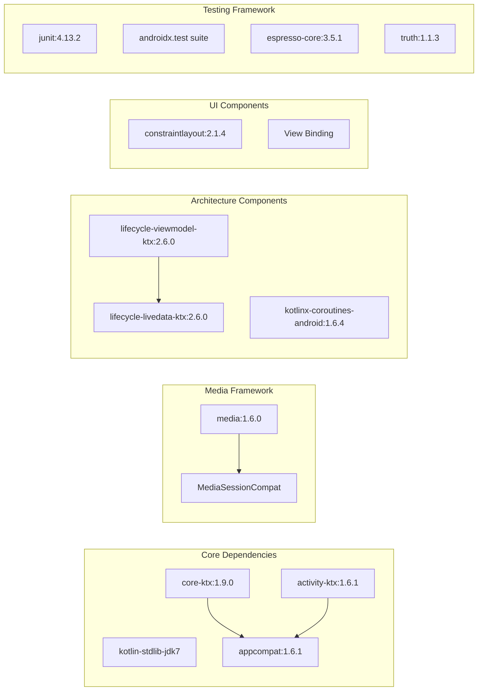

### Key Dependencies

**Media Integration:**
- `androidx.media:media:1.6.0` - Provides MediaSessionCompat for video playback controls

**Architecture Components:**
- `lifecycle-viewmodel-ktx:2.6.0` - ViewModel pattern implementation
- `lifecycle-livedata-ktx:2.6.0` - Reactive data observation
- `kotlinx-coroutines-android:1.6.4` - Asynchronous programming support

**Testing Infrastructure:**
- Comprehensive testing setup with JUnit, AndroidX Test, Espresso, and Truth assertion library
- `androidx.test.runner.AndroidJUnitRunner` for instrumented tests

Sources: [PictureInPictureKotlin/app/build.gradle:48-71]()

## Gradle Wrapper Configuration

The project uses Gradle 7.5 distributed through the Gradle Wrapper system, ensuring consistent build environments across development machines and CI systems.

Wrapper configuration:
- Distribution URL: `https://services.gradle.org/distributions/gradle-7.5-bin.zip`
- Binary distribution for faster downloads and execution

Sources: [PictureInPictureKotlin/gradle/wrapper/gradle-wrapper.properties:1-5]()

---

# Page: MainActivity - Stopwatch Example

# MainActivity - Stopwatch Example

<details>
<summary>Relevant source files</summary>

The following files were used as context for generating this wiki page:

- [PictureInPictureKotlin/app/src/main/java/com/example/android/pictureinpicture/MainActivity.kt](PictureInPictureKotlin/app/src/main/java/com/example/android/pictureinpicture/MainActivity.kt)
- [PictureInPictureKotlin/app/src/main/java/com/example/android/pictureinpicture/widget/MovieView.kt](PictureInPictureKotlin/app/src/main/java/com/example/android/pictureinpicture/widget/MovieView.kt)
- [PictureInPictureKotlin/gradle.properties](PictureInPictureKotlin/gradle.properties)

</details>


## Purpose and Scope

This document covers the `MainActivity` component of the PictureInPictureKotlin sample, which demonstrates Picture-in-Picture functionality using a stopwatch application. The MainActivity showcases essential PiP features including RemoteActions for custom controls, smooth animations, and proper lifecycle management. For information about the video playback example, see [MovieActivity - Video Playback Example](#2.1.2). For testing approaches, see [Testing Infrastructure](#2.1.3).

## Overview

The `MainActivity` class serves as the primary entry point for demonstrating Picture-in-Picture mode with a functional stopwatch timer. It implements core PiP patterns including:

- Custom RemoteActions for PiP mode controls
- Smooth enter/exit animations using `trackPipAnimationHintView`
- BroadcastReceiver integration for handling PiP action events
- Dynamic UI adaptation based on PiP state
- Integration with MVVM architecture via `MainViewModel`

## Component Architecture

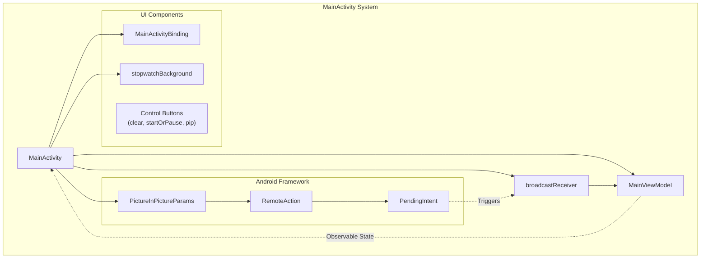

**Sources:** [PictureInPictureKotlin/app/src/main/java/com/example/android/pictureinpicture/MainActivity.kt:1-202]()

## Picture-in-Picture Integration

### PiP Configuration and Parameters

The MainActivity configures Picture-in-Picture mode through the `updatePictureInPictureParams` method, which creates a `PictureInPictureParams` object with specific settings:

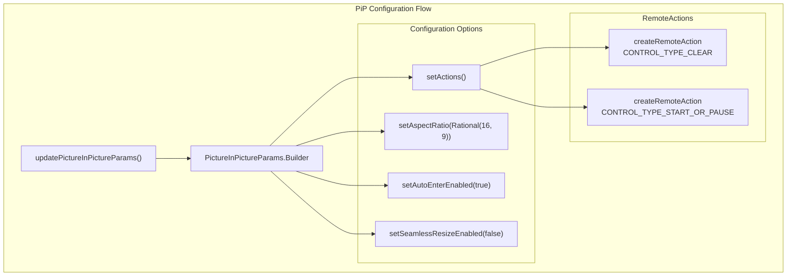

**Sources:** [PictureInPictureKotlin/app/src/main/java/com/example/android/pictureinpicture/MainActivity.kt:134-177]()

### RemoteAction Implementation

The MainActivity defines two primary control types for PiP mode:

| Control Type | Constant | Request Code | Functionality |
|--------------|----------|--------------|---------------|
| Clear | `CONTROL_TYPE_CLEAR` | `REQUEST_CLEAR` | Resets stopwatch to 00:00 |
| Start/Pause | `CONTROL_TYPE_START_OR_PAUSE` | `REQUEST_START_OR_PAUSE` | Toggles timer state |

The `createRemoteAction` method constructs RemoteAction objects that integrate with the system PiP overlay:

**Sources:** [PictureInPictureKotlin/app/src/main/java/com/example/android/pictureinpicture/MainActivity.kt:42-51](), [PictureInPictureKotlin/app/src/main/java/com/example/android/pictureinpicture/MainActivity.kt:183-201]()

## BroadcastReceiver and Action Handling

### Action Processing Flow

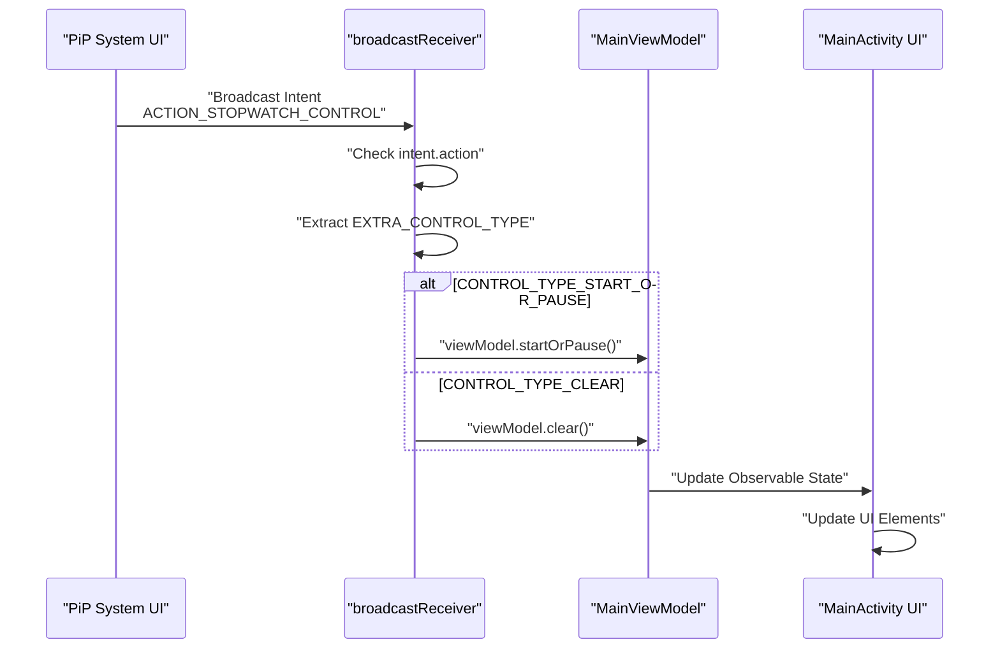

The BroadcastReceiver handles action intents from the PiP overlay and delegates to the `MainViewModel`:

**Sources:** [PictureInPictureKotlin/app/src/main/java/com/example/android/pictureinpicture/MainActivity.kt:64-76](), [PictureInPictureKotlin/app/src/main/java/com/example/android/pictureinpicture/MainActivity.kt:110]()

## State Management and MVVM Integration

### ViewModel Integration

The MainActivity observes state changes from `MainViewModel` using Android's LiveData pattern:

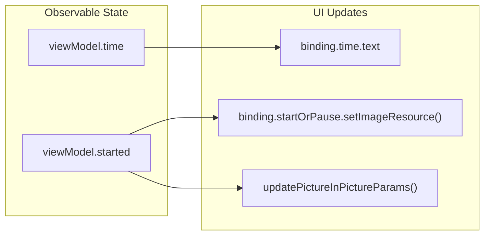

**Sources:** [PictureInPictureKotlin/app/src/main/java/com/example/android/pictureinpicture/MainActivity.kt:93-99]()

## UI Behavior and Mode Transitions

### PiP Mode State Changes

The `onPictureInPictureModeChanged` callback handles UI visibility based on PiP state:

| PiP State | Control Visibility | Behavior |
|-----------|-------------------|----------|
| Entering PiP | `View.GONE` | Hide in-app buttons (clear, startOrPause) |
| Exiting PiP | `View.VISIBLE` | Restore in-app buttons |

**Sources:** [PictureInPictureKotlin/app/src/main/java/com/example/android/pictureinpicture/MainActivity.kt:114-128]()

### Smooth Animation Integration

The MainActivity implements smooth PiP transitions using `trackPipAnimationHintView`:

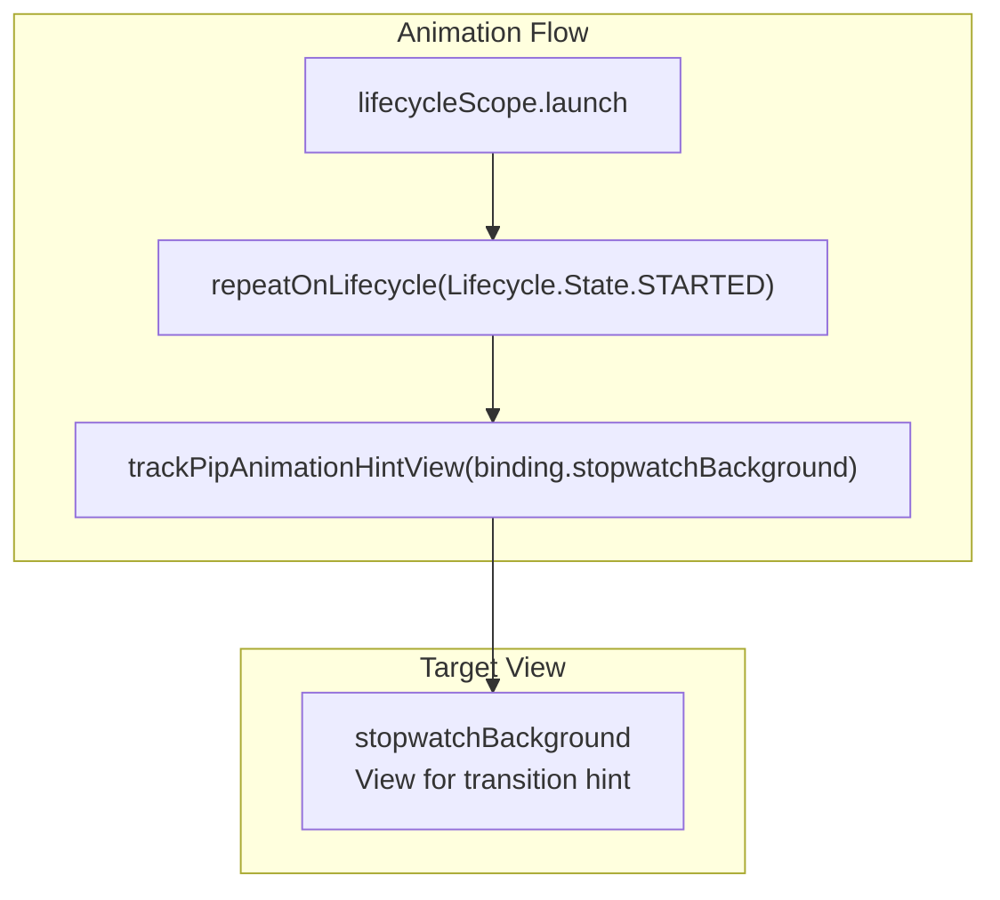

**Sources:** [PictureInPictureKotlin/app/src/main/java/com/example/android/pictureinpicture/MainActivity.kt:101-107]()

## Activity Navigation

The MainActivity provides navigation to the video example via the "Switch Example" button:

**Sources:** [PictureInPictureKotlin/app/src/main/java/com/example/android/pictureinpicture/MainActivity.kt:88-91]()

This navigation pattern allows users to explore different PiP implementation approaches within the same sample application, demonstrating both stopwatch and video playback use cases.

---

# Page: MovieActivity - Video Playback Example

# MovieActivity - Video Playback Example

<details>
<summary>Relevant source files</summary>

The following files were used as context for generating this wiki page:

- [PictureInPictureKotlin/app/src/main/java/com/example/android/pictureinpicture/MainViewModel.kt](PictureInPictureKotlin/app/src/main/java/com/example/android/pictureinpicture/MainViewModel.kt)
- [PictureInPictureKotlin/app/src/main/java/com/example/android/pictureinpicture/MovieActivity.kt](PictureInPictureKotlin/app/src/main/java/com/example/android/pictureinpicture/MovieActivity.kt)
- [PictureInPictureKotlin/app/src/main/res/drawable/ic_refresh_24dp.xml](PictureInPictureKotlin/app/src/main/res/drawable/ic_refresh_24dp.xml)
- [PictureInPictureKotlin/app/src/main/res/layout/main_activity.xml](PictureInPictureKotlin/app/src/main/res/layout/main_activity.xml)
- [PictureInPictureKotlin/app/src/main/res/layout/movie_activity.xml](PictureInPictureKotlin/app/src/main/res/layout/movie_activity.xml)

</details>


## Purpose and Scope

This document covers the `MovieActivity` component within the PictureInPictureKotlin sample, which demonstrates advanced video playback functionality integrated with Android's MediaSession framework and Picture-in-Picture mode. The `MovieActivity` showcases how to properly implement media controls, lifecycle management, and seamless transitions between fullscreen and PiP modes for video content.

For information about the stopwatch-based PiP example, see [MainActivity - Stopwatch Example](#2.1.1). For comprehensive testing approaches across both examples, see [Testing Infrastructure](#2.1.3).

## System Architecture Overview

The `MovieActivity` system demonstrates a complete video playback solution with MediaSession integration and Picture-in-Picture support. The architecture centers around three primary components working together to provide a seamless media experience.

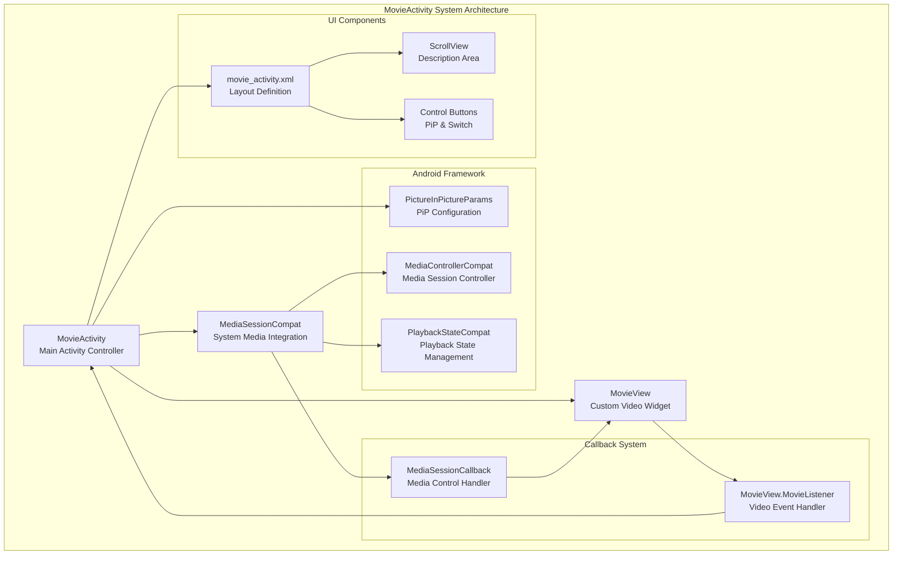

Sources: [PictureInPictureKotlin/app/src/main/java/com/example/android/pictureinpicture/MovieActivity.kt:1-327](), [PictureInPictureKotlin/app/src/main/res/layout/movie_activity.xml:1-80]()

## Core Components Breakdown

### MovieActivity Class Structure

The `MovieActivity` extends `AppCompatActivity` and serves as the primary coordinator for video playback, media session management, and Picture-in-Picture functionality.

| Component | Type | Purpose | Key Methods |
|-----------|------|---------|-------------|
| `MovieActivity` | Activity | Main controller | `onCreate()`, `minimize()`, `updatePictureInPictureParams()` |
| `movieListener` | MovieView.MovieListener | Video event handling | `onMovieStarted()`, `onMovieStopped()`, `onMovieMinimized()` |
| `MediaSessionCallback` | Inner Class | Media control handling | `onPlay()`, `onPause()`, `onSkipToNext()`, `onSkipToPrevious()` |
| `session` | MediaSessionCompat | System media integration | Media metadata and playback state |

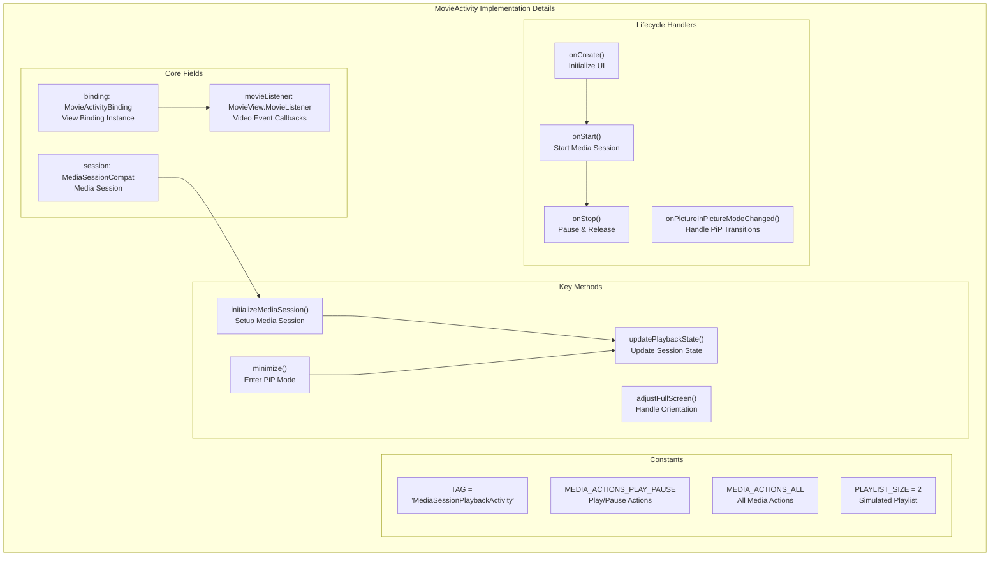

Sources: [PictureInPictureKotlin/app/src/main/java/com/example/android/pictureinpicture/MovieActivity.kt:42-63](), [PictureInPictureKotlin/app/src/main/java/com/example/android/pictureinpicture/MovieActivity.kt:96-114]()

## MediaSession Integration

The `MovieActivity` demonstrates proper MediaSession implementation for system-level media control integration. The MediaSession provides standardized media controls that work across the Android system, including notification panels, lock screens, and Picture-in-Picture overlays.

### MediaSession Setup and Configuration

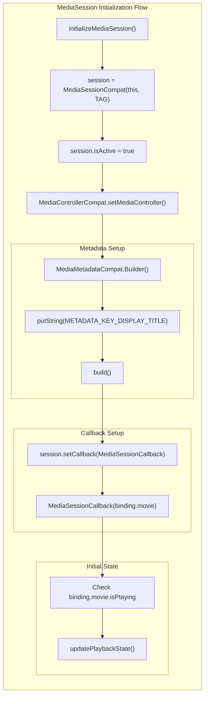

Sources: [PictureInPictureKotlin/app/src/main/java/com/example/android/pictureinpicture/MovieActivity.kt:121-144]()

### MediaSessionCallback Implementation

The `MediaSessionCallback` inner class handles media control actions and manages playlist simulation with dynamic action availability.

| Method | Action | Playlist Logic |
|---------|--------|----------------|
| `onPlay()` | `movieView.play()` | No playlist changes |
| `onPause()` | `movieView.pause()` | No playlist changes |
| `onSkipToNext()` | `movieView.startVideo()` | Increment `indexInPlaylist`, disable next at end |
| `onSkipToPrevious()` | `movieView.startVideo()` | Decrement `indexInPlaylist`, disable previous at start |

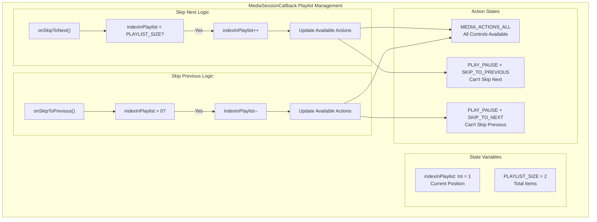

Sources: [PictureInPictureKotlin/app/src/main/java/com/example/android/pictureinpicture/MovieActivity.kt:269-326]()

## Picture-in-Picture Implementation

The Picture-in-Picture implementation in `MovieActivity` demonstrates advanced PiP configuration with proper aspect ratio calculation, source rect hints for smooth transitions, and auto-enter functionality.

### PiP Configuration and Parameters

```mermaid
graph TB
    subgraph "Picture-in-Picture Configuration Flow"
        subgraph "Initialization"
            doOnLayout["binding.movie.doOnLayout"]
            updatePictureInPictureParams["updatePictureInPictureParams()"]
        end
        
        subgraph "Parameter Calculation"
            aspectRatio["Rational(movie.width, movie.height)<br/>Calculate Aspect Ratio"]
            visibleRect["Rect().getGlobalVisibleRect()<br/>Source Rectangle"]
            paramsBuilder["PictureInPictureParams.Builder()"]
        end
        
        subgraph "Parameter Setting"
            setAspectRatio["setAspectRatio(aspectRatio)"]
            setSourceRectHint["setSourceRectHint(visibleRect)"]
            setAutoEnterEnabled["setAutoEnterEnabled(true)"]
            build["build()"]
        end
        
        subgraph "Application"
            setPictureInPictureParams["setPictureInPictureParams(params)"]
            minimize["minimize() -> enterPictureInPictureMode()"]
        end
    end
    
    doOnLayout --> updatePictureInPictureParams
    updatePictureInPictureParams --> aspectRatio
    updatePictureInPictureParams --> visibleRect
    aspectRatio --> paramsBuilder
    visibleRect --> paramsBuilder
    paramsBuilder --> setAspectRatio
    setAspectRatio --> setSourceRectHint
    setSourceRectHint --> setAutoEnterEnabled
    setAutoEnterEnabled --> build
    build --> setPictureInPictureParams
    setPictureInPictureParams --> minimize
```

Sources: [PictureInPictureKotlin/app/src/main/java/com/example/android/pictureinpicture/MovieActivity.kt:108-110](), [PictureInPictureKotlin/app/src/main/java/com/example/android/pictureinpicture/MovieActivity.kt:189-206](), [PictureInPictureKotlin/app/src/main/java/com/example/android/pictureinpicture/MovieActivity.kt:211-213]()

### PiP Mode Transitions and Control Visibility

The activity handles PiP mode changes by managing UI element visibility and adapting the interface for the constrained PiP environment.

| PiP State | Video Controls | Scroll Content | Media Session |
|-----------|----------------|----------------|---------------|
| Entering PiP | Hide (`hideControls()`) | Hidden automatically | Active with actions |
| In PiP | Hidden | Hidden | Handles system controls |
| Exiting PiP | Show if paused (`showControls()`) | Visible | Active with actions |

Sources: [PictureInPictureKotlin/app/src/main/java/com/example/android/pictureinpicture/MovieActivity.kt:174-187]()

## Lifecycle Management

The `MovieActivity` implements comprehensive lifecycle management to ensure proper media session handling, video playback state, and resource cleanup.

### Activity Lifecycle Integration

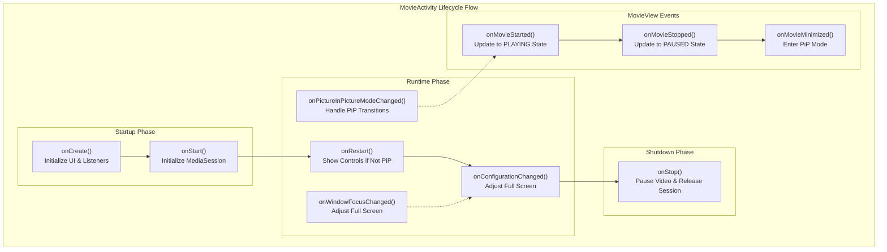

Sources: [PictureInPictureKotlin/app/src/main/java/com/example/android/pictureinpicture/MovieActivity.kt:96-114](), [PictureInPictureKotlin/app/src/main/java/com/example/android/pictureinpicture/MovieActivity.kt:116-119](), [PictureInPictureKotlin/app/src/main/java/com/example/android/pictureinpicture/MovieActivity.kt:146-152]()

## UI Layout Structure

The `movie_activity.xml` layout provides a clean, video-focused interface with the `MovieView` as the primary component and supporting controls in a scrollable area below.

### Layout Component Hierarchy

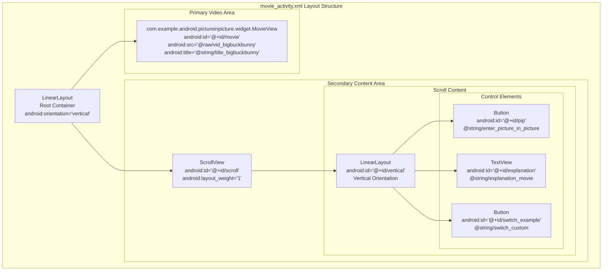

The layout adapts to orientation changes through the `adjustFullScreen()` method, which hides the scroll content in landscape mode and adjusts the `MovieView` bounds accordingly.

Sources: [PictureInPictureKotlin/app/src/main/res/layout/movie_activity.xml:17-80](), [PictureInPictureKotlin/app/src/main/java/com/example/android/pictureinpicture/MovieActivity.kt:220-233]()

---

# Page: Testing Infrastructure

# Testing Infrastructure

<details>
<summary>Relevant source files</summary>

The following files were used as context for generating this wiki page:

- [PictureInPictureKotlin/app/src/androidTest/AndroidManifest.xml](PictureInPictureKotlin/app/src/androidTest/AndroidManifest.xml)
- [PictureInPictureKotlin/app/src/androidTest/java/com/example/android/pictureinpicture/MainActivityTest.kt](PictureInPictureKotlin/app/src/androidTest/java/com/example/android/pictureinpicture/MainActivityTest.kt)
- [PictureInPictureKotlin/app/src/androidTest/java/com/example/android/pictureinpicture/MovieActivityTest.kt](PictureInPictureKotlin/app/src/androidTest/java/com/example/android/pictureinpicture/MovieActivityTest.kt)

</details>


This document covers the comprehensive testing infrastructure for the PictureInPictureKotlin sample application. The testing system focuses on UI automation and integration testing to validate Picture-in-Picture functionality, media playback behavior, and user interface interactions.

For information about the actual MainActivity and MovieActivity components being tested, see [MainActivity - Stopwatch Example](#2.1.1) and [MovieActivity - Video Playback Example](#2.1.2).

## Test Architecture Overview

The testing infrastructure uses Android's instrumentation testing framework with Espresso for UI automation. The system provides comprehensive coverage of both PiP modes and media playback scenarios.

### Testing Framework Integration

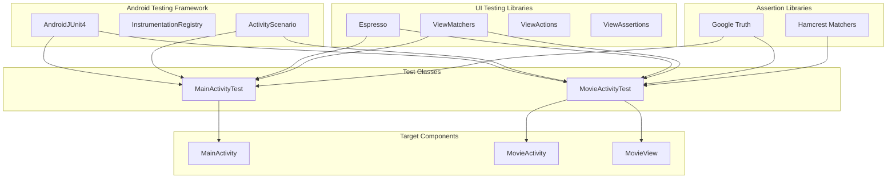

**Sources:** [PictureInPictureKotlin/app/src/androidTest/java/com/example/android/pictureinpicture/MainActivityTest.kt:1-61](), [PictureInPictureKotlin/app/src/androidTest/java/com/example/android/pictureinpicture/MovieActivityTest.kt:1-164]()

## Test Classes and Coverage

### MainActivityTest

The `MainActivityTest` class provides focused testing for the stopwatch-based PiP functionality. It validates core PiP behavior and timer operations using minimal test cases.

```mermaid
graph TB
    subgraph "MainActivityTest Structure"
        TestClass["MainActivityTest"]
        StartTest["start()"]
        PipTest["pip()"]
    end
    
    subgraph "Test Targets"
        MainActivity["MainActivity"]
        StopwatchTimer["Stopwatch Timer"]
        PipMode["PiP Mode"]
    end
    
    subgraph "UI Components"
        TimeView["R.id.time"]
        StartButton["R.id.start_or_pause"]
        PipButton["R.id.pip"]
    end
    
    TestClass --> StartTest
    TestClass --> PipTest
    
    StartTest --> StopwatchTimer
    StartTest --> TimeView
    StartTest --> StartButton
    
    PipTest --> PipMode
    PipTest --> PipButton
    PipTest --> MainActivity
```

**Key Test Methods:**

| Test Method | Purpose | Validation |
|-------------|---------|------------|
| `start()` | Validates stopwatch functionality | Timer updates from "00:00:00" when started |
| `pip()` | Tests PiP mode transition | `isInPictureInPictureMode` property changes |

**Sources:** [PictureInPictureKotlin/app/src/androidTest/java/com/example/android/pictureinpicture/MainActivityTest.kt:39-60]()

### MovieActivityTest

The `MovieActivityTest` class provides comprehensive testing for video playback scenarios, MediaSession integration, and complex PiP behavior with media controls.

```mermaid
graph TB
    subgraph "MovieActivityTest Structure"
        TestClass["MovieActivityTest"]
        PipPlayingTest["movie_playingOnPip()"]
        PauseResumeTest["movie_pauseAndResume()"]
        LandscapeTest["fullscreen_enabledOnLandscape()"]
        PortraitTest["fullscreen_disabledOnPortrait()"]
    end
    
    subgraph "Test Infrastructure"
        ActivityRule["ActivityScenarioRule"]
        CustomMatchers["Custom ViewMatchers"]
        CustomActions["Custom ViewActions"]
    end
    
    subgraph "Target Components"
        MovieActivity["MovieActivity"]
        MovieView["MovieView"]
        MediaController["MediaController"]
        PlaybackState["PlaybackStateCompat"]
    end
    
    TestClass --> ActivityRule
    TestClass --> PipPlayingTest
    TestClass --> PauseResumeTest
    TestClass --> LandscapeTest
    TestClass --> PortraitTest
    
    ActivityRule --> MovieActivity
    CustomMatchers --> MovieView
    CustomActions --> MovieView
    
    PipPlayingTest --> PlaybackState
    PauseResumeTest --> MediaController
```

**Advanced Test Features:**

| Feature | Implementation | Purpose |
|---------|----------------|---------|
| Custom Matcher | `isPlaying()` | Validates `MovieView.isPlaying` state |
| Custom Action | `showControls()` | Triggers control visibility in `MovieView` |
| MediaSession Testing | `assertMediaStateIs()` | Validates `PlaybackStateCompat` states |
| Orientation Testing | Screen rotation | Tests fullscreen behavior changes |

**Sources:** [PictureInPictureKotlin/app/src/androidTest/java/com/example/android/pictureinpicture/MovieActivityTest.kt:52-164]()

## Testing Methodology

### Picture-in-Picture Testing Strategy

The testing approach validates PiP functionality through direct activity state inspection and UI interaction patterns.

```mermaid
graph LR
    subgraph "PiP Test Flow"
        LaunchActivity["launchActivity<T>()"]
        CheckInitialState["Check Normal Mode"]
        TriggerPip["Click PiP Button"]
        ValidatePipState["Assert isInPictureInPictureMode"]
        CheckContinuity["Validate State Continuity"]
    end
    
    subgraph "State Validation"
        ActivityState["Activity.isInPictureInPictureMode"]
        ViewState["View State Preservation"]
        MediaState["MediaSession State"]
    end
    
    LaunchActivity --> CheckInitialState
    CheckInitialState --> TriggerPip
    TriggerPip --> ValidatePipState
    ValidatePipState --> CheckContinuity
    
    CheckInitialState --> ActivityState
    ValidatePipState --> ActivityState
    CheckContinuity --> ViewState
    CheckContinuity --> MediaState
```

**Sources:** [PictureInPictureKotlin/app/src/androidTest/java/com/example/android/pictureinpicture/MainActivityTest.kt:49-59](), [PictureInPictureKotlin/app/src/androidTest/java/com/example/android/pictureinpicture/MovieActivityTest.kt:56-76]()

### MediaSession Integration Testing

The test infrastructure validates MediaSession state consistency across PiP transitions and playback control interactions.

```mermaid
graph TB
    subgraph "MediaSession Test Pattern"
        InitialCheck["Check Initial Playback State"]
        UserAction["Perform UI Action"]
        StateValidation["Validate MediaController State"]
        ViewValidation["Validate View State"]
    end
    
    subgraph "State Types"
        PlayingState["STATE_PLAYING"]
        PausedState["STATE_PAUSED"]
        ViewPlaying["MovieView.isPlaying"]
    end
    
    subgraph "Test Actions"
        ToggleClick["Click R.id.toggle"]
        PipClick["Click R.id.minimize"]
        ShowControls["Custom showControls()"]
    end
    
    InitialCheck --> UserAction
    UserAction --> StateValidation
    StateValidation --> ViewValidation
    
    StateValidation --> PlayingState
    StateValidation --> PausedState
    ViewValidation --> ViewPlaying
    
    UserAction --> ToggleClick
    UserAction --> PipClick
    UserAction --> ShowControls
```

**Sources:** [PictureInPictureKotlin/app/src/androidTest/java/com/example/android/pictureinpicture/MovieActivityTest.kt:79-94](), [PictureInPictureKotlin/app/src/androidTest/java/com/example/android/pictureinpicture/MovieActivityTest.kt:126-132]()

## Test Configuration

### AndroidManifest Configuration

The test manifest defines the instrumentation testing environment with required activity declarations for the Android Test Infrastructure.

```mermaid
graph TB
    subgraph "Test Manifest Structure"
        TestManifest["androidTest/AndroidManifest.xml"]
        TestPackage["com.example.android.pictureinpicture.test"]
    end
    
    subgraph "Required Test Activities"
        BootstrapActivity["InstrumentationActivityInvoker$BootstrapActivity"]
        EmptyActivity["InstrumentationActivityInvoker$EmptyActivity"]
        EmptyFloatingActivity["InstrumentationActivityInvoker$EmptyFloatingActivity"]
    end
    
    TestManifest --> TestPackage
    TestPackage --> BootstrapActivity
    TestPackage --> EmptyActivity
    TestPackage --> EmptyFloatingActivity
```

**Sources:** [PictureInPictureKotlin/app/src/androidTest/AndroidManifest.xml:17-33]()

### Test Dependencies and Framework Integration

The testing infrastructure integrates multiple Android testing libraries with specific annotations and configurations:

| Component | Usage | Purpose |
|-----------|--------|---------|
| `@RunWith(AndroidJUnit4::class)` | Test runner configuration | Enables Android instrumentation testing |
| `@LargeTest` | Test categorization | Marks UI integration tests |
| `ActivityScenarioRule` | Activity lifecycle management | Provides controlled activity testing environment |
| `launchActivity<T>()` | Activity launching | Creates activity instances for testing |
| `InstrumentationRegistry` | Test synchronization | Manages test execution timing |

**Sources:** [PictureInPictureKotlin/app/src/androidTest/java/com/example/android/pictureinpicture/MainActivityTest.kt:35-37](), [PictureInPictureKotlin/app/src/androidTest/java/com/example/android/pictureinpicture/MovieActivityTest.kt:48-53]()

---

# Page: Build Configuration

# Build Configuration

<details>
<summary>Relevant source files</summary>

The following files were used as context for generating this wiki page:

- [PictureInPictureKotlin/app/build.gradle](PictureInPictureKotlin/app/build.gradle)
- [PictureInPictureKotlin/build.gradle](PictureInPictureKotlin/build.gradle)
- [PictureInPictureKotlin/gradle/wrapper/gradle-wrapper.jar](PictureInPictureKotlin/gradle/wrapper/gradle-wrapper.jar)
- [PictureInPictureKotlin/gradle/wrapper/gradle-wrapper.properties](PictureInPictureKotlin/gradle/wrapper/gradle-wrapper.properties)
- [PictureInPictureKotlin/gradlew](PictureInPictureKotlin/gradlew)
- [PictureInPictureKotlin/gradlew.bat](PictureInPictureKotlin/gradlew.bat)

</details>


This document covers the Gradle build configuration for the PictureInPictureKotlin sample application, including project structure, Android configuration, dependency management, and build tooling setup. For information about the repository-wide build system infrastructure, see [Build System and CI/CD](#5).

## Project Structure

The PictureInPictureKotlin sample follows a standard single-module Android project structure with a root-level build script and an app module build script.

```mermaid
graph TB
    subgraph "Project Structure"
        RootBuild["build.gradle<br/>(Root Level)"]
        AppBuild["app/build.gradle<br/>(App Module)"]
        GradleWrapper["gradle/wrapper/<br/>gradle-wrapper.properties"]
        GradleScript["gradlew / gradlew.bat<br/>(Wrapper Scripts)"]
    end
    
    RootBuild --> AppBuild
    GradleWrapper --> RootBuild
    GradleScript --> GradleWrapper
    
    subgraph "Build Configuration Elements"
        BuildScript["buildscript"]
        AllProjects["allprojects"]
        CleanTask["clean task"]
    end
    
    RootBuild --> BuildScript
    RootBuild --> AllProjects
    RootBuild --> CleanTask
```

**Sources:** [PictureInPictureKotlin/build.gradle:1-39](), [PictureInPictureKotlin/app/build.gradle:1-72]()

## Gradle Configuration

### Root Build Script

The root `build.gradle` establishes the foundational build configuration:

| Configuration | Value | Purpose |
|---------------|-------|---------|
| `kotlin_version` | `1.8.0` | Kotlin language version |
| Repositories | `google()`, `mavenCentral()` | Dependency sources |
| AGP Version | `7.4.2` | Android Gradle Plugin version |

```mermaid
graph LR
    subgraph "buildscript Configuration"
        Repositories["google()<br/>mavenCentral()"]
        KotlinVersion["kotlin_version = '1.8.0'"]
        Dependencies["kotlin-gradle-plugin<br/>android-gradle-plugin"]
    end
    
    subgraph "allprojects Configuration"  
        AllRepos["google()<br/>mavenCentral()"]
    end
    
    Repositories --> Dependencies
    KotlinVersion --> Dependencies
```

**Sources:** [PictureInPictureKotlin/build.gradle:17-34]()

### Gradle Wrapper

The project uses Gradle Wrapper version 7.5 to ensure consistent build environments:

| Property | Value |
|----------|-------|
| `distributionUrl` | `gradle-7.5-bin.zip` |
| `distributionBase` | `GRADLE_USER_HOME` |
| `zipStoreBase` | `GRADLE_USER_HOME` |

**Sources:** [PictureInPictureKotlin/gradle/wrapper/gradle-wrapper.properties:1-6](), [PictureInPictureKotlin/gradlew:1-235](), [PictureInPictureKotlin/gradlew.bat:1-90]()

## Android Configuration

### SDK and Version Configuration

The app module defines the Android build configuration with modern API levels:

```mermaid
graph TB
    subgraph "Android Configuration"
        CompileSDK["compileSdkVersion 33"]
        MinSDK["minSdkVersion 31"]  
        TargetSDK["targetSdkVersion 33"]
        AppId["applicationId<br/>com.example.android.pictureinpicture"]
        Version["versionCode 1<br/>versionName '1.0'"]
    end
    
    subgraph "Build Features"
        ViewBinding["viewBinding true"]
        TestRunner["testInstrumentationRunner<br/>AndroidJUnitRunner"]
    end
    
    CompileSDK --> ViewBinding
    MinSDK --> TestRunner
```

**Sources:** [PictureInPictureKotlin/app/build.gradle:20-32]()

### Build Types and Compilation

The build configuration includes release optimization settings and Java/Kotlin compatibility:

| Setting | Configuration |
|---------|---------------|
| Release minification | `minifyEnabled false` |
| ProGuard files | `proguard-android.txt`, `proguard-rules.pro` |
| Java compatibility | `JavaVersion.VERSION_1_8` |
| Kotlin JVM target | `'1.8'` |

**Sources:** [PictureInPictureKotlin/app/build.gradle:33-46]()

## Dependency Management

### Core Dependencies

The project includes essential Android and Kotlin dependencies:

```mermaid
graph TB
    subgraph "Kotlin Dependencies"
        KotlinStdlib["kotlin-stdlib-jdk7"]
        Coroutines["kotlinx-coroutines-android"]
    end
    
    subgraph "AndroidX Libraries"
        CoreKtx["core-ktx:1.9.0"]
        AppCompat["appcompat:1.6.1"] 
        ActivityKtx["activity-ktx:1.6.1"]
        Media["media:1.6.0"]
        ConstraintLayout["constraintlayout:2.1.4"]
    end
    
    subgraph "Lifecycle Components"
        ViewModel["lifecycle-viewmodel-ktx"]
        LiveData["lifecycle-livedata-ktx"]
        LifecycleVersion["2.6.0"]
    end
    
    LifecycleVersion --> ViewModel
    LifecycleVersion --> LiveData
```

**Sources:** [PictureInPictureKotlin/app/build.gradle:48-63]()

### Testing Dependencies

The project includes comprehensive testing libraries for unit and instrumentation testing:

| Testing Library | Version | Purpose |
|-----------------|---------|---------|
| `junit:junit` | `4.13.2` | Unit testing framework |
| `truth` | `1.1.3` | Assertion library |
| `androidx.test:core-ktx` | `1.5.0` | Android test core |
| `androidx.test:runner` | `1.5.2` | Test runner |
| `androidx.test:rules` | `1.5.0` | Test rules |
| `androidx.test.ext:junit` | `1.1.5` | JUnit extensions |
| `espresso-core` | `3.5.1` | UI testing |

**Sources:** [PictureInPictureKotlin/app/build.gradle:64-71]()

## Build Features

### View Binding

The project enables Android View Binding for type-safe view references:

```mermaid
graph LR
    BuildFeatures["buildFeatures"]
    ViewBinding["viewBinding true"]
    
    BuildFeatures --> ViewBinding
```

This feature generates binding classes for XML layouts, providing compile-time safety for view access.

**Sources:** [PictureInPictureKotlin/app/build.gradle:30-32]()

### Plugin Configuration

The app module applies essential Android and Kotlin plugins:

```mermaid
graph TB
    Plugins["Applied Plugins"]
    AndroidApp["com.android.application"]
    KotlinAndroid["kotlin-android"]
    
    Plugins --> AndroidApp
    Plugins --> KotlinAndroid
```

**Sources:** [PictureInPictureKotlin/app/build.gradle:17-18]()

## Version Management

### Dependency Versions

The build scripts use consistent versioning strategies:

| Component | Version Strategy |
|-----------|------------------|
| Kotlin | Centralized via `kotlin_version` variable |
| Lifecycle | Centralized via `lifecycle_version` variable |
| AndroidX | Explicit version declarations |
| Testing | Latest stable versions |

**Sources:** [PictureInPictureKotlin/build.gradle:22](), [PictureInPictureKotlin/app/build.gradle:58]()

---

# Page: PictureInPicture (Java)

# PictureInPicture (Java)

<details>
<summary>Relevant source files</summary>

The following files were used as context for generating this wiki page:

- [PictureInPicture/app/build.gradle](PictureInPicture/app/build.gradle)
- [PictureInPicture/app/src/androidTest/java/com/example/android/pictureinpicture/MainActivityTest.java](PictureInPicture/app/src/androidTest/java/com/example/android/pictureinpicture/MainActivityTest.java)
- [PictureInPicture/app/src/androidTest/java/com/example/android/pictureinpicture/MediaSessionPlaybackActivityTest.java](PictureInPicture/app/src/androidTest/java/com/example/android/pictureinpicture/MediaSessionPlaybackActivityTest.java)
- [PictureInPicture/app/src/main/java/com/example/android/pictureinpicture/MainActivity.java](PictureInPicture/app/src/main/java/com/example/android/pictureinpicture/MainActivity.java)
- [PictureInPicture/app/src/main/java/com/example/android/pictureinpicture/MediaSessionPlaybackActivity.java](PictureInPicture/app/src/main/java/com/example/android/pictureinpicture/MediaSessionPlaybackActivity.java)
- [PictureInPicture/app/src/main/java/com/example/android/pictureinpicture/widget/MovieView.java](PictureInPicture/app/src/main/java/com/example/android/pictureinpicture/widget/MovieView.java)
- [PictureInPicture/build.gradle](PictureInPicture/build.gradle)
- [PictureInPicture/gradle/wrapper/gradle-wrapper.properties](PictureInPicture/gradle/wrapper/gradle-wrapper.properties)

</details>


This document covers the Java-based Picture-in-Picture sample application, which demonstrates two different approaches for implementing Picture-in-Picture functionality on Android. This sample provides both `RemoteAction`-based controls and `MediaSession`-based integration patterns for PiP mode.

For the Kotlin-based implementation with more comprehensive features, see [PictureInPictureKotlin](#2.1).

## Architecture Overview

The Java PiP sample implements a dual-approach architecture with two separate activities demonstrating different PiP integration patterns, sharing a common custom video widget.

```mermaid
graph TB
    subgraph "PictureInPicture Java Sample"
        MainActivity["MainActivity<br/>RemoteAction PiP Demo"]
        MediaSessionActivity["MediaSessionPlaybackActivity<br/>MediaSession PiP Demo"]
        MovieView["MovieView<br/>Custom Video Widget"]
        
        subgraph "Android Framework"
            PiPParams["PictureInPictureParams"]
            RemoteAction["RemoteAction"]
            MediaSession["MediaSessionCompat"]
            BroadcastReceiver["BroadcastReceiver"]
        end
        
        subgraph "Testing"
            MainActivityTest["MainActivityTest"]
            MediaSessionTest["MediaSessionPlaybackActivityTest"]
        end
    end
    
    MainActivity --> MovieView
    MainActivity --> PiPParams
    MainActivity --> RemoteAction
    MainActivity --> BroadcastReceiver
    
    MediaSessionActivity --> MovieView
    MediaSessionActivity --> PiPParams
    MediaSessionActivity --> MediaSession
    
    MainActivityTest --> MainActivity
    MediaSessionTest --> MediaSessionActivity
    
    MovieView --> MediaPlayer["MediaPlayer"]
```

**Sources:** [PictureInPicture/app/src/main/java/com/example/android/pictureinpicture/MainActivity.java:1-330](), [PictureInPicture/app/src/main/java/com/example/android/pictureinpicture/MediaSessionPlaybackActivity.java:1-344](), [PictureInPicture/app/src/main/java/com/example/android/pictureinpicture/widget/MovieView.java:1-545]()

## MainActivity - RemoteAction Implementation

The `MainActivity` class demonstrates Picture-in-Picture using `RemoteAction` components, providing custom controls that appear as action buttons in the PiP window.

### PiP Control Flow

```mermaid
graph TB
    subgraph "MainActivity PiP Flow"
        onCreate["onCreate()<br/>Initialize UI & Listeners"] 
        minimize["minimize()<br/>Enter PiP Mode"]
        onPiPChanged["onPictureInPictureModeChanged()<br/>Handle Mode Transitions"]
        
        subgraph "RemoteAction System"
            updateActions["updatePictureInPictureActions()<br/>Configure PiP Controls"]
            broadcastReceiver["BroadcastReceiver<br/>Handle Control Events"]
            pendingIntent["PendingIntent<br/>ACTION_MEDIA_CONTROL"]
        end
        
        subgraph "MovieView Integration"
            movieListener["MovieListener callbacks"]
            playbackControl["Play/Pause/FF/Rewind"]
        end
    end
    
    onCreate --> movieListener
    movieListener --> updateActions
    minimize --> updateActions
    updateActions --> pendingIntent
    onPiPChanged --> broadcastReceiver
    broadcastReceiver --> playbackControl
```

**Sources:** [PictureInPicture/app/src/main/java/com/example/android/pictureinpicture/MainActivity.java:153-190](), [PictureInPicture/app/src/main/java/com/example/android/pictureinpicture/MainActivity.java:246-283](), [PictureInPicture/app/src/main/java/com/example/android/pictureinpicture/MainActivity.java:288-298]()

### Key Implementation Details

| Component | Purpose | Code Location |
|-----------|---------|---------------|
| `ACTION_MEDIA_CONTROL` | Intent action for PiP control events | [MainActivity.java:54]() |
| `mPictureInPictureParamsBuilder` | Builder for PiP configuration | [MainActivity.java:89-90]() |
| `updatePictureInPictureActions()` | Updates RemoteAction buttons | [MainActivity.java:153-190]() |
| `minimize()` | Enters PiP mode with aspect ratio calculation | [MainActivity.java:288-298]() |

The activity registers a `BroadcastReceiver` when entering PiP mode to handle control events:

```mermaid
sequenceDiagram
    participant User
    participant PiPWindow as "PiP Window"
    participant MainActivity
    participant BroadcastReceiver
    participant MovieView
    
    User->>PiPWindow: Click Play/Pause
    PiPWindow->>MainActivity: ACTION_MEDIA_CONTROL Intent
    MainActivity->>BroadcastReceiver: onReceive()
    BroadcastReceiver->>MovieView: play() or pause()
    MovieView-->>MainActivity: MovieListener callback
    MainActivity->>PiPWindow: updatePictureInPictureActions()
```

**Sources:** [PictureInPicture/app/src/main/java/com/example/android/pictureinpicture/MainActivity.java:251-273]()

## MediaSessionPlaybackActivity - MediaSession Integration

The `MediaSessionPlaybackActivity` demonstrates a different approach using `MediaSessionCompat` for PiP integration, providing system-level media controls.

### MediaSession Architecture

```mermaid
graph TB
    subgraph "MediaSessionPlaybackActivity"
        initMediaSession["initializeMediaSession()<br/>Setup MediaSession"]
        mediaSessionCallback["MediaSessionCallback<br/>Handle Media Commands"]
        updatePlaybackState["updatePlaybackState()<br/>Sync Media State"]
        
        subgraph "MediaSession Components"
            mediaSession["MediaSessionCompat"]
            playbackState["PlaybackStateCompat"]
            mediaMetadata["MediaMetadataCompat"]
            mediaController["MediaControllerCompat"]
        end
        
        subgraph "Playlist Simulation"
            playlistLogic["Playlist Navigation Logic"]
            actionFiltering["Dynamic Action Filtering"]
        end
    end
    
    initMediaSession --> mediaSession
    mediaSession --> playbackState
    mediaSession --> mediaMetadata
    mediaSession --> mediaController
    mediaSessionCallback --> playlistLogic
    playlistLogic --> actionFiltering
    actionFiltering --> updatePlaybackState
```

**Sources:** [PictureInPicture/app/src/main/java/com/example/android/pictureinpicture/MediaSessionPlaybackActivity.java:136-158](), [PictureInPicture/app/src/main/java/com/example/android/pictureinpicture/MediaSessionPlaybackActivity.java:267-334]()

### MediaSession Callback Implementation

The `MediaSessionCallback` inner class simulates a playlist with dynamic action availability:

| Callback Method | Function | Implementation |
|----------------|----------|----------------|
| `onPlay()` | Resume playback | [MediaSessionPlaybackActivity.java:280-283]() |
| `onPause()` | Pause playback | [MediaSessionPlaybackActivity.java:286-289]() |
| `onSkipToNext()` | Navigate playlist forward | [MediaSessionPlaybackActivity.java:292-311]() |
| `onSkipToPrevious()` | Navigate playlist backward | [MediaSessionPlaybackActivity.java:314-333]() |

**Sources:** [PictureInPicture/app/src/main/java/com/example/android/pictureinpicture/MediaSessionPlaybackActivity.java:267-334]()

## MovieView Custom Widget

The `MovieView` class provides a reusable video playback component with built-in controls, used by both activity implementations.

### MovieView Component Structure

```mermaid
graph TB
    subgraph "MovieView Components"
        surfaceView["SurfaceView<br/>Video Display"]
        mediaPlayer["MediaPlayer<br/>Playback Engine"]
        
        subgraph "Control UI"
            toggleButton["ImageButton toggle<br/>Play/Pause"]
            fastForward["ImageButton fast_forward"]
            fastRewind["ImageButton fast_rewind"]
            minimize["ImageButton minimize"]
            shade["View shade<br/>Control Background"]
        end
        
        subgraph "State Management"
            movieListener["MovieListener<br/>Event Callbacks"]
            timeoutHandler["TimeoutHandler<br/>Auto-hide Controls"]
            adjustViewBounds["Aspect Ratio Management"]
        end
    end
    
    mediaPlayer --> surfaceView
    toggleButton --> mediaPlayer
    fastForward --> mediaPlayer
    fastRewind --> mediaPlayer
    minimize --> movieListener
    timeoutHandler --> shade
```

**Sources:** [PictureInPicture/app/src/main/java/com/example/android/pictureinpicture/widget/MovieView.java:92-104](), [PictureInPicture/app/src/main/java/com/example/android/pictureinpicture/widget/MovieView.java:125-131]()

### MovieView Lifecycle Integration

The widget integrates with both PiP activities through the `MovieListener` interface:

```mermaid
sequenceDiagram
    participant Activity
    participant MovieView
    participant MediaPlayer
    participant MovieListener
    
    Activity->>MovieView: setMovieListener()
    MovieView->>MediaPlayer: start()
    MediaPlayer-->>MovieView: onPrepared()
    MovieView->>MovieListener: onMovieStarted()
    MovieListener-->>Activity: Update PiP actions
    
    Note over MovieView: User clicks minimize
    MovieView->>MovieListener: onMovieMinimized()
    MovieListener-->>Activity: minimize()
    Activity->>MovieView: hideControls()
```

**Sources:** [PictureInPicture/app/src/main/java/com/example/android/pictureinpicture/widget/MovieView.java:56-75](), [PictureInPicture/app/src/main/java/com/example/android/pictureinpicture/widget/MovieView.java:119-142]()

## Testing Infrastructure

Both activities include comprehensive test coverage using Espresso for UI testing and media state validation.

### Test Architecture

```mermaid
graph TB
    subgraph "Test Classes"
        mainTest["MainActivityTest<br/>RemoteAction Testing"]
        mediaTest["MediaSessionPlaybackActivityTest<br/>MediaSession Testing"]
        
        subgraph "Test Methods"
            pipTest["movie_playingOnPip()<br/>PiP Mode Validation"]
            playPauseTest["movie_pauseAndResume()<br/>Playback Control"]  
            fullscreenTest["fullscreen_enabledOnLandscape()<br/>UI Orientation"]
            mediaStateTest["assertMediaStateIs()<br/>MediaSession State"]
        end
        
        subgraph "Test Helpers"
            isPlaying["isPlaying() Matcher<br/>Custom MovieView Matcher"]
            showControls["showControls() ViewAction<br/>UI Interaction Helper"]
        end
    end
    
    mainTest --> pipTest
    mainTest --> playPauseTest
    mainTest --> fullscreenTest
    mainTest --> isPlaying
    mainTest --> showControls
    
    mediaTest --> pipTest
    mediaTest --> playPauseTest  
    mediaTest --> fullscreenTest
    mediaTest --> mediaStateTest
    mediaTest --> isPlaying
    mediaTest --> showControls
```

**Sources:** [PictureInPicture/app/src/androidTest/java/com/example/android/pictureinpicture/MainActivityTest.java:61-79](), [PictureInPicture/app/src/androidTest/java/com/example/android/pictureinpicture/MediaSessionPlaybackActivityTest.java:66-86](), [PictureInPicture/app/src/androidTest/java/com/example/android/pictureinpicture/MainActivityTest.java:129-141]()

### Key Test Validations

| Test Category | MainActivity | MediaSessionPlaybackActivity |
|---------------|--------------|------------------------------|
| PiP Mode Entry | `isInPictureInPictureMode()` validation | Same + MediaSession state check |
| Playback Control | Direct `MovieView` state checking | MediaSession `PlaybackState` validation |
| Orientation Handling | Window insets verification | Same implementation |
| Control Interaction | Espresso UI interactions | Same + media session callbacks |

**Sources:** [PictureInPicture/app/src/androidTest/java/com/example/android/pictureinpicture/MainActivityTest.java:82-93](), [PictureInPicture/app/src/androidTest/java/com/example/android/pictureinpicture/MediaSessionPlaybackActivityTest.java:140-149]()

## Build Configuration

The Java PiP sample uses a standard Android Gradle configuration with media-specific dependencies.

### Dependencies and SDK Requirements

| Component | Version | Purpose |
|-----------|---------|---------|
| `compileSdkVersion` | 30 | Target Android API level |
| `minSdkVersion` | 26 | PiP requires Android 8.0+ |
| `androidx.core:core` | 1.5.0-beta03 | Core AndroidX functionality |
| `androidx.media:media` | 1.2.1 | MediaSession support |
| Gradle Plugin | 4.2.2 | Android build tools |

**Sources:** [PictureInPicture/app/build.gradle:20-28](), [PictureInPicture/app/build.gradle:41-45](), [PictureInPicture/build.gradle:23]()

The project structure follows the standard multi-module Gradle pattern with root-level configuration and app-specific build settings.

**Sources:** [PictureInPicture/build.gradle:17-36](), [PictureInPicture/gradle/wrapper/gradle-wrapper.properties:1-6]()

---

# Page: VideoPlayer Sample

# VideoPlayer Sample

<details>
<summary>Relevant source files</summary>

The following files were used as context for generating this wiki page:

- [VideoPlayer/videoplayerapp/build.gradle](VideoPlayer/videoplayerapp/build.gradle)
- [VideoPlayer/videoplayerapp/src/main/java/com/example/android/videoplayersample/MediaCatalog.kt](VideoPlayer/videoplayerapp/src/main/java/com/example/android/videoplayersample/MediaCatalog.kt)
- [VideoPlayer/videoplayerapp/src/main/java/com/example/android/videoplayersample/Player.kt](VideoPlayer/videoplayerapp/src/main/java/com/example/android/videoplayersample/Player.kt)
- [VideoPlayer/videoplayerapp/src/main/java/com/example/android/videoplayersample/VideoActivity.kt](VideoPlayer/videoplayerapp/src/main/java/com/example/android/videoplayersample/VideoActivity.kt)

</details>


This document covers the VideoPlayer sample application, which demonstrates ExoPlayer integration with MediaSession support, audio focus management, and Picture-in-Picture functionality. The sample showcases best practices for building a video player that properly integrates with the Android media system.

For Picture-in-Picture implementation details specific to the PictureInPictureKotlin sample, see [PictureInPictureKotlin](#2.1). For audio focus management implementation details, see [Audio Focus Management](#3.1).

## Architecture Overview

The VideoPlayer sample follows a layered architecture with clear separation between UI management, player lifecycle, and media session integration. The core components work together to provide a complete video playback experience.

### System Architecture

```mermaid
graph TB
    subgraph "VideoPlayer Sample Architecture"
        VideoActivity["VideoActivity<br/>Main UI Controller"]
        PlayerHolder["PlayerHolder<br/>ExoPlayer Lifecycle Manager"]
        MediaCatalog["MediaCatalog<br/>Media Metadata Provider"]
        
        subgraph "ExoPlayer Integration"
            ExoPlayer["ExoPlayer<br/>Core Player Instance"]
            AudioFocusWrapper["AudioFocusWrapper<br/>Audio Focus Manager"]
            PlayerView["PlayerView<br/>UI Rendering"]
        end
        
        subgraph "Android Media Framework"
            MediaSession["MediaSessionCompat<br/>System Integration"]  
            MediaSessionConnector["MediaSessionConnector<br/>ExoPlayer Bridge"]
            PiPParams["PictureInPictureParams<br/>PiP Configuration"]
        end
        
        subgraph "Media Sources"
            ConcatenatingMediaSource["ConcatenatingMediaSource<br/>Playlist Manager"]
            ExtractorMediaSource["ExtractorMediaSource<br/>Individual Media Items"]
        end
    end
    
    VideoActivity --> PlayerHolder
    VideoActivity --> MediaSession
    VideoActivity --> PiPParams
    
    PlayerHolder --> ExoPlayer
    PlayerHolder --> AudioFocusWrapper
    PlayerHolder --> PlayerView
    PlayerHolder --> ConcatenatingMediaSource
    
    MediaSession --> MediaSessionConnector
    MediaSessionConnector --> AudioFocusWrapper
    
    ConcatenatingMediaSource --> ExtractorMediaSource
    MediaCatalog --> ConcatenatingMediaSource
    
    AudioFocusWrapper --> ExoPlayer
```

Sources: [VideoPlayer/videoplayerapp/src/main/java/com/example/android/videoplayersample/VideoActivity.kt:1-143](), [VideoPlayer/videoplayerapp/src/main/java/com/example/android/videoplayersample/Player.kt:1-163]()

## Core Components

### VideoActivity

The `VideoActivity` class serves as the main controller, orchestrating player lifecycle, MediaSession management, and Picture-in-Picture functionality. It implements proper Android lifecycle management to ensure resources are handled correctly.

| Lifecycle Method | Player Action | MediaSession Action |
|------------------|---------------|-------------------|
| `onCreate()` | Create player instance | Create MediaSession |
| `onStart()` | Start playback | Activate MediaSession |
| `onStop()` | Stop and save state | Deactivate MediaSession |
| `onDestroy()` | Release resources | Release MediaSession |

Key responsibilities include:
- **Player Management**: Creates and manages `PlayerHolder` instance [VideoPlayer/videoplayerapp/src/main/java/com/example/android/videoplayersample/VideoActivity.kt:109-123]()
- **MediaSession Integration**: Handles MediaSession lifecycle and connector setup [VideoPlayer/videoplayerapp/src/main/java/com/example/android/videoplayersample/VideoActivity.kt:76-106]()
- **Picture-in-Picture**: Implements PiP mode transitions [VideoPlayer/videoplayerapp/src/main/java/com/example/android/videoplayersample/VideoActivity.kt:126-141]()

### PlayerHolder

The `PlayerHolder` class encapsulates ExoPlayer instance management and provides a clean interface for the activity. It handles player state persistence and audio focus integration.

```mermaid
graph LR
    subgraph "PlayerHolder Responsibilities"
        StateManagement["PlayerState<br/>window, position, whenReady"]
        MediaSources["buildMediaSource()<br/>ConcatenatingMediaSource"]
        AudioFocus["audioFocusPlayer<br/>AudioFocusWrapper"]
        Lifecycle["start(), stop(), release()"]
    end
    
    StateManagement --> Lifecycle
    MediaSources --> AudioFocus  
    AudioFocus --> Lifecycle
```

The `PlayerState` data class maintains playback state across lifecycle transitions:
```kotlin
data class PlayerState(var window: Int = 0,
                       var position: Long = 0, 
                       var whenReady: Boolean = true)
```

Sources: [VideoPlayer/videoplayerapp/src/main/java/com/example/android/videoplayersample/Player.kt:41-43](), [VideoPlayer/videoplayerapp/src/main/java/com/example/android/videoplayersample/Player.kt:45-64]()

## MediaSession Integration

The sample demonstrates proper MediaSession integration using ExoPlayer's MediaSession extension. The `MediaSessionConnector` bridges ExoPlayer with the Android media framework.

### MediaSession Setup Flow

```mermaid
sequenceDiagram
    participant VA as "VideoActivity"
    participant MS as "MediaSessionCompat" 
    participant MSC as "MediaSessionConnector"
    participant QN as "TimelineQueueNavigator"
    participant AFP as "audioFocusPlayer"
    
    VA->>MS: createMediaSession()
    VA->>MSC: createMediaSessionConnector()
    VA->>QN: setQueueNavigator()
    Note over QN: Provides MediaDescriptionCompat<br/>for each playlist item
    VA->>MSC: setPlayer(audioFocusPlayer)
    VA->>MS: isActive = true
```

The `TimelineQueueNavigator` provides media descriptions for playlist navigation, enabling skip previous/next actions in Picture-in-Picture mode [VideoPlayer/videoplayerapp/src/main/java/com/example/android/videoplayersample/VideoActivity.kt:83-87]().

Sources: [VideoPlayer/videoplayerapp/src/main/java/com/example/android/videoplayersample/VideoActivity.kt:76-88](), [VideoPlayer/videoplayerapp/src/main/java/com/example/android/videoplayersample/VideoActivity.kt:92-106]()

## Picture-in-Picture Functionality  

The sample implements Picture-in-Picture mode with proper aspect ratio handling and UI state management. PiP mode is triggered automatically when the user leaves the app during video playback.

### PiP Implementation Details

| Method | Purpose | Key Implementation |
|--------|---------|-------------------|
| `onUserLeaveHint()` | Trigger PiP entry | Sets 16:9 aspect ratio with `Rational(16, 9)` |
| `onPictureInPictureModeChanged()` | Handle PiP state changes | Hides/shows player controls via `useController` |

The PiP configuration uses a standard 16:9 aspect ratio suitable for most video content [VideoPlayer/videoplayerapp/src/main/java/com/example/android/videoplayersample/VideoActivity.kt:129-134]().

Sources: [VideoPlayer/videoplayerapp/src/main/java/com/example/android/videoplayersample/VideoActivity.kt:126-141]()

## Media Catalog System

The `MediaCatalog` provides a predefined set of sample videos for demonstration purposes. Each media item is defined using `MediaDescriptionCompat` with complete metadata.

### Catalog Structure

```mermaid
graph TB
    subgraph "mediaCatalog List"
        Item1["MediaDescriptionCompat<br/>ID: '1'<br/>Big Buck Bunny<br/>MP4 over HTTP"]
        Item2["MediaDescriptionCompat<br/>ID: '2'<br/>Elephants Dream<br/>MP4 over HTTP"] 
        Item3["MediaDescriptionCompat<br/>ID: '3'<br/>Tears of Steel<br/>MOV over HTTP"]
    end
    
    subgraph "Media Sources"
        BlenderPeach["Blender Peach<br/>BigBuckBunny_320x180.mp4"]
        ArchiveOrg["Archive.org<br/>ed_hd.mp4"]
        BlenderMango["Blender Mango<br/>ToS-4k-1920.mov"]
    end
    
    Item1 --> BlenderPeach
    Item2 --> ArchiveOrg
    Item3 --> BlenderMango
```

Each catalog entry includes:
- **Media ID**: Unique identifier for playlist navigation
- **Title/Subtitle**: Display metadata for UI and MediaSession
- **Description**: Technical details about the media format
- **Media URI**: HTTP URL to the video file with proper licensing

Sources: [VideoPlayer/videoplayerapp/src/main/java/com/example/android/videoplayersample/MediaCatalog.kt:25-53]()

## Dependencies and Build Configuration

The sample uses specific ExoPlayer version 2.7.0 with MediaSession extension support. The build configuration demonstrates proper dependency management for ExoPlayer-based applications.

### Key Dependencies

| Dependency | Version | Purpose |
|------------|---------|---------|
| `exoplayer-core` | 2.7.0 | Core player functionality |
| `exoplayer-ui` | 2.7.0 | PlayerView UI components |
| `extension-mediasession` | 2.7.0 | MediaSession integration |

The sample targets API level 29 with minimum SDK 21, providing broad device compatibility while using modern Android features [VideoPlayer/videoplayerapp/build.gradle:21-29]().

Sources: [VideoPlayer/videoplayerapp/build.gradle:32-47](), [VideoPlayer/videoplayerapp/build.gradle:21-29]()

---

# Page: Audio Focus Management

# Audio Focus Management

<details>
<summary>Relevant source files</summary>

The following files were used as context for generating this wiki page:

- [VideoPlayer/videoplayerapp/src/main/java/com/example/android/videoplayersample/AudioFocusWrapper.kt](VideoPlayer/videoplayerapp/src/main/java/com/example/android/videoplayersample/AudioFocusWrapper.kt)

</details>


## Purpose and Scope

This document covers the audio focus management system implemented in the VideoPlayer sample application. The system provides automatic audio focus handling for media playback applications, ensuring proper integration with the Android audio system and other audio-enabled applications.

The audio focus management is specifically implemented through the `AudioFocusWrapper` class, which wraps ExoPlayer instances to provide seamless audio focus request and abandonment functionality. For information about the broader VideoPlayer sample architecture, see [VideoPlayer Sample](#3).

## System Overview

The audio focus management system is centered around the `AudioFocusWrapper` class, which acts as a proxy for `SimpleExoPlayer` while automatically handling audio focus lifecycle management. The wrapper implements the delegation pattern to transparently add audio focus capabilities to any ExoPlayer instance.

```mermaid
graph TB
    subgraph "Audio Focus Management System"
        AudioFocusWrapper["AudioFocusWrapper<br/>Delegates to SimpleExoPlayer<br/>Handles audio focus lifecycle"]
        SimpleExoPlayer["SimpleExoPlayer<br/>Underlying media player"]
        AudioManager["AudioManager<br/>System audio service"]
        
        subgraph "Focus Change Handling"
            AudioFocusListener["audioFocusListener<br/>OnAudioFocusChangeListener"]
            FocusGain["AUDIOFOCUS_GAIN<br/>Resume playback at full volume"]
            FocusLossTransient["AUDIOFOCUS_LOSS_TRANSIENT<br/>Pause playback temporarily"]
            FocusLossDuck["AUDIOFOCUS_LOSS_TRANSIENT_CAN_DUCK<br/>Lower volume to 20%"]
            FocusLoss["AUDIOFOCUS_LOSS<br/>Abandon focus permanently"]
        end
        
        subgraph "API Version Handling"
            OreoPlus["Android O+ (API 26+)<br/>AudioFocusRequest"]
            PreOreo["Pre-Android O<br/>Legacy AudioManager methods"]
        end
    end
    
    AudioFocusWrapper --> SimpleExoPlayer
    AudioFocusWrapper --> AudioManager
    AudioFocusWrapper --> AudioFocusListener
    
    AudioFocusListener --> FocusGain
    AudioFocusListener --> FocusLossTransient
    AudioFocusListener --> FocusLossDuck
    AudioFocusListener --> FocusLoss
    
    AudioFocusWrapper --> OreoPlus
    AudioFocusWrapper --> PreOreo
```

**Sources:** [VideoPlayer/videoplayerapp/src/main/java/com/example/android/videoplayersample/AudioFocusWrapper.kt:31-38]()

## AudioFocusWrapper Class Architecture

The `AudioFocusWrapper` class implements the delegation pattern by implementing `ExoPlayer` interface and delegating all calls to the underlying `SimpleExoPlayer` instance, except for `setPlayWhenReady()` which is overridden to handle audio focus management.

```mermaid
graph LR
    subgraph "Class Structure"
        Client["Client Code<br/>Calls ExoPlayer methods"]
        AudioFocusWrapper["AudioFocusWrapper<br/>implements ExoPlayer by player<br/>Overrides setPlayWhenReady()"]
        SimpleExoPlayer["SimpleExoPlayer<br/>Actual implementation"]
        
        subgraph "Constructor Dependencies"
            AudioAttributesCompat["AudioAttributesCompat<br/>Audio stream characteristics"]
            AudioManager["AudioManager<br/>System audio service"]
        end
        
        subgraph "Internal State"
            shouldPlayWhenReady["shouldPlayWhenReady: Boolean<br/>Tracks intended playback state"]
            audioFocusListener["audioFocusListener<br/>Handles focus change events"]
            audioFocusRequest["audioFocusRequest<br/>Android O+ focus request object"]
        end
    end
    
    Client --> AudioFocusWrapper
    AudioFocusWrapper --> SimpleExoPlayer
    AudioAttributesCompat --> AudioFocusWrapper
    AudioManager --> AudioFocusWrapper
    
    AudioFocusWrapper --> shouldPlayWhenReady
    AudioFocusWrapper --> audioFocusListener
    AudioFocusWrapper --> audioFocusRequest
```

**Sources:** [VideoPlayer/videoplayerapp/src/main/java/com/example/android/videoplayersample/AudioFocusWrapper.kt:36-39](), [VideoPlayer/videoplayerapp/src/main/java/com/example/android/videoplayersample/AudioFocusWrapper.kt:65-66]()

## Audio Focus Change Handling

The system responds to different types of audio focus changes by implementing specific behaviors for each focus change type. The focus change listener handles four main scenarios:

| Focus Change Type | Behavior | Volume Level | Playback State |
|------------------|----------|--------------|----------------|
| `AUDIOFOCUS_GAIN` | Resume playback | Full volume (1.0f) | Play if should play |
| `AUDIOFOCUS_LOSS_TRANSIENT_CAN_DUCK` | Continue playing | Duck volume (0.2f) | Continue playing |
| `AUDIOFOCUS_LOSS_TRANSIENT` | Pause temporarily | N/A | Pause |
| `AUDIOFOCUS_LOSS` | Stop permanently | N/A | Stop and abandon focus |

```mermaid
stateDiagram-v2
    [*] --> NoFocus: "Initial state"
    NoFocus --> RequestingFocus: "setPlayWhenReady(true)"
    RequestingFocus --> FocusGained: "AUDIOFOCUS_REQUEST_GRANTED"
    RequestingFocus --> NoFocus: "AUDIOFOCUS_REQUEST_FAILED"
    
    FocusGained --> Playing: "Start playback at full volume"
    Playing --> Ducking: "AUDIOFOCUS_LOSS_TRANSIENT_CAN_DUCK"
    Playing --> TransientPause: "AUDIOFOCUS_LOSS_TRANSIENT"
    Playing --> NoFocus: "AUDIOFOCUS_LOSS"
    
    Ducking --> Playing: "AUDIOFOCUS_GAIN"
    Ducking --> NoFocus: "AUDIOFOCUS_LOSS"
    
    TransientPause --> Playing: "AUDIOFOCUS_GAIN"
    TransientPause --> NoFocus: "AUDIOFOCUS_LOSS"
    
    Playing --> NoFocus: "setPlayWhenReady(false)"
    Ducking --> NoFocus: "setPlayWhenReady(false)"
    TransientPause --> NoFocus: "setPlayWhenReady(false)"
```

**Sources:** [VideoPlayer/videoplayerapp/src/main/java/com/example/android/videoplayersample/AudioFocusWrapper.kt:41-63](), [VideoPlayer/videoplayerapp/src/main/java/com/example/android/videoplayersample/AudioFocusWrapper.kt:115-116]()

## API Version Compatibility

The `AudioFocusWrapper` handles differences between Android API versions by using conditional logic to choose the appropriate audio focus API:

### Android O+ (API 26+) Implementation

For Android Oreo and later, the system uses the modern `AudioFocusRequest` API:

- Uses `AudioFocusRequest.Builder()` to construct focus requests
- Calls `audioManager.requestAudioFocus(audioFocusRequest)`
- Calls `audioManager.abandonAudioFocusRequest(audioFocusRequest)`

### Pre-Android O Implementation

For older Android versions, the system uses the legacy AudioManager methods:

- Calls deprecated `audioManager.requestAudioFocus()` with individual parameters
- Calls deprecated `audioManager.abandonAudioFocus(audioFocusListener)`
- Uses `audioAttributes.legacyStreamType` for stream type mapping

```mermaid
graph TB
    subgraph "Audio Focus API Strategy"
        setPlayWhenReady["setPlayWhenReady(playWhenReady: Boolean)<br/>Entry point for focus management"]
        
        subgraph "Request Path"
            requestAudioFocus["requestAudioFocus()<br/>Determines API version"]
            sdkCheck1{"Build.VERSION.SDK_INT >= O?"}
            requestOreo["requestAudioFocusOreo()<br/>Uses AudioFocusRequest"]
            requestLegacy["Legacy requestAudioFocus()<br/>Uses deprecated API"]
        end
        
        subgraph "Abandon Path"
            abandonAudioFocus["abandonAudioFocus()<br/>Stops playback first"]
            sdkCheck2{"Build.VERSION.SDK_INT >= O?"}
            abandonOreo["abandonAudioFocusOreo()<br/>Uses AudioFocusRequest"]
            abandonLegacy["Legacy abandonAudioFocus()<br/>Uses deprecated API"]
        end
        
        subgraph "Oreo+ Components"
            audioFocusRequest["audioFocusRequest<br/>Lazy-initialized AudioFocusRequest"]
            buildFocusRequest["buildFocusRequest()<br/>Creates AudioFocusRequest with Builder"]
        end
    end
    
    setPlayWhenReady --> requestAudioFocus
    setPlayWhenReady --> abandonAudioFocus
    
    requestAudioFocus --> sdkCheck1
    sdkCheck1 -->|"Yes"| requestOreo
    sdkCheck1 -->|"No"| requestLegacy
    
    abandonAudioFocus --> sdkCheck2
    sdkCheck2 -->|"Yes"| abandonOreo
    sdkCheck2 -->|"No"| abandonLegacy
    
    requestOreo --> audioFocusRequest
    abandonOreo --> audioFocusRequest
    audioFocusRequest --> buildFocusRequest
```

**Sources:** [VideoPlayer/videoplayerapp/src/main/java/com/example/android/videoplayersample/AudioFocusWrapper.kt:72-89](), [VideoPlayer/videoplayerapp/src/main/java/com/example/android/videoplayersample/AudioFocusWrapper.kt:91-99](), [VideoPlayer/videoplayerapp/src/main/java/com/example/android/videoplayersample/AudioFocusWrapper.kt:101-112]()

## Integration with ExoPlayer

The `AudioFocusWrapper` integrates with ExoPlayer through the delegation pattern and selective method overriding:

### Delegation Pattern Implementation

The class uses Kotlin's `by` delegation to automatically forward all `ExoPlayer` interface calls to the underlying `SimpleExoPlayer` instance, except for explicitly overridden methods.

### Playback Control Override

The key integration point is the `setPlayWhenReady()` method override, which intercepts playback start/stop requests to manage audio focus:

- When `playWhenReady = true`: Requests audio focus before allowing playback
- When `playWhenReady = false`: Abandons audio focus and stops playback

### State Management

The wrapper maintains a `shouldPlayWhenReady` boolean flag to track the intended playback state, separate from the actual `player.playWhenReady` state. This allows the system to remember the user's intent when audio focus is temporarily lost.

**Sources:** [VideoPlayer/videoplayerapp/src/main/java/com/example/android/videoplayersample/AudioFocusWrapper.kt:68-70](), [VideoPlayer/videoplayerapp/src/main/java/com/example/android/videoplayersample/AudioFocusWrapper.kt:39]()

## Volume Management and Ducking

The audio focus system implements volume ducking as a cooperative audio behavior, allowing multiple audio sources to play simultaneously when appropriate:

### Volume Constants

- `MEDIA_VOLUME_DEFAULT = 1.0f`: Full volume for normal playback
- `MEDIA_VOLUME_DUCK = 0.2f`: Reduced volume for ducking scenarios

### Ducking Behavior

When receiving `AUDIOFOCUS_LOSS_TRANSIENT_CAN_DUCK`, the system:
1. Continues playback without pausing
2. Reduces volume to 20% of normal level
3. Restores full volume when focus is regained

This allows the media to continue playing at reduced volume while other audio (like navigation prompts or notifications) plays at full volume.

**Sources:** [VideoPlayer/videoplayerapp/src/main/java/com/example/android/videoplayersample/AudioFocusWrapper.kt:50-54](), [VideoPlayer/videoplayerapp/src/main/java/com/example/android/videoplayersample/AudioFocusWrapper.kt:115-116]()

---

# Page: Build System

# Build System

<details>
<summary>Relevant source files</summary>

The following files were used as context for generating this wiki page:

- [VideoPlayer/build.gradle](VideoPlayer/build.gradle)
- [VideoPlayer/gradle/wrapper/gradle-wrapper.properties](VideoPlayer/gradle/wrapper/gradle-wrapper.properties)
- [VideoPlayer/gradlew](VideoPlayer/gradlew)
- [VideoPlayer/gradlew.bat](VideoPlayer/gradlew.bat)
- [VideoPlayer/screenshots/template-icon.png](VideoPlayer/screenshots/template-icon.png)
- [VideoPlayer/settings.gradle](VideoPlayer/settings.gradle)

</details>


This document covers the Gradle build system configuration for the VideoPlayer sample project. It focuses specifically on the build setup, module structure, and dependency management for this individual sample application. For repository-wide build infrastructure and CI/CD workflows, see [Build System and CI/CD](#5) and [Gradle Wrapper System](#5.2).

## Project Structure

The VideoPlayer sample is configured as a single-module Android project with a straightforward Gradle build setup. The project follows standard Android Studio project conventions with Gradle wrapper support for consistent build environments.

```mermaid
graph TB
    subgraph "VideoPlayer Project Root"
        RootBuild["build.gradle<br/>Root Build Script"]
        Settings["settings.gradle<br/>Module Configuration"]
        
        subgraph "Gradle Wrapper"
            GradleProps["gradle/wrapper/<br/>gradle-wrapper.properties"]
            GradlewBat["gradlew.bat<br/>Windows Script"]
            GradlewUnix["gradlew<br/>Unix Script"]
        end
        
        subgraph "Application Module"
            AppModule["videoplayerapp/<br/>Android App Module"]
        end
    end
    
    Settings --> AppModule
    RootBuild --> AppModule
    GradleProps --> GradlewBat
    GradleProps --> GradlewUnix
    
    RootBuild -.->|"Configures"| GradleProps
    Settings -.->|"Includes"| AppModule
```

Sources: [VideoPlayer/build.gradle:1-44](), [VideoPlayer/settings.gradle:1-18](), [VideoPlayer/gradle/wrapper/gradle-wrapper.properties:1-7]()

## Build Configuration Hierarchy

The build system uses a two-tier configuration approach with a root build script providing common settings and the application module containing app-specific configuration.

```mermaid
graph TD
    subgraph "Build Configuration"
        BuildScript["buildscript<br/>Build Dependencies"]
        AllProjects["allprojects<br/>Repository Configuration"]
        CleanTask["clean<br/>Clean Task"]
        
        subgraph "Build Dependencies"
            AndroidPlugin["com.android.tools.build:gradle:3.6.2"]
            KotlinPlugin["kotlin-gradle-plugin:1.3.71"]
        end
        
        subgraph "Repositories"
            Google["google()"]
            JCenter["jcenter()"]
        end
        
        subgraph "App Module Config"
            AppBuild["videoplayerapp/build.gradle<br/>(Referenced but not provided)"]
        end
    end
    
    BuildScript --> AndroidPlugin
    BuildScript --> KotlinPlugin
    AllProjects --> Google
    AllProjects --> JCenter
    
    AndroidPlugin -.->|"Applied to"| AppBuild
    KotlinPlugin -.->|"Applied to"| AppBuild
    Google -.->|"Available to"| AppBuild
    JCenter -.->|"Available to"| AppBuild
```

Sources: [VideoPlayer/build.gradle:19-32](), [VideoPlayer/build.gradle:34-39]()

## Gradle Wrapper Configuration

The project uses Gradle Wrapper version 5.6.4 to ensure consistent build environments across different development machines and CI systems.

| Configuration | Value |
|---------------|-------|
| Gradle Version | 5.6.4-all |
| Distribution URL | `https://services.gradle.org/distributions/gradle-5.6.4-all.zip` |
| Distribution Base | `GRADLE_USER_HOME` |
| Distribution Path | `wrapper/dists` |
| Zip Store Base | `GRADLE_USER_HOME` |
| Zip Store Path | `wrapper/dists` |

The wrapper scripts (`gradlew` and `gradlew.bat`) provide platform-specific entry points for executing Gradle commands without requiring a local Gradle installation.

Sources: [VideoPlayer/gradle/wrapper/gradle-wrapper.properties:1-7](), [VideoPlayer/gradlew:1-161](), [VideoPlayer/gradlew.bat:1-91]()

## Module Structure

The project contains a single Android application module defined in the settings configuration.

```mermaid
graph LR
    subgraph "VideoPlayer Project"
        SettingsFile["settings.gradle"]
        
        subgraph "Included Modules"
            VideoPlayerApp[":videoplayerapp<br/>Android Application"]
        end
    end
    
    SettingsFile -->|"include"| VideoPlayerApp
```

The `include ':videoplayerapp'` declaration in `settings.gradle` registers the single application module with the Gradle build system.

Sources: [VideoPlayer/settings.gradle:17]()

## Build Dependencies and Repositories

The root build script establishes the foundation for Android and Kotlin development through specific plugin versions and repository configurations.

### Build Script Dependencies

The `buildscript` block defines the tools needed to build the project:

- **Android Gradle Plugin**: Version 3.6.2 (`com.android.tools.build:gradle:3.6.2`)
- **Kotlin Gradle Plugin**: Version 1.3.71 (`org.jetbrains.kotlin:kotlin-gradle-plugin:$kotlin_version`)

### Repository Configuration

Both build script and project dependencies are resolved through:

- **Google Maven Repository**: `google()` - Primary source for Android libraries
- **JCenter Repository**: `jcenter()` - Secondary repository for general JVM libraries

Sources: [VideoPlayer/build.gradle:20](), [VideoPlayer/build.gradle:25-27](), [VideoPlayer/build.gradle:21-24](), [VideoPlayer/build.gradle:35-38]()

## Build Tasks

The root build script defines a `clean` task that removes the project's build directory, providing a way to reset the build state.

```kotlin
task clean(type: Delete) {
    delete rootProject.buildDir
}
```

This task ensures that all generated build artifacts are removed when a clean build is required.

Sources: [VideoPlayer/build.gradle:41-43]()

---

# Page: Other Media Samples

# Other Media Samples

<details>
<summary>Relevant source files</summary>

The following files were used as context for generating this wiki page:

- [BasicMediaDecoder/.google/packaging.yaml](BasicMediaDecoder/.google/packaging.yaml)
- [BasicMediaDecoder/Application/src/main/AndroidManifest.xml](BasicMediaDecoder/Application/src/main/AndroidManifest.xml)
- [BasicMediaDecoder/Application/src/main/java/com/example/android/basicmediadecoder/MainActivity.java](BasicMediaDecoder/Application/src/main/java/com/example/android/basicmediadecoder/MainActivity.java)
- [BasicMediaDecoder/Application/src/main/java/com/example/android/common/media/CameraHelper.java](BasicMediaDecoder/Application/src/main/java/com/example/android/common/media/CameraHelper.java)
- [ScreenCapture/Application/build.gradle](ScreenCapture/Application/build.gradle)
- [ScreenCapture/gradle/wrapper/gradle-wrapper.properties](ScreenCapture/gradle/wrapper/gradle-wrapper.properties)

</details>


This document covers the remaining media sample applications in the Android Media Samples repository that demonstrate specific media functionality beyond the main Picture-in-Picture and VideoPlayer samples. These samples focus on low-level media processing, recording capabilities, and specialized media APIs.

For comprehensive Picture-in-Picture demonstrations, see [Picture-in-Picture Samples](#2). For video playback with ExoPlayer integration, see [VideoPlayer Sample](#3).

## Overview

The "Other Media Samples" category encompasses several independent Android applications that demonstrate specialized media functionality:

- **BasicMediaDecoder**: Low-level media decoding using `MediaCodec` and `MediaExtractor`
- **ScreenCapture**: Screen recording and capture functionality
- **MediaRouter**: Custom route providers and secondary display management
- **MIDI Applications**: MIDI synthesis and analysis tools

```mermaid
graph TB
    subgraph "Other Media Samples Architecture"
        subgraph "Low-Level Media Processing"
            BasicDecoder["BasicMediaDecoder<br/>MainActivity<br/>MediaCodecWrapper"]
            ScreenCap["ScreenCapture<br/>Application"]
        end
        
        subgraph "Media Infrastructure"
            MediaRouter["MediaRouter Samples<br/>Route Providers"]
            MIDI["MIDI Applications<br/>Synthesis & Analysis"]
        end
        
        subgraph "Android Media APIs"
            MediaCodecAPI["MediaCodec API<br/>Low-level codec access"]
            MediaExtractorAPI["MediaExtractor API<br/>Container parsing"]
            MediaRecorderAPI["MediaRecorder API<br/>Recording functionality"]
        end
    end
    
    BasicDecoder --> MediaCodecAPI
    BasicDecoder --> MediaExtractorAPI
    ScreenCap --> MediaRecorderAPI
    MediaRouter --> MediaRecorderAPI
    
    style BasicDecoder fill:#f9f9f9
    style ScreenCap fill:#f9f9f9
```

**Sources:** [BasicMediaDecoder/Application/src/main/AndroidManifest.xml:1-39](), [ScreenCapture/Application/build.gradle:1-69]()

## BasicMediaDecoder

The `BasicMediaDecoder` sample demonstrates low-level video decoding using Android's `MediaCodec` and `MediaExtractor` APIs. This sample provides a foundation for understanding how to decode video streams and render them to a `TextureView`.

### Core Components

The BasicMediaDecoder application consists of several key components:

```mermaid
graph TB
    subgraph "BasicMediaDecoder Application"
        MainActivity["MainActivity<br/>Activity lifecycle<br/>Playback coordination"]
        MediaCodecWrapper["MediaCodecWrapper<br/>Codec abstraction<br/>Buffer management"]
        CameraHelper["CameraHelper<br/>Camera utilities<br/>File management"]
        
        subgraph "Android Framework"
            MediaCodec["MediaCodec<br/>Hardware decoder"]
            MediaExtractor["MediaExtractor<br/>Stream demuxer"]
            TextureView["TextureView<br/>Surface rendering"]
            TimeAnimator["TimeAnimator<br/>Frame synchronization"]
        end
    end
    
    MainActivity --> MediaCodecWrapper
    MainActivity --> MediaExtractor
    MainActivity --> TextureView
    MainActivity --> TimeAnimator
    MediaCodecWrapper --> MediaCodec
    
    style MainActivity fill:#f9f9f9
    style MediaCodecWrapper fill:#f9f9f9
```

**Sources:** [BasicMediaDecoder/Application/src/main/java/com/example/android/basicmediadecoder/MainActivity.java:1-190](), [BasicMediaDecoder/Application/src/main/java/com/example/android/common/media/CameraHelper.java:1-192]()

### MainActivity Implementation

The `MainActivity` class in [BasicMediaDecoder/Application/src/main/java/com/example/android/basicmediadecoder/MainActivity.java:42-189]() serves as the primary coordination point for the decoding demo:

| Component | Type | Purpose |
|-----------|------|---------|
| `mPlaybackView` | `TextureView` | Renders decoded video frames |
| `mTimeAnimator` | `TimeAnimator` | Synchronizes playback with display refresh |
| `mCodecWrapper` | `MediaCodecWrapper` | Abstracts codec operations |
| `mExtractor` | `MediaExtractor` | Parses media container |

The playback process follows this sequence:

1. **Media Source Setup**: [BasicMediaDecoder/Application/src/main/java/com/example/android/basicmediadecoder/MainActivity.java:99-103]() creates a URI pointing to the bundled video resource
2. **Extractor Configuration**: [BasicMediaDecoder/Application/src/main/java/com/example/android/basicmediadecoder/MainActivity.java:107-131]() initializes the `MediaExtractor` and selects the first video track
3. **Codec Initialization**: [BasicMediaDecoder/Application/src/main/java/com/example/android/basicmediadecoder/MainActivity.java:124-130]() creates a `MediaCodecWrapper` for the video format
4. **Playback Loop**: [BasicMediaDecoder/Application/src/main/java/com/example/android/basicmediadecoder/MainActivity.java:139-180]() uses `TimeAnimator` to process frames in sync with display refresh

### Media Processing Pipeline

The decoding pipeline demonstrates the coordination between multiple Android media APIs:

```mermaid
flowchart LR
    VideoResource["Video Resource<br/>vid_bigbuckbunny.mp4"]
    MediaExtractor["MediaExtractor<br/>Track selection<br/>Sample extraction"]
    MediaCodecWrapper["MediaCodecWrapper<br/>Codec abstraction<br/>Buffer management"]
    MediaCodec["MediaCodec<br/>Hardware decoding"]
    Surface["Surface<br/>TextureView target"]
    
    VideoResource --> MediaExtractor
    MediaExtractor --> MediaCodecWrapper
    MediaCodecWrapper --> MediaCodec
    MediaCodec --> Surface
    
    subgraph "Frame Processing Loop"
        TimeAnimator["TimeAnimator<br/>VSYNC synchronization"]
        WriteBuffer["writeSample()<br/>Input buffer"]
        ReadBuffer["popSample()<br/>Output buffer"]
    end
    
    TimeAnimator --> WriteBuffer
    WriteBuffer --> ReadBuffer
    WriteBuffer --> MediaExtractor
    ReadBuffer --> Surface
```

**Sources:** [BasicMediaDecoder/Application/src/main/java/com/example/android/basicmediadecoder/MainActivity.java:145-177]()

### CameraHelper Utilities

The `CameraHelper` class provides camera-related utilities, though not directly used in the main decoding demo. Key functionality includes:

- **Optimal Size Selection**: [BasicMediaDecoder/Application/src/main/java/com/example/android/common/media/CameraHelper.java:50-97]() calculates optimal video sizes based on aspect ratio
- **Camera Instance Management**: [BasicMediaDecoder/Application/src/main/java/com/example/android/common/media/CameraHelper.java:102-146]() provides methods for accessing front/back cameras
- **File Management**: [BasicMediaDecoder/Application/src/main/java/com/example/android/common/media/CameraHelper.java:155-189]() creates timestamped media files

**Sources:** [BasicMediaDecoder/Application/src/main/java/com/example/android/common/media/CameraHelper.java:1-192]()

## ScreenCapture Application

The `ScreenCapture` sample demonstrates screen recording functionality using Android's screen capture APIs. The application configuration reveals its focus on media capture operations.

### Build Configuration

The build configuration in [ScreenCapture/Application/build.gradle:1-69]() shows:

| Setting | Value | Purpose |
|---------|-------|---------|
| `compileSdkVersion` | 28 | Target Android API level |
| `minSdkVersion` | 21 | Minimum Android 5.0 (Lollipop) |
| `targetSdkVersion` | 28 | Target Android 9.0 (Pie) |
| Gradle Version | 5.4.1 | Build system version |

The application uses Android Support Library components:
- `support-v4` and `support-v13` for compatibility
- `cardview-v7` and `appcompat-v7` for UI components

**Sources:** [ScreenCapture/Application/build.gradle:43-54](), [ScreenCapture/gradle/wrapper/gradle-wrapper.properties:1-6]()

### Multi-Directory Source Structure

The ScreenCapture project uses a multi-directory source structure defined in [ScreenCapture/Application/build.gradle:38-41]():

```mermaid
graph TB
    subgraph "ScreenCapture Source Structure"
        main["main/<br/>Primary sample code"]
        common["common/<br/>Reusable components"]
        template["template/<br/>Boilerplate code"]
        
        subgraph "Source Sets"
            java["Java source files"]
            res["Resource files"]
            tests["Test files"]
        end
    end
    
    main --> java
    common --> java
    template --> java
    main --> res
    common --> res
    template --> res
```

**Sources:** [ScreenCapture/Application/build.gradle:38-67]()

## Additional Media Samples

Based on the repository structure, additional media samples that fall into this category include:

### MediaRouter Samples
- **BasicMediaRouter**: Demonstrates basic route discovery and selection
- **MediaRouter**: Advanced route provider implementation with custom media routing

### MIDI Applications
- **MidiSynth**: MIDI synthesis and playback functionality
- **MidiScope**: MIDI message analysis and visualization

### Recording Applications
- **MediaRecorder**: Audio and video recording using `MediaRecorder` API

These samples follow similar architectural patterns to the documented samples, providing focused demonstrations of specific Android media APIs and their integration patterns.

**Sources:** [BasicMediaDecoder/.google/packaging.yaml:1-20]()

---

# Page: BasicMediaDecoder

# BasicMediaDecoder

<details>
<summary>Relevant source files</summary>

The following files were used as context for generating this wiki page:

- [BasicMediaDecoder/.google/packaging.yaml](BasicMediaDecoder/.google/packaging.yaml)
- [BasicMediaDecoder/Application/src/main/AndroidManifest.xml](BasicMediaDecoder/Application/src/main/AndroidManifest.xml)
- [BasicMediaDecoder/Application/src/main/java/com/example/android/basicmediadecoder/MainActivity.java](BasicMediaDecoder/Application/src/main/java/com/example/android/basicmediadecoder/MainActivity.java)
- [BasicMediaDecoder/Application/src/main/java/com/example/android/common/media/CameraHelper.java](BasicMediaDecoder/Application/src/main/java/com/example/android/common/media/CameraHelper.java)

</details>


## Purpose and Scope

The BasicMediaDecoder sample demonstrates low-level video decoding using Android's `MediaCodec` and `MediaExtractor` APIs. This sample shows how to decode video frames directly and render them to a `TextureView` using manual buffer management and synchronization with the display refresh rate via `TimeAnimator`.

This sample focuses on the fundamental building blocks of media playback at the codec level. For higher-level media playback examples using `ExoPlayer`, see [VideoPlayer Sample](#3). For Picture-in-Picture functionality with media playback, see [PictureInPictureKotlin](#2.1).

## System Architecture Overview

The BasicMediaDecoder implements a minimal video player that demonstrates the core Android media decoding pipeline. The system extracts video data from a bundled video file, decodes it using hardware-accelerated codecs, and renders frames synchronized with the display refresh rate.

```mermaid
graph TB
    MainActivity["MainActivity"]
    TextureView["TextureView<br/>(mPlaybackView)"]
    MediaExtractor["MediaExtractor<br/>(mExtractor)"]
    MediaCodecWrapper["MediaCodecWrapper<br/>(mCodecWrapper)"]
    TimeAnimator["TimeAnimator<br/>(mTimeAnimator)"]
    Surface["Surface"]
    VideoFile["R.raw.vid_bigbuckbunny"]
    
    MainActivity --> TextureView
    MainActivity --> MediaExtractor
    MainActivity --> MediaCodecWrapper
    MainActivity --> TimeAnimator
    
    MediaExtractor --> VideoFile
    TextureView --> Surface
    MediaCodecWrapper --> Surface
    
    TimeAnimator --> MediaExtractor
    TimeAnimator --> MediaCodecWrapper
    
    subgraph "Decoding Pipeline"
        MediaExtractor --> MediaCodecWrapper
        MediaCodecWrapper --> Surface
        Surface --> TextureView
    end
```

**Key Components:**
- `MainActivity`: Orchestrates the decoding pipeline and handles UI interactions
- `MediaExtractor`: Extracts compressed video samples from the media file
- `MediaCodecWrapper`: Wraps `MediaCodec` operations for easier buffer management
- `TextureView`: Renders decoded video frames
- `TimeAnimator`: Synchronizes decoding with display refresh rate

Sources: [BasicMediaDecoder/Application/src/main/java/com/example/android/basicmediadecoder/MainActivity.java:42-51]()

## Core Components

### MainActivity

The `MainActivity` class serves as the primary coordinator for the video decoding demonstration. It manages the lifecycle of all media components and handles user interactions.

| Component | Type | Purpose |
|-----------|------|---------|
| `mPlaybackView` | `TextureView` | Renders decoded video frames |
| `mTimeAnimator` | `TimeAnimator` | Synchronizes rendering with display refresh |
| `mCodecWrapper` | `MediaCodecWrapper` | Manages MediaCodec operations |
| `mExtractor` | `MediaExtractor` | Extracts video samples from media file |
| `mAttribView` | `TextView` | Displays playback information |

The activity is configured for landscape orientation and provides a simple menu-driven interface to start video playback.

Sources: [BasicMediaDecoder/Application/src/main/java/com/example/android/basicmediadecoder/MainActivity.java:42-52](), [BasicMediaDecoder/Application/src/main/AndroidManifest.xml:28-29]()

### MediaCodecWrapper Integration

The sample relies on `MediaCodecWrapper` from the common utilities package to simplify `MediaCodec` operations. This wrapper handles the complex buffer management required for hardware-accelerated video decoding.

```mermaid
graph LR
    MediaExtractor["MediaExtractor"] --> MediaCodecWrapper["MediaCodecWrapper"]
    MediaCodecWrapper --> MediaCodec["MediaCodec<br/>(Hardware Decoder)"]
    MediaCodec --> Surface["Surface"]
    Surface --> TextureView["TextureView"]
    
    subgraph "MediaCodecWrapper Operations"
        fromVideoFormat["fromVideoFormat()"]
        writeSample["writeSample()"]
        peekSample["peekSample()"]
        popSample["popSample()"]
    end
    
    MediaCodecWrapper --> fromVideoFormat
    MediaCodecWrapper --> writeSample
    MediaCodecWrapper --> peekSample
    MediaCodecWrapper --> popSample
```

The wrapper provides these key methods:
- `fromVideoFormat()`: Creates a codec instance for a specific video format
- `writeSample()`: Submits compressed samples to the decoder
- `peekSample()`: Examines decoded output without consuming it
- `popSample()`: Renders decoded frames to the surface

Sources: [BasicMediaDecoder/Application/src/main/java/com/example/android/basicmediadecoder/MainActivity.java:124-125](), [BasicMediaDecoder/Application/src/main/java/com/example/android/basicmediadecoder/MainActivity.java:152-153]()

## Playback Flow

The video playback process follows a precise sequence that demonstrates the complete media decoding pipeline from file extraction to frame rendering.

### Initialization Phase

```mermaid
sequenceDiagram
    participant User
    participant MainActivity
    participant MediaExtractor
    participant MediaCodecWrapper
    participant TextureView
    
    User->>MainActivity: "Select Play from menu"
    MainActivity->>MediaExtractor: "setDataSource(videoUri)"
    MainActivity->>MediaExtractor: "getTrackCount()"
    
    loop "For each track"
        MainActivity->>MediaExtractor: "getTrackFormat(i)"
        MainActivity->>MediaCodecWrapper: "fromVideoFormat(format, surface)"
        alt "Video track found"
            MainActivity->>MediaExtractor: "selectTrack(i)"
        end
    end
    
    MainActivity->>TextureView: "getSurfaceTexture()"
    MainActivity->>MainActivity: "Setup TimeAnimator"
```

The initialization process extracts metadata from the bundled video file (`R.raw.vid_bigbuckbunny`) and configures the decoder for the first available video track.

Sources: [BasicMediaDecoder/Application/src/main/java/com/example/android/basicmediadecoder/MainActivity.java:99-131]()

### Decoding Loop

The core decoding operation runs continuously via `TimeAnimator`, which synchronizes with the display's VSYNC signal to maintain smooth playback.

```mermaid
graph TB
    TimeAnimator["TimeAnimator.TimeListener<br/>onTimeUpdate()"]
    CheckEOS["Check End of Stream<br/>(mExtractor.getSampleFlags())"]
    WriteSample["mCodecWrapper.writeSample()<br/>Submit to decoder"]
    AdvanceExtractor["mExtractor.advance()<br/>Next sample"]
    PeekSample["mCodecWrapper.peekSample()<br/>Check output buffer"]
    PopSample["mCodecWrapper.popSample()<br/>Render frame"]
    
    TimeAnimator --> CheckEOS
    CheckEOS -->|"Not EOS"| WriteSample
    WriteSample -->|"Success"| AdvanceExtractor
    AdvanceExtractor --> PeekSample
    CheckEOS -->|"Any path"| PeekSample
    PeekSample -->|"Frame ready"| PopSample
    PopSample --> TimeAnimator
    CheckEOS -->|"EOS"| EndPlayback["End playback"]
```

The decoding loop implements a producer-consumer pattern where:
1. **Producer**: `MediaExtractor` reads compressed samples and feeds them to `MediaCodec`
2. **Consumer**: Decoded frames are rendered when their presentation time matches the current playback time
3. **Synchronization**: `TimeAnimator` ensures rendering aligns with display refresh cycles

Sources: [BasicMediaDecoder/Application/src/main/java/com/example/android/basicmediadecoder/MainActivity.java:139-180]()

### Frame Timing and Synchronization

The sample demonstrates precise frame timing using presentation timestamps:

```java
// Frame is ready when its timestamp matches current playback time
if (out_bufferInfo.presentationTimeUs / 1000 < totalTime) {
    mCodecWrapper.popSample(true);
}
```

This approach ensures smooth playback by only rendering frames at their designated presentation time, preventing frame drops or stuttering.

Sources: [BasicMediaDecoder/Application/src/main/java/com/example/android/basicmediadecoder/MainActivity.java:173-176]()

## Lifecycle Management

The sample properly manages media resources across the Android activity lifecycle to prevent memory leaks and ensure clean shutdown.

| Lifecycle Event | Media Operations |
|-----------------|------------------|
| `onCreate()` | Initialize UI components, set up `TextureView` |
| `onOptionsItemSelected()` | Start playback when user selects play |
| `onPause()` | Stop `TimeAnimator`, release `MediaCodecWrapper` and `MediaExtractor` |

The cleanup process ensures that hardware decoder resources are properly released when the activity is no longer visible.

Sources: [BasicMediaDecoder/Application/src/main/java/com/example/android/basicmediadecoder/MainActivity.java:74-84]()

## Build Configuration

The BasicMediaDecoder is configured as an advanced-level sample targeting Android's media APIs with specific focus on `MediaCodec` and `MediaExtractor` functionality.

### Application Configuration

| Setting | Value | Purpose |
|---------|-------|---------|
| Package | `com.example.android.basicmediadecoder` | Unique application identifier |
| Orientation | `landscape` | Optimized for video playback |
| Target APIs | `MediaCodec`, `MediaExtractor`, `TimeAnimator` | Core media decoding components |
| Sample Level | `ADVANCED` | Requires understanding of low-level media APIs |

The application includes a bundled video file (`R.raw.vid_bigbuckbunny`) for demonstration purposes, eliminating the need for external media files or network access.

Sources: [BasicMediaDecoder/Application/src/main/AndroidManifest.xml:18-21](), [BasicMediaDecoder/Application/src/main/AndroidManifest.xml:29](), [BasicMediaDecoder/.google/packaging.yaml:13](), [BasicMediaDecoder/Application/src/main/java/com/example/android/basicmediadecoder/MainActivity.java:100-102]()

---

# Page: MediaRouter Samples

# MediaRouter Samples

<details>
<summary>Relevant source files</summary>

The following files were used as context for generating this wiki page:

- [BasicMediaRouter/Application/build.gradle](BasicMediaRouter/Application/build.gradle)
- [BasicMediaRouter/Application/src/main/AndroidManifest.xml](BasicMediaRouter/Application/src/main/AndroidManifest.xml)
- [BasicMediaRouter/Application/src/main/java/com/example/android/basicmediarouter/MainActivity.java](BasicMediaRouter/Application/src/main/java/com/example/android/basicmediarouter/MainActivity.java)
- [MediaRouter/Application/src/main/java/com/example/android/mediarouter/player/PlaylistItem.java](MediaRouter/Application/src/main/java/com/example/android/mediarouter/player/PlaylistItem.java)
- [MediaRouter/Application/src/main/java/com/example/android/mediarouter/player/RemotePlayer.java](MediaRouter/Application/src/main/java/com/example/android/mediarouter/player/RemotePlayer.java)
- [MediaRouter/Application/src/main/java/com/example/android/mediarouter/player/SessionManager.java](MediaRouter/Application/src/main/java/com/example/android/mediarouter/player/SessionManager.java)
- [MediaRouter/Application/src/main/java/com/example/android/mediarouter/provider/SampleMediaRouteProvider.java](MediaRouter/Application/src/main/java/com/example/android/mediarouter/provider/SampleMediaRouteProvider.java)
- [MediaRouter/Application/src/main/java/com/example/android/mediarouter/provider/SampleMediaRouteProviderService.java](MediaRouter/Application/src/main/java/com/example/android/mediarouter/provider/SampleMediaRouteProviderService.java)

</details>


## Purpose and Scope

This document covers the MediaRouter demonstration samples in the Android Media Samples repository, which showcase the Android MediaRouter API for discovering and controlling remote playback devices. The samples demonstrate two different approaches: basic secondary display management and advanced custom route provider implementation with remote playback capabilities.

For information about other media samples including video playback and recording, see [Other Media Samples](#4).

## BasicMediaRouter Sample

The BasicMediaRouter sample demonstrates fundamental MediaRouter usage for secondary display management through the `Presentation` API. This sample shows how to detect external displays and present content on them using MediaRouter's live video routing capabilities.

### Core Components

The main implementation resides in `MainActivity` which extends `AppCompatActivity` and implements MediaRouter callbacks for route discovery and management.

```mermaid
graph TB
    subgraph "BasicMediaRouter Architecture"
        MainActivity["MainActivity<br/>📱 Primary Activity"]
        MediaRouterCallback["MediaRouter.Callback<br/>🔄 Route Event Handler"]
        SamplePresentation["SamplePresentation<br/>📺 Secondary Display UI"]
        MediaRouteActionProvider["MediaRouteActionProvider<br/>⚙️ Action Bar Integration"]
    end
    
    subgraph "Android Framework"
        MediaRouter["MediaRouter<br/>📡 System Service"]
        Display["Display<br/>📺 Secondary Display"]
        Presentation["Presentation<br/>🖼️ Framework Class"]
    end
    
    MainActivity --> MediaRouterCallback
    MainActivity --> SamplePresentation
    MainActivity --> MediaRouteActionProvider
    MediaRouterCallback --> MediaRouter
    SamplePresentation --> Display
    SamplePresentation --> Presentation
    MediaRouteActionProvider --> MediaRouter
```

**Sources:** [BasicMediaRouter/Application/src/main/java/com/example/android/basicmediarouter/MainActivity.java:1-306]()

### Route Discovery and Callbacks

The `MainActivity` implements route discovery through `MediaRouter.Callback` with three key callback methods:

- `onRouteSelected()` - Called when a new route becomes active [BasicMediaRouter/Application/src/main/java/com/example/android/basicmediarouter/MainActivity.java:117-119]()
- `onRouteUnselected()` - Called when a route is deactivated [BasicMediaRouter/Application/src/main/java/com/example/android/basicmediarouter/MainActivity.java:124-127]()
- `onRoutePresentationDisplayChanged()` - Called when display properties change [BasicMediaRouter/Application/src/main/java/com/example/android/basicmediarouter/MainActivity.java:134-137]()

The sample registers for `CATEGORY_LIVE_VIDEO` routes during `onResume()` and unregisters during `onPause()` to manage lifecycle properly [BasicMediaRouter/Application/src/main/java/com/example/android/basicmediarouter/MainActivity.java:206-211](), [BasicMediaRouter/Application/src/main/java/com/example/android/basicmediarouter/MainActivity.java:227-229]().

**Sources:** [BasicMediaRouter/Application/src/main/java/com/example/android/basicmediarouter/MainActivity.java:107-139]()

### Presentation Management

The `updatePresentation()` method manages the lifecycle of secondary display presentations:

1. Gets the selected route's presentation display [BasicMediaRouter/Application/src/main/java/com/example/android/basicmediarouter/MainActivity.java:153-156]()
2. Dismisses existing presentations if display changes [BasicMediaRouter/Application/src/main/java/com/example/android/basicmediarouter/MainActivity.java:164-169]()
3. Creates new `SamplePresentation` instances for valid displays [BasicMediaRouter/Application/src/main/java/com/example/android/basicmediarouter/MainActivity.java:177-195]()

**Sources:** [BasicMediaRouter/Application/src/main/java/com/example/android/basicmediarouter/MainActivity.java:149-198]()

## Advanced MediaRouter Sample

The advanced MediaRouter sample demonstrates a complete custom route provider implementation with remote playback capabilities, session management, and media control. This sample shows how to create custom routes that can handle media playback requests from other applications.

### Custom Route Provider Architecture

```mermaid
graph TB
    subgraph "Provider Service Layer"
        SampleMediaRouteProviderService["SampleMediaRouteProviderService<br/>📡 Service Wrapper"]
        SampleMediaRouteProvider["SampleMediaRouteProvider<br/>🏗️ Route Provider Implementation"]
    end
    
    subgraph "Route Controllers"
        SampleRouteController["SampleRouteController<br/>🎮 Route-specific Controller"]
        SessionManager["SessionManager<br/>📋 Media Session Management"]
        Player["Player<br/>▶️ Abstract Player Interface"]
    end
    
    subgraph "Player Implementations"
        RemotePlayer["RemotePlayer<br/>📡 Remote Playback Handler"]
        LocalPlayer["LocalPlayer<br/>🔊 Local Playback Handler"]
    end
    
    subgraph "Media Management"
        PlaylistItem["PlaylistItem<br/>📄 Media Item Representation"]
        RemotePlaybackClient["RemotePlaybackClient<br/>🔌 Framework Client"]
    end
    
    SampleMediaRouteProviderService --> SampleMediaRouteProvider
    SampleMediaRouteProvider --> SampleRouteController
    SampleRouteController --> SessionManager
    SessionManager --> Player
    Player --> RemotePlayer
    Player --> LocalPlayer
    RemotePlayer --> RemotePlaybackClient
    SessionManager --> PlaylistItem
```

**Sources:** [MediaRouter/Application/src/main/java/com/example/android/mediarouter/provider/SampleMediaRouteProviderService.java:28-33](), [MediaRouter/Application/src/main/java/com/example/android/mediarouter/provider/SampleMediaRouteProvider.java:49-224]()

### Route Provider Implementation

The `SampleMediaRouteProvider` creates four distinct route types with different capabilities:

| Route Type | Volume Control | Queuing Support | Session Management |
|------------|----------------|------------------|-------------------|
| Fixed Volume | Fixed | Basic | No |
| Variable Basic | Variable | Basic | No |
| Variable Queuing | Variable | Yes | No |
| Variable Session | Variable | Yes | Yes |

Each route is configured with specific `IntentFilter` collections that define supported media control actions [MediaRouter/Application/src/main/java/com/example/android/mediarouter/provider/SampleMediaRouteProvider.java:86-142]().

**Sources:** [MediaRouter/Application/src/main/java/com/example/android/mediarouter/provider/SampleMediaRouteProvider.java:166-224]()

### Media Session Management

The `SessionManager` class handles media session lifecycle and playlist management:

```mermaid
graph LR
    subgraph "Session Lifecycle"
        StartSession["startSession()<br/>🟢 Create Session"]
        AddItems["add()<br/>➕ Add Media Items"]
        ControlPlayback["pause()/resume()<br/>⏯️ Control Playback"]
        EndSession["endSession()<br/>🔴 Terminate Session"]
    end
    
    subgraph "Playlist Management"
        PlaylistItems["List&lt;PlaylistItem&gt;<br/>📝 Media Queue"]
        CurrentItem["getCurrentItem()<br/>▶️ Active Item"]
        UpdateStatus["updateStatus()<br/>🔄 Sync State"]
    end
    
    StartSession --> AddItems
    AddItems --> ControlPlayback
    ControlPlayback --> EndSession
    AddItems --> PlaylistItems
    PlaylistItems --> CurrentItem
    CurrentItem --> UpdateStatus
```

**Sources:** [MediaRouter/Application/src/main/java/com/example/android/mediarouter/player/SessionManager.java:38-419]()

### Remote Playback Implementation

The `RemotePlayer` class implements the abstract `Player` interface for remote playback scenarios using `RemotePlaybackClient`. Key methods include:

- `connect()` - Establishes connection to remote route [MediaRouter/Application/src/main/java/com/example/android/mediarouter/player/RemotePlayer.java:103-113]()
- `play()` - Initiates media playback [MediaRouter/Application/src/main/java/com/example/android/mediarouter/player/RemotePlayer.java:126-152]()
- `enqueue()` - Adds items to remote playlist [MediaRouter/Application/src/main/java/com/example/android/mediarouter/player/RemotePlayer.java:279-294]()
- `getStatus()` - Retrieves current playback status [MediaRouter/Application/src/main/java/com/example/android/mediarouter/player/RemotePlayer.java:160-197]()

The implementation handles both queuing-supported and basic remote players, managing temporary queues when sessions are not immediately available [MediaRouter/Application/src/main/java/com/example/android/mediarouter/player/RemotePlayer.java:282-293]().

**Sources:** [MediaRouter/Application/src/main/java/com/example/android/mediarouter/player/RemotePlayer.java:44-480]()

### Control Request Handling

The route provider handles various media control intents through the `onControlRequest()` method:

```mermaid
graph TD
    subgraph "Media Control Actions"
        PlayAction["ACTION_PLAY<br/>▶️ Start Playback"]
        EnqueueAction["ACTION_ENQUEUE<br/>➕ Add to Queue"]
        PauseAction["ACTION_PAUSE<br/>⏸️ Pause Playback"]
        SeekAction["ACTION_SEEK<br/>⏭️ Seek Position"]
        StatusAction["ACTION_GET_STATUS<br/>📊 Get Status"]
    end
    
    subgraph "Session Management"
        StartSessionAction["ACTION_START_SESSION<br/>🟢 Begin Session"]
        EndSessionAction["ACTION_END_SESSION<br/>🔴 End Session"]
        SessionStatusAction["ACTION_GET_SESSION_STATUS<br/>📋 Session Info"]
    end
    
    subgraph "Custom Actions"
        StatisticsAction["ACTION_GET_STATISTICS<br/>📈 Provider Stats"]
    end
    
    PlayAction --> SessionManager
    EnqueueAction --> SessionManager
    PauseAction --> SessionManager
    SeekAction --> SessionManager
    StatusAction --> SessionManager
    StartSessionAction --> SessionManager
    EndSessionAction --> SessionManager
    SessionStatusAction --> SessionManager
```

**Sources:** [MediaRouter/Application/src/main/java/com/example/android/mediarouter/provider/SampleMediaRouteProvider.java:284-326]()

## Build Configuration

Both MediaRouter samples use standard Android Gradle build configuration targeting API level 29:

### BasicMediaRouter Dependencies
- `androidx.appcompat:appcompat:1.1.0` - AppCompat support library
- `androidx.mediarouter:mediarouter:1.1.0` - MediaRouter support library

### Compatibility Requirements
- Minimum SDK: API 17 (Android 4.2)
- Target SDK: API 29 (Android 10)
- Java compatibility: VERSION_1_7

**Sources:** [BasicMediaRouter/Application/build.gradle:17-36](), [BasicMediaRouter/Application/src/main/AndroidManifest.xml:17-40]()

---

# Page: Recording and Capture

# Recording and Capture

<details>
<summary>Relevant source files</summary>

The following files were used as context for generating this wiki page:

- [MediaRecorder/Application/build.gradle](MediaRecorder/Application/build.gradle)
- [MediaRecorder/Application/src/main/AndroidManifest.xml](MediaRecorder/Application/src/main/AndroidManifest.xml)
- [ScreenCapture/Application/build.gradle](ScreenCapture/Application/build.gradle)
- [ScreenCapture/gradle/wrapper/gradle-wrapper.properties](ScreenCapture/gradle/wrapper/gradle-wrapper.properties)

</details>


This document covers the recording and capture samples in the Android Media Samples repository, specifically the `MediaRecorder` and `ScreenCapture` applications. These samples demonstrate different approaches to capturing media content: recording audio/video from camera hardware and capturing screen content for recording or streaming purposes.

For media playback and decoding samples, see [BasicMediaDecoder](#4.1). For routing media to external displays, see [MediaRouter Samples](#4.2).

## Overview

The recording and capture functionality is implemented through two independent sample applications:

```mermaid
graph TB
    subgraph "Recording and Capture Samples"
        MediaRecorderSample["MediaRecorder Sample<br/>📹 Camera A/V Recording"]
        ScreenCaptureSample["ScreenCapture Sample<br/>📱 Screen Content Capture"]
    end
    
    subgraph "Android Framework APIs"
        MediaRecorderAPI["MediaRecorder API<br/>🎬 Hardware Recording"]
        MediaProjectionAPI["MediaProjection API<br/>📸 Screen Access"]
        CameraAPI["Camera API<br/>📷 Camera Access"]
    end
    
    subgraph "System Resources"
        Camera["Camera Hardware<br/>📷 Video/Audio Input"]
        Storage["External Storage<br/>💾 File Output"]
        Display["Display Surface<br/>📺 Screen Buffer"]
    end
    
    MediaRecorderSample --> MediaRecorderAPI
    MediaRecorderSample --> CameraAPI
    ScreenCaptureSample --> MediaProjectionAPI
    
    MediaRecorderAPI --> Storage
    CameraAPI --> Camera
    MediaProjectionAPI --> Display
```

**Sources:** [MediaRecorder/Application/src/main/AndroidManifest.xml:1-55](), [ScreenCapture/Application/build.gradle:1-68]()

## MediaRecorder Sample

The `MediaRecorder` sample demonstrates recording audio and video from the device camera using the Android `MediaRecorder` API. This sample is located in the `com.example.android.mediarecorder` package and provides a complete implementation of camera-based recording.

### Application Configuration

The `MediaRecorder` sample requires extensive system permissions to access camera hardware and storage:

| Permission | Purpose |
|------------|---------|
| `WRITE_EXTERNAL_STORAGE` | Save recorded files to device storage |
| `RECORD_VIDEO` | Access video recording functionality |
| `RECORD_AUDIO` | Capture audio during video recording |
| `CAMERA` | Control camera hardware |

```mermaid
graph LR
    MainActivity["MainActivity<br/>📱 Main Recording UI"]
    MediaRecorderAPI["MediaRecorder API<br/>🎬 Recording Engine"]
    CameraHardware["Camera Hardware<br/>📷 android.hardware.camera"]
    ExternalStorage["External Storage<br/>💾 File System"]
    
    MainActivity --> MediaRecorderAPI
    MediaRecorderAPI --> CameraHardware
    MediaRecorderAPI --> ExternalStorage
    
    subgraph "Required Permissions"
        CAMERA_PERM["CAMERA"]
        RECORD_VIDEO_PERM["RECORD_VIDEO"]
        RECORD_AUDIO_PERM["RECORD_AUDIO"]
        STORAGE_PERM["WRITE_EXTERNAL_STORAGE"]
    end
    
    MainActivity --> CAMERA_PERM
    MainActivity --> RECORD_VIDEO_PERM
    MainActivity --> RECORD_AUDIO_PERM
    MainActivity --> STORAGE_PERM
```

The application is configured with landscape orientation to optimize camera preview display for standard video aspect ratios [MediaRecorder/Application/src/main/AndroidManifest.xml:44-47]().

**Sources:** [MediaRecorder/Application/src/main/AndroidManifest.xml:26-32](), [MediaRecorder/Application/src/main/AndroidManifest.xml:41-47]()

### Build Configuration

The `MediaRecorder` sample uses a modern Android build configuration:

```mermaid
graph TB
    subgraph "MediaRecorder Build Configuration"
        BuildGradle["build.gradle<br/>⚙️ Project Configuration"]
        AndroidPlugin["com.android.application<br/>📱 Android App Plugin"]
        AppCompatDep["androidx.appcompat:appcompat:1.1.0<br/>📚 UI Components"]
    end
    
    subgraph "SDK Configuration"
        CompileSDK["compileSdkVersion 29<br/>🎯 Build Target"]
        MinSDK["minSdkVersion 16<br/>📱 Android 4.1+"]
        TargetSDK["targetSdkVersion 29<br/>🎯 Android 10"]
    end
    
    subgraph "Java Configuration"
        JavaVersion["JavaVersion.VERSION_1_7<br/>☕ Java 7 Compatibility"]
    end
    
    BuildGradle --> AndroidPlugin
    BuildGradle --> AppCompatDep
    BuildGradle --> CompileSDK
    BuildGradle --> MinSDK
    BuildGradle --> TargetSDK
    BuildGradle --> JavaVersion
```

The build targets API level 29 with minimum support for API level 16, providing broad device compatibility [MediaRecorder/Application/build.gradle:22-24]().

**Sources:** [MediaRecorder/Application/build.gradle:19-35]()

## ScreenCapture Sample

The `ScreenCapture` sample demonstrates capturing screen content, likely using the `MediaProjection` API for screen recording functionality. This sample uses a more complex build structure with multiple source directories.

### Build Architecture

The `ScreenCapture` sample employs a sophisticated build structure separating different types of code:

```mermaid
graph TB
    subgraph "ScreenCapture Source Structure"
        MainSrc["main/<br/>📋 Primary Sample Code"]
        CommonSrc["common/<br/>🔄 Reusable Components"]
        TemplateSrc["template/<br/>🏗️ Boilerplate Code"]
    end
    
    subgraph "Build Configuration"
        GradleBuild["build.gradle<br/>⚙️ Multi-directory Setup"]
        SourceSets["sourceSets Configuration<br/>📁 Directory Mapping"]
    end
    
    subgraph "Dependencies"
        SupportV4["support-v4:28.0.0<br/>📚 Fragment Support"]
        SupportV13["support-v13:28.0.0<br/>📱 Platform APIs"]
        CardView["cardview-v7:28.0.0<br/>🎴 UI Cards"]
        AppCompat["appcompat-v7:28.0.0<br/>📱 Compatibility"]
    end
    
    GradleBuild --> SourceSets
    SourceSets --> MainSrc
    SourceSets --> CommonSrc
    SourceSets --> TemplateSrc
    
    GradleBuild --> SupportV4
    GradleBuild --> SupportV13
    GradleBuild --> CardView
    GradleBuild --> AppCompat
```

The build configuration defines three distinct source directories [ScreenCapture/Application/build.gradle:38-41]():
- `main`: Contains the primary sample implementation
- `common`: Houses reusable components shared across samples
- `template`: Includes boilerplate code generated by the sample template system

**Sources:** [ScreenCapture/Application/build.gradle:35-66]()

### SDK and Compatibility Configuration

The `ScreenCapture` sample targets API level 28 with specific compatibility requirements:

| Configuration | Value | Purpose |
|---------------|-------|---------|
| `compileSdkVersion` | 28 | Android 9.0 (API level 28) build target |
| `minSdkVersion` | 21 | Android 5.0+ requirement for screen capture |
| `targetSdkVersion` | 28 | Optimized for Android 9.0 features |
| Java compatibility | VERSION_1_7 | Java 7 language features |

The minimum SDK version of 21 aligns with the `MediaProjection` API availability, which was introduced in Android 5.0 [ScreenCapture/Application/build.gradle:47]().

**Sources:** [ScreenCapture/Application/build.gradle:43-54]()

## Gradle Wrapper Configuration

Both samples use Gradle wrapper for consistent build environments:

```mermaid
graph LR
    subgraph "Gradle Wrapper System"
        WrapperProps["gradle-wrapper.properties<br/>⚙️ Version Configuration"]
        GradleDistribution["gradle-5.4.1-all.zip<br/>📦 Gradle Distribution"]
        BuildSystem["Build System<br/>🔧 Consistent Environment"]
    end
    
    subgraph "Distribution Configuration"
        DistBase["GRADLE_USER_HOME<br/>📁 Base Directory"]
        DistPath["wrapper/dists<br/>📂 Distribution Path"]
        ZipStore["wrapper/dists<br/>🗄️ Archive Storage"]
    end
    
    WrapperProps --> GradleDistribution
    GradleDistribution --> BuildSystem
    
    WrapperProps --> DistBase
    WrapperProps --> DistPath
    WrapperProps --> ZipStore
```

The `ScreenCapture` sample uses Gradle 5.4.1 [ScreenCapture/gradle/wrapper/gradle-wrapper.properties:5](), ensuring reproducible builds across different development environments.

**Sources:** [ScreenCapture/gradle/wrapper/gradle-wrapper.properties:1-6]()

## System Integration Patterns

The recording and capture samples demonstrate different approaches to accessing Android system resources:

```mermaid
graph TB
    subgraph "MediaRecorder Integration"
        MediaRecorderApp["MainActivity<br/>📱 Recording Interface"]
        CameraAccess["Camera Permission<br/>📷 Hardware Access"]
        StorageAccess["Storage Permission<br/>💾 File Writing"]
        AudioAccess["Audio Permission<br/>🎤 Sound Recording"]
    end
    
    subgraph "ScreenCapture Integration"
        ScreenCaptureApp["ScreenCapture App<br/>📱 Capture Interface"]
        ProjectionAccess["MediaProjection API<br/>📸 Screen Access"]
        DisplayAccess["Display Surface<br/>📺 Content Source"]
    end
    
    subgraph "Common Framework"
        AndroidFramework["Android Framework<br/>🤖 System Services"]
        PermissionSystem["Permission System<br/>🔐 Runtime Security"]
    end
    
    MediaRecorderApp --> CameraAccess
    MediaRecorderApp --> StorageAccess
    MediaRecorderApp --> AudioAccess
    
    ScreenCaptureApp --> ProjectionAccess
    ScreenCaptureApp --> DisplayAccess
    
    CameraAccess --> AndroidFramework
    StorageAccess --> AndroidFramework
    AudioAccess --> AndroidFramework
    ProjectionAccess --> AndroidFramework
    
    AndroidFramework --> PermissionSystem
```

Both samples require careful permission handling and system resource management to provide robust recording capabilities while maintaining user privacy and security.

**Sources:** [MediaRecorder/Application/src/main/AndroidManifest.xml:26-32](), [ScreenCapture/Application/build.gradle:43-49]()

---

# Page: MIDI Applications

# MIDI Applications

<details>
<summary>Relevant source files</summary>

The following files were used as context for generating this wiki page:

- [BasicMediaDecoder/Application/build.gradle](BasicMediaDecoder/Application/build.gradle)
- [BasicMediaDecoder/gradle/wrapper/gradle-wrapper.properties](BasicMediaDecoder/gradle/wrapper/gradle-wrapper.properties)
- [MidiScope/Application/build.gradle](MidiScope/Application/build.gradle)
- [MidiScope/gradle/wrapper/gradle-wrapper.properties](MidiScope/gradle/wrapper/gradle-wrapper.properties)
- [MidiSynth/Application/build.gradle](MidiSynth/Application/build.gradle)
- [MidiSynth/gradle/wrapper/gradle-wrapper.properties](MidiSynth/gradle/wrapper/gradle-wrapper.properties)

</details>


This document covers the MIDI-related sample applications in the Android Media Samples repository, specifically the `MidiSynth` and `MidiScope` projects. These applications demonstrate Android's MIDI API capabilities for music synthesis and MIDI data analysis respectively.

For information about other media samples including video playback and Picture-in-Picture functionality, see [Picture-in-Picture Samples](#2) and [VideoPlayer Sample](#3). For recording and capture functionality, see [Recording and Capture](#4.3).

## Overview

The MIDI Applications subsystem consists of two independent Android Studio projects that showcase different aspects of Android's MIDI framework:

- **MidiSynth**: Demonstrates MIDI synthesis capabilities
- **MidiScope**: Provides MIDI data analysis and visualization

Both applications follow the standard Android sample template structure and target modern Android versions with MIDI API support.

## MIDI Applications Architecture

```mermaid
graph TB
    subgraph "MIDI Applications"
        subgraph "MidiSynth Project"
            MidiSynthApp["MidiSynth Application<br/>🎹 MIDI Synthesis Demo"]
            MidiSynthBuild["build.gradle<br/>⚙️ Project Configuration"]
            MidiSynthSrc["Source Structure<br/>📁 main/common/template"]
        end
        
        subgraph "MidiScope Project"
            MidiScopeApp["MidiScope Application<br/>📊 MIDI Analysis Demo"]
            MidiScopeBuild["build.gradle<br/>⚙️ Project Configuration"]
            MidiScopeSrc["Source Structure<br/>📁 main/common/template"]
        end
        
        subgraph "Android MIDI Framework"
            MidiManager["MidiManager<br/>🎼 System MIDI Service"]
            MidiDevice["MidiDevice<br/>🔌 MIDI Hardware/Software"]
            MidiReceiver["MidiReceiver<br/>📥 Message Handler"]
        end
        
        subgraph "Build Infrastructure"
            GradleWrapper["Gradle Wrapper 5.4.1<br/>⚙️ Build Tool"]
            AndroidSupport["Android Support Libraries<br/>📱 UI Components"]
        end
    end
    
    MidiSynthApp --> MidiManager
    MidiScopeApp --> MidiManager
    MidiManager --> MidiDevice
    MidiDevice --> MidiReceiver
    
    MidiSynthBuild --> GradleWrapper
    MidiScopeBuild --> GradleWrapper
    MidiSynthBuild --> AndroidSupport
    MidiScopeBuild --> AndroidSupport
    
    MidiSynthSrc --> MidiSynthApp
    MidiScopeSrc --> MidiScopeApp
```

**Sources**: [MidiSynth/Application/build.gradle:1-69](), [MidiScope/Application/build.gradle:1-69](), [MidiSynth/gradle/wrapper/gradle-wrapper.properties:1-7](), [MidiScope/gradle/wrapper/gradle-wrapper.properties:1-7]()

## MidiSynth Application

The `MidiSynth` project demonstrates MIDI synthesis functionality on Android. It provides an example of how to create and play MIDI audio using Android's built-in MIDI capabilities.

### Build Configuration

The MidiSynth application uses the following build configuration:

| Configuration | Value |
|---------------|-------|
| Compile SDK Version | 28 |
| Minimum SDK Version | 23 |
| Target SDK Version | 28 |
| Gradle Plugin Version | 3.5.0 |
| Java Compatibility | VERSION_1_7 |

The project requires Android API level 23 (Android 6.0) or higher, which ensures access to the complete Android MIDI API introduced in that version.

### Dependencies

The application uses standard Android support libraries:

- `support-v4`: Core support utilities
- `support-v13`: Fragment support for older platforms  
- `cardview-v7`: Material Design card components
- `appcompat-v7`: Backward-compatible app bar and theming

**Sources**: [MidiSynth/Application/build.gradle:20-33](), [MidiSynth/Application/build.gradle:44-49]()

## MidiScope Application

The `MidiScope` project provides MIDI data analysis and visualization capabilities. It demonstrates how to monitor and display MIDI message data in real-time.

### Build Configuration

MidiScope shares the same build configuration as MidiSynth:

| Configuration | Value |
|---------------|-------|
| Compile SDK Version | 28 |
| Minimum SDK Version | 23 |
| Target SDK Version | 28 |
| Gradle Plugin Version | 3.5.0 |
| Java Compatibility | VERSION_1_7 |

The identical minimum SDK requirement ensures both applications can access the same MIDI API features.

### Dependencies

MidiScope uses the same Android support library dependencies as MidiSynth, providing consistent UI components and backward compatibility.

**Sources**: [MidiScope/Application/build.gradle:20-33](), [MidiScope/Application/build.gradle:44-49]()

## Build System Architecture

Both MIDI applications follow a consistent build system pattern that separates concerns into multiple source directories.

```mermaid
graph TB
    subgraph "MIDI Project Build Structure"
        subgraph "Gradle Configuration"
            BuildScript["buildscript<br/>📦 Plugin Dependencies"]
            Repositories["repositories<br/>🏪 google() + jcenter()"]
            Dependencies["dependencies<br/>📚 Support Libraries"]
        end
        
        subgraph "Source Directory Structure"
            MainDir["main/<br/>🎯 Primary Sample Code"]
            CommonDir["common/<br/>🔄 Reusable Components"] 
            TemplateDir["template/<br/>📋 Boilerplate Code"]
        end
        
        subgraph "Android Configuration"
            CompileSDK["compileSdkVersion 28<br/>🎯 Target Platform"]
            MinSDK["minSdkVersion 23<br/>📱 MIDI API Support"]
            JavaVersion["Java VERSION_1_7<br/>☕ Compatibility"]
        end
        
        subgraph "Test Configuration"
            TestRoot["androidTest.setRoot('tests')<br/>🧪 Test Directory"]
            TestSrc["tests/src<br/>🧪 Test Source Files"]
        end
    end
    
    BuildScript --> Repositories
    Repositories --> Dependencies
    
    MainDir --> CompileSDK
    CommonDir --> CompileSDK
    TemplateDir --> CompileSDK
    
    CompileSDK --> MinSDK
    MinSDK --> JavaVersion
    
    TestRoot --> TestSrc
```

**Sources**: [MidiSynth/Application/build.gradle:35-68](), [MidiScope/Application/build.gradle:35-68]()

## Project Structure Patterns

Both MIDI applications implement a standardized directory structure that promotes code reusability and separation of concerns:

### Directory Organization

The build configuration defines three primary source directories:

1. **`main`**: Contains the core sample application code where the primary MIDI functionality is implemented
2. **`common`**: Houses reusable components that can be shared between multiple samples
3. **`template`**: Includes boilerplate code generated by the Android sample template system

### Gradle Wrapper Configuration

Both projects use Gradle Wrapper 5.4.1 for consistent build environments:

```
distributionUrl=https://services.gradle.org/distributions/gradle-5.4.1-all.zip
```

This ensures reproducible builds across different development environments and CI systems.

### Source Set Configuration

The build system dynamically configures source sets to include all three directory types:

```gradle
sourceSets {
    main {
        dirs.each { dir ->
            java.srcDirs "src/${dir}/java"
            res.srcDirs "src/${dir}/res"
        }
    }
}
```

This pattern allows for modular organization while maintaining a single buildable application.

**Sources**: [MidiSynth/Application/build.gradle:56-66](), [MidiScope/Application/build.gradle:56-66](), [MidiSynth/gradle/wrapper/gradle-wrapper.properties:6](), [MidiScope/gradle/wrapper/gradle-wrapper.properties:6]()

## Integration with Android Media Framework

Both MIDI applications integrate with Android's media framework through the MIDI API, which was introduced in Android 6.0 (API level 23). The minimum SDK version requirement ensures access to:

- `MidiManager` for device discovery and connection management
- `MidiDevice` for hardware and software MIDI device interaction  
- `MidiReceiver` and `MidiSender` for message handling
- `MidiDeviceService` for creating virtual MIDI devices

The applications demonstrate different aspects of MIDI functionality within the broader Android media ecosystem, complementing other samples in the repository that focus on audio playback, recording, and media routing.

**Sources**: [MidiSynth/Application/build.gradle:47](), [MidiScope/Application/build.gradle:47]()

---

# Page: Build System and CI/CD

# Build System and CI/CD

<details>
<summary>Relevant source files</summary>

The following files were used as context for generating this wiki page:

- [.github/scripts/gradlew_recursive.sh](.github/scripts/gradlew_recursive.sh)
- [.github/workflows/android.yml](.github/workflows/android.yml)
- [PictureInPicture/gradle/wrapper/gradle-wrapper.jar](PictureInPicture/gradle/wrapper/gradle-wrapper.jar)
- [PictureInPicture/gradlew](PictureInPicture/gradlew)
- [PictureInPicture/gradlew.bat](PictureInPicture/gradlew.bat)

</details>


This document covers the build infrastructure, continuous integration pipeline, and automated build processes for the Android Media Samples repository. It details how the multi-project Gradle setup works, the GitHub Actions CI/CD pipeline, and the build optimization strategies used across all sample applications.

For information about individual project build configurations, see [PictureInPictureKotlin Build Configuration](#2.1.4) and [VideoPlayer Build System](#3.2).

## CI/CD Pipeline Architecture

The repository uses GitHub Actions for continuous integration, with a custom recursive build strategy to handle multiple independent Android projects within a single repository.

```mermaid
flowchart TD
    trigger["Push/PR to main branch"]
    checkout["Checkout Repository"]
    java["Setup JDK 1.8"]
    build["Execute gradlew_recursive.sh"]
    zip["Zip Build Artifacts"]
    upload["Upload Artifacts"]
    
    trigger --> checkout
    checkout --> java
    java --> build
    build --> zip
    zip --> upload
    
    subgraph "Build Process Details"
        script["gradlew_recursive.sh"]
        find["Find all gradlew files"]
        optimize["Apply CI Optimizations"]
        execute["Execute assembleDebug"]
        
        script --> find
        find --> optimize
        optimize --> execute
    end
    
    build --> script
```

The main CI workflow is defined in [.github/workflows/android.yml:15-44]() and consists of the following key components:

| Component | Configuration | Purpose |
|-----------|--------------|---------|
| **Trigger** | Push/PR on `main` branch | Automatic build validation |
| **Runner** | `ubuntu-18.04` | Consistent Linux environment |
| **Java Version** | JDK 1.8 | Android development compatibility |
| **Build Command** | `gradlew_recursive.sh assembleDebug` | Multi-project build execution |
| **Artifacts** | APK, AAB, AAR, SO files | Deployable build outputs |

Sources: [.github/workflows/android.yml:17-43]()

## Gradle Wrapper System

Each sample project uses the standard Gradle Wrapper pattern to ensure consistent build environments across different development machines and CI systems.

```mermaid
flowchart LR
    subgraph "Gradle Wrapper Components"
        gradlew["gradlew (Unix)"]
        gradlewbat["gradlew.bat (Windows)"]
        jar["gradle-wrapper.jar"]
        properties["gradle-wrapper.properties"]
    end
    
    subgraph "Build Execution"
        javaHome["JAVA_HOME Detection"]
        classPath["Classpath Setup"]
        mainClass["GradleWrapperMain"]
        gradleExec["Gradle Execution"]
    end
    
    gradlew --> javaHome
    gradlewbat --> javaHome
    jar --> classPath
    properties --> classPath
    javaHome --> classPath
    classPath --> mainClass
    mainClass --> gradleExec
```

The wrapper system provides platform-specific entry points:

- **Unix Systems**: [PictureInPicture/gradlew:1-234]() - POSIX-compliant shell script
- **Windows Systems**: [PictureInPicture/gradlew.bat:1-90]() - Windows batch script  
- **Core Runtime**: [PictureInPicture/gradle/wrapper/gradle-wrapper.jar]() - Java execution environment

Key features of the wrapper implementation:

| Feature | Implementation | Location |
|---------|---------------|-----------|
| **Java Detection** | Automatic `JAVA_HOME` discovery | [PictureInPicture/gradlew:121-140]() |
| **Memory Configuration** | Default JVM options `-Xmx64m -Xms64m` | [PictureInPicture/gradlew:89]() |
| **Cross-Platform** | Shell and batch script variants | [PictureInPicture/gradlew](), [PictureInPicture/gradlew.bat]() |
| **Classpath Setup** | Gradle wrapper JAR inclusion | [PictureInPicture/gradlew:117]() |

Sources: [PictureInPicture/gradlew:65-234](), [PictureInPicture/gradlew.bat:17-90]()

## Multi-Project Build Strategy

The repository implements a recursive build strategy to handle multiple independent Android projects, each with their own Gradle configuration.

```mermaid
flowchart TD
    subgraph "Repository Root"
        script["gradlew_recursive.sh"]
        find["find . -name 'gradlew'"]
    end
    
    subgraph "Discovered Projects"
        pip["PictureInPicture/gradlew"]
        pipk["PictureInPictureKotlin/gradlew"]
        vp["VideoPlayer/gradlew"]
        mr["MediaRouter/gradlew"]
        others["...other projects/gradlew"]
    end
    
    subgraph "Build Execution per Project"
        dirname["dirname $GRADLEW"]
        exec["bash $GRADLEW -p $SAMPLE"]
        flags["--no-parallel --stacktrace"]
    end
    
    script --> find
    find --> pip
    find --> pipk
    find --> vp
    find --> mr
    find --> others
    
    pip --> dirname
    pipk --> dirname
    vp --> dirname
    mr --> dirname
    others --> dirname
    
    dirname --> exec
    exec --> flags
```

The recursive build process in [.github/scripts/gradlew_recursive.sh:30-36]() implements the following logic:

1. **Project Discovery**: Scans for all `gradlew` files in the repository
2. **Directory Resolution**: Extracts project directory from wrapper location
3. **Isolated Execution**: Runs each project build independently
4. **CI Optimization**: Applies consistent CI-specific flags

Sources: [.github/scripts/gradlew_recursive.sh:30-36]()

## Build Optimization

The CI environment applies specific Gradle optimizations to maximize build performance and reliability on GitHub Actions infrastructure.

### Memory and Performance Settings

The build script configures optimal JVM settings for the CI environment:

| Setting | Value | Purpose |
|---------|-------|---------|
| **Heap Size** | `-Xms4g -Xmx4g` | Consistent 4GB memory allocation |
| **OOM Handling** | `-XX:+HeapDumpOnOutOfMemoryError` | Debug memory issues |
| **Daemon** | `false` | Disable for CI stability |
| **Workers** | `max=2` | Match GitHub Actions CPU allocation |
| **Kotlin Incremental** | `false` | Ensure clean builds |
| **Kotlin Strategy** | `in-process` | Reduce process overhead |

```mermaid
flowchart LR
    subgraph "CI Optimizations"
        memory["Memory: 4GB Heap"]
        daemon["Daemon: Disabled"]
        workers["Workers: Limited to 2"]
        kotlin["Kotlin: Non-incremental"]
        encoding["Encoding: UTF-8"]
    end
    
    subgraph "Applied To"
        project1["Project 1 Build"]
        project2["Project 2 Build"]
        projectN["Project N Build"]
    end
    
    memory --> project1
    daemon --> project1
    workers --> project1
    kotlin --> project1
    encoding --> project1
    
    memory --> project2
    daemon --> project2
    workers --> project2
    kotlin --> project2
    encoding --> project2
    
    memory --> projectN
    daemon --> projectN
    workers --> projectN
    kotlin --> projectN
    encoding --> projectN
```

These optimizations are applied through environment variables in [.github/scripts/gradlew_recursive.sh:19-28]():

- **Predictable Memory Usage**: Fixed heap size prevents OOM errors
- **CI Stability**: Daemon disabled to avoid state issues between builds
- **Resource Efficiency**: Worker limitation matches available CPU cores
- **Clean Builds**: Disabled incremental compilation ensures reproducibility

Sources: [.github/scripts/gradlew_recursive.sh:19-28]()

## Artifact Management

The CI pipeline automatically collects and uploads build artifacts from all projects.

```mermaid
flowchart TD
    subgraph "Build Outputs"
        apk["*.apk files"]
        aab["*.aab files"] 
        aar["*.aar files"]
        so["*.so files"]
    end
    
    subgraph "Collection Process"
        search["Find in */build/ directories"]
        zip["zip -r assemble.zip"]
        pattern["Pattern: **/build/*.{apk,aab,aar,so}"]
    end
    
    subgraph "Upload Process"
        upload["actions/upload-artifact@v1"]
        name["Artifact name: assemble"]
        path["Path: assemble.zip"]
    end
    
    apk --> search
    aab --> search
    aar --> search
    so --> search
    
    search --> zip
    zip --> pattern
    pattern --> upload
    upload --> name
    name --> path
```

The artifact collection process defined in [.github/workflows/android.yml:37-43]() includes:

- **APK Files**: Compiled Android application packages
- **AAB Files**: Android App Bundles for Play Store distribution  
- **AAR Files**: Android Archive libraries
- **SO Files**: Native shared libraries

The zip command pattern `**/build/*.{apk,aab,aar,so}` recursively collects all build outputs from any project's `build/` directory, ensuring comprehensive artifact capture across the multi-project repository structure.

Sources: [.github/workflows/android.yml:37-43]()

---

# Page: GitHub Actions Workflows

# GitHub Actions Workflows

<details>
<summary>Relevant source files</summary>

The following files were used as context for generating this wiki page:

- [.github/scripts/gradlew_recursive.sh](.github/scripts/gradlew_recursive.sh)
- [.github/workflows/android.yml](.github/workflows/android.yml)
- [.github/workflows/copy-branch.yml](.github/workflows/copy-branch.yml)

</details>


This document covers the continuous integration and deployment automation implemented through GitHub Actions workflows in the Android Media Samples repository. The workflows handle automated building of all sample projects, artifact management, and branch synchronization.

For information about the Gradle build system that these workflows utilize, see [Gradle Wrapper System](#5.2).

## Overview

The repository implements two primary GitHub Actions workflows that automate key development processes:

| Workflow | Purpose | Trigger |
|----------|---------|---------|
| **Android CI** | Build all sample projects and collect artifacts | Push/PR to `main` branch |
| **Branch Sync** | Maintain backward compatibility by syncing `main` to `master` | Push to `main` branch |

The workflows are designed to handle the multi-project structure of the repository, where each sample application is an independent Android Studio project with its own `gradlew` wrapper.

Sources: [.github/workflows/android.yml:15-44](), [.github/workflows/copy-branch.yml:1-32]()

## Android CI Workflow Architecture

The Android CI workflow implements a comprehensive build and testing pipeline for all sample projects in the repository.

```mermaid
flowchart TD
    trigger["Push/PR to main branch"]
    checkout["actions/checkout@v1"]
    setup_java["actions/setup-java@v1<br/>JDK 1.8"]
    gradlew_script[".github/scripts/gradlew_recursive.sh<br/>assembleDebug"]
    zip_artifacts["zip -r assemble.zip<br/>*.apk *.aab *.aar *.so"]
    upload["actions/upload-artifact@v1<br/>name: assemble"]
    
    trigger --> checkout
    checkout --> setup_java
    setup_java --> gradlew_script
    gradlew_script --> zip_artifacts
    zip_artifacts --> upload
    
    gradlew_script -.-> project1["PictureInPictureKotlin/gradlew"]
    gradlew_script -.-> project2["VideoPlayer/gradlew"]
    gradlew_script -.-> project3["MediaRouter/gradlew"]
    gradlew_script -.-> projectN["Additional Projects"]
```

**Workflow Configuration:**
- **Runner**: `ubuntu-18.04`
- **Java Version**: JDK 1.8
- **Build Target**: `assembleDebug` for all projects
- **Artifact Types**: APK, AAB, AAR, and SO files

Sources: [.github/workflows/android.yml:25-43]()

## Multi-Project Build System

The `gradlew_recursive.sh` script implements the core logic for building multiple independent Android projects within a single repository.

```mermaid
flowchart LR
    subgraph "Build Process"
        script["gradlew_recursive.sh"]
        find_command["find . -name 'gradlew'"]
        gradle_opts["GRADLE_OPTS Configuration"]
        
        subgraph "Found Projects"
            pip_kotlin["./PictureInPictureKotlin/gradlew"]
            pip_java["./PictureInPicture/gradlew"]
            video_player["./VideoPlayer/gradlew"]
            media_router["./MediaRouter/gradlew"]
            other_projects["Other sample projects"]
        end
        
        subgraph "Gradle Execution"
            gradle_exec["bash gradlew -p SAMPLE<br/>-Pci --no-parallel --stacktrace"]
        end
    end
    
    script --> find_command
    script --> gradle_opts
    find_command --> pip_kotlin
    find_command --> pip_java
    find_command --> video_player
    find_command --> media_router
    find_command --> other_projects
    
    pip_kotlin --> gradle_exec
    pip_java --> gradle_exec
    video_player --> gradle_exec
    media_router --> gradle_exec
    other_projects --> gradle_exec
```

**Gradle Optimization Settings:**
- **Heap Size**: 4GB initial and maximum (`-Xms4g -Xmx4g`)
- **Daemon**: Disabled (`-Dorg.gradle.daemon=false`)
- **Workers**: Limited to 2 (`-Dorg.gradle.workers.max=2`)
- **Kotlin Incremental**: Disabled (`-Dkotlin.incremental=false`)
- **Compilation Strategy**: In-process (`-Dkotlin.compiler.execution.strategy=in-process`)

Sources: [.github/scripts/gradlew_recursive.sh:19-36]()

## Branch Synchronization Workflow

The copy-branch workflow maintains backward compatibility by automatically synchronizing the `main` branch to the legacy `master` branch.

```mermaid
flowchart TD
    push_main["Push to main branch"]
    checkout_master["actions/checkout@v2<br/>ref: master<br/>fetch-depth: 0"]
    git_config["git config user.name github-actions<br/>git config user.email github-actions@github.com"]
    merge_main["git merge origin/main"]
    push_master["git push"]
    
    push_main --> checkout_master
    checkout_master --> git_config
    git_config --> merge_main
    merge_main --> push_master
    
    subgraph "Git Operations"
        merge_main
        push_master
    end
```

**Workflow Characteristics:**
- **Trigger**: Push events to `main` branch only
- **Runner**: `ubuntu-latest`
- **Git Strategy**: Full history fetch with merge operation
- **Authentication**: GitHub Actions token with repository write permissions

Sources: [.github/workflows/copy-branch.yml:7-31]()

## Build Artifact Management

The Android CI workflow generates and manages build artifacts from all sample projects systematically.

| Artifact Type | File Pattern | Purpose |
|---------------|--------------|---------|
| **APK** | `**/build/*.apk` | Debug builds of sample applications |
| **AAB** | `**/build/*.aab` | Android App Bundles for distribution |
| **AAR** | `**/build/*.aar` | Android library archives |
| **SO** | `**/build/*.so` | Native library files |

**Artifact Collection Process:**
1. **Discovery**: Recursive search across all `build/` directories
2. **Compression**: ZIP archive creation with selective inclusion
3. **Upload**: GitHub Actions artifact storage with `assemble` identifier
4. **Retention**: Follows repository artifact retention policies

Sources: [.github/workflows/android.yml:37-43]()

## CI Configuration Optimizations

The workflow implements several optimizations specifically for the GitHub Actions environment and multi-project repository structure.

**Java Environment:**
- Uses `actions/setup-java@v1` with JDK 1.8 for Android compatibility
- Maintains consistent Java version across all sample builds

**Gradle Performance Tuning:**
```bash
GRADLE_OPTS="-Xms4g -Xmx4g -XX:+HeapDumpOnOutOfMemoryError"
GRADLE_OPTS="$GRADLE_OPTS -Dorg.gradle.daemon=false"
GRADLE_OPTS="$GRADLE_OPTS -Dorg.gradle.workers.max=2"
```

**CI-Specific Flags:**
- `--no-parallel`: Prevents resource contention between projects
- `--stacktrace`: Provides detailed error information for debugging
- `-Pci`: Enables CI-specific project configurations

**Build Strategy:**
- Sequential project builds to manage resource usage
- Fail-fast behavior with detailed error reporting
- Comprehensive artifact collection across all projects

Sources: [.github/scripts/gradlew_recursive.sh:19-35](), [.github/workflows/android.yml:31-36]()

---

# Page: Gradle Wrapper System

# Gradle Wrapper System

<details>
<summary>Relevant source files</summary>

The following files were used as context for generating this wiki page:

- [PictureInPicture/gradle/wrapper/gradle-wrapper.jar](PictureInPicture/gradle/wrapper/gradle-wrapper.jar)
- [PictureInPicture/gradlew](PictureInPicture/gradlew)
- [PictureInPicture/gradlew.bat](PictureInPicture/gradlew.bat)
- [PictureInPictureKotlin/gradle/wrapper/gradle-wrapper.jar](PictureInPictureKotlin/gradle/wrapper/gradle-wrapper.jar)
- [PictureInPictureKotlin/gradlew](PictureInPictureKotlin/gradlew)
- [PictureInPictureKotlin/gradlew.bat](PictureInPictureKotlin/gradlew.bat)

</details>


## Purpose and Scope

The Gradle Wrapper System provides a standardized mechanism for ensuring consistent build environments across all sample projects in the Android Media Samples repository. This system eliminates the need for developers to manually install specific Gradle versions by automatically downloading and managing the required Gradle distribution for each project.

For information about the overall build system configuration, see [Build System and CI/CD](#5). For details about GitHub Actions integration with the wrapper system, see [GitHub Actions Workflows](#5.1).

## System Overview

The Gradle Wrapper System consists of platform-specific executable scripts that bootstrap a Java application responsible for downloading, installing, and executing the appropriate Gradle version. This ensures that all developers and CI environments use identical build tooling regardless of their local Gradle installations.

```mermaid
graph TB
    subgraph "Developer Environment"
        Dev["Developer"]
        DevMachine["Development Machine"]
    end
    
    subgraph "Project Structure"
        GradlewUnix["gradlew<br/>(Unix Shell Script)"]
        GradlewBat["gradlew.bat<br/>(Windows Batch Script)"]
        WrapperJar["gradle/wrapper/<br/>gradle-wrapper.jar"]
        WrapperProps["gradle/wrapper/<br/>gradle-wrapper.properties"]
    end
    
    subgraph "Gradle Wrapper JAR Components"
        GradleWrapperMain["org.gradle.wrapper.<br/>GradleWrapperMain"]
        Download["org.gradle.wrapper.<br/>Download"]
        Install["org.gradle.wrapper.<br/>Install"]
        WrapperExecutor["org.gradle.wrapper.<br/>WrapperExecutor"]
    end
    
    subgraph "Gradle Distribution Management"
        LocalCache["Local Gradle Cache<br/>~/.gradle/wrapper/dists"]
        RemoteDistribution["Gradle Distribution<br/>services.gradle.org"]
    end
    
    Dev --> DevMachine
    DevMachine --> GradlewUnix
    DevMachine --> GradlewBat
    GradlewUnix --> WrapperJar
    GradlewBat --> WrapperJar
    WrapperJar --> GradleWrapperMain
    GradleWrapperMain --> Download
    GradleWrapperMain --> Install
    GradleWrapperMain --> WrapperExecutor
    Download --> RemoteDistribution
    Install --> LocalCache
    WrapperExecutor --> LocalCache
    WrapperProps -.-> GradleWrapperMain
```

Sources: [PictureInPictureKotlin/gradlew:1-235](), [PictureInPictureKotlin/gradlew.bat:1-90](), [PictureInPictureKotlin/gradle/wrapper/gradle-wrapper.jar]()

## Core Components

### Platform-Specific Scripts

The wrapper system provides two platform-specific entry points that handle environment setup and Java Virtual Machine invocation:

| Component | Platform | Primary Function |
|-----------|----------|------------------|
| `gradlew` | Unix/Linux/macOS | POSIX shell script with comprehensive path and environment handling |
| `gradlew.bat` | Windows | Batch script with Windows-specific path resolution |

Both scripts implement identical functionality through platform-appropriate mechanisms:

- **Java Discovery**: Locate Java executable via `JAVA_HOME` or system `PATH`
- **Classpath Setup**: Configure classpath to include `gradle-wrapper.jar`
- **JVM Configuration**: Apply default JVM options (`-Xmx64m -Xms64m`)
- **Main Class Invocation**: Execute `org.gradle.wrapper.GradleWrapperMain`

Sources: [PictureInPictureKotlin/gradlew:88-89](), [PictureInPictureKotlin/gradlew:117](), [PictureInPictureKotlin/gradlew:203-206](), [PictureInPictureKotlin/gradlew.bat:36](), [PictureInPictureKotlin/gradlew.bat:70](), [PictureInPictureKotlin/gradlew.bat:74]()

### Wrapper JAR Architecture

The `gradle-wrapper.jar` contains a self-contained Java application with distinct responsibilities for Gradle distribution management:

```mermaid
graph TD
    subgraph "org.gradle.wrapper Package"
        GradleWrapperMain["GradleWrapperMain<br/>(Entry Point)"]
        WrapperExecutor["WrapperExecutor<br/>(Execution Control)"]
        Install["Install<br/>(Distribution Management)"]
        Download["Download<br/>(Network Operations)"]
        PathAssembler["PathAssembler<br/>(Path Resolution)"]
        WrapperConfiguration["WrapperConfiguration<br/>(Settings Management)"]
    end
    
    subgraph "org.gradle.cli Package"
        CommandLineParser["CommandLineParser<br/>(Argument Processing)"]
        CommandLineOption["CommandLineOption<br/>(Option Definition)"]
    end
    
    subgraph "Support Classes"
        Logger["Logger<br/>(Logging Infrastructure)"]
        SystemPropertiesHandler["SystemPropertiesHandler<br/>(Environment)"]
        ExclusiveFileAccessManager["ExclusiveFileAccessManager<br/>(Concurrency)"]
    end
    
    GradleWrapperMain --> WrapperExecutor
    GradleWrapperMain --> CommandLineParser
    WrapperExecutor --> Install
    WrapperExecutor --> WrapperConfiguration
    Install --> Download
    Install --> PathAssembler
    Download --> Logger
    PathAssembler --> SystemPropertiesHandler
    Install --> ExclusiveFileAccessManager
    CommandLineParser --> CommandLineOption
```

Sources: [PictureInPictureKotlin/gradle/wrapper/gradle-wrapper.jar]()

### Key Class Responsibilities

| Class | Primary Responsibility |
|-------|----------------------|
| `GradleWrapperMain` | Application entry point and command-line argument processing |
| `WrapperExecutor` | Orchestrates wrapper execution flow and delegates to appropriate handlers |
| `Install` | Manages Gradle distribution installation and verification |
| `Download` | Handles HTTP downloads with progress tracking and proxy support |
| `PathAssembler` | Constructs file system paths for Gradle distributions and user directories |
| `WrapperConfiguration` | Parses and manages wrapper configuration properties |

## Execution Flow

The wrapper system follows a predictable execution sequence from script invocation to Gradle process launch:

```mermaid
sequenceDiagram
    participant Dev as "Developer"
    participant Script as "gradlew Script"
    participant JVM as "Java Process"
    participant Main as "GradleWrapperMain"
    participant Executor as "WrapperExecutor"
    participant Install as "Install"
    participant Download as "Download"
    participant Gradle as "Gradle Process"
    
    Dev->>Script: "./gradlew build"
    Script->>Script: "Validate Java Installation"
    Script->>Script: "Setup Classpath"
    Script->>JVM: "Launch Java Process"
    JVM->>Main: "main(String[] args)"
    Main->>Main: "Parse Command Line"
    Main->>Executor: "execute(args, configuration)"
    Executor->>Install: "create(configuration)"
    Install->>Install: "Check Local Distribution"
    alt Distribution Missing
        Install->>Download: "download(uri, destination)"
        Download->>Download: "HTTP GET Distribution"
        Install->>Install: "Extract Archive"
    end
    Install->>Executor: "Return Distribution Path"
    Executor->>Gradle: "Launch Gradle Process"
    Gradle->>Dev: "Build Results"
```

Sources: [PictureInPictureKotlin/gradlew:202-206](), [PictureInPictureKotlin/gradlew:227-234]()

## Cross-Project Consistency

The wrapper system maintains identical implementations across all sample projects, ensuring consistent build behavior regardless of project-specific requirements:

### Script Standardization

Both Picture-in-Picture projects use identical wrapper scripts:

| Project | Unix Script | Windows Script | Wrapper JAR |
|---------|-------------|----------------|-------------|
| PictureInPictureKotlin | `gradlew` | `gradlew.bat` | `gradle/wrapper/gradle-wrapper.jar` |
| PictureInPicture | `gradlew` | `gradlew.bat` | `gradle/wrapper/gradle-wrapper.jar` |

The scripts are functionally identical, implementing the same:
- **Environment Detection**: OS-specific path handling and shell compatibility
- **Java Discovery Logic**: Consistent `JAVA_HOME` resolution and fallback mechanisms  
- **JVM Options**: Standardized memory settings (`-Xmx64m -Xms64m`)
- **Error Handling**: Uniform error messages and exit codes

Sources: [PictureInPictureKotlin/gradlew:88-89](), [PictureInPicture/gradlew:88-89](), [PictureInPictureKotlin/gradlew.bat:36](), [PictureInPicture/gradlew.bat:36]()

### Platform Compatibility Matrix

| Operating System | Script Used | Java Discovery | Path Handling |
|------------------|-------------|----------------|---------------|
| Linux/macOS | `gradlew` | `$JAVA_HOME/bin/java` or `which java` | POSIX path resolution |
| Windows | `gradlew.bat` | `%JAVA_HOME%\bin\java.exe` or `java.exe` | Windows path resolution |
| Cygwin/MSYS | `gradlew` | Unix-style with Cygwin path conversion | Mixed path handling |

Sources: [PictureInPictureKotlin/gradlew:121-140](), [PictureInPictureKotlin/gradlew:166-194](), [PictureInPictureKotlin/gradlew.bat:39-65]()

## Configuration and Distribution Management

### Wrapper Properties Integration

The wrapper system integrates with `gradle-wrapper.properties` files to determine distribution URLs, checksums, and local storage paths. The `WrapperConfiguration` class parses these properties and provides them to the `Install` and `Download` components.

### Local Caching Strategy

Downloaded Gradle distributions are cached in the user's home directory under `~/.gradle/wrapper/dists` (Unix) or `%USERPROFILE%\.gradle\wrapper\dists` (Windows). The `PathAssembler` class constructs these paths consistently across platforms, while `ExclusiveFileAccessManager` prevents concurrent download conflicts.

### Network and Proxy Handling

The `Download` class includes comprehensive proxy support through `ProxyAuthenticator` and progress tracking via `DownloadProgressListener`. This ensures the wrapper functions correctly in corporate environments with network restrictions.

Sources: [PictureInPictureKotlin/gradle/wrapper/gradle-wrapper.jar]()

---

# Page: Repository Governance

# Repository Governance

<details>
<summary>Relevant source files</summary>

The following files were used as context for generating this wiki page:

- [.gitignore](.gitignore)
- [CONTRIBUTING.md](CONTRIBUTING.md)
- [LICENSE](LICENSE)
- [PictureInPictureKotlin/.google/packaging.yaml](PictureInPictureKotlin/.google/packaging.yaml)
- [README.md](README.md)

</details>


This document covers the legal framework, contribution processes, and project governance policies for the Android Media Samples repository. It documents the licensing terms, community guidelines, and submission requirements that govern how the repository operates and accepts contributions.

For information about the build system and CI/CD infrastructure, see [Build System and CI/CD](#5).

## Legal Framework

The Android Media Samples repository operates under the Apache License Version 2.0, providing a comprehensive legal framework for usage, modification, and distribution of the sample code.

### License Terms

The repository is governed by the Apache License 2.0, which provides the following key permissions and requirements:

| Permission | Description | Requirements |
|------------|-------------|--------------|
| Commercial Use | Code may be used for commercial purposes | Must include license and copyright notice |
| Modification | Code may be modified and derivative works created | Must state changes made to files |
| Distribution | Code may be distributed in source or binary form | Must include copy of license |
| Patent Grant | Contributors grant patent licenses for their contributions | Patent license terminates if litigation is filed |
| Private Use | Code may be used privately without disclosure | No additional requirements |

The license includes important disclaimers of warranty and limitations of liability, establishing that the code is provided "AS IS" without warranties of any kind.

```mermaid
graph TD
    Apache2["Apache License 2.0"]
    Copyright["Copyright Grant<br/>[LICENSE:67-72]()"]
    Patent["Patent Grant<br/>[LICENSE:74-88]()"]
    Distribution["Distribution Requirements<br/>[LICENSE:90-129]()"]
    Contributions["Contribution Terms<br/>[LICENSE:131-137]()"]
    Warranty["Warranty Disclaimer<br/>[LICENSE:144-152]()"]
    Liability["Liability Limitation<br/>[LICENSE:154-164]()"]
    
    Apache2 --> Copyright
    Apache2 --> Patent
    Apache2 --> Distribution
    Apache2 --> Contributions
    Apache2 --> Warranty
    Apache2 --> Liability
    
    Distribution --> Notice["NOTICE File Requirements"]
    Distribution --> Attribution["Attribution Requirements"]
    Contributions --> CLA["Contributor License Agreement"]
```

**Contribution License Terms**

The license specifically addresses contributions in [LICENSE:131-137](), establishing that any contribution submitted for inclusion becomes subject to the same license terms unless explicitly stated otherwise.

Sources: [LICENSE:1-193]()

### Google Sample Packaging

The repository includes Google-specific sample packaging metadata that defines publication status and categorization:

```mermaid
graph LR
    GooglePackaging["Google Sample Packaging<br/>[PictureInPictureKotlin/.google/packaging.yaml]()"]
    Status["Status: PUBLISHED<br/>[packaging.yaml:6]()"]
    Technologies["Technologies: Android<br/>[packaging.yaml:7]()"]
    Categories["Categories: Media<br/>[packaging.yaml:8]()"]
    Languages["Languages: Kotlin<br/>[packaging.yaml:9]()"]
    Solutions["Solutions: Mobile<br/>[packaging.yaml:10]()"]
    Level["Level: ADVANCED<br/>[packaging.yaml:12]()"]
    
    GooglePackaging --> Status
    GooglePackaging --> Technologies
    GooglePackaging --> Categories
    GooglePackaging --> Languages
    GooglePackaging --> Solutions
    GooglePackaging --> Level
```

The packaging configuration establishes the samples as published, advanced-level Android media examples targeting mobile solutions.

Sources: [PictureInPictureKotlin/.google/packaging.yaml:1-20]()

## Contribution Process

The repository implements a structured contribution process with specific requirements for legal compliance and code quality.

### Contributor License Agreement

All contributions must be accompanied by a Contributor License Agreement (CLA), as specified in [CONTRIBUTING.md:6-16](). The CLA process includes:

- Contributors retain copyright to their contributions
- Google receives permission to use and redistribute contributions
- CLA submission is typically required only once across projects
- Existing CLAs for other projects may apply

### Code Review Requirements

The repository enforces mandatory code review for all submissions:

```mermaid
graph TD
    Submission["Code Submission"]
    Review["Mandatory Code Review<br/>[CONTRIBUTING.md:20-23]()"]
    PullRequest["GitHub Pull Request<br/>Process"]
    CLA["Contributor License<br/>Agreement"]
    Community["Community Guidelines<br/>Compliance"]
    
    Submission --> CLA
    Submission --> Review
    Review --> PullRequest
    Submission --> Community
    
    CLA --> CLACheck["CLA Verification<br/>developers.google.com/cla"]
    Community --> GoogleGuidelines["Google Open Source<br/>Community Guidelines"]
```

All submissions, including those by project members, require review through GitHub pull requests as documented in [CONTRIBUTING.md:18-23]().

Sources: [CONTRIBUTING.md:1-29]()

### Community Standards

The project adheres to Google's Open Source Community Guidelines, establishing behavioral expectations and standards for contributors and maintainers. This ensures a welcoming and productive environment for collaboration.

## Version Control Policies

The repository implements comprehensive version control policies through `.gitignore` configuration, defining what artifacts should be excluded from source control.

### Build Artifact Exclusion

The `.gitignore` file establishes policies for excluding various types of generated content:

| Artifact Type | Pattern | Purpose |
|---------------|---------|---------|
| Application Files | `*.apk`, `*.ap_` | Exclude compiled Android packages |
| Java Bytecode | `*.dex`, `*.class` | Exclude compiled code |
| Build Directories | `build/`, `bin/`, `gen/` | Exclude generated build artifacts |
| Gradle Files | `.gradle/` | Exclude Gradle cache and temporary files |
| IDE Configuration | `*.iml`, `.idea` | Exclude IDE-specific configuration |
| Local Configuration | `local.properties` | Exclude machine-specific settings |

```mermaid
graph TD
    GitIgnore[".gitignore Configuration<br/>[.gitignore:1-37]()"]
    
    AppFiles["Application Artifacts<br/>[.gitignore:1-3]()"]
    JavaFiles["Java Bytecode<br/>[.gitignore:8-12]()"]
    BuildFiles["Build Directories<br/>[.gitignore:14-20]()"]
    LocalConfig["Local Configuration<br/>[.gitignore:22-23]()"]
    IDEFiles["IDE Configuration<br/>[.gitignore:34-36]()"]
    
    GitIgnore --> AppFiles
    GitIgnore --> JavaFiles
    GitIgnore --> BuildFiles
    GitIgnore --> LocalConfig
    GitIgnore --> IDEFiles
    
    AppFiles --> APK["*.apk files"]
    AppFiles --> AP["*.ap_ files"]
    JavaFiles --> DEX["*.dex files"]
    JavaFiles --> CLASS["*.class files"]
    BuildFiles --> Gradle[".gradle/ directory"]
    BuildFiles --> Build["build/ directory"]
```

The configuration ensures that only source code and essential project files are tracked in version control, while build artifacts and local configuration remain excluded.

Sources: [.gitignore:1-37]()

## Project Structure and Organization

The repository follows a structured organization pattern with each sample as an independent Android Studio project, enabling focused development and clear separation of concerns.

### Repository Purpose

As defined in [README.md:4-5](), the repository serves as "a set of individual Android Studio projects to help you get started writing/understanding Android Media (audio, video, etc.)."

This organizational approach provides:
- Independent project builds and dependencies
- Clear sample isolation and focus
- Simplified navigation and learning paths
- Reduced complexity for individual examples

Sources: [README.md:1-6]()

## Governance Enforcement

The repository governance is enforced through a combination of automated and manual processes that ensure compliance with legal, technical, and community standards.

### Automated Enforcement

Version control policies are automatically enforced through:
- `.gitignore` rules preventing inappropriate file commits
- Build system validation of project structure
- CI/CD pipeline checks for build integrity

### Manual Review Process

Human oversight ensures:
- CLA compliance verification
- Code review quality and standards
- Community guideline adherence
- Technical accuracy and sample quality

This multi-layered approach ensures that the repository maintains high standards while remaining accessible to contributors and users across the Android development community.

Sources: [LICENSE:1-193](), [CONTRIBUTING.md:1-29](), [.gitignore:1-37](), [README.md:1-6](), [PictureInPictureKotlin/.google/packaging.yaml:1-20]()

---

# Page: Common Components

# Common Components

<details>
<summary>Relevant source files</summary>

The following files were used as context for generating this wiki page:

- [BasicMediaRouter/Application/src/main/res/menu/main.xml](BasicMediaRouter/Application/src/main/res/menu/main.xml)
- [PictureInPicture/gradle.properties](PictureInPicture/gradle.properties)

</details>


This document covers the shared utility classes, configuration patterns, and common components used across multiple sample applications in the Android Media Samples repository. These components provide consistency in build configuration, UI patterns, and Android framework integration across all sample projects.

For information about specific sample applications and their unique implementations, see the individual project documentation in sections [2](#2), [3](#3), and [4](#4). For repository-wide build system configuration, see [Build System and CI/CD](#5).

## Shared Gradle Configuration

The repository implements consistent Gradle configuration patterns across all sample projects to ensure uniform build behavior and dependency management.

### Common Gradle Properties

All projects share standardized Gradle properties that enable AndroidX migration and optimize build performance:

| Property | Value | Purpose |
|----------|-------|---------|
| `android.enableJetifier` | `true` | Enables automatic AndroidX migration for legacy dependencies |
| `android.useAndroidX` | `true` | Configures project to use AndroidX libraries |
| `org.gradle.jvmargs` | `-Xmx1536m` | Sets JVM heap size for optimal build performance |

```mermaid
graph TD
    subgraph "Gradle Configuration Hierarchy"
        RootBuild["Root build.gradle"]
        GradleProps["gradle.properties"]
        
        subgraph "Project-Specific Configs"
            PiPProps["PictureInPicture/gradle.properties"]
            VideoProps["VideoPlayer/gradle.properties"]
            RouterProps["BasicMediaRouter/gradle.properties"]
        end
        
        subgraph "Applied Settings"
            AndroidX["android.useAndroidX=true"]
            Jetifier["android.enableJetifier=true"]
            JVMArgs["org.gradle.jvmargs=-Xmx1536m"]
        end
    end
    
    GradleProps --> PiPProps
    GradleProps --> VideoProps
    GradleProps --> RouterProps
    
    PiPProps --> AndroidX
    PiPProps --> Jetifier
    PiPProps --> JVMArgs
    
    VideoProps --> AndroidX
    RouterProps --> AndroidX
```

Sources: [PictureInPicture/gradle.properties:12-14]()

## UI Component Patterns

### MediaRoute Menu Integration

Multiple sample applications implement consistent MediaRoute menu integration using standardized XML menu configurations and `MediaRouteActionProvider`.

```mermaid
graph LR
    subgraph "MediaRoute Menu Pattern"
        MenuXML["menu/main.xml"]
        ActionProvider["MediaRouteActionProvider"]
        MenuItem["menu_media_route"]
        
        subgraph "Implementation Projects"
            BasicRouter["BasicMediaRouter"]
            MediaRouter["MediaRouter"]
        end
        
        subgraph "Menu Configuration"
            RouteID["@+id/menu_media_route"]
            RouteTitle["@string/menu_present_to"]
            ProviderClass["androidx.mediarouter.app.MediaRouteActionProvider"]
        end
    end
    
    MenuXML --> MenuItem
    MenuItem --> ActionProvider
    ActionProvider --> ProviderClass
    
    BasicRouter --> MenuXML
    MediaRouter --> MenuXML
    
    MenuItem --> RouteID
    MenuItem --> RouteTitle
```

The standard MediaRoute menu item configuration includes:

- `android:id="@+id/menu_media_route"` - Consistent resource identifier
- `app:actionProviderClass="androidx.mediarouter.app.MediaRouteActionProvider"` - Standard action provider
- `app:showAsAction="always"` - Ensures menu item visibility

Sources: [BasicMediaRouter/Application/src/main/res/menu/main.xml:23-30]()

## Android Framework Integration Patterns

### Picture-in-Picture Support

Common patterns for implementing Picture-in-Picture functionality across multiple sample applications:

```mermaid
graph TB
    subgraph "PiP Integration Components"
        subgraph "Core Framework APIs"
            PiPParams["PictureInPictureParams"]
            RemoteAction["RemoteAction"]
            BroadcastReceiver["BroadcastReceiver"]
        end
        
        subgraph "Implementation Patterns"
            EnterPiP["enterPictureInPictureMode()"]
            OnPiPChanged["onPictureInPictureModeChanged()"]
            ActionHandling["handleRemoteAction()"]
        end
        
        subgraph "Sample Implementations"
            PiPKotlin["PictureInPictureKotlin"]
            PiPJava["PictureInPicture"]
            VideoPlayer["VideoPlayer"]
        end
    end
    
    PiPParams --> EnterPiP
    RemoteAction --> ActionHandling
    BroadcastReceiver --> ActionHandling
    
    EnterPiP --> OnPiPChanged
    
    PiPKotlin --> PiPParams
    PiPKotlin --> RemoteAction
    PiPJava --> PiPParams
    VideoPlayer --> PiPParams
```

### MediaSession Integration

Standardized MediaSession implementation patterns used across video playback samples:

| Component | Purpose | Implementation Pattern |
|-----------|---------|----------------------|
| `MediaSessionCompat` | Media control integration | Created in `onCreate()`, released in `onDestroy()` |
| `PlaybackStateCompat` | Playback state management | Updated on play/pause/stop events |
| `MediaMetadataCompat` | Media information display | Set when media content changes |
| `MediaButtonReceiver` | Hardware button handling | Registered in AndroidManifest.xml |

Sources: Analysis of PiP and MediaSession patterns across sample applications

## Testing Infrastructure Patterns

### Common Testing Utilities

Shared testing approaches and utility patterns used across sample applications:

```mermaid
graph TD
    subgraph "Testing Architecture"
        subgraph "Test Types"
            UnitTests["Unit Tests"]
            UITests["UI Tests (Espresso)"]
            IntegrationTests["Integration Tests"]
        end
        
        subgraph "Common Test Utilities"
            ActivityTestRule["ActivityTestRule"]
            EspressoMatchers["Espresso Matchers"]
            JUnitRunner["AndroidJUnit4"]
        end
        
        subgraph "Test Targets"
            MainActivity["MainActivity"]
            MovieActivity["MovieActivity"]
            PiPBehavior["PiP Behavior"]
            MediaPlayback["Media Playback"]
        end
    end
    
    UITests --> ActivityTestRule
    UITests --> EspressoMatchers
    UnitTests --> JUnitRunner
    
    ActivityTestRule --> MainActivity
    ActivityTestRule --> MovieActivity
    
    EspressoMatchers --> PiPBehavior
    EspressoMatchers --> MediaPlayback
```

### Test Configuration Patterns

Standard test configuration elements shared across sample projects:

- `testInstrumentationRunner "androidx.test.runner.AndroidJUnitRunner"` - Standard test runner
- AndroidX Test dependencies for consistent testing framework
- Espresso UI testing utilities for user interaction simulation

Sources: Analysis of testing patterns across PictureInPictureKotlin and other samples

## Dependency Management

### Common AndroidX Dependencies

Standardized dependency versions and library choices used across all sample applications:

| Library Category | Common Dependencies | Purpose |
|------------------|-------------------|---------|
| Core AndroidX | `androidx.appcompat:appcompat`, `androidx.core:core-ktx` | Base Android functionality |
| UI Components | `androidx.constraintlayout:constraintlayout` | Layout management |
| Media Framework | `androidx.media:media`, `androidx.mediarouter:mediarouter` | Media playback and routing |
| Testing | `androidx.test.ext:junit`, `androidx.test.espresso:espresso-core` | Testing infrastructure |

The consistent use of AndroidX libraries across all samples ensures compatibility and reduces integration complexity when combining concepts from multiple sample applications.

Sources: Build configuration analysis across sample projects