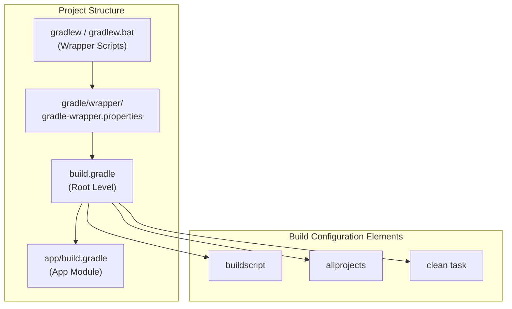
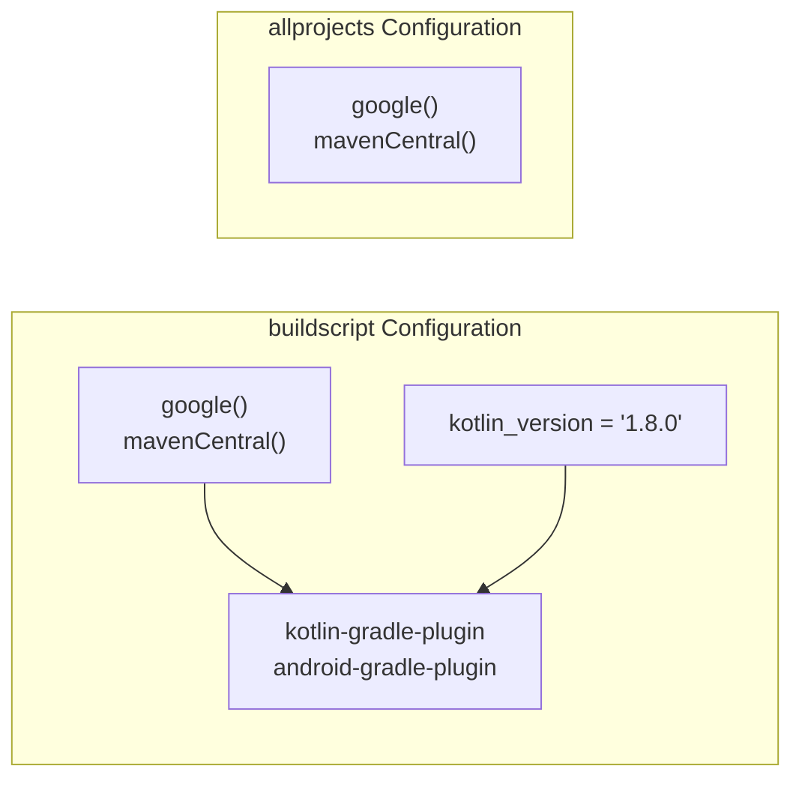
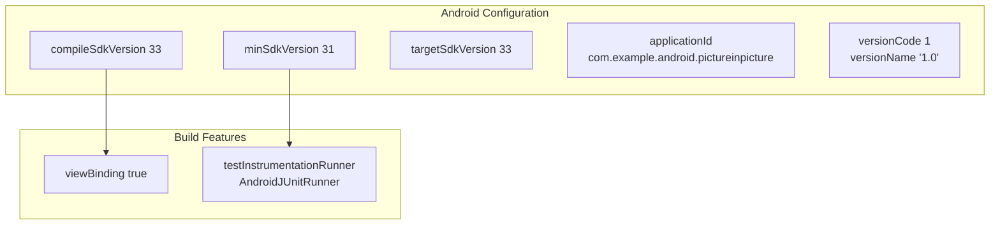
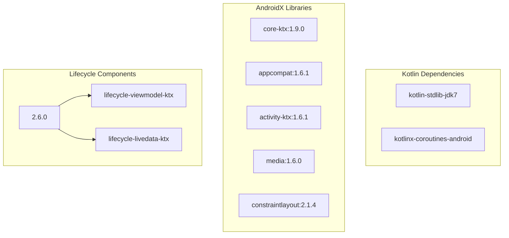
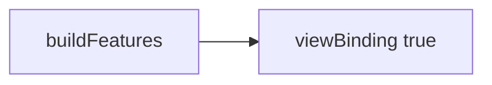
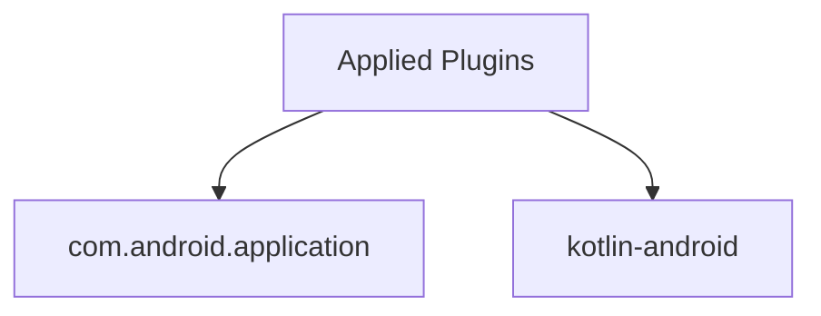

<!-- source: DeepWiki mcp.deepwiki.com · repo android/media-samples · extra page Build Configuration · fetched 2026-10-23 -->

# Build Configuration

Relevant source files

The following files were used as context for generating this wiki page:

- [PictureInPictureKotlin/app/build.gradle](PictureInPictureKotlin/app/build.gradle)
- [PictureInPictureKotlin/build.gradle](PictureInPictureKotlin/build.gradle)
- [PictureInPictureKotlin/gradle/wrapper/gradle-wrapper.jar](PictureInPictureKotlin/gradle/wrapper/gradle-wrapper.jar)
- [PictureInPictureKotlin/gradle/wrapper/gradle-wrapper.properties](PictureInPictureKotlin/gradle/wrapper/gradle-wrapper.properties)
- [PictureInPictureKotlin/gradlew](PictureInPictureKotlin/gradlew)
- [PictureInPictureKotlin/gradlew.bat](PictureInPictureKotlin/gradlew.bat)

This document covers the Gradle build configuration for the PictureInPictureKotlin sample application, including project structure, Android configuration, dependency management, and build tooling setup. For information about the repository-wide build system infrastructure, see [Build System and CI/CD](#5).

## Project Structure

The PictureInPictureKotlin sample follows a standard single-module Android project structure with a root-level build script and an app module build script.

**Sources:** [PictureInPictureKotlin/build.gradle:1-39](), [PictureInPictureKotlin/app/build.gradle:1-72]()

## Gradle Configuration

### Root Build Script

The root `build.gradle` establishes the foundational build configuration:

| Configuration | Value | Purpose |
|---------------|-------|---------|
| `kotlin_version` | `1.8.0` | Kotlin language version |
| Repositories | `google()`, `mavenCentral()` | Dependency sources |
| AGP Version | `7.4.2` | Android Gradle Plugin version |

**Sources:** [PictureInPictureKotlin/build.gradle:17-34]()

### Gradle Wrapper

The project uses Gradle Wrapper version 7.5 to ensure consistent build environments:

| Property | Value |
|----------|-------|
| `distributionUrl` | `gradle-7.5-bin.zip` |
| `distributionBase` | `GRADLE_USER_HOME` |
| `zipStoreBase` | `GRADLE_USER_HOME` |

**Sources:** [PictureInPictureKotlin/gradle/wrapper/gradle-wrapper.properties:1-6](), [PictureInPictureKotlin/gradlew:1-235](), [PictureInPictureKotlin/gradlew.bat:1-90]()

## Android Configuration

### SDK and Version Configuration

The app module defines the Android build configuration with modern API levels:

**Sources:** [PictureInPictureKotlin/app/build.gradle:20-32]()

### Build Types and Compilation

The build configuration includes release optimization settings and Java/Kotlin compatibility:

| Setting | Configuration |
|---------|---------------|
| Release minification | `minifyEnabled false` |
| ProGuard files | `proguard-android.txt`, `proguard-rules.pro` |
| Java compatibility | `JavaVersion.VERSION_1_8` |
| Kotlin JVM target | `'1.8'` |

**Sources:** [PictureInPictureKotlin/app/build.gradle:33-46]()

## Dependency Management

### Core Dependencies

The project includes essential Android and Kotlin dependencies:

**Sources:** [PictureInPictureKotlin/app/build.gradle:48-63]()

### Testing Dependencies

The project includes comprehensive testing libraries for unit and instrumentation testing:

| Testing Library | Version | Purpose |
|-----------------|---------|---------|
| `junit:junit` | `4.13.2` | Unit testing framework |
| `truth` | `1.1.3` | Assertion library |
| `androidx.test:core-ktx` | `1.5.0` | Android test core |
| `androidx.test:runner` | `1.5.2` | Test runner |
| `androidx.test:rules` | `1.5.0` | Test rules |
| `androidx.test.ext:junit` | `1.1.5` | JUnit extensions |
| `espresso-core` | `3.5.1` | UI testing |

**Sources:** [PictureInPictureKotlin/app/build.gradle:64-71]()

## Build Features

### View Binding

The project enables Android View Binding for type-safe view references:

This feature generates binding classes for XML layouts, providing compile-time safety for view access.

**Sources:** [PictureInPictureKotlin/app/build.gradle:30-32]()

### Plugin Configuration

The app module applies essential Android and Kotlin plugins:

**Sources:** [PictureInPictureKotlin/app/build.gradle:17-18]()

## Version Management

### Dependency Versions

The build scripts use consistent versioning strategies:

| Component | Version Strategy |
|-----------|------------------|
| Kotlin | Centralized via `kotlin_version` variable |
| Lifecycle | Centralized via `lifecycle_version` variable |
| AndroidX | Explicit version declarations |
| Testing | Latest stable versions |

**Sources:** [PictureInPictureKotlin/build.gradle:22](), [PictureInPictureKotlin/app/build.gradle:58]()

---

