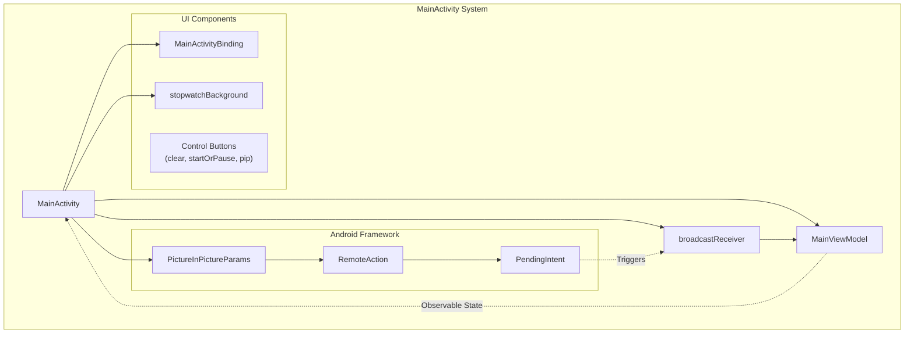
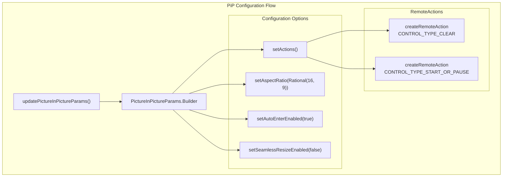
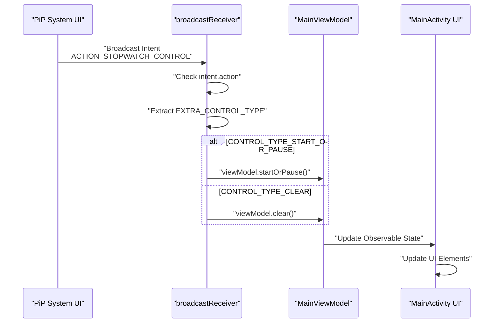
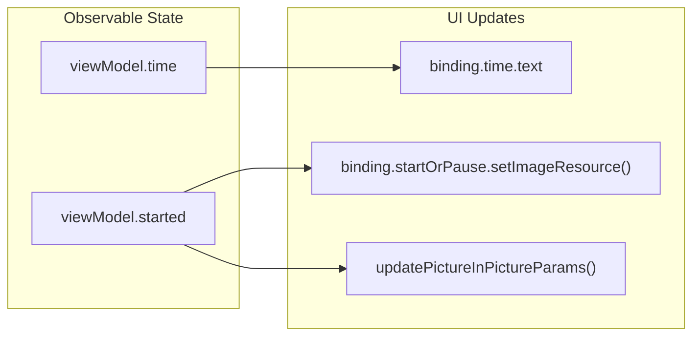
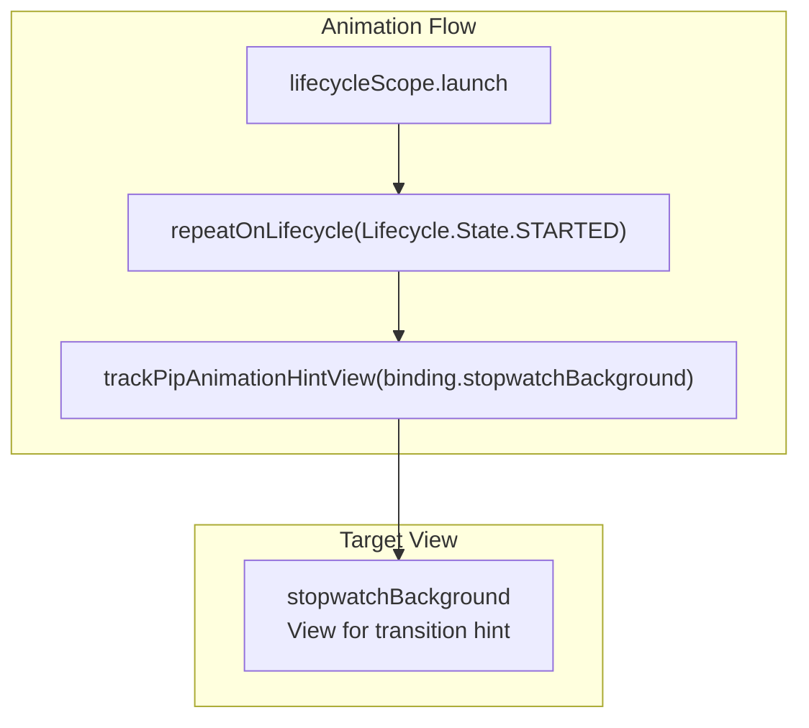

<!-- source: DeepWiki mcp.deepwiki.com · repo android/media-samples · extra page MainActivity - Stopwatch Example · fetched 2026-10-23 -->

# MainActivity - Stopwatch Example

Relevant source files

The following files were used as context for generating this wiki page:

- [PictureInPictureKotlin/app/src/main/java/com/example/android/pictureinpicture/MainActivity.kt](PictureInPictureKotlin/app/src/main/java/com/example/android/pictureinpicture/MainActivity.kt)
- [PictureInPictureKotlin/app/src/main/java/com/example/android/pictureinpicture/widget/MovieView.kt](PictureInPictureKotlin/app/src/main/java/com/example/android/pictureinpicture/widget/MovieView.kt)
- [PictureInPictureKotlin/gradle.properties](PictureInPictureKotlin/gradle.properties)

## Purpose and Scope

This document covers the `MainActivity` component of the PictureInPictureKotlin sample, which demonstrates Picture-in-Picture functionality using a stopwatch application. The MainActivity showcases essential PiP features including RemoteActions for custom controls, smooth animations, and proper lifecycle management. For information about the video playback example, see [MovieActivity - Video Playback Example](#2.1.2). For testing approaches, see [Testing Infrastructure](#2.1.3).

## Overview

The `MainActivity` class serves as the primary entry point for demonstrating Picture-in-Picture mode with a functional stopwatch timer. It implements core PiP patterns including:

- Custom RemoteActions for PiP mode controls
- Smooth enter/exit animations using `trackPipAnimationHintView`
- BroadcastReceiver integration for handling PiP action events
- Dynamic UI adaptation based on PiP state
- Integration with MVVM architecture via `MainViewModel`

## Component Architecture

**Sources:** [PictureInPictureKotlin/app/src/main/java/com/example/android/pictureinpicture/MainActivity.kt:1-202]()

## Picture-in-Picture Integration

### PiP Configuration and Parameters

The MainActivity configures Picture-in-Picture mode through the `updatePictureInPictureParams` method, which creates a `PictureInPictureParams` object with specific settings:

**Sources:** [PictureInPictureKotlin/app/src/main/java/com/example/android/pictureinpicture/MainActivity.kt:134-177]()

### RemoteAction Implementation

The MainActivity defines two primary control types for PiP mode:

| Control Type | Constant | Request Code | Functionality |
|--------------|----------|--------------|---------------|
| Clear | `CONTROL_TYPE_CLEAR` | `REQUEST_CLEAR` | Resets stopwatch to 00:00 |
| Start/Pause | `CONTROL_TYPE_START_OR_PAUSE` | `REQUEST_START_OR_PAUSE` | Toggles timer state |

The `createRemoteAction` method constructs RemoteAction objects that integrate with the system PiP overlay:

**Sources:** [PictureInPictureKotlin/app/src/main/java/com/example/android/pictureinpicture/MainActivity.kt:42-51](), [PictureInPictureKotlin/app/src/main/java/com/example/android/pictureinpicture/MainActivity.kt:183-201]()

## BroadcastReceiver and Action Handling

### Action Processing Flow

The BroadcastReceiver handles action intents from the PiP overlay and delegates to the `MainViewModel`:

**Sources:** [PictureInPictureKotlin/app/src/main/java/com/example/android/pictureinpicture/MainActivity.kt:64-76](), [PictureInPictureKotlin/app/src/main/java/com/example/android/pictureinpicture/MainActivity.kt:110]()

## State Management and MVVM Integration

### ViewModel Integration

The MainActivity observes state changes from `MainViewModel` using Android's LiveData pattern:

**Sources:** [PictureInPictureKotlin/app/src/main/java/com/example/android/pictureinpicture/MainActivity.kt:93-99]()

## UI Behavior and Mode Transitions

### PiP Mode State Changes

The `onPictureInPictureModeChanged` callback handles UI visibility based on PiP state:

| PiP State | Control Visibility | Behavior |
|-----------|-------------------|----------|
| Entering PiP | `View.GONE` | Hide in-app buttons (clear, startOrPause) |
| Exiting PiP | `View.VISIBLE` | Restore in-app buttons |

**Sources:** [PictureInPictureKotlin/app/src/main/java/com/example/android/pictureinpicture/MainActivity.kt:114-128]()

### Smooth Animation Integration

The MainActivity implements smooth PiP transitions using `trackPipAnimationHintView`:

**Sources:** [PictureInPictureKotlin/app/src/main/java/com/example/android/pictureinpicture/MainActivity.kt:101-107]()

## Activity Navigation

The MainActivity provides navigation to the video example via the "Switch Example" button:

**Sources:** [PictureInPictureKotlin/app/src/main/java/com/example/android/pictureinpicture/MainActivity.kt:88-91]()

This navigation pattern allows users to explore different PiP implementation approaches within the same sample application, demonstrating both stopwatch and video playback use cases.

---

