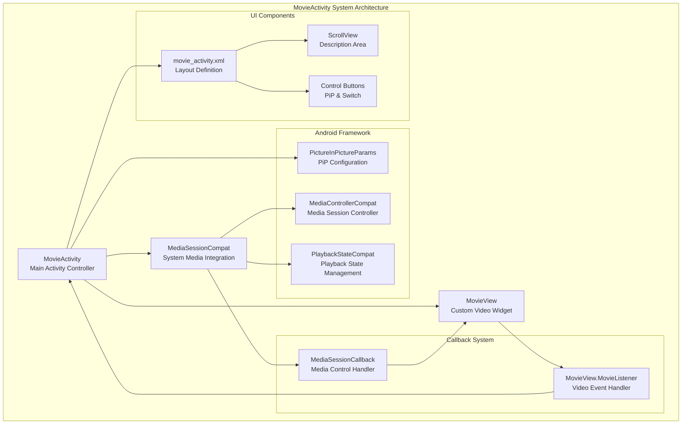
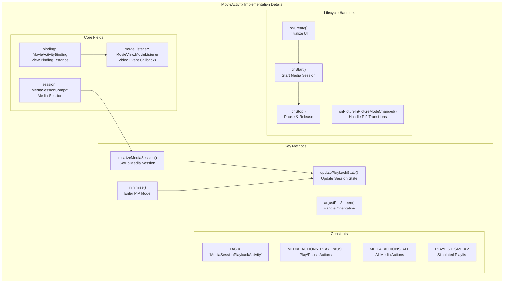
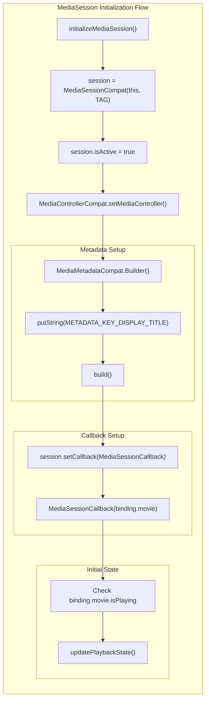
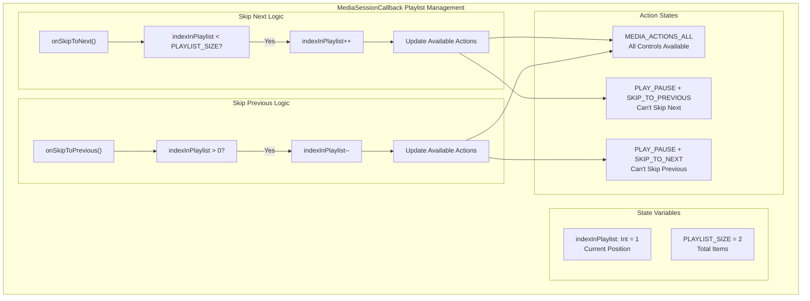
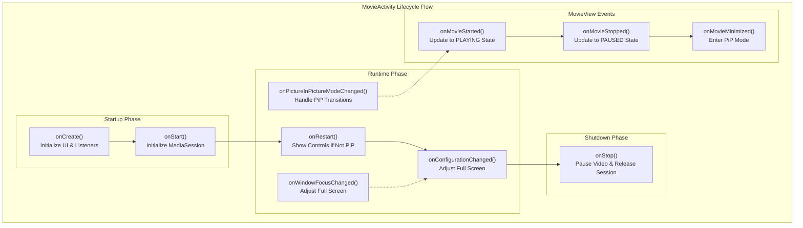
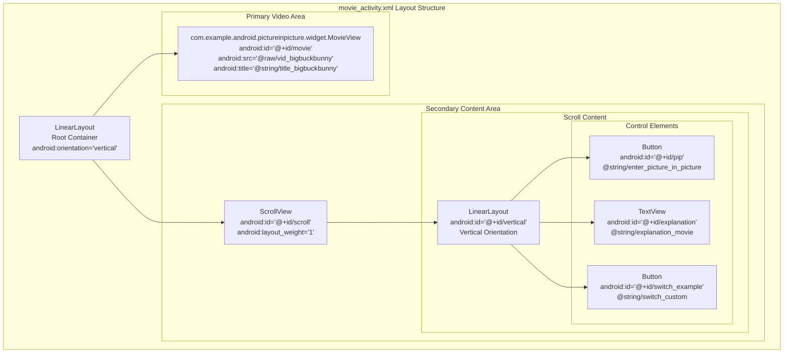

<!-- source: DeepWiki mcp.deepwiki.com · repo android/media-samples · extra page MovieActivity - Video Playback Example · fetched 2026-10-23 -->

# MovieActivity - Video Playback Example

Relevant source files

The following files were used as context for generating this wiki page:

- [PictureInPictureKotlin/app/src/main/java/com/example/android/pictureinpicture/MainViewModel.kt](PictureInPictureKotlin/app/src/main/java/com/example/android/pictureinpicture/MainViewModel.kt)
- [PictureInPictureKotlin/app/src/main/java/com/example/android/pictureinpicture/MovieActivity.kt](PictureInPictureKotlin/app/src/main/java/com/example/android/pictureinpicture/MovieActivity.kt)
- [PictureInPictureKotlin/app/src/main/res/drawable/ic_refresh_24dp.xml](PictureInPictureKotlin/app/src/main/res/drawable/ic_refresh_24dp.xml)
- [PictureInPictureKotlin/app/src/main/res/layout/main_activity.xml](PictureInPictureKotlin/app/src/main/res/layout/main_activity.xml)
- [PictureInPictureKotlin/app/src/main/res/layout/movie_activity.xml](PictureInPictureKotlin/app/src/main/res/layout/movie_activity.xml)

## Purpose and Scope

This document covers the `MovieActivity` component within the PictureInPictureKotlin sample, which demonstrates advanced video playback functionality integrated with Android's MediaSession framework and Picture-in-Picture mode. The `MovieActivity` showcases how to properly implement media controls, lifecycle management, and seamless transitions between fullscreen and PiP modes for video content.

For information about the stopwatch-based PiP example, see [MainActivity - Stopwatch Example](#2.1.1). For comprehensive testing approaches across both examples, see [Testing Infrastructure](#2.1.3).

## System Architecture Overview

The `MovieActivity` system demonstrates a complete video playback solution with MediaSession integration and Picture-in-Picture support. The architecture centers around three primary components working together to provide a seamless media experience.

Sources: [PictureInPictureKotlin/app/src/main/java/com/example/android/pictureinpicture/MovieActivity.kt:1-327](), [PictureInPictureKotlin/app/src/main/res/layout/movie_activity.xml:1-80]()

## Core Components Breakdown

### MovieActivity Class Structure

The `MovieActivity` extends `AppCompatActivity` and serves as the primary coordinator for video playback, media session management, and Picture-in-Picture functionality.

| Component | Type | Purpose | Key Methods |
|-----------|------|---------|-------------|
| `MovieActivity` | Activity | Main controller | `onCreate()`, `minimize()`, `updatePictureInPictureParams()` |
| `movieListener` | MovieView.MovieListener | Video event handling | `onMovieStarted()`, `onMovieStopped()`, `onMovieMinimized()` |
| `MediaSessionCallback` | Inner Class | Media control handling | `onPlay()`, `onPause()`, `onSkipToNext()`, `onSkipToPrevious()` |
| `session` | MediaSessionCompat | System media integration | Media metadata and playback state |

Sources: [PictureInPictureKotlin/app/src/main/java/com/example/android/pictureinpicture/MovieActivity.kt:42-63](), [PictureInPictureKotlin/app/src/main/java/com/example/android/pictureinpicture/MovieActivity.kt:96-114]()

## MediaSession Integration

The `MovieActivity` demonstrates proper MediaSession implementation for system-level media control integration. The MediaSession provides standardized media controls that work across the Android system, including notification panels, lock screens, and Picture-in-Picture overlays.

### MediaSession Setup and Configuration

Sources: [PictureInPictureKotlin/app/src/main/java/com/example/android/pictureinpicture/MovieActivity.kt:121-144]()

### MediaSessionCallback Implementation

The `MediaSessionCallback` inner class handles media control actions and manages playlist simulation with dynamic action availability.

| Method | Action | Playlist Logic |
|---------|--------|----------------|
| `onPlay()` | `movieView.play()` | No playlist changes |
| `onPause()` | `movieView.pause()` | No playlist changes |
| `onSkipToNext()` | `movieView.startVideo()` | Increment `indexInPlaylist`, disable next at end |
| `onSkipToPrevious()` | `movieView.startVideo()` | Decrement `indexInPlaylist`, disable previous at start |

Sources: [PictureInPictureKotlin/app/src/main/java/com/example/android/pictureinpicture/MovieActivity.kt:269-326]()

## Picture-in-Picture Implementation

The Picture-in-Picture implementation in `MovieActivity` demonstrates advanced PiP configuration with proper aspect ratio calculation, source rect hints for smooth transitions, and auto-enter functionality.

### PiP Configuration and Parameters

```mermaid
graph TB
    subgraph "Picture-in-Picture Configuration Flow"
        subgraph "Initialization"
            doOnLayout["binding.movie.doOnLayout"]
            updatePictureInPictureParams["updatePictureInPictureParams()"]
        end
        
        subgraph "Parameter Calculation"
            aspectRatio["Rational(movie.width, movie.height)<br/>Calculate Aspect Ratio"]
            visibleRect["Rect().getGlobalVisibleRect()<br/>Source Rectangle"]
            paramsBuilder["PictureInPictureParams.Builder()"]
        end
        
        subgraph "Parameter Setting"
            setAspectRatio["setAspectRatio(aspectRatio)"]
            setSourceRectHint["setSourceRectHint(visibleRect)"]
            setAutoEnterEnabled["setAutoEnterEnabled(true)"]
            build["build()"]
        end
        
        subgraph "Application"
            setPictureInPictureParams["setPictureInPictureParams(params)"]
            minimize["minimize() -> enterPictureInPictureMode()"]
        end
    end
    
    doOnLayout --> updatePictureInPictureParams
    updatePictureInPictureParams --> aspectRatio
    updatePictureInPictureParams --> visibleRect
    aspectRatio --> paramsBuilder
    visibleRect --> paramsBuilder
    paramsBuilder --> setAspectRatio
    setAspectRatio --> setSourceRectHint
    setSourceRectHint --> setAutoEnterEnabled
    setAutoEnterEnabled --> build
    build --> setPictureInPictureParams
    setPictureInPictureParams --> minimize
```

Sources: [PictureInPictureKotlin/app/src/main/java/com/example/android/pictureinpicture/MovieActivity.kt:108-110](), [PictureInPictureKotlin/app/src/main/java/com/example/android/pictureinpicture/MovieActivity.kt:189-206](), [PictureInPictureKotlin/app/src/main/java/com/example/android/pictureinpicture/MovieActivity.kt:211-213]()

### PiP Mode Transitions and Control Visibility

The activity handles PiP mode changes by managing UI element visibility and adapting the interface for the constrained PiP environment.

| PiP State | Video Controls | Scroll Content | Media Session |
|-----------|----------------|----------------|---------------|
| Entering PiP | Hide (`hideControls()`) | Hidden automatically | Active with actions |
| In PiP | Hidden | Hidden | Handles system controls |
| Exiting PiP | Show if paused (`showControls()`) | Visible | Active with actions |

Sources: [PictureInPictureKotlin/app/src/main/java/com/example/android/pictureinpicture/MovieActivity.kt:174-187]()

## Lifecycle Management

The `MovieActivity` implements comprehensive lifecycle management to ensure proper media session handling, video playback state, and resource cleanup.

### Activity Lifecycle Integration

Sources: [PictureInPictureKotlin/app/src/main/java/com/example/android/pictureinpicture/MovieActivity.kt:96-114](), [PictureInPictureKotlin/app/src/main/java/com/example/android/pictureinpicture/MovieActivity.kt:116-119](), [PictureInPictureKotlin/app/src/main/java/com/example/android/pictureinpicture/MovieActivity.kt:146-152]()

## UI Layout Structure

The `movie_activity.xml` layout provides a clean, video-focused interface with the `MovieView` as the primary component and supporting controls in a scrollable area below.

### Layout Component Hierarchy

The layout adapts to orientation changes through the `adjustFullScreen()` method, which hides the scroll content in landscape mode and adjusts the `MovieView` bounds accordingly.

Sources: [PictureInPictureKotlin/app/src/main/res/layout/movie_activity.xml:17-80](), [PictureInPictureKotlin/app/src/main/java/com/example/android/pictureinpicture/MovieActivity.kt:220-233]()

---

