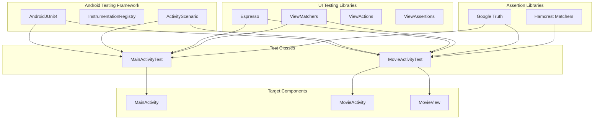
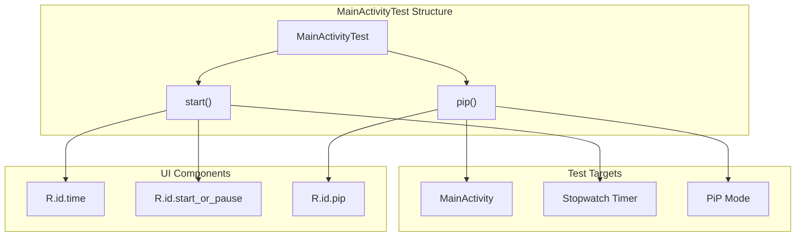
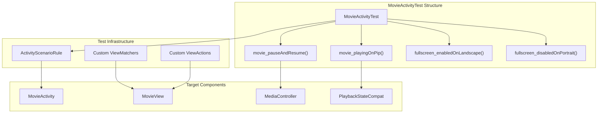
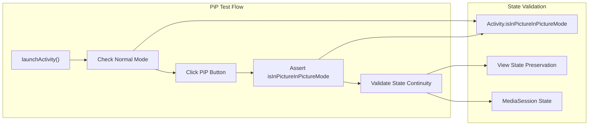
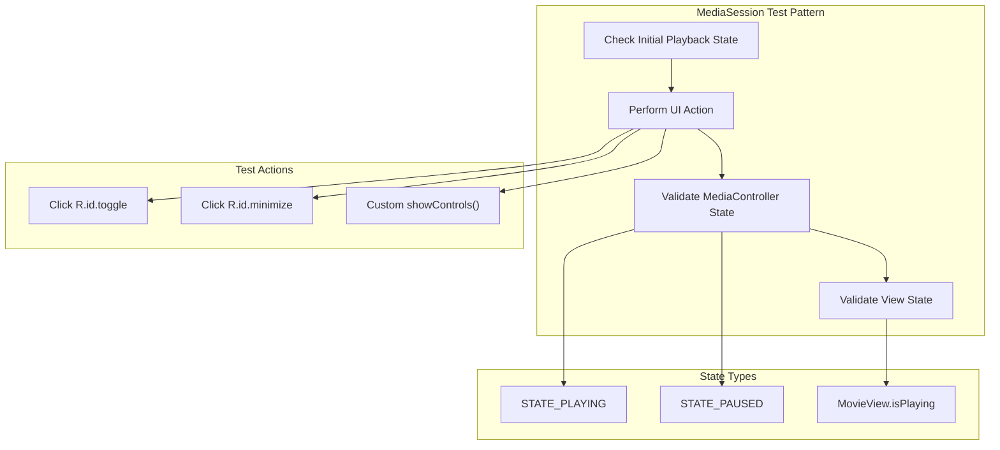
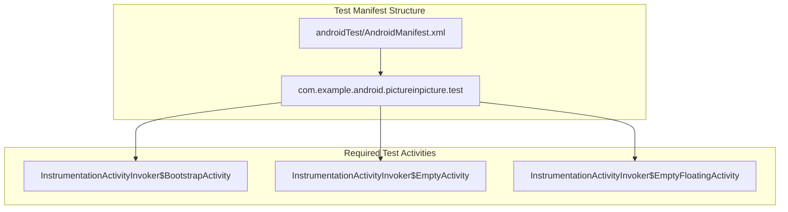

<!-- source: DeepWiki mcp.deepwiki.com · repo android/media-samples · extra page Testing Infrastructure · fetched 2026-10-23 -->

# Testing Infrastructure

Relevant source files

The following files were used as context for generating this wiki page:

- [PictureInPictureKotlin/app/src/androidTest/AndroidManifest.xml](PictureInPictureKotlin/app/src/androidTest/AndroidManifest.xml)
- [PictureInPictureKotlin/app/src/androidTest/java/com/example/android/pictureinpicture/MainActivityTest.kt](PictureInPictureKotlin/app/src/androidTest/java/com/example/android/pictureinpicture/MainActivityTest.kt)
- [PictureInPictureKotlin/app/src/androidTest/java/com/example/android/pictureinpicture/MovieActivityTest.kt](PictureInPictureKotlin/app/src/androidTest/java/com/example/android/pictureinpicture/MovieActivityTest.kt)

This document covers the comprehensive testing infrastructure for the PictureInPictureKotlin sample application. The testing system focuses on UI automation and integration testing to validate Picture-in-Picture functionality, media playback behavior, and user interface interactions.

For information about the actual MainActivity and MovieActivity components being tested, see [MainActivity - Stopwatch Example](#2.1.1) and [MovieActivity - Video Playback Example](#2.1.2).

## Test Architecture Overview

The testing infrastructure uses Android's instrumentation testing framework with Espresso for UI automation. The system provides comprehensive coverage of both PiP modes and media playback scenarios.

### Testing Framework Integration

**Sources:** [PictureInPictureKotlin/app/src/androidTest/java/com/example/android/pictureinpicture/MainActivityTest.kt:1-61](), [PictureInPictureKotlin/app/src/androidTest/java/com/example/android/pictureinpicture/MovieActivityTest.kt:1-164]()

## Test Classes and Coverage

### MainActivityTest

The `MainActivityTest` class provides focused testing for the stopwatch-based PiP functionality. It validates core PiP behavior and timer operations using minimal test cases.

**Key Test Methods:**

| Test Method | Purpose | Validation |
|-------------|---------|------------|
| `start()` | Validates stopwatch functionality | Timer updates from "00:00:00" when started |
| `pip()` | Tests PiP mode transition | `isInPictureInPictureMode` property changes |

**Sources:** [PictureInPictureKotlin/app/src/androidTest/java/com/example/android/pictureinpicture/MainActivityTest.kt:39-60]()

### MovieActivityTest

The `MovieActivityTest` class provides comprehensive testing for video playback scenarios, MediaSession integration, and complex PiP behavior with media controls.

**Advanced Test Features:**

| Feature | Implementation | Purpose |
|---------|----------------|---------|
| Custom Matcher | `isPlaying()` | Validates `MovieView.isPlaying` state |
| Custom Action | `showControls()` | Triggers control visibility in `MovieView` |
| MediaSession Testing | `assertMediaStateIs()` | Validates `PlaybackStateCompat` states |
| Orientation Testing | Screen rotation | Tests fullscreen behavior changes |

**Sources:** [PictureInPictureKotlin/app/src/androidTest/java/com/example/android/pictureinpicture/MovieActivityTest.kt:52-164]()

## Testing Methodology

### Picture-in-Picture Testing Strategy

The testing approach validates PiP functionality through direct activity state inspection and UI interaction patterns.

**Sources:** [PictureInPictureKotlin/app/src/androidTest/java/com/example/android/pictureinpicture/MainActivityTest.kt:49-59](), [PictureInPictureKotlin/app/src/androidTest/java/com/example/android/pictureinpicture/MovieActivityTest.kt:56-76]()

### MediaSession Integration Testing

The test infrastructure validates MediaSession state consistency across PiP transitions and playback control interactions.

**Sources:** [PictureInPictureKotlin/app/src/androidTest/java/com/example/android/pictureinpicture/MovieActivityTest.kt:79-94](), [PictureInPictureKotlin/app/src/androidTest/java/com/example/android/pictureinpicture/MovieActivityTest.kt:126-132]()

## Test Configuration

### AndroidManifest Configuration

The test manifest defines the instrumentation testing environment with required activity declarations for the Android Test Infrastructure.

**Sources:** [PictureInPictureKotlin/app/src/androidTest/AndroidManifest.xml:17-33]()

### Test Dependencies and Framework Integration

The testing infrastructure integrates multiple Android testing libraries with specific annotations and configurations:

| Component | Usage | Purpose |
|-----------|--------|---------|
| `@RunWith(AndroidJUnit4::class)` | Test runner configuration | Enables Android instrumentation testing |
| `@LargeTest` | Test categorization | Marks UI integration tests |
| `ActivityScenarioRule` | Activity lifecycle management | Provides controlled activity testing environment |
| `launchActivity<T>()` | Activity launching | Creates activity instances for testing |
| `InstrumentationRegistry` | Test synchronization | Manages test execution timing |

**Sources:** [PictureInPictureKotlin/app/src/androidTest/java/com/example/android/pictureinpicture/MainActivityTest.kt:35-37](), [PictureInPictureKotlin/app/src/androidTest/java/com/example/android/pictureinpicture/MovieActivityTest.kt:48-53]()

---

