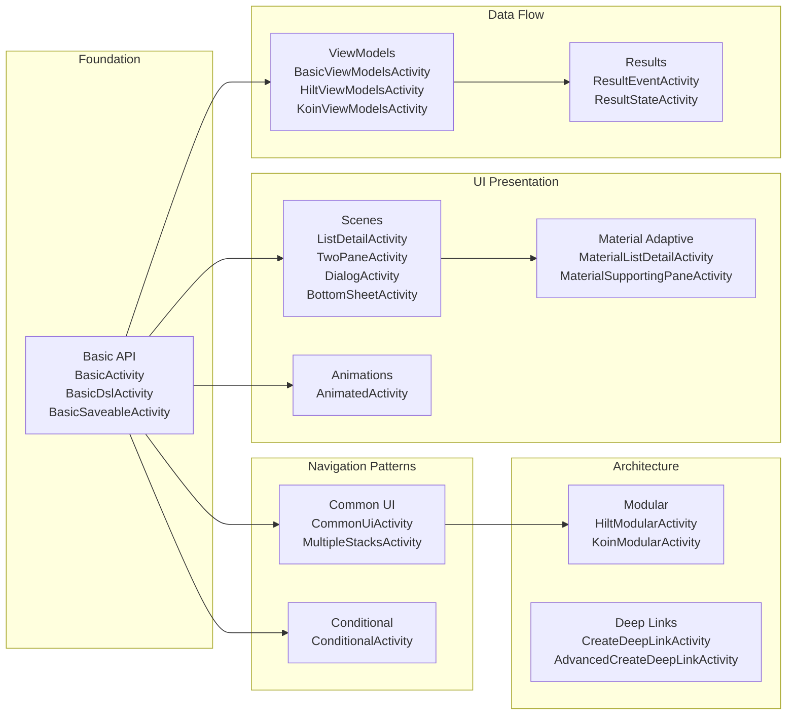
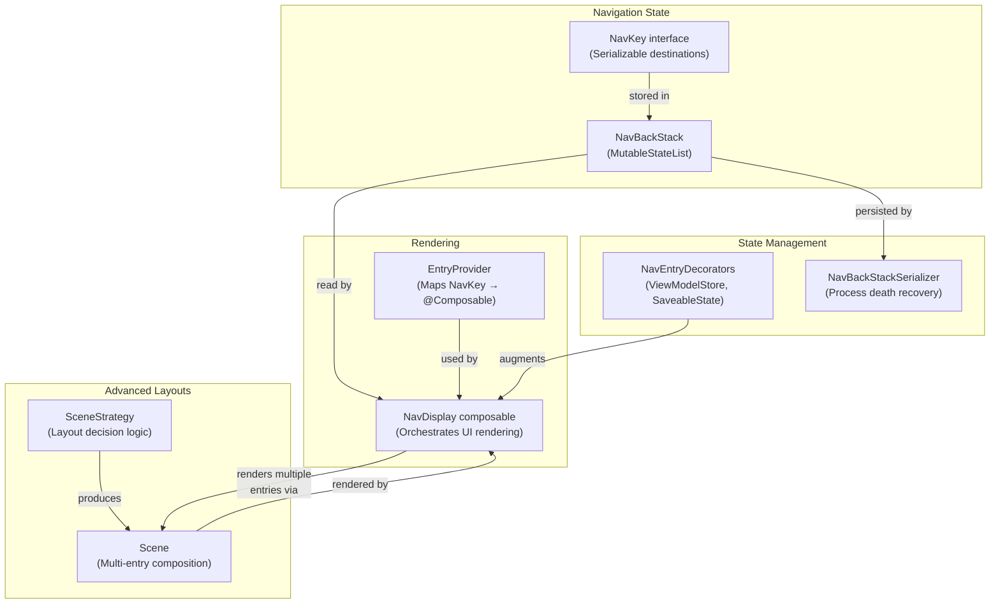

<!-- source: DeepWiki mcp.deepwiki.com · repo android/nav3-recipes · page 1 Overview · fetched 2026-10-23 -->

# Overview

Relevant source files

The following files were used as context for generating this wiki page:

- [README.md](README.md)
- [app/src/main/AndroidManifest.xml](app/src/main/AndroidManifest.xml)
- [app/src/main/java/com/example/nav3recipes/RecipePickerActivity.kt](app/src/main/java/com/example/nav3recipes/RecipePickerActivity.kt)

## Purpose and Scope

The `nav3-recipes` repository is a collection of standalone code examples demonstrating how to use [Jetpack Navigation 3](https://goo.gle/nav3) APIs to implement common navigation use cases in Android applications. Each recipe is a self-contained example that introduces a single concept, packaged as its own `Activity` within the repository.

This Overview page introduces the repository structure, recipe philosophy, and high-level organization. For detailed information about specific topics:
- Core Navigation 3 concepts (NavKey, NavBackStack, NavDisplay): see [Core Navigation 3 Concepts](#2.2)
- Running and exploring recipes: see [Running Recipe Examples](#2.3)
- Individual recipe categories: see sections [3](#3) through [11](#11)

## Repository Architecture

The repository uses a hub-and-spoke architecture where `RecipePickerActivity` serves as the central launcher, providing access to all recipe examples through a categorized list interface.

```mermaid
graph TB
    subgraph "Application Entry Point"
        Manifest["AndroidManifest.xml"]
        Launcher["RecipePickerActivity<br/>(MAIN/LAUNCHER)"]
    end
    
    subgraph "Recipe Activities"
        Basic["BasicActivity"]
        BasicDsl["BasicDslActivity"]
        BasicSaveable["BasicSaveableActivity"]
        CommonUi["CommonUiActivity"]
        ListDetail["ListDetailActivity"]
        TwoPane["TwoPaneActivity"]
        Dialog["DialogActivity"]
        BottomSheet["BottomSheetActivity"]
        MaterialLD["MaterialListDetailActivity"]
        MaterialSP["MaterialSupportingPaneActivity"]
        Animated["AnimatedActivity"]
        MultiStacks["MultipleStacksActivity"]
        Conditional["ConditionalActivity"]
        HiltMod["HiltModularActivity"]
        KoinMod["KoinModularActivity"]
        BasicVM["BasicViewModelsActivity"]
        HiltVM["HiltViewModelsActivity"]
        KoinVM["KoinViewModelsActivity"]
        ResultEvt["ResultEventActivity"]
        ResultState["ResultStateActivity"]
        CreateDL["CreateDeepLinkActivity"]
        AdvancedDL["AdvancedCreateDeepLinkActivity"]
    end
    
    Manifest -->|declares| Launcher
    Manifest -->|declares all| Basic
    Manifest -->|declares all| BasicDsl
    
    Launcher -->|Intent| Basic
    Launcher -->|Intent| BasicDsl
    Launcher -->|Intent| BasicSaveable
    Launcher -->|Intent| CommonUi
    Launcher -->|Intent| ListDetail
    Launcher -->|Intent| TwoPane
    Launcher -->|Intent| Dialog
    Launcher -->|Intent| BottomSheet
    Launcher -->|Intent| MaterialLD
    Launcher -->|Intent| MaterialSP
    Launcher -->|Intent| Animated
    Launcher -->|Intent| MultiStacks
    Launcher -->|Intent| Conditional
    Launcher -->|Intent| HiltMod
    Launcher -->|Intent| KoinMod
    Launcher -->|Intent| BasicVM
    Launcher -->|Intent| HiltVM
    Launcher -->|Intent| KoinVM
    Launcher -->|Intent| ResultEvt
    Launcher -->|Intent| ResultState
    Launcher -->|Intent| CreateDL
    Launcher -->|Intent| AdvancedDL
```

**Sources**: [README.md:1-95](), [app/src/main/AndroidManifest.xml:1-190](), [app/src/main/java/com/example/nav3recipes/RecipePickerActivity.kt:1-185]()

### RecipePickerActivity Implementation

The `RecipePickerActivity` class maintains a list of all recipes organized by category. Each recipe is defined using the `Recipe` data class containing a display name and the `Activity` class to launch.

| Component | Purpose | Implementation |
|-----------|---------|----------------|
| `Recipe` | Represents a single recipe example | Contains `name: String` and `activityClass: Class<out Activity>` |
| `Heading` | Categorizes recipes in the UI | Contains `name: String` for category labels |
| `recipes` list | Master recipe registry | Defines all available recipes with their categories at [RecipePickerActivity.kt:78-118]() |
| `RecipeList` composable | UI presentation | Renders recipes as clickable `ListItem` components |

The `recipes` list at [RecipePickerActivity.kt:78-118]() defines the canonical list of all examples in the repository, organized into categories that align with the sections in this wiki.

**Sources**: [app/src/main/java/com/example/nav3recipes/RecipePickerActivity.kt:68-185]()

## Recipe Philosophy

The repository follows a **single-concept-per-recipe** philosophy:

1. **Independence**: Each recipe is a complete, standalone example with its own `Activity` and navigation setup
2. **Focused scope**: Recipes demonstrate one specific concept or pattern without mixing multiple concerns
3. **Progressive complexity**: New concepts result in new recipes rather than modifications to existing ones
4. **Graduation path**: Successful patterns from recipes may "graduate" to become official library helpers in Jetpack Navigation 3, after which recipes are updated to use those helpers

This approach ensures that developers can:
- Explore specific features in isolation
- Copy and adapt recipe code without untangling multiple patterns
- Compare different approaches to similar problems (e.g., Hilt vs Koin for DI)

**Sources**: [README.md:1-10]()

## Recipe Categories

The repository organizes recipes into nine primary categories, each addressing different aspects of navigation implementation:

**Sources**: [README.md:12-60](), [app/src/main/java/com/example/nav3recipes/RecipePickerActivity.kt:78-118]()

### Category Descriptions

| Category | Recipe Count | Key Concepts Demonstrated | Wiki Section |
|----------|--------------|--------------------------|--------------|
| **Basic API examples** | 3 | NavDisplay, NavBackStack, EntryProvider, serialization | [3](#3) |
| **Deep links** | 2 | URL parsing, synthetic back stacks, Task management | [4](#4) |
| **Layouts using Scenes** | 4 | SceneStrategy, multi-pane layouts, dialogs, bottom sheets | [6](#6) |
| **Material adaptive layouts** | 2 | PaneScaffoldDirective, Material3 adaptive components | [6.5](#6.5) |
| **Animations** | 1 | Custom transitions, transitionSpec, predictive back | [7](#7) |
| **Common use cases** | 3 | Bottom bar navigation, multiple back stacks, conditional routing | [5](#5), [11.2](#11.2) |
| **Architecture** | 2 | Modular navigation with Hilt and Koin | [10](#10) |
| **Passing arguments to ViewModels** | 3 | ViewModel factories, Hilt/Koin injection | [9](#9) |
| **Returning Results** | 2 | Event-based and state-based result passing | [8](#8) |

**Sources**: [README.md:12-60]()

## Navigation 3 Core Components

While detailed coverage of Navigation 3 concepts is provided in [Core Navigation 3 Concepts](#2.2), the following diagram shows how the core components used throughout recipes relate to each other:

### Recipes by Component Coverage

The following table maps Navigation 3 components to the recipes that demonstrate them:

| Component | Primary Recipes | Wiki Section |
|-----------|----------------|--------------|
| `NavKey` | BasicActivity, CreateDeepLinkActivity | [3.1](#3.1), [4.1](#4.1), [12.1](#12.1) |
| `NavBackStack` | BasicActivity, MultipleStacksActivity | [3.1](#3.1), [5](#5), [12.2](#12.2) |
| `NavDisplay` | All recipes | [3.1](#3.1), [12.3](#12.3) |
| `EntryProvider` (DSL) | BasicDslActivity | [3.2](#3.2), [12.3](#12.3) |
| `NavBackStackSerializer` | BasicSaveableActivity | [3.3](#3.3), [12.2](#12.2) |
| `SceneStrategy` | ListDetailActivity, TwoPaneActivity | [6.1](#6.1), [6.2](#6.2), [6.3](#6.3) |
| `DialogSceneStrategy` | DialogActivity, BottomSheetActivity | [6.4](#6.4) |
| Material3 adaptive | MaterialListDetailActivity, MaterialSupportingPaneActivity | [6.5](#6.5) |
| `NavEntryDecorator` | BasicActivity, HiltViewModelsActivity | [12.4](#12.4) |

**Sources**: [README.md:15-39]()

## Version and Compatibility

The repository uses the **latest version** of Navigation 3 on the `main` branch, which may include alpha or snapshot releases. For recipes tested against **stable** versions of the library, developers should refer to the [releases page](https://github.com/android/nav3-recipes/releases).

The build configuration supports:
- **Dual dependency injection**: Both Hilt (compile-time) and Koin (runtime) frameworks are included, allowing recipes to demonstrate both approaches
- **Navigation 2 compatibility**: Some recipes show migration patterns from Navigation 2 to Navigation 3
- **Multi-module structure**: The `:app`, `:common`, and `:advanceddeeplinkapp` modules enable feature separation

For detailed build system information, see [Build System and Project Structure](#14).

**Sources**: [README.md:10-11](), [README.md:67-68]()

## Using This Repository

Developers can use this repository in three ways:

1. **Learning**: Explore recipes sequentially to understand Navigation 3 capabilities, starting with basic examples and progressing to advanced patterns
2. **Reference**: Find specific recipes that match your use case (e.g., "How do I implement a list-detail layout?") and study the implementation
3. **Code templates**: Copy recipe code as a starting point for implementing similar features in your own application

Each recipe directory contains:
- A `README.md` file explaining the recipe's purpose and key concepts
- Complete source code with inline comments
- Activity implementation that can be launched from RecipePickerActivity

To run the recipes:
1. Clone the repository: `git clone https://github.com/android/nav3-recipes.git`
2. Open the project in [Android Studio](https://developer.android.com/studio)
3. Build and run the app
4. RecipePickerActivity launches automatically, displaying all available recipes
5. Tap any recipe to launch its dedicated Activity

For detailed setup instructions, see [Running Recipe Examples](#2.3).

**Sources**: [README.md:67-69]()

## Issue Reporting and Contributions

### Issues Specific to Recipes

If you encounter an issue that is **directly related to this repository** (reproducible without modifying the source code), file an issue on the [GitHub issue tracker](https://github.com/android/nav3-recipes/issues/new?template=2-bug-report.md).

### Issues with Navigation 3 Library

If you've found an issue with the **Jetpack Navigation 3 library itself**, file it on the [Android issue tracker](https://issuetracker.google.com/issues/new?component=1750212&template=2102223).

### Material3 Adaptive Issues

For bugs or feature requests related to **Material3 Adaptive Scenes**, file them on the [Material Components issue tracker](https://issuetracker.google.com/issues/new?component=1467081) rather than this repository.

### Requesting New Recipes

To request a new recipe demonstrating a specific use case, file a [recipe request](https://github.com/android/nav3-recipes/issues/new?template=1-recipe-request.md). The most upvoted recipe requests are prioritized for implementation.

### Contributing Code

Contributions are welcome following the [contribution guidelines](CONTRIBUTING.md). The repository maintains the philosophy that new concepts should be separate recipes rather than modifications to existing ones, ensuring each recipe remains focused and easy to understand.

**Sources**: [README.md:70-74]()

## Related Resources

- **Compose Multiplatform Recipes**: For CMP-specific navigation recipes, see the [terrakok/nav3-recipes](https://github.com/terrakok/nav3-recipes) repository
- **Official Documentation**: [Jetpack Navigation 3 documentation](https://goo.gle/nav3)
- **Deep Linking Guide**: See the repository's [deep linking guide](docs/deeplink-guide.md) for comprehensive coverage of URL handling patterns

**Sources**: [README.md:76-77]()

---

