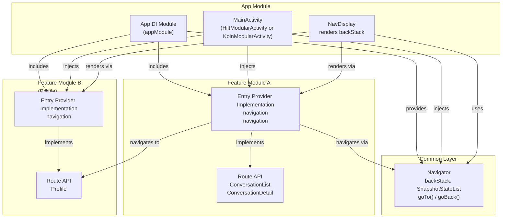
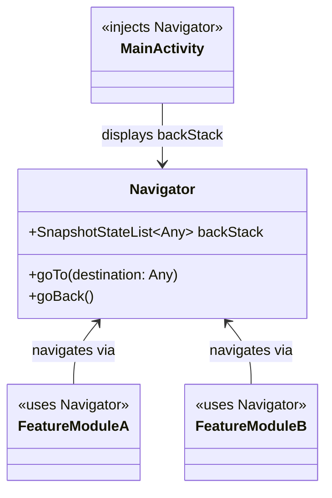
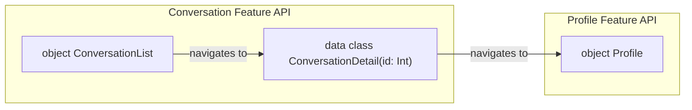
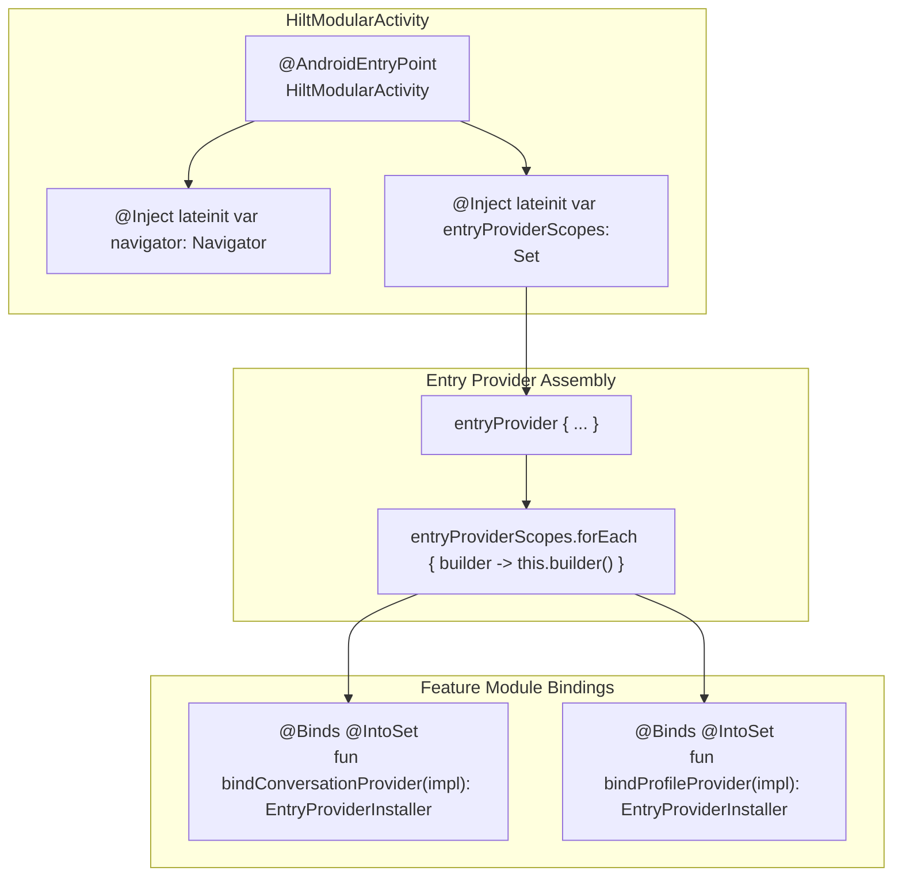
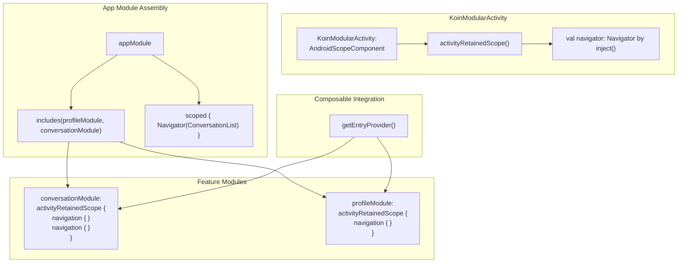

<!-- source: DeepWiki mcp.deepwiki.com · repo android/nav3-recipes · page 10 Modular Navigation Architecture · fetched 2026-10-23 -->

# Modular Navigation Architecture

<details>
<summary>Relevant source files</summary>

The following files were used as context for generating this wiki page:

- [app/src/main/java/com/example/nav3recipes/modular/hilt/HiltModularActivity.kt](app/src/main/java/com/example/nav3recipes/modular/hilt/HiltModularActivity.kt)
- [app/src/main/java/com/example/nav3recipes/modular/koin/AppModule.kt](app/src/main/java/com/example/nav3recipes/modular/koin/AppModule.kt)
- [app/src/main/java/com/example/nav3recipes/modular/koin/CommonModule.kt](app/src/main/java/com/example/nav3recipes/modular/koin/CommonModule.kt)
- [app/src/main/java/com/example/nav3recipes/modular/koin/ConversationModule.kt](app/src/main/java/com/example/nav3recipes/modular/koin/ConversationModule.kt)
- [app/src/main/java/com/example/nav3recipes/modular/koin/KoinModularActivity.kt](app/src/main/java/com/example/nav3recipes/modular/koin/KoinModularActivity.kt)
- [app/src/main/java/com/example/nav3recipes/modular/koin/ProfileModule.kt](app/src/main/java/com/example/nav3recipes/modular/koin/ProfileModule.kt)

</details>


## Purpose and Scope

This page demonstrates how to structure Navigation 3 applications using a modular architecture where navigation logic is decoupled into independent feature modules. Each feature module defines its own routes and entry providers, which are then injected into the main application using dependency injection frameworks (Hilt or Koin). This architectural pattern enables better code organization, separation of concerns, and scalability for large applications.

For basic ViewModel dependency injection, see [ViewModel Integration](#9). For custom Navigator class patterns without modularization, see [Advanced Navigator Patterns](#11).

---

## Architectural Overview

Modular navigation separates the application into distinct layers:



**Key Architectural Components:**

| Component | Responsibility | Ownership |
|-----------|---------------|-----------|
| `Navigator` | Centralized backStack management | Common/shared |
| Route API (e.g., `ConversationList`, `Profile`) | Type-safe navigation keys | Feature module API |
| Entry Provider Implementation | Maps routes to composable UI | Feature module implementation |
| App DI Module | Assembles all feature modules | Application module |
| MainActivity | Hosts `NavDisplay` and injects dependencies | Application module |

The feature modules have **no direct dependencies on each other**. Cross-feature navigation occurs by referencing route API types (which can be published as separate API artifacts) and using the shared `Navigator` instance.

**Sources:** [app/src/main/java/com/example/nav3recipes/modular/koin/KoinModularActivity.kt:26-39](), [app/src/main/java/com/example/nav3recipes/modular/koin/CommonModule.kt:1-16]()

---

## Common Navigator Pattern

Both modular approaches share a common `Navigator` pattern that encapsulates backStack state and navigation operations:



The `Navigator` class implementation is minimal:

| Method | Signature | Behavior |
|--------|-----------|----------|
| Constructor | `Navigator(startDestination: Any)` | Initializes `backStack` with start destination |
| `goTo()` | `fun goTo(destination: Any)` | Appends destination to `backStack` |
| `goBack()` | `fun goBack()` | Removes last item from `backStack` (if not empty) |

The `backStack` is declared as `SnapshotStateList<Any>` [app/src/main/java/com/example/nav3recipes/modular/koin/CommonModule.kt:7](), making it observable by Compose. This allows `NavDisplay` to automatically recompose when navigation occurs.

**Feature modules inject the `Navigator` instance** to perform navigation without depending on other modules. For example, the Conversation module navigates to Profile:

[app/src/main/java/com/example/nav3recipes/modular/koin/ConversationModule.kt:47-51]()

**Sources:** [app/src/main/java/com/example/nav3recipes/modular/koin/CommonModule.kt:1-16](), [app/src/main/java/com/example/nav3recipes/modular/koin/ConversationModule.kt:29-53]()

---

## Feature Module Structure

Each feature module defines two logical layers:

### Route API Layer

Route types are defined as `object` (for singleton destinations) or `data class` (for parameterized destinations):



These route types serve as the **public API** of the feature module. In a multi-module project, these could be defined in separate `:feature-api` modules to avoid circular dependencies.

### Entry Provider Implementation Layer

Entry provider implementations map route types to composable content:

| Framework | Mechanism | Scope |
|-----------|-----------|-------|
| Koin | `navigation<T> { }` DSL | `activityRetainedScope` |
| Hilt | `EntryProviderInstaller` interface | Custom binding mechanism |

The implementation layer **depends on both the route API and the common `Navigator`**, but feature implementations remain isolated from each other.

**Sources:** [app/src/main/java/com/example/nav3recipes/modular/koin/ConversationModule.kt:29-34](), [app/src/main/java/com/example/nav3recipes/modular/koin/ProfileModule.kt:19-20]()

---

## Hilt Modular Navigation

The Hilt implementation uses a custom `EntryProviderInstaller` interface pattern for injecting entry provider definitions.

### Architecture



### EntryProviderInstaller Interface

The `EntryProviderInstaller` is a functional interface that receives an `EntryProviderScope` builder:

```
typealias EntryProviderInstaller = EntryProviderScope.() -> Unit
```

Each feature module provides an implementation that adds its routes to the builder. The main activity collects all implementations via **Hilt's `@IntoSet` multibinding**:

[app/src/main/java/com/example/nav3recipes/modular/hilt/HiltModularActivity.kt:22]()

### Entry Provider Assembly

The activity constructs the composite `EntryProvider` by invoking all installers:

[app/src/main/java/com/example/nav3recipes/modular/hilt/HiltModularActivity.kt:33-35]()

This pattern allows feature modules to contribute entry provider definitions without the main module needing explicit knowledge of each feature's routes.

### Implementation Pattern

Each feature module:
1. Defines a class implementing `EntryProviderInstaller`
2. Implements the lambda to call `entry<RouteType> { }` for each route
3. Provides a Hilt binding using `@Binds @IntoSet`

Example structure:
```
@Module
@InstallIn(ActivityRetainedComponent::class)
abstract class ConversationModule {
    @Binds
    @IntoSet
    abstract fun bindConversationProvider(impl: ConversationProviderImpl): EntryProviderInstaller
}

class ConversationProviderImpl @Inject constructor(
    private val navigator: Navigator
) : EntryProviderInstaller {
    override fun invoke(scope: EntryProviderScope) {
        with(scope) {
            entry<ConversationList> { ConversationListScreen(...) }
            entry<ConversationDetail> { key -> ConversationDetailScreen(key, ...) }
        }
    }
}
```

**Sources:** [app/src/main/java/com/example/nav3recipes/modular/hilt/HiltModularActivity.kt:1-41]()

---

## Koin Modular Navigation

The Koin implementation uses the `navigation<T>` DSL and the experimental `getEntryProvider()` function for a more declarative approach.

### Architecture



### Module Definition Pattern

Feature modules use the `navigation<T>` DSL within an `activityRetainedScope`:

[app/src/main/java/com/example/nav3recipes/modular/koin/ConversationModule.kt:36-53]()

The `navigation<T>` function registers an entry provider for the specified route type. For parameterized routes, the lambda receives the route key instance:

[app/src/main/java/com/example/nav3recipes/modular/koin/ConversationModule.kt:47-51]()

### App Module Assembly

The app module aggregates all feature modules using `includes()`:

[app/src/main/java/com/example/nav3recipes/modular/koin/AppModule.kt:1-14]()

The `Navigator` instance is provided in the same scope, making it available to all feature modules:

[app/src/main/java/com/example/nav3recipes/modular/koin/AppModule.kt:9-13]()

### Retrieving the Entry Provider

The activity uses `getEntryProvider()` to obtain a composite entry provider containing all registered routes:

[app/src/main/java/com/example/nav3recipes/modular/koin/KoinModularActivity.kt:58]()

This function is provided by the `koin-androidx-compose-navigation3` library and automatically collects all `navigation<T>` registrations from the current scope.

### Scope Management

The activity implements `AndroidScopeComponent` and uses `activityRetainedScope()`:

[app/src/main/java/com/example/nav3recipes/modular/koin/KoinModularActivity.kt:41-44]()

This ensures the `Navigator` and entry providers survive configuration changes but are cleaned up when the activity is finished.

**Sources:** [app/src/main/java/com/example/nav3recipes/modular/koin/KoinModularActivity.kt:1-75](), [app/src/main/java/com/example/nav3recipes/modular/koin/AppModule.kt:1-14](), [app/src/main/java/com/example/nav3recipes/modular/koin/ConversationModule.kt:36-53]()

---

## Implementation Comparison

Both frameworks achieve modular navigation through different mechanisms:

| Aspect | Hilt | Koin |
|--------|------|------|
| **Entry provider registration** | `EntryProviderInstaller` interface + `@IntoSet` multibinding | `navigation<T> { }` DSL |
| **Dependency injection style** | Compile-time with KSP annotation processing | Runtime with reflection |
| **Module aggregation** | Automatic via component hierarchy | Explicit via `includes()` |
| **Entry provider retrieval** | Manual `entryProvider { forEach { builder() } }` | `getEntryProvider()` composable |
| **Scope management** | Dagger component scopes | `activityRetainedScope()` |
| **Navigator injection** | `@Inject lateinit var navigator` | `val navigator by inject()` |
| **Type safety** | Full compile-time safety | Runtime type checking |
| **Verbosity** | Requires interface definition + binding module | More concise DSL |
| **Multi-module support** | Excellent (designed for compile-time modularization) | Good (runtime module loading) |

### Code Structure Comparison

**Hilt Feature Module:**
```
@Module
@InstallIn(ActivityRetainedComponent::class)
abstract class ConversationModule {
    @Binds @IntoSet
    abstract fun bind(impl: ConversationProviderImpl): EntryProviderInstaller
}

class ConversationProviderImpl @Inject constructor(
    private val navigator: Navigator
) : EntryProviderInstaller {
    override fun invoke(scope: EntryProviderScope) {
        scope.entry<ConversationList> { ... }
    }
}
```

**Koin Feature Module:**
```
val conversationModule = module {
    activityRetainedScope {
        navigation<ConversationList> {
            val navigator = get<Navigator>()
            ConversationListScreen(...)
        }
    }
}
```

The Koin approach is more concise but relies on runtime resolution. The Hilt approach requires more boilerplate but provides compile-time safety and better IDE support.

**Sources:** [app/src/main/java/com/example/nav3recipes/modular/hilt/HiltModularActivity.kt:1-41](), [app/src/main/java/com/example/nav3recipes/modular/koin/ConversationModule.kt:36-53]()

---

## Benefits of Modular Navigation

The modular navigation architecture provides several advantages:

1. **Feature Isolation**: Each feature module can be developed, tested, and maintained independently
2. **Decoupled Dependencies**: Feature modules depend only on the common Navigator and their own route APIs
3. **Dynamic Feature Modules**: Structure enables Android's dynamic feature delivery (feature modules can be downloaded on-demand)
4. **Team Scalability**: Different teams can own different feature modules without merge conflicts
5. **Testability**: Feature modules can be tested in isolation with mock Navigator implementations
6. **Lazy Loading**: Entry providers are only invoked when their routes are navigated to
7. **Clear API Boundaries**: Route APIs define explicit contracts between features

This architecture is particularly valuable for large applications with multiple feature teams or apps that need to support dynamic feature delivery.

**Sources:** [app/src/main/java/com/example/nav3recipes/modular/koin/KoinModularActivity.kt:26-39]()

---

