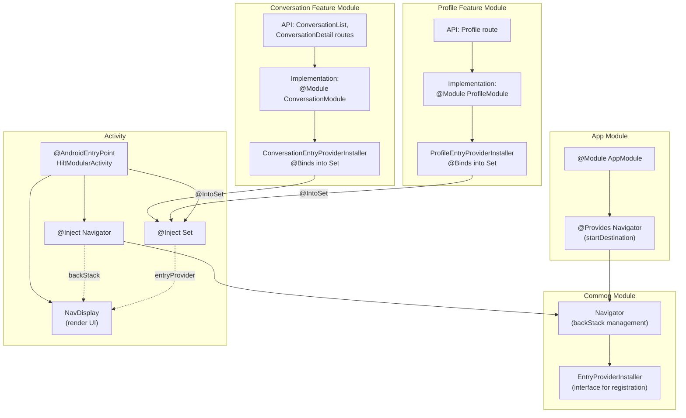
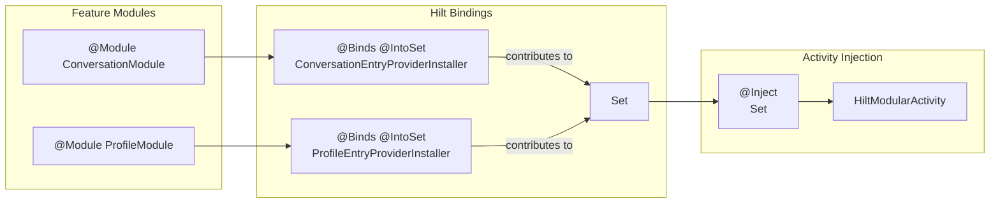
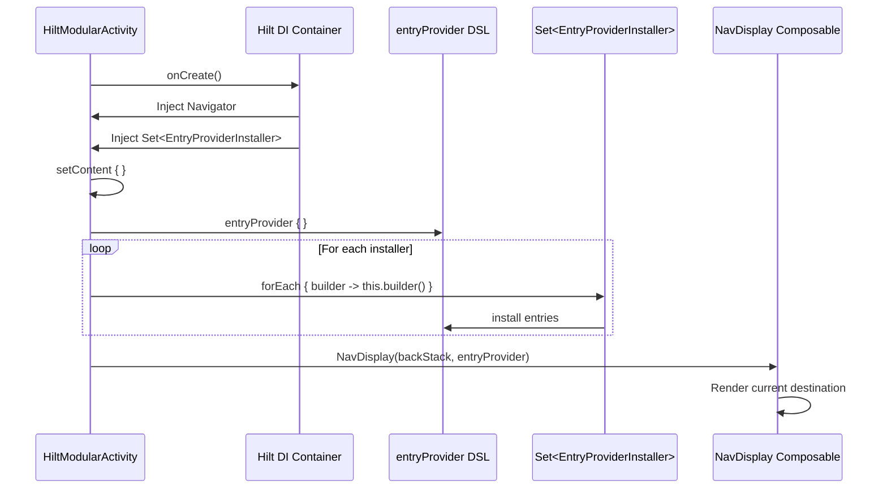
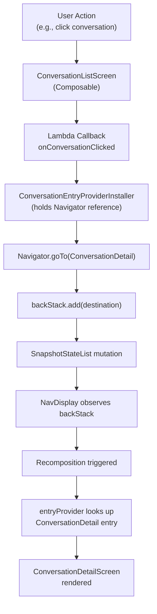
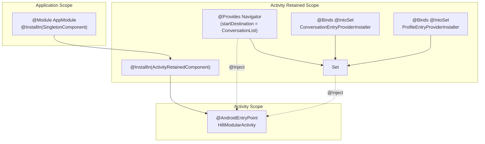
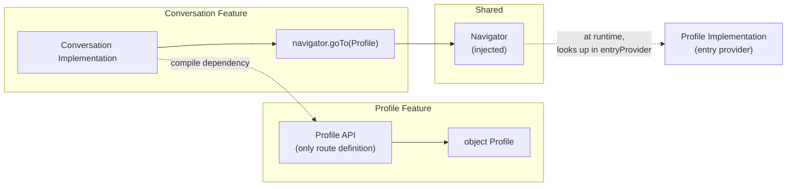

<!-- source: DeepWiki mcp.deepwiki.com · repo android/nav3-recipes · page 10.1 Hilt Modular Navigation · fetched 2026-10-23 -->

# Hilt Modular Navigation

<details>
<summary>Relevant source files</summary>

The following files were used as context for generating this wiki page:

- [app/src/main/java/com/example/nav3recipes/modular/hilt/HiltModularActivity.kt](app/src/main/java/com/example/nav3recipes/modular/hilt/HiltModularActivity.kt)
- [app/src/main/java/com/example/nav3recipes/modular/koin/AppModule.kt](app/src/main/java/com/example/nav3recipes/modular/koin/AppModule.kt)
- [app/src/main/java/com/example/nav3recipes/modular/koin/CommonModule.kt](app/src/main/java/com/example/nav3recipes/modular/koin/CommonModule.kt)
- [app/src/main/java/com/example/nav3recipes/modular/koin/ConversationModule.kt](app/src/main/java/com/example/nav3recipes/modular/koin/ConversationModule.kt)
- [app/src/main/java/com/example/nav3recipes/modular/koin/KoinModularActivity.kt](app/src/main/java/com/example/nav3recipes/modular/koin/KoinModularActivity.kt)
- [app/src/main/java/com/example/nav3recipes/modular/koin/ProfileModule.kt](app/src/main/java/com/example/nav3recipes/modular/koin/ProfileModule.kt)

</details>


## Purpose and Scope

This page documents the Hilt-based modular navigation pattern, which decouples navigation implementation into feature modules using Dagger/Hilt for dependency injection. Each feature module independently defines its routes and UI screens, then registers them with the main application through Hilt's multibinding mechanism.

For the Koin-based alternative to this pattern, see [10.2](#10.2). For basic ViewModel injection with Hilt (non-modular), see [9.2](#9.2).

---

## Architecture Overview

The modular navigation pattern separates concerns into distinct layers:

| Layer | Responsibility | Example Components |
|-------|----------------|-------------------|
| **Common Module** | Shared navigation infrastructure | `Navigator`, `EntryProviderInstaller` interface |
| **Feature Module API** | Public route definitions (serializable NavKeys) | `ConversationList`, `ConversationDetail`, `Profile` |
| **Feature Module Implementation** | Entry providers mapping routes to UI | Hilt modules providing `EntryProviderInstaller` implementations |
| **App Module** | Assembly and dependency graph configuration | Hilt application module, root `Navigator` provision |
| **Activity** | UI rendering and navigation display | `HiltModularActivity` |

This architecture enables feature teams to work independently, adding new destinations without modifying existing features or the main application code.



Sources: [app/src/main/java/com/example/nav3recipes/modular/hilt/HiltModularActivity.kt:1-40]()

---

## Core Components

### Navigator Class

The `Navigator` class encapsulates back stack state and provides navigation operations. It is a shared singleton (activity-scoped in Hilt) that all feature modules depend on.

**Key Responsibilities:**
- Maintains `backStack: SnapshotStateList<Any>` for navigation state
- Provides `goTo(destination: Any)` to push destinations
- Provides `goBack()` to pop destinations

**Implementation Structure:**
```kotlin
class Navigator(startDestination: Any) {
    val backStack : SnapshotStateList<Any> = mutableStateListOf(startDestination)
    
    fun goTo(destination: Any) {
        backStack.add(destination)
    }
    
    fun goBack() {
        backStack.removeLastOrNull()
    }
}
```

This class is analogous to the `Navigator` pattern described in [11.1](#11.1), but simplified for modular demonstration purposes.

Sources: [app/src/main/java/com/example/nav3recipes/modular/koin/CommonModule.kt:6-16]()

---

### EntryProviderInstaller Interface

The `EntryProviderInstaller` is a functional interface (SAM type) that feature modules implement to register their navigation entries:

```kotlin
typealias EntryProviderInstaller = EntryProviderScope.() -> Unit
```

Feature modules provide implementations that are bound into a Hilt `Set` using multibinding. The activity collects all installers and applies them to the `entryProvider` DSL.

Sources: [app/src/main/java/com/example/nav3recipes/modular/hilt/HiltModularActivity.kt:22-34]()

---

## Hilt Integration Strategy

### Multibinding Pattern

Hilt's multibinding (`@IntoSet`) enables feature modules to independently contribute `EntryProviderInstaller` implementations without the app module knowing about specific features.



**Example Module Declaration:**
```kotlin
@Module
@InstallIn(ActivityComponent::class)
abstract class ConversationModule {
    
    @Binds
    @IntoSet
    abstract fun bindConversationInstaller(
        installer: ConversationEntryProviderInstaller
    ): EntryProviderInstaller
}
```

Sources: [app/src/main/java/com/example/nav3recipes/modular/hilt/HiltModularActivity.kt:22]()

---

### Activity Injection Point

`HiltModularActivity` uses the `@AndroidEntryPoint` annotation to enable Hilt injection. It receives two injected dependencies:

| Injected Dependency | Type | Purpose |
|---------------------|------|---------|
| `navigator` | `Navigator` | Shared back stack management across all features |
| `entryProviderScopes` | `Set<EntryProviderInstaller>` | All registered entry provider installers from features |

**Implementation:**
[app/src/main/java/com/example/nav3recipes/modular/hilt/HiltModularActivity.kt:15-23]()

```kotlin
@AndroidEntryPoint
class HiltModularActivity : ComponentActivity() {
    
    @Inject
    lateinit var navigator: Navigator
    
    @Inject
    lateinit var entryProviderScopes: Set<@JvmSuppressWildcards EntryProviderInstaller>
```

The `@JvmSuppressWildcards` annotation prevents Kotlin from generating wildcard types in the bytecode, which would cause Hilt binding failures.

Sources: [app/src/main/java/com/example/nav3recipes/modular/hilt/HiltModularActivity.kt:15-22]()

---

## Feature Module Structure

Each feature module follows a consistent pattern:

### 1. API Layer - Route Definitions

Routes are defined as serializable objects or data classes:

```kotlin
// Conversation Feature API
object ConversationList
data class ConversationDetail(val id: Int)

// Profile Feature API  
object Profile
```

These routes serve as NavKeys (see [12.1](#12.1)) and can be referenced by any module that depends on the feature's API.

Sources: [app/src/main/java/com/example/nav3recipes/modular/koin/ConversationModule.kt:30-34](), [app/src/main/java/com/example/nav3recipes/modular/koin/ProfileModule.kt:20]()

---

### 2. Implementation Layer - Entry Provider Installer

Each feature provides an `EntryProviderInstaller` implementation that maps routes to composable content:

```kotlin
@ActivityRetainedScoped
class ConversationEntryProviderInstaller @Inject constructor(
    private val navigator: Navigator
) : EntryProviderInstaller {
    
    override fun EntryProviderScope.invoke() {
        entry<ConversationList> { 
            ConversationListScreen(
                onConversationClicked = { detail -> 
                    navigator.goTo(detail) 
                }
            ) 
        }
        
        entry<ConversationDetail> { key -> 
            ConversationDetailScreen(
                conversationDetail = key,
                onProfileClicked = { navigator.goTo(Profile) }
            ) 
        }
    }
}
```

The installer receives the `Navigator` via constructor injection, enabling cross-feature navigation without direct feature dependencies.

Sources: [app/src/main/java/com/example/nav3recipes/modular/koin/ConversationModule.kt:38-52]()

---

### 3. Hilt Module - Binding Registration

A Hilt module binds the installer into the multibinding set:

```kotlin
@Module
@InstallIn(ActivityRetainedComponent::class)
abstract class ConversationModule {
    
    @Binds
    @IntoSet
    abstract fun bindInstaller(
        installer: ConversationEntryProviderInstaller
    ): EntryProviderInstaller
}
```

Using `ActivityRetainedComponent` ensures installers survive configuration changes but are scoped to the activity lifecycle.

Sources: [app/src/main/java/com/example/nav3recipes/modular/hilt/HiltModularActivity.kt:22]()

---

## Activity Setup and EntryProvider Assembly

`HiltModularActivity` assembles all feature installers into a unified `entryProvider`:



**Implementation Details:**
[app/src/main/java/com/example/nav3recipes/modular/hilt/HiltModularActivity.kt:24-39]()

```kotlin
override fun onCreate(savedInstanceState: Bundle?) {
    super.onCreate(savedInstanceState)
    setEdgeToEdgeConfig()
    setContent {
        Scaffold { paddingValues ->
            NavDisplay(
                backStack = navigator.backStack,
                modifier = Modifier.padding(paddingValues),
                onBack = { navigator.goBack() },
                entryProvider = entryProvider {
                    entryProviderScopes.forEach { builder -> this.builder() }
                }
            )
        }
    }
}
```

The line `entryProviderScopes.forEach { builder -> this.builder() }` invokes each `EntryProviderInstaller` lambda within the `EntryProviderScope` context, registering all feature entries into a single provider. For details on the `entryProvider` DSL, see [4.2](#4.2).

Sources: [app/src/main/java/com/example/nav3recipes/modular/hilt/HiltModularActivity.kt:27-36]()

---

## Runtime Navigation Flow

When a user navigates between features:



**Key Flow Steps:**

1. **User Interaction**: User triggers navigation (e.g., clicks a conversation in the list)
2. **Callback Invocation**: Composable invokes a lambda callback passed as a parameter
3. **Navigator Call**: Installer's injected `Navigator` instance receives `goTo(destination)`
4. **State Mutation**: `Navigator` adds destination to `backStack` (Compose `SnapshotStateList`)
5. **Reactive Observation**: `NavDisplay` observes the `backStack` state change
6. **Entry Lookup**: `NavDisplay` uses `entryProvider` to find the composable for the new destination
7. **Recomposition**: Compose recomposes with the new destination's UI

This flow demonstrates Navigation 3's Unidirectional Data Flow pattern (see [3.1](#3.1)).

Sources: [app/src/main/java/com/example/nav3recipes/modular/hilt/HiltModularActivity.kt:29-35](), [app/src/main/java/com/example/nav3recipes/modular/koin/CommonModule.kt:9-15]()

---

## Dependency Graph Structure

The complete Hilt dependency graph for modular navigation:



**Scope Rationale:**

| Component Scope | Lifetime | Used For |
|----------------|----------|----------|
| `ActivityRetainedComponent` | Survives configuration changes, dies with activity | `Navigator`, `EntryProviderInstaller` implementations |
| `ActivityComponent` | Dies with activity, recreated on rotation | UI-related dependencies (not used in this recipe) |

Using `ActivityRetainedComponent` ensures the `Navigator` back stack persists across screen rotations without requiring explicit state saving.

Sources: [app/src/main/java/com/example/nav3recipes/modular/hilt/HiltModularActivity.kt:15-39]()

---

## Cross-Feature Navigation

Feature modules navigate to other features by depending on their API modules (which only contain route definitions):



**Dependency Structure:**

- **Conversation Implementation Module** depends on **Profile API Module** (compile-time)
- **Conversation Implementation Module** injects **Navigator** (runtime)
- **Navigator** does NOT know about Profile implementation (decoupled)
- **Profile Implementation Module** is discovered at runtime via Hilt multibinding

This creates compile-time safety for route types while maintaining runtime modularity.

Sources: [app/src/main/java/com/example/nav3recipes/modular/koin/ConversationModule.kt:49]()

---

## Comparison with Koin Implementation

The Koin-based alternative ([10.2](#10.2)) achieves the same modular architecture with runtime dependency injection:

| Aspect | Hilt Implementation | Koin Implementation |
|--------|---------------------|---------------------|
| **Annotation Processing** | Compile-time code generation | Runtime reflection |
| **Multibinding** | `@Binds @IntoSet` | Koin `activityRetainedScope { navigation<T> { } }` DSL |
| **Activity Annotation** | `@AndroidEntryPoint` | Implements `AndroidScopeComponent` |
| **Installer Collection** | `Set<EntryProviderInstaller>` injected | `getEntryProvider()` composable function |
| **Module Declaration** | Abstract Hilt modules with `@Binds` | Kotlin `module { }` DSL |
| **Navigator Provision** | `@Provides` in app module | `scoped { Navigator(...) }` in app module |

Both approaches result in identical runtime behavior and architecture. Choose Hilt for compile-time safety and performance, or Koin for simplicity and Kotlin-first APIs.

Sources: [app/src/main/java/com/example/nav3recipes/modular/hilt/HiltModularActivity.kt:15-39](), [app/src/main/java/com/example/nav3recipes/modular/koin/KoinModularActivity.kt:40-74]()

---

## Benefits and Trade-offs

### Benefits

- **Decoupled Features**: Features are independent Gradle modules with no direct dependencies
- **Parallel Development**: Teams can work on different features simultaneously
- **Selective Inclusion**: Dynamic feature modules can conditionally include/exclude features
- **Type Safety**: Compile-time verification of route types when depending on API modules
- **Testability**: Feature modules can be tested in isolation with mocked `Navigator`

### Trade-offs

- **Complexity**: More infrastructure code compared to monolithic navigation ([4.1](#4.1))
- **Build Time**: Hilt annotation processing adds compile-time overhead
- **Indirection**: Navigation flow requires understanding the DI graph
- **Boilerplate**: Each feature requires module declarations and binding setup

This pattern is recommended for medium-to-large applications with multiple teams or dynamic feature modules. For simpler applications, consider the basic navigation patterns in [4.1](#4.1).

Sources: [app/src/main/java/com/example/nav3recipes/modular/hilt/HiltModularActivity.kt:1-40]()

---

