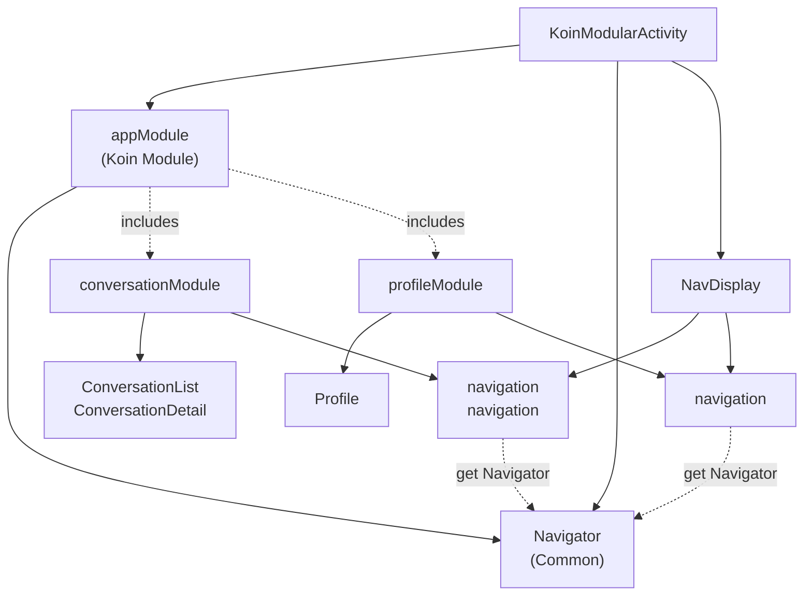
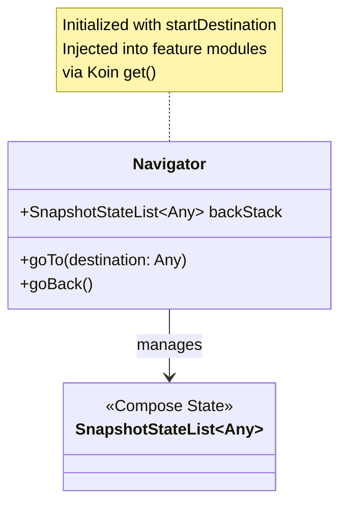
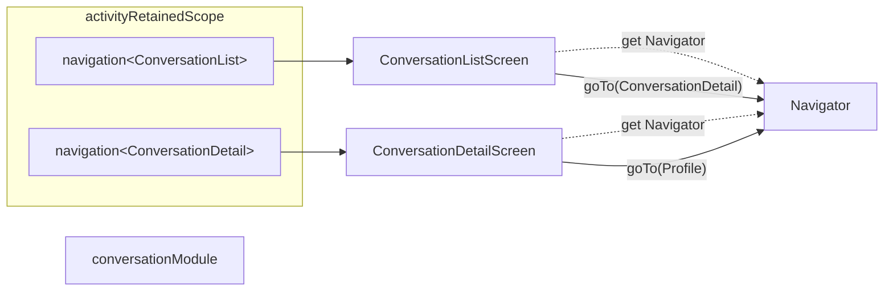
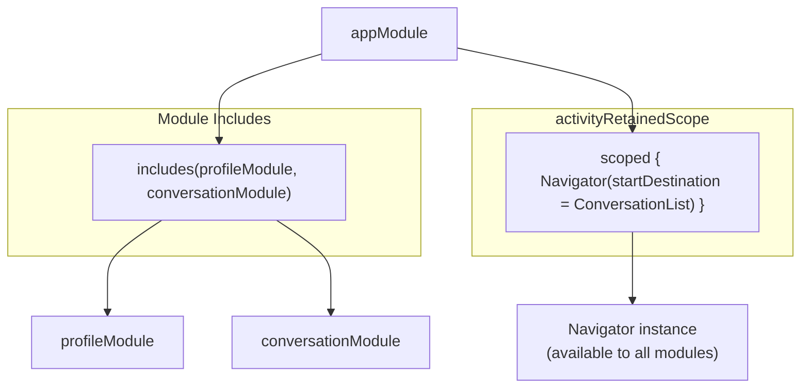
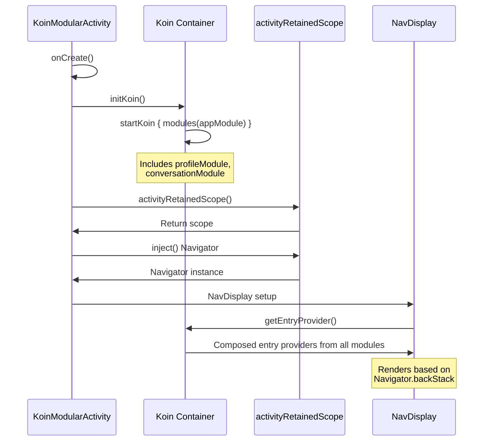
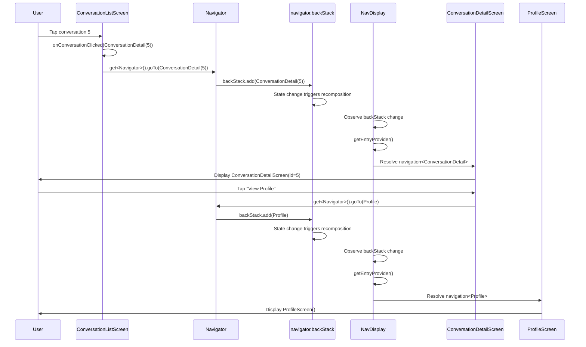

<!-- source: DeepWiki mcp.deepwiki.com · repo android/nav3-recipes · page 10.2 Koin Modular Navigation · fetched 2026-10-23 -->

# Koin Modular Navigation

<details>
<summary>Relevant source files</summary>

The following files were used as context for generating this wiki page:

- [app/src/main/java/com/example/nav3recipes/modular/hilt/HiltModularActivity.kt](app/src/main/java/com/example/nav3recipes/modular/hilt/HiltModularActivity.kt)
- [app/src/main/java/com/example/nav3recipes/modular/koin/AppModule.kt](app/src/main/java/com/example/nav3recipes/modular/koin/AppModule.kt)
- [app/src/main/java/com/example/nav3recipes/modular/koin/CommonModule.kt](app/src/main/java/com/example/nav3recipes/modular/koin/CommonModule.kt)
- [app/src/main/java/com/example/nav3recipes/modular/koin/ConversationModule.kt](app/src/main/java/com/example/nav3recipes/modular/koin/ConversationModule.kt)
- [app/src/main/java/com/example/nav3recipes/modular/koin/KoinModularActivity.kt](app/src/main/java/com/example/nav3recipes/modular/koin/KoinModularActivity.kt)
- [app/src/main/java/com/example/nav3recipes/modular/koin/ProfileModule.kt](app/src/main/java/com/example/nav3recipes/modular/koin/ProfileModule.kt)

</details>


This page demonstrates how to structure Navigation 3 code into feature modules using **Koin** for runtime dependency injection. The pattern decouples navigation logic by defining feature-specific entry providers in separate modules that are composed together at the application level.

For the compile-time Dagger/Hilt equivalent, see [Hilt Modular Navigation](#10.1). For basic Koin usage with ViewModels, see [Koin Injected ViewModels](#9.3).

## Architecture Overview

The Koin modular navigation pattern separates navigation concerns across three layers:

1. **Common Module**: Defines the `Navigator` class and shared navigation infrastructure
2. **Feature Modules**: Each feature (Conversation, Profile) defines its own routes and entry providers
3. **App Module**: Composes all feature modules and provides the `Navigator` instance



**Sources:** [app/src/main/java/com/example/nav3recipes/modular/koin/KoinModularActivity.kt:26-38](), [app/src/main/java/com/example/nav3recipes/modular/koin/AppModule.kt:1-14]()

## Module Structure Breakdown

The modular architecture uses Koin's module system to organize code:

| Module | Responsibilities | Key Types | Scope |
|--------|------------------|-----------|-------|
| Common | `Navigator` class definition | `Navigator` | N/A (defined in `.kt` file) |
| App Module | Compose feature modules, provide `Navigator` instance | `appModule` | `activityRetainedScope` |
| Conversation Module | Routes: `ConversationList`, `ConversationDetail`<br/>Entry providers for conversation screens | `conversationModule` | `activityRetainedScope` |
| Profile Module | Route: `Profile`<br/>Entry provider for profile screen | `profileModule` | `activityRetainedScope` |

**Sources:** [app/src/main/java/com/example/nav3recipes/modular/koin/AppModule.kt:6-14](), [app/src/main/java/com/example/nav3recipes/modular/koin/ConversationModule.kt:36-53](), [app/src/main/java/com/example/nav3recipes/modular/koin/ProfileModule.kt:22-27]()

## Navigator Implementation

The `Navigator` class provides a centralized back stack and navigation operations:



The implementation at [app/src/main/java/com/example/nav3recipes/modular/koin/CommonModule.kt:6-16]() shows:

- **`backStack`**: A `mutableStateListOf<Any>` initialized with `startDestination`
- **`goTo(destination)`**: Adds a destination to the back stack
- **`goBack()`**: Removes the last entry from the back stack

This simple implementation demonstrates the pattern. Production code would likely add type safety, validation, and more sophisticated back stack management.

**Sources:** [app/src/main/java/com/example/nav3recipes/modular/koin/CommonModule.kt:6-16]()

## Feature Module Implementation

Feature modules use Koin's **experimental `navigation` DSL** to register entry providers within `activityRetainedScope`.

### Conversation Module Structure



The conversation module defines two routes and their corresponding screens:

**Route Definitions** ([app/src/main/java/com/example/nav3recipes/modular/koin/ConversationModule.kt:30-34]()):
- `object ConversationList`: List of conversations
- `data class ConversationDetail(val id: Int)`: Detail view for a specific conversation with color property

**Entry Provider Registration** ([app/src/main/java/com/example/nav3recipes/modular/koin/ConversationModule.kt:38-52]()):
```
activityRetainedScope {
    navigation<ConversationList> {
        ConversationListScreen(onConversationClicked = { ... })
    }
    
    navigation<ConversationDetail> { key ->
        ConversationDetailScreen(key) { ... }
    }
}
```

Key patterns:
- **Scope**: `activityRetainedScope` ensures the module survives configuration changes
- **Type-safe keys**: `navigation<ConversationList>` registers the entry provider for that specific type
- **Navigator injection**: Uses `get<Navigator>()` to retrieve the shared `Navigator` instance
- **Parameter passing**: `navigation<ConversationDetail> { key ->` receives the route data

**Sources:** [app/src/main/java/com/example/nav3recipes/modular/koin/ConversationModule.kt:30-53]()

### Profile Module Structure

The profile module follows the same pattern with a single route:

**Route Definition** ([app/src/main/java/com/example/nav3recipes/modular/koin/ProfileModule.kt:20]()):
- `object Profile`: Profile screen (no parameters)

**Entry Provider Registration** ([app/src/main/java/com/example/nav3recipes/modular/koin/ProfileModule.kt:24-26]()):
```
activityRetainedScope {
    navigation<Profile> { ProfileScreen() }
}
```

**Sources:** [app/src/main/java/com/example/nav3recipes/modular/koin/ProfileModule.kt:19-27]()

## App Module Composition

The app module uses Koin's `includes()` to compose feature modules and provides the `Navigator`:



The implementation at [app/src/main/java/com/example/nav3recipes/modular/koin/AppModule.kt:6-13]() shows:

1. **Module composition**: `includes(profileModule, conversationModule)` merges feature modules
2. **Navigator provision**: `scoped { Navigator(startDestination = ConversationList) }` creates a single `Navigator` instance in `activityRetainedScope`
3. **Start destination**: `ConversationList` is the initial screen

This structure allows feature modules to request `get<Navigator>()` and receive the same instance.

**Sources:** [app/src/main/java/com/example/nav3recipes/modular/koin/AppModule.kt:1-14]()

## Activity Setup and Koin Integration

`KoinModularActivity` initializes Koin, retrieves the `Navigator`, and sets up `NavDisplay`:



### Scope Management

The activity implements `AndroidScopeComponent` to use Koin's activity-retained scope:

```
class KoinModularActivity : ComponentActivity(), AndroidScopeComponent {
    override val scope : Scope by activityRetainedScope()
    val navigator: Navigator by inject()
}
```

**Key points:**
- **`AndroidScopeComponent`**: Interface that provides scope management
- **`activityRetainedScope()`**: Scope that survives configuration changes but not process death
- **`by inject()`**: Lazy injection of the `Navigator` from the scope

**Sources:** [app/src/main/java/com/example/nav3recipes/modular/koin/KoinModularActivity.kt:41-44]()

### Koin Initialization

The `initKoin()` method at [app/src/main/java/com/example/nav3recipes/modular/koin/KoinModularActivity.kt:64-73]() initializes Koin if not already started:

```
private fun initKoin() {
    if (KoinPlatform.getKoinOrNull() == null) {
        startKoin {
            androidContext(this@KoinModularActivity)
            androidLogger(Level.DEBUG)
            modules(appModule)
        }
    }
}
```

**Note:** The comment at [app/src/main/java/com/example/nav3recipes/modular/koin/KoinModularActivity.kt:66]() indicates this should ideally be in `Application.onCreate()` for production apps. The recipe uses activity-level initialization for demonstration purposes.

**Sources:** [app/src/main/java/com/example/nav3recipes/modular/koin/KoinModularActivity.kt:64-73]()

### NavDisplay Setup

The `NavDisplay` is configured with the Koin-provided entry provider:

```
NavDisplay(
    backStack = navigator.backStack,
    modifier = Modifier.padding(paddingValues),
    onBack = { navigator.goBack() },
    entryProvider = getEntryProvider()
)
```

**`getEntryProvider()`** ([app/src/main/java/com/example/nav3recipes/modular/koin/KoinModularActivity.kt:58]()) is a Koin Compose extension that:
1. Retrieves all registered `navigation<T>` entry providers from the scope
2. Composes them into a single entry provider
3. Returns the composed entry provider for use by `NavDisplay`

This automatically aggregates entry providers from all included modules (`profileModule`, `conversationModule`).

**Sources:** [app/src/main/java/com/example/nav3recipes/modular/koin/KoinModularActivity.kt:52-61]()

## Comparison with Hilt Modular Approach

| Aspect | Koin Modular | Hilt Modular |
|--------|--------------|--------------|
| Initialization | `startKoin { modules(appModule) }` at runtime | Annotation processing at compile time |
| Scope Definition | `activityRetainedScope { }` | `@ActivityRetainedScoped` annotation |
| Entry Provider Registration | `navigation<T> { }` DSL | `@IntoSet` multibinding |
| Module Composition | `includes(module1, module2)` | Hilt modules automatically discovered |
| Type System | `typealias EntryProviderInstaller` not needed | `typealias EntryProviderInstaller` for multibinding |
| Navigator Injection | `get<Navigator>()` in lambdas | `@Inject lateinit var navigator` in activity |
| Entry Provider Retrieval | `getEntryProvider()` composable | Manual `entryProvider { }` with forEach |

The Koin approach uses runtime reflection and DSLs, resulting in less boilerplate but no compile-time safety. The Hilt approach requires more annotations but provides compile-time validation.

**Sources:** [app/src/main/java/com/example/nav3recipes/modular/koin/KoinModularActivity.kt:1-74](), [app/src/main/java/com/example/nav3recipes/modular/hilt/HiltModularActivity.kt:1-40]()

## Navigation Flow Example

The complete navigation flow when a user taps a conversation:



**Key characteristics:**
1. Feature modules remain decoupled—they only know about routes and the `Navigator` interface
2. The `Navigator` manages back stack state
3. `NavDisplay` observes state changes and resolves the appropriate composable via Koin's entry provider
4. The `navigation<T>` DSL provides type-safe mapping from route types to composables

**Sources:** [app/src/main/java/com/example/nav3recipes/modular/koin/ConversationModule.kt:38-52](), [app/src/main/java/com/example/nav3recipes/modular/koin/CommonModule.kt:6-16]()

---

