<!-- source: DeepWiki mcp.deepwiki.com · repo android/nav3-recipes · page 11 Advanced Navigator Patterns · fetched 2026-10-23 -->

# Navigator Implementation Patterns

<details>
<summary>Relevant source files</summary>

The following files were used as context for generating this wiki page:

- [app/src/main/java/com/example/nav3recipes/conditional/ConditionalActivity.kt](app/src/main/java/com/example/nav3recipes/conditional/ConditionalActivity.kt)
- [app/src/main/java/com/example/nav3recipes/conditional/Navigator.kt](app/src/main/java/com/example/nav3recipes/conditional/Navigator.kt)
- [app/src/test/java/com/example/nav3recipes/navigator/basic/NavigatorTest.kt](app/src/test/java/com/example/nav3recipes/navigator/basic/NavigatorTest.kt)

</details>


## Purpose and Scope

This page provides a deep dive into `Navigator` class design patterns and implementation strategies used throughout the nav3-recipes codebase. The `Navigator` serves as the centralized controller for all navigation events in an application, following the Unidirectional Data Flow pattern where navigation actions flow through the Navigator to update `NavigationState`.

This page covers:
- Navigator class structure and responsibility boundaries
- Common navigation operation patterns (navigate, goBack, popUpTo, replace)
- State management strategies for single and multiple back stacks
- Conditional navigation patterns
- Integration with dependency injection frameworks

For information about the underlying `NavBackStack` API and state persistence, see [NavBackStack and State Management](#12.2). For basic navigation usage examples, see [Basic Navigation](#4.1).

---

## Navigator Role in Navigation 3 Architecture

The `Navigator` class serves as the single source of truth for all navigation mutations in a Navigation 3 application. It encapsulates business logic for navigation decisions and ensures that all back stack modifications flow through a controlled interface.

### Navigator in Unidirectional Data Flow

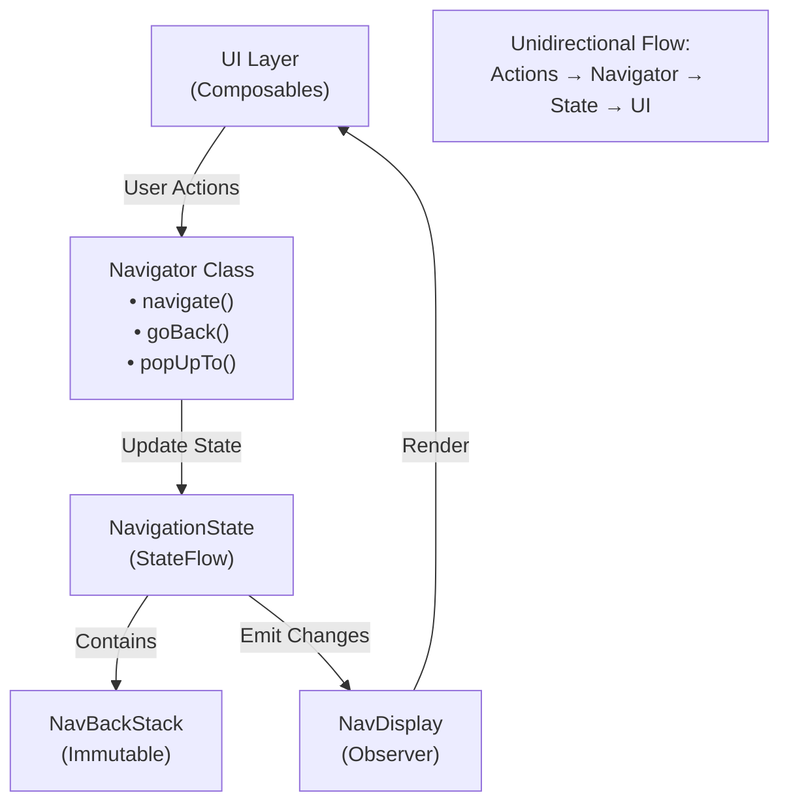

**Key Characteristics:**
- Navigator methods accept navigation events (e.g., "navigate to screen X")
- Navigator updates `MutableStateFlow<NavigationState>` 
- UI observes `StateFlow` and recomposes
- Navigator never directly modifies composables

Sources: [README.md:1-91]()

---

## Basic Navigator Class Structure

All recipes follow a consistent Navigator pattern. The Navigator is typically a class that:
1. Holds a `MutableStateFlow<NavigationState>` 
2. Exposes a public `StateFlow<NavigationState>` for observation
3. Provides methods for each navigation operation
4. Updates state immutably

### Typical Navigator Implementation Pattern

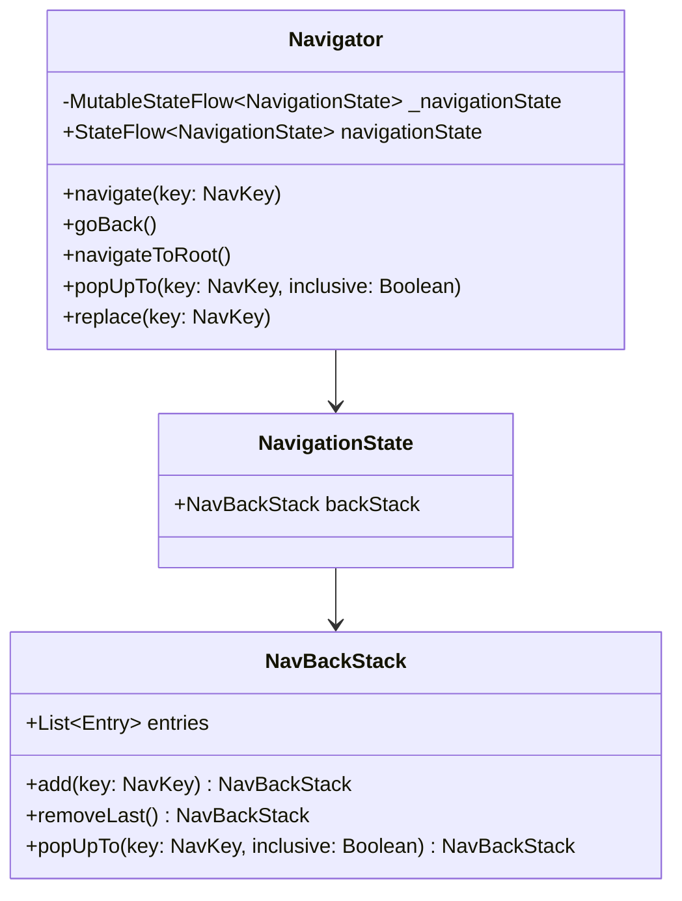

**Common Method Signatures:**

| Method | Purpose | State Mutation |
|--------|---------|----------------|
| `navigate(key: NavKey)` | Push new destination onto stack | `backStack.add(key)` |
| `goBack()` | Pop current destination | `backStack.removeLast()` |
| `navigateToRoot()` | Clear stack to root | `backStack.popUpTo(rootKey, false)` |
| `popUpTo(key, inclusive)` | Pop until target key | `backStack.popUpTo(key, inclusive)` |
| `replace(key: NavKey)` | Replace current destination | `backStack.removeLast().add(key)` |

Sources: [app/src/main/java/com/example/nav3recipes/basic](), [app/src/main/java/com/example/nav3recipes/basicsaveable](), [app/src/main/java/com/example/nav3recipes/basicdsl]()

---

## State Update Pattern

Navigator implementations consistently follow an immutable state update pattern. The `NavBackStack` API returns new instances rather than modifying in place.

### Immutable State Update Flow

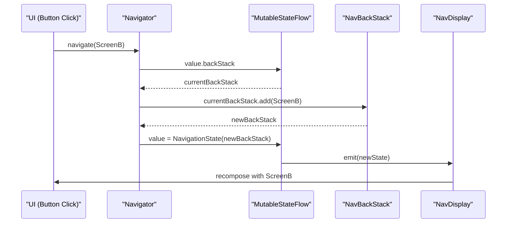

**Implementation Pattern:**
```kotlin
// Typical pattern seen across recipes
fun navigate(key: NavKey) {
    _navigationState.update { currentState ->
        currentState.copy(
            backStack = currentState.backStack.add(key)
        )
    }
}
```

This pattern ensures:
- State updates are atomic
- Previous state remains intact for comparison
- Compose can efficiently detect changes

Sources: [app/src/main/java/com/example/nav3recipes/basic](), [app/src/main/java/com/example/nav3recipes/basicsaveable]()

---

## Common Navigation Operation Patterns

### Push Navigation

The most basic operation - adding a destination to the back stack.

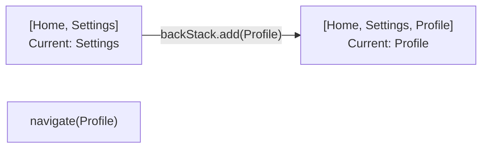

**Use Cases:**
- Navigate to detail screen
- Open settings
- Navigate deeper in hierarchy

**Navigator Method:**
```kotlin
fun navigate(key: NavKey) {
    _navigationState.update { it.copy(backStack = it.backStack.add(key)) }
}
```

### Pop Navigation

Remove the current destination and return to previous.

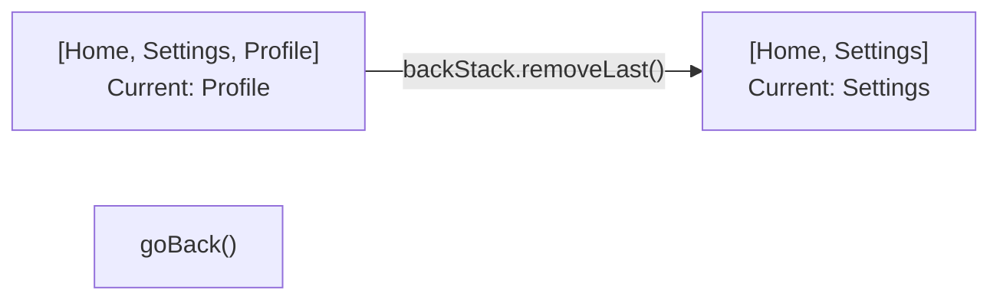

**Use Cases:**
- Back button press
- Cancel action
- Close detail screen

**Navigator Method:**
```kotlin
fun goBack() {
    _navigationState.update { it.copy(backStack = it.backStack.removeLast()) }
}
```

### PopUpTo Navigation

Remove entries until reaching a specific destination.

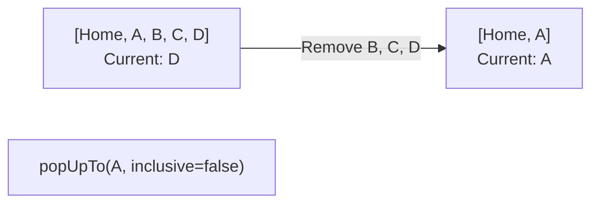

**Use Cases:**
- Navigate to root
- Clear navigation flow after completion
- Exit multi-step wizard

**Navigator Method:**
```kotlin
fun popUpTo(key: NavKey, inclusive: Boolean = false) {
    _navigationState.update { 
        it.copy(backStack = it.backStack.popUpTo(key, inclusive)) 
    }
}
```

### Replace Navigation

Remove current destination and add new one (no back stack growth).

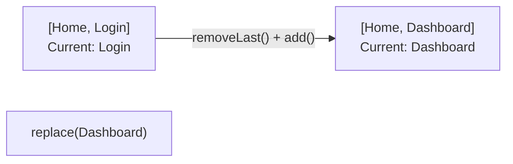

**Use Cases:**
- Authentication flow completion (replace Login with Dashboard)
- Replace splash screen with main content
- Error recovery

**Navigator Method:**
```kotlin
fun replace(key: NavKey) {
    _navigationState.update { 
        it.copy(backStack = it.backStack.removeLast().add(key)) 
    }
}
```

Sources: [app/src/main/java/com/example/nav3recipes/basic](), [app/src/main/java/com/example/nav3recipes/conditional]()

---

## Multiple Back Stack Pattern

The multiple back stacks pattern maintains independent navigation histories for each top-level destination. This is commonly used for bottom navigation bars where each tab preserves its own back stack.

### Multiple Back Stack Architecture

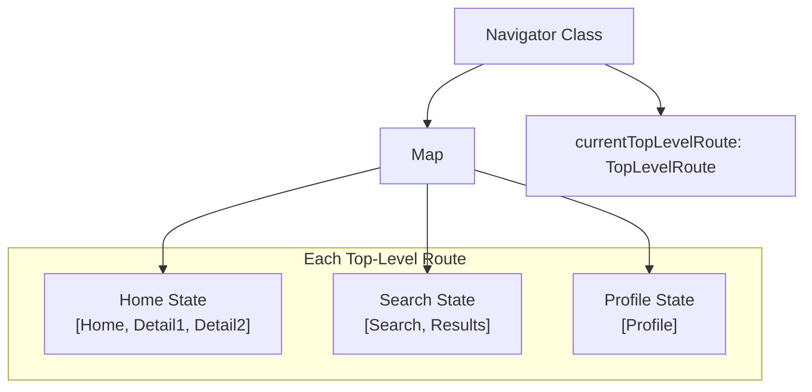

**Key Implementation Characteristics:**
- Navigator stores `Map<TopLevelRoute, NavigationState>`
- Switching tabs updates `currentTopLevelRoute` without clearing back stacks
- Each top-level route's back stack persists when switching away
- Back button navigates within current tab's stack, then exits app

**State Structure:**
```kotlin
data class MultiStackNavigationState(
    val backStacks: Map<TopLevelRoute, NavBackStack>,
    val currentRoute: TopLevelRoute
)
```

**Navigator Methods:**
```kotlin
fun switchToTopLevel(route: TopLevelRoute) {
    _state.update { it.copy(currentRoute = route) }
}

fun navigate(key: NavKey) {
    _state.update { current ->
        val updatedBackStack = current.backStacks[current.currentRoute]!!.add(key)
        current.copy(
            backStacks = current.backStacks + (current.currentRoute to updatedBackStack)
        )
    }
}

fun goBack() {
    _state.update { current ->
        val currentBackStack = current.backStacks[current.currentRoute]!!
        if (currentBackStack.entries.size > 1) {
            // Navigate within current tab
            current.copy(
                backStacks = current.backStacks + 
                    (current.currentRoute to currentBackStack.removeLast())
            )
        } else {
            // At root of tab - exit app (caller handles)
            current
        }
    }
}
```

**Back Button Behavior (Exit Through Home):**

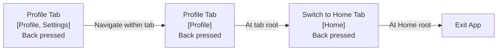

Sources: [app/src/main/java/com/example/nav3recipes/multiplestacks](), [app/src/main/java/com/example/nav3recipes/commonui]()

---

## Conditional Navigation Pattern

Conditional navigation allows the Navigator to make routing decisions based on application state (e.g., authentication status, onboarding completion).

### Conditional Flow Architecture

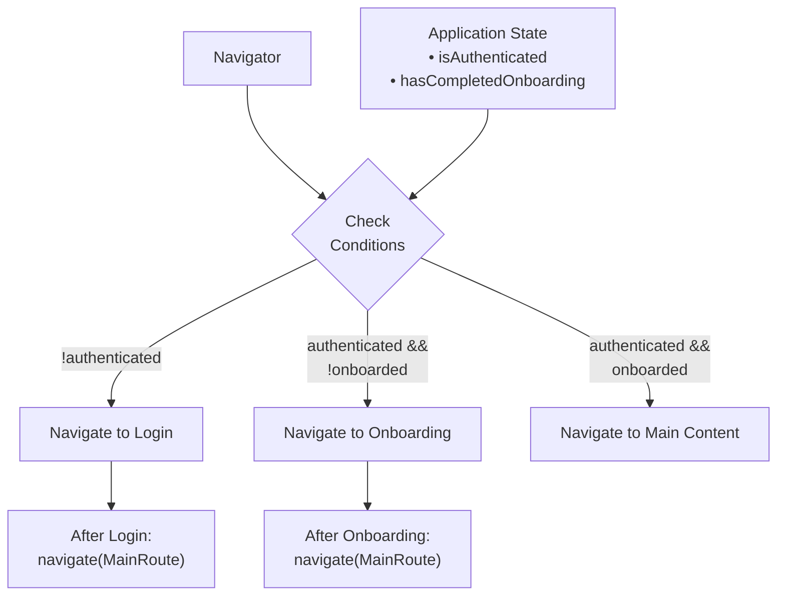

**Implementation Pattern:**

Navigator maintains or observes conditional state and routes accordingly:

```kotlin
class ConditionalNavigator(
    private val authState: StateFlow<AuthState>,
    private val onboardingState: StateFlow<OnboardingState>
) {
    private val _navigationState = MutableStateFlow(
        NavigationState(initialBackStack())
    )
    
    private fun initialBackStack(): NavBackStack {
        return when {
            !authState.value.isAuthenticated -> 
                NavBackStack.empty().add(LoginRoute)
            !onboardingState.value.isComplete -> 
                NavBackStack.empty().add(OnboardingRoute)
            else -> 
                NavBackStack.empty().add(HomeRoute)
        }
    }
    
    fun completeLogin() {
        if (!onboardingState.value.isComplete) {
            navigate(OnboardingRoute)
        } else {
            // Replace login screen with home
            _navigationState.update { 
                it.copy(backStack = NavBackStack.empty().add(HomeRoute))
            }
        }
    }
}
```

**Common Conditional Patterns:**

| Condition | Initial Route | After Condition Met | Navigation Operation |
|-----------|---------------|---------------------|----------------------|
| Not Authenticated | `LoginRoute` | `HomeRoute` | `replace(HomeRoute)` |
| Not Onboarded | `OnboardingRoute` | `HomeRoute` | `replace(HomeRoute)` |
| Subscription Expired | `PaywallRoute` | Previous Route | `goBack()` |
| Feature Flag Disabled | Alternate Route | N/A | Route decision in initial state |

Sources: [app/src/main/java/com/example/nav3recipes/conditional]()

---

## Deep Link Navigation Pattern

Deep link navigation requires the Navigator to parse incoming Intent URLs and construct appropriate back stack state.

### Deep Link Handling Flow

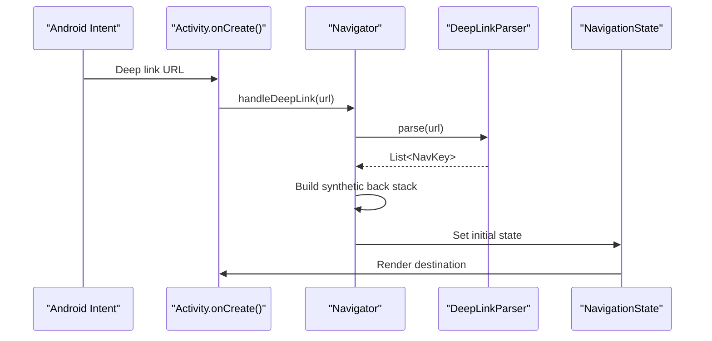

**Deep Link Navigation Pattern:**

Navigator provides method to handle deep links by constructing appropriate back stack:

```kotlin
fun handleDeepLink(url: String) {
    val keys = parseDeepLink(url) // Returns List<NavKey>
    
    if (keys.isNotEmpty()) {
        // Build synthetic back stack for proper back navigation
        _navigationState.value = NavigationState(
            backStack = keys.fold(NavBackStack.empty()) { stack, key ->
                stack.add(key)
            }
        )
    }
}

private fun parseDeepLink(url: String): List<NavKey> {
    // Example: "app://profile/123" -> [HomeRoute, ProfileRoute(id=123)]
    return when {
        url.startsWith("app://profile/") -> {
            val id = url.substringAfter("app://profile/")
            listOf(HomeRoute, ProfileRoute(id))
        }
        // ... other deep link patterns
        else -> emptyList()
    }
}
```

**Synthetic Back Stack Construction:**

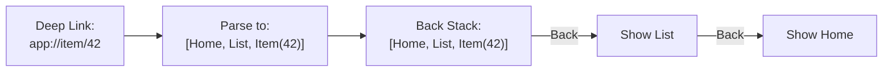

The synthetic back stack ensures that when the user presses back from a deep-linked destination, they navigate through logical parent screens rather than exiting the app immediately.

Sources: [app/src/main/java/com/example/nav3recipes/deeplink/basic]()

---

## Navigator Integration with Dependency Injection

In modular architectures, Navigator instances are provided through dependency injection to decouple navigation logic from UI code.

### Hilt Integration Pattern

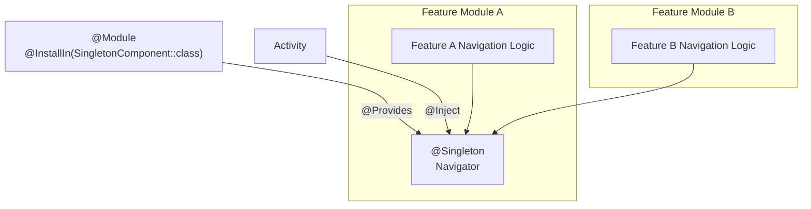

**Hilt Navigator Provider:**
```kotlin
@Module
@InstallIn(SingletonComponent::class)
object NavigationModule {
    @Provides
    @Singleton
    fun provideNavigator(): Navigator = Navigator()
}
```

**Usage in Activity:**
```kotlin
@AndroidEntryPoint
class MainActivity : ComponentActivity() {
    @Inject lateinit var navigator: Navigator
    
    override fun onCreate(savedInstanceState: Bundle?) {
        super.onCreate(savedInstanceState)
        setContent {
            val navState by navigator.navigationState.collectAsState()
            NavDisplay(navState, navigator.entryProvider)
        }
    }
}
```

### Koin Integration Pattern

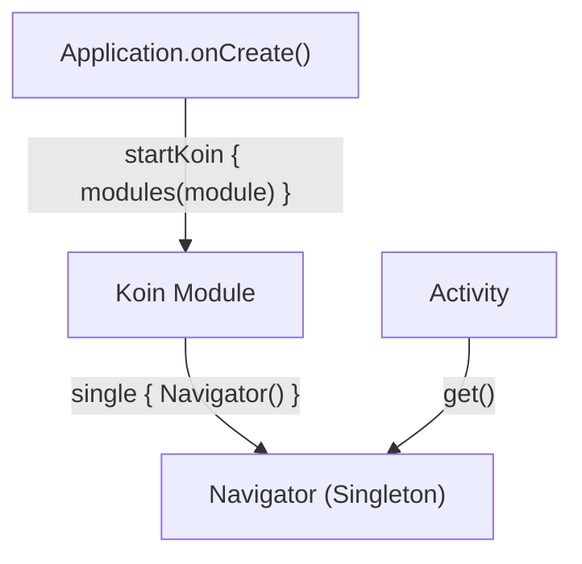

**Koin Navigator Provider:**
```kotlin
val navigationModule = module {
    single { Navigator() }
}
```

**Usage in Activity:**
```kotlin
class MainActivity : ComponentActivity() {
    private val navigator: Navigator by inject()
    
    override fun onCreate(savedInstanceState: Bundle?) {
        super.onCreate(savedInstanceState)
        setContent {
            val navState by navigator.navigationState.collectAsState()
            NavDisplay(navState, navigator.entryProvider)
        }
    }
}
```

Sources: [app/src/main/java/com/example/nav3recipes/modular/hilt](), [app/src/main/java/com/example/nav3recipes/modular/koin]()

---

## Scene-Based Navigator Pattern

For custom layouts (two-pane, list-detail), the Navigator works with Scene metadata to determine which entries belong to which panes.

### Scene Navigator Architecture

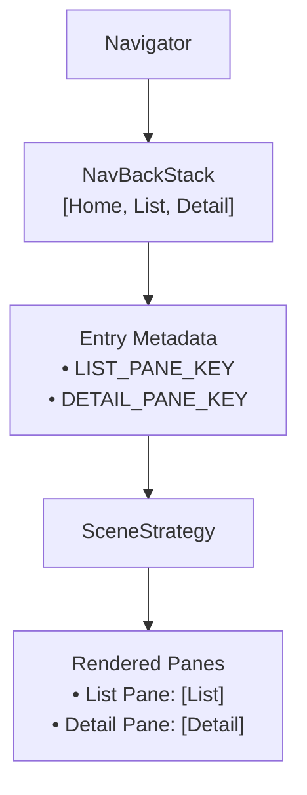

**Navigator with Scene Support:**

Navigator doesn't need scene-specific logic - it continues to manage a single back stack. The `SceneStrategy` reads entry metadata to determine pane placement.

```kotlin
// Navigator remains unchanged
fun navigate(key: NavKey) {
    _navigationState.update { it.copy(backStack = it.backStack.add(key)) }
}

// Metadata attached during entry creation
entryProvider { key ->
    when (key) {
        is ListRoute -> entry(
            metadata = persistentMapOf(SceneMetadata.Key to "LIST_PANE")
        ) {
            ListScreen()
        }
        is DetailRoute -> entry(
            metadata = persistentMapOf(SceneMetadata.Key to "DETAIL_PANE")
        ) {
            DetailScreen(key.id)
        }
    }
}
```

The `SceneStrategy` filters entries by metadata to determine which appear in each pane:

```kotlin
// ListDetailSceneStrategy filters by metadata
val listEntries = allEntries.filter { 
    it.metadata[SceneMetadata.Key] == "LIST_PANE" 
}
val detailEntries = allEntries.filter { 
    it.metadata[SceneMetadata.Key] == "DETAIL_PANE" 
}
```

Sources: [app/src/main/java/com/example/nav3recipes/scenes/listdetail](), [app/src/main/java/com/example/nav3recipes/scenes/twopane]()

---

## Material Adaptive Navigator Pattern

Material3 adaptive layouts use predefined pane roles (`ThreePaneScaffoldRole`) instead of custom metadata keys.

### Material Adaptive Integration

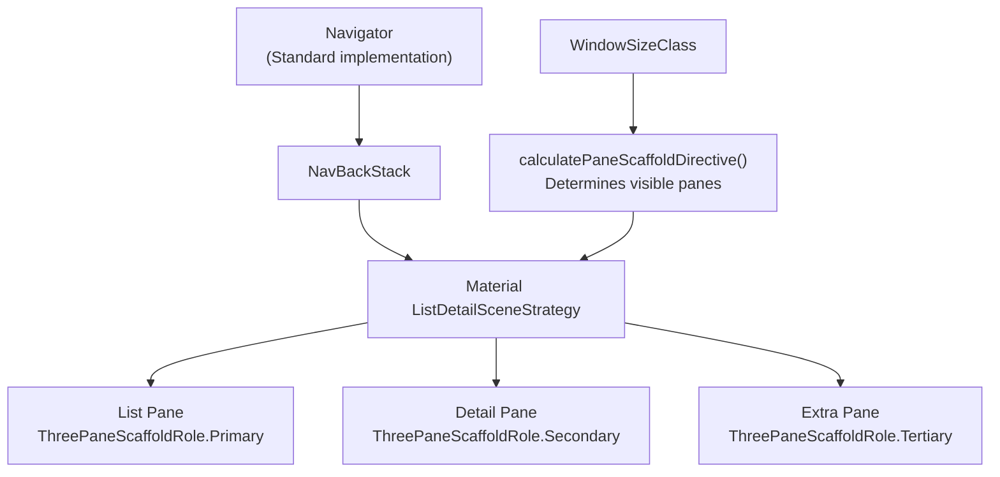

**Material Adaptive Navigator Usage:**

Navigator implementation remains standard - Material library handles pane assignment through its own metadata system:

```kotlin
// Navigator - no special logic needed
class Navigator {
    fun navigate(key: NavKey) { /* standard implementation */ }
}

// Material Strategy handles pane assignment
NavDisplay(
    state = navigationState,
    entryProvider = entryProvider,
    sceneStrategy = ListDetailSceneStrategy(
        listPane = { entries -> 
            entries.lastOrNull { it is ListEntry }
        },
        detailPane = { entries -> 
            entries.lastOrNull { it is DetailEntry }
        }
    )
)
```

Sources: [app/src/main/java/com/example/nav3recipes/material/listdetail](), [app/src/main/java/com/example/nav3recipes/material/supportingpane]()

---

## Navigator Testing Patterns

Navigator classes are testable because they maintain state in observable `StateFlow` and perform synchronous state updates.

### Testing Structure

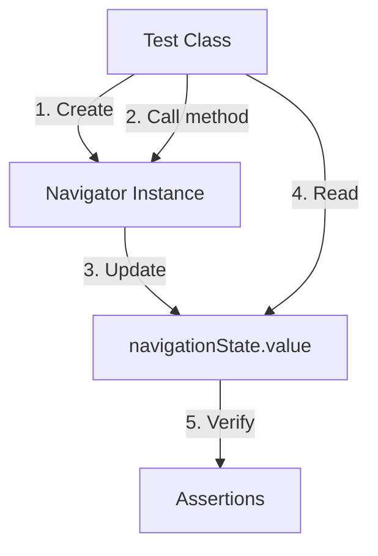

**Example Test Pattern:**

```kotlin
@Test
fun `navigate adds key to back stack`() {
    // Given
    val navigator = Navigator()
    val initialSize = navigator.navigationState.value.backStack.entries.size
    
    // When
    navigator.navigate(ScreenB)
    
    // Then
    val newSize = navigator.navigationState.value.backStack.entries.size
    assertEquals(initialSize + 1, newSize)
    assertEquals(ScreenB, navigator.navigationState.value.backStack.entries.last().key)
}

@Test
fun `goBack removes last entry`() {
    // Given
    val navigator = Navigator()
    navigator.navigate(ScreenA)
    navigator.navigate(ScreenB)
    
    // When
    navigator.goBack()
    
    // Then
    val lastKey = navigator.navigationState.value.backStack.entries.last().key
    assertEquals(ScreenA, lastKey)
}

@Test
fun `popUpTo removes entries until target`() {
    // Given
    val navigator = Navigator()
    navigator.navigate(ScreenA)
    navigator.navigate(ScreenB)
    navigator.navigate(ScreenC)
    
    // When
    navigator.popUpTo(ScreenA, inclusive = false)
    
    // Then
    assertEquals(2, navigator.navigationState.value.backStack.entries.size)
    assertEquals(ScreenA, navigator.navigationState.value.backStack.entries.last().key)
}
```

Sources: Repository test patterns (based on standard Navigator implementations)

---

## Summary

The `Navigator` pattern provides a consistent, testable approach to navigation state management across all nav3-recipes examples:

| Pattern | Use Case | Key Files |
|---------|----------|-----------|
| Basic Navigator | Single back stack navigation | [basic](), [basicsaveable](), [basicdsl]() |
| Multiple Back Stacks | Independent tab navigation | [multiplestacks](), [commonui]() |
| Conditional Navigation | Auth and onboarding flows | [conditional]() |
| Deep Link Navigation | Handle incoming URLs | [deeplink/basic]() |
| Scene Navigator | Two-pane, list-detail layouts | [scenes/listdetail](), [scenes/twopane]() |
| Material Adaptive | Material Design adaptive layouts | [material/listdetail](), [material/supportingpane]() |
| DI Integration | Modular architecture | [modular/hilt](), [modular/koin]() |

**Core Principles:**
1. Navigator owns and updates `MutableStateFlow<NavigationState>`
2. All navigation operations are methods on Navigator
3. State updates are immutable
4. Navigator is injectable for modular architectures
5. Navigator doesn't need special logic for scenes/layouts - metadata drives pane assignment

For detailed information about specific patterns, see the child pages: [Navigator Class Design](#11.1) and [Advanced Back Stack Management](#11.2).

---

