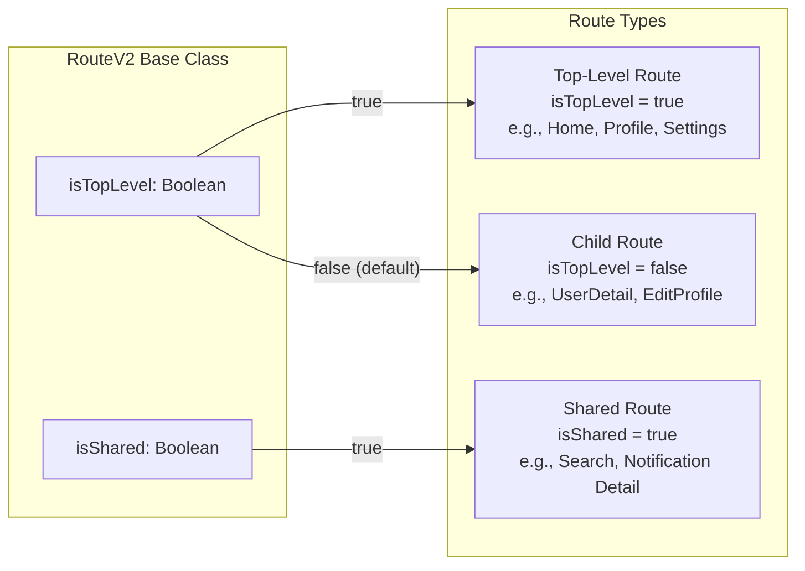
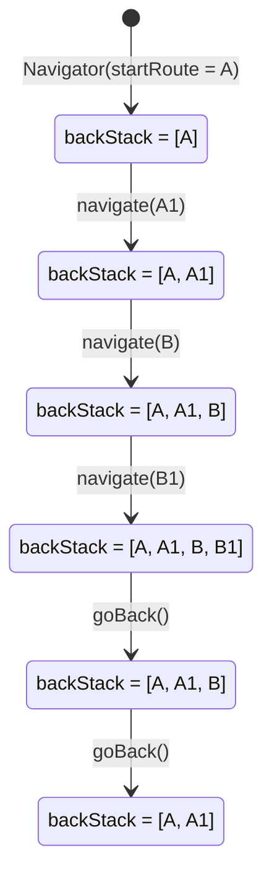
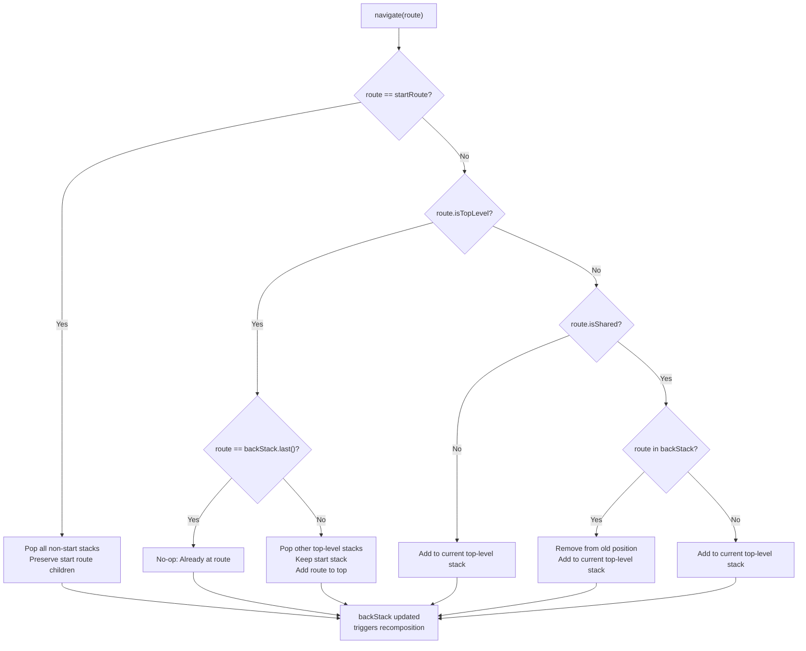
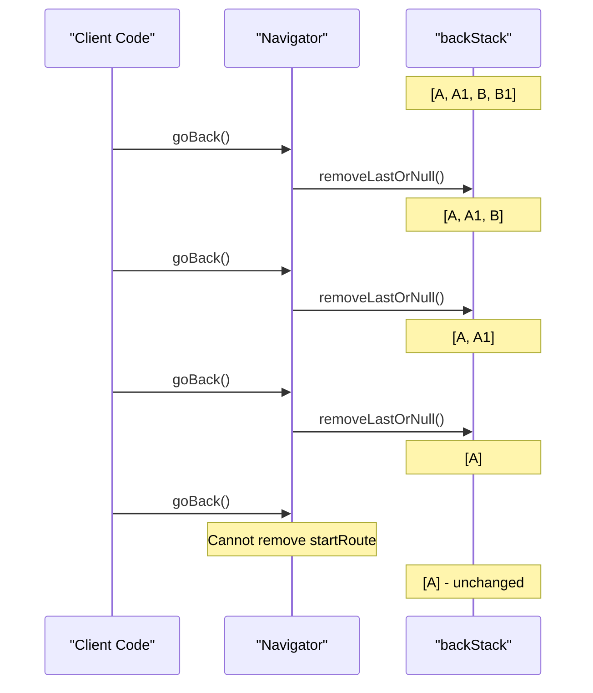
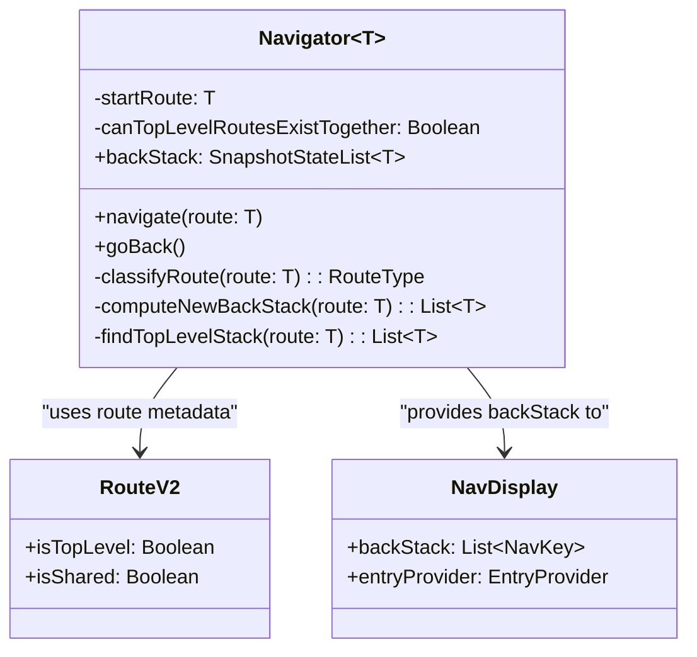
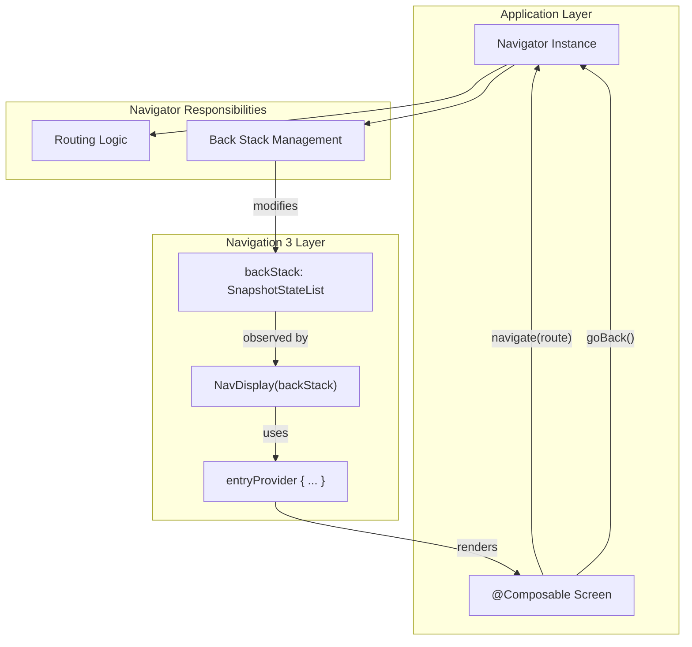

<!-- source: DeepWiki mcp.deepwiki.com · repo android/nav3-recipes · page 11.1 Navigator Class Design Patterns · fetched 2026-10-23 -->

# Navigator Class Design Patterns

<details>
<summary>Relevant source files</summary>

The following files were used as context for generating this wiki page:

- [app/src/test/java/com/example/nav3recipes/navigator/basic/NavigatorTest.kt](app/src/test/java/com/example/nav3recipes/navigator/basic/NavigatorTest.kt)

</details>


## Purpose and Scope

This document explains the **Navigator class** architectural pattern used in Navigation 3 recipes for orchestrating complex navigation logic. Navigator classes encapsulate back stack management, navigation events, and routing decisions into a dedicated state holder that sits between the UI layer and the `NavBackStack` primitive. 

This pattern is particularly useful for:
- Managing multiple independent back stacks (e.g., tab-based navigation)
- Implementing conditional navigation logic (e.g., login gates, permission checks)
- Enforcing application-specific navigation rules (e.g., "exit through home" semantics)

For simple linear navigation without complex routing logic, see [Basic Navigation API](#3.1). For multi-stack implementation details, see [Multiple Back Stacks Pattern](#5.1). For conditional navigation use cases, see [Conditional Navigation with Login Gates](#11.2).

---

## Navigator Class Architecture

A Navigator class follows a standard structure that separates navigation state from navigation operations:

```mermaid
graph TB
    subgraph "Navigator Class"
        BS["backStack: SnapshotStateList&lt;RouteV2&gt;"]
        SR["startRoute: RouteV2"]
        NAV["navigate(route: RouteV2)"]
        GB["goBack()"]
        LOGIC["Navigation Logic<br/>Route Classification<br/>Stack Management"]
    end
    
    subgraph "Client Code"
        UI["Composable UI"]
        VM["ViewModel (optional)"]
    end
    
    subgraph "Navigation 3 Primitives"
        NBS["NavBackStack"]
        ND["NavDisplay"]
    end
    
    UI -->|"calls"| NAV
    UI -->|"calls"| GB
    UI -->|"observes"| BS
    VM -->|"may hold"| BS
    
    NAV -->|"modifies"| BS
    GB -->|"modifies"| BS
    LOGIC -->|"enforces rules on"| BS
    
    BS -->|"passed to"| ND
    NBS -."|alternate:<br/>Navigator may wrap"| BS
```

**Key Components:**

| Component | Type | Purpose |
|-----------|------|---------|
| `backStack` | `SnapshotStateList<NavKey>` | Observable navigation state that triggers recomposition |
| `startRoute` | `NavKey` | Initial route, always present in the back stack |
| `navigate(route)` | Method | Adds routes based on classification and routing rules |
| `goBack()` | Method | Removes the top route from the stack |

The Navigator pattern provides a **higher-level API** over direct back stack manipulation. Instead of calling `backStack.add(key)` throughout UI code, clients call `navigator.navigate(key)`, allowing the Navigator to enforce consistent routing logic.

**Sources:** [app/src/test/java/com/example/nav3recipes/navigator/basic/NavigatorTest.kt:1-117]()

---

## Route Classification System

Navigator classes typically implement a **route classification system** to determine navigation behavior. Routes are categorized using metadata properties:



### Route Type Behaviors

| Route Type | Navigation Behavior | Example Use Cases |
|------------|-------------------|-------------------|
| **Top-Level** | Creates a new navigation stack; may pop other top-level stacks | Bottom navigation tabs, main sections |
| **Child** | Adds to the current top-level route's stack | Detail screens, sub-flows |
| **Shared** | Can appear in multiple stacks; moves to new stack on re-navigation | Search results, shared content |

**Example from tests:**
```kotlin
private data object A : RouteV2(isTopLevel = true)      // Top-level route
private data object A1 : RouteV2()                       // Child route (default)
private data object D : RouteV2(isShared = true)        // Shared route
```

**Sources:** [app/src/test/java/com/example/nav3recipes/navigator/basic/NavigatorTest.kt:8-14]()

---

## Navigation State Management

The Navigator maintains a `backStack` that is initialized with the `startRoute` and modified through navigation operations:



### Initialization Behavior

When a Navigator is created, the back stack contains only the start route:

[app/src/test/java/com/example/nav3recipes/navigator/basic/NavigatorTest.kt:16-20]()

```kotlin
@Test
fun backStackContainsOnlyStartRoute(){
    val navigator = Navigator<RouteV2>(startRoute = A)
    assertEquals(listOf<RouteV2>(A), navigator.backStack)
}
```

### Stack Preservation Rules

The Navigator enforces specific preservation rules when navigating between top-level routes:

**Rule 1: Start Route Stack Always Preserved**

When navigating to a new top-level route, the start route's stack is preserved:

[app/src/test/java/com/example/nav3recipes/navigator/basic/NavigatorTest.kt:37-45]()

```kotlin
navigator.navigate(A1)  // [A, A1]
navigator.navigate(C)   // [A, A1, C]
navigator.navigate(B)   // [A, A1, B] - A1 preserved
```

**Rule 2: Previous Top-Level Stack Cleared**

Non-start top-level routes lose their stacks when switching to another top-level route:

[app/src/test/java/com/example/nav3recipes/navigator/basic/NavigatorTest.kt:37-45]()

```kotlin
navigator.navigate(C)  // Adds C
navigator.navigate(B)  // C is removed (not start route)
// Result: [A, A1, B] - C is gone
```

**Sources:** [app/src/test/java/com/example/nav3recipes/navigator/basic/NavigatorTest.kt:37-45]()

---

## Navigate Method Patterns

The `navigate()` method implements routing logic based on route classification and current back stack state:



### Navigation to Start Route

Navigating to the start route resets to a known state while preserving child routes:

[app/src/test/java/com/example/nav3recipes/navigator/basic/NavigatorTest.kt:67-75]()

```kotlin
navigator.navigate(A1)  // [A, A1]
navigator.navigate(B)   // [A, A1, B]
navigator.navigate(A)   // [A, A1] - returns to start with children
```

If there are no child routes under the start route, it resets to just the start route:

[app/src/test/java/com/example/nav3recipes/navigator/basic/NavigatorTest.kt:57-65]()

```kotlin
navigator.navigate(B)   // [A, B]
navigator.navigate(C)   // [A, B, C]
navigator.navigate(A)   // [A] - complete reset
```

### Repeated Navigation to Top-Level Route

Repeatedly navigating to a top-level route that's already on top is a **no-op** that preserves child routes:

[app/src/test/java/com/example/nav3recipes/navigator/basic/NavigatorTest.kt:77-86]()

```kotlin
navigator.navigate(B)   // [A, B]
navigator.navigate(B1)  // [A, B, B1]
navigator.navigate(B)   // [A, B, B1] - no change, preserves B1
```

### Shared Route Movement

Shared routes can move between top-level stacks. If a shared route exists in the back stack and is navigated to again, it **moves** to the new position:

[app/src/test/java/com/example/nav3recipes/navigator/basic/NavigatorTest.kt:47-55]()

```kotlin
navigator.navigate(D)   // [A, D] - add shared route
navigator.navigate(C)   // [A, D, C] - new top-level
navigator.navigate(D)   // [A, C, D] - D moves to C's stack
```

**Sources:** [app/src/test/java/com/example/nav3recipes/navigator/basic/NavigatorTest.kt:22-86]()

---

## GoBack Method Behavior

The `goBack()` method implements **chronological back navigation**—it removes the most recently added route:



### Back Stack Protection

The `goBack()` method typically **prevents removing the start route**. When the back stack contains only the start route, calling `goBack()` has no effect:

[app/src/test/java/com/example/nav3recipes/navigator/basic/NavigatorTest.kt:102-116]()

```kotlin
navigator.navigate(A1)
navigator.navigate(B)
navigator.navigate(B1)
assertEquals(listOf(A, A1, B, B1), navigator.backStack)

navigator.goBack()
assertEquals(listOf(A, A1, B), navigator.backStack)  // Removed B1

navigator.goBack()
assertEquals(listOf(A, A1), navigator.backStack)     // Removed B

navigator.goBack()
assertEquals(listOf<RouteV2>(A), navigator.backStack) // Removed A1, kept A
```

### Chronological vs. Stack-Based Back

Unlike pop operations that might maintain stack hierarchy, `goBack()` is **purely chronological**—it doesn't consider which top-level stack a route belongs to, only the order in which routes were added.

**Sources:** [app/src/test/java/com/example/nav3recipes/navigator/basic/NavigatorTest.kt:102-116]()

---

## Multi-Stack Navigation Mode

Navigator classes can support different multi-stack behaviors through configuration:

### Default Mode: Exclusive Top-Level Stacks

By default, only **one top-level route's stack** is visible at a time (plus the start route):

[app/src/test/java/com/example/nav3recipes/navigator/basic/NavigatorTest.kt:38-45]()

```kotlin
navigator.navigate(A1)  // [A, A1]
navigator.navigate(C)   // [A, A1, C] - A's stack preserved
navigator.navigate(B)   // [A, A1, B] - C removed, B added
```

### Cooperative Mode: Multiple Top-Level Stacks

When `canTopLevelRoutesExistTogether = true`, multiple top-level routes can exist simultaneously with their stacks:

[app/src/test/java/com/example/nav3recipes/navigator/basic/NavigatorTest.kt:88-100]()

```kotlin
val navigator = Navigator<RouteV2>(
    startRoute = A, 
    canTopLevelRoutesExistTogether = true
)

navigator.navigate(A)
navigator.navigate(A1)  // [A, A1]
navigator.navigate(B)
navigator.navigate(B1)  // [A, A1, B, B1] - both stacks present
navigator.navigate(C)   // [A, A1, B, B1, C]
navigator.navigate(B)   // [A, A1, C, B, B1] - B's stack moves to top
```

This mode is useful for scenarios where the entire navigation history should be visible (e.g., breadcrumb trails, hierarchical navigation).

**Sources:** [app/src/test/java/com/example/nav3recipes/navigator/basic/NavigatorTest.kt:88-100]()

---

## Navigator Implementation Pattern

### Typical Navigator Class Structure



### Key Design Decisions

| Aspect | Design Choice | Rationale |
|--------|--------------|-----------|
| **State Type** | `SnapshotStateList` | Compose-observable, triggers recomposition |
| **Generic Type** | `Navigator<T : NavKey>` | Works with any `NavKey` implementation |
| **Method Surface** | `navigate()`, `goBack()` | Simple, testable API |
| **Route Metadata** | `isTopLevel`, `isShared` properties | Declarative route classification |
| **Initialization** | `startRoute` parameter | Guarantees non-empty back stack |

### Testing Strategy

Navigator classes are **highly testable** because they're pure state machines. Tests verify back stack transformations without requiring Android framework dependencies:

[app/src/test/java/com/example/nav3recipes/navigator/basic/NavigatorTest.kt:1-117]()

```kotlin
class NavigatorTest {
    @Test
    fun navigatingToChildRoute_addsToCurrentTopLevelStack() {
        val navigator = Navigator<RouteV2>(startRoute = A)
        navigator.navigate(B)
        navigator.navigate(B1)
        assertEquals(listOf(A, B, B1), navigator.backStack)
    }
}
```

All navigation logic can be tested through assertion of expected back stack states.

**Sources:** [app/src/test/java/com/example/nav3recipes/navigator/basic/NavigatorTest.kt:1-117]()

---

## Integration with Navigation 3 Primitives

Navigator classes **wrap** Navigation 3 primitives rather than replacing them:



### Usage Pattern

1. **Create Navigator:** Initialize with start route and configuration
2. **Pass to NavDisplay:** Use `navigator.backStack` as the back stack
3. **Call Navigation Methods:** Use `navigator.navigate()` instead of `backStack.add()`
4. **Entry Provider:** Map routes to composables as usual

This pattern keeps the Navigator **decoupled** from UI concerns while providing a **single source of truth** for navigation state.

**Sources:** [app/src/test/java/com/example/nav3recipes/navigator/basic/NavigatorTest.kt:1-117]()

---

## Summary

The Navigator class pattern provides:

- **Encapsulation:** Complex routing logic isolated in a testable class
- **Consistency:** Single place to enforce navigation rules
- **Flexibility:** Supports multiple back stacks, conditional navigation, and custom logic
- **Type Safety:** Generic design works with any `NavKey` implementation
- **Testability:** Pure state transformations without Android dependencies

For real-world implementations of these patterns, see [Multiple Back Stacks Pattern](#5.1) and [Conditional Navigation with Login Gates](#11.2).

**Sources:** [app/src/test/java/com/example/nav3recipes/navigator/basic/NavigatorTest.kt:1-117]()

---

