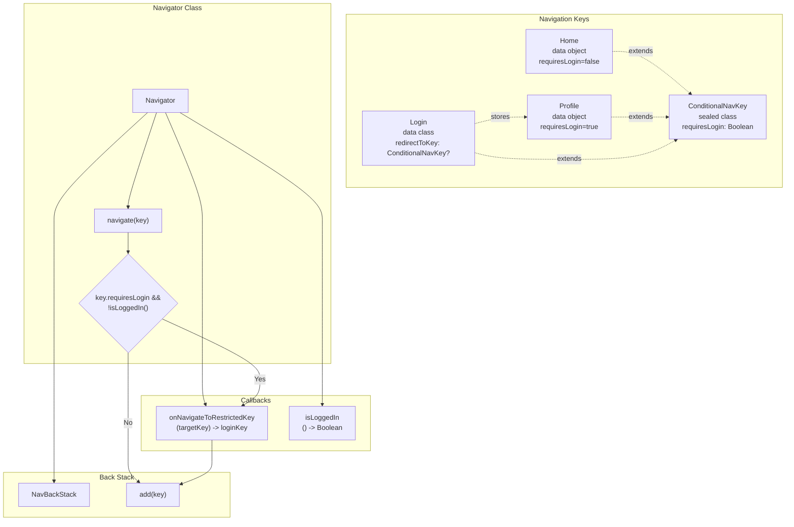
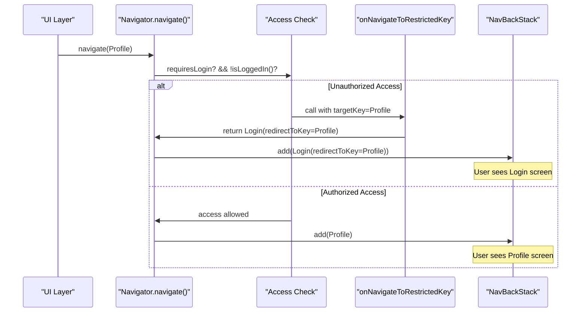
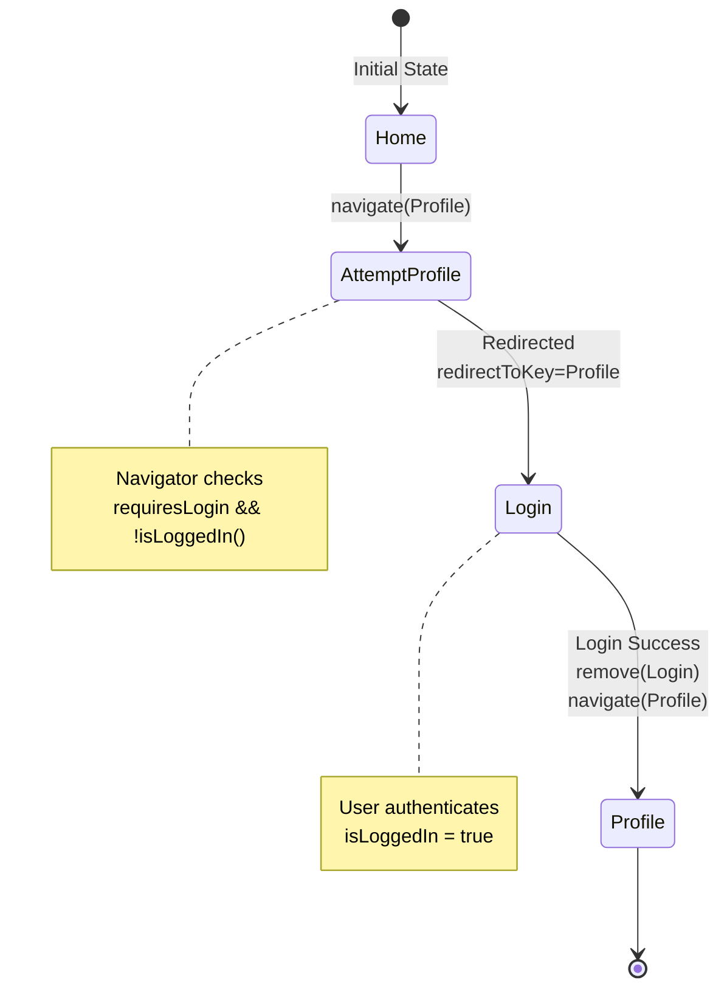

<!-- source: DeepWiki mcp.deepwiki.com · repo android/nav3-recipes · page 11.2 Conditional Navigation with Login Gates · fetched 2026-10-23 -->

# Conditional Navigation with Login Gates

<details>
<summary>Relevant source files</summary>

The following files were used as context for generating this wiki page:

- [app/src/main/java/com/example/nav3recipes/conditional/ConditionalActivity.kt](app/src/main/java/com/example/nav3recipes/conditional/ConditionalActivity.kt)
- [app/src/main/java/com/example/nav3recipes/conditional/Navigator.kt](app/src/main/java/com/example/nav3recipes/conditional/Navigator.kt)

</details>


## Purpose and Scope

This document explains how to implement conditional navigation where certain destinations require user authentication before access is granted. The pattern demonstrates intercepting navigation attempts, redirecting unauthenticated users to a login screen, and restoring the original navigation target after successful authentication.

For general Navigator class design patterns, see [Navigator Class Design Patterns](#11.1). For handling multiple independent back stacks in tab-based navigation, see [Multiple Back Stacks Pattern](#5.1).

## Overview

The conditional navigation pattern solves the common requirement of protecting certain routes behind authentication. Rather than implementing access checks at each destination, the pattern centralizes this logic in a `Navigator` class that intercepts all navigation attempts and enforces authentication requirements declaratively.

The key architectural decision is embedding the authentication requirement directly in the navigation key hierarchy through a `requiresLogin` property, allowing the `Navigator` to enforce access control uniformly across the application.

Sources: [app/src/main/java/com/example/nav3recipes/conditional/Navigator.kt:1-48]()

## Architecture Diagram



**Figure 1: Component architecture for conditional navigation with authentication gates**

This diagram shows how `ConditionalNavKey` subclasses declare authentication requirements, and how `Navigator.navigate()` intercepts attempts to access restricted routes by consulting the `isLoggedIn` callback and redirecting through `onNavigateToRestrictedKey`.

Sources: [app/src/main/java/com/example/nav3recipes/conditional/ConditionalActivity.kt:44-76](), [app/src/main/java/com/example/nav3recipes/conditional/Navigator.kt:21-48]()

## ConditionalNavKey Sealed Class

The `ConditionalNavKey` sealed class extends `NavKey` and adds a `requiresLogin` property that subclasses use to declare their authentication requirements:

```kotlin
@Serializable
sealed class ConditionalNavKey(val requiresLogin: Boolean = false) : NavKey
```

### Route Declarations

| Route | Type | requiresLogin | Purpose |
|-------|------|---------------|---------|
| `Home` | data object | false | Public home screen accessible without authentication |
| `Profile` | data object | true | Protected profile screen requiring authentication |
| `Login` | data class | false | Login screen itself is public; contains `redirectToKey` parameter |

The `Login` key uses a `redirectToKey` parameter to store the original navigation target, enabling post-authentication redirection:

[app/src/main/java/com/example/nav3recipes/conditional/ConditionalActivity.kt:73-76]()

This architecture allows authentication requirements to be declared once at the route definition level rather than repeated in UI code.

Sources: [app/src/main/java/com/example/nav3recipes/conditional/ConditionalActivity.kt:44-76]()

## Navigator Class Implementation

The `Navigator` class encapsulates navigation logic with built-in authentication enforcement:

```kotlin
class Navigator(
    private val backStack: NavBackStack<ConditionalNavKey>,
    private val onNavigateToRestrictedKey: (targetKey: ConditionalNavKey?) -> ConditionalNavKey,
    private val isLoggedIn: () -> Boolean,
)
```

### Constructor Parameters

| Parameter | Type | Purpose |
|-----------|------|---------|
| `backStack` | `NavBackStack<ConditionalNavKey>` | The navigation back stack to modify |
| `onNavigateToRestrictedKey` | `(ConditionalNavKey?) -> ConditionalNavKey` | Factory lambda that creates login key with redirect target |
| `isLoggedIn` | `() -> Boolean` | State reader that returns current authentication status |

The use of lambda parameters rather than direct state references allows the `Navigator` to remain reactive to authentication state changes without rebuilding the instance.

Sources: [app/src/main/java/com/example/nav3recipes/conditional/Navigator.kt:33-37]()

## Navigation Interception Flow

The `navigate()` function implements the core conditional logic:



**Figure 2: Sequence diagram showing navigation interception for restricted routes**

The implementation at [app/src/main/java/com/example/nav3recipes/conditional/Navigator.kt:38-45]():

```kotlin
fun navigate(key: ConditionalNavKey) {
    if (key.requiresLogin && !isLoggedIn()) {
        val loginKey = onNavigateToRestrictedKey(key)
        backStack.add(loginKey)
    } else {
        backStack.add(key)
    }
}
```

This pattern ensures that unauthorized navigation attempts are transparently redirected without requiring conditional logic in the UI layer.

Sources: [app/src/main/java/com/example/nav3recipes/conditional/Navigator.kt:38-45]()

## Post-Authentication Redirect

After successful login, the `Login` screen reads its `redirectToKey` parameter to restore the user's original navigation intent:



**Figure 3: State machine showing the complete login gate flow with post-authentication redirect**

The login entry provider implementation at [app/src/main/java/com/example/nav3recipes/conditional/ConditionalActivity.kt:122-134]():

```kotlin
entry<Login> { key ->
    ContentYellow("Login screen. Logged in? $isLoggedIn") {
        Button(onClick = {
            isLoggedIn = true
            key.redirectToKey?.let { targetKey ->
                backStack.remove(key)
                navigator.navigate(targetKey)
            }
        }) {
            Text("Login")
        }
    }
}
```

### Redirect Implementation Details

1. **Set authentication state**: `isLoggedIn = true`
2. **Remove login screen**: `backStack.remove(key)` prevents back button from returning to login
3. **Navigate to target**: `navigator.navigate(targetKey)` now succeeds because user is authenticated

The `remove()` call is critical for proper back stack hygiene. Without it, pressing back from the profile screen would return to the login screen rather than the home screen.

Sources: [app/src/main/java/com/example/nav3recipes/conditional/ConditionalActivity.kt:122-134]()

## Activity Integration

The `ConditionalActivity` demonstrates the complete setup:

### State Management

Authentication state is managed with `rememberSaveable` to persist across configuration changes:

[app/src/main/java/com/example/nav3recipes/conditional/ConditionalActivity.kt:85-87]()

### Navigator Instantiation

The `Navigator` is created with `remember` and configured with lambda callbacks:

[app/src/main/java/com/example/nav3recipes/conditional/ConditionalActivity.kt:88-94]()

```kotlin
val navigator = remember {
    Navigator(
        backStack = backStack,
        onNavigateToRestrictedKey = { redirectToKey -> Login(redirectToKey) },
        isLoggedIn = { isLoggedIn }
    )
}
```

The `remember` call ensures the `Navigator` instance is preserved across recompositions while still accessing the latest `isLoggedIn` value through the lambda closure.

### NavDisplay Configuration

The `NavDisplay` is wired to use the navigator's `goBack()` method:

[app/src/main/java/com/example/nav3recipes/conditional/ConditionalActivity.kt:96-98]()

Sources: [app/src/main/java/com/example/nav3recipes/conditional/ConditionalActivity.kt:80-139]()

## Entry Provider Definitions

The entry provider defines UI for each route type:

### Home Entry

Public entry point displaying login status and navigation options:

[app/src/main/java/com/example/nav3recipes/conditional/ConditionalActivity.kt:100-111]()

### Profile Entry

Protected entry only accessible after authentication, with logout capability:

[app/src/main/java/com/example/nav3recipes/conditional/ConditionalActivity.kt:112-121]()

The logout button demonstrates resetting authentication state and navigating back to home:

```kotlin
Button(onClick = {
    isLoggedIn = false
    navigator.navigate(Home)
}) {
    Text("Logout")
}
```

### Login Entry

Handles authentication and conditional redirect as detailed in the Post-Authentication Redirect section.

Sources: [app/src/main/java/com/example/nav3recipes/conditional/ConditionalActivity.kt:99-135]()

## Back Stack Serialization

The example uses a custom `rememberNavBackStack` overload to support subtypes of `NavKey`:

[app/src/main/java/com/example/nav3recipes/conditional/ConditionalActivity.kt:144-151]()

This function uses `rememberSerializable` with `NavBackStackSerializer` and `NavKeySerializer` to persist the back stack across process death. The polymorphic serialization of the `ConditionalNavKey` sealed class is handled automatically by kotlinx.serialization.

For more details on back stack persistence, see [Saveable Back Stack](#3.3).

Sources: [app/src/main/java/com/example/nav3recipes/conditional/ConditionalActivity.kt:144-151]()

## Pattern Benefits

| Benefit | Description |
|---------|-------------|
| **Centralized Logic** | Authentication checks live in one place (`Navigator.navigate()`) rather than scattered across UI |
| **Declarative Requirements** | Routes declare `requiresLogin` at definition time, making requirements self-documenting |
| **Transparent Redirection** | UI code calls `navigator.navigate(Profile)` without conditional logic; interception is invisible |
| **Type-Safe Redirect** | `Login.redirectToKey` uses the same type as other routes, eliminating string-based routing errors |
| **Proper Back Stack** | Removing login screen after authentication ensures correct back button behavior |

## Extension Patterns

### Multiple Authentication Levels

The pattern can be extended to support role-based access:

```kotlin
sealed class ConditionalNavKey(
    val requiredRole: UserRole? = null
) : NavKey

enum class UserRole { GUEST, USER, ADMIN }
```

### Async Authentication Checks

For network-based authentication, replace the synchronous `isLoggedIn` callback with a suspend function or Flow:

```kotlin
class Navigator(
    private val authState: StateFlow<AuthState>
) {
    fun navigate(key: ConditionalNavKey) {
        if (key.requiresLogin && authState.value !is AuthState.Authenticated) {
            // redirect logic
        }
    }
}
```

### Deep Link Integration

Combine with deep linking to handle authentication for deep-linked destinations. See [Advanced Deep Links with Synthetic Back Stacks](#4.2) for synthetic back stack construction that can be paired with this conditional navigation pattern.

Sources: [app/src/main/java/com/example/nav3recipes/conditional/ConditionalActivity.kt:44-76](), [app/src/main/java/com/example/nav3recipes/conditional/Navigator.kt:1-48]()

---

