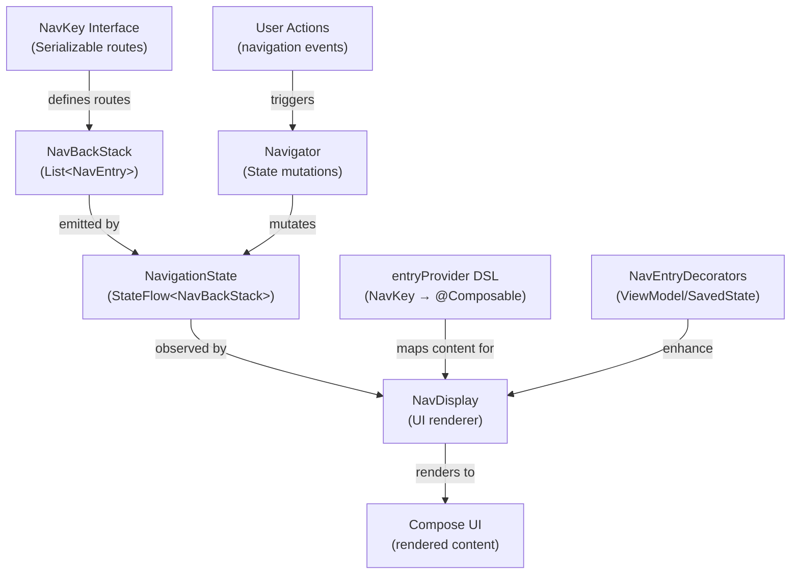
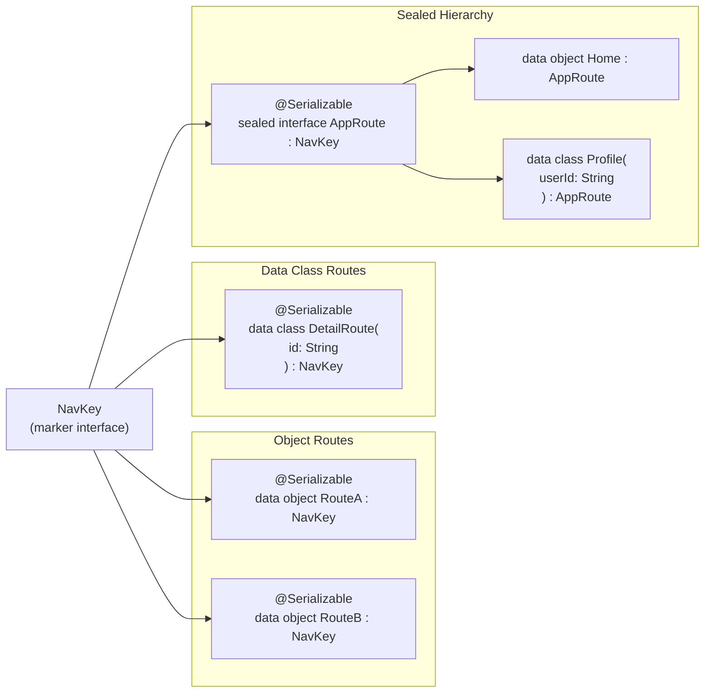
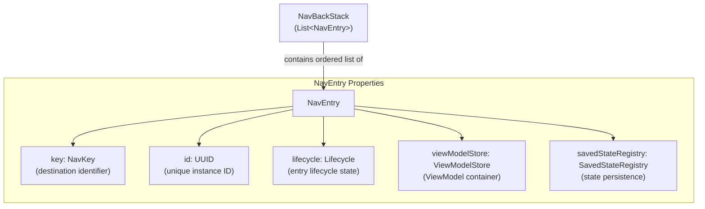
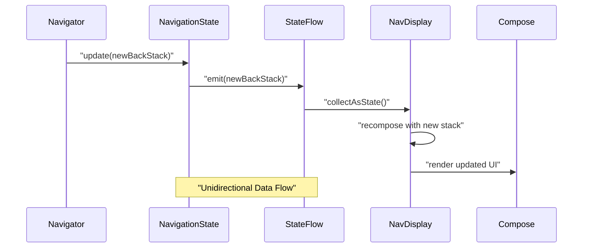
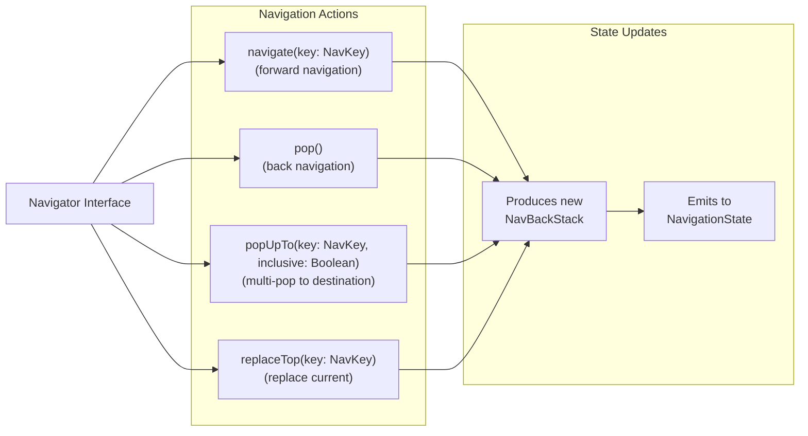
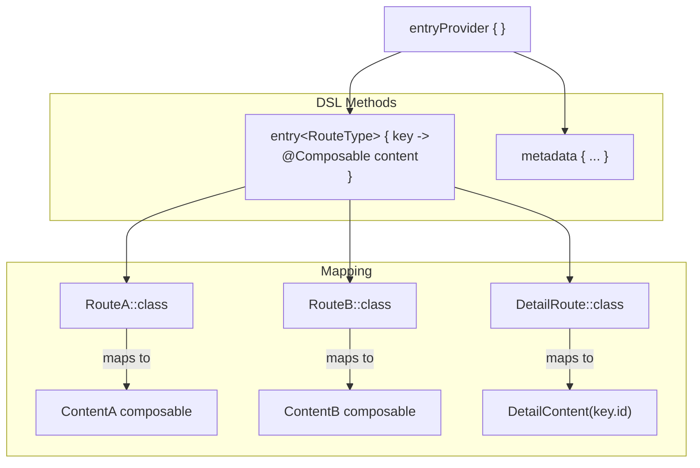
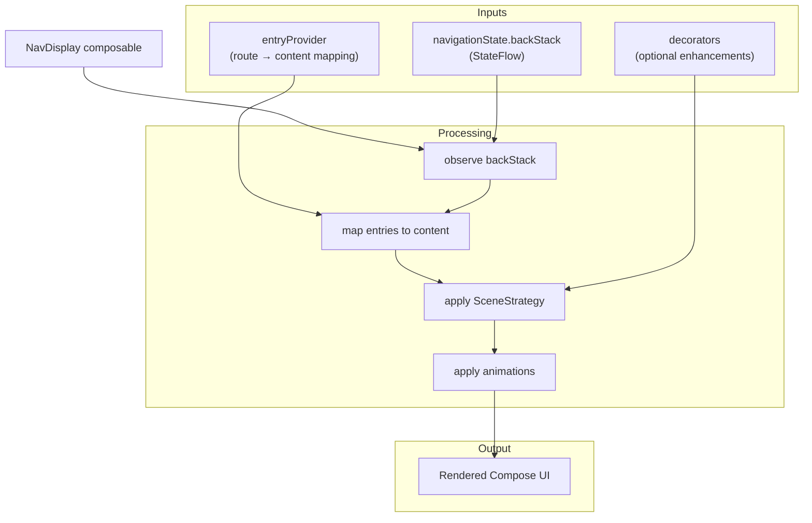
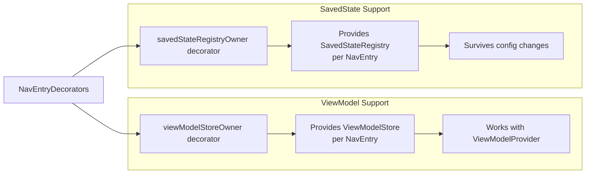
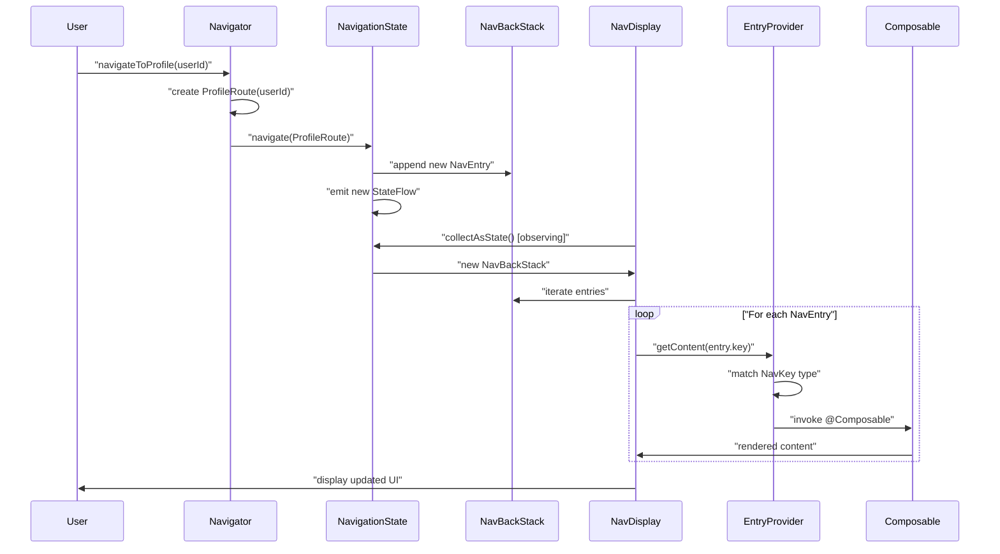
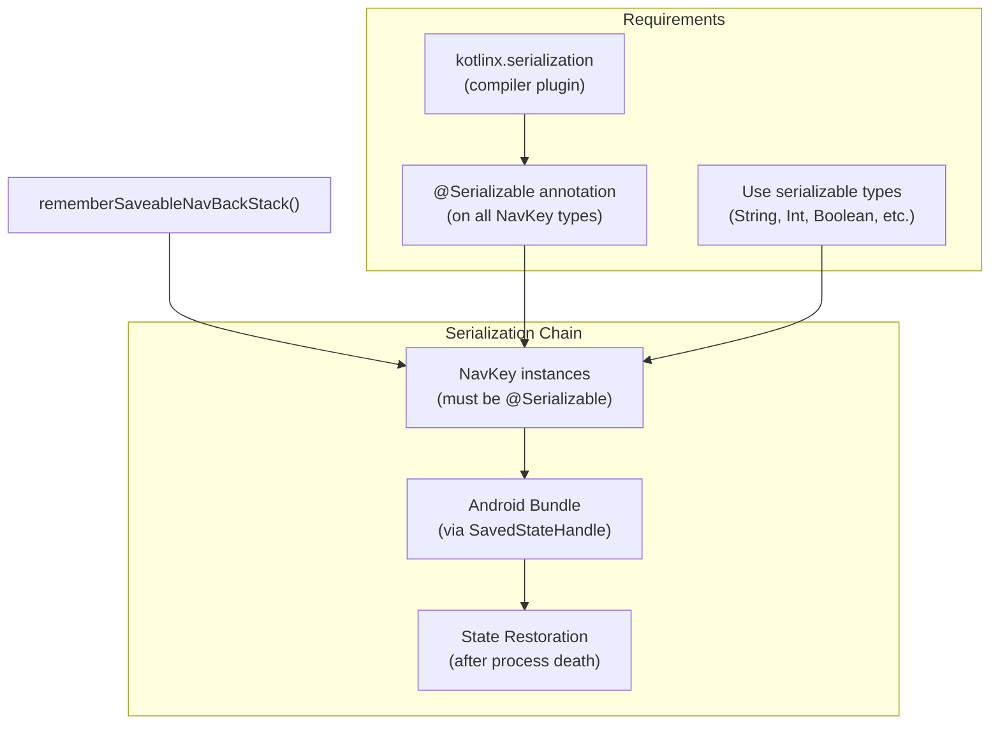

<!-- source: DeepWiki mcp.deepwiki.com · repo android/nav3-recipes · page 12 Core Navigation Components Reference · fetched 2026-10-23 -->

# Core Navigation Components Reference

<details>
<summary>Relevant source files</summary>

The following files were used as context for generating this wiki page:

- [app/src/main/java/com/example/nav3recipes/basic/BasicActivity.kt](app/src/main/java/com/example/nav3recipes/basic/BasicActivity.kt)
- [app/src/main/java/com/example/nav3recipes/basicsaveable/BasicSaveableActivity.kt](app/src/main/java/com/example/nav3recipes/basicsaveable/BasicSaveableActivity.kt)
- [app/src/main/java/com/example/nav3recipes/commonui/CommonUiActivity.kt](app/src/main/java/com/example/nav3recipes/commonui/CommonUiActivity.kt)
- [app/src/main/java/com/example/nav3recipes/content/Content.kt](app/src/main/java/com/example/nav3recipes/content/Content.kt)

</details>


## Purpose and Scope

This page provides a detailed reference for the core building blocks of Navigation 3: `NavKey`, `NavBackStack`, `NavigationState`, `Navigator`, `entryProvider`, `NavDisplay`, and entry decorators. These components form the foundation of all navigation patterns demonstrated in this repository.

For step-by-step migration instructions, see [Navigation 2 to Navigation 3 Migration](#3). For practical implementations using these components, see [Basic Navigation Recipes](#4). For advanced patterns like scenes and adaptive layouts, see [Custom Scenes and Adaptive Layouts](#6).

---

## Core Component Architecture

Navigation 3 enforces a **Unidirectional Data Flow** architecture. All components interact through a well-defined state management pattern where `Navigator` instances produce immutable state updates, `NavigationState` holds the current state, and `NavDisplay` renders that state.

### Component Interaction Model



**Sources:** [README.md:1-18]()

---

## NavKey: Type-Safe Route Definitions

`NavKey` is a marker interface for defining navigation destinations. All route types must implement `NavKey` and be serializable to support state restoration across configuration changes and process death.

### NavKey Requirements

| Requirement | Purpose | Implementation |
|-------------|---------|----------------|
| Implement `NavKey` | Identifies type as navigation route | `interface` or `@Serializable data class` |
| Serializable | Persist across process death | Use `@Serializable` (Kotlin Serialization) |
| Immutable | Safe state management | Use `val` properties, `data class` |
| Unique identity | Distinguish destinations | Unique type or unique parameter values |

### Common NavKey Patterns



**Serialization Examples:**

- **Simple route (no parameters):** `@Serializable data object HomeRoute : NavKey`
- **Parameterized route:** `@Serializable data class UserProfile(val userId: String) : NavKey`
- **Complex route:** `@Serializable data class EditItem(val id: String, val mode: EditMode) : NavKey`

**Sources:** [README.md:15-18](), Diagram 2 from high-level architecture

---

## NavBackStack: Navigation History Container

`NavBackStack` is an immutable list of `NavEntry` instances representing the current navigation history. Each `NavEntry` wraps a `NavKey` and provides lifecycle management.

### NavEntry Structure



### Back Stack Operations

| Operation | Purpose | Navigator Method |
|-----------|---------|------------------|
| Add to top | Navigate forward | `navigate(key)` |
| Remove from top | Navigate back | `pop()` |
| Replace top | Replace current destination | `replaceTop(key)` |
| Pop to key | Navigate back to specific destination | `popUpTo(key, inclusive)` |
| Clear and navigate | Reset stack with new destination | `navigate(key, popUpToRoute, inclusive)` |

**Sources:** [README.md:16-18](), Diagram 2 from high-level architecture

---

## NavigationState: Reactive State Holder

`NavigationState` holds the current `NavBackStack` and exposes it as a reactive `StateFlow`. All navigation changes flow through this component, enabling observers to react to state changes.

### State Flow Pattern



### Creating NavigationState

Navigation 3 provides factory functions to create `NavigationState`:

- **`rememberNavBackStack(initialRoute: NavKey)`**: Creates a non-persistent back stack
- **`rememberSaveableNavBackStack(initialRoute: NavKey)`**: Creates a back stack that survives configuration changes and process death

**Sources:** [README.md:16-18](), Diagram 2 from high-level architecture

---

## Navigator: State Mutation Interface

`Navigator` is the interface for performing navigation actions. All navigation events are channeled through `Navigator` methods, which produce new `NavBackStack` instances.

### Navigator Methods



### Implementation Pattern

Custom `Navigator` implementations typically:
1. Hold a reference to `NavigationState`
2. Define domain-specific navigation methods
3. Translate user actions into back stack mutations
4. Update `NavigationState` with the new stack

**Common Navigator pattern:**
```
class AppNavigator(private val navigationState: NavigationState) {
    fun navigateToProfile(userId: String) {
        navigationState.navigate(ProfileRoute(userId))
    }
    
    fun navigateBack() {
        navigationState.pop()
    }
}
```

**Sources:** [README.md:43-44](), Diagram 2 from high-level architecture

---

## entryProvider DSL: Route-to-Content Mapping

The `entryProvider` DSL maps `NavKey` instances to composable content. It defines what UI to render for each navigation destination.

### entryProvider Structure



### Basic Usage Example

Conceptual structure demonstrated in recipes:

```
val provider = entryProvider {
    entry<HomeRoute> { key ->
        HomeScreen()
    }
    
    entry<ProfileRoute> { key ->
        ProfileScreen(userId = key.userId)
    }
    
    entry<SettingsRoute> { key ->
        SettingsScreen()
    }
}
```

### Advanced: Entry Metadata

Metadata configures per-entry behavior:
- Scene assignments (for multi-pane layouts)
- Animation overrides
- Transition specifications

**Sources:** [README.md:18](), [README.md:23-33]()

---

## NavDisplay: UI Renderer

`NavDisplay` is the composable function that renders the current `NavBackStack` by mapping each `NavEntry` to its corresponding content using the `entryProvider`.

### NavDisplay Responsibilities



### NavDisplay Parameters

| Parameter | Type | Purpose |
|-----------|------|---------|
| `navigationState` | `NavigationState` | Source of back stack state |
| `entryProvider` | `EntryProvider` | Maps `NavKey` to `@Composable` |
| `sceneStrategy` | `SceneStrategy` | Layout strategy (single-pane, multi-pane, dialog, etc.) |
| `decorators` | `NavEntryDecorators` | Adds ViewModel/SavedState support |
| `animations` | `AnimationSpec` | Transition animations |

**Sources:** [README.md:16-18](), [README.md:24-27]()

---

## Entry Decorators: Lifecycle Enhancements

`NavEntryDecorators` enhance `NavEntry` instances with additional capabilities: ViewModel stores and SavedState registries. These enable per-entry lifecycle management compatible with Jetpack components.

### Decorator Types



### ViewModel Integration Pattern

Decorators enable standard ViewModel patterns within navigation entries:

**Typical usage in recipes:**
```
NavDisplay(
    navigationState = navState,
    entryProvider = provider,
    decorators = remember {
        NavEntryDecorators()
            .withViewModels()
            .withSavedState()
    }
) { entry ->
    val viewModel: MyViewModel = viewModel()
    // ViewModel scoped to this NavEntry
}
```

**Sources:** [README.md:46-49](), Diagram 2 from high-level architecture

---

## Component Lifecycle and Interactions

Understanding how these components interact during a typical navigation flow is essential for building robust navigation systems.

### Complete Navigation Flow



**Sources:** [README.md:1-18](), Diagram 2 from high-level architecture

---

## State Persistence Patterns

Navigation 3 supports two persistence strategies for different lifecycle scenarios.

### Persistence Strategy Comparison

| Strategy | Function | Survives | Use Case |
|----------|----------|----------|----------|
| **Transient** | `rememberNavBackStack()` | Configuration changes only | Simple navigation, no process death concern |
| **Persistent** | `rememberSaveableNavBackStack()` | Configuration changes + process death | Production apps requiring full state restoration |

### Serialization Requirements for Persistence



**Important:** All `NavKey` types must be annotated with `@Serializable` and use only serializable types in their properties for persistent back stacks to work correctly.

**Sources:** [README.md:17](), Diagram 2 from high-level architecture

---

## Component Summary Table

| Component | Type | Mutability | Lifecycle | Primary Responsibility |
|-----------|------|------------|-----------|------------------------|
| `NavKey` | Interface/Data class | Immutable | Application-wide | Define navigation destinations |
| `NavEntry` | Data class | Immutable | Per-destination | Wrap NavKey with lifecycle/state |
| `NavBackStack` | List wrapper | Immutable | Navigation session | Maintain navigation history |
| `NavigationState` | State holder | Mutable (internal) | Navigation session | Expose reactive back stack |
| `Navigator` | Interface | Stateless | Activity/ViewModel | Perform navigation actions |
| `entryProvider` | DSL builder | Immutable | Composition | Map NavKey to UI |
| `NavDisplay` | Composable | Stateless | Composition | Render navigation UI |
| `NavEntryDecorators` | Configuration | Immutable | Composition | Enhance entries with lifecycle components |

**Sources:** [README.md:1-54](), All high-level diagrams

---

