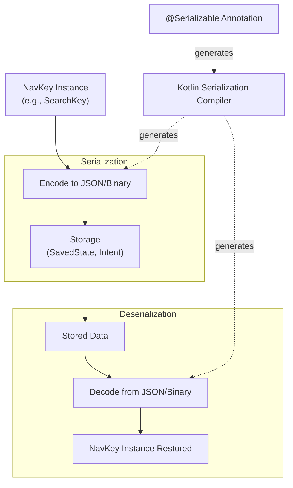
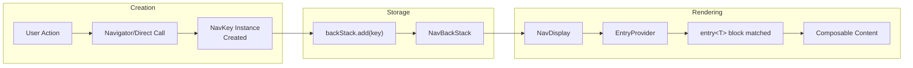
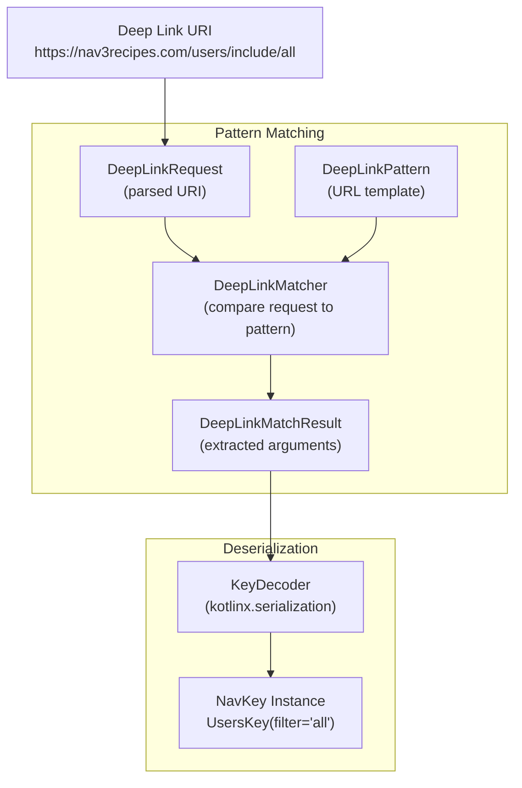
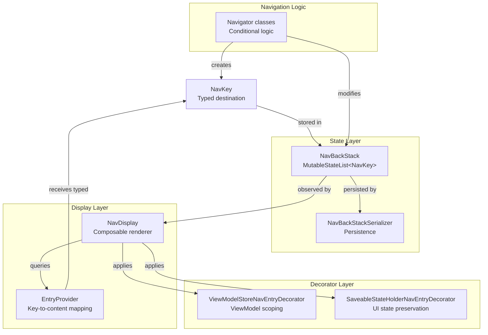

<!-- source: DeepWiki mcp.deepwiki.com · repo android/nav3-recipes · page 12.1 NavKey and Route System · fetched 2026-10-23 -->

# NavKey and Route System

<details>
<summary>Relevant source files</summary>

The following files were used as context for generating this wiki page:

- [app/src/main/java/com/example/nav3recipes/conditional/ConditionalActivity.kt](app/src/main/java/com/example/nav3recipes/conditional/ConditionalActivity.kt)
- [app/src/main/java/com/example/nav3recipes/conditional/Navigator.kt](app/src/main/java/com/example/nav3recipes/conditional/Navigator.kt)
- [app/src/main/java/com/example/nav3recipes/deeplink/basic/CreateDeepLinkActivity.kt](app/src/main/java/com/example/nav3recipes/deeplink/basic/CreateDeepLinkActivity.kt)
- [app/src/main/java/com/example/nav3recipes/deeplink/basic/MainActivity.kt](app/src/main/java/com/example/nav3recipes/deeplink/basic/MainActivity.kt)
- [app/src/main/java/com/example/nav3recipes/deeplink/basic/NavRecipeKey.kt](app/src/main/java/com/example/nav3recipes/deeplink/basic/NavRecipeKey.kt)
- [app/src/main/java/com/example/nav3recipes/deeplink/basic/README.md](app/src/main/java/com/example/nav3recipes/deeplink/basic/README.md)
- [app/src/main/java/com/example/nav3recipes/deeplink/basic/ui/UrlResources.kt](app/src/main/java/com/example/nav3recipes/deeplink/basic/ui/UrlResources.kt)
- [common/.gitignore](common/.gitignore)
- [common/build.gradle.kts](common/build.gradle.kts)

</details>


## Purpose and Scope

This document provides detailed technical reference for the `NavKey` interface, which serves as the core type-safe destination abstraction in Navigation 3. It covers `NavKey` implementations, serialization requirements, argument passing patterns, and the relationship between `NavKey` instances and the navigation system.

For information about how `NavKey` instances are stored and managed in navigation state, see [NavBackStack and State Management](#12.2). For details on how `NavKey` instances are mapped to UI content, see [NavDisplay and Entry Providers](#12.3). For converting URLs into `NavKey` instances, see [Basic Deep Link Parsing](#4.1).

---

## The NavKey Interface

`NavKey` is a marker interface that represents a navigation destination. Every navigation target in Navigation 3 must implement this interface. `NavKey` instances are:

- **Type-safe**: Each destination is represented by a distinct Kotlin type
- **Serializable**: Must be serializable using `kotlinx.serialization` for state persistence
- **Immutable**: Typically implemented as `data class` or `data object` to ensure value semantics
- **Stored in back stack**: Placed in `NavBackStack` to represent navigation history

The interface itself contains no members:

```kotlin
interface NavKey
```

Its purpose is to provide a common type for the navigation system while allowing each destination to define its own structure and arguments.

**Sources**: [app/src/main/java/com/example/nav3recipes/deeplink/basic/NavRecipeKey.kt:3-12](), [app/src/main/java/com/example/nav3recipes/conditional/ConditionalActivity.kt:32-34]()

---

## NavKey Implementation Patterns

### Data Object Pattern: Parameterless Routes

For destinations that require no arguments, implement `NavKey` as a `data object`. This creates a singleton instance representing the destination:

```kotlin
@Serializable
data object Home : NavKey
```

This pattern is used when:
- The destination has no state or arguments
- Only one instance of the route should exist in the back stack (value equality)
- No configuration is needed to render the destination

**Example**: [app/src/main/java/com/example/nav3recipes/deeplink/basic/NavRecipeKey.kt:14-17]()

```kotlin
@Serializable
internal object HomeKey: NavRecipeKey {
    override val name: String = STRING_LITERAL_HOME
}
```

**Sources**: [app/src/main/java/com/example/nav3recipes/deeplink/basic/NavRecipeKey.kt:14-17](), [app/src/main/java/com/example/nav3recipes/conditional/ConditionalActivity.kt:59-60]()

---

### Data Class Pattern: Routes with Arguments

For destinations requiring arguments, implement `NavKey` as a `data class`. Properties become navigation arguments:

```kotlin
@Serializable
data class UsersKey(
    val filter: String
) : NavKey
```

Arguments can be:
- **Primitive types**: `String`, `Int`, `Boolean`, etc.
- **Nullable types**: `String?`, `Int?` for optional arguments
- **Custom types**: Any type that is itself `@Serializable`
- **Collections**: `List<String>`, `Map<String, Int>`, etc.

**Example**: [app/src/main/java/com/example/nav3recipes/deeplink/basic/NavRecipeKey.kt:19-29]()

```kotlin
@Serializable
internal data class UsersKey(
    val filter: String,
): NavRecipeKey {
    override val name: String = STRING_LITERAL_USERS
    companion object {
        const val FILTER_KEY = STRING_LITERAL_FILTER
        const val FILTER_OPTION_RECENTLY_ADDED = "recentlyAdded"
        const val FILTER_OPTION_ALL = "all"
    }
}
```

**Example with nullable arguments**: [app/src/main/java/com/example/nav3recipes/deeplink/basic/NavRecipeKey.kt:31-39]()

```kotlin
@Serializable
internal data class SearchKey(
    val firstName: String? = null,
    val ageMin: Int? = null,
    val ageMax: Int? = null,
    val location: String? = null,
): NavRecipeKey
```

**Sources**: [app/src/main/java/com/example/nav3recipes/deeplink/basic/NavRecipeKey.kt:19-39]()

---

### Sealed Class Pattern: Polymorphic Route Hierarchies

When multiple route types share common behavior or need to be stored in a single back stack with type safety, use a sealed class hierarchy:

```kotlin
@Serializable
sealed class ConditionalNavKey(val requiresLogin: Boolean = false) : NavKey

@Serializable
data object Home : ConditionalNavKey()

@Serializable
data object Profile : ConditionalNavKey(requiresLogin = true)

@Serializable
data class Login(
    val redirectToKey: ConditionalNavKey? = null
) : ConditionalNavKey()
```

This pattern enables:
- **Shared properties**: `requiresLogin` is accessible on all subtypes
- **Type-safe back stacks**: `NavBackStack<ConditionalNavKey>` can hold any subtype
- **Automatic polymorphic serialization**: `kotlinx.serialization` handles sealed class serialization without additional configuration
- **Pattern matching**: Use `when` expressions for exhaustive handling

**Sources**: [app/src/main/java/com/example/nav3recipes/conditional/ConditionalActivity.kt:44-77]()

---

## Serialization Requirements

All `NavKey` implementations must be annotated with `@Serializable` from `kotlinx.serialization`. This enables:

1. **Back stack persistence**: Serialize the back stack to survive process death
2. **Deep link decoding**: Convert parsed deep link arguments into typed `NavKey` instances
3. **State restoration**: Restore navigation state across configuration changes

### Diagram: NavKey Serialization Flow



**Sources**: [app/src/main/java/com/example/nav3recipes/deeplink/basic/NavRecipeKey.kt:8-39](), [app/src/main/java/com/example/nav3recipes/conditional/ConditionalActivity.kt:41-77]()

---

## NavKey in the Navigation Flow

### Diagram: NavKey Lifecycle



**Process**:

1. **Creation**: Application code creates a `NavKey` instance in response to user action or business logic
2. **Addition to back stack**: `backStack.add(key)` places the key in the navigation history
3. **Display observation**: `NavDisplay` observes the `NavBackStack` (which is a `SnapshotStateList`)
4. **Provider lookup**: `NavDisplay` consults the `EntryProvider` to find the `entry<T>` block matching the key's type
5. **Content rendering**: The matched `entry<T>` block receives the typed key and renders the corresponding composable

**Sources**: [app/src/main/java/com/example/nav3recipes/deeplink/basic/MainActivity.kt:88-123](), [app/src/main/java/com/example/nav3recipes/conditional/ConditionalActivity.kt:96-136]()

---

## Argument Passing Through NavKey Properties

Arguments are passed to destinations by including them as properties in the `NavKey` data class. The `EntryProvider` provides type-safe access to these arguments in the `entry<T>` block:

### Example: Filter Argument

**NavKey definition**: [app/src/main/java/com/example/nav3recipes/deeplink/basic/NavRecipeKey.kt:19-29]()

```kotlin
@Serializable
internal data class UsersKey(
    val filter: String,
): NavRecipeKey
```

**Navigation**: Create the key with the argument

```kotlin
backStack.add(UsersKey(filter = "recentlyAdded"))
```

**Rendering**: Access the argument in the entry block [app/src/main/java/com/example/nav3recipes/deeplink/basic/MainActivity.kt:98-108]()

```kotlin
entry<UsersKey> { key ->
    EntryScreen("${key.name} : ${key.filter}") {
        val list = when {
            key.filter.isEmpty() -> LIST_USERS
            key.filter == UsersKey.FILTER_OPTION_ALL -> LIST_USERS
            else -> LIST_USERS.take(5)
        }
        FriendsList(list)
    }
}
```

### Example: Multiple Optional Arguments

**NavKey definition**: [app/src/main/java/com/example/nav3recipes/deeplink/basic/NavRecipeKey.kt:31-39]()

```kotlin
@Serializable
internal data class SearchKey(
    val firstName: String? = null,
    val ageMin: Int? = null,
    val ageMax: Int? = null,
    val location: String? = null,
): NavRecipeKey
```

**Rendering with conditional logic**: [app/src/main/java/com/example/nav3recipes/deeplink/basic/MainActivity.kt:109-120]()

```kotlin
entry<SearchKey> { search ->
    EntryScreen(search.name) {
        val matchingUsers = LIST_USERS.filter { user ->
            (search.firstName == null || user.firstName == search.firstName) &&
            (search.location == null || user.location == search.location) &&
            (search.ageMin == null || user.age >= search.ageMin) &&
            (search.ageMax == null || user.age <= search.ageMax)
        }
        FriendsList(matchingUsers)
    }
}
```

### Example: Redirect Target Argument

**NavKey definition**: [app/src/main/java/com/example/nav3recipes/conditional/ConditionalActivity.kt:73-76]()

```kotlin
@Serializable
private data class Login(
    val redirectToKey: ConditionalNavKey? = null
) : ConditionalNavKey()
```

**Navigation with redirect**: [app/src/main/java/com/example/nav3recipes/conditional/Navigator.kt:38-45]()

```kotlin
fun navigate(key: ConditionalNavKey) {
    if (key.requiresLogin && !isLoggedIn()) {
        val loginKey = onNavigateToRestrictedKey(key)
        backStack.add(loginKey)
    } else {
        backStack.add(key)
    }
}
```

**Rendering with redirect handling**: [app/src/main/java/com/example/nav3recipes/conditional/ConditionalActivity.kt:122-134]()

```kotlin
entry<Login> { key ->
    ContentYellow("Login screen. Logged in? $isLoggedIn") {
        Button(onClick = {
            isLoggedIn = true
            key.redirectToKey?.let { targetKey ->
                backStack.remove(key)
                navigator.navigate(targetKey)
            }
        }) {
            Text("Login")
        }
    }
}
```

**Sources**: [app/src/main/java/com/example/nav3recipes/deeplink/basic/MainActivity.kt:98-120](), [app/src/main/java/com/example/nav3recipes/conditional/ConditionalActivity.kt:122-134](), [app/src/main/java/com/example/nav3recipes/conditional/Navigator.kt:38-45]()

---

## NavKey and Deep Linking

`NavKey` instances can be created from deep link URIs through a multi-step parsing process:

### Diagram: Deep Link URI to NavKey Conversion



**Four-step process**: [app/src/main/java/com/example/nav3recipes/deeplink/basic/MainActivity.kt:27-82]()

1. **Define patterns**: Associate URL templates with `NavKey` serializers [app/src/main/java/com/example/nav3recipes/deeplink/basic/MainActivity.kt:53-60]()

```kotlin
val deepLinkPatterns: List<DeepLinkPattern<out NavKey>> = listOf(
    DeepLinkPattern(HomeKey.serializer(), URL_HOME_EXACT.toUri()),
    DeepLinkPattern(UsersKey.serializer(), URL_USERS_WITH_FILTER.toUri()),
    DeepLinkPattern(SearchKey.serializer(), URL_SEARCH.toUri()),
)
```

2. **Parse request**: Convert incoming URI to `DeepLinkRequest` [app/src/main/java/com/example/nav3recipes/deeplink/basic/MainActivity.kt:70]()

3. **Match pattern**: Find matching pattern and extract arguments [app/src/main/java/com/example/nav3recipes/deeplink/basic/MainActivity.kt:72-74]()

```kotlin
val match = deepLinkPatterns.firstNotNullOfOrNull { pattern ->
    DeepLinkMatcher(request, pattern).match()
}
```

4. **Decode to NavKey**: Use `kotlinx.serialization` to create typed instance [app/src/main/java/com/example/nav3recipes/deeplink/basic/MainActivity.kt:76-81]()

```kotlin
match?.let {
    KeyDecoder(match.args).decodeSerializableValue(match.serializer)
}
```

For more details on deep linking, see [Basic Deep Link Parsing](#4.1) and [Advanced Deep Links with Synthetic Back Stacks](#4.2).

**Sources**: [app/src/main/java/com/example/nav3recipes/deeplink/basic/MainActivity.kt:27-82](), [app/src/main/java/com/example/nav3recipes/deeplink/basic/README.md:1-24]()

---

## NavKey Best Practices

| Practice | Rationale | Example |
|----------|-----------|---------|
| Use `data object` for parameterless routes | Ensures singleton semantics and value equality | `data object Home : NavKey` |
| Use `data class` for routes with arguments | Provides immutability and structural equality | `data class Detail(val id: Int) : NavKey` |
| Always annotate with `@Serializable` | Required for back stack persistence and deep linking | `@Serializable data class Route(...) : NavKey` |
| Use nullable properties for optional arguments | Enables deep links to work with missing query parameters | `val firstName: String? = null` |
| Provide default values for optional arguments | Simplifies navigation code when defaults are acceptable | `val pageSize: Int = 20` |
| Use sealed classes for related routes | Enables shared properties and polymorphic serialization | `sealed class ConditionalNavKey : NavKey` |
| Store constants in companion objects | Centralizes route-related constants | `companion object { const val FILTER_KEY = "filter" }` |
| Avoid mutable properties | `NavKey` should be immutable for predictable back stack behavior | Use `val`, not `var` |

**Sources**: [app/src/main/java/com/example/nav3recipes/deeplink/basic/NavRecipeKey.kt:1-39](), [app/src/main/java/com/example/nav3recipes/conditional/ConditionalActivity.kt:44-77]()

---

## Relationship to Other Navigation Components

### Diagram: NavKey Integration with Navigation System



**Key relationships**:

- **NavBackStack**: Stores `NavKey` instances as navigation history. See [NavBackStack and State Management](#12.2)
- **NavDisplay**: Renders the top `NavKey` from the back stack. See [NavDisplay and Entry Providers](#12.3)
- **EntryProvider**: Maps `NavKey` types to composable content via `entry<T>` blocks. See [NavDisplay and Entry Providers](#12.3)
- **Decorators**: Augment `NavKey` instances with lifecycle-aware features. See [Entry Decorators](#12.4)
- **Navigator classes**: Create and manipulate `NavKey` instances with business logic. See [Navigator Class Design Patterns](#11.1)

**Sources**: [app/src/main/java/com/example/nav3recipes/conditional/ConditionalActivity.kt:78-151](), [app/src/main/java/com/example/nav3recipes/deeplink/basic/MainActivity.kt:50-124]()

---

