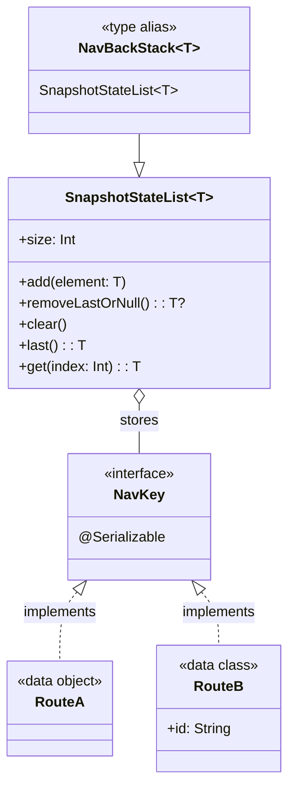
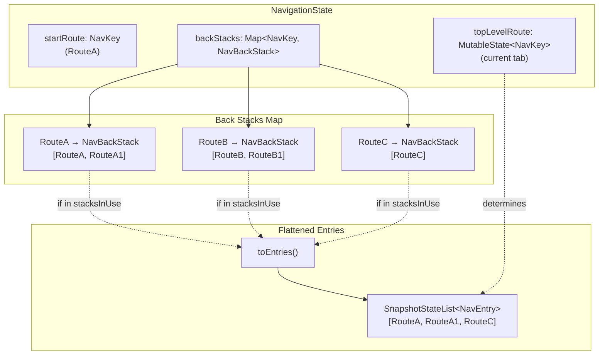
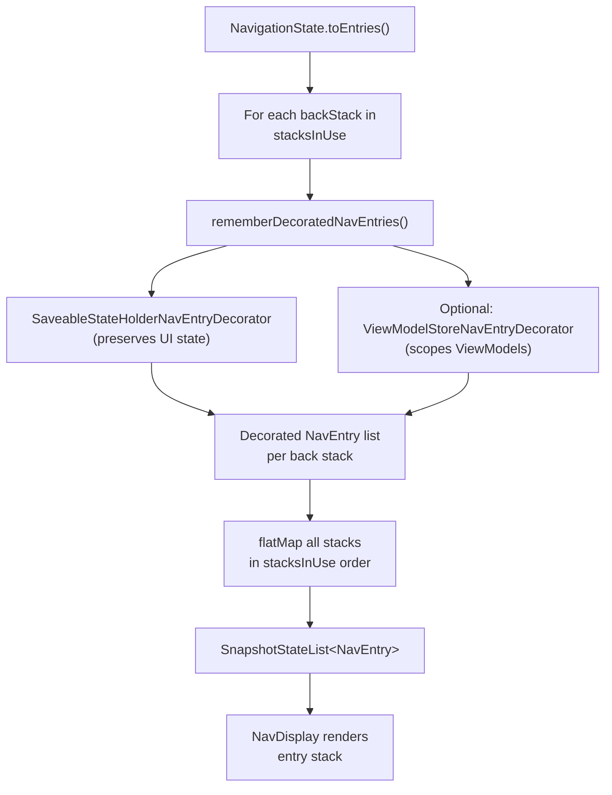
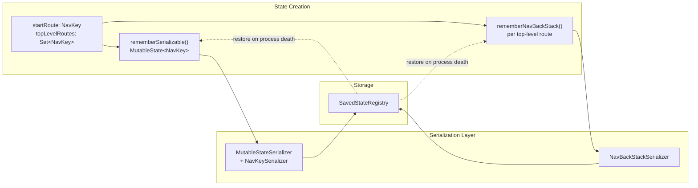
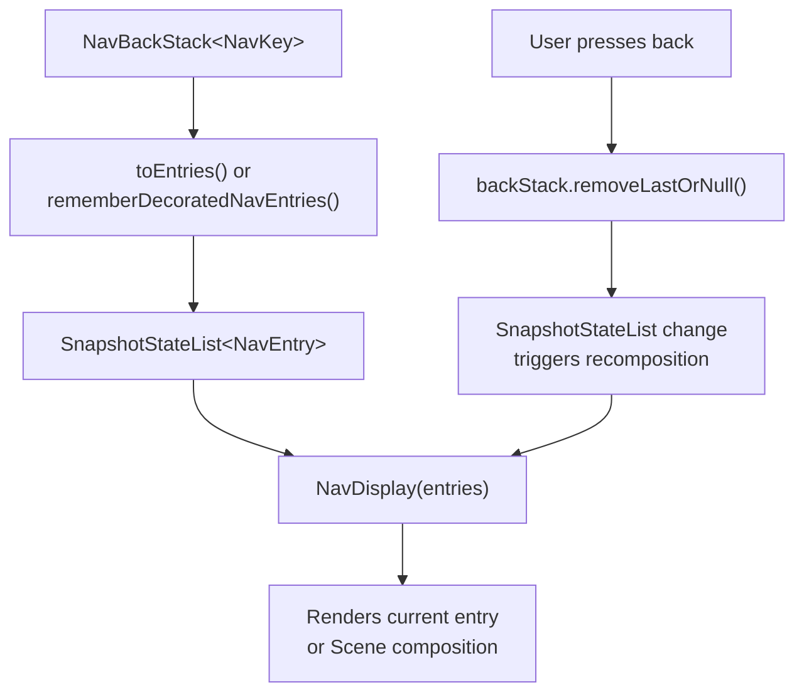
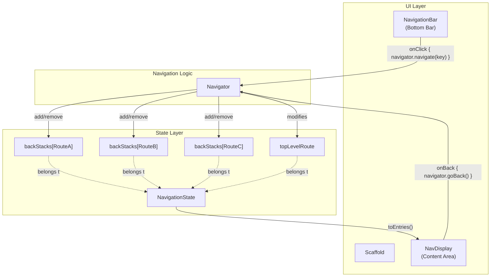

<!-- source: DeepWiki mcp.deepwiki.com · repo android/nav3-recipes · page 12.2 NavBackStack and State Management · fetched 2026-10-23 -->

# NavBackStack and State Management

<details>
<summary>Relevant source files</summary>

The following files were used as context for generating this wiki page:

- [app/src/main/java/com/example/nav3recipes/multiplestacks/Content.kt](app/src/main/java/com/example/nav3recipes/multiplestacks/Content.kt)
- [app/src/main/java/com/example/nav3recipes/multiplestacks/MultipleStacksActivity.kt](app/src/main/java/com/example/nav3recipes/multiplestacks/MultipleStacksActivity.kt)
- [app/src/main/java/com/example/nav3recipes/multiplestacks/NavigationState.kt](app/src/main/java/com/example/nav3recipes/multiplestacks/NavigationState.kt)
- [app/src/main/java/com/example/nav3recipes/multiplestacks/Navigator.kt](app/src/main/java/com/example/nav3recipes/multiplestacks/Navigator.kt)
- [app/src/main/java/com/example/nav3recipes/multiplestacks/README.md](app/src/main/java/com/example/nav3recipes/multiplestacks/README.md)

</details>


## Purpose and Scope

This document explains `NavBackStack`, the core state container in Navigation 3 that stores the navigation history as an observable list of `NavKey` instances. NavBackStack is a `SnapshotStateList` that automatically triggers recomposition when the back stack changes, enabling reactive navigation UIs. This page covers back stack operations, serialization, state persistence, and multi-stack patterns.

For information about NavKey types and serialization, see [NavKey and Route System (12.1)](#12.1). For information about how NavDisplay renders back stacks, see [NavDisplay and Entry Providers (12.3)](#12.3). For multi-stack navigation patterns, see [Multiple Back Stacks Pattern (5.1)](#5.1).

**Sources:** [app/src/main/java/com/example/nav3recipes/multiplestacks/NavigationState.kt:1-108]()

---

## NavBackStack Overview

`NavBackStack` is a type alias for `SnapshotStateList<NavKey>`, the core data structure that stores navigation history in Navigation 3. It is an observable, mutable list that automatically triggers Compose recomposition when modified, enabling reactive navigation UIs without manual state synchronization.

### Key Characteristics

| Characteristic | Description | Implementation |
|---|---|---|
| **Type-Safe** | Only stores `NavKey` instances, ensuring type safety | `NavBackStack<T : NavKey>` |
| **Observable** | Built on `SnapshotStateList`, triggers recomposition on changes | Compose state snapshot system |
| **Serializable** | Can be saved and restored across process death | `NavBackStackSerializer` |
| **Mutable** | Supports standard list operations: add, remove, clear | `MutableList` interface |
| **Rememberable** | Created with `rememberNavBackStack()` for lifecycle management | `rememberSaveable` integration |

**Sources:** [app/src/main/java/com/example/nav3recipes/multiplestacks/NavigationState.kt:28-32](), [app/src/main/java/com/example/nav3recipes/multiplestacks/NavigationState.kt:53]()

---

## NavBackStack Type Structure



**Diagram: NavBackStack type hierarchy showing relationship to SnapshotStateList and NavKey**

**Sources:** [app/src/main/java/com/example/nav3recipes/multiplestacks/MultipleStacksActivity.kt:42-58](), [app/src/main/java/com/example/nav3recipes/multiplestacks/NavigationState.kt:28]()

---

## Creating NavBackStack with rememberNavBackStack

The `rememberNavBackStack()` composable function creates a `NavBackStack` instance that persists across configuration changes and process death. It accepts an initial `NavKey` that becomes the first entry in the back stack.

### Basic Usage Pattern

```kotlin
@Composable
fun MyScreen() {
    val backStack = rememberNavBackStack(startRoute)
    
    NavDisplay(
        entries = backStack.rememberDecoratedEntries(entryProvider),
        onBack = { backStack.removeLastOrNull() }
    )
}
```

### rememberNavBackStack Implementation

The function internally uses `rememberSaveable` with `NavBackStackSerializer` to ensure the back stack survives both configuration changes (like rotation) and process death:

```kotlin
@Composable
fun rememberNavBackStack(initialKey: NavKey): NavBackStack<NavKey>
```

When the composable is first created, the back stack is initialized with the `initialKey`. On subsequent recompositions, the serialized state is restored.

**Sources:** [app/src/main/java/com/example/nav3recipes/multiplestacks/NavigationState.kt:53](), [app/src/main/java/com/example/nav3recipes/multiplestacks/NavigationState.kt:40-62]()

---

## Basic Back Stack Operations

NavBackStack supports standard mutable list operations for navigation state management:

### Core Operations

| Operation | Method | Description | Navigation Context |
|---|---|---|---|
| **Push** | `add(key: NavKey)` | Adds a new destination to the back stack | Navigate forward |
| **Pop** | `removeLastOrNull()` | Removes and returns the last entry | Navigate back |
| **Peek** | `last()` | Returns the current destination without removal | Get current route |
| **Clear** | `clear()` | Removes all entries from the stack | Reset navigation |
| **Size** | `size` | Returns the number of entries | Check stack depth |

### Operation Examples from Navigator

The `Navigator` class demonstrates typical back stack manipulation patterns:

**Forward Navigation:**
```kotlin
fun navigate(route: NavKey) {
    if (route in state.backStacks.keys) {
        // Switch to top-level route
        state.topLevelRoute = route
    } else {
        // Add to current stack
        state.backStacks[state.topLevelRoute]?.add(route)
    }
}
```

**Back Navigation:**
```kotlin
fun goBack() {
    val currentStack = state.backStacks[state.topLevelRoute]
    val currentRoute = currentStack.last()
    
    if (currentRoute == state.topLevelRoute) {
        // At base of stack, switch to start route
        state.topLevelRoute = state.startRoute
    } else {
        // Pop from current stack
        currentStack.removeLastOrNull()
    }
}
```

**Sources:** [app/src/main/java/com/example/nav3recipes/multiplestacks/Navigator.kt:24-46]()

---

## Multi-Stack Navigation Pattern

The multiple back stacks pattern maintains separate `NavBackStack` instances for each top-level destination (e.g., bottom navigation tabs), enabling independent navigation histories per section.

### NavigationState Architecture



**Diagram: Multi-stack architecture showing separate NavBackStack per top-level route and flattening logic**

### NavigationState Implementation

The `NavigationState` class manages multiple back stacks with "exit through home" semantics:

```kotlin
class NavigationState(
    val startRoute: NavKey,
    topLevelRoute: MutableState<NavKey>,
    val backStacks: Map<NavKey, NavBackStack<NavKey>>
) {
    var topLevelRoute: NavKey by topLevelRoute
    
    val stacksInUse: List<NavKey>
        get() = if (topLevelRoute == startRoute) {
            listOf(startRoute)
        } else {
            listOf(startRoute, topLevelRoute)
        }
}
```

**Key Behavior:** The `stacksInUse` property ensures the start route stack is always included, implementing the "exit through home" pattern where pressing back from any tab eventually returns to the home tab before exiting the app.

**Sources:** [app/src/main/java/com/example/nav3recipes/multiplestacks/NavigationState.kt:71-84](), [app/src/main/java/com/example/nav3recipes/multiplestacks/README.md:15-16]()

---

## Converting Back Stacks to NavEntries

The `toEntries()` extension function converts `NavigationState` (containing multiple back stacks) into a flattened `SnapshotStateList<NavEntry>` for rendering by `NavDisplay`.

### Flattening and Decoration Flow



**Diagram: Back stack to NavEntry conversion flow with decorator application**

### Implementation

```kotlin
@Composable
fun NavigationState.toEntries(
    entryProvider: (NavKey) -> NavEntry<NavKey>
): SnapshotStateList<NavEntry<NavKey>> {
    
    val decoratedEntries = backStacks.mapValues { (_, stack) ->
        val decorators = listOf(
            rememberSaveableStateHolderNavEntryDecorator<NavKey>(),
        )
        rememberDecoratedNavEntries(
            backStack = stack,
            entryDecorators = decorators,
            entryProvider = entryProvider
        )
    }
    
    return stacksInUse
        .flatMap { decoratedEntries[it] ?: emptyList() }
        .toMutableStateList()
}
```

**Key Design:** Each back stack maintains its own `SaveableStateHolderNavEntryDecorator`, ensuring that UI state (like scroll position or text field content) is preserved per tab. When switching tabs, the decorator retains the state of hidden screens.

**Sources:** [app/src/main/java/com/example/nav3recipes/multiplestacks/NavigationState.kt:89-108](), [app/src/main/java/com/example/nav3recipes/multiplestacks/README.md:20]()

---

## State Persistence with rememberNavigationState

The `rememberNavigationState()` composable creates a `NavigationState` that persists across configuration changes and process death by serializing all back stacks and the current top-level route.

### Persistence Architecture



**Diagram: State persistence flow showing serialization of topLevelRoute and individual back stacks**

### rememberNavigationState Implementation

```kotlin
@Composable
fun rememberNavigationState(
    startRoute: NavKey,
    topLevelRoutes: Set<NavKey>
): NavigationState {
    
    val topLevelRoute = rememberSerializable(
        startRoute, topLevelRoutes,
        serializer = MutableStateSerializer(NavKeySerializer())
    ) {
        mutableStateOf(startRoute)
    }
    
    val backStacks = topLevelRoutes.associateWith { key -> 
        rememberNavBackStack(key) 
    }
    
    return remember(startRoute, topLevelRoutes) {
        NavigationState(
            startRoute = startRoute,
            topLevelRoute = topLevelRoute,
            backStacks = backStacks
        )
    }
}
```

**Serialization Strategy:**
- `topLevelRoute` uses `MutableStateSerializer` wrapping `NavKeySerializer` to save the current tab
- Each `NavBackStack` uses `NavBackStackSerializer` to save its entire navigation history
- Both leverage `kotlinx.serialization` to encode `NavKey` instances

**Sources:** [app/src/main/java/com/example/nav3recipes/multiplestacks/NavigationState.kt:40-62](), [app/src/main/java/com/example/nav3recipes/multiplestacks/NavigationState.kt:46-49]()

---

## NavBackStack Serialization

All `NavKey` instances stored in `NavBackStack` must be annotated with `@Serializable` to enable state persistence. The `NavBackStackSerializer` uses `kotlinx.serialization` to encode and decode back stacks.

### Serialization Requirements

| Component | Requirement | Purpose |
|---|---|---|
| **NavKey classes** | `@Serializable` annotation | Enables encoding to SavedState |
| **NavKey properties** | Serializable types (primitives, strings, lists) | All navigation arguments must be persistable |
| **NavBackStack** | Automatic via `rememberNavBackStack` | Handles serialization/deserialization internally |

### Example Serializable NavKeys

```kotlin
@Serializable
data object RouteA : NavKey

@Serializable
data object RouteA1 : NavKey

@Serializable
data class RouteWithArgs(val userId: String, val count: Int) : NavKey
```

All routes used in the multiple stacks recipe are serializable data objects or data classes, enabling full back stack restoration after process death.

**Sources:** [app/src/main/java/com/example/nav3recipes/multiplestacks/MultipleStacksActivity.kt:42-58](), [app/src/main/java/com/example/nav3recipes/multiplestacks/NavigationState.kt:34]()

---

## Integration with NavDisplay

NavBackStack integrates with `NavDisplay` through the `NavEntry` conversion process. The typical integration pattern follows these steps:

### NavDisplay Integration Flow



**Diagram: NavBackStack integration with NavDisplay showing reactive update flow**

### Usage in MultipleStacksActivity

The MultipleStacksActivity demonstrates the full integration pattern:

```kotlin
val navigationState = rememberNavigationState(
    startRoute = RouteA,
    topLevelRoutes = TOP_LEVEL_ROUTES.keys
)

val navigator = remember { Navigator(navigationState) }

NavDisplay(
    entries = navigationState.toEntries(entryProvider),
    onBack = { navigator.goBack() },
    modifier = Modifier.padding(paddingValues)
)
```

**Key Points:**
1. `rememberNavigationState` creates persisted back stacks
2. `toEntries()` converts back stacks to decorated entries
3. `NavDisplay` automatically recomposes when back stacks change
4. `onBack` callback manipulates back stack via `removeLastOrNull()`

**Sources:** [app/src/main/java/com/example/nav3recipes/multiplestacks/MultipleStacksActivity.kt:76-112]()

---

## UI State Preservation with Decorators

Each `NavBackStack` in a multi-stack setup maintains its own `SaveableStateHolderNavEntryDecorator`, ensuring that UI state persists when navigating between tabs.

### State Preservation Pattern

When a user navigates from Tab A to Tab B:
1. Tab A's entries remain in its `NavBackStack`
2. `SaveableStateHolderNavEntryDecorator` stores all `rememberSaveable` state for Tab A's entries
3. Tab B's entries are rendered with their preserved state
4. When returning to Tab A, the decorator restores the saved state

### State Preservation Example

The Content.kt file demonstrates state preservation with counters:

```kotlin
entry<RouteA1> {
    var count by rememberSaveable {
        mutableIntStateOf(0)
    }
    
    Button(onClick = { count++ }) {
        Text("Value: $count")
    }
}
```

**Behavior:**
1. User navigates to RouteA1 and increments counter to 5
2. User switches to Tab B
3. User switches back to Tab A
4. Counter still displays 5 (state preserved by decorator)

This pattern works for:
- Scroll positions
- Text field content
- Expansion states
- Any state stored with `rememberSaveable`

**Sources:** [app/src/main/java/com/example/nav3recipes/multiplestacks/Content.kt:48-58](), [app/src/main/java/com/example/nav3recipes/multiplestacks/NavigationState.kt:94-97](), [app/src/main/java/com/example/nav3recipes/multiplestacks/README.md:20]()

---

## NavBackStack in Bottom Navigation Pattern

The MultipleStacksActivity demonstrates the canonical bottom navigation pattern with preserved back stacks per tab:

### Bottom Navigation Architecture



**Diagram: Bottom navigation architecture showing NavBackStack per tab with NavigationState coordination**

### Implementation Pattern

```kotlin
val TOP_LEVEL_ROUTES = mapOf<NavKey, NavBarItem>(
    RouteA to NavBarItem(icon = Icons.Default.Home, description = "Route A"),
    RouteB to NavBarItem(icon = Icons.Default.Face, description = "Route B"),
    RouteC to NavBarItem(icon = Icons.Default.Camera, description = "Route C"),
)

val navigationState = rememberNavigationState(
    startRoute = RouteA,
    topLevelRoutes = TOP_LEVEL_ROUTES.keys
)

Scaffold(bottomBar = {
    NavigationBar {
        TOP_LEVEL_ROUTES.forEach { (key, value) ->
            val isSelected = key == navigationState.topLevelRoute
            NavigationBarItem(
                selected = isSelected,
                onClick = { navigator.navigate(key) },
                icon = { Icon(imageVector = value.icon, contentDescription = value.description) },
                label = { Text(value.description) }
            )
        }
    }
}) { paddingValues ->
    NavDisplay(
        entries = navigationState.toEntries(entryProvider),
        onBack = { navigator.goBack() }
    )
}
```

**Key Features:**
1. Each tab has its own `NavBackStack` created by `rememberNavBackStack`
2. Tab switches update `topLevelRoute` but preserve all back stacks
3. `stacksInUse` determines which stacks contribute to flattened entries
4. "Exit through home" pattern ensures consistent back behavior

**Sources:** [app/src/main/java/com/example/nav3recipes/multiplestacks/MultipleStacksActivity.kt:60-112](), [app/src/main/java/com/example/nav3recipes/multiplestacks/README.md:1-21]()

---

## Summary

Navigator is a purpose-built state manager that provides:

1. **Observable back stack** via `SnapshotStateList` for reactive UI updates
2. **Multi-stack architecture** supporting tab-based navigation with preserved state
3. **Type-safe routes** with sealed class hierarchy for compile-time safety
4. **Full state persistence** using Kotlin serialization and SavedState
5. **Independent operation** decoupled from Compose's navigation components

The dual-layer architecture (internal top-level stacks + public flattened back stack) enables sophisticated multi-section navigation while exposing a simple linear back stack to UI components.

**Sources:** [app/src/main/java/com/example/nav3recipes/migration/step7/Navigator.kt:1-244](), [app/src/main/java/com/example/nav3recipes/migration/step7/Step7MigrationActivity.kt:83-146]()

---

