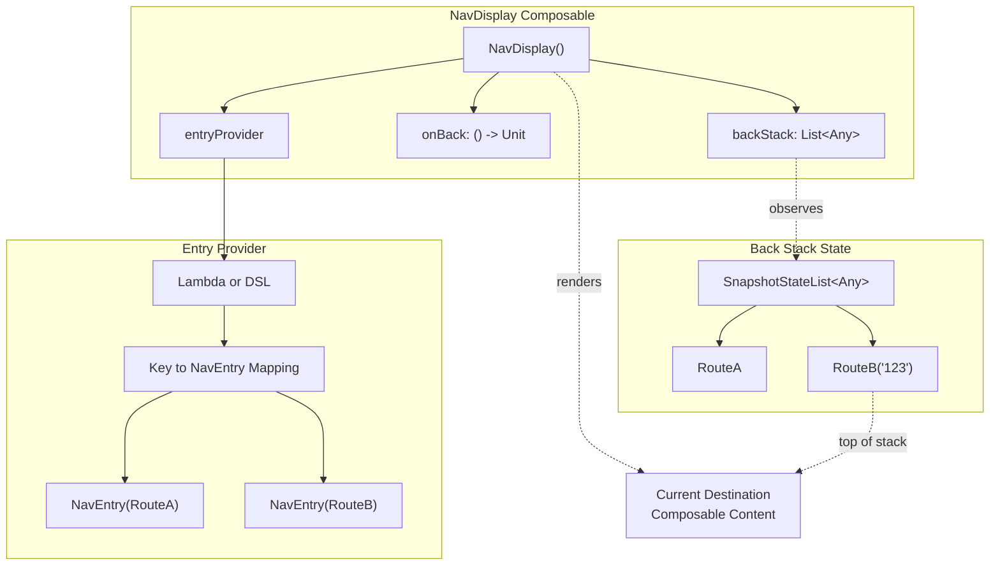
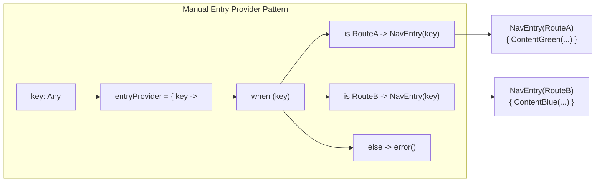
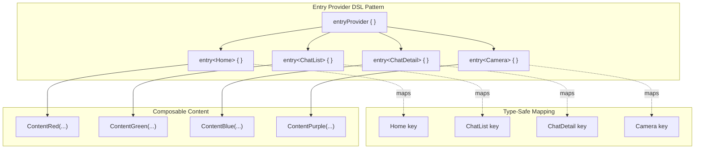
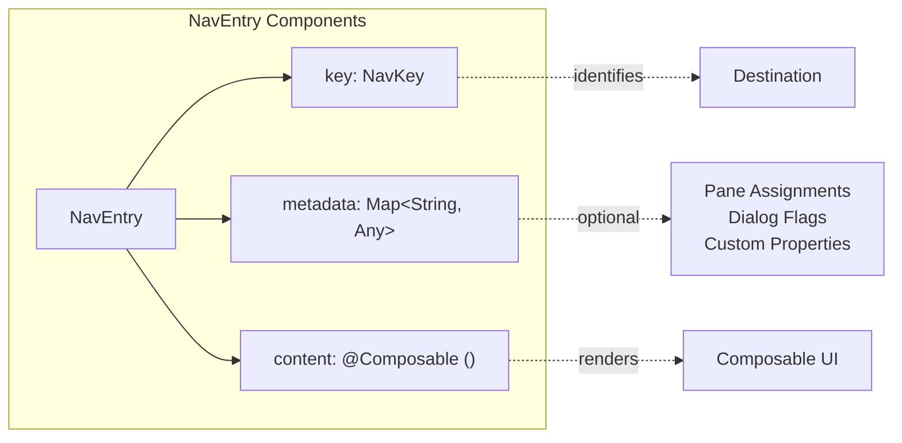
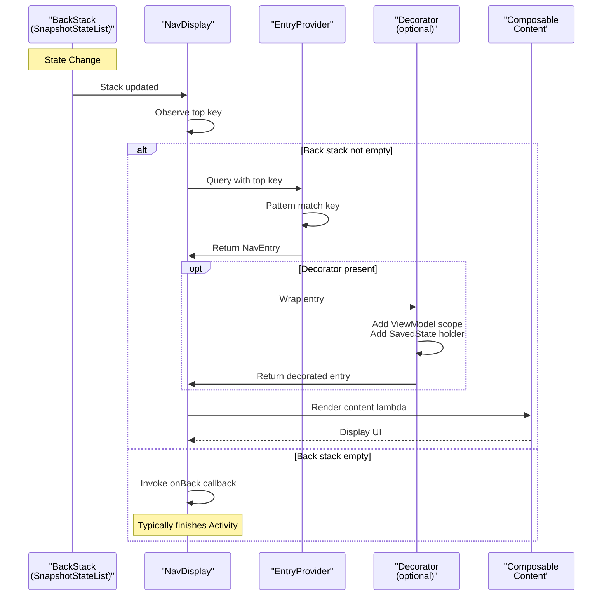
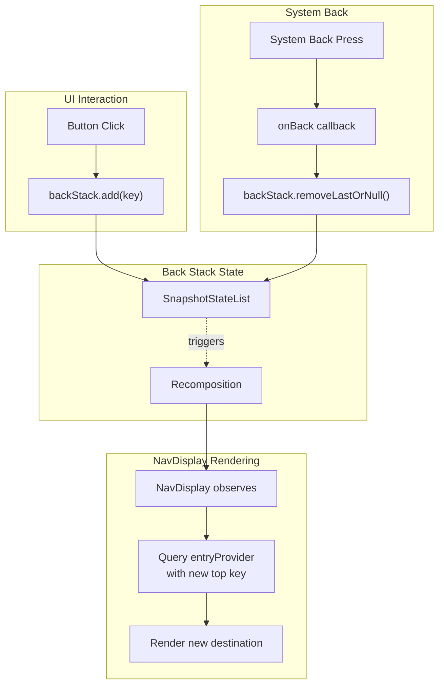

<!-- source: DeepWiki mcp.deepwiki.com · repo android/nav3-recipes · page 12.3 NavDisplay and Entry Providers · fetched 2026-10-23 -->

# NavDisplay and Entry Providers

<details>
<summary>Relevant source files</summary>

The following files were used as context for generating this wiki page:

- [app/src/main/java/com/example/nav3recipes/basic/BasicActivity.kt](app/src/main/java/com/example/nav3recipes/basic/BasicActivity.kt)
- [app/src/main/java/com/example/nav3recipes/commonui/CommonUiActivity.kt](app/src/main/java/com/example/nav3recipes/commonui/CommonUiActivity.kt)

</details>


## Purpose and Scope

This document provides detailed reference documentation for the `NavDisplay` composable and the entry provider system, which together form the rendering layer of Navigation 3. `NavDisplay` is the central composable that renders navigation destinations based on the current back stack state, while entry providers define the mapping from navigation keys to composable content.

For information about the underlying navigation state management, see [NavBackStack and State Management](#12.2). For details on entry decorators that augment entries with lifecycle and state management, see [Entry Decorators](#12.4). For complete working examples, see [Basic Navigation API](#3.1) and [Entry Provider DSL](#3.2).

---

## NavDisplay Composable

`NavDisplay` is the primary composable function responsible for rendering navigation content. It observes the back stack state and displays the appropriate destination by consulting the entry provider.

### Core Parameters

| Parameter | Type | Description |
|-----------|------|-------------|
| `backStack` | `List<Any>` | Observable list of navigation keys (typically `SnapshotStateList`) |
| `onBack` | `() -> Unit` | Callback invoked when the system back button is pressed |
| `entryProvider` | `(Any) -> NavEntry` or DSL | Function or builder that maps keys to `NavEntry` instances |
| `decorator` | `NavEntryDecorator` (optional) | Augments entries with lifecycle/state management |

### Basic Usage Pattern



The `NavDisplay` composable continuously observes the `backStack` list. When the stack changes, it queries the `entryProvider` with the top key to obtain the corresponding `NavEntry`, then renders that entry's content.

**Sources**: [app/src/main/java/com/example/nav3recipes/basic/BasicActivity.kt:44-68](), [app/src/main/java/com/example/nav3recipes/commonui/CommonUiActivity.kt:86-107]()

---

## Entry Provider Approaches

Navigation 3 supports two approaches for defining entry providers: manual lambda-based providers and the type-safe DSL.

### Manual Entry Provider (Lambda)

The simplest entry provider is a lambda function that pattern-matches keys and returns `NavEntry` instances.



**Implementation Example**:

In [app/src/main/java/com/example/nav3recipes/basic/BasicActivity.kt:44-68](), the entry provider is defined as a lambda:

```kotlin
entryProvider = { key ->
    when (key) {
        is RouteA -> NavEntry(key) {
            ContentGreen("Welcome to Nav3") { /* ... */ }
        }
        is RouteB -> NavEntry(key) {
            ContentBlue("Route id: ${key.id}")
        }
        else -> error("Unknown route: $key")
    }
}
```

**Characteristics**:
- Direct control over key matching logic
- Explicit `NavEntry` construction
- Requires exhaustive `when` expression or `else` clause
- Useful for simple navigation graphs

**Sources**: [app/src/main/java/com/example/nav3recipes/basic/BasicActivity.kt:47-67]()

### Entry Provider DSL

The DSL approach provides a more declarative, type-safe way to define key-to-content mappings using the `entryProvider` builder function and `entry<T>` blocks.



**Implementation Example**:

In [app/src/main/java/com/example/nav3recipes/commonui/CommonUiActivity.kt:89-106](), the entry provider uses the DSL:

```kotlin
entryProvider = entryProvider {
    entry<Home> {
        ContentRed("Home screen")
    }
    entry<ChatList> {
        ContentGreen("Chat list screen") {
            Button(onClick = { topLevelBackStack.add(ChatDetail) }) {
                Text("Go to conversation")
            }
        }
    }
    entry<ChatDetail> {
        ContentBlue("Chat detail screen")
    }
    entry<Camera> {
        ContentPurple("Camera screen")
    }
}
```

**Characteristics**:
- Type-safe: `entry<T>` blocks use reified type parameters
- Declarative: each destination defined in its own block
- Automatic `NavEntry` construction
- No need for exhaustive pattern matching
- Recommended approach for most applications

**Sources**: [app/src/main/java/com/example/nav3recipes/commonui/CommonUiActivity.kt:89-106]()

---

## NavEntry Creation

`NavEntry` is the container that associates a navigation key with its composable content. Both entry provider approaches ultimately create `NavEntry` instances.

### NavEntry Structure



**Manual Construction**:
```kotlin
NavEntry(key) {
    // Composable content lambda
    ContentBlue("Route id: ${key.id}")
}
```

**DSL Construction** (implicit):
```kotlin
entry<RouteB> {
    // Composable content lambda
    // NavEntry created automatically with type-safe key
    ContentBlue("Route id: ${this.id}")
}
```

Within `entry<T>` blocks, the key instance is available as the implicit receiver (`this`), providing type-safe access to key properties.

**Sources**: [app/src/main/java/com/example/nav3recipes/basic/BasicActivity.kt:49-66]()

---

## Rendering Process

The rendering flow describes how `NavDisplay` converts back stack state into visible UI.



### Rendering Behavior

| Back Stack State | NavDisplay Behavior |
|-----------------|---------------------|
| Non-empty | Queries entry provider with top key, renders returned `NavEntry` content |
| Empty | Invokes `onBack` callback (typically calls `Activity.finish()`) |
| Multiple entries | Only top entry is visible; previous entries maintained in memory |

**Key Observations**:
- Only the topmost entry in the back stack is rendered
- Previous entries remain in the stack but are not composed
- Back stack changes trigger recomposition
- The `onBack` callback handles empty stack scenarios

**Sources**: [app/src/main/java/com/example/nav3recipes/basic/BasicActivity.kt:44-68](), [app/src/main/java/com/example/nav3recipes/commonui/CommonUiActivity.kt:86-107]()

---

## Integration with Back Stack Operations

`NavDisplay` integrates with back stack manipulation to enable navigation.

### Navigation Pattern



**Forward Navigation**:
1. User interaction adds new key to back stack
2. Back stack state change triggers recomposition
3. `NavDisplay` observes new top key
4. Entry provider returns new `NavEntry`
5. New destination content renders

**Backward Navigation**:
1. System back press invokes `onBack` callback
2. Callback removes last key from back stack
3. Back stack state change triggers recomposition
4. `NavDisplay` renders previous destination

**Example from BasicActivity**:

Forward navigation [app/src/main/java/com/example/nav3recipes/basic/BasicActivity.kt:51-53]():
```kotlin
Button(onClick = {
    backStack.add(RouteB("123"))
})
```

Back navigation [app/src/main/java/com/example/nav3recipes/basic/BasicActivity.kt:46]():
```kotlin
onBack = { backStack.removeLastOrNull() }
```

**Sources**: [app/src/main/java/com/example/nav3recipes/basic/BasicActivity.kt:42-68](), [app/src/main/java/com/example/nav3recipes/commonui/CommonUiActivity.kt:86-108]()

---

## Common Patterns

### Pattern 1: Type-Safe Key Access in DSL

When using the entry provider DSL, the key instance is available as the implicit receiver:

```kotlin
entry<RouteB> {
    // 'this' is of type RouteB
    ContentBlue("Route id: ${this.id}")
    
    // Access key properties directly
    Text("Parameter: ${id}")
}
```

### Pattern 2: Shared Entry Provider Across Activities

Entry providers can be extracted and reused:

```kotlin
val sharedEntryProvider = entryProvider {
    entry<RouteA> { /* ... */ }
    entry<RouteB> { /* ... */ }
}

// In Activity
NavDisplay(
    backStack = backStack,
    onBack = { backStack.removeLastOrNull() },
    entryProvider = sharedEntryProvider
)
```

### Pattern 3: Nested Navigation State

Entry providers can access navigation state from composition locals or captured variables:

```kotlin
entry<ChatList> {
    ContentGreen("Chat list screen") {
        // Access outer navigation state
        Button(onClick = { topLevelBackStack.add(ChatDetail) }) {
            Text("Go to conversation")
        }
    }
}
```

This pattern is demonstrated in [app/src/main/java/com/example/nav3recipes/commonui/CommonUiActivity.kt:93-98]().

### Pattern 4: Error Handling

**Manual Entry Provider**:
```kotlin
entryProvider = { key ->
    when (key) {
        // ... known routes
        else -> error("Unknown route: $key")
    }
}
```

**DSL Entry Provider**:
The DSL throws an exception if no matching `entry<T>` block is registered for a key type, providing automatic error detection.

**Sources**: [app/src/main/java/com/example/nav3recipes/basic/BasicActivity.kt:47-67](), [app/src/main/java/com/example/nav3recipes/commonui/CommonUiActivity.kt:89-106]()

---

## Comparison: Manual vs DSL Entry Providers

| Aspect | Manual Lambda | Entry Provider DSL |
|--------|---------------|-------------------|
| **Syntax** | `{ key -> when(key) { ... } }` | `entryProvider { entry<T> { } }` |
| **Type Safety** | Pattern matching required | Reified generics provide type safety |
| **Key Access** | Requires explicit cast or `is` check | Implicit receiver with correct type |
| **Exhaustiveness** | Must provide `else` clause | Automatic error for missing entries |
| **Recommended For** | Simple graphs, custom logic | Most applications, modular navigation |
| **Example** | [BasicActivity.kt:47-67]() | [CommonUiActivity.kt:89-106]() |

**Sources**: [app/src/main/java/com/example/nav3recipes/basic/BasicActivity.kt:47-67](), [app/src/main/java/com/example/nav3recipes/commonui/CommonUiActivity.kt:89-106]()

---

## Summary

`NavDisplay` serves as the bridge between navigation state (the back stack) and UI rendering. By separating the navigation state from the rendering logic, it enables:

1. **Reactive Updates**: Automatic recomposition when back stack changes
2. **Flexible Mapping**: Multiple approaches for defining key-to-content mappings
3. **Type Safety**: DSL approach provides compile-time guarantees
4. **Testability**: Entry providers can be tested independently of navigation logic

The entry provider system, whether using manual lambdas or the DSL, provides a clean separation between navigation keys and their visual representation, forming a foundational pattern used throughout Navigation 3 recipes.

---

